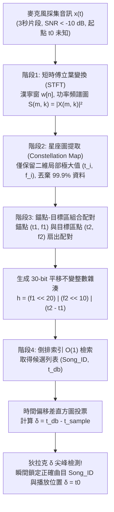
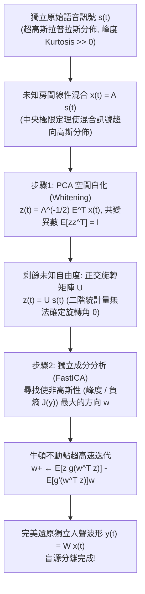

想像你正身處一家喧鬧的咖啡館：義式濃縮咖啡機噴出高壓蒸汽，杯盤碰撞聲此起彼落，周圍十幾桌客人同時交談。天花板上的廉價喇叭裡隱約傳出一首熟悉的旋律。你掏出手機打開聽歌識曲應用程式（如 Shazam），僅僅將麥克風舉起<strong>3秒鐘</strong>。不到一秒，畫面上便精準地顯示出歌曲名稱、歌手、專輯封面，甚至直接跳轉到「目前播放至2分14秒」的即時同步歌詞。

從資訊理論與數位訊號處理（DSP）的視角審視，這看似平常的功能背後隱藏著四個近乎苛刻的工程與數學挑戰：

1. <strong>極端的訊噪比（$\text{SNR} < -10\,\text{dB}$）</strong>：手機麥克風採集到的聲能中，超過90%是人聲交談、蒸汽嘶鳴和餐具撞擊等加性背景雜訊（Additive Noise），目標音樂深埋在雜訊基底之下。
2. <strong>未知的房間脈衝響應與通道失真</strong>：原版數位音訊 $s(t)$ 經過喇叭非線性失真、牆壁與天花板的多徑反射殘響（與房間脈衝響應 $h_{\text{room}}(t)$ 的摺積），再疊加手機微型MEMS麥克風的頻響衰減，觀測訊號變為 $x(t) = (s * h_{\text{room}})(t) + n(t)$。
3. <strong>未知的時間起點（平移不變性 $t_0$）</strong>：使用者不會從歌曲第0秒開始錄音，而是隨機截取4分鐘歌曲裡的任意3秒片段 $[t_0, t_0 + 3\,\text{s}]$。
4. <strong>1億首歌（$10^8$曲）的超大規模檢索</strong>：曲庫包含約1億首歌曲（相當於超過1,000年的連續音訊），必須在幾百毫秒內完成檢索。

本文將完整剖析 Shazam 共同創辦人 Avery Li-Chun Wang 在2003年 ISMIR 會議上發表的經典論文 *"An Industrial-Strength Audio Search Algorithm"* 的<strong>四階段聲學指紋架構</strong>；隨後探討其對偶問題——<strong>雞尾酒會問題（Cocktail Party Problem）與盲源分離（BSS）</strong>，揭示<strong>獨立成分分析（ICA / FastICA）</strong>如何逆用中央極限定理，從混合錄音中分離出每一個獨立的人聲波形。

---

## 第一章：為什麼直接波形比對與密碼學雜湊會徹底失效？

### 1.1 密碼學雜湊（`SHA-256`）的雪崩效應陷阱

在電腦科學中，$O(1)$ 查找的首選通常是 `SHA-256` 或 `MD5`。但密碼學雜湊的設計核心是<strong>雪崩效應（Avalanche Effect）</strong>：輸入哪怕翻轉1個位元，輸出的256位元雜湊值也會有約50%隨機翻轉。同一首錄音室母帶分別壓縮為 128 kbps MP3 和 256 kbps AAC，或者混入極其微弱的熱雜訊，其 `SHA-256` 值就會面目全非。我們需要的是對強烈雜訊與失真免疫的<strong>感知雜湊（聲學指紋）</strong>。

### 1.2 時域互相關（Cross-Correlation）的算力爆炸與相位崩潰

若直接在時域計算3秒錄音 $x[n]$（取樣率 $f_s = 8000\,\text{Hz}$ 時長 $L = 24,000$ 樣本）與曲庫中1億首歌 $s_i[n]$ 在所有滑動偏移 $\tau$ 下的互相關：

$$R_{x s_i}[\tau] = \sum_{n=0}^{L-1} x[n]\, s_i[n + \tau]$$

1億首平均240秒的歌曲共有 $1.92 \times 10^{14}$ 個滑動位置，單次查詢需要約 <strong>$4.6 \times 10^{18}$ 次乘加運算（4.6 ExaFLOPs）</strong>！更致命的是，房間殘響 $h_{\text{room}}(t)$ 會引起嚴重的頻率相關相位失真（群延遲色散）。人耳耳蝸對相位失真幾乎不敏感，但時域波形 $x[n]$ 的形狀會被相位旋轉徹底打亂，導致互相關峰值完全消失。

---

## 第二章：階段1 — 短時傅立葉變換（STFT）與海森堡不確定性原理

為了消除相位敏感性並模擬人耳耳蝸的基底膜頻率分解，第一步是將一維波形 $x[n]$ 轉換為二維時頻能量圖——<strong>頻譜圖（Spectrogram）</strong>。

我們將音訊降取樣至 $f_s = 8000\,\text{Hz}$（奈奎斯特頻率 $4000\,\text{Hz}$，涵蓋音樂基頻、主要諧波與人聲共振峰），乘以長度為 $N$ 的<strong>漢寧窗（Hann Window）</strong> $w[n] = 0.5 - 0.5\cos\left(\frac{2\pi n}{N-1}\right)$ 以抑制頻譜洩漏旁瓣，並以步長 $H$ 滑動計算離散傅立葉變換（STFT）：

$$X(m, k) = \sum_{n=0}^{N-1} x[n + mH]\, w[n]\, e^{-i \frac{2\pi k n}{N}}, \qquad S(m, k) = |X(m, k)|^2$$

透過只保留功率譜密度 $S(m, k) = |X(m, k)|^2$ 並丟棄相位項 $\arg(X(m, k))$，我們直接消除了房間殘響帶來的相位畸變。

然而，視窗長度 $N$ 的選擇受制於<strong>Gabor-Heisenberg 時頻不確定性原理</strong>：

$$\sigma_t \cdot \sigma_\omega \ge \frac{1}{2} \quad \Longleftrightarrow \quad \Delta t \cdot \Delta f = \left(\frac{N}{f_s}\right) \cdot \left(\frac{f_s}{N}\right) = 1$$

若 $N$ 過大（如 $4096$），頻率解析度 $\Delta f$ 極高，但時間解析度 $\Delta t = 512\,\text{ms}$ 過粗，鼓點瞬態被塗抹；若 $N$ 過小（如 $128$），時間定位精準但頻率解析度 $\Delta f = 62.5\,\text{Hz}$ 無法區分相鄰半音。Shazam 選取 <strong>$N = 1024$（$\Delta t = 128\,\text{ms}$，$\Delta f = 7.8125\,\text{Hz}$）</strong> 搭配步長 $H = 256$ 或 $512$，在時間與頻率解析度之間取得了最佳平衡。

---

## 第三章：階段2 — 稀疏峰值提取與「星座圖（Constellation Map）」

頻譜圖 $S(m, k)$ 依然受到咖啡館寬頻雜訊和喇叭頻響失真的污染。Avery Wang 提出了一項極具洞察力的降維策略：<strong>丟棄頻譜圖中 99.9% 的資料，僅保留二維鄰域 $\mathcal{N}(m_i, k_i)$ 內的局部極大值點（Local Maxima）座標 $(t_i, f_i)$</strong>！

$$(m_i, k_i) \in \mathcal{P} \iff S(m_i, k_i) > S(m, k) \quad \forall (m, k) \in \mathcal{N}(m_i, k_i) \setminus \{(m_i, k_i)\}$$

當把這些稀疏的局部峰值點繪製在黑色的 $(t, f)$ 平面上時，宛如夜空中的璀璨繁星，因此被稱為<strong>星座圖（Constellation Map）</strong>。

為什麼星座圖能在 $-10\,\text{dB}$ 的強雜訊下存活？
1. <strong>山峰穿透濃霧效應</strong>：加性背景雜訊相當於抬高了整個地形圖的海平面（雜訊基底），淹沒了低矮的山谷，但<strong>最高的山峰頂點（小鼓瞬態、人聲強共振峰、合成器主音諧波）依然刺破海面，且其 $(t_i, f_i)$ 座標保持不變</strong>。
2. <strong>抹除振幅，徹底免疫等化器（EQ）與自動增益（AGC）</strong>：一旦選為星座點，其振幅值 $S(t_i, f_i)$ 即被丟棄，只保留座標 $(t_i, f_i)$。房間傳遞函數 $|H_{\text{room}}(f)|^2$ 是平滑的乘性包絡，不會改變尖銳譜峰一階導數 $\frac{\partial S}{\partial f} = 0$ 的極值位置。

---

## 第四章：階段3 — 錨點與目標區的32位元組合雜湊（Combinatorial Hashing）

如果直接用單個星座點的頻率 $f_i \in [0, 1023]$（僅10位元，1,024個桶）去檢索1億首歌（共約 $3 \times 10^{11}$ 個峰值點），每個桶會發生3億次雜湊碰撞，完全無法檢索。

Wang 的天才設計是<strong>錨點-目標對組合雜湊（Combinatorial Hashing）</strong>：
1. 選定星座點 $p_1 = (t_1, f_1)$ 作為<strong>錨點（Anchor Point）</strong>。
2. 在其前方時間窗 $\Delta t = t_2 - t_1 \in [\tau_{\min}, \tau_{\max}]$、頻率差 $|f_2 - f_1| \le \Delta f_{\max}$ 的矩形<strong>目標區（Target Zone）</strong>內，選取最多 $F$ 個（扇出係數 Fan-out Factor $F \approx 10$）目標點 $p_2 = (t_2, f_2)$。
3. 將錨點頻率 $f_1$（10 bit）、目標頻率 $f_2$（10 bit）以及<strong>兩點相對時間差 $\Delta t = t_2 - t_1$（10 bit）</strong>打包進一個 <strong>32位元無符號整數雜湊值 $h$</strong>：

$$h = \text{Hash}(f_1,\; f_2,\; t_2 - t_1) = (f_1 \ll 20) \;\mid\; (f_2 \ll 10) \;\mid\; (\Delta t)$$

這一設計創造了兩個資訊理論奇蹟：
- <strong>碰撞率降低100萬倍</strong>：雜湊空間從單點的 $2^{10} = 1,024$ 暴增至 <strong>$2^{30} = 1,073,741,824$（約10.7億個桶）</strong>，假陽性碰撞機率下降了 $2^{20} \approx 10^6$ 倍！
- <strong>嚴格的時間平移不變性</strong>：無論使用者從歌曲的哪一秒 $t_0$ 開始錄音，錨點與目標點的時間偏移都滿足 $(t_2 - t_0) - (t_1 - t_0) = t_2 - t_1 = \Delta t$，未知起點 $t_0$ 在相減時被完美抵消！即便 70% 的真峰值被咖啡館雜訊抹除（單峰存活率 $p = 0.3$），仍有 $p^2 = 9\%$ 的點對完整存活，3秒內依然能產生約 80 個精確命中的30位元雜湊。



---

## 第五章：階段4 — 倒排索引與時間偏移差（$\Delta T$）一致性直方圖

伺服器維護著以 32位元雜湊 $h$ 為鍵、`$(\text{Song\_ID}, t_{\text{db}})$` 列表為值的巨型<strong>倒排索引（Inverted Index）</strong>。當3秒查詢片段生成雜湊集合 $\{(h_k, t_{\text{sample}, k})\}$ 後，對每個命中的候選曲目記錄計算<strong>時間偏移差</strong>：

$$\delta_k = t_{\text{db}, k} - t_{\text{sample}, k}$$

- 對於<strong>錯誤歌曲</strong>，偶然碰撞的 $t_{\text{db}, k}$ 隨機分佈，差值 $\delta_k$ 均勻散落在整首歌的數千個時間箱中，每個箱只有 1～2 票。
- 對於<strong>正確歌曲</strong>，所有真實命中的錨點都滿足線性時序關係 $t_{\text{db}, k} = t_{\text{sample}, k} + t_0$，因此所有 $\delta_k$ 恆等於常數 $t_0$！在直方圖 $C_{\text{Song\_ID}}[\delta]$ 中，所有選票集中轟擊同一個時間箱 $\delta = t_0$，形成一根高聳入雲的<strong>狄拉克 $\delta$ 尖峰（Dirac-Delta Spike）</strong>，在毫秒內同時確定曲名與目前播放秒數！

| 評估維度 | 時域波形互相關 | 密碼學雜湊 (`SHA-256`) | 色度特徵指紋 (`Chromaprint`) | Shazam 星座圖 + 組合雜湊 |
| :--- | :--- | :--- | :--- | :--- |
| <strong>核心特徵表示</strong> | 時域取樣點 $x[n]$ | 原始檔案位元流 | 12半音音級能量向量 | STFT二維局部峰值對 $(f_1, f_2, \Delta t)$ |
| <strong>強雜訊魯棒性 ($-10\,\text{dB}$)</strong> | 極差（相位畸變與雜訊淹沒） | 零（單位元翻轉徹底改變） | 中等（強雜訊改變和弦能量比） | <strong>極強（局部最高峰刺破雜訊基底）</strong> |
| <strong>任意3秒片段起點 ($t_0$)</strong> | 需遍歷 $10^{14}$ 個滑動位置 | 無法處理局部片段 | 需滑動視窗位元容錯比對 | <strong>嚴格平移不變（$\Delta t = t_2 - t_1$ 抵消 $t_0$）</strong> |
| <strong>1億曲檢索複雜度</strong> | $O(N_{\text{songs}} \cdot L^2)$（數小時） | $O(1)$（但無法用於含噪音訊） | 亞線性索引掃描 | <strong>$O(1)$ 倒排索引 + $O(1)$ 直方圖投票</strong> |

---

## 第六章：對偶難題 — 雞尾酒會效應與獨立成分分析（ICA / 盲源分離）

Shazam 將周圍人聲視為雜訊加以剔除；但如果我們反過來，希望<strong>在完全未知房間聲學特性與說話人位置（Blind）的前提下，把混在一起的 $M$ 個說話人的聲音分離還原為各自獨立的清晰語音波形</strong>呢？這就是 Colin Cherry 在1953年提出的<strong>雞尾酒會問題（Cocktail Party Problem）</strong>，即<strong>盲源分離（BSS: Blind Source Separation）</strong>。

### 6.1 為什麼主成分分析（PCA）無法分離混合語音？

設 $M$ 個獨立聲源 $\mathbf{s}(t) = [s_1(t), \dots, s_M(t)]^\top$（滿足單位共變異數 $\mathbb{E}[\mathbf{s}\mathbf{s}^\top] = \mathbf{I}$）經未知混合矩陣 $\mathbf{A}$ 混合後被麥克風接收為 $\mathbf{x}(t) = \mathbf{A}\mathbf{s}(t)$。
若對觀測共變異數矩陣 $\mathbf{\Sigma}_x = \mathbb{E}[\mathbf{x}\mathbf{x}^\top] = \mathbf{E}\mathbf{\Lambda}\mathbf{E}^\top$ 進行 <strong>PCA 空間白化（Whitening）</strong>：

$$\mathbf{z}(t) = \mathbf{\Lambda}^{-1/2} \mathbf{E}^\top \mathbf{x}(t) = \left(\mathbf{\Lambda}^{-1/2}\mathbf{E}^\top \mathbf{A}\right)\mathbf{s}(t) = \mathbf{U}\mathbf{s}(t)$$

雖然白化訊號滿足二階不相關 $\mathbb{E}[\mathbf{z}\mathbf{z}^\top] = \mathbf{I}$，但矩陣 $\mathbf{U}$ 是一個未知的<strong>正交旋轉矩陣（$\mathbf{U}\mathbf{U}^\top = \mathbf{I}$）</strong>！對於任意正交旋轉矩陣 $\mathbf{R}(\theta) \in O(M)$，旋轉後的訊號 $\tilde{\mathbf{z}} = \mathbf{R}(\theta)\mathbf{z}$ 依然滿足 $\mathbb{E}[\tilde{\mathbf{z}}\tilde{\mathbf{z}}^\top] = \mathbf{R}\mathbf{I}\mathbf{R}^\top = \mathbf{I}$。這意味著<strong>二階統計量（變異數與共變異數）對正交旋轉角 $\theta$ 是完全盲目的</strong>！不相關（Uncorrelatedness）遠弱於統計獨立（Independence）。

### 6.2 逆用中央極限定理：最大化「非高斯性（Non-Gaussianity）」

Pierre Comon、Bell & Sejnowski 與 Aapo Hyvärinen 創立的<strong>獨立成分分析（ICA）</strong>完美破解了旋轉角 $\theta$：
1. <strong>人類語音的超高斯性（Super-Gaussianity）</strong>：人說話時存在大量音節停頓（幅值接近0）與突發的母音爆發，其振幅分佈服從尖峰厚尾的<strong>拉普拉斯分佈（Laplacian Distribution）</strong>，峰度（Kurtosis）遠大於0。
2. <strong>中央極限定理（CLT）的逆向羅盤</strong>：中央極限定理指出，獨立隨機變數的線性混合 $y = \mathbf{w}^\top \mathbf{z} = q_1 s_1 + q_2 s_2$ 總是<strong>比單一原始聲源更接近高斯分佈</strong>！反之，當我們在單位球面上旋轉投影向量 $\mathbf{w}$（$\|\mathbf{w}\| = 1$），使輸出訊號 $y = \mathbf{w}^\top \mathbf{z}$ 的<strong>非高斯性達到極大值</strong>時，權重向量 $(q_1, q_2)$ 必然精確落在座標軸 $(\pm 1, 0)$ 或 $(0, \pm 1)$ 上——此時混合被徹底解開，$y(t) = \pm s_i(t)$ 即為分離出的純淨人聲！



### 6.3 峰度（Kurtosis）、負熵（Negentropy）與 FastICA 不動點迭代

衡量單位變異數訊號 $y = \mathbf{w}^\top \mathbf{z}$ 非高斯性的兩大數學指標為：
- <strong>四階累積量（峰度 Kurtosis）</strong>：$\text{kurt}(y) = \mathbb{E}[y^4] - 3(\mathbb{E}[y^2])^2 = \mathbb{E}[y^4] - 3$（高斯分佈為 $0$，語音訊號 $\gg 0$）。
- <strong>資訊理論負熵（Negentropy）</strong>：由於等變異數分佈中高斯分佈微分熵最大，$J(y) = H(y_{\text{gauss}}) - H(y) \ge 0$ 恆成立，且最大化各分量負熵之和嚴格等價於最小化輸出間的<strong>互資訊（Mutual Information）</strong>。Hyvärinen 採用抗異常值的非二次對比函數 $G(y) = \frac{1}{a_1}\log\cosh(a_1 y)$（一階導數 $g(y) = \tanh(a_1 y)$，二階導數 $g'(y) = a_1(1 - \tanh^2(a_1 y))$）近似負熵，並利用球面牛頓法推導出無需學習率、具有二階/三階收斂速度的 <strong>FastICA 不動點迭代公式</strong>：

$$\mathbf{w}^{+} \leftarrow \mathbb{E}\!\left[\mathbf{z}\, g(\mathbf{w}^\top \mathbf{z})\right] - \mathbb{E}\!\left[g'(\mathbf{w}^\top \mathbf{z})\right] \mathbf{w}, \qquad \mathbf{W} \leftarrow \left(\mathbf{W}\mathbf{W}^\top\right)^{-1/2} \mathbf{W}$$

在真實殘響房間中，時域摺積混合 $\mathbf{x}(t) = \sum_\tau \mathbf{A}(\tau)\mathbf{s}(t-\tau)$ 經由階段1的 <strong>STFT</strong> 轉化為每個頻率箱 $k$ 內的瞬時矩陣乘積 $\mathbf{X}(m, k) \approx \mathbf{A}(k)\mathbf{S}(m, k)$，結合獨立向量分析（IVA）或深度時頻遮罩網路（如 Hybrid Demucs），便構成了當今智慧耳機降噪與即時伴奏人聲分離的核心引擎。

---

## 第七章：Python 完整實作 — Shazam 星座圖檢索與 FastICA 盲源分離

```python
import numpy as np
from scipy.ndimage import maximum_filter
from collections import defaultdict

class ShazamFingerprinter:
    def __init__(self, fs=8000, n_fft=1024, hop_length=256, neighborhood=(15, 15), fan_out=10):
        self.fs, self.n_fft, self.hop_length = fs, n_fft, hop_length
        self.neighborhood, self.fan_out = neighborhood, fan_out
        self.database = defaultdict(list)

    def stft_spectrogram(self, signal):
        window = np.hanning(self.n_fft)
        n_frames = 1 + (len(signal) - self.n_fft) // self.hop_length
        spec = np.zeros((self.n_fft // 2, n_frames))
        for m in range(n_frames):
            frame = signal[m * self.hop_length : m * self.hop_length + self.n_fft] * window
            spec[:, m] = 10.0 * np.log10(np.abs(np.fft.rfft(frame)[:self.n_fft // 2])**2 + 1e-10)
        return spec

    def extract_peaks(self, spec, pct=85):
        mask = (maximum_filter(spec, size=self.neighborhood) == spec) & (spec > np.percentile(spec, pct))
        f_idx, t_idx = np.where(mask)
        order = np.argsort(t_idx)
        return list(zip(t_idx[order], f_idx[order]))

    def generate_hashes(self, peaks, dt_min=2, dt_max=60, df_max=150):
        hashes = []
        for i, (t1, f1) in enumerate(peaks):
            cnt = 0
            for t2, f2 in peaks[i + 1:]:
                dt = t2 - t1
                if dt < dt_min: continue
                if dt > dt_max: break
                if abs(f2 - f1) <= df_max:
                    h = (int(f1 & 0x3FF) << 20) | (int(f2 & 0x3FF) << 10) | int(dt & 0x3FF)
                    hashes.append((h, int(t1)))
                    cnt += 1
                    if cnt >= self.fan_out: break
        return hashes

    def add_track(self, song_id, audio):
        for h, t1 in self.generate_hashes(self.extract_peaks(self.stft_spectrogram(audio))):
            self.database[h].append((song_id, t1))

    def recognize(self, snippet):
        q_hashes = self.generate_hashes(self.extract_peaks(self.stft_spectrogram(snippet)))
        hist = defaultdict(lambda: defaultdict(int))
        for h, t_s in q_hashes:
            for song_id, t_db in self.database.get(h, ()):
                hist[song_id][t_db - t_s] += 1
        best_song, best_votes, best_dt = None, 0, 0
        for song_id, counts in hist.items():
            dt, votes = max(counts.items(), key=lambda x: x[1])
            if votes > best_votes:
                best_song, best_votes, best_dt = song_id, votes, dt
        return best_song, best_votes, best_dt * self.hop_length / self.fs

def fast_ica(X, max_iter=200, tol=1e-7):
    m, n = X.shape
    Xc = X - np.mean(X, axis=1, keepdims=True)
    eigvals, eigvecs = np.linalg.eigh((Xc @ Xc.T) / n)
    V = np.diag(1.0 / np.sqrt(eigvals + 1e-12)) @ eigvecs.T
    Z = V @ Xc
    W = np.eye(m)
    for _ in range(max_iter):
        WZ = W @ Z
        g, gp = np.tanh(WZ), 1.0 - np.tanh(WZ)**2
        W_new = (g @ Z.T) / n - np.diag(np.mean(gp, axis=1)) @ W
        u, _, vt = np.linalg.svd(W_new)
        W_new = u @ vt
        if np.max(np.abs(np.abs(np.diag(W_new @ W.T)) - 1.0)) < tol:
            break
        W = W_new
    return W @ Z
```
