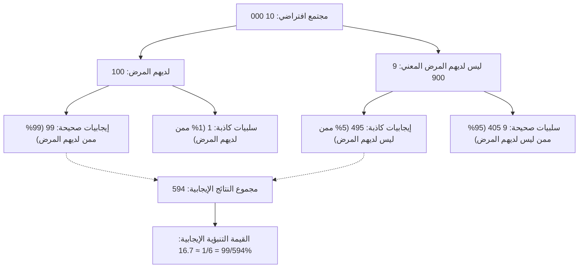
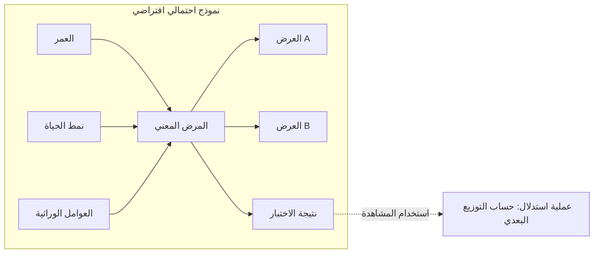

## 1. تحديث التوقعات في عالم غير يقيني

المطر غدًا، وأثر دواء، واحتمال أن تكون رسالة بريد إلكتروني غير مرغوب فيها: نتخذ القرارات بمعلومات غير مكتملة. **تربط مبرهنة بايز احتمال حدث عند معرفة مشاهدة باحتمال تلك المشاهدة عند افتراض الحدث.** بعد تحديد النموذج والمعلومات السابقة، يمكن تحديث الاحتمالات بالمشاهدات الجديدة.

تحمل المبرهنة اسم توماس بايز، القس وعالم الرياضيات من القرن الثامن عشر. تتضمن [رسالة ريتشارد برايس التي قدمت بحث بايز بعد وفاته](https://bayes.wustl.edu/Manual/an.essay.pdf) إشارة إلى قراءته في Royal Society في 23 ديسمبر 1763. وساهم باحثون لاحقون كثيرون في تطوير الاستدلال البايزي الحديث. سنعرض الصيغة ومثال اختبار وأربعة تطبيقات في الذكاء الاصطناعي وتفسيرات مختلفة للاحتمال.

## 2. الصيغة ودور التطبيع

إذا كان الحدث B يحقق $P(B)>0$، فإن تعريف الاحتمال الشرطي يعطي

$$
P(A\mid B)=\frac{P(A\cap B)}{P(B)}
$$

وإذا تحقق أيضًا $P(A)>0$ بحيث يكون الاحتمال الشرطي العكسي معرفًا، فإن تفكيك الاحتمال المشترك يعطي

$$
P(A\mid B)=\frac{P(B\mid A)P(A)}{P(B)}
$$

عندما يشير B إلى مشاهدة جديدة، تكون الأدوار كما يأتي:

- **الاحتمال القبلي** $P(A)$: احتمال A قبل أخذ B في الحسبان.
- **الإمكان (likelihood)** $P(B\mid A)$: احتمال مشاهدة B بافتراض A.
- **احتمال المشاهدة / الإمكان الهامشي** $P(B)$: الاحتمال الكلي لمشاهدة B.
- **الاحتمال البعدي** $P(A\mid B)$: احتمال A بعد أخذ B في الحسبان.

ضرب الاحتمال القبلي في الإمكان يعطي البسط فقط. **للحصول على الاحتمال البعدي يجب القسمة على احتمال المشاهدة، أي إجراء التطبيع.** حتى لو كان احتمال A صفرًا، تظل الصيغة الأولى بالاحتمال المشترك صحيحة متى كان احتمال B موجبًا. ولا يجوز التعويض مباشرة في الصيغة الثانية إذا لم يكن الاحتمال الشرطي العكسي معرفًا.

## 3. دالة الإمكان وMAP والتنبؤ البعدي

لنرمز إلى معلمة مجهولة بـ θ وإلى البيانات المشاهدة بـ d. عند [تحديث كثافة قبلية باستخدام دالة الإمكان](https://web.stanford.edu/class/stats200/Lecture20.pdf)، نكتب

$$
\pi(\theta\mid d)=\frac{L(\theta;d)\pi(\theta)}{Z(d)},\qquad Z(d)=\int L(t;d)\pi(t)\,dt
$$

نفترض $0<Z(d)<\infty$. دالة الإمكان L هي دالة في θ عند تثبيت d، وليست توزيعًا احتماليًا على θ. في حالة البيانات المتصلة نستخدم كثافات قد تتجاوز قيمتها الواحد. وكون احتمال نقطة مشاهدة مفردة صفرًا لا يمنع في حد ذاته التحديث بالكثافات.

إذا بلغت الكثافة البعدية قيمة عظمى، فإن **تقدير MAP** يختار نقطة من نقاط تعظيمها:

$$
\hat\theta_{\mathrm{MAP}}\in\arg\max_\theta\pi(\theta\mid d)
$$

أما **الاحتمال التنبؤي البعدي** لمشاهدة ثنائية مستقبلية فيحسب بأخذ متوسط التنبؤات على التوزيع البعدي:

$$
\Pr(Y_{\mathrm{new}}=1\mid d)=\int\Pr(Y_{\mathrm{new}}=1\mid\theta,d)\pi(\theta\mid d)\,d\theta
$$

مثلًا، نضع توزيعًا قبليًا منتظمًا من صفر إلى واحد لاحتمال θ ظهور الصورة عند رمي عملة. نفترض استقلال الرميات شرطيًا عند إعطاء θ، ونشاهد بالترتيب 1,1,0، حيث 1 للصورة و0 للكتابة. عندئذ

$$
\pi(\theta\mid 1,1,0)=12\theta^2(1-\theta),\qquad 0<\theta<1
$$

ومن ثم

$$
\hat\theta_{\mathrm{MAP}}=\frac23,\qquad\Pr(Y_{\mathrm{new}}=1\mid1,1,0)=\frac35
$$

قد يعطي التعويض بمنوال الكثافة البعدية جوابًا مختلفًا عن المتوسط على التوزيع. اختيار صنف، وتقدير معلمات بـ MAP، والتنبؤ بمشاهدات مستقبلية مهام لا يصح اختزالها جميعًا في «تعظيم الاحتمال البعدي».

## 4. اختبار طبي افتراضي: حساسية 99% وقيمة تنبؤية إيجابية نحو 16.7%

هذا **مثال حسابي افتراضي، وليس قياسًا لأداء اختبار حقيقي**. يشير D إلى وجود المرض المعني، وT إلى نتيجة إيجابية. نفترض انتشار المرض بنسبة 1% في السكان المستهدفين، وحساسية 99%، ومعدل نتائج إيجابية كاذبة 5% لدى من ليس لديهم المرض.

$$
P(D)=0.01,\qquad P(T\mid D)=0.99,\qquad P(T\mid D^c)=0.05
$$

متممة الحدث D تعني غياب هذا المرض تحديدًا، لا الصحة في جميع النواحي. بجمع مصدري النتائج الإيجابية نحصل على

$$
P(T)=P(T\mid D)P(D)+P(T\mid D^c)P(D^c)=0.99\cdot0.01+0.05\cdot0.99=0.0594
$$

إذن احتمال وجود المرض بشرط نتيجة إيجابية هو

$$
P(D\mid T)=\frac{0.0099}{0.0594}=\frac{99}{594}=\frac16\approx0.1667
$$

الجواب نحو 16.7%، أو 1/6 بالضبط. أما الباقي، وهو 5/6 أو نحو 83.3% من النتائج الإيجابية، فنتائج إيجابية كاذبة لدى من ليس لديهم المرض المعني. عندما يكون الانتشار منخفضًا، قد تفوق الإيجابيات الكاذبة من المجموعة الأكبر بكثير دون المرض عدد الإيجابيات الصحيحة.

للتعبير بالأعداد، نبني مجتمعًا افتراضيًا من 10 000 شخص يحقق هذه النسب بالضبط. أما عينة حقيقية من 10 000 شخص فقد تختلف فيها الأعداد.

| النتيجة | المرض موجود | المرض المعني غير موجود | المجموع |
| --- | ---: | ---: | ---: |
| إيجابية | 99 (إيجابية صحيحة) | 495 (إيجابية كاذبة) | 594 |
| سلبية | 1 (سلبية كاذبة) | 9 405 (سلبية صحيحة) | 9 406 |
| المجموع | 100 | 9 900 | 10 000 |

**الحساسية 99% لا تعني قيمة تنبؤية إيجابية 99% أو معدلًا إجماليًا للنتائج الصحيحة 99%.** في هذا الجدول، المعدل الإجمالي للنتائج الصحيحة، أي accuracy، يساوي

$$
\frac{99+9405}{10000}=0.9504=95.04\%
$$

**القيمة التنبؤية الإيجابية (PPV)** هي احتمال وجود المرض عند نتيجة اختبار إيجابية. تستخدم [تعريفات الحساسية والنوعية والقيمة التنبؤية الإيجابية](https://www.fda.gov/regulatory-information/search-fda-guidance-documents/statistical-guidance-reporting-results-studies-evaluating-diagnostic-tests-guidance-industry-and-fda) مقامات مختلفة. وفكرة «99% تعني أن النتيجة الإيجابية تكاد تؤكد المرض» تخلط بين المجموعات التي نحسب فيها النسب. تفسير اختبار حقيقي يتطلب انتشار المرض وخصائص الاختبار الملائمين للسكان المعنيين.

## 5. التطبيق الأول في الذكاء الاصطناعي: تصنيف بايز الساذج

في تصنيف الرسائل غير المرغوب فيها، تعطي السمات X، مثل وجود كلمات معينة، معلومات عن الاحتمال البعدي للصنف C. الافتراض الأساسي هو **الاستقلال الشرطي عند إعطاء الصنف**، لا استقلال الكلمات دون شرط. ابتداءً من ثلاث سمات، قد يتحقق الاستقلال الشرطي لكل زوج داخل كل صنف دون أن تكون السمات كلها مستقلة معًا.

لسمات منفصلة، نفترض أن الاحتمال الهامشي للمشاهدة x والاحتمالات القبلية للأصناف موجبة. إذا كانت السمات كلها مستقلة معًا داخل كل صنف، نحصل على

$$
\Pr(C=c\mid X=x)\propto\Pr(C=c)\prod_{j=1}^{m}\Pr(X_j=x_j\mid C=c)
$$

عندما تكون تكاليف جميع أخطاء التصنيف متساوية، نختار الصنف ذي الاحتمال البعدي الأعلى. وهذا القرار يختلف عن تقدير معلمات النموذج نفسها باستخدام MAP.

الكلمات الحقيقية مترابطة، لذا فالاستقلال تقريب. البساطة وسرعة الحساب مفيدتان، لكنهما لا تضمنان دائمًا أفضل معدل إجابات صحيحة أو احتمالات جيدة المعايرة. تميز [وثائق scikit-learn الرسمية](https://scikit-learn.org/stable/modules/naive_bayes.html) أيضًا بين جودة التصنيف وجودة تقدير الاحتمالات. وتختلف النماذج التوليدية، مثل نموذج Bernoulli لوجود الكلمة ونموذج multinomial لعدد مرات ظهورها.

## 6. التطبيق الثاني في الذكاء الاصطناعي: شبكات بايز

تمثل شبكة بايز توزيعًا مشتركًا برسم بياني موجه غير دوري (DAG) وتوزيع شرطي محلي لكل عقدة. في نموذج منفصل منته، حيث ترمز pa إلى قيم العقد الأبوية، يكون التحليل إلى عوامل

$$
\Pr(V_1=v_1,\ldots,V_n=v_n)=\prod_{i=1}^{n}\Pr(V_i=v_i\mid\mathrm{pa}_i)
$$

تحدد [طريقة تمثيل التوزيع باستخدام DAG](https://ermongroup.github.io/cs228-notes/representation/directed/) أيضًا افتراضات الاستقلال الشرطي.

يربط النموذج الافتراضي التالي العمر ونمط الحياة والعوامل الوراثية والمرض والأعراض والاختبار. نفترض استقلال العوامل الثلاثة التي ليس لها آباء. تمثل الأسهم المتصلة علاقات أبوية في التوزيعات المحلية، ولا تمثل خريطة مثبتة لأسباب حقيقية. **الاستنتاج السببي يحتاج إلى افتراضات سببية إضافية**، فضلًا عن نموذج الاعتماد الإحصائي ([التمييز لدى Pearl](https://ftp.cs.ucla.edu/pub/stat_ser/r350.pdf)).

تشير ملاحظة السهم المنقط إلى عملية استدلال، وليست متغيرًا عشوائيًا إضافيًا في التوزيع المشترك. كما أن حساب التوزيعات الهامشية البعدية للمرض أو المتغيرات الأخرى لا يساوي إعادة تعلم جميع المعلمات. توفر هذه النماذج إطارًا للتشخيص أو تقييم الموقف أو التنبؤ المالي، لكن صلاحيتها تعتمد على البنية والبيانات.

## 7. التطبيق الثالث في الذكاء الاصطناعي: التحسين البايزي

قد يتطلب ضبط المعلمات الفائقة، مثل معدل التعلم أو عمق الشبكة، تكرار التدريب والتقييم. ولا يلزم اختيار هذه الإعدادات يدويًا؛ يمكن أتمتة البحث.

يمثل التحسين البايزي العلاقة بين الإعدادات والأداء بنموذج بديل احتمالي، مثل عملية غاوسية، ويحدثه بناءً على نتائج التقييم. تختار **دالة اختيار النقطة التالية (acquisition function)**، مثل التحسن المتوقع، النقطة التالية. ويوازن الاختيار بين استغلال المناطق الواعدة واستكشاف المناطق غير اليقينية. درس [Snoek وزملاؤه](https://arxiv.org/abs/1206.2944) ضبط خوارزميات التعلم الآلي بهذا الأسلوب.

الهدف توزيع التقييمات المكلفة بكفاءة. ولا يوجد ضمان عام لإيجاد الحل الأمثل بأقل عدد من المحاولات لكل دالة هدف وميزانية وظروف ضوضاء.

## 8. التطبيق الرابع في الذكاء الاصطناعي: التعلم العميق البايزي

يمكن للشبكة العصبية العادية أيضًا إخراج احتمالات للأصناف، مثلًا باستخدام softmax. إجراء الحساب بأوزان ثابتة لا يمنع إخراج توزيع احتمالي.

يضع أحد الأساليب البايزية كثافة قبلية لأوزان w ذات قيم متصلة، ثم يستنتج كثافتها البعدية عند بيانات التدريب d. في نموذج الاستقلال الشرطي المعتاد، يكون الاحتمال التنبؤي البعدي للصنف المنفصل y

$$
\Pr(y\mid x,d)=\int\Pr(y\mid x,w)\pi(w\mid d)\,dw
$$

يقرب [البحث الأصلي لـ Blundell وزملائه](https://arxiv.org/abs/1505.05424) التوزيع البعدي الذي يصعب حسابه بدقة في شبكات بالحجم العملي باستخدام توزيع تغايري تقريبي (variational). يمكن للتنبؤات مراعاة عدم اليقين في الأوزان، لكنها تعتمد على التوزيع القبلي ودالة الإمكان وطريقة التقريب.

مجرد إخراج «احتمال الصنف 90%» لا يعبر عن جميع جوانب عدم يقين النموذج. وكلمة «بايزي» لا تضمن وحدها معايرة التنبؤات في الذكاء الاصطناعي الطبي أو غيره. وتؤكد [أبحاث عدم اليقين عند تغير التوزيع](https://arxiv.org/abs/1906.02530) أهمية اختبار الاختلاف بين بيانات التدريب وبيانات الاستخدام.

## 9. مقارنة المنهجين التكراري والبايزي

يستخدم المنهجان نظرية الاحتمالات؛ ومبرهنة بايز نفسها علاقة رياضية مشتركة. في الاستدلال الإحصائي، تعد الطرق التكرارية المعلمات المجهولة ثابتة، وتدرس خصائص إجراءات التقدير أو اختبار الفرضيات عند تكرار أخذ العينات. ويعبر المنهج البايزي عن عدم اليقين في المجهولات بتوزيع قبلي، ثم يستخدم التوزيع البعدي بعد المشاهدات. إسناد توزيع لا يعني أن المعلمة الفيزيائية تتغير في كل مشاهدة.

لرميات مستقلة ومتماثلة التوزيع لعملة عادلة، حيث الصورة 1 والكتابة 0، يعطينا [قانون الأعداد الكبيرة](https://kenji.blog/ar/p/law-of-large-numbers/) النهاية

$$
\frac1n\sum_{i=1}^{n}X_i\xrightarrow{\mathrm{a.s.}}\frac12
$$

الرمز a.s. يعني التقارب شبه المؤكد: احتمال أن تتقارب النسبة إلى 1/2 يساوي 1. ولا يضمن ظهور الصورة في نصف الرميات بالضبط في عدد منته منها.

قد تتضمن التوزيعات القبلية معرفة تخصصية، أو تكون مثلًا ضعيفة المعلومات (weakly informative). فلا يصح عدها كلها تفضيلات اعتباطية، ولا توقع موضوعية تلقائية لمجرد اختيار توزيع قبلي. ويمكن فهم توقع المطر غدًا بنسبة 70% بوصفه احتمالًا قائمًا على نموذج ومعلومات، ويمكن اختبار معايرته. الرقم وحده لا يحدد المدرسة الإحصائية أو درجة ثقة المتنبئ الشخصية.

## 10. استخدام المشاهدات الجديدة ومراجعة الافتراضات

يجمع التحديث البايزي المعلومات السابقة والمشاهدات وفق قواعد الاحتمال. في التحديث المتتابع، يصبح التوزيع البعدي السابق قبليًا جديدًا، ونستخدم دالة الإمكان الشرطية للبيانات الجديدة. لا نضرب مشاهدة سبق استخدامها مرة أخرى كما لو كانت معلومة جديدة مستقلة.

الصيغة وحدها لا تصلح نموذجًا خاطئًا أو بيانات منحازة. التحقق مما شوهد، وأي مجتمع أو توزيع افترضناه، جزء من التعلم ومراجعة الفهم. وتوضح [مفارقة المظروفين](https://kenji.blog/ar/p/two-envelopes-paradox/) أيضًا ضرورة حساب الاحتمالات الشرطية من نموذج صريح.
