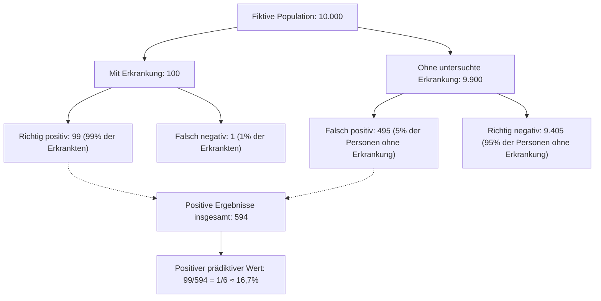
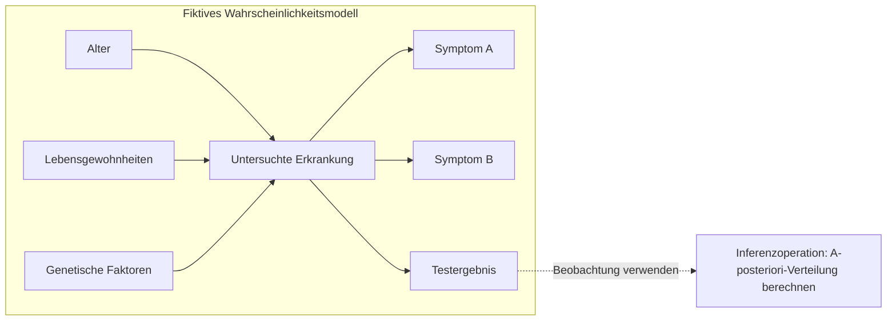

## 1. Vorhersagen in einer unsicheren Welt aktualisieren

Morgiger Regen, die Wirkung eines Medikaments oder die Frage, ob eine E-Mail Spam ist: Wir urteilen mit unvollständigen Informationen. **Der Satz von Bayes verknüpft die Wahrscheinlichkeit eines Ereignisses bei gegebener Beobachtung mit der Wahrscheinlichkeit dieser Beobachtung bei gegebenem Ereignis.** Sind Modell und Vorinformationen festgelegt, lassen sich Wahrscheinlichkeiten anhand neuer Beobachtungen aktualisieren.

Namensgeber ist Thomas Bayes, ein Geistlicher und Mathematiker des 18. Jahrhunderts. [Richard Prices Brief über Bayes' nachgelassene Abhandlung](https://bayes.wustl.edu/Manual/an.essay.pdf) nennt eine Verlesung vor der Royal Society am 23. Dezember 1763. Die moderne bayessche Inferenz umfasst auch die Weiterentwicklungen vieler späterer Forschender. Wir betrachten die Formel, ein Testbeispiel, vier KI-Anwendungen und unterschiedliche Deutungen von Wahrscheinlichkeit.

## 2. Die Formel und die Rolle der Normierung

Für ein Ereignis B mit $P(B)>0$ liefert die Definition der bedingten Wahrscheinlichkeit

$$
P(A\mid B)=\frac{P(A\cap B)}{P(B)}
$$

Gilt zusätzlich $P(A)>0$, sodass auch die umgekehrte bedingte Wahrscheinlichkeit definiert ist, ergibt die Zerlegung der gemeinsamen Wahrscheinlichkeit

$$
P(A\mid B)=\frac{P(B\mid A)P(A)}{P(B)}
$$

Wenn B eine neue Beobachtung bezeichnet, haben die Terme folgende Rollen:

- **A-priori-Wahrscheinlichkeit** $P(A)$: Wahrscheinlichkeit von A vor Berücksichtigung von B.
- **Likelihood** $P(B\mid A)$: Wahrscheinlichkeit, B unter der Annahme A zu beobachten.
- **Wahrscheinlichkeit der Beobachtung / marginale Likelihood** $P(B)$: gesamte Wahrscheinlichkeit, B zu beobachten.
- **A-posteriori-Wahrscheinlichkeit** $P(A\mid B)$: Wahrscheinlichkeit von A nach Berücksichtigung von B.

Das Produkt aus A-priori-Wahrscheinlichkeit und Likelihood ist der Zähler. **Für die A-posteriori-Wahrscheinlichkeit muss durch die Wahrscheinlichkeit der Beobachtung geteilt und damit normiert werden.** Auch wenn A Wahrscheinlichkeit null hat, gilt die erste Formel über die gemeinsame Wahrscheinlichkeit, sofern B positive Wahrscheinlichkeit hat. In die zweite Formel darf nicht einfach eingesetzt werden, wenn die umgekehrte bedingte Wahrscheinlichkeit undefiniert ist.

## 3. Likelihood, MAP und posterior-prädiktive Vorhersage

Wir bezeichnen den unbekannten Parameter mit θ und die beobachteten Daten mit d. Bei der [Aktualisierung einer A-priori-Dichte mithilfe einer Likelihood](https://web.stanford.edu/class/stats200/Lecture20.pdf) schreibt man

$$
\pi(\theta\mid d)=\frac{L(\theta;d)\pi(\theta)}{Z(d)},\qquad Z(d)=\int L(t;d)\pi(t)\,dt
$$

Dabei setzen wir $0<Z(d)<\infty$ voraus. Die Likelihood L ist bei festgehaltenem d eine Funktion von θ, keine Wahrscheinlichkeitsverteilung über θ. Für stetige Daten verwendet man Dichten, deren Werte größer als eins sein können. Die Wahrscheinlichkeit null eines einzelnen beobachteten Punktes verhindert nicht schon für sich eine Aktualisierung über Dichten.

Falls die A-posteriori-Dichte ein Maximum erreicht, wählt die **Maximum-a-posteriori-Schätzung (MAP)** einen entsprechenden Parameterwert:

$$
\hat\theta_{\mathrm{MAP}}\in\arg\max_\theta\pi(\theta\mid d)
$$

Die **posterior-prädiktive Wahrscheinlichkeit** einer zukünftigen binären Beobachtung entsteht dagegen durch Mittelung der Vorhersagen über die A-posteriori-Verteilung:

$$
\Pr(Y_{\mathrm{new}}=1\mid d)=\int\Pr(Y_{\mathrm{new}}=1\mid\theta,d)\pi(\theta\mid d)\,d\theta
$$

Beispielsweise erhält die Kopfwahrscheinlichkeit θ einer Münze eine Gleichverteilung zwischen null und eins als A-priori-Verteilung. Bedingt auf θ seien die Würfe unabhängig. Wir beobachten der Reihe nach 1,1,0, wobei 1 Kopf bedeutet. Dann gilt

$$
\pi(\theta\mid 1,1,0)=12\theta^2(1-\theta),\qquad 0<\theta<1
$$

und damit

$$
\hat\theta_{\mathrm{MAP}}=\frac23,\qquad\Pr(Y_{\mathrm{new}}=1\mid1,1,0)=\frac35
$$

Das Einsetzen eines Modus der A-posteriori-Dichte und die Mittelung über die Verteilung können verschiedene Antworten liefern. Eine Klasse auszuwählen, Parameter mittels MAP zu schätzen und zukünftige Beobachtungen vorherzusagen lässt sich nicht pauschal als „Maximierung der A-posteriori-Wahrscheinlichkeit“ beschreiben.

## 4. Ein hypothetischer medizinischer Test: 99 % Sensitivität, etwa 16,7 % PPV

Dies ist **ein hypothetisches Rechenbeispiel, keine gemessene Leistung eines realen Tests**. D bedeutet, die untersuchte Erkrankung zu haben; T bezeichnet ein positives Testergebnis. Die Prävalenz in der Zielpopulation sei 1 %, die Sensitivität 99 % und die Falsch-Positiv-Rate 5 %.

$$
P(D)=0.01,\qquad P(T\mid D)=0.99,\qquad P(T\mid D^c)=0.05
$$

Das Gegenereignis zu D bedeutet, diese Erkrankung nicht zu haben, nicht aber in jeder Hinsicht gesund zu sein. Durch Addition der beiden möglichen Quellen positiver Ergebnisse erhält man

$$
P(T)=P(T\mid D)P(D)+P(T\mid D^c)P(D^c)=0.99\cdot0.01+0.05\cdot0.99=0.0594
$$

Die Wahrscheinlichkeit der Erkrankung bei positivem Ergebnis ist somit

$$
P(D\mid T)=\frac{0.0099}{0.0594}=\frac{99}{594}=\frac16\approx0.1667
$$

Das Ergebnis beträgt etwa 16,7 %; der genaue Wert ist 1/6. Die übrigen 5/6, also etwa 83,3 % der positiven Ergebnisse, sind falsch positive Ergebnisse bei Personen ohne die untersuchte Erkrankung. Bei niedriger Prävalenz können die falsch positiven Fälle aus der viel größeren Gruppe ohne Erkrankung die richtig positiven Fälle überwiegen.

Um die Anteile als Personen darzustellen, konstruieren wir eine fiktive Population von 10.000 Personen mit genau diesen Anteilen. Bei einer realen Stichprobe von 10.000 würden die Anzahlen schwanken.

| Testergebnis | Mit untersuchter Erkrankung | Ohne untersuchte Erkrankung | Gesamt |
| --- | ---: | ---: | ---: |
| Positiv | 99 (richtig positiv) | 495 (falsch positiv) | 594 |
| Negativ | 1 (falsch negativ) | 9.405 (richtig negativ) | 9.406 |
| Gesamt | 100 | 9.900 | 10.000 |

**Eine Sensitivität von 99 % bedeutet weder einen positiven prädiktiven Wert von 99 % noch eine Gesamtgenauigkeit von 99 %.** Die Gesamtgenauigkeit, also der Anteil aller korrekten Ergebnisse in dieser Tabelle, beträgt

$$
\frac{99+9405}{10000}=0.9504=95.04\%
$$

Die [Definitionen von Sensitivität, Spezifität und positivem prädiktivem Wert](https://www.fda.gov/regulatory-information/search-fda-guidance-documents/statistical-guidance-reporting-results-studies-evaluating-diagnostic-tests-guidance-industry-and-fda) verwenden unterschiedliche Nenner. Die Intuition „99 % bedeutet, dass ein positiver Fall fast sicher erkrankt ist“ verwechselt die Bezugsgruppen. Eine Anwendung auf reale Ergebnisse erfordert Prävalenz und Testeigenschaften, die zur jeweiligen Population passen.

## 5. KI-Anwendung 1: Naive-Bayes-Klassifikation

Bei der Spamerkennung liefern Merkmale X, etwa das Vorkommen bestimmter Wörter, Informationen über die A-posteriori-Wahrscheinlichkeit der Klasse C. Die grundlegende Annahme lautet **bedingte Unabhängigkeit bei gegebener Klasse**, nicht unbedingte Unabhängigkeit der Wörter. Bei drei oder mehr Merkmalen garantiert selbst paarweise Unabhängigkeit innerhalb jeder Klasse keine gemeinsame Unabhängigkeit.

Für diskrete Merkmale seien die Randwahrscheinlichkeit der Beobachtung x und die A-priori-Wahrscheinlichkeiten der Klassen positiv. Sind alle Merkmale innerhalb jeder Klasse gemeinsam unabhängig, gilt

$$
\Pr(C=c\mid X=x)\propto\Pr(C=c)\prod_{j=1}^{m}\Pr(X_j=x_j\mid C=c)
$$

Haben alle Fehlklassifikationen dieselben Kosten, wählt man eine Klasse mit maximaler A-posteriori-Wahrscheinlichkeit. Diese Klassifikationsentscheidung ist etwas anderes als eine MAP-Schätzung der Modellparameter selbst.

Tatsächliche Wörter hängen zusammen; die Unabhängigkeit ist eine Näherung. Einfachheit und Rechengeschwindigkeit sind Vorteile, aber keine Garantie für stets höhere Genauigkeit oder gut kalibrierte Wahrscheinlichkeiten. Auch die [offizielle scikit-learn-Dokumentation](https://scikit-learn.org/stable/modules/naive_bayes.html) unterscheidet Klassifikationsleistung und Qualität der geschätzten Wahrscheinlichkeiten. Die konkreten generativen Modelle unterscheiden sich, etwa Bernoulli für das Vorkommen von Wörtern und Multinomial für ihre Häufigkeiten.

## 6. KI-Anwendung 2: Bayessche Netze

Ein bayessches Netz stellt eine gemeinsame Verteilung durch einen gerichteten azyklischen Graphen (DAG) und eine lokale bedingte Verteilung je Knoten dar. In einem endlichen diskreten Modell bezeichne pa die Werte der Elternknoten. Dann lautet die Faktorisierung

$$
\Pr(V_1=v_1,\ldots,V_n=v_n)=\prod_{i=1}^{n}\Pr(V_i=v_i\mid\mathrm{pa}_i)
$$

Die [Darstellung einer Verteilung durch einen DAG](https://ermongroup.github.io/cs228-notes/representation/directed/) legt auch Annahmen über bedingte Unabhängigkeit fest.

Das folgende fiktive Modell verbindet Alter, Lebensgewohnheiten, genetische Faktoren, Erkrankung, Symptome und einen Test. Die drei Faktoren ohne Eltern werden als unabhängig angenommen. Durchgezogene Pfeile legen Eltern-Kind-Beziehungen der lokalen Verteilungen fest; sie machen den Graphen nicht zu einem validierten Diagramm realer Kausalbeziehungen. **Kausale Aussagen benötigen zusätzliche kausale Annahmen**, die über ein statistisches Abhängigkeitsmodell hinausgehen ([Pearls Unterscheidung](https://ftp.cs.ucla.edu/pub/stat_ser/r350.pdf)).

Der Hinweis am gestrichelten Pfeil bezeichnet eine Inferenzoperation, keine zusätzliche Zufallsvariable der gemeinsamen Verteilung. Die Berechnung posteriorer Randverteilungen der Erkrankung oder anderer Variablen ist auch nicht dasselbe wie das erneute Lernen sämtlicher Parameter. Solche Modelle bieten einen Rahmen für Diagnostik, Situationsschätzung oder Finanzprognosen; ihre Eignung im jeweiligen Einsatz hängt von Struktur und Daten ab.

## 7. KI-Anwendung 3: Bayessche Optimierung

Die Abstimmung von Hyperparametern wie Lernrate oder Netztiefe kann wiederholtes Trainieren und Auswerten erfordern. Einstellungen müssen nicht von Hand ausgewählt werden; die Suche lässt sich automatisieren.

Bayessche Optimierung bildet die Beziehung zwischen Einstellungen und Leistung durch ein probabilistisches Ersatzmodell, etwa einen Gaußprozess, ab und aktualisiert es anhand der Auswertungen. Eine **Akquisitionsfunktion**, etwa die erwartete Verbesserung, wählt den nächsten Kandidaten. Sowohl die Nutzung vielversprechender Bereiche als auch die Erkundung unsicherer Bereiche sind wichtig. [Snoek und Mitautoren](https://arxiv.org/abs/1206.2944) untersuchen die Abstimmung von Algorithmen des maschinellen Lernens.

Ziel ist eine effiziente Verteilung teurer Auswertungen. Für beliebige Zielfunktionen, Budgets und Rauschbedingungen ist nicht garantiert, das Optimum mit der geringstmöglichen Zahl von Versuchen zu finden.

## 8. KI-Anwendung 4: Bayessches Deep Learning

Auch ein gewöhnliches neuronales Netz kann Klassenwahrscheinlichkeiten ausgeben, etwa mittels Softmax. Die Berechnung mit festen Gewichten ist mit der Ausgabe einer Wahrscheinlichkeitsverteilung vereinbar.

Ein bayesscher Ansatz kann den stetigen Gewichten w eine A-priori-Dichte zuweisen und ihre A-posteriori-Dichte bedingt auf die Trainingsdaten d bestimmen. Im üblichen Modell bedingter Unabhängigkeit lautet die posterior-prädiktive Wahrscheinlichkeit einer diskreten Klasse y

$$
\Pr(y\mid x,d)=\int\Pr(y\mid x,w)\pi(w\mid d)\,dw
$$

Die [Originalarbeit von Blundell und Mitautoren](https://arxiv.org/abs/1505.05424) nähert die bei Netzen praxisrelevanter Größe schwer exakt berechenbare Inferenz durch eine Variationsverteilung an. Vorhersagen können die Unsicherheit über Gewichte berücksichtigen, hängen aber von A-priori-Verteilung, Likelihood und Näherungsverfahren ab.

Eine Ausgabe wie „90 % Wahrscheinlichkeit für eine Klasse“ vermittelt allein nicht die gesamte Unsicherheit über das Modell. Die Bezeichnung „bayessch“ garantiert keine kalibrierten Vorhersagen in medizinischer KI oder anderen Anwendungen. Auch [Forschung zur Unsicherheit bei Verteilungsverschiebungen](https://arxiv.org/abs/1906.02530) motiviert, Unterschiede zwischen Trainings- und Einsatzdaten zu bewerten.

## 9. Frequentistische und bayessche Inferenz vergleichen

Beide Ansätze verwenden Wahrscheinlichkeitstheorie; der Satz von Bayes selbst ist gemeinsame Mathematik. Bei statistischer Inferenz behandeln frequentistische Verfahren unbekannte Parameter als fest und betonen die Eigenschaften von Schätz- oder Testverfahren bei wiederholter Stichprobenziehung. Bayessche Inferenz stellt Unsicherheit über unbekannte Größen durch eine A-priori-Verteilung dar und verwendet nach der Beobachtung eine A-posteriori-Verteilung. Eine Verteilung zuzuweisen bedeutet nicht, dass sich ein physikalischer Parameter bei jeder Beobachtung ändert.

Für unabhängige, identisch verteilte Würfe einer fairen Münze, mit Kopf als 1 und Zahl als 0, liefert das [Gesetz der großen Zahlen](https://kenji.blog/de/p/law-of-large-numbers/) den Grenzwert

$$
\frac1n\sum_{i=1}^{n}X_i\xrightarrow{\mathrm{a.s.}}\frac12
$$

Das Symbol a.s. bezeichnet fast sichere Konvergenz: Die Wahrscheinlichkeit, dass der Anteil gegen 1/2 konvergiert, ist 1. Für eine endliche Zahl von Würfen wird dadurch nicht genau die Hälfte Kopf garantiert.

A-priori-Verteilungen können Fachwissen berücksichtigen oder beispielsweise schwach informative Verteilungen sein. Es wäre irreführend, sie alle als willkürliche Vorlieben abzutun oder durch ihre Wahl automatisch Objektivität zu erwarten. Eine Regenprognose von 70 % für morgen lässt sich als modell- und informationsgestützte Wahrscheinlichkeit lesen, deren Kalibrierung überprüfbar ist. Diese Zahl allein identifiziert weder eine statistische Schule noch die persönliche Überzeugung der vorhersagenden Person.

## 10. Beobachtungen aktualisieren und Annahmen prüfen

Bayessche Aktualisierung verbindet Vorinformationen und Beobachtungen nach den Regeln der Wahrscheinlichkeit. Bei sequentieller Aktualisierung wird die bisherige A-posteriori-Verteilung zur nächsten A-priori-Verteilung; verwendet wird die bedingte Likelihood der neuen Daten. Eine bereits verwendete Beobachtung darf nicht erneut wie eine unabhängige neue Information einmultipliziert werden.

Die Formel allein korrigiert weder ein falsches Modell noch verzerrte Daten. Zu prüfen, was beobachtet und welche Population oder Verteilung angenommen wurde, gehört zum Lernen und Überarbeiten unseres Verständnisses. Auch das [Zwei-Umschläge-Paradoxon](https://kenji.blog/de/p/two-envelopes-paradox/) zeigt, warum bedingte Wahrscheinlichkeiten aus einem expliziten Modell berechnet werden müssen.
