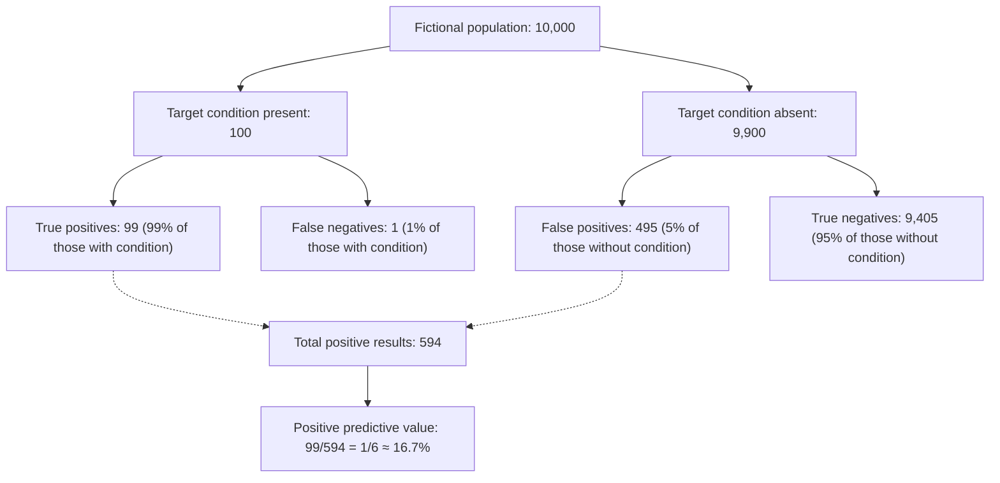
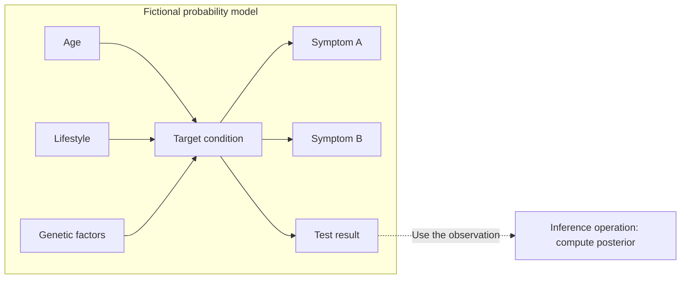

## 1. Updating predictions in an uncertain world

Tomorrow's rain, a drug's effect, or whether an email is spam: we make judgments from incomplete information. **Bayes' theorem connects a probability conditional on evidence with a conditional probability in the reverse direction.** Given a model and prior information, it provides a way to update probabilities after a new observation.

The theorem is named after the eighteenth-century minister and mathematician Thomas Bayes. [Richard Price's letter communicating Bayes' posthumous essay](https://bayes.wustl.edu/Manual/an.essay.pdf) records that it was read at the Royal Society on December 23, 1763. Modern Bayesian inference also includes developments by many later researchers. We will cover the formula, a testing example, four AI applications, and different interpretations of probability.

## 2. The formula and the role of normalization

For an event B with $P(B)>0$, the definition of conditional probability gives

$$
P(A\mid B)=\frac{P(A\cap B)}{P(B)}
$$

If $P(A)>0$ as well, so that the reverse conditional probability is defined, decomposing the joint probability gives

$$
P(A\mid B)=\frac{P(B\mid A)P(A)}{P(B)}
$$

When B is new evidence, the terms have the following roles.

- **Prior probability** $P(A)$: the probability of A before accounting for B.
- **Likelihood** $P(B\mid A)$: the probability of observing B under A.
- **Evidence / marginal likelihood** $P(B)$: the overall probability of observing B.
- **Posterior probability** $P(A\mid B)$: the probability of A after accounting for B.

Prior times likelihood is the numerator. **To obtain the posterior probability, divide by the evidence to normalize it.** Even if A has probability zero, the first formula using the joint probability remains valid when B has positive probability. Do not substitute into the second formula when its reverse conditional probability is undefined.

## 3. Likelihood, MAP, and posterior prediction

Let θ be an unknown parameter and d the observed data. [Updating a prior density using a likelihood](https://web.stanford.edu/class/stats200/Lecture20.pdf) gives

$$
\pi(\theta\mid d)=\frac{L(\theta;d)\pi(\theta)}{Z(d)},\qquad Z(d)=\int L(t;d)\pi(t)\,dt
$$

Here we assume $0<Z(d)<\infty$. The likelihood L is a function of θ with the observed d held fixed. It is not a probability distribution over θ. For continuous data, we use densities, whose values may exceed one. A particular observation having probability zero does not by itself prevent density-based updating.

When a maximum of the posterior density exists, **maximum a posteriori (MAP) estimation** selects such a point:

$$
\hat\theta_{\mathrm{MAP}}\in\arg\max_\theta\pi(\theta\mid d)
$$

In contrast, the **posterior predictive** probability for a future binary observation averages the predictions over the posterior distribution:

$$
\Pr(Y_{\mathrm{new}}=1\mid d)=\int\Pr(Y_{\mathrm{new}}=1\mid\theta,d)\pi(\theta\mid d)\,d\theta
$$

For example, put a uniform prior between zero and one on a coin's heads probability θ. Given θ, assume independent tosses and observe the ordered outcomes 1,1,0, where 1 means heads. Then

$$
\pi(\theta\mid 1,1,0)=12\theta^2(1-\theta),\qquad 0<\theta<1
$$

and therefore

$$
\hat\theta_{\mathrm{MAP}}=\frac23,\qquad\Pr(Y_{\mathrm{new}}=1\mid1,1,0)=\frac35
$$

Substituting the mode and averaging over a distribution give different answers. Selecting a class, estimating parameters by MAP, and predicting future observations cannot all be described as “maximizing the posterior probability.”

## 4. A hypothetical medical test: 99% sensitivity, about 16.7% PPV

This is **a hypothetical calculation, not the measured performance of a real test**. Let D mean having the target condition and T mean a positive test. Suppose prevalence in the target population is 1%, sensitivity is 99%, and the false-positive rate is 5%.

$$
P(D)=0.01,\qquad P(T\mid D)=0.99,\qquad P(T\mid D^c)=0.05
$$

The complement of D means not having the target condition; it does not mean being healthy in every respect. Adding the two possible sources of positive results gives

$$
P(T)=P(T\mid D)P(D)+P(T\mid D^c)P(D^c)=0.99\cdot0.01+0.05\cdot0.99=0.0594
$$

Consequently, the probability of the target condition given a positive result is

$$
P(D\mid T)=\frac{0.0099}{0.0594}=\frac{99}{594}=\frac16\approx0.1667
$$

The result is about 16.7%; the exact value is 1/6. The remaining 5/6, about 83.3% of positive results, are false positives without the target condition. At low prevalence, false positives from the much larger group without the condition can outnumber true positives.

To express these proportions as counts, construct a fictional population of 10,000 with exactly these ratios. Counts would vary in an actual sample of 10,000.

| Test result | Target condition present | Target condition absent | Total |
| --- | ---: | ---: | ---: |
| Positive | 99 (true positives) | 495 (false positives) | 594 |
| Negative | 1 (false negative) | 9,405 (true negatives) | 9,406 |
| Total | 100 | 9,900 | 10,000 |

**99% sensitivity does not mean 99% positive predictive value or 99% overall accuracy.** Overall accuracy in this table is

$$
\frac{99+9405}{10000}=0.9504=95.04\%
$$

The [definitions of sensitivity, specificity, and positive predictive value](https://www.fda.gov/regulatory-information/search-fda-guidance-documents/statistical-guidance-reporting-results-studies-evaluating-diagnostic-tests-guidance-industry-and-fda) use different denominators. The intuition “99% means almost certainly affected if positive” confuses which group conditions the proportion. Applying the calculation to real results requires prevalence and test characteristics appropriate to that population.

## 5. AI application 1: naive Bayes classification

For spam detection, features X, such as whether particular words occur, inform the posterior probability of class C. The basic naive Bayes assumption is **conditional independence given the class**, not unconditional independence of words. With three or more features, independence of every pair alone is also insufficient.

For discrete features, suppose the observed x has positive marginal probability, the classes have positive prior probabilities, and the features are jointly independent within each class. Then

$$
\Pr(C=c\mid X=x)\propto\Pr(C=c)\prod_{j=1}^{m}\Pr(X_j=x_j\mid C=c)
$$

If all misclassifications have the same cost, select a class with the largest posterior probability. This classification decision is different from MAP estimation of the model parameters themselves.

Actual words are related, so independence is an approximation. Simplicity and computational speed are advantages, but superior accuracy or well-calibrated probabilities are not guaranteed. The [official scikit-learn discussion](https://scikit-learn.org/stable/modules/naive_bayes.html) also distinguishes classification performance from the quality of probability estimates. Concrete generative models differ between variants, such as Bernoulli models for word presence and multinomial models for word counts.

## 6. AI application 2: Bayesian networks

A Bayesian network represents a joint distribution using a directed acyclic graph (DAG) and a local conditional distribution for each node. In a finite discrete model, with pa denoting parent-node values, it factorizes as

$$
\Pr(V_1=v_1,\ldots,V_n=v_n)=\prod_{i=1}^{n}\Pr(V_i=v_i\mid\mathrm{pa}_i)
$$

[Representing a distribution with a DAG](https://ermongroup.github.io/cs228-notes/representation/directed/) also specifies conditional independence assumptions.

The following is a fictional model connecting age, lifestyle, genetic factors, a condition, symptoms, and a test. It assumes the three factors without parents are independent. Solid arrows specify parent relationships in local distributions; they do not make this a validated diagram of real causal relationships. **Causal claims require additional causal assumptions**, beyond a model of statistical dependencies ([Pearl's distinction](https://ftp.cs.ucla.edu/pub/stat_ser/r350.pdf)).

The annotation reached by the dotted arrow is an inference operation, not an additional random variable in the joint distribution. Computing posterior marginals for a condition or other variables is also different from relearning every parameter. Such models provide a framework for diagnosis, situation estimation, and financial prediction, but their validity for a particular use depends on the structure and data.

## 7. AI application 3: Bayesian optimization

Tuning hyperparameters such as a learning rate or network depth may require repeatedly training and evaluating a model. Settings need not be selected manually; automated search is possible.

Bayesian optimization represents the relationship between settings and performance with a probabilistic surrogate, such as a Gaussian process, and updates it with evaluation results. An **acquisition function**, such as expected improvement, selects the next candidate. Both exploitation of promising regions and exploration of uncertain regions matter. [Snoek and colleagues](https://arxiv.org/abs/1206.2944) study the tuning of machine-learning algorithms.

The aim is to allocate expensive evaluations efficiently. It does not guarantee the optimum in the fewest trials for every objective function, budget, or noise setting.

## 8. AI application 4: Bayesian deep learning

An ordinary neural network can output class probabilities, for example through softmax. Computing with fixed weights is compatible with outputting a probability distribution.

A Bayesian treatment can put a prior density on continuous weights w and obtain their posterior density given training data d. Under the usual conditional independence model, the posterior predictive probability for a discrete class y is

$$
\Pr(y\mid x,d)=\int\Pr(y\mid x,w)\pi(w\mid d)\,dw
$$

[Blundell and colleagues' original paper](https://arxiv.org/abs/1505.05424) approximates inference that is difficult to perform exactly for practically sized networks, using a variational distribution. Predictions can reflect uncertainty about weights, but depend on the prior, likelihood, and approximation method.

An output such as “90% probability of a class” alone does not convey all uncertainty about the model. Calling a method Bayesian does not guarantee calibrated predictions in medical AI or other applications. [Research on uncertainty under dataset shift](https://arxiv.org/abs/1906.02530) also motivates evaluating differences between training and deployment data.

## 9. Comparing frequentist and Bayesian inference

Both approaches use probability theory; Bayes' theorem itself is shared mathematics. In statistical inference, frequentist methods treat unknown parameters as fixed and emphasize properties of estimation or testing procedures under repeated sampling. Bayesian inference represents uncertainty about unknown quantities with a prior distribution and uses a posterior after observing data. Assigning a distribution does not mean a physical parameter changes after every observation.

For independent, identically distributed fair coin tosses, with heads represented by 1 and tails by 0, the [law of large numbers](https://kenji.blog/en/p/law-of-large-numbers/) gives the limit

$$
\frac1n\sum_{i=1}^{n}X_i\xrightarrow{\mathrm{a.s.}}\frac12
$$

It does not guarantee exactly half heads in a finite number of tosses.

Bayesian priors may encode expertise or use choices such as weakly informative distributions. It is misleading either to dismiss all priors as arbitrary preferences or to assume a prior automatically makes an analysis objective. A 70% forecast of rain tomorrow can be read as a probability based on a model and information, whose calibration can be evaluated. That number alone identifies neither a particular statistical school nor an individual forecaster's personal confidence.

## 10. Update the evidence and examine the assumptions

Bayesian updating combines prior information and evidence coherently. In sequential updating, the previous posterior becomes the next prior, using the conditional likelihood of the new data. Do not multiply an already-used observation in again as independent new evidence.

The formula alone cannot repair a wrong model or biased data. Examining what was observed, and which population or distribution was assumed, is part of learning and revising our understanding. The [two-envelope paradox](https://kenji.blog/en/p/two-envelopes-paradox/) is another example of why conditional probabilities must be calculated from an explicit model.
