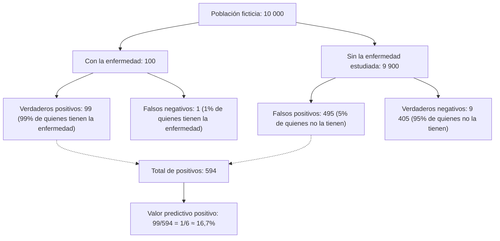
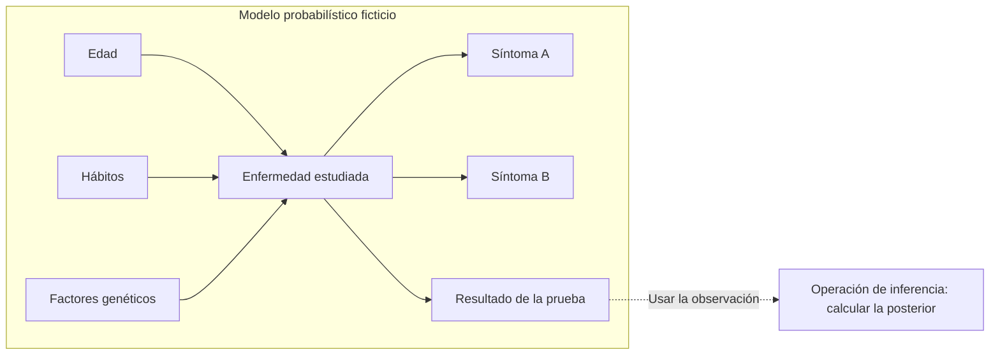

## 1. Actualizar predicciones en un mundo incierto

La lluvia de mañana, el efecto de un medicamento o la posibilidad de que un correo sea spam: decidimos con información incompleta. **El teorema de Bayes relaciona una probabilidad condicionada a una evidencia con la probabilidad condicional en sentido inverso.** Una vez definidos el modelo y la información previa, permite actualizar probabilidades con nuevas observaciones.

El nombre recuerda a Thomas Bayes, ministro religioso y matemático del siglo XVIII. [La carta de Richard Price que comunica su ensayo póstumo](https://bayes.wustl.edu/Manual/an.essay.pdf) indica que se leyó ante la Royal Society el 23 de diciembre de 1763. La inferencia bayesiana moderna incorpora también desarrollos de muchos investigadores posteriores. Veremos la fórmula, un ejemplo de detección, cuatro aplicaciones en IA y distintas interpretaciones de la probabilidad.

## 2. La fórmula y el papel de la normalización

Para un suceso B con $P(B)>0$, la definición de probabilidad condicional da

$$
P(A\mid B)=\frac{P(A\cap B)}{P(B)}
$$

Si además $P(A)>0$, de modo que la probabilidad condicional inversa esté definida, descomponer la probabilidad conjunta da

$$
P(A\mid B)=\frac{P(B\mid A)P(A)}{P(B)}
$$

Cuando B representa nueva evidencia, los términos cumplen estas funciones:

- **Probabilidad a priori** $P(A)$: probabilidad de A antes de incorporar B.
- **Verosimilitud** $P(B\mid A)$: probabilidad de observar B bajo el supuesto A.
- **Evidencia o verosimilitud marginal** $P(B)$: probabilidad total de observar B.
- **Probabilidad a posteriori** $P(A\mid B)$: probabilidad de A tras incorporar B.

El producto de la probabilidad previa por la verosimilitud es el numerador. **Para obtener la posterior hay que dividir por la evidencia y normalizar.** Aunque A tenga probabilidad cero, la primera fórmula, basada en la probabilidad conjunta, sigue siendo válida si B tiene probabilidad positiva. No se debe sustituir directamente en la segunda cuando su probabilidad condicional inversa no está definida.

## 3. Verosimilitud, MAP y predicción posterior

Denotemos por θ el parámetro desconocido y por d los datos observados. Al [actualizar una densidad previa mediante una verosimilitud](https://web.stanford.edu/class/stats200/Lecture20.pdf), escribimos

$$
\pi(\theta\mid d)=\frac{L(\theta;d)\pi(\theta)}{Z(d)},\qquad Z(d)=\int L(t;d)\pi(t)\,dt
$$

Suponemos $0<Z(d)<\infty$. La verosimilitud L es una función de θ con d fijado, no una distribución de probabilidad sobre θ. Para datos continuos se utilizan densidades, cuyos valores pueden superar uno. Que un punto observado tenga probabilidad cero no impide por sí solo actualizar mediante densidades.

Si la densidad posterior alcanza un máximo, la **estimación de máximo a posteriori (MAP)** selecciona un punto donde lo alcanza:

$$
\hat\theta_{\mathrm{MAP}}\in\arg\max_\theta\pi(\theta\mid d)
$$

En cambio, la **predicción posterior** de una futura observación binaria promedia las predicciones con respecto a la distribución posterior:

$$
\Pr(Y_{\mathrm{new}}=1\mid d)=\int\Pr(Y_{\mathrm{new}}=1\mid\theta,d)\pi(\theta\mid d)\,d\theta
$$

Por ejemplo, asignemos una distribución previa uniforme entre cero y uno a la probabilidad θ de obtener cara. Condicionadas a θ, las tiradas son independientes. Observamos, en orden, 1,1,0, donde 1 significa cara. Entonces

$$
\pi(\theta\mid 1,1,0)=12\theta^2(1-\theta),\qquad 0<\theta<1
$$

y, por tanto,

$$
\hat\theta_{\mathrm{MAP}}=\frac23,\qquad\Pr(Y_{\mathrm{new}}=1\mid1,1,0)=\frac35
$$

Sustituir la moda y promediar sobre una distribución pueden dar respuestas distintas. Elegir una clase, estimar parámetros por MAP y predecir observaciones futuras no se pueden describir, en conjunto, como «maximizar la probabilidad posterior».

## 4. Una prueba médica hipotética: sensibilidad del 99 % y VPP de aproximadamente el 16,7 %

Este es **un ejemplo de cálculo hipotético, no el rendimiento medido de una prueba real**. D significa tener la enfermedad estudiada y T obtener un resultado positivo. Supongamos una prevalencia del 1 % en la población de interés, una sensibilidad del 99 % y una tasa de falsos positivos del 5 %.

$$
P(D)=0.01,\qquad P(T\mid D)=0.99,\qquad P(T\mid D^c)=0.05
$$

El complementario de D significa no tener esa enfermedad; no significa estar sano en todos los aspectos. Al sumar las dos posibles fuentes de resultados positivos, obtenemos

$$
P(T)=P(T\mid D)P(D)+P(T\mid D^c)P(D^c)=0.99\cdot0.01+0.05\cdot0.99=0.0594
$$

Por tanto, la probabilidad de tener la enfermedad dado un resultado positivo es

$$
P(D\mid T)=\frac{0.0099}{0.0594}=\frac{99}{594}=\frac16\approx0.1667
$$

El resultado es aproximadamente el 16,7 %; su valor exacto es 1/6. Los 5/6 restantes, aproximadamente el 83,3 % de los positivos, son falsos positivos sin la enfermedad estudiada. Con una prevalencia baja, los falsos positivos del grupo mucho más numeroso sin la enfermedad pueden superar a los verdaderos positivos.

Para expresar las proporciones como personas, construimos una población ficticia de 10 000 con exactamente esas proporciones. En una muestra real de 10 000, los recuentos variarían.

| Resultado | Con la enfermedad estudiada | Sin la enfermedad estudiada | Total |
| --- | ---: | ---: | ---: |
| Positivo | 99 (verdaderos positivos) | 495 (falsos positivos) | 594 |
| Negativo | 1 (falso negativo) | 9 405 (verdaderos negativos) | 9 406 |
| Total | 100 | 9 900 | 10 000 |

**Una sensibilidad del 99 % no equivale a un valor predictivo positivo del 99 % ni a una exactitud global del 99 %.** La exactitud global, es decir, la proporción total de aciertos en esta tabla, es

$$
\frac{99+9405}{10000}=0.9504=95.04\%
$$

Las [definiciones de sensibilidad, especificidad y valor predictivo positivo](https://www.fda.gov/regulatory-information/search-fda-guidance-documents/statistical-guidance-reporting-results-studies-evaluating-diagnostic-tests-guidance-industry-and-fda) usan denominadores distintos. La intuición «99 % significa que un positivo casi seguro tiene la enfermedad» confunde el grupo sobre el que se calcula la proporción. Para aplicar el cálculo a resultados reales, la prevalencia y las características de la prueba deben corresponder a la población pertinente.

## 5. Aplicación en IA 1: clasificación Naive Bayes

Para detectar spam, las características X, como la presencia de ciertas palabras, informan la probabilidad posterior de la clase C. La hipótesis básica de Naive Bayes es la **independencia condicional dada la clase**, no la independencia incondicional de las palabras. Con tres o más características, ni siquiera la independencia por pares dentro de cada clase garantiza la independencia conjunta.

Para características discretas, supongamos que la observación x tiene probabilidad marginal positiva, que las probabilidades previas de las clases son positivas y que las características son conjuntamente independientes dentro de cada clase. Entonces

$$
\Pr(C=c\mid X=x)\propto\Pr(C=c)\prod_{j=1}^{m}\Pr(X_j=x_j\mid C=c)
$$

Si todas las clasificaciones erróneas tienen el mismo coste, se elige una clase de probabilidad posterior máxima. Esta decisión de clasificación es distinta de estimar por MAP los parámetros del modelo.

Las palabras reales están relacionadas, de modo que la independencia es una aproximación. La sencillez y la rapidez son ventajas, pero no garantizan siempre mayor exactitud ni probabilidades bien calibradas. La [documentación oficial de scikit-learn](https://scikit-learn.org/stable/modules/naive_bayes.html) también distingue el rendimiento de clasificación de la calidad de las probabilidades estimadas. Los modelos generativos concretos varían: por ejemplo, Bernoulli para presencia de palabras y multinomial para sus recuentos.

## 6. Aplicación en IA 2: redes bayesianas

Una red bayesiana representa una distribución conjunta mediante un grafo dirigido acíclico (DAG) y una distribución condicional local por nodo. En un modelo discreto finito, con pa indicando los valores de los nodos padres, la factorización es

$$
\Pr(V_1=v_1,\ldots,V_n=v_n)=\prod_{i=1}^{n}\Pr(V_i=v_i\mid\mathrm{pa}_i)
$$

[Representar una distribución mediante un DAG](https://ermongroup.github.io/cs228-notes/representation/directed/) también especifica hipótesis de independencia condicional.

El siguiente modelo ficticio relaciona edad, hábitos, factores genéticos, enfermedad, síntomas y una prueba. Supone independientes los tres factores sin padres. Las flechas continuas especifican las relaciones padre-hijo de las distribuciones locales; no convierten el gráfico en un diagrama validado de relaciones causales reales. **Las afirmaciones causales requieren hipótesis causales adicionales**, además de un modelo de dependencias estadísticas ([distinción de Pearl](https://ftp.cs.ucla.edu/pub/stat_ser/r350.pdf)).

La anotación señalada por la flecha discontinua es una operación de inferencia, no una variable aleatoria adicional de la distribución conjunta. Calcular distribuciones marginales posteriores de la enfermedad u otras variables tampoco equivale a volver a aprender todos los parámetros. Estos modelos ofrecen un marco para diagnóstico, estimación de situaciones o predicción financiera, pero su validez para cada uso depende de la estructura y los datos.

## 7. Aplicación en IA 3: optimización bayesiana

Ajustar hiperparámetros, como la tasa de aprendizaje o la profundidad de una red, puede requerir entrenar y evaluar repetidamente. No es necesario seleccionar los ajustes a mano: la búsqueda se puede automatizar.

La optimización bayesiana representa la relación entre configuración y rendimiento mediante un modelo sustituto probabilístico, como un proceso gaussiano, y lo actualiza con las evaluaciones. Una **función de adquisición**, como la mejora esperada, selecciona el siguiente candidato. Importan tanto la explotación de regiones prometedoras como la exploración de regiones inciertas. [Snoek y colaboradores](https://arxiv.org/abs/1206.2944) estudian el ajuste de algoritmos de aprendizaje automático.

El objetivo es asignar eficientemente evaluaciones costosas. No se garantiza encontrar el óptimo en el menor número de intentos para toda función objetivo, presupuesto o situación de ruido.

## 8. Aplicación en IA 4: aprendizaje profundo bayesiano

Una red neuronal ordinaria también puede producir probabilidades de clase, por ejemplo mediante softmax. Calcular con pesos fijos es compatible con producir una distribución de probabilidad.

Un tratamiento bayesiano puede asignar una densidad previa a los pesos continuos w y obtener su densidad posterior dados los datos de entrenamiento d. Bajo el modelo habitual de independencia condicional, la probabilidad predictiva posterior de una clase discreta, denotada por *y*, es

$$
\Pr(y\mid x,d)=\int\Pr(y\mid x,w)\pi(w\mid d)\,dw
$$

El [trabajo original de Blundell y colaboradores](https://arxiv.org/abs/1505.05424) aproxima mediante una distribución variacional la inferencia que resulta difícil realizar exactamente en redes de tamaño práctico. Las predicciones pueden reflejar incertidumbre sobre los pesos, pero dependen de la distribución previa, la verosimilitud y el método de aproximación.

Una salida como «90 % de probabilidad de una clase» no transmite por sí sola toda la incertidumbre sobre el modelo. Llamar bayesiano a un método no garantiza predicciones calibradas en IA médica ni en otras aplicaciones. La [investigación sobre incertidumbre ante cambios de distribución](https://arxiv.org/abs/1906.02530) también motiva evaluar las diferencias entre los datos de entrenamiento y los de uso.

## 9. Comparar la inferencia frecuentista y la bayesiana

Ambos enfoques usan teoría de la probabilidad; el teorema de Bayes es matemática compartida. En inferencia estadística, los métodos frecuentistas tratan los parámetros desconocidos como fijos y destacan las propiedades de los procedimientos de estimación o contraste bajo muestreo repetido. La inferencia bayesiana representa la incertidumbre sobre cantidades desconocidas con una distribución previa y usa una posterior tras observar los datos. Asignar una distribución no significa que un parámetro físico cambie con cada observación.

Para lanzamientos independientes e idénticamente distribuidos de una moneda equilibrada, con cara representada por 1 y cruz por 0, la [ley de los grandes números](https://kenji.blog/es/p/law-of-large-numbers/) da el límite

$$
\frac1n\sum_{i=1}^{n}X_i\xrightarrow{\mathrm{a.s.}}\frac12
$$

No garantiza exactamente la mitad de caras en un número finito de lanzamientos.

Las distribuciones previas pueden incorporar conocimiento experto o elecciones como distribuciones débilmente informativas. Es engañoso descartarlas todas como preferencias arbitrarias o suponer que elegir una previa hace objetivo un análisis automáticamente. Un pronóstico del 70 % de lluvia mañana puede interpretarse como una probabilidad basada en un modelo y en información, cuya calibración se puede evaluar. Ese número, por sí solo, no identifica una escuela estadística ni la confianza personal de un pronosticador.

## 10. Actualizar la evidencia y examinar los supuestos

La actualización bayesiana combina información previa y evidencia conforme a las reglas de probabilidad. En una actualización secuencial, la posterior anterior se convierte en la nueva previa y se utiliza la verosimilitud condicional de los datos nuevos. No se debe volver a multiplicar una observación ya utilizada como si fuera evidencia nueva e independiente.

La fórmula no corrige por sí sola un modelo erróneo o unos datos sesgados. Examinar qué se observó y qué población o distribución se supuso forma parte de aprender y revisar nuestra comprensión. La [paradoja de los dos sobres](https://kenji.blog/es/p/two-envelopes-paradox/) también ilustra por qué las probabilidades condicionales deben calcularse a partir de un modelo explícito.
