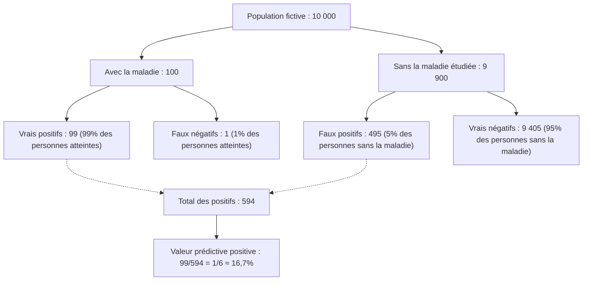
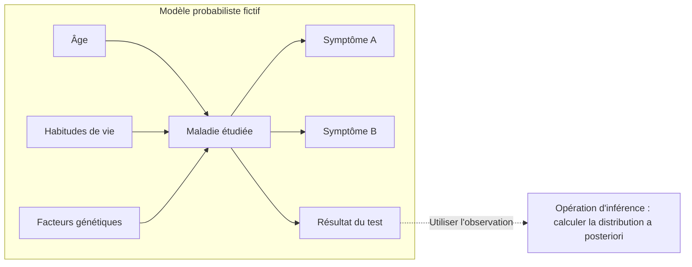

## 1. Actualiser les prédictions dans un monde incertain

La pluie de demain, l'effet d'un médicament ou la possibilité qu'un courriel soit indésirable : nous décidons avec des informations incomplètes. **Le théorème de Bayes relie la probabilité d'un événement sachant une observation à celle de cette observation sachant l'événement.** Une fois le modèle et les informations préalables définis, il permet d'actualiser les probabilités avec de nouvelles observations.

Il porte le nom de Thomas Bayes, pasteur et mathématicien du XVIIIe siècle. [La lettre de Richard Price présentant son mémoire posthume](https://bayes.wustl.edu/Manual/an.essay.pdf) mentionne une lecture à la Royal Society le 23 décembre 1763. L'inférence bayésienne moderne comprend aussi les développements de nombreux chercheurs ultérieurs. Nous examinerons la formule, un exemple de dépistage, quatre applications en IA et différentes interprétations de la probabilité.

## 2. La formule et le rôle de la normalisation

Pour un événement B tel que $P(B)>0$, la définition de la probabilité conditionnelle donne

$$
P(A\mid B)=\frac{P(A\cap B)}{P(B)}
$$

Si l'on a également $P(A)>0$, de sorte que la probabilité conditionnelle inverse soit définie, la décomposition de la probabilité conjointe donne

$$
P(A\mid B)=\frac{P(B\mid A)P(A)}{P(B)}
$$

Lorsque B représente une nouvelle observation, les termes ont les rôles suivants :

- **Probabilité a priori** $P(A)$ : probabilité de A avant de prendre B en compte.
- **Vraisemblance** $P(B\mid A)$ : probabilité d'observer B sous l'hypothèse A.
- **Probabilité de l'observation / vraisemblance marginale** $P(B)$ : probabilité totale d'observer B.
- **Probabilité a posteriori** $P(A\mid B)$ : probabilité de A après prise en compte de B.

Le produit de la probabilité a priori par la vraisemblance constitue le numérateur. **Il faut encore diviser par la probabilité de l'observation pour normaliser et obtenir la probabilité a posteriori.** Même si A est de probabilité nulle, la première formule, fondée sur la probabilité conjointe, reste valable si B a une probabilité positive. Il ne faut pas appliquer directement la seconde lorsque sa probabilité conditionnelle inverse n'est pas définie.

## 3. Vraisemblance, MAP et prédiction a posteriori

Notons θ le paramètre inconnu et d les données observées. Pour [actualiser une densité a priori à partir d'une vraisemblance](https://web.stanford.edu/class/stats200/Lecture20.pdf), on écrit

$$
\pi(\theta\mid d)=\frac{L(\theta;d)\pi(\theta)}{Z(d)},\qquad Z(d)=\int L(t;d)\pi(t)\,dt
$$

On suppose $0<Z(d)<\infty$. La vraisemblance L est une fonction de θ, les données d étant fixées ; ce n'est pas une distribution de probabilité sur θ. Pour des données continues, on utilise des densités, dont les valeurs peuvent dépasser un. La probabilité nulle d'un point observé n'empêche pas, à elle seule, l'actualisation par des densités.

Si la densité a posteriori atteint un maximum, l'**estimation par maximum a posteriori (MAP)** choisit un point où ce maximum est atteint :

$$
\hat\theta_{\mathrm{MAP}}\in\arg\max_\theta\pi(\theta\mid d)
$$

En revanche, la **probabilité prédictive a posteriori** d'une future observation binaire s'obtient en faisant la moyenne des prédictions selon la distribution a posteriori :

$$
\Pr(Y_{\mathrm{new}}=1\mid d)=\int\Pr(Y_{\mathrm{new}}=1\mid\theta,d)\pi(\theta\mid d)\,d\theta
$$

Par exemple, attribuons une loi a priori uniforme entre zéro et un à la probabilité θ d'obtenir face. Conditionnellement à θ, les lancers sont indépendants. On observe, dans l'ordre, 1,1,0, où 1 désigne face. Alors

$$
\pi(\theta\mid 1,1,0)=12\theta^2(1-\theta),\qquad 0<\theta<1
$$

et donc

$$
\hat\theta_{\mathrm{MAP}}=\frac23,\qquad\Pr(Y_{\mathrm{new}}=1\mid1,1,0)=\frac35
$$

Remplacer le paramètre par un mode de la densité a posteriori et calculer une moyenne sur la distribution peuvent donner des réponses différentes. Choisir une classe, estimer les paramètres par MAP et prévoir de futures observations ne se résument pas tous à « maximiser la probabilité a posteriori ».

## 4. Un test médical fictif : sensibilité de 99 % et VPP d'environ 16,7 %

Il s'agit d'un **exemple de calcul fictif, et non des performances mesurées d'un test réel**. D signifie être atteint de la maladie étudiée et T avoir un résultat positif. Supposons une prévalence de 1 % dans la population concernée, une sensibilité de 99 % et un taux de faux positifs de 5 %.

$$
P(D)=0.01,\qquad P(T\mid D)=0.99,\qquad P(T\mid D^c)=0.05
$$

L'événement complémentaire de D signifie ne pas avoir cette maladie, et non être en bonne santé à tous égards. En additionnant les deux sources possibles de résultats positifs, on obtient

$$
P(T)=P(T\mid D)P(D)+P(T\mid D^c)P(D^c)=0.99\cdot0.01+0.05\cdot0.99=0.0594
$$

La probabilité d'avoir la maladie sachant que le résultat est positif est donc

$$
P(D\mid T)=\frac{0.0099}{0.0594}=\frac{99}{594}=\frac16\approx0.1667
$$

Le résultat vaut environ 16,7 % ; sa valeur exacte est 1/6. Les 5/6 restants, soit environ 83,3 % des positifs, sont des faux positifs sans la maladie étudiée. Lorsque la prévalence est faible, les faux positifs issus du groupe beaucoup plus nombreux sans la maladie peuvent dépasser les vrais positifs.

Pour exprimer ces proportions en personnes, construisons une population fictive de 10 000 personnes présentant exactement ces proportions. Dans un échantillon réel de 10 000 personnes, les effectifs varieraient.

| Résultat | Avec la maladie étudiée | Sans la maladie étudiée | Total |
| --- | ---: | ---: | ---: |
| Positif | 99 (vrais positifs) | 495 (faux positifs) | 594 |
| Négatif | 1 (faux négatif) | 9 405 (vrais négatifs) | 9 406 |
| Total | 100 | 9 900 | 10 000 |

**Une sensibilité de 99 % n'est ni une valeur prédictive positive de 99 %, ni une exactitude globale de 99 %.** L'exactitude globale, c'est-à-dire la proportion totale de classifications correctes dans ce tableau, est

$$
\frac{99+9405}{10000}=0.9504=95.04\%
$$

Les [définitions de la sensibilité, de la spécificité et de la valeur prédictive positive](https://www.fda.gov/regulatory-information/search-fda-guidance-documents/statistical-guidance-reporting-results-studies-evaluating-diagnostic-tests-guidance-industry-and-fda) utilisent des dénominateurs différents. L'intuition « 99 % signifie qu'un positif est presque certainement malade » confond le groupe sur lequel la proportion est calculée. L'application à des résultats réels exige une prévalence et des caractéristiques du test adaptées à la population concernée.

## 5. Application en IA 1 : classification naïve bayésienne

Pour détecter les courriels indésirables, les caractéristiques X, comme la présence de certains mots, renseignent la probabilité a posteriori de la classe C. L'hypothèse de base est l'**indépendance conditionnelle sachant la classe**, et non l'indépendance inconditionnelle des mots. À partir de trois caractéristiques, même l'indépendance deux à deux au sein de chaque classe ne garantit pas l'indépendance mutuelle.

Pour des caractéristiques discrètes, supposons que l'observation x ait une probabilité marginale positive, que les probabilités a priori des classes soient positives et que les caractéristiques soient mutuellement indépendantes dans chaque classe. Alors

$$
\Pr(C=c\mid X=x)\propto\Pr(C=c)\prod_{j=1}^{m}\Pr(X_j=x_j\mid C=c)
$$

Si toutes les erreurs de classification ont le même coût, on choisit une classe de probabilité a posteriori maximale. Cette décision de classification diffère de l'estimation MAP des paramètres du modèle eux-mêmes.

Les mots réels sont liés : l'indépendance est une approximation. La simplicité et la rapidité sont des avantages, sans garantie d'une exactitude toujours supérieure ou de probabilités bien calibrées. La [documentation officielle de scikit-learn](https://scikit-learn.org/stable/modules/naive_bayes.html) distingue aussi les performances de classification de la qualité des probabilités estimées. Les modèles génératifs concrets diffèrent, par exemple Bernoulli pour la présence de mots et multinomial pour leurs effectifs.

## 6. Application en IA 2 : réseaux bayésiens

Un réseau bayésien représente une distribution conjointe au moyen d'un graphe orienté acyclique (DAG) et d'une distribution conditionnelle locale par nœud. Dans un modèle discret fini, pa désignant les valeurs des nœuds parents, la factorisation s'écrit

$$
\Pr(V_1=v_1,\ldots,V_n=v_n)=\prod_{i=1}^{n}\Pr(V_i=v_i\mid\mathrm{pa}_i)
$$

[Représenter une distribution par un DAG](https://ermongroup.github.io/cs228-notes/representation/directed/) précise aussi des hypothèses d'indépendance conditionnelle.

Le modèle fictif suivant relie âge, habitudes de vie, facteurs génétiques, maladie, symptômes et test. Il suppose indépendants les trois facteurs sans parents. Les flèches pleines définissent les relations parent-enfant des distributions locales ; elles ne font pas du graphique un diagramme validé des relations causales réelles. **Une affirmation causale exige des hypothèses causales supplémentaires**, au-delà d'un modèle de dépendances statistiques ([distinction de Pearl](https://ftp.cs.ucla.edu/pub/stat_ser/r350.pdf)).

L'annotation visée par la flèche en pointillés est une opération d'inférence, pas une variable aléatoire supplémentaire de la distribution conjointe. Calculer des distributions marginales a posteriori pour la maladie ou d'autres variables ne revient pas non plus à réapprendre tous les paramètres. Ces modèles offrent un cadre pour le diagnostic, l'estimation de situations ou les prévisions financières, mais leur validité pour chaque usage dépend de la structure et des données.

## 7. Application en IA 3 : optimisation bayésienne

Régler des hyperparamètres, comme le taux d'apprentissage ou la profondeur du réseau, peut demander des entraînements et évaluations répétés. Les réglages ne doivent pas nécessairement être choisis à la main : la recherche peut être automatisée.

L'optimisation bayésienne représente le lien entre réglages et performances par un modèle probabiliste de substitution, tel qu'un processus gaussien, puis l'actualise avec les évaluations. Une **fonction d'acquisition**, comme l'amélioration espérée, sélectionne le candidat suivant. L'exploitation des régions prometteuses et l'exploration des régions incertaines comptent toutes deux. [Snoek et ses collaborateurs](https://arxiv.org/abs/1206.2944) étudient le réglage d'algorithmes d'apprentissage automatique.

L'objectif est d'allouer efficacement des évaluations coûteuses. Il n'est pas garanti de trouver l'optimum en un minimum d'essais pour toute fonction objectif, tout budget ou toute situation de bruit.

## 8. Application en IA 4 : apprentissage profond bayésien

Un réseau neuronal ordinaire peut aussi produire des probabilités de classe, par exemple avec softmax. Calculer avec des poids fixes est compatible avec la production d'une distribution de probabilité.

Un traitement bayésien peut attribuer une densité a priori aux poids continus w, puis obtenir leur densité a posteriori conditionnellement aux données d'entraînement d. Dans le modèle habituel d'indépendance conditionnelle, la probabilité prédictive a posteriori d'une classe discrète notée *y* est

$$
\Pr(y\mid x,d)=\int\Pr(y\mid x,w)\pi(w\mid d)\,dw
$$

Le [travail original de Blundell et de ses collaborateurs](https://arxiv.org/abs/1505.05424) utilise une distribution variationnelle pour approcher une inférence difficile à calculer exactement sur des réseaux de taille pratique. Les prédictions peuvent refléter l'incertitude sur les poids, mais dépendent de la loi a priori, de la vraisemblance et de la méthode d'approximation.

Une sortie telle que « probabilité de 90 % pour une classe » n'exprime pas à elle seule toute l'incertitude sur le modèle. Qualifier une méthode de bayésienne ne garantit pas des prédictions calibrées en IA médicale ou ailleurs. Les [recherches sur l'incertitude lors de changements de distribution](https://arxiv.org/abs/1906.02530) motivent aussi l'évaluation des différences entre données d'entraînement et données d'utilisation.

## 9. Comparer les inférences fréquentiste et bayésienne

Les deux approches utilisent la théorie des probabilités ; le théorème de Bayes lui-même est un outil mathématique commun. En inférence statistique, les méthodes fréquentistes traitent les paramètres inconnus comme fixes et s'intéressent aux propriétés des procédures d'estimation ou de test lors d'échantillonnages répétés. L'inférence bayésienne représente l'incertitude sur des quantités inconnues par une loi a priori et utilise une loi a posteriori après observation des données. Attribuer une distribution ne signifie pas qu'un paramètre physique change à chaque observation.

Pour des lancers indépendants et identiquement distribués d'une pièce équilibrée, avec face représentée par 1 et pile par 0, la [loi des grands nombres](https://kenji.blog/fr/p/law-of-large-numbers/) donne la limite

$$
\frac1n\sum_{i=1}^{n}X_i\xrightarrow{\mathrm{a.s.}}\frac12
$$

Le symbole a.s. indique une convergence presque sûre : la probabilité que la proportion converge vers 1/2 est 1. Cela ne garantit pas exactement la moitié de faces sur un nombre fini de lancers.

Les lois a priori peuvent intégrer des connaissances expertes ou des choix tels que des lois faiblement informatives. Il serait trompeur de les réduire toutes à des préférences arbitraires, ou de supposer qu'un choix de loi a priori rend automatiquement une analyse objective. Une prévision de pluie de 70 % pour demain peut se lire comme une probabilité fondée sur un modèle et des informations, dont on peut évaluer la calibration. Ce nombre seul n'identifie ni une école statistique ni la confiance personnelle du prévisionniste.

## 10. Actualiser les observations et examiner les hypothèses

L'actualisation bayésienne combine les informations préalables et les observations selon les règles de probabilité. Lors d'une actualisation séquentielle, la loi a posteriori précédente devient la nouvelle loi a priori et l'on utilise la vraisemblance conditionnelle des nouvelles données. Il ne faut pas réutiliser une observation déjà prise en compte comme si elle constituait une nouvelle information indépendante à multiplier.

La formule ne répare pas à elle seule un modèle erroné ou des données biaisées. Examiner ce qui a été observé et la population ou la distribution supposée fait partie de l'apprentissage et de la révision de notre compréhension. Le [paradoxe des deux enveloppes](https://kenji.blog/fr/p/two-envelopes-paradox/) illustre aussi pourquoi les probabilités conditionnelles doivent être calculées à partir d'un modèle explicite.
