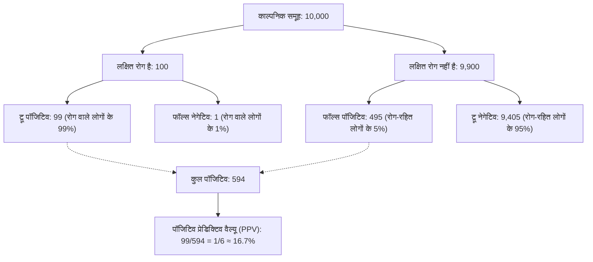
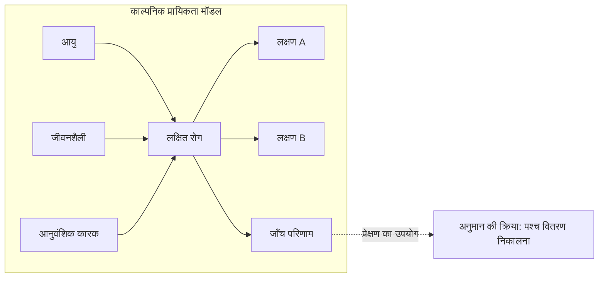

## 1. अनिश्चित दुनिया में पूर्वानुमान अद्यतन करना

कल की बारिश, दवा का प्रभाव या किसी ईमेल के स्पैम होने की संभावना: हम अधूरी जानकारी के आधार पर निर्णय लेते हैं। **बेज़ का प्रमेय किसी प्रेक्षण को जानने के बाद किसी घटना की प्रायिकता को, विपरीत दिशा की सशर्त प्रायिकता से जोड़ता है।** मॉडल और पूर्व जानकारी तय करने के बाद इससे नए प्रेक्षणों के आधार पर प्रायिकताएँ अद्यतन की जा सकती हैं।

इसका नाम 18वीं सदी के पादरी और गणितज्ञ थॉमस बेज़ से आया है। [बेज़ की मरणोपरांत प्रकाशित रचना का परिचय देने वाला रिचर्ड प्राइस का पत्र](https://bayes.wustl.edu/Manual/an.essay.pdf) 23 दिसंबर 1763 को Royal Society में पढ़े जाने का उल्लेख करता है। आधुनिक बायेसियन अनुमान में बाद के अनेक शोधकर्ताओं का विकास भी शामिल है। यहाँ सूत्र, जाँच का उदाहरण, AI के चार अनुप्रयोग और प्रायिकता की अलग व्याख्याएँ देखेंगे।

## 2. सूत्र और सामान्यीकरण की भूमिका

यदि घटना B के लिए $P(B)>0$ है, तो सशर्त प्रायिकता की परिभाषा देती है

$$
P(A\mid B)=\frac{P(A\cap B)}{P(B)}
$$

यदि $P(A)>0$ भी है, जिससे विपरीत दिशा की सशर्त प्रायिकता परिभाषित है, तो संयुक्त प्रायिकता का विभाजन देता है

$$
P(A\mid B)=\frac{P(B\mid A)P(A)}{P(B)}
$$

B को नया प्रेक्षण मानें तो हर पद की भूमिका है:

- **पूर्व प्रायिकता** $P(A)$: B पर विचार करने से पहले A की प्रायिकता।
- **लाइकलीहुड (likelihood)** $P(B\mid A)$: A मानने पर B देखने की प्रायिकता।
- **प्रेक्षण की प्रायिकता / सीमांत लाइकलीहुड** $P(B)$: B देखने की कुल प्रायिकता।
- **पश्च प्रायिकता** $P(A\mid B)$: B पर विचार करने के बाद A की प्रायिकता।

पूर्व प्रायिकता और लाइकलीहुड का गुणनफल केवल अंश है। **पश्च प्रायिकता पाने के लिए प्रेक्षण की प्रायिकता से भाग देकर सामान्यीकरण भी करना होता है।** A की प्रायिकता शून्य हो तब भी, B की प्रायिकता धनात्मक होने पर संयुक्त प्रायिकता वाला पहला सूत्र मान्य है। विपरीत दिशा की सशर्त प्रायिकता अपरिभाषित हो तो दूसरे सूत्र में सीधे मान नहीं रखते।

## 3. लाइकलीहुड, MAP और पश्च पूर्वानुमान अलग हैं

अज्ञात प्राचल यानी पैरामीटर को θ और प्रेक्षित डेटा को d कहें। [लाइकलीहुड से पूर्व घनत्व अद्यतन करने](https://web.stanford.edu/class/stats200/Lecture20.pdf) पर लिख सकते हैं

$$
\pi(\theta\mid d)=\frac{L(\theta;d)\pi(\theta)}{Z(d)},\qquad Z(d)=\int L(t;d)\pi(t)\,dt
$$

यहाँ $0<Z(d)<\infty$ मानते हैं। लाइकलीहुड L, d को स्थिर रखकर θ का फलन है; यह θ पर प्रायिकता वितरण नहीं है। सतत डेटा में प्रायिकता घनत्व इस्तेमाल होते हैं, जिनके मान 1 से अधिक हो सकते हैं। किसी एक प्रेक्षित बिंदु की प्रायिकता शून्य होना अपने आप घनत्व से अद्यतन को असंभव नहीं बनाता।

यदि पश्च घनत्व किसी बिंदु पर अधिकतम मान प्राप्त करता है, तो **maximum a posteriori (MAP) अनुमान** ऐसा बिंदु चुनता है:

$$
\hat\theta_{\mathrm{MAP}}\in\arg\max_\theta\pi(\theta\mid d)
$$

इसके विपरीत, दो संभावित परिणामों वाले अगले प्रेक्षण के लिए **पश्च पूर्वानुमान** अलग-अलग पैरामीटरों के पूर्वानुमानों का पश्च वितरण के अनुसार औसत लेता है:

$$
\Pr(Y_{\mathrm{new}}=1\mid d)=\int\Pr(Y_{\mathrm{new}}=1\mid\theta,d)\pi(\theta\mid d)\,d\theta
$$

उदाहरण के लिए, सिक्के पर चित आने की प्रायिकता θ को 0 से 1 के बीच समान पूर्व वितरण दें। θ पर सशर्त, हर उछाल स्वतंत्र है। क्रम से 1,1,0 देखा गया है, जहाँ 1 चित और 0 पट है। तब

$$
\pi(\theta\mid 1,1,0)=12\theta^2(1-\theta),\qquad 0<\theta<1
$$

इसलिए

$$
\hat\theta_{\mathrm{MAP}}=\frac23,\qquad\Pr(Y_{\mathrm{new}}=1\mid1,1,0)=\frac35
$$

पश्च घनत्व का बहुलक डालने और वितरण के अनुसार औसत लेने से अलग उत्तर मिल सकते हैं। वर्ग चुनना, पैरामीटर का MAP अनुमान और भविष्य के प्रेक्षण का पूर्वानुमान—इन सभी को एक साथ “पश्च प्रायिकता अधिकतम करना” नहीं कहा जा सकता।

## 4. काल्पनिक चिकित्सीय जाँच: संवेदनशीलता 99%, PPV लगभग 16.7%

यह **गणना का काल्पनिक उदाहरण है, किसी असली जाँच का मापा गया प्रदर्शन नहीं**। D लक्षित रोग की मौजूदगी और T पॉजिटिव परिणाम दर्शाता है। मानें कि लक्षित समूह में रोग की मौजूदगी का अनुपात 1%, जाँच की संवेदनशीलता 99% और फॉल्स पॉजिटिव दर 5% है।

$$
P(D)=0.01,\qquad P(T\mid D)=0.99,\qquad P(T\mid D^c)=0.05
$$

D की पूरक घटना का अर्थ “लक्षित रोग नहीं है” है, हर दृष्टि से स्वस्थ होना नहीं। रोग होने और न होने, दोनों स्थितियों में पॉजिटिव मिलने की प्रायिकताएँ जोड़ने से

$$
P(T)=P(T\mid D)P(D)+P(T\mid D^c)P(D^c)=0.99\cdot0.01+0.05\cdot0.99=0.0594
$$

मिलता है। इसलिए पॉजिटिव परिणाम पर लक्षित रोग होने की प्रायिकता है

$$
P(D\mid T)=\frac{0.0099}{0.0594}=\frac{99}{594}=\frac16\approx0.1667
$$

उत्तर लगभग 16.7%, ठीक 1/6 है। पॉजिटिव परिणामों के बाकी 5/6, लगभग 83.3%, ऐसे लोगों के फॉल्स पॉजिटिव हैं जिन्हें लक्षित रोग नहीं है। रोग कम प्रचलित हो तो रोग-रहित बड़े समूह से आने वाले फॉल्स पॉजिटिव, ट्रू पॉजिटिव से अधिक हो सकते हैं।

इन अनुपातों को लोगों की संख्या में दिखाने के लिए ठीक यही अनुपात रखने वाला 10,000 लोगों का काल्पनिक समूह बनाएँ। वास्तविक 10,000 लोगों के नमूने में संख्याएँ बदल सकती हैं।

| जाँच परिणाम | लक्षित रोग है | लक्षित रोग नहीं है | कुल |
| --- | ---: | ---: | ---: |
| पॉजिटिव | 99 (ट्रू पॉजिटिव) | 495 (फॉल्स पॉजिटिव) | 594 |
| नेगेटिव | 1 (फॉल्स नेगेटिव) | 9,405 (ट्रू नेगेटिव) | 9,406 |
| कुल | 100 | 9,900 | 10,000 |

**संवेदनशीलता 99% का अर्थ न तो positive predictive value (PPV) 99% है, न कुल सही परिणामों का अनुपात 99%।** इस तालिका में कुल सही परिणामों का अनुपात, यानी accuracy, है

$$
\frac{99+9405}{10000}=0.9504=95.04\%
$$

**positive predictive value (PPV)** पॉजिटिव परिणाम पर रोग होने की प्रायिकता है। [संवेदनशीलता, विशिष्टता (specificity) और PPV की परिभाषाओं](https://www.fda.gov/regulatory-information/search-fda-guidance-documents/statistical-guidance-reporting-results-studies-evaluating-diagnostic-tests-guidance-industry-and-fda) में अनुपात का आधार समूह, यानी हर, अलग होता है। “99% यानी पॉजिटिव व्यक्ति लगभग निश्चित रूप से बीमार है” वाली सहज धारणा इन समूहों को गड़बड़ाती है। असली परिणामों पर गणना लागू करने के लिए संबंधित समूह में रोग की मौजूदगी का अनुपात और जाँच की उपयुक्त विशेषताएँ चाहिए।

## 5. AI अनुप्रयोग 1: नैव बेज़ वर्गीकरण

स्पैम पहचान में शब्दों की मौजूदगी जैसी विशेषताएँ X, वर्ग C की पश्च प्रायिकता के बारे में जानकारी देती हैं। मूल धारणा है **वर्ग दिए जाने पर सशर्त स्वतंत्रता**, शब्दों की बिना शर्त स्वतंत्रता नहीं। तीन या अधिक विशेषताओं में हर वर्ग के भीतर जोड़ों में स्वतंत्रता भी संयुक्त स्वतंत्रता की गारंटी नहीं है।

असतत विशेषताओं के लिए मानें कि प्रेक्षण x की सीमांत प्रायिकता और हर वर्ग की पूर्व प्रायिकता धनात्मक है। यदि हर वर्ग के भीतर सभी विशेषताएँ संयुक्त रूप से स्वतंत्र हैं, तो

$$
\Pr(C=c\mid X=x)\propto\Pr(C=c)\prod_{j=1}^{m}\Pr(X_j=x_j\mid C=c)
$$

मिलता है। हर गलत वर्गीकरण की लागत समान हो तो सबसे अधिक पश्च प्रायिकता वाला वर्ग चुनते हैं। यह वर्गीकरण निर्णय, मॉडल के पैरामीटरों के MAP अनुमान से अलग है।

वास्तविक शब्द संबंधित होते हैं, इसलिए स्वतंत्रता एक सन्निकटन है। सरलता और गणना की गति लाभ हैं, लेकिन हमेशा अधिक accuracy या अच्छे कैलिब्रेशन की गारंटी नहीं। [scikit-learn का आधिकारिक विवरण](https://scikit-learn.org/stable/modules/naive_bayes.html) भी वर्गीकरण प्रदर्शन और अनुमानित प्रायिकताओं की गुणवत्ता को अलग करता है। ठोस जनन मॉडल अलग होते हैं, जैसे शब्द की मौजूदगी के लिए Bernoulli और उसकी आवृत्ति के लिए multinomial।

## 6. AI अनुप्रयोग 2: बायेसियन नेटवर्क

बायेसियन नेटवर्क, निर्देशित अचक्रीय ग्राफ (DAG) और हर नोड के स्थानीय सशर्त वितरण से संयुक्त वितरण दर्शाता है। DAG एक दिशित ग्राफ है जिसमें कोई निर्देशित चक्र नहीं होता। परिमित असतत मॉडल में pa से पैरेंट नोडों के मान दर्शाएँ, तो गुणनखंडन है

$$
\Pr(V_1=v_1,\ldots,V_n=v_n)=\prod_{i=1}^{n}\Pr(V_i=v_i\mid\mathrm{pa}_i)
$$

[DAG से वितरण दर्शाना](https://ermongroup.github.io/cs228-notes/representation/directed/) सशर्त स्वतंत्रता की धारणाएँ भी तय करता है।

नीचे आयु, जीवनशैली, आनुवंशिक कारकों, रोग, लक्षणों और जाँच को जोड़ने वाला काल्पनिक मॉडल है। इसमें बिना पैरेंट वाले तीन कारक स्वतंत्र माने गए हैं। ठोस तीर स्थानीय वितरणों के पैरेंट-चाइल्ड संबंध बताते हैं; वे वास्तविक कारण-कार्य संबंधों का सत्यापित चित्र नहीं हैं। **सांख्यिकीय निर्भरता के मॉडल से कारण-कार्य का दावा करने के लिए अतिरिक्त कारणात्मक धारणाएँ चाहिए** ([Pearl का अंतर](https://ftp.cs.ucla.edu/pub/stat_ser/r350.pdf))।

टूटी रेखा का अंतिम हिस्सा अनुमान की क्रिया का संकेत है, संयुक्त वितरण में अतिरिक्त यादृच्छिक चर नहीं। प्रेक्षण से रोग या दूसरे चरों के पश्च सीमांत वितरण निकालना भी मॉडल के सभी पैरामीटर फिर से सीखना नहीं है। ऐसे मॉडल निदान, स्थिति के अनुमान और वित्तीय पूर्वानुमान का ढाँचा बन सकते हैं, लेकिन किसी उपयोग में उनकी वैधता संरचना और डेटा पर निर्भर है।

## 7. AI अनुप्रयोग 3: बायेसियन ऑप्टिमाइज़ेशन

सीखने की दर या नेटवर्क की गहराई जैसे हाइपरपैरामीटर समायोजित करने में प्रशिक्षण और मूल्यांकन दोहराना पड़ सकता है। सेटिंग्स मनुष्य को हाथ से ही चुननी हों, ऐसा नहीं; खोज स्वचालित हो सकती है।

बायेसियन ऑप्टिमाइज़ेशन गाऊसी प्रक्रिया जैसे संभाव्य प्रतिनिधि मॉडल से सेटिंग्स और प्रदर्शन का संबंध दर्शाता है, फिर मूल्यांकन परिणामों से उसे अद्यतन करता है। अपेक्षित सुधार जैसे **acquisition function** से अगला उम्मीदवार चुना जाता है। आशाजनक क्षेत्रों का उपयोग और अनिश्चित क्षेत्रों की खोज, दोनों महत्वपूर्ण हैं। [Snoek और सहलेखकों का अध्ययन](https://arxiv.org/abs/1206.2944) मशीन लर्निंग एल्गोरिथ्म के समायोजन पर है।

उद्देश्य महँगे मूल्यांकनों को कुशलता से बाँटना है। हर उद्देश्य फलन, बजट और शोर की परिस्थिति में सबसे कम प्रयासों से इष्टतम हल मिलने की गारंटी नहीं है।

## 8. AI अनुप्रयोग 4: बायेसियन डीप लर्निंग

सामान्य न्यूरल नेटवर्क भी softmax जैसे तरीकों से वर्गों की प्रायिकताएँ दे सकता है। स्थिर भारों से गणना करना और प्रायिकता वितरण आउटपुट करना परस्पर विरोधी नहीं हैं।

बायेसियन दृष्टिकोण का एक उदाहरण सतत भार w को पूर्व घनत्व देना और प्रशिक्षण डेटा d के आधार पर पश्च घनत्व निकालना है। सामान्य सशर्त स्वतंत्रता मॉडल में असतत वर्ग y की पश्च पूर्वानुमान प्रायिकता है

$$
\Pr(y\mid x,d)=\int\Pr(y\mid x,w)\pi(w\mid d)\,dw
$$

व्यावहारिक आकार के नेटवर्कों में पश्च वितरण की सटीक गणना कठिन होती है। [Blundell और सहलेखकों का मूल शोध](https://arxiv.org/abs/1505.05424) variational distribution के माध्यम से उसका सन्निकटन करता है। पूर्वानुमान भारों की अनिश्चितता दर्शा सकते हैं, लेकिन पूर्व वितरण, लाइकलीहुड और सन्निकटन विधि पर भी निर्भर हैं।

केवल “इस वर्ग की प्रायिकता 90%” देने से मॉडल की सारी अनिश्चितता व्यक्त नहीं होती। बायेसियन नाम भर से मेडिकल AI या दूसरे उपयोगों के पूर्वानुमान अच्छे कैलिब्रेशन वाले नहीं हो जाते। [डेटा वितरण बदलने पर अनिश्चितता का अध्ययन](https://arxiv.org/abs/1906.02530) भी प्रशिक्षण और उपयोग के डेटा में अंतर का मूल्यांकन करने की जरूरत बताता है।

## 9. आवृत्तिवादी और बायेसियन अनुमान की तुलना

दोनों प्रायिकता सिद्धांत इस्तेमाल करते हैं; बेज़ का प्रमेय स्वयं साझा गणित है। सांख्यिकीय अनुमान में आवृत्तिवादी तरीके अज्ञात पैरामीटरों को स्थिर मानते हैं और दोहराए गए नमूना-चयन में अनुमान या परीक्षण विधियों के गुणों पर ध्यान देते हैं। बायेसियन अनुमान अज्ञात राशियों की अनिश्चितता पूर्व वितरण से दर्शाता है और डेटा देखने के बाद पश्च वितरण इस्तेमाल करता है। वितरण देना यह नहीं कहता कि भौतिक पैरामीटर हर प्रेक्षण पर बदलता है।

एक निष्पक्ष सिक्के के स्वतंत्र और समान वितरण वाले उछालों में चित को 1, पट को 0 मानें। [बड़ी संख्याओं का नियम](https://kenji.blog/hi/p/law-of-large-numbers/) सीमा देता है

$$
\frac1n\sum_{i=1}^{n}X_i\xrightarrow{\mathrm{a.s.}}\frac12
$$

a.s. का अर्थ लगभग निश्चित अभिसरण है: अनुपात के 1/2 पर अभिसरित होने की प्रायिकता 1 है। इससे परिमित उछालों में चित की संख्या ठीक आधी होने की गारंटी नहीं मिलती।

पूर्व वितरण विशेषज्ञ ज्ञान दर्शा सकते हैं या कमजोर जानकारी वाले वितरण चुने जा सकते हैं। सभी को मनमानी पसंद कहना, या पूर्व वितरण चुनने से विश्लेषण अपने आप वस्तुनिष्ठ मान लेना, दोनों गलत हैं। कल बारिश का 70% पूर्वानुमान मॉडल और जानकारी पर आधारित प्रायिकता के रूप में पढ़ा जा सकता है और उसका कैलिब्रेशन जाँचा जा सकता है। यह संख्या अकेले किसी सांख्यिकीय विचारधारा या पूर्वानुमानकर्ता के निजी विश्वास को नहीं बताती।

## 10. नई जानकारी लें और धारणाएँ भी जाँचें

बायेसियन अद्यतन प्रायिकता के नियमों के अनुसार पूर्व जानकारी और प्रेक्षण जोड़ता है। क्रमिक अद्यतन में पिछले पश्च वितरण को अगला पूर्व वितरण बनाते हैं और नए डेटा का सशर्त लाइकलीहुड लेते हैं। पहले इस्तेमाल किए प्रेक्षण को स्वतंत्र नई जानकारी की तरह फिर से गुणा नहीं करते।

सूत्र अकेला गलत मॉडल या पक्षपाती डेटा नहीं सुधारता। क्या देखा और किस समूह या वितरण को माना, यह जाँचना भी सीखने और अपनी समझ सुधारने का हिस्सा है। [दो लिफाफों का विरोधाभास](https://kenji.blog/hi/p/two-envelopes-paradox/) भी स्पष्ट मॉडल से सशर्त प्रायिकता निकालने का महत्व दिखाता है।
