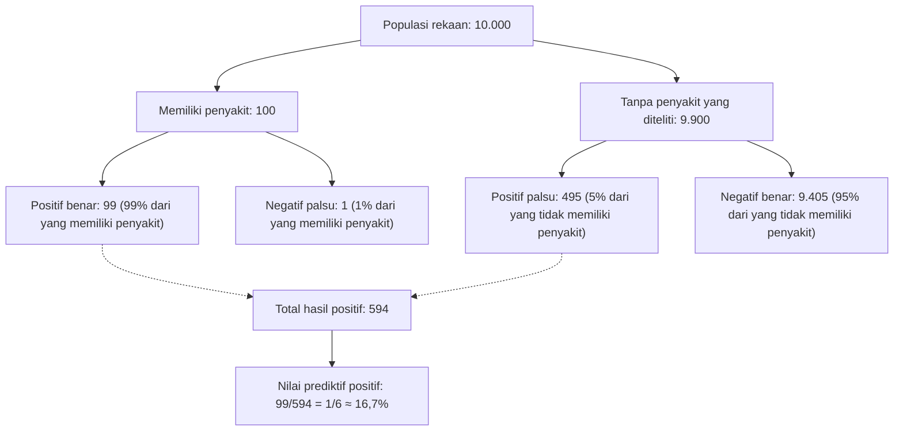
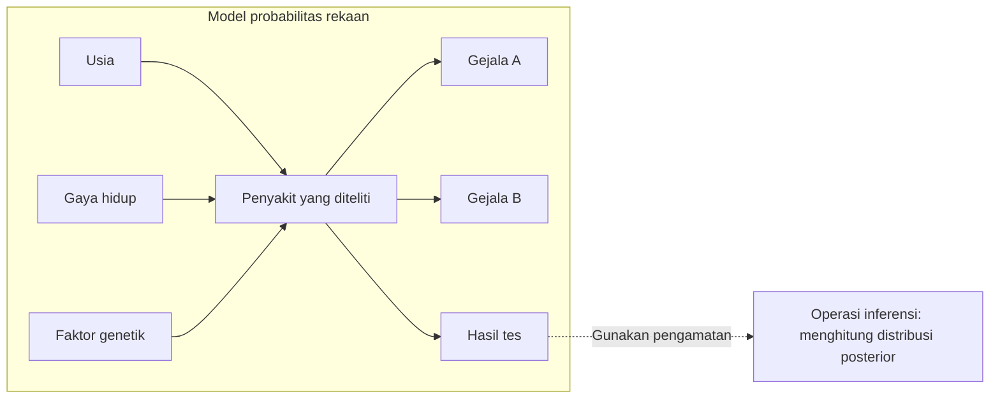

## 1. Memperbarui prediksi di tengah ketidakpastian

Hujan besok, efek obat, atau kemungkinan sebuah surel adalah spam: kita mengambil keputusan dengan informasi yang tidak lengkap. **Teorema Bayes menghubungkan probabilitas suatu kejadian setelah suatu pengamatan diketahui dengan probabilitas bersyarat dalam arah sebaliknya.** Setelah model dan informasi awal ditentukan, teorema ini dapat digunakan untuk memperbarui probabilitas berdasarkan pengamatan baru.

Namanya berasal dari Thomas Bayes, pendeta dan matematikawan abad ke-18. [Surat Richard Price yang memperkenalkan tulisan peninggalan Bayes](https://bayes.wustl.edu/Manual/an.essay.pdf) mencatat pembacaan di Royal Society pada 23 Desember 1763. Inferensi Bayesian modern juga mencakup perkembangan dari banyak peneliti berikutnya. Kita akan membahas rumus, contoh tes, empat penerapan AI, dan perbedaan penafsiran probabilitas.

## 2. Rumus dan peran normalisasi

Untuk kejadian B dengan $P(B)>0$, definisi probabilitas bersyarat memberikan

$$
P(A\mid B)=\frac{P(A\cap B)}{P(B)}
$$

Jika $P(A)>0$ juga berlaku, sehingga probabilitas bersyarat dalam arah sebaliknya terdefinisi, penguraian probabilitas gabungan memberikan

$$
P(A\mid B)=\frac{P(B\mid A)P(A)}{P(B)}
$$

Ketika B merupakan pengamatan baru, peran setiap suku adalah:

- **Probabilitas prior** $P(A)$: probabilitas A sebelum memperhitungkan B.
- **Likelihood** $P(B\mid A)$: probabilitas mengamati B dengan mengasumsikan A.
- **Probabilitas pengamatan / likelihood marginal** $P(B)$: probabilitas total mengamati B.
- **Probabilitas posterior** $P(A\mid B)$: probabilitas A setelah memperhitungkan B.

Perkalian prior dan likelihood hanyalah pembilang. **Untuk memperoleh posterior, kita masih harus membaginya dengan probabilitas pengamatan agar ternormalisasi.** Meskipun probabilitas A nol, rumus pertama yang memakai probabilitas gabungan tetap berlaku jika probabilitas B positif. Jangan langsung menggunakan rumus kedua ketika probabilitas bersyarat dalam arah sebaliknya tidak terdefinisi.

## 3. Likelihood, MAP, dan prediksi posterior berbeda

Misalkan θ adalah parameter yang tidak diketahui dan d adalah data pengamatan. Saat [memperbarui densitas prior dengan likelihood](https://web.stanford.edu/class/stats200/Lecture20.pdf), kita dapat menulis

$$
\pi(\theta\mid d)=\frac{L(\theta;d)\pi(\theta)}{Z(d)},\qquad Z(d)=\int L(t;d)\pi(t)\,dt
$$

Kita mengasumsikan $0<Z(d)<\infty$. Likelihood L adalah fungsi θ dengan d tetap, bukan distribusi probabilitas atas θ. Untuk data kontinu digunakan densitas, yang nilainya dapat melebihi satu. Probabilitas nol pada satu titik pengamatan tidak dengan sendirinya menghalangi pembaruan melalui densitas.

Jika densitas posterior mencapai maksimum, **estimasi maximum a posteriori (MAP)** memilih titik tempat maksimum itu dicapai:

$$
\hat\theta_{\mathrm{MAP}}\in\arg\max_\theta\pi(\theta\mid d)
$$

Sebaliknya, **probabilitas prediktif posterior** untuk pengamatan biner berikutnya diperoleh dengan merata-ratakan prediksi menurut distribusi posterior:

$$
\Pr(Y_{\mathrm{new}}=1\mid d)=\int\Pr(Y_{\mathrm{new}}=1\mid\theta,d)\pi(\theta\mid d)\,d\theta
$$

Sebagai contoh, berikan prior seragam antara nol dan satu pada probabilitas θ munculnya sisi gambar dari sebuah koin. Bersyarat pada θ, tiap lemparan independen. Kita mengamati urutan 1,1,0, dengan 1 berarti gambar dan 0 berarti angka. Maka

$$
\pi(\theta\mid 1,1,0)=12\theta^2(1-\theta),\qquad 0<\theta<1
$$

sehingga

$$
\hat\theta_{\mathrm{MAP}}=\frac23,\qquad\Pr(Y_{\mathrm{new}}=1\mid1,1,0)=\frac35
$$

Memasukkan modus densitas posterior dan mengambil rata-rata menurut distribusi dapat memberikan jawaban berbeda. Memilih kelas, mengestimasi parameter dengan MAP, dan memprediksi pengamatan berikutnya tidak semuanya dapat disebut “memaksimalkan probabilitas posterior”.

## 4. Tes medis hipotetis: sensitivitas 99%, NPP sekitar 16,7%

Ini adalah **contoh perhitungan hipotetis, bukan kinerja terukur dari tes nyata**. D berarti memiliki penyakit yang diteliti, sedangkan T berarti hasil tes positif. Asumsikan prevalensi 1% pada populasi sasaran, sensitivitas 99%, dan tingkat positif palsu 5%.

$$
P(D)=0.01,\qquad P(T\mid D)=0.99,\qquad P(T\mid D^c)=0.05
$$

Komplemen D berarti tidak memiliki penyakit tersebut, bukan sehat dalam segala hal. Menjumlahkan dua sumber hasil positif memberikan

$$
P(T)=P(T\mid D)P(D)+P(T\mid D^c)P(D^c)=0.99\cdot0.01+0.05\cdot0.99=0.0594
$$

Dengan demikian, probabilitas memiliki penyakit ketika hasilnya positif adalah

$$
P(D\mid T)=\frac{0.0099}{0.0594}=\frac{99}{594}=\frac16\approx0.1667
$$

Hasilnya sekitar 16,7%; nilai tepatnya 1/6. Sisanya, 5/6 atau sekitar 83,3% dari hasil positif, merupakan positif palsu pada orang tanpa penyakit yang diteliti. Jika prevalensi rendah, positif palsu dari kelompok tanpa penyakit yang jauh lebih besar dapat melebihi positif benar.

Untuk menyatakan proporsi sebagai jumlah orang, kita membangun populasi rekaan berisi 10.000 orang dengan proporsi persis seperti di atas. Dalam sampel nyata berisi 10.000 orang, jumlah tiap kelompok dapat bervariasi.

| Hasil tes | Memiliki penyakit yang diteliti | Tidak memiliki penyakit yang diteliti | Total |
| --- | ---: | ---: | ---: |
| Positif | 99 (positif benar) | 495 (positif palsu) | 594 |
| Negatif | 1 (negatif palsu) | 9.405 (negatif benar) | 9.406 |
| Total | 100 | 9.900 | 10.000 |

**Sensitivitas 99% tidak berarti nilai prediktif positif (NPP) 99% ataupun akurasi keseluruhan 99%.** Akurasi keseluruhan, yaitu proporsi seluruh hasil yang benar dalam tabel ini, adalah

$$
\frac{99+9405}{10000}=0.9504=95.04\%
$$

[Definisi sensitivitas, spesifisitas, dan nilai prediktif positif](https://www.fda.gov/regulatory-information/search-fda-guidance-documents/statistical-guidance-reporting-results-studies-evaluating-diagnostic-tests-guidance-industry-and-fda) menggunakan penyebut berbeda. Intuisi “99% berarti orang dengan hasil positif hampir pasti sakit” mencampuradukkan kelompok yang menjadi dasar proporsi. Penerapan pada hasil nyata memerlukan prevalensi dan karakteristik tes yang sesuai dengan populasi terkait.

## 5. Penerapan AI 1: klasifikasi Naive Bayes

Untuk mendeteksi spam, fitur X seperti kemunculan kata tertentu memberikan informasi tentang probabilitas posterior kelas C. Asumsi dasar Naive Bayes adalah **independensi bersyarat ketika kelas diketahui**, bukan independensi kata tanpa syarat. Untuk tiga fitur atau lebih, bahkan independensi berpasangan dalam setiap kelas tidak menjamin independensi bersama.

Untuk fitur diskret, anggap probabilitas marginal pengamatan x dan probabilitas prior setiap kelas positif. Jika semua fitur independen secara bersama dalam setiap kelas, maka

$$
\Pr(C=c\mid X=x)\propto\Pr(C=c)\prod_{j=1}^{m}\Pr(X_j=x_j\mid C=c)
$$

Jika semua kesalahan klasifikasi memiliki biaya yang sama, kita memilih kelas dengan probabilitas posterior terbesar. Keputusan klasifikasi ini berbeda dari estimasi MAP atas parameter model itu sendiri.

Kata-kata nyata saling berkaitan, sehingga independensi hanyalah pendekatan. Kesederhanaan dan kecepatan adalah kelebihan, tetapi tidak menjamin akurasi selalu lebih tinggi atau probabilitas terkalibrasi dengan baik. [Dokumentasi resmi scikit-learn](https://scikit-learn.org/stable/modules/naive_bayes.html) juga membedakan kinerja klasifikasi dari kualitas estimasi probabilitas. Model generatif konkretnya berbeda, misalnya Bernoulli untuk ada-tidaknya kata dan multinomial untuk jumlah kemunculannya.

## 6. Penerapan AI 2: jaringan Bayesian

Jaringan Bayesian menyatakan distribusi gabungan melalui graf berarah tanpa siklus (DAG) dan distribusi bersyarat lokal untuk setiap simpul. Pada model diskret berhingga, dengan pa menyatakan nilai simpul induk, faktorisasi tersebut adalah

$$
\Pr(V_1=v_1,\ldots,V_n=v_n)=\prod_{i=1}^{n}\Pr(V_i=v_i\mid\mathrm{pa}_i)
$$

[Menyatakan distribusi dengan DAG](https://ermongroup.github.io/cs228-notes/representation/directed/) juga menetapkan asumsi independensi bersyarat.

Model rekaan berikut menghubungkan usia, gaya hidup, faktor genetik, penyakit, gejala, dan tes. Model ini mengasumsikan ketiga faktor tanpa induk saling independen. Panah utuh menentukan hubungan induk-anak dalam distribusi lokal; diagram ini bukan hubungan sebab-akibat nyata yang telah divalidasi. **Klaim sebab-akibat memerlukan asumsi kausal tambahan**, di luar model dependensi statistik ([pembedaan oleh Pearl](https://ftp.cs.ucla.edu/pub/stat_ser/r350.pdf)).

Catatan pada ujung panah putus-putus adalah operasi inferensi, bukan variabel acak tambahan dalam distribusi gabungan. Menghitung distribusi marginal posterior penyakit atau variabel lain juga tidak sama dengan mempelajari ulang seluruh parameter model. Model seperti ini dapat menjadi kerangka diagnosis, estimasi situasi, atau prediksi keuangan, tetapi kesesuaiannya untuk setiap penggunaan bergantung pada struktur dan data.

## 7. Penerapan AI 3: optimisasi Bayesian

Menyesuaikan hiperparameter seperti laju pembelajaran atau kedalaman jaringan dapat memerlukan pelatihan dan evaluasi berulang. Pengaturan tidak harus dipilih manual oleh manusia; pencarian dapat diotomatisasi.

Optimisasi Bayesian menyatakan hubungan antara pengaturan dan kinerja melalui model pengganti probabilistik, misalnya proses Gaussian, lalu memperbaruinya dengan hasil evaluasi. **Fungsi akuisisi**, seperti peningkatan yang diharapkan, memilih kandidat berikutnya. Eksploitasi wilayah yang menjanjikan dan eksplorasi wilayah yang belum pasti sama-sama penting. [Snoek dan rekan-rekan](https://arxiv.org/abs/1206.2944) mempelajari penyesuaian algoritma pembelajaran mesin.

Tujuannya adalah mengalokasikan evaluasi yang mahal secara efisien. Tidak ada jaminan menemukan optimum dengan jumlah percobaan paling sedikit untuk setiap fungsi objektif, anggaran, dan kondisi derau.

## 8. Penerapan AI 4: pembelajaran mendalam Bayesian

Jaringan saraf biasa juga dapat menghasilkan probabilitas kelas, misalnya melalui softmax. Perhitungan dengan bobot tetap tidak bertentangan dengan keluaran berupa distribusi probabilitas.

Salah satu pendekatan Bayesian memberikan densitas prior pada bobot kontinu w dan memperoleh densitas posteriornya berdasarkan data pelatihan d. Pada model independensi bersyarat yang lazim, probabilitas prediktif posterior untuk kelas diskret y adalah

$$
\Pr(y\mid x,d)=\int\Pr(y\mid x,w)\pi(w\mid d)\,dw
$$

[Makalah asli Blundell dan rekan-rekan](https://arxiv.org/abs/1505.05424) menggunakan distribusi variasional untuk mendekati inferensi yang sulit dihitung secara eksak pada jaringan yang digunakan dalam praktik. Prediksi dapat mencerminkan ketidakpastian bobot, tetapi juga bergantung pada prior, likelihood, dan metode pendekatan.

Keluaran seperti “probabilitas kelas ini 90%” saja tidak menyampaikan seluruh ketidakpastian tentang model. Sebutan Bayesian tidak menjamin prediksi terkalibrasi dalam AI medis atau aplikasi lain. [Penelitian ketidakpastian saat distribusi bergeser](https://arxiv.org/abs/1906.02530) juga mendorong evaluasi perbedaan data pelatihan dan data saat penggunaan.

## 9. Membandingkan inferensi frekuentis dan Bayesian

Kedua pendekatan memakai teori probabilitas; teorema Bayes sendiri adalah matematika yang digunakan bersama. Dalam inferensi statistik, metode frekuentis memperlakukan parameter tak diketahui sebagai nilai tetap dan menekankan sifat prosedur estimasi atau pengujian pada pengambilan sampel berulang. Inferensi Bayesian menyatakan ketidakpastian tentang besaran tak diketahui melalui distribusi prior dan memakai posterior setelah mengamati data. Memberikan distribusi tidak berarti parameter fisik berubah setiap kali ada pengamatan.

Untuk pelemparan koin adil yang independen dan berdistribusi sama, dengan gambar bernilai 1 dan angka bernilai 0, [hukum bilangan besar](https://kenji.blog/id/p/law-of-large-numbers/) memberikan limit

$$
\frac1n\sum_{i=1}^{n}X_i\xrightarrow{\mathrm{a.s.}}\frac12
$$

Simbol a.s. menyatakan konvergensi hampir pasti: probabilitas proporsi tersebut konvergen ke 1/2 adalah 1. Ini tidak menjamin jumlah kemunculan sisi gambar tepat setengah dari jumlah lemparan yang berhingga.

Prior dapat memasukkan pengetahuan ahli atau pilihan seperti distribusi yang memberikan informasi lemah. Tidak tepat menyebut semua prior sekadar selera sewenang-wenang ataupun menganggap pemilihan prior otomatis membuat analisis objektif. Prediksi hujan 70% untuk besok dapat dipahami sebagai probabilitas berbasis model dan informasi yang kalibrasinya dapat dievaluasi. Angka itu saja tidak menentukan aliran statistik tertentu atau keyakinan pribadi seorang peramal cuaca.

## 10. Memperbarui pengamatan dan memeriksa asumsi

Pembaruan Bayesian menggabungkan informasi awal dan pengamatan sesuai aturan probabilitas. Dalam pembaruan berurutan, posterior sebelumnya menjadi prior berikutnya, dan digunakan likelihood bersyarat dari data baru. Jangan mengalikan pengamatan yang sudah dipakai lagi seolah-olah merupakan informasi baru yang independen.

Rumus saja tidak memperbaiki model yang salah atau data yang bias. Memeriksa apa yang diamati serta populasi atau distribusi yang diasumsikan merupakan bagian dari belajar dan merevisi pemahaman. [Paradoks dua amplop](https://kenji.blog/id/p/two-envelopes-paradox/) juga menunjukkan mengapa probabilitas bersyarat harus dihitung dari model yang eksplisit.
