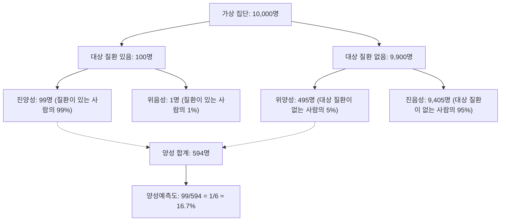
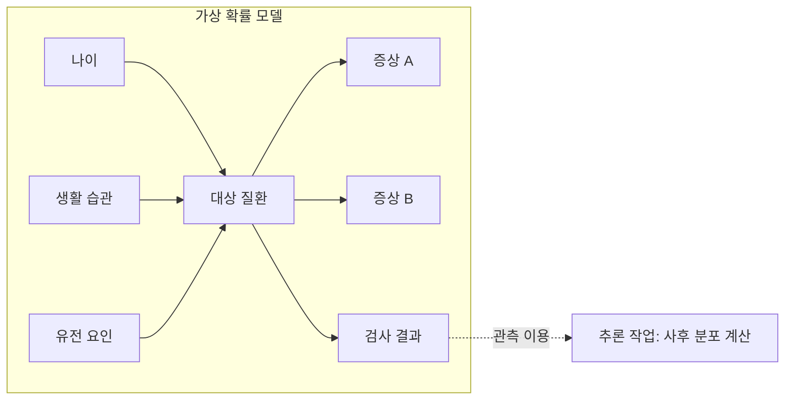

## 1. 불확실한 세계에서 예측을 갱신하기

내일의 비, 약의 효과, 이메일이 스팸일 가능성처럼 우리는 불완전한 정보로 판단합니다. **베이즈 정리는 증거를 조건으로 한 확률과 반대 방향의 조건부 확률을 연결합니다.** 모델과 사전 정보를 정하면 새로운 관측에 따라 확률을 갱신하는 데 사용할 수 있습니다.

이름은 18세기의 목사이자 수학자 토머스 베이즈에서 유래합니다. [베이즈의 유고를 소개한 리처드 프라이스의 편지](https://bayes.wustl.edu/Manual/an.essay.pdf)에는 1763년 12월 23일 왕립학회에서 낭독되었다는 기록이 있습니다. 현대의 베이지안 추론에는 이후 여러 연구자의 발전도 포함됩니다. 여기서는 공식, 검사 예시, AI의 네 가지 응용, 확률 해석의 차이를 살펴봅니다.

## 2. 공식과 정규화의 역할

사건 B가 $P(B)>0$을 만족하면 조건부 확률의 정의에 따라

$$
P(A\mid B)=\frac{P(A\cap B)}{P(B)}
$$

입니다. 여기에 $P(A)>0$도 성립하여 반대 방향의 조건부 확률이 정의되면, 결합확률을 분해해

$$
P(A\mid B)=\frac{P(B\mid A)P(A)}{P(B)}
$$

을 얻습니다. B를 새로운 증거로 보면 각 항의 역할은 다음과 같습니다.

- **사전 확률** $P(A)$: B를 고려하기 전 A의 확률입니다.
- **우도(가능도)** $P(B\mid A)$: A를 가정할 때 B를 관측할 확률입니다.
- **증거의 확률／주변 우도** $P(B)$: B를 관측할 전체 확률입니다.
- **사후 확률** $P(A\mid B)$: B를 고려한 뒤 A의 확률입니다.

사전 확률과 우도의 곱은 분자입니다. **사후 확률을 얻으려면 증거의 확률로 나누어 정규화해야 합니다.** A의 확률이 0이어도 B의 확률이 양수라면 결합확률을 쓰는 첫 번째 식은 유효합니다. 반대 방향의 조건부 확률이 정의되지 않는 경우에 두 번째 식을 그대로 대입하지 않습니다.

## 3. 우도, MAP, 사후 예측은 다릅니다

미지의 모수(파라미터)를 θ, 관측 자료를 d라고 하겠습니다. [사전 밀도를 우도로 갱신](https://web.stanford.edu/class/stats200/Lecture20.pdf)하면

$$
\pi(\theta\mid d)=\frac{L(\theta;d)\pi(\theta)}{Z(d)},\qquad Z(d)=\int L(t;d)\pi(t)\,dt
$$

로 쓸 수 있습니다. 여기서는 $0<Z(d)<\infty$를 가정합니다. 우도 L은 관측 d를 고정하고 θ를 변화시키는 함수이지, θ에 대한 확률분포가 아닙니다. 연속 자료에서는 확률밀도를 사용하며 밀도 값은 1을 넘을 수도 있습니다. 관측한 점 자체의 확률이 0이라는 사실만으로 밀도를 이용한 갱신이 불가능해지는 것은 아닙니다.

사후 밀도가 최댓값을 갖는 점이 존재할 때, **최대 사후 확률 추정(MAP)**은 그런 점을 선택합니다.

$$
\hat\theta_{\mathrm{MAP}}\in\arg\max_\theta\pi(\theta\mid d)
$$

반면 다음 이진 관측의 **사후 예측**은 각 모수에서의 예측을 사후 분포에 따라 평균합니다.

$$
\Pr(Y_{\mathrm{new}}=1\mid d)=\int\Pr(Y_{\mathrm{new}}=1\mid\theta,d)\pi(\theta\mid d)\,d\theta
$$

예를 들어 동전의 앞면 확률 θ에 0부터 1까지의 균등 사전 분포를 둡니다. θ가 주어지면 각 던지기는 독립이고, 앞면을 1로 표시한 관측이 순서대로 1,1,0이었다고 합시다. 그러면

$$
\pi(\theta\mid 1,1,0)=12\theta^2(1-\theta),\qquad 0<\theta<1
$$

이므로

$$
\hat\theta_{\mathrm{MAP}}=\frac23,\qquad\Pr(Y_{\mathrm{new}}=1\mid1,1,0)=\frac35
$$

입니다. 최빈값을 대입하는 것과 분포에 따라 평균하는 것은 다른 답을 줄 수 있습니다. 분류할 클래스를 고르는 일, 모수를 MAP으로 추정하는 일, 미래 관측을 예측하는 일을 모두 ‘사후 확률 최대화’라고 부를 수는 없습니다.

## 4. 가상의 의료 검사: 민감도 99%와 양성예측도 약 16.7%

이것은 **계산을 위한 가상 예시이며 실제 검사에서 측정한 성능이 아닙니다.** D는 대상 질환이 있는 사건, T는 검사 양성을 뜻합니다. 대상 집단의 유병률은 1%, 민감도는 99%, 위양성률은 5%라고 가정합니다.

$$
P(D)=0.01,\qquad P(T\mid D)=0.99,\qquad P(T\mid D^c)=0.05
$$

D의 여사건은 ‘대상 질환이 없음’이지 모든 면에서 건강하다는 뜻은 아닙니다. 질환이 있는 경우와 없는 경우의 양성 확률을 더하면

$$
P(T)=P(T\mid D)P(D)+P(T\mid D^c)P(D^c)=0.99\cdot0.01+0.05\cdot0.99=0.0594
$$

입니다. 따라서 양성일 때 대상 질환이 있을 확률은

$$
P(D\mid T)=\frac{0.0099}{0.0594}=\frac{99}{594}=\frac16\approx0.1667
$$

입니다. 결과는 약 16.7%이며 정확히는 1/6입니다. 양성인 사람 중 나머지 5/6, 약 83.3%는 대상 질환이 없는 위양성입니다. 유병률이 낮으면 대상 질환이 없는 훨씬 큰 집단에서 나오는 위양성이 진양성보다 많을 수 있습니다.

이 비율을 사람 수로 나타내기 위해 비율을 정확히 만족하는 가상의 10,000명 집단을 구성하면 아래 표가 됩니다. 실제로 10,000명을 표본으로 뽑으면 각 인원수는 달라질 수 있습니다.

| 검사 결과 | 대상 질환 있음 | 대상 질환 없음 | 합계 |
| --- | ---: | ---: | ---: |
| 양성 | 99명(진양성) | 495명(위양성) | 594명 |
| 음성 | 1명(위음성) | 9,405명(진음성) | 9,406명 |
| 합계 | 100명 | 9,900명 | 10,000명 |

**민감도 99%는 양성예측도 99%나 전체 정확도 99%를 뜻하지 않습니다.** 이 표의 전체 정확도는

$$
\frac{99+9405}{10000}=0.9504=95.04\%
$$

입니다. [민감도·특이도·양성예측도의 정의](https://www.fda.gov/regulatory-information/search-fda-guidance-documents/statistical-guidance-reporting-results-studies-evaluating-diagnostic-tests-guidance-industry-and-fda)는 분모가 서로 다릅니다. ‘99%이므로 양성이면 거의 확실히 질환이 있다’는 직관은 어느 집단을 조건으로 비율을 구하는지 혼동합니다. 실제 결과에 적용하려면 해당 집단에 맞는 유병률과 검사 특성이 필요합니다.

## 5. AI 응용 1: 나이브 베이즈 분류기

스팸 판별에서는 단어의 포함 여부 같은 특성 X를 이용해 클래스 C의 사후 확률을 구합니다. 나이브 베이즈의 기본 가정은 **클래스가 주어졌을 때의 조건부 독립**입니다. 단어들이 무조건 독립이라는 뜻이 아닙니다. 특성이 세 개 이상이면 각 클래스 안에서 모든 쌍이 독립이어도 상호 독립이 보장되지 않습니다.

이산 특성에서 관측 x의 주변 확률과 각 클래스의 사전 확률이 양수이고, 클래스 안에서 특성 전체가 상호 독립이라면

$$
\Pr(C=c\mid X=x)\propto\Pr(C=c)\prod_{j=1}^{m}\Pr(X_j=x_j\mid C=c)
$$

로 분해할 수 있습니다. 모든 오분류의 비용이 같으면 사후 확률이 가장 큰 클래스를 고릅니다. 이 분류 결정은 모델 모수 자체의 MAP 추정과 다릅니다.

실제 단어들은 연관되어 있으므로 독립성은 근사입니다. 단순함과 계산 속도는 장점이지만 항상 높은 정확도나 잘 보정된 확률을 보장하지는 않습니다. [scikit-learn 공식 설명](https://scikit-learn.org/stable/modules/naive_bayes.html)도 분류 성능과 확률 추정의 품질을 구분합니다. 단어의 포함 여부를 다루는 베르누이형과 출현 횟수를 다루는 다항형 등은 구체적인 생성 모델도 다릅니다.

## 6. AI 응용 2: 베이지안 네트워크

베이지안 네트워크는 방향 비순환 그래프(DAG)와 각 노드의 국소 조건부 분포로 결합분포를 표현합니다. 유한한 이산 모델에서 pa를 부모 노드의 값이라고 하면

$$
\Pr(V_1=v_1,\ldots,V_n=v_n)=\prod_{i=1}^{n}\Pr(V_i=v_i\mid\mathrm{pa}_i)
$$

로 인수분해합니다. [DAG로 확률분포를 표현하는 것](https://ermongroup.github.io/cs228-notes/representation/directed/)은 어떤 조건부 독립성을 가정하는지도 정합니다.

다음은 나이·생활 습관·유전 요인·질환·증상·검사 결과를 연결한 설명용 가상 모델입니다. 부모가 없는 세 요인을 서로 독립이라고 가정합니다. 실선은 국소 분포의 부모·자식 관계를 지정하며 실제 인과관계를 검증한 그림이라는 뜻이 아닙니다. **통계적 의존 모델에서 인과를 주장하려면 별도의 인과 가정이 필요합니다**([Pearl의 구분](https://ftp.cs.ucla.edu/pub/stat_ser/r350.pdf)).

점선 끝은 추론 작업을 나타내는 주석이며 결합분포를 구성하는 추가 확률변수가 아닙니다. 관측을 이용해 질환 등의 사후 주변분포를 계산하는 것과 모델의 모든 모수를 다시 학습하는 것도 다릅니다. 이런 모델은 진단·상황 추정·금융 예측 등의 틀이 될 수 있지만, 각 용도에서의 타당성은 구조와 자료에 달려 있습니다.

## 7. AI 응용 3: 베이지안 최적화

학습률이나 네트워크 깊이 같은 하이퍼파라미터를 조정하려면 학습과 평가를 반복해야 할 수 있습니다. 설정을 사람이 직접 골라야 하는 것은 아니며 자동 탐색도 가능합니다.

베이지안 최적화는 가우스 과정 등의 확률적 대리 모델로 설정과 성능의 관계를 표현하고 평가 결과를 반영해 갱신합니다. 기대 개선량 같은 **획득 함수**로 다음 후보를 고릅니다. 유망한 영역을 활용하는 것과 아직 불확실한 영역을 탐색하는 것이 모두 중요합니다. [Snoek 등의 연구](https://arxiv.org/abs/1206.2944)는 머신러닝 알고리즘의 조정을 다룹니다.

비용이 큰 평가를 효율적으로 배분하려는 방법이지만, 모든 목적함수·예산·잡음 조건에서 최소 횟수로 최적해를 찾는다는 보장은 없습니다.

## 8. AI 응용 4: 베이지안 딥러닝

일반적인 신경망도 softmax 등으로 클래스 확률을 출력할 수 있습니다. 고정 가중치로 계산한다는 것과 확률분포를 출력한다는 것은 양립합니다.

베이지안 접근의 한 예는 연속 가중치 w에 사전 밀도를 두고 학습 자료 d를 반영한 사후 밀도를 구하는 것입니다. 보통의 조건부 독립 모델에서 이산 클래스 y의 사후 예측 확률은

$$
\Pr(y\mid x,d)=\int\Pr(y\mid x,w)\pi(w\mid d)\,dw
$$

입니다. [Blundell 등의 원 논문](https://arxiv.org/abs/1505.05424)은 실제 규모의 네트워크에서 정확히 계산하기 어려운 추론을 변분분포로 근사합니다. 가중치의 불확실성을 예측에 반영할 수 있지만 사전 분포·우도·근사 방법의 선택에도 의존합니다.

‘어떤 클래스의 확률이 90%’라는 출력만으로 모델에 관한 모든 불확실성을 전달한 것은 아닙니다. 베이지안이라는 이름만으로 의료 AI 등의 예측 확률이 잘 보정된다고 보장할 수도 없습니다. [자료 분포 변화에서의 불확실성을 다룬 연구](https://arxiv.org/abs/1906.02530)도 고려해 학습 자료와 사용 단계 자료의 차이를 평가해야 합니다.

## 9. 빈도주의와 베이지안 추론 비교

두 접근 모두 확률론을 사용하며 베이즈 정리 자체는 공통의 수학입니다. 통계적 추론에서 빈도주의 방법은 미지의 모수를 고정값으로 다루고 반복 표본추출에서 추정·검정 절차가 갖는 성질을 중시합니다. 베이지안 추론은 미지량에 대한 불확실성을 사전 분포로 나타내고 관측 후 사후 분포를 사용합니다. 분포를 부여하는 것은 물리적 모수가 관측 때마다 바뀐다는 뜻이 아닙니다.

독립이고 동일한 분포를 따르는 공정한 동전 던지기에서 앞면을 1, 뒷면을 0으로 나타내면 [큰 수의 법칙](https://kenji.blog/ko/p/law-of-large-numbers/)은

$$
\frac1n\sum_{i=1}^{n}X_i\xrightarrow{\mathrm{a.s.}}\frac12
$$

이라는 거의 확실한 수렴을 줍니다. 즉, 앞면 비율이 1/2로 수렴할 확률이 1입니다. 유한 번 던졌을 때 앞면이 반드시 정확히 절반이라는 보장은 아닙니다.

베이지안 사전 분포에는 전문 지식을 반영하는 선택이나 약한 정보를 주는 선택 등이 있습니다. 모두 임의의 취향이라고 치부하거나, 사전 분포를 두면 자동으로 객관적이라고 생각하는 것은 적절하지 않습니다. 내일 비가 올 확률 70%도 모델과 정보에 근거한 확률 예측으로 읽고 보정 상태를 평가할 수 있습니다. 이 숫자만으로 특정 통계 학파나 예보자 개인의 확신 정도를 단정할 수는 없습니다.

## 10. 증거를 갱신하고 가정도 점검하기

베이지안 갱신은 확률 규칙에 따라 사전 정보와 증거를 결합합니다. 순차 갱신에서는 이전 사후 분포를 다음 사전 분포로 삼고 새 자료의 조건부 우도를 사용합니다. 이미 사용한 관측을 독립적인 새 증거인 것처럼 다시 곱하지 않습니다.

공식만으로 잘못된 모델이나 편향된 자료가 올바르게 바뀌지는 않습니다. 무엇을 관측했고 어떤 집단과 분포를 가정했는지 점검하는 것도 새로 배우고 이해를 고치는 과정입니다. [두 봉투의 역설](https://kenji.blog/ko/p/two-envelopes-paradox/)도 명시적인 모델에서 조건부 확률을 계산해야 하는 이유를 보여 줍니다.
