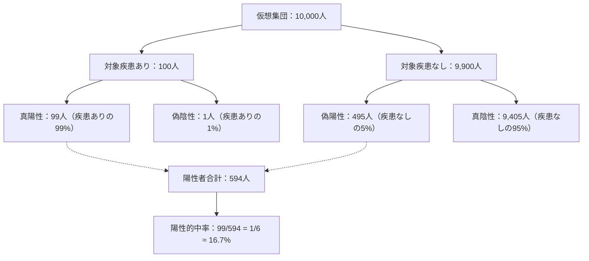
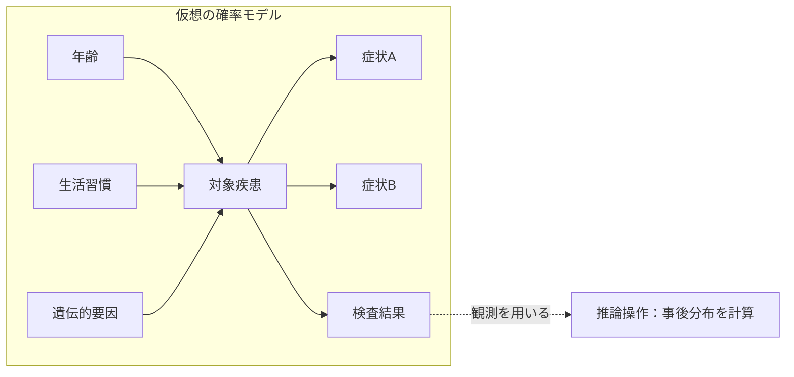

## 1. 不確実な世界で予測を更新する

明日の雨、薬の効果、受信メールがスパムである可能性。私たちは不完全な情報から判断します。**ベイズの定理は、証拠を条件にした確率と、逆向きの条件付き確率を結び付ける定理**です。モデルと事前情報を定めれば、新しい観測に基づく確率の更新に使えます。

名称は18世紀の牧師・数学者トーマス・ベイズに由来します。[遺稿を伝えるリチャード・プライスの書簡](https://bayes.wustl.edu/Manual/an.essay.pdf)には、1763年12月23日にRoyal Societyで読まれたことが記されています。現代のベイズ推論は、その後の多くの研究者による発展も含みます。ここでは公式、検査例、AIの4つの応用、確率解釈の違いを順に扱います。

## 2. 公式と正規化の役割

事象Bの確率が $P(B)>0$ なら、条件付き確率の定義から

$$
P(A\mid B)=\frac{P(A\cap B)}{P(B)}
$$

です。さらに $P(A)>0$ で逆向きの条件付き確率も定義されるとき、同時確率を分解して

$$
P(A\mid B)=\frac{P(B\mid A)P(A)}{P(B)}
$$

を得ます。新しい証拠をBとすると、各項は次の役割を持ちます。

- **事前確率** $P(A)$：Bを考慮する前のAの確率。
- **尤度** $P(B\mid A)$：Aを仮定したとき、Bが観測される確率。
- **証拠の確率／周辺尤度** $P(B)$：Bが観測される全体の確率。
- **事後確率** $P(A\mid B)$：Bを考慮した後のAの確率。

事前確率と尤度の積は分子です。**事後確率にするには、証拠の確率で割って正規化します。** Aの確率が0でも、Bの確率が正なら最初の同時確率による式は使えます。逆向きの条件付き確率が未定義な場合まで、2番目の式をそのまま代入しません。

## 3. 尤度、MAP、事後予測は別のもの

未知パラメータをθ、観測データをdとします。[事前密度と尤度から事後密度を求める](https://web.stanford.edu/class/stats200/Lecture20.pdf)場合は、

$$
\pi(\theta\mid d)=\frac{L(\theta;d)\pi(\theta)}{Z(d)},\qquad Z(d)=\int L(t;d)\pi(t)\,dt
$$

と書けます。ここでは $0<Z(d)<\infty$ を仮定します。尤度Lは、観測dを固定してθを変化させる関数です。θについての確率分布ではありません。連続データでは確率密度を用い、密度の値が1を超えることもあります。観測点そのものの確率が0であることと、密度による更新ができないことは同じではありません。

事後密度の最大点が存在するとき、それを選ぶ**MAP推定**は

$$
\hat\theta_{\mathrm{MAP}}\in\arg\max_\theta\pi(\theta\mid d)
$$

です。一方、次の二値観測を予測する**事後予測**は、各パラメータでの予測を事後分布で平均します。

$$
\Pr(Y_{\mathrm{new}}=1\mid d)=\int\Pr(Y_{\mathrm{new}}=1\mid\theta,d)\pi(\theta\mid d)\,d\theta
$$

例えば、表の確率θに0から1までの一様事前分布を置き、θを与えると独立なコイン投げで順に1,1,0を観測したとします。1を表とすると、

$$
\pi(\theta\mid 1,1,0)=12\theta^2(1-\theta),\qquad 0<\theta<1
$$

なので、

$$
\hat\theta_{\mathrm{MAP}}=\frac23,\qquad\Pr(Y_{\mathrm{new}}=1\mid1,1,0)=\frac35
$$

です。モードを代入する操作と、分布で平均する操作では答えが異なります。分類のクラス選択、パラメータのMAP、将来の予測を一括して「事後確率の最大化」とは呼べません。

## 4. 仮想の医療検査：感度99%でも陽性的中率は約16.7%

ここからは実在の検査性能ではなく、**計算用の仮想例**です。Dを対象疾患がある事象、Tを検査陽性とします。対象集団の有病率は1%、感度は99%、偽陽性率は5%とします。

$$
P(D)=0.01,\qquad P(T\mid D)=0.99,\qquad P(T\mid D^c)=0.05
$$

Dの補事象は「対象疾患がない」であり、あらゆる意味で健康という意味ではありません。陽性の確率は、疾患あり・なしの2通りを足して

$$
P(T)=P(T\mid D)P(D)+P(T\mid D^c)P(D^c)=0.99\cdot0.01+0.05\cdot0.99=0.0594
$$

です。したがって、陽性だったときに対象疾患がある確率は

$$
P(D\mid T)=\frac{0.0099}{0.0594}=\frac{99}{594}=\frac16\approx0.1667
$$

となります。結果は約16.7%、正確には1/6です。陽性者の残り5/6、約83.3%は対象疾患がない偽陽性です。低い有病率では、疾患がない多数の人から生じる偽陽性が、真陽性を上回ることがあります。

人数で表すため、この比率をちょうど持つ架空の1万人集団を作ると次の表になります。現実に1万人を標本抽出すれば、人数は変動します。

| 検査結果 | 対象疾患あり | 対象疾患なし | 合計 |
| --- | ---: | ---: | ---: |
| 陽性 | 99（真陽性） | 495（偽陽性） | 594 |
| 陰性 | 1（偽陰性） | 9,405（真陰性） | 9,406 |
| 合計 | 100 | 9,900 | 10,000 |

**感度99%は、陽性的中率99%でも全体正解率99%でもありません。** この表の全体正解率は

$$
\frac{99+9405}{10000}=0.9504=95.04\%
$$

です。[感度・特異度・陽性的中率の定義](https://www.fda.gov/regulatory-information/search-fda-guidance-documents/statistical-guidance-reporting-results-studies-evaluating-diagnostic-tests-guidance-industry-and-fda)では、それぞれ分母が異なります。「99%だから陽性ならほぼ確実」という直感では、どの集団を条件にした割合かを取り違えています。実際の結果へ適用するには、その対象集団に合った有病率や検査特性が必要です。

## 5. AIへの応用①：ナイーブベイズ分類器

スパム判定では、単語の有無などの特徴XからクラスCの事後確率を求めます。ナイーブベイズの基本となる仮定は、**クラスを与えた条件付き独立**です。単語が無条件に独立だという意味ではありません。3つ以上の特徴では、全ペアの独立だけでも不十分です。

離散特徴について、観測xの周辺確率とクラスの事前確率が正で、クラス内で特徴全体が独立なら、

$$
\Pr(C=c\mid X=x)\propto\Pr(C=c)\prod_{j=1}^{m}\Pr(X_j=x_j\mid C=c)
$$

と分解できます。各誤分類のコストが同じなら、最大の事後確率を持つクラスを選びます。この分類判断と、モデルパラメータ自体のMAP推定は別です。

実際の単語には関連があり、独立性は近似です。単純さと計算の速さは利点ですが、精度や確率の校正が常に優れる保証はありません。[scikit-learnの公式説明](https://scikit-learn.org/stable/modules/naive_bayes.html)も、分類性能と確率推定の品質を区別しています。単語の有無を扱うベルヌーイ型と、語の出現回数を扱う多項型などでは、具体的な生成モデルも異なります。

## 6. AIへの応用②：ベイジアンネットワーク

ベイジアンネットワークは、有向非巡回グラフ（DAG）と各ノードの局所条件付き分布で同時分布を表します。有限離散モデルでは、親ノードの値をpaとして

$$
\Pr(V_1=v_1,\ldots,V_n=v_n)=\prod_{i=1}^{n}\Pr(V_i=v_i\mid\mathrm{pa}_i)
$$

と因数分解します。[DAGによる確率分布の表現](https://ermongroup.github.io/cs228-notes/representation/directed/)は、どの条件付き独立性を仮定するかも指定します。

次は年齢・生活習慣・遺伝的要因、疾患、症状、検査結果を結ぶ説明用の仮想モデルです。この図では3つの親のない要因を独立と仮定しています。実線は局所分布の親子関係で、現実の因果関係を検証した図という意味ではありません。**依存のモデルから因果を主張するには追加の因果仮定が必要**です（[Pearlの区別](https://ftp.cs.ucla.edu/pub/stat_ser/r350.pdf)）。

点線の先は推論操作の注記であり、同時分布を構成する追加の確率変数ではありません。観測から疾患などの事後周辺分布を計算することと、モデルの全パラメータを学習し直すことも別です。この種の確率モデルは診断・状況推定・金融予測などを考える枠組みになりますが、用途ごとの妥当性は構造とデータに依存します。

## 7. AIへの応用③：ベイズ最適化

学習率やネットワークの深さなどのハイパーパラメータを調整するには、学習と評価を何度も行う場合があります。設定を人が手で選ぶ必要はなく、自動探索も可能です。

ベイズ最適化では、ガウス過程などの確率的な代理モデルで設定と性能の関係を表し、評価結果を加えて更新します。次の候補は、期待改善などの**獲得関数**で選びます。有望な場所を調べる活用と、まだ不確かな場所を調べる探索の両方が重要です。[Snoekらの研究](https://arxiv.org/abs/1206.2944)は機械学習アルゴリズムの調整を扱っています。

高価な評価を効率よく配分する狙いはありますが、どんな目的関数・予算・ノイズでも、最少の試行で最適解が必ず得られるわけではありません。

## 8. AIへの応用④：ベイズ深層学習

通常のニューラルネットワークも、softmaxなどでクラス確率を出力できます。固定した重みで計算することと、出力が確率分布であることは両立します。

ベイズ的な扱いの一例では、連続の重みwに事前密度を置き、学習データdを考慮した事後密度を求めます。通常の条件付き独立モデルで、離散クラスyの事後予測確率は

$$
\Pr(y\mid x,d)=\int\Pr(y\mid x,w)\pi(w\mid d)\,dw
$$

です。[Blundellらの原論文](https://arxiv.org/abs/1505.05424)では、実用的な大きさのネットワークで難しい厳密推論を変分分布などで近似します。重みの不確実性を予測に反映できますが、事前・尤度・近似方法の選択にも依存します。

「あるクラスの確率90%」という出力だけでは、モデルに関する不確実性を全て伝えたことにはなりません。ベイズ法という名称だけで、医療AIなどの予測が正しく校正される保証もありません。[分布変化下の不確実性を調べた研究](https://arxiv.org/abs/1906.02530)も踏まえ、学習時と利用時のデータの違いを含めて評価する必要があります。

## 9. 頻度主義とベイズ主義を比べる

両者とも確率論を使い、ベイズの定理そのものは共通の数学です。統計的推論では、頻度主義は未知パラメータを固定値として扱い、標本を繰り返したときの推定・検定手続きの性質を重視します。ベイズ推論は未知量への不確実性を事前分布で表し、観測後の事後分布を用います。分布を置くことは、物理的なパラメータが観測のたびに変わるという意味ではありません。

公平で独立同分布のコイン投げで、表を1、裏を0とするなら、[大数の法則](https://kenji.blog/p/law-of-large-numbers/)は

$$
\frac1n\sum_{i=1}^{n}X_i\xrightarrow{\mathrm{a.s.}}\frac12
$$

という極限を与えます。有限回で表が必ず厳密に半分になる、という保証ではありません。

ベイズの事前分布には専門知識を反映するものや、弱情報的な選択などがあります。全てを恣意的な好みと片付けるのも、事前を置けば客観性が自動で得られると考えるのも適切ではありません。明日の雨を70%とする予測も、モデルと情報に基づく確率として読み、予測の校正を評価できます。それだけで特定の統計的流派や、担当者個人の確信度を断定はできません。

## 10. 新しい証拠とともに、前提も点検する

ベイズ更新は、事前情報と証拠を整合的に組み合わせる方法です。逐次更新では、前回の事後を次の事前にし、新しいデータの条件付き尤度を使います。既に使った観測を独立の新証拠として二重に掛けません。

もっとも、公式だけで誤ったモデルや偏ったデータが正しくなるわけではありません。何を観測し、どんな集団や分布を仮定したのかを点検することが、柔軟に学び直すために必要です。[2つの封筒のパラドックス](https://kenji.blog/p/two-envelopes-paradox/)も、条件付き確率を具体的なモデルから計算する重要性を示す例です。
