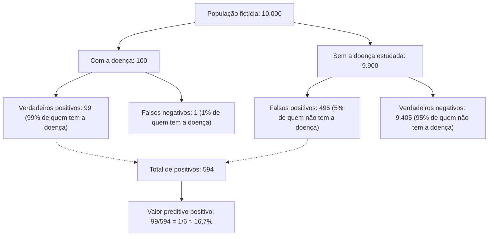
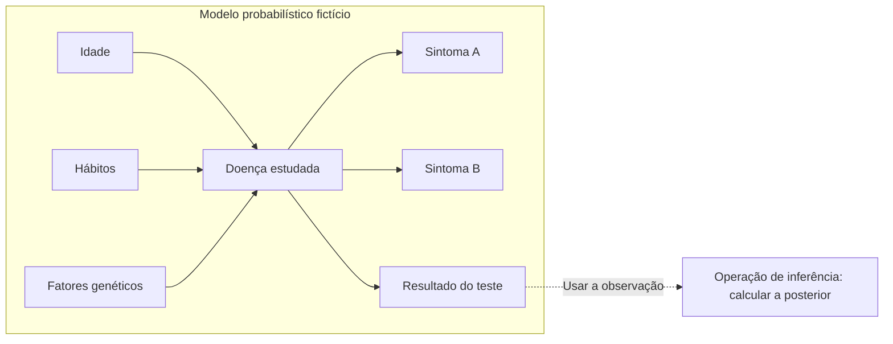

## 1. Atualizar previsões em um mundo incerto

A chuva de amanhã, o efeito de um medicamento ou a possibilidade de um e-mail ser spam: decidimos com informações incompletas. **O teorema de Bayes relaciona uma probabilidade condicionada à evidência com a probabilidade condicional no sentido inverso.** Definidos o modelo e as informações prévias, ele permite atualizar probabilidades com novas observações.

O nome homenageia Thomas Bayes, pastor e matemático do século XVIII. [A carta de Richard Price que apresenta seu ensaio póstumo](https://bayes.wustl.edu/Manual/an.essay.pdf) registra a leitura na Royal Society em 23 de dezembro de 1763. A inferência bayesiana moderna também incorpora desenvolvimentos de muitos pesquisadores posteriores. Veremos a fórmula, um exemplo de teste, quatro aplicações em IA e diferentes interpretações da probabilidade.

## 2. A fórmula e o papel da normalização

Para um evento B com $P(B)>0$, a definição de probabilidade condicional fornece

$$
P(A\mid B)=\frac{P(A\cap B)}{P(B)}
$$

Se também $P(A)>0$, de modo que a probabilidade condicional inversa esteja definida, a decomposição da probabilidade conjunta fornece

$$
P(A\mid B)=\frac{P(B\mid A)P(A)}{P(B)}
$$

Quando B é uma nova evidência, cada termo tem o seguinte papel:

- **Probabilidade a priori** $P(A)$: probabilidade de A antes de incorporar B.
- **Verossimilhança** $P(B\mid A)$: probabilidade de observar B sob a hipótese A.
- **Evidência ou verossimilhança marginal** $P(B)$: probabilidade total de observar B.
- **Probabilidade a posteriori** $P(A\mid B)$: probabilidade de A após incorporar B.

O produto da probabilidade prévia pela verossimilhança é o numerador. **Para obter a posterior, é preciso dividir pela evidência e normalizar.** Mesmo que A tenha probabilidade zero, a primeira fórmula, baseada na probabilidade conjunta, continua válida se B tiver probabilidade positiva. Não se deve substituir diretamente na segunda quando a probabilidade condicional inversa não está definida.

## 3. Verossimilhança, MAP e previsão a posteriori

Denotemos por θ o parâmetro desconhecido e por d os dados observados. Ao [atualizar uma densidade prévia pela verossimilhança](https://web.stanford.edu/class/stats200/Lecture20.pdf), escrevemos

$$
\pi(\theta\mid d)=\frac{L(\theta;d)\pi(\theta)}{Z(d)},\qquad Z(d)=\int L(t;d)\pi(t)\,dt
$$

Supomos $0<Z(d)<\infty$. A verossimilhança L é uma função de θ com d fixado, não uma distribuição de probabilidade sobre θ. Dados contínuos usam densidades, cujos valores podem ultrapassar um. Um ponto observado ter probabilidade zero não impede, por si só, a atualização por densidades.

Se a densidade posterior atinge um máximo, a **estimação de máximo a posteriori (MAP)** seleciona um ponto em que isso ocorre:

$$
\hat\theta_{\mathrm{MAP}}\in\arg\max_\theta\pi(\theta\mid d)
$$

Já a **previsão a posteriori** de uma futura observação binária calcula a média das previsões em relação à distribuição posterior:

$$
\Pr(Y_{\mathrm{new}}=1\mid d)=\int\Pr(Y_{\mathrm{new}}=1\mid\theta,d)\pi(\theta\mid d)\,d\theta
$$

Por exemplo, atribuamos uma distribuição prévia uniforme entre zero e um à probabilidade θ de obter cara. Condicionadas a θ, as jogadas são independentes. Observamos, em ordem, 1,1,0, com 1 representando cara. Então

$$
\pi(\theta\mid 1,1,0)=12\theta^2(1-\theta),\qquad 0<\theta<1
$$

e, portanto,

$$
\hat\theta_{\mathrm{MAP}}=\frac23,\qquad\Pr(Y_{\mathrm{new}}=1\mid1,1,0)=\frac35
$$

Substituir a moda e calcular uma média sobre uma distribuição podem produzir respostas diferentes. Escolher uma classe, estimar parâmetros por MAP e prever observações futuras não podem ser descritos, em conjunto, como «maximizar a probabilidade posterior».

## 4. Um teste médico hipotético: sensibilidade de 99% e VPP de aproximadamente 16,7%

Este é **um exemplo de cálculo hipotético, não o desempenho medido de um teste real**. D significa ter a doença estudada e T obter um resultado positivo. Suponhamos prevalência de 1% na população de interesse, sensibilidade de 99% e taxa de falsos positivos de 5%.

$$
P(D)=0.01,\qquad P(T\mid D)=0.99,\qquad P(T\mid D^c)=0.05
$$

O complementar de D significa não ter essa doença; não significa estar saudável em todos os aspectos. Somando as duas fontes de resultados positivos, obtemos

$$
P(T)=P(T\mid D)P(D)+P(T\mid D^c)P(D^c)=0.99\cdot0.01+0.05\cdot0.99=0.0594
$$

Portanto, a probabilidade de ter a doença dado um resultado positivo é

$$
P(D\mid T)=\frac{0.0099}{0.0594}=\frac{99}{594}=\frac16\approx0.1667
$$

O resultado é aproximadamente 16,7%; o valor exato é 1/6. Os 5/6 restantes, cerca de 83,3% dos positivos, são falsos positivos sem a doença estudada. Com prevalência baixa, os falsos positivos do grupo muito maior sem a doença podem superar os verdadeiros positivos.

Para expressar as proporções em pessoas, construímos uma população fictícia de 10.000 com exatamente essas proporções. Em uma amostra real de 10.000, os números variariam.

| Resultado | Com a doença estudada | Sem a doença estudada | Total |
| --- | ---: | ---: | ---: |
| Positivo | 99 (verdadeiros positivos) | 495 (falsos positivos) | 594 |
| Negativo | 1 (falso negativo) | 9.405 (verdadeiros negativos) | 9.406 |
| Total | 100 | 9.900 | 10.000 |

**Sensibilidade de 99% não significa valor preditivo positivo de 99% nem acurácia global de 99%.** A acurácia global, isto é, a proporção total de acertos nesta tabela, é

$$
\frac{99+9405}{10000}=0.9504=95.04\%
$$

As [definições de sensibilidade, especificidade e valor preditivo positivo](https://www.fda.gov/regulatory-information/search-fda-guidance-documents/statistical-guidance-reporting-results-studies-evaluating-diagnostic-tests-guidance-industry-and-fda) usam denominadores diferentes. A intuição «99% significa que um positivo quase certamente tem a doença» confunde o grupo sobre o qual se calcula a proporção. Para aplicar o cálculo a resultados reais, a prevalência e as características do teste precisam corresponder à população relevante.

## 5. Aplicação em IA 1: classificação Naive Bayes

Na detecção de spam, características X, como a presença de determinadas palavras, informam a probabilidade posterior da classe C. A hipótese básica do Naive Bayes é a **independência condicional dada a classe**, não a independência incondicional das palavras. Com três ou mais características, nem mesmo a independência aos pares dentro de cada classe garante a independência conjunta.

Para características discretas, suponhamos que a observação x tenha probabilidade marginal positiva, que as probabilidades prévias das classes sejam positivas e que as características sejam conjuntamente independentes dentro de cada classe. Então

$$
\Pr(C=c\mid X=x)\propto\Pr(C=c)\prod_{j=1}^{m}\Pr(X_j=x_j\mid C=c)
$$

Se todas as classificações incorretas têm o mesmo custo, escolhe-se uma classe com probabilidade posterior máxima. Essa decisão de classificação é diferente da estimação MAP dos próprios parâmetros do modelo.

Palavras reais têm relações entre si, portanto a independência é uma aproximação. Simplicidade e rapidez são vantagens, mas não garantem sempre maior acurácia nem probabilidades bem calibradas. A [documentação oficial do scikit-learn](https://scikit-learn.org/stable/modules/naive_bayes.html) também distingue desempenho de classificação e qualidade das probabilidades estimadas. Os modelos generativos concretos variam: por exemplo, Bernoulli para presença de palavras e multinomial para suas contagens.

## 6. Aplicação em IA 2: redes bayesianas

Uma rede bayesiana representa uma distribuição conjunta por meio de um grafo dirigido acíclico (DAG) e uma distribuição condicional local para cada nó. Em um modelo discreto finito, com pa indicando os valores dos nós pais, a fatoração é

$$
\Pr(V_1=v_1,\ldots,V_n=v_n)=\prod_{i=1}^{n}\Pr(V_i=v_i\mid\mathrm{pa}_i)
$$

[Representar uma distribuição por um DAG](https://ermongroup.github.io/cs228-notes/representation/directed/) também especifica hipóteses de independência condicional.

O modelo fictício abaixo relaciona idade, hábitos, fatores genéticos, doença, sintomas e um teste. Ele supõe independentes os três fatores sem pais. As setas contínuas especificam as relações entre pais e filhos nas distribuições locais; não tornam o gráfico um diagrama validado de relações causais reais. **Afirmações causais exigem hipóteses causais adicionais**, além de um modelo de dependências estatísticas ([distinção de Pearl](https://ftp.cs.ucla.edu/pub/stat_ser/r350.pdf)).

A anotação indicada pela seta tracejada é uma operação de inferência, não uma variável aleatória adicional da distribuição conjunta. Calcular distribuições marginais posteriores da doença ou de outras variáveis também não equivale a reaprender todos os parâmetros. Esses modelos oferecem um quadro para diagnóstico, estimativa de situações ou previsão financeira, mas a validade em cada uso depende da estrutura e dos dados.

## 7. Aplicação em IA 3: otimização bayesiana

Ajustar hiperparâmetros, como taxa de aprendizado ou profundidade da rede, pode exigir treinamentos e avaliações repetidos. Não é necessário selecionar as configurações manualmente: a busca pode ser automatizada.

A otimização bayesiana representa a relação entre configuração e desempenho por um modelo substituto probabilístico, como um processo gaussiano, e o atualiza com os resultados das avaliações. Uma **função de aquisição**, como a melhoria esperada, escolhe o próximo candidato. Importam tanto a exploração de regiões incertas quanto o aproveitamento de regiões promissoras. [Snoek e colaboradores](https://arxiv.org/abs/1206.2944) estudam o ajuste de algoritmos de aprendizado de máquina.

O objetivo é distribuir avaliações caras de maneira eficiente. Não se garante encontrar o ótimo no menor número de tentativas para toda função objetivo, orçamento ou condição de ruído.

## 8. Aplicação em IA 4: aprendizado profundo bayesiano

Uma rede neural comum também pode produzir probabilidades de classe, por exemplo com softmax. Calcular com pesos fixos é compatível com produzir uma distribuição de probabilidade.

Um tratamento bayesiano pode atribuir uma densidade prévia aos pesos contínuos w e obter sua densidade posterior condicionada aos dados de treinamento d. No modelo usual de independência condicional, a probabilidade preditiva posterior de uma classe discreta y é

$$
\Pr(y\mid x,d)=\int\Pr(y\mid x,w)\pi(w\mid d)\,dw
$$

O [trabalho original de Blundell e colaboradores](https://arxiv.org/abs/1505.05424) aproxima, com uma distribuição variacional, a inferência difícil de calcular exatamente em redes de tamanho prático. As previsões podem refletir incerteza sobre os pesos, mas dependem da distribuição prévia, da verossimilhança e do método de aproximação.

Uma saída como «90% de probabilidade de uma classe» não transmite, sozinha, toda a incerteza sobre o modelo. Chamar um método de bayesiano não garante previsões calibradas em IA médica nem em outras aplicações. A [pesquisa sobre incerteza diante de mudanças de distribuição](https://arxiv.org/abs/1906.02530) também motiva avaliar diferenças entre os dados de treinamento e os dados de uso.

## 9. Comparar inferência frequentista e bayesiana

Ambas as abordagens usam teoria da probabilidade; o teorema de Bayes é matemática compartilhada. Na inferência estatística, métodos frequentistas tratam parâmetros desconhecidos como fixos e enfatizam as propriedades dos procedimentos de estimação ou teste sob amostragem repetida. A inferência bayesiana representa a incerteza sobre quantidades desconhecidas com uma distribuição prévia e usa a posterior após observar dados. Atribuir uma distribuição não significa que um parâmetro físico mude a cada observação.

Para lançamentos independentes e identicamente distribuídos de uma moeda equilibrada, com cara representada por 1 e coroa por 0, a [lei dos grandes números](https://kenji.blog/pt/p/law-of-large-numbers/) dá o limite

$$
\frac1n\sum_{i=1}^{n}X_i\xrightarrow{\mathrm{a.s.}}\frac12
$$

O símbolo a.s. indica convergência quase certa: a probabilidade de a proporção convergir para 1/2 é 1. Isso não garante exatamente metade de caras em um número finito de lançamentos.

Distribuições prévias podem incorporar conhecimento especializado ou escolhas como distribuições fracamente informativas. É inadequado descartá-las todas como preferências arbitrárias ou supor que escolher uma prévia torna a análise automaticamente objetiva. Uma previsão de 70% de chuva amanhã pode ser interpretada como probabilidade baseada em um modelo e em informações, cuja calibração pode ser avaliada. Esse número, por si só, não identifica uma escola estatística nem a confiança pessoal de quem fez a previsão.

## 10. Atualizar a evidência e examinar as hipóteses

A atualização bayesiana combina informações prévias e evidência conforme as regras de probabilidade. Na atualização sequencial, a posterior anterior torna-se a nova prévia e usa-se a verossimilhança condicional dos dados novos. Não se deve multiplicar novamente uma observação já utilizada como se fosse evidência nova e independente.

A fórmula não corrige, por si só, um modelo errado ou dados enviesados. Examinar o que foi observado e qual população ou distribuição foi suposta faz parte de aprender e rever nossa compreensão. O [paradoxo dos dois envelopes](https://kenji.blog/pt/p/two-envelopes-paradox/) também mostra por que probabilidades condicionais devem ser calculadas a partir de um modelo explícito.
