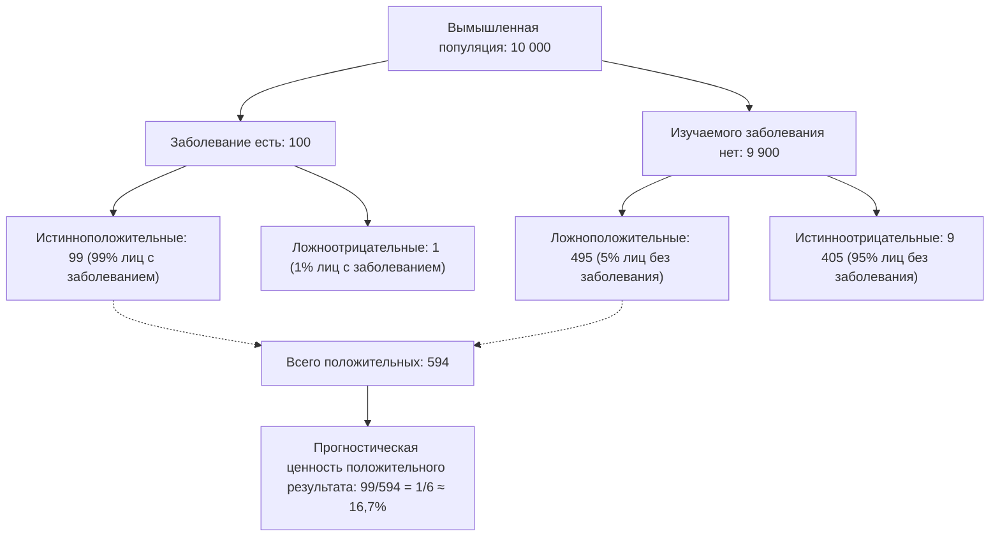
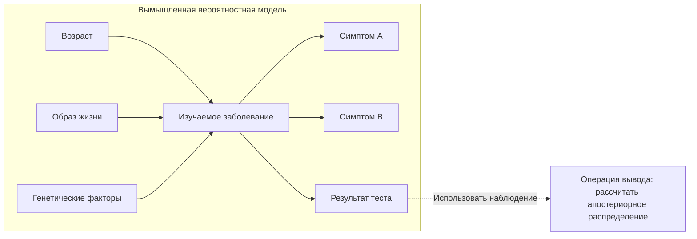

## 1. Обновление прогнозов в условиях неопределённости

Завтрашний дождь, действие лекарства или вероятность того, что письмо — спам: мы принимаем решения при неполной информации. **Теорема Байеса связывает вероятность события при данном наблюдении с вероятностью этого наблюдения при данном событии.** Задав модель и исходную информацию, можно обновлять вероятности по новым наблюдениям.

Теорема названа в честь Томаса Байеса, священника и математика XVIII века. [Письмо Ричарда Прайса, представляющее посмертную работу Байеса](https://bayes.wustl.edu/Manual/an.essay.pdf), содержит отметку о чтении в Royal Society 23 декабря 1763 года. Современная байесовская статистика включает и результаты многих последующих исследователей. Рассмотрим формулу, пример тестирования, четыре применения в ИИ и разные интерпретации вероятности.

## 2. Формула и роль нормировки

Для события B с $P(B)>0$ определение условной вероятности даёт

$$
P(A\mid B)=\frac{P(A\cap B)}{P(B)}
$$

Если также $P(A)>0$, так что определена и обратная условная вероятность, разложение совместной вероятности даёт

$$
P(A\mid B)=\frac{P(B\mid A)P(A)}{P(B)}
$$

Когда B обозначает новое наблюдение, смысл членов таков:

- **Априорная вероятность** $P(A)$: вероятность A до учёта B.
- **Правдоподобие** $P(B\mid A)$: вероятность наблюдать B при предположении A.
- **Вероятность наблюдения / маргинальное правдоподобие** $P(B)$: полная вероятность наблюдать B.
- **Апостериорная вероятность** $P(A\mid B)$: вероятность A после учёта B.

Произведение априорной вероятности и правдоподобия — только числитель. **Для получения апостериорной вероятности нужно разделить на вероятность наблюдения, то есть выполнить нормировку.** Даже если A имеет нулевую вероятность, первая формула через совместную вероятность остаётся верной при положительной вероятности B. Нельзя просто подставлять значения во вторую формулу, когда обратная условная вероятность не определена.

## 3. Правдоподобие, MAP и апостериорное предсказание

Обозначим неизвестный параметр через θ, а наблюдаемые данные через d. При [обновлении априорной плотности с помощью правдоподобия](https://web.stanford.edu/class/stats200/Lecture20.pdf) записывают

$$
\pi(\theta\mid d)=\frac{L(\theta;d)\pi(\theta)}{Z(d)},\qquad Z(d)=\int L(t;d)\pi(t)\,dt
$$

Предполагается $0<Z(d)<\infty$. Правдоподобие L — функция θ при фиксированных d, а не распределение вероятности по θ. Для непрерывных данных используют плотности, значения которых могут превышать единицу. Нулевая вероятность отдельной наблюдённой точки сама по себе не препятствует обновлению через плотности.

Если апостериорная плотность достигает максимума, **MAP-оценка (максимум апостериори)** выбирает одну из точек максимума:

$$
\hat\theta_{\mathrm{MAP}}\in\arg\max_\theta\pi(\theta\mid d)
$$

Напротив, **апостериорная предиктивная вероятность** будущего бинарного наблюдения получается усреднением прогнозов по апостериорному распределению:

$$
\Pr(Y_{\mathrm{new}}=1\mid d)=\int\Pr(Y_{\mathrm{new}}=1\mid\theta,d)\pi(\theta\mid d)\,d\theta
$$

Например, зададим равномерное априорное распределение от нуля до единицы для вероятности θ выпадения орла. Условно при заданном θ броски независимы. Наблюдаем по порядку 1,1,0, где 1 — орёл, 0 — решка. Тогда

$$
\pi(\theta\mid 1,1,0)=12\theta^2(1-\theta),\qquad 0<\theta<1
$$

следовательно,

$$
\hat\theta_{\mathrm{MAP}}=\frac23,\qquad\Pr(Y_{\mathrm{new}}=1\mid1,1,0)=\frac35
$$

Подстановка моды апостериорной плотности и усреднение по распределению могут дать разные ответы. Выбор класса, MAP-оценивание параметров и предсказание будущих наблюдений нельзя целиком свести к «максимизации апостериорной вероятности».

## 4. Гипотетический медицинский тест: чувствительность 99 %, PPV около 16,7 %

Это **гипотетический расчётный пример, а не измеренные характеристики реального теста**. D означает наличие изучаемого заболевания, T — положительный результат. Пусть распространённость заболевания в целевой популяции равна 1 %, чувствительность — 99 %, а доля ложноположительных результатов среди лиц без заболевания — 5 %.

$$
P(D)=0.01,\qquad P(T\mid D)=0.99,\qquad P(T\mid D^c)=0.05
$$

Событие, противоположное D, означает отсутствие именно этого заболевания, а не здоровье во всех отношениях. Сложив два источника положительных результатов, получаем

$$
P(T)=P(T\mid D)P(D)+P(T\mid D^c)P(D^c)=0.99\cdot0.01+0.05\cdot0.99=0.0594
$$

Поэтому вероятность заболевания при положительном результате равна

$$
P(D\mid T)=\frac{0.0099}{0.0594}=\frac{99}{594}=\frac16\approx0.1667
$$

Ответ — около 16,7 %, точно 1/6. Остальные 5/6, около 83,3 % положительных результатов, — ложноположительные результаты у людей без изучаемого заболевания. При низкой распространённости ложноположительные случаи из гораздо большей группы без заболевания могут превосходить истинноположительные.

Чтобы выразить доли числом людей, построим вымышленную популяцию из 10 000 человек с точно такими пропорциями. В реальной выборке из 10 000 численности групп менялись бы.

| Результат | Заболевание есть | Изучаемого заболевания нет | Всего |
| --- | ---: | ---: | ---: |
| Положительный | 99 (истинноположительные) | 495 (ложноположительные) | 594 |
| Отрицательный | 1 (ложноотрицательный) | 9 405 (истинноотрицательные) | 9 406 |
| Всего | 100 | 9 900 | 10 000 |

**Чувствительность 99 % не означает ни PPV 99 %, ни общую долю правильных результатов 99 %.** В этой таблице общая доля правильных результатов, то есть accuracy, составляет

$$
\frac{99+9405}{10000}=0.9504=95.04\%
$$

**Прогностическая ценность положительного результата (PPV)** — вероятность заболевания при положительном тесте. [Определения чувствительности, специфичности и PPV](https://www.fda.gov/regulatory-information/search-fda-guidance-documents/statistical-guidance-reporting-results-studies-evaluating-diagnostic-tests-guidance-industry-and-fda) используют разные знаменатели. Интуиция «99 % означает, что положительный результат почти наверняка указывает на заболевание» смешивает группы, относительно которых считаются доли. Для реальных результатов нужны распространённость и свойства теста, соответствующие рассматриваемой популяции.

## 5. Применение в ИИ 1: наивная байесовская классификация

При распознавании спама признаки X, например наличие отдельных слов, дают информацию об апостериорной вероятности класса C. Базовая гипотеза — **условная независимость при заданном классе**, а не безусловная независимость слов. Начиная с трёх признаков, даже попарная независимость внутри каждого класса не гарантирует независимости в совокупности.

Для дискретных признаков предположим, что маргинальная вероятность наблюдения x и априорные вероятности классов положительны. Если внутри каждого класса все признаки независимы в совокупности, то

$$
\Pr(C=c\mid X=x)\propto\Pr(C=c)\prod_{j=1}^{m}\Pr(X_j=x_j\mid C=c)
$$

При одинаковой стоимости всех ошибок классификации выбирают класс с максимальной апостериорной вероятностью. Это решение отличается от MAP-оценивания самих параметров модели.

Реальные слова связаны, поэтому независимость — приближение. Простота и скорость вычислений полезны, но не гарантируют всегда лучшую долю правильных ответов или хорошо откалиброванные вероятности. [Официальная документация scikit-learn](https://scikit-learn.org/stable/modules/naive_bayes.html) также различает качество классификации и качество оценок вероятности. Конкретные порождающие модели различаются: например, Bernoulli для наличия слова и multinomial для числа его появлений.

## 6. Применение в ИИ 2: байесовские сети

Байесовская сеть представляет совместное распределение ориентированным ациклическим графом (DAG) и локальным условным распределением для каждой вершины. В конечной дискретной модели, где pa обозначает значения родительских вершин, факторизация имеет вид

$$
\Pr(V_1=v_1,\ldots,V_n=v_n)=\prod_{i=1}^{n}\Pr(V_i=v_i\mid\mathrm{pa}_i)
$$

[Представление распределения с помощью DAG](https://ermongroup.github.io/cs228-notes/representation/directed/) также задаёт предположения об условной независимости.

Следующая вымышленная модель связывает возраст, образ жизни, генетические факторы, заболевание, симптомы и тест. Три фактора без родителей предполагаются независимыми. Сплошные стрелки задают отношения родитель-потомок в локальных распределениях; это не проверенная схема реальных причинных связей. **Причинные выводы требуют дополнительных причинных предположений**, помимо статистической модели зависимостей ([различие у Перла](https://ftp.cs.ucla.edu/pub/stat_ser/r350.pdf)).

Подпись у пунктирной стрелки — операция статистического вывода, а не дополнительная случайная величина совместного распределения. Расчёт апостериорных маргинальных распределений заболевания или других переменных также не равнозначен повторному обучению всех параметров. Такие модели дают основу для диагностики, оценки ситуации или финансовых прогнозов, но применимость зависит от структуры и данных.

## 7. Применение в ИИ 3: байесовская оптимизация

Настройка гиперпараметров, например темпа обучения или глубины сети, может требовать повторных обучений и оценок. Настройки необязательно выбирать вручную: поиск можно автоматизировать.

Байесовская оптимизация описывает связь настроек и качества вероятностной суррогатной моделью, например гауссовским процессом, и обновляет её по результатам оценок. Следующую точку выбирает **функция выбора (acquisition function)**, например ожидаемое улучшение. Важны и использование перспективных областей, и исследование неопределённых областей. [Snoek и соавторы](https://arxiv.org/abs/1206.2944) изучают настройку алгоритмов машинного обучения.

Цель — эффективно распределять дорогие оценки. Гарантии найти оптимум за наименьшее число попыток для любой целевой функции, бюджета и условий шума нет.

## 8. Применение в ИИ 4: байесовское глубокое обучение

Обычная нейронная сеть тоже может выдавать вероятности классов, например через softmax. Расчёт с фиксированными весами совместим с выдачей распределения вероятности.

Один из байесовских подходов задаёт априорную плотность непрерывным весам w и получает их апостериорную плотность при обучающих данных d. В обычной модели условной независимости апостериорная предиктивная вероятность дискретного класса y равна

$$
\Pr(y\mid x,d)=\int\Pr(y\mid x,w)\pi(w\mid d)\,dw
$$

[Исходная работа Blundell и соавторов](https://arxiv.org/abs/1505.05424) приближает сложное для точного вычисления апостериорное распределение в сетях практического масштаба с помощью вариационного распределения. Прогнозы могут учитывать неопределённость весов, но зависят от априорного распределения, правдоподобия и метода приближения.

Одного вывода «вероятность класса 90 %» недостаточно, чтобы передать всю неопределённость модели. Само слово «байесовский» не гарантирует калиброванных прогнозов в медицинском ИИ или других приложениях. [Исследования неопределённости при сдвиге распределения](https://arxiv.org/abs/1906.02530) также мотивируют проверять различия между обучающими данными и данными при использовании.

## 9. Сравнение частотного и байесовского подходов

Оба подхода используют теорию вероятностей; сама теорема Байеса — общая математика. В статистическом выводе частотные методы рассматривают неизвестные параметры как фиксированные и оценивают свойства процедур оценивания или проверки гипотез при повторном получении выборок. Байесовский подход выражает неопределённость неизвестных величин априорным распределением и после наблюдений использует апостериорное. Задать распределение не означает, что физический параметр меняется при каждом наблюдении.

Для независимых одинаково распределённых бросков честной монеты, где орёл обозначен 1, решка — 0, [закон больших чисел](https://kenji.blog/ru/p/law-of-large-numbers/) даёт предел

$$
\frac1n\sum_{i=1}^{n}X_i\xrightarrow{\mathrm{a.s.}}\frac12
$$

Символ a.s. означает сходимость почти наверное: вероятность того, что доля сходится к 1/2, равна 1. Это не гарантирует ровно половину орлов в конечном числе бросков.

Априорные распределения могут учитывать экспертные знания или быть, например, слабо информативными. Неверно считать их все произвольными предпочтениями или ожидать автоматической объективности только от выбора априорного распределения. Прогноз дождя 70 % на завтра можно понимать как вероятность на основе модели и информации, калибровку которой можно проверить. Одно число не определяет статистическую школу или личную уверенность прогнозиста.

## 10. Учитывать новые наблюдения и проверять предположения

Байесовское обновление объединяет исходную информацию и наблюдения по правилам вероятности. При последовательном обновлении прежнее апостериорное распределение становится новым априорным, а для новых данных используется условное правдоподобие. Уже использованное наблюдение нельзя ещё раз умножать как независимую новую информацию.

Одна формула не исправляет неверную модель или смещённые данные. Проверять, что наблюдалось и какая популяция или распределение предполагались, — часть обучения и пересмотра понимания. [Парадокс двух конвертов](https://kenji.blog/ru/p/two-envelopes-paradox/) тоже показывает, почему условные вероятности нужно вычислять из явной модели.
