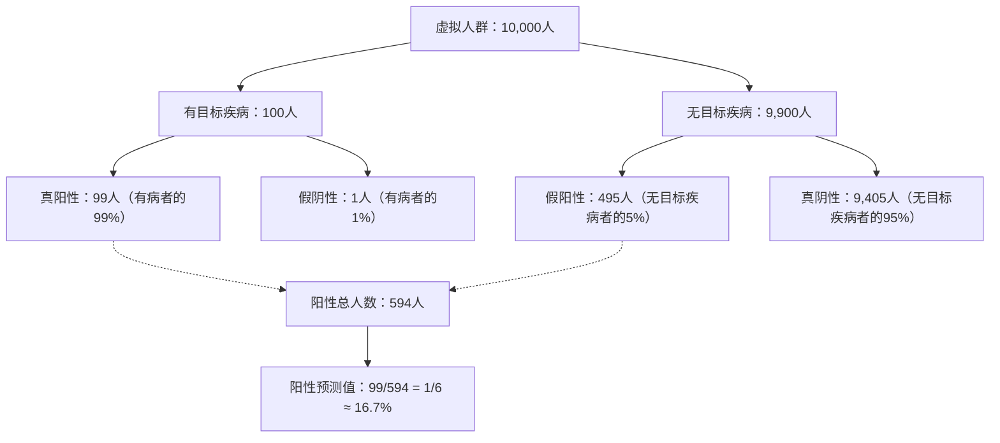
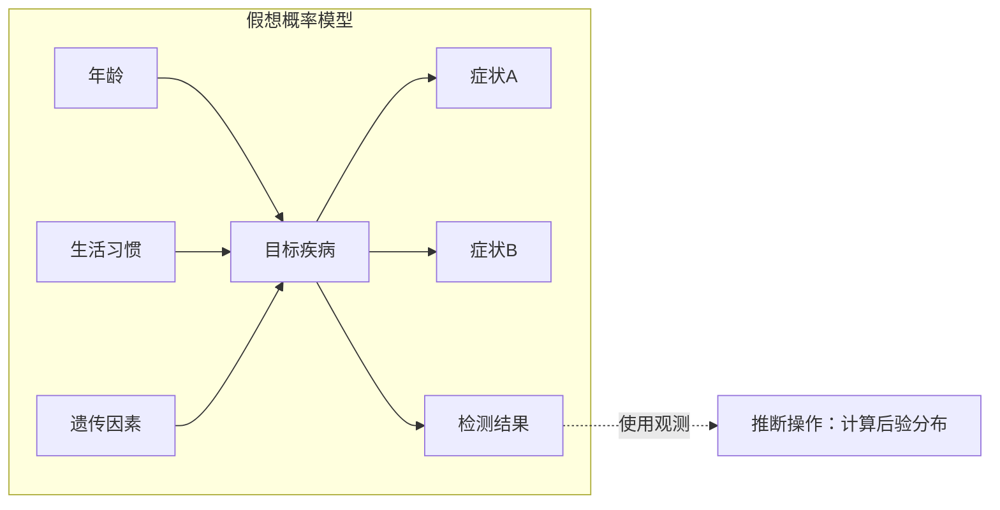

## 1. 在不确定的世界中更新预测

明天会不会下雨、新药是否有效、邮件是不是垃圾邮件：我们根据不完整的信息作出判断。**贝叶斯定理将给定证据后的条件概率与反向的条件概率联系起来。** 确定模型和先验信息后，就可以利用新观测更新概率。

这一定理以18世纪的牧师兼数学家托马斯·贝叶斯命名。[理查德·普赖斯介绍贝叶斯遗稿的书信](https://bayes.wustl.edu/Manual/an.essay.pdf)记载，该文于1763年12月23日在英国皇家学会宣读。现代贝叶斯推断也包括后来许多研究者的发展。下文依次讨论公式、检测示例、四种AI应用，以及不同的概率解释。

## 2. 公式与归一化的作用

对于满足 $P(B)>0$ 的事件B，由条件概率的定义可得

$$
P(A\mid B)=\frac{P(A\cap B)}{P(B)}
$$

如果还满足 $P(A)>0$，反向条件概率也有定义，那么分解联合概率便得到

$$
P(A\mid B)=\frac{P(B\mid A)P(A)}{P(B)}
$$

把B视为新证据时，各项的作用如下。

- **先验概率** $P(A)$：考虑B之前，A的概率。
- **似然** $P(B\mid A)$：假设A成立时，观测到B的概率。
- **证据的概率／边际似然** $P(B)$：观测到B的总体概率。
- **后验概率** $P(A\mid B)$：考虑B之后，A的概率。

先验乘以似然只是分子。**还要除以证据的概率进行归一化，才得到后验概率。** 即使A的概率为0，只要B的概率为正，第一个使用联合概率的公式仍然成立。反向条件概率没有定义时，不应直接代入第二个公式。

## 3. 似然、MAP与后验预测不是一回事

设未知参数为θ，观测数据为d。[用似然更新先验密度](https://web.stanford.edu/class/stats200/Lecture20.pdf)时，可以写成

$$
\pi(\theta\mid d)=\frac{L(\theta;d)\pi(\theta)}{Z(d)},\qquad Z(d)=\int L(t;d)\pi(t)\,dt
$$

这里假设 $0<Z(d)<\infty$。似然L是固定观测d、让θ变化的函数，不是关于θ的概率分布。对于连续数据，使用的是概率密度，密度值可以大于1。某个观测点本身的概率为0，并不等于不能利用密度进行更新。

当后验密度存在最大点时，**最大后验估计（MAP）**选择这样的点：

$$
\hat\theta_{\mathrm{MAP}}\in\arg\max_\theta\pi(\theta\mid d)
$$

相比之下，下一次二值观测的**后验预测**要按照后验分布，对各个参数下的预测取平均：

$$
\Pr(Y_{\mathrm{new}}=1\mid d)=\int\Pr(Y_{\mathrm{new}}=1\mid\theta,d)\pi(\theta\mid d)\,d\theta
$$

例如，为硬币正面概率θ指定0到1之间的均匀先验。给定θ后，各次投掷相互独立，并依次观测到1,1,0，其中1表示正面。此时

$$
\pi(\theta\mid 1,1,0)=12\theta^2(1-\theta),\qquad 0<\theta<1
$$

因此

$$
\hat\theta_{\mathrm{MAP}}=\frac23,\qquad\Pr(Y_{\mathrm{new}}=1\mid1,1,0)=\frac35
$$

代入众数与对分布求平均会得到不同的答案。选择分类类别、对参数作MAP估计、预测未来观测，不能统统称为“最大化后验概率”。

## 4. 假想医学检测：灵敏度99%，阳性预测值约16.7%

以下是**用于计算的假想示例，不是真实检测的实测性能**。设D表示存在目标疾病，T表示检测阳性。假设目标人群的患病率为1%，检测灵敏度为99%，假阳性率为5%。

$$
P(D)=0.01,\qquad P(T\mid D)=0.99,\qquad P(T\mid D^c)=0.05
$$

D的补事件表示“没有目标疾病”，不表示各方面都健康。将有病和无病两种情况下的阳性概率相加，得到

$$
P(T)=P(T\mid D)P(D)+P(T\mid D^c)P(D^c)=0.99\cdot0.01+0.05\cdot0.99=0.0594
$$

因此，检测阳性时存在目标疾病的概率为

$$
P(D\mid T)=\frac{0.0099}{0.0594}=\frac{99}{594}=\frac16\approx0.1667
$$

结果约为16.7%，精确值是1/6。阳性者中剩余的5/6，约83.3%，是假阳性，即没有目标疾病的人。在患病率较低时，人数众多的无目标疾病群体产生的假阳性，可以超过真阳性。

为了用人数说明这些比例，构造一个恰好满足上述比例的虚拟万人群体，可得下表。实际抽取一万人时，各项人数会有波动。

| 检测结果 | 有目标疾病 | 无目标疾病 | 合计 |
| --- | ---: | ---: | ---: |
| 阳性 | 99（真阳性） | 495（假阳性） | 594 |
| 阴性 | 1（假阴性） | 9,405（真阴性） | 9,406 |
| 合计 | 100 | 9,900 | 10,000 |

**灵敏度99%不等于阳性预测值99%，也不等于总体准确率99%。** 该表的总体准确率为

$$
\frac{99+9405}{10000}=0.9504=95.04\%
$$

[灵敏度、特异度和阳性预测值的定义](https://www.fda.gov/regulatory-information/search-fda-guidance-documents/statistical-guidance-reporting-results-studies-evaluating-diagnostic-tests-guidance-industry-and-fda)使用不同的分母。“99%意味着阳性者几乎肯定患病”的直觉，混淆了比例所针对的人群。若要用于真实结果，还需要适合该目标人群的患病率和检测特性。

## 5. AI应用一：朴素贝叶斯分类器

垃圾邮件检测可根据词语是否出现等特征X，求类别C的后验概率。朴素贝叶斯的基本假设是**给定类别后的条件独立**，而不是词语无条件独立。特征达到三个以上时，即使在每个类别内两两独立，也未必联合独立。

对于离散特征，若观测x的边际概率和各类别的先验概率为正，且在每个类别内所有特征联合独立，就有

$$
\Pr(C=c\mid X=x)\propto\Pr(C=c)\prod_{j=1}^{m}\Pr(X_j=x_j\mid C=c)
$$

若各类误分类的代价相同，可以选择后验概率最大的类别。这种分类决策与模型参数本身的MAP估计不同。

真实词语存在关联，独立性只是一种近似。模型简单、计算快是优点，但不保证准确率或概率校准总是更好。[scikit-learn的官方说明](https://scikit-learn.org/stable/modules/naive_bayes.html)也区分了分类表现与概率估计质量。针对词语是否出现的伯努利型、针对词频计数的多项型等变体，其具体生成模型也有所不同。

## 6. AI应用二：贝叶斯网络

贝叶斯网络用有向无环图（DAG）和每个节点的局部条件分布表示联合分布。在有限离散模型中，令pa表示父节点的取值，则有因子分解

$$
\Pr(V_1=v_1,\ldots,V_n=v_n)=\prod_{i=1}^{n}\Pr(V_i=v_i\mid\mathrm{pa}_i)
$$

[用DAG表示概率分布](https://ermongroup.github.io/cs228-notes/representation/directed/)也规定了相应的条件独立假设。

下图是连接年龄、生活习惯、遗传因素、疾病、症状和检测结果的假想模型。它假设三个没有父节点的因素相互独立。实线表示局部条件分布的父子关系，不代表现实中的因果关系已经得到验证。**仅凭统计依赖模型不足以作因果断言，还需要额外的因果假设**（参见[Pearl的区分](https://ftp.cs.ucla.edu/pub/stat_ser/r350.pdf)）。

虚线所指的是推断操作的注释，不是构成联合分布的额外随机变量。利用观测计算疾病等变量的后验边际分布，也不同于重新学习模型的全部参数。这类模型可作为诊断、状态估计和金融预测等问题的框架，但具体用途中的有效性取决于模型结构与数据。

## 7. AI应用三：贝叶斯优化

调整学习率、网络深度等超参数，可能需要反复训练和评估。参数设定不必由人手工选择，也可以自动搜索。

贝叶斯优化用高斯过程等概率代理模型描述设定与性能的关系，并加入评估结果进行更新。通过期望改进等**采集函数**选择下一个候选点：既要利用表现有希望的区域，也要探索尚不确定的区域。[Snoek等人的研究](https://arxiv.org/abs/1206.2944)讨论了机器学习算法的调优。

其目标是高效分配昂贵的评估资源，但并不保证对任意目标函数、预算和噪声情况，都能用最少的尝试找到最优解。

## 8. AI应用四：贝叶斯深度学习

普通神经网络也可以通过softmax等方式输出类别概率。使用固定权重进行计算，与输出一个概率分布并不矛盾。

一种贝叶斯处理方法是为连续权重w指定先验密度，再根据训练数据d求后验密度。在通常的条件独立模型下，离散类别y的后验预测概率为

$$
\Pr(y\mid x,d)=\int\Pr(y\mid x,w)\pi(w\mid d)\,dw
$$

[Blundell等人的原论文](https://arxiv.org/abs/1505.05424)用变分分布近似实际规模网络中难以精确执行的推断。预测能够反映权重的不确定性，但也取决于先验、似然和近似方法的选择。

仅仅输出“某类别的概率为90%”，并没有表达关于模型的全部不确定性。“贝叶斯”这一名称本身，也不能保证医疗AI等应用的预测概率已经校准。[关于数据分布变化下不确定性的研究](https://arxiv.org/abs/1906.02530)也说明，评估时需要考虑训练数据与使用阶段数据的差异。

## 9. 比较频率主义与贝叶斯推断

两者都使用概率论，贝叶斯定理本身是共同的数学工具。在统计推断中，频率学派把未知参数视为固定值，重视估计或检验程序在重复抽样下的性质。贝叶斯推断用先验分布表示对未知量的不确定性，并在观测后使用后验分布。为参数指定分布，不等于物理参数会在每次观测后发生改变。

对于独立同分布的公平硬币投掷，用1表示正面、0表示反面，[大数定律](https://kenji.blog/zh-cn/p/law-of-large-numbers/)给出极限

$$
\frac1n\sum_{i=1}^{n}X_i\xrightarrow{\mathrm{a.s.}}\frac12
$$

它不保证在有限次投掷中，正面次数一定恰好占一半。

贝叶斯先验可以反映专业知识，也可以选择弱信息先验等。把所有先验都看成随意的偏好，或以为只要指定先验就自动获得客观性，都不合适。明天下雨的概率为70%，可以理解为基于模型和信息的概率预测，并评估其校准情况。仅凭这个数字，无法确定使用了哪一统计流派，也无法断定它就是某位预报员个人的确信程度。

## 10. 更新证据，也检查前提

贝叶斯更新按照概率规则结合先验信息与证据。逐次更新时，将上一次的后验作为下一次的先验，并使用新数据的条件似然。不要把已经使用过的观测，再当作独立的新证据重复相乘。

公式本身无法修复错误模型或有偏数据。检查观测了什么、假设了什么人群与分布，是重新学习和修正认识的一部分。[两个信封悖论](https://kenji.blog/zh-cn/p/two-envelopes-paradox/)也是从明确模型计算条件概率的重要例子。
