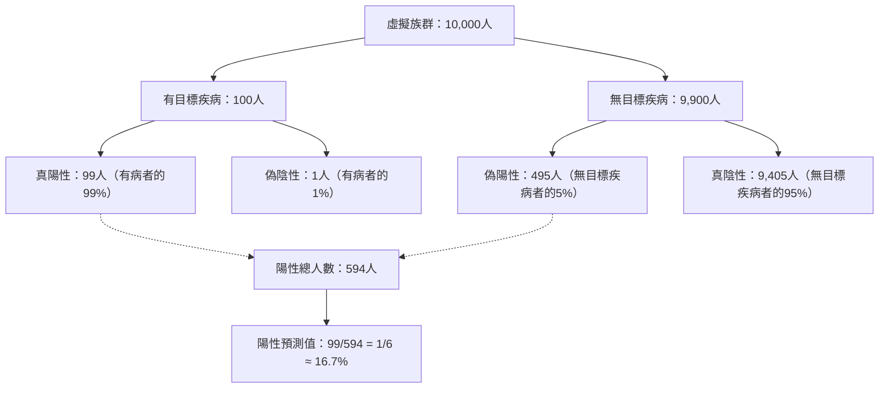
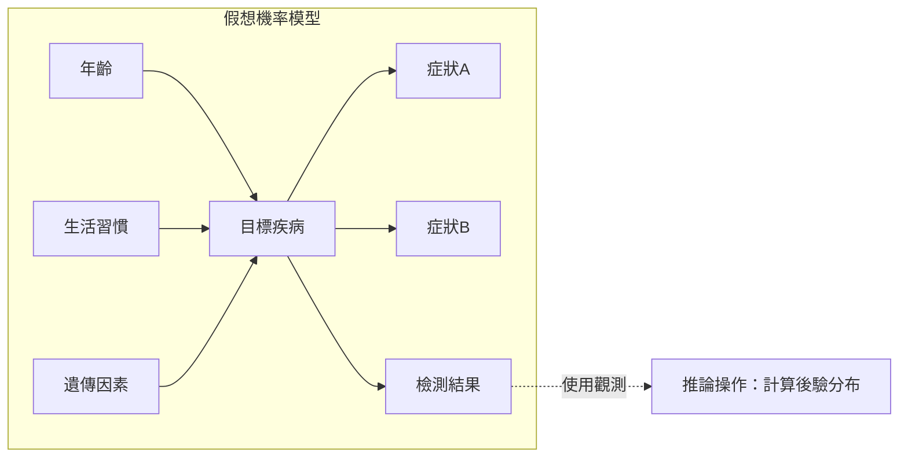

## 1. 在不確定的世界中更新預測

明天會不會下雨、新藥是否有效、郵件是不是垃圾郵件：我們依據不完整的資訊做判斷。**貝氏定理連結了給定證據後的條件機率與反向條件機率。** 指定模型與先驗資訊後，就能用新的觀測更新機率。

這個定理以18世紀的牧師兼數學家湯瑪斯·貝葉斯命名。[理查德·普萊斯介紹貝葉斯遺稿的書信](https://bayes.wustl.edu/Manual/an.essay.pdf)記載，該文於1763年12月23日在英國皇家學會宣讀。現代貝氏推論也包含後來許多研究者的發展。以下依序討論公式、檢測範例、四種AI應用，以及不同的機率解釋。

## 2. 公式與正規化的作用

對滿足 $P(B)>0$ 的事件B，條件機率的定義給出

$$
P(A\mid B)=\frac{P(A\cap B)}{P(B)}
$$

如果也滿足 $P(A)>0$，使反向條件機率有定義，分解聯合機率便得到

$$
P(A\mid B)=\frac{P(B\mid A)P(A)}{P(B)}
$$

將B視為新證據時，各項扮演以下角色。

- **先驗機率** $P(A)$：考慮B之前，A的機率。
- **概似（likelihood）** $P(B\mid A)$：假設A成立時，觀測到B的機率。
- **證據機率／邊際概似** $P(B)$：觀測到B的整體機率。
- **後驗機率** $P(A\mid B)$：考慮B之後，A的機率。

先驗乘以概似只是分子。**還要除以證據機率進行正規化，才能得到後驗機率。** 即使A的機率為0，只要B的機率為正，第一個使用聯合機率的公式仍然成立。反向條件機率未定義時，不要直接代入第二個公式。

## 3. 概似、MAP與後驗預測並不相同

令未知參數為θ，觀測資料為d。[利用概似更新先驗密度](https://web.stanford.edu/class/stats200/Lecture20.pdf)時，可寫成

$$
\pi(\theta\mid d)=\frac{L(\theta;d)\pi(\theta)}{Z(d)},\qquad Z(d)=\int L(t;d)\pi(t)\,dt
$$

這裡假設 $0<Z(d)<\infty$。概似L是固定觀測d、讓θ變動的函數，不是關於θ的機率分布。連續資料使用的是機率密度，密度值可以超過1。觀測點本身的機率為0，不代表無法利用密度更新。

如果後驗密度存在最大點，**最大後驗估計（MAP）**會選取這樣的點：

$$
\hat\theta_{\mathrm{MAP}}\in\arg\max_\theta\pi(\theta\mid d)
$$

相較之下，下一次二元觀測的**後驗預測**，是依後驗分布對各參數下的預測取平均：

$$
\Pr(Y_{\mathrm{new}}=1\mid d)=\int\Pr(Y_{\mathrm{new}}=1\mid\theta,d)\pi(\theta\mid d)\,d\theta
$$

例如，對硬幣的正面機率θ指定0到1之間的均勻先驗。給定θ後，各次投擲互相獨立，並依序觀測到1,1,0，其中1代表正面。此時

$$
\pi(\theta\mid 1,1,0)=12\theta^2(1-\theta),\qquad 0<\theta<1
$$

因此

$$
\hat\theta_{\mathrm{MAP}}=\frac23,\qquad\Pr(Y_{\mathrm{new}}=1\mid1,1,0)=\frac35
$$

代入眾數與對分布取平均，答案可以不同。選擇分類類別、對參數進行MAP估計、預測未來觀測，不能全都稱為「最大化後驗機率」。

## 4. 假想醫療檢測：敏感度99%，陽性預測值約16.7%

以下是**用於計算的假想範例，並非真實檢測的實測效能**。D代表具有目標疾病，T代表檢測陽性。假設目標族群的盛行率為1%、敏感度為99%、偽陽性率為5%。

$$
P(D)=0.01,\qquad P(T\mid D)=0.99,\qquad P(T\mid D^c)=0.05
$$

D的補事件是「沒有目標疾病」，並不是各方面都健康。將有病與無病兩種情形下的陽性機率相加，可得

$$
P(T)=P(T\mid D)P(D)+P(T\mid D^c)P(D^c)=0.99\cdot0.01+0.05\cdot0.99=0.0594
$$

因此，陽性時具有目標疾病的機率是

$$
P(D\mid T)=\frac{0.0099}{0.0594}=\frac{99}{594}=\frac16\approx0.1667
$$

結果約16.7%，精確值為1/6。陽性者中其餘的5/6、約83.3%，是沒有目標疾病的偽陽性。當盛行率低時，沒有目標疾病的人很多，從中產生的偽陽性可能超過真陽性。

為了用人數呈現比例，可以建構一個恰好滿足上述比例的虛擬萬人族群，得到下表。實際抽樣一萬人時，各項人數會有變動。

| 檢測結果 | 有目標疾病 | 無目標疾病 | 合計 |
| --- | ---: | ---: | ---: |
| 陽性 | 99（真陽性） | 495（偽陽性） | 594 |
| 陰性 | 1（偽陰性） | 9,405（真陰性） | 9,406 |
| 合計 | 100 | 9,900 | 10,000 |

**敏感度99%不等於陽性預測值99%，也不等於整體正確率99%。** 這張表的整體正確率為

$$
\frac{99+9405}{10000}=0.9504=95.04\%
$$

[敏感度、特異度與陽性預測值的定義](https://www.fda.gov/regulatory-information/search-fda-guidance-documents/statistical-guidance-reporting-results-studies-evaluating-diagnostic-tests-guidance-industry-and-fda)使用不同的分母。「99%表示陽性者幾乎確定有病」的直覺，混淆了比例所針對的族群。要應用於真實結果，還需要適合該目標族群的盛行率與檢測特性。

## 5. AI應用一：樸素貝氏分類器

垃圾郵件偵測可以利用詞語是否出現等特徵X，求類別C的後驗機率。樸素貝氏的基本假設是**給定類別後的條件獨立**，而非詞語無條件獨立。特徵達三個以上時，即使在每個類別內兩兩獨立，也不保證聯合獨立。

對離散特徵，若觀測x的邊際機率與各類別的先驗機率為正，且每個類別內的所有特徵聯合獨立，則

$$
\Pr(C=c\mid X=x)\propto\Pr(C=c)\prod_{j=1}^{m}\Pr(X_j=x_j\mid C=c)
$$

若各種誤分類的代價相同，可選擇後驗機率最大的類別。這個分類決策與模型參數本身的MAP估計不同。

真實詞語有關聯，獨立性是一種近似。簡單、計算快是優點，但不保證分類表現或機率校準總是較好。[scikit-learn官方說明](https://scikit-learn.org/stable/modules/naive_bayes.html)也區分了分類表現與機率估計品質。以詞語是否出現為特徵的伯努利型，與使用詞頻計數的多項型等變體，具體生成模型也不同。

## 6. AI應用二：貝氏網路

貝氏網路利用有向無環圖（DAG）與各節點的局部條件分布，表示聯合分布。在有限離散模型中，以pa代表父節點的取值，可作因子分解：

$$
\Pr(V_1=v_1,\ldots,V_n=v_n)=\prod_{i=1}^{n}\Pr(V_i=v_i\mid\mathrm{pa}_i)
$$

[用DAG表示機率分布](https://ermongroup.github.io/cs228-notes/representation/directed/)也指定了相應的條件獨立假設。

下圖是連結年齡、生活習慣、遺傳因素、疾病、症狀與檢測結果的假想模型。它假設三個沒有父節點的因素互相獨立。實線定義局部分布的父子關係，不表示現實中的因果關係已獲驗證。**要從統計相依模型提出因果主張，還需要額外的因果假設**（參見[Pearl的區分](https://ftp.cs.ucla.edu/pub/stat_ser/r350.pdf)）。

虛線指向的是推論操作的註記，不是聯合分布中的額外隨機變數。利用觀測計算疾病等變數的後驗邊際分布，也不同於重新學習模型的全部參數。這類模型可作為診斷、狀態估計與金融預測等問題的框架，但各用途中的有效性取決於結構與資料。

## 7. AI應用三：貝氏最佳化

調整學習率、網路深度等超參數，可能需要反覆訓練與評估。參數設定不必由人手動選擇，也可以自動搜尋。

貝氏最佳化使用高斯過程等機率代理模型，描述設定與效能的關係，並納入評估結果更新。透過期望改善等**獲取函數（acquisition function）**選擇下一個候選點：既要利用有希望的區域，也要探索尚不確定的區域。[Snoek等人的研究](https://arxiv.org/abs/1206.2944)討論機器學習演算法的調校。

目標是有效分配昂貴的評估資源，但並不保證對任何目標函數、預算與雜訊情況，都能以最少的嘗試找到最佳解。

## 8. AI應用四：貝氏深度學習

一般的類神經網路也能透過softmax等方式輸出類別機率。使用固定權重計算，與輸出機率分布並不衝突。

一種貝氏處理方式是對連續權重w指定先驗密度，再依訓練資料d求後驗密度。在通常的條件獨立模型下，離散類別y的後驗預測機率為

$$
\Pr(y\mid x,d)=\int\Pr(y\mid x,w)\pi(w\mid d)\,dw
$$

[Blundell等人的原論文](https://arxiv.org/abs/1505.05424)利用變分分布，近似實際規模網路中難以精確計算的推論。預測可以反映權重的不確定性，但也依賴先驗、概似與近似方法的選擇。

只輸出「某類別的機率為90%」，並未表達關於模型的全部不確定性。「貝氏」這個名稱本身，也不保證醫療AI等應用的預測機率已妥善校準。[探討資料分布改變下不確定性的研究](https://arxiv.org/abs/1906.02530)也提醒我們，評估時要納入訓練資料與使用階段資料之間的差異。

## 9. 比較頻率學派與貝氏推論

兩者都使用機率論，貝氏定理本身是共同的數學工具。在統計推論中，頻率學派將未知參數視為固定值，重視估計或檢定程序在重複抽樣下的性質。貝氏推論以先驗分布表達對未知量的不確定性，觀測後使用後驗分布。指定分布不代表物理參數會在每次觀測後改變。

對獨立同分布的公平硬幣投擲，以1表示正面、0表示反面，[大數法則](https://kenji.blog/zh-tw/p/law-of-large-numbers/)給出極限

$$
\frac1n\sum_{i=1}^{n}X_i\xrightarrow{\mathrm{a.s.}}\frac12
$$

它不保證有限次投擲中，正面次數一定恰好占一半。

貝氏先驗可以反映專業知識，也可以選擇弱資訊先驗等。將所有先驗視為任意偏好，或認為指定先驗就自動具有客觀性，都不恰當。明天下雨機率70%，可理解為依模型與資訊產生的機率預測，並評估其校準程度。僅憑這個數字，無法判斷採用哪個統計學派，也不能斷定它就是某位預報人員個人的確信程度。

## 10. 更新證據，也檢查前提

貝氏更新依機率規則結合先驗資訊與證據。逐次更新時，以上一次的後驗作為下一次的先驗，並使用新資料的條件概似。不要把已使用的觀測，再當成獨立的新證據重複相乘。

公式本身無法修復錯誤模型或有偏資料。檢查觀測了什麼、假設了哪個族群與分布，也是重新學習、修正理解的一部分。[兩個信封悖論](https://kenji.blog/zh-tw/p/two-envelopes-paradox/)同樣說明，條件機率必須從明確的模型計算。
