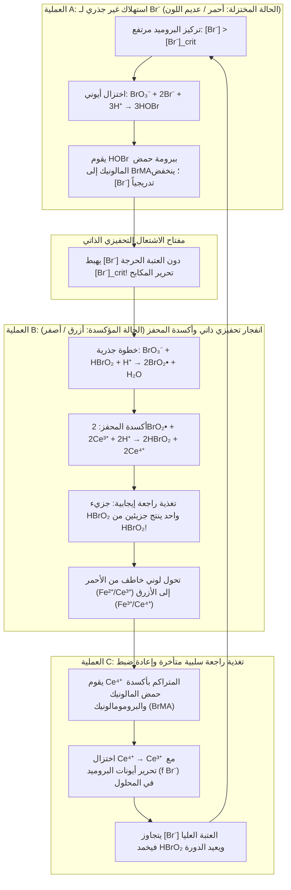
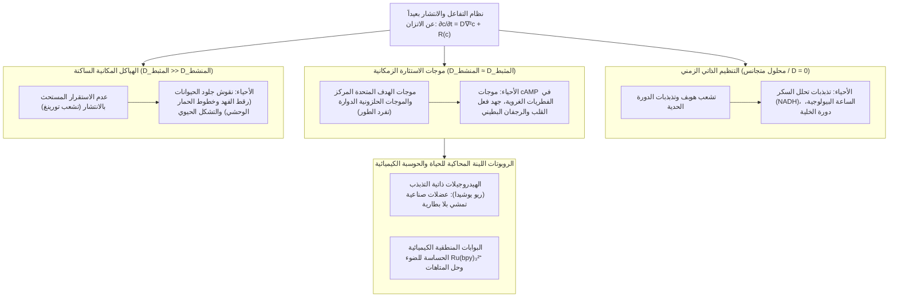

## 1. مقدمة: ماذا لو بدأ الحليب الممزوج بالقهوة بالنبض من تلقاء نفسه؟

تخيل أنك تسكب حليباً بارداً في فنجان قهوة سوداء ساخنة وتحركه بالملعقة. تندمج الدوامات الداكنة والفاتحة حتى يستقر السائل على لون بني فاتح متجانس. يخبرنا حدسنا اليومي — وكذلك الركيزة الأساسية للفيزياء الكلاسيكية المعروفة باسم <strong>القانون الثاني للديناميكا الحرارية</strong> — أن هذه العملية تسير في اتجاه واحد строго. فبعد امتزاجهما، لن تعود القهوة تلقائياً إلى اللون الأسود القاتم، ثم تومض باللون الأبيض الناصع بعد دقيقة، وتواصل التذبذب كالساعة.

غير أن هناك تفاعلاً حقيقياً في الكيمياء الفيزيائية يتحدى هذا الحدس بطريقة مذهلة: <strong>تفاعل بيلوسوف-جابوتينسكي (Belousov-Zhabotinsky reaction - تفاعل BZ)</strong>. فعند مزج بضعة كواشف مائية في كأس زجاجية، <strong>يتذبذب المحلول تلقائياً عشرات المرات بين لونين متباينين بدقة المترونوم</strong>؛ وعند سكبه في طبقة رقيقة غير محركة داخل طبق بتري، فإنه يولد ذاتياً <strong>حلقات متحدة المركز متسعة (أنماط الهدف) وموجات حلزونية أرخميدية دوارة</strong>.

### 1951: اكتشاف «هرطقي» رفضته الأوساط العلمية السوفيتية

بدأت القصة في موسكو عام 1951، حين كان الكيميائي والفيزيائي الحيوي السوفيتي <strong>بوريس بافلوفيتش بيلوسوف (1893–1970)</strong> يبحث عن نموذج غير عضوي يحاكي <strong>دورة حمض الستريك (دورة كريبس)</strong>. أذاب بيلوسوف <strong>برومات البوتاسيوم ($\text{KBrO}_3$)</strong> كعامل مؤكسد، و<strong>حمض الستريك</strong> كركيزة عضوية، و<strong>كبريتات السيريوم ($\text{Ce}^{4+}/\text{Ce}^{3+}$)</strong> كمحفز أكسدة-اختزال في حمض الكبريتيك المخفف. وبدلاً من التحول الرتيب من الأصفر ($\text{Ce}^{4+}$) إلى عديم اللون ($\text{Ce}^{3+}$)، تذبذب المحلول دورياً بين <strong>الأصفر وعديم اللون</strong> عشرات المرات لأكثر من ساعة!

عندما أرسل بيلوسوف مخطوطاته في عامي 1951 و1957 إلى المجلات الكيميائية السوفيتية، قوبلت <strong>بالرفض القاطع</strong> بحجة:

> «إن الادعاء بأن تفاعلاً كيميائياً متجانساً يتذبذب ذهاباً وإياباً عبر نقطة اتزانه <strong>ينتهك القانون الثاني للديناميكا الحرارية بشكل مباشر</strong>. وما لاحظه المؤلف لا بد أن يكون خطأً تجريبياً ناتجاً عن سوء الخلط أو الشوائب أو فقاعات الغاز.»

شعر بيلوسوف البالغ من العمر 64 عاماً بإهانة بالغة، فاكتفى بنشر ملخص قصير من صفحتين عام 1958 في نشرة غير محكمة لطب الإشعاع، وترك هذا المجال للأبد.

### 1961: إعادة الاعتبار على يد أناتول جابوتينسكي والنبض الأحمر-الأزرق

في عام 1961، سلّم البروفيسور سيمون شنول في جامعة موسكو الحكومية هذه الوصفة لطالب الدراسات العليا الشاب <strong>أناتول ماركوفيتش جابوتينسكي (1938–2008)</strong>. استبدل جابوتينسكي حمض الستريك بـ<strong>حمض المالونيك ($\text{CH}_2(\text{COOH})_2$)</strong> وأدخل كاشف الأكسدة والاختزال <strong>الفيروين (Ferroin, $[\text{Fe}(\text{phen})_3]^{2+}/[\text{Fe}(\text{phen})_3]^{3+}$)</strong>، فأصبح المحلول ينبض ببراعة بين <strong>الأحمر القرميدي ($[\text{Fe}(\text{phen})_3]^{2+}$ المختزل) والأزرق السماوي ($[\text{Fe}(\text{phen})_3]^{3+}$ المؤكسد)</strong>. وفي عام 1980، مُنح بيلوسوف (بعد وفاته) وجابوتينسكي <strong>جائزة لينين</strong> المرموقة.

---

## 2. حل المفارقة الديناميكية الحرارية: لماذا لا ينتهك تفاعل BZ القانون الثاني؟

### التناقص الرتيب لطاقة غيبس الحرة وعلاقات أونساغر بالقرب من الاتزان

في نظام مغلق عند درجة حرارة $T$ وضغط $P$ ثابتين، يفرض القانون الثاني أن يكون معدل إنتاج الإنتروبيا الداخلية غير سالب ($\sigma_S \equiv \frac{d_i S}{dt} \ge 0$)، ومن ثم تتناقص طاقة غيبس الحرة $G = H - TS$ بشكل رتيب:

$$\frac{dG}{dt} = -T \sigma_S = -\sum_{\rho} A_{\rho} v_{\rho} \le 0$$

حيث $v_{\rho}$ هي سرعة التفاعل $\rho$، و$A_{\rho} \equiv -\sum_i \nu_{i\rho} \mu_i = -\left(\frac{\partial G}{\partial \xi_{\rho}}\right)_{T,P}$ هي الألفة الكيميائية.

وفي <strong>النظام الخطي القريب من الاتزان</strong> ($|A_{\rho}| \ll RT$)، يفرض التناظر الزمني المجهري <strong>مبدأ التوازن التفصيلي</strong> و<strong>علاقات التبادل لأونساغر</strong> (لارس أونساغر، جائزة نوبل 1968)، مما يجعل مصفوفة معاملات النقل متناظرة تماماً ($L_{\alpha\beta} = L_{\beta\alpha}$). ونتيجة لذلك، تمتلك مصفوفة جاكوبي $\mathbf{J}_{\text{eq}}$ <strong>قيماً ذاتية حقيقية وسالبة حصراً ($\lambda_k \in \mathbb{R}, \lambda_k \le 0, \text{Im}(\lambda_k) = 0$)</strong>. أي أنه بالقرب من الاتزان الديناميكي الحراري يستحيل حدوث حتى التذبذبات المتخامدة!

### بعيداً عن الاتزان: كسر التناظر والهياكل التبديدية لبريغوجين

يكمن الحل في أن <strong>تفاعل BZ لا يتذبذب حول نقطة الاتزان الديناميكي الحراري، بل يعمل بعيداً جداً عن الاتزان ($A_{\rho} \gg RT$) في النظام اللاخطي القوي!</strong>

بعيداً عن الاتزان، تكسر التغذية الراجعة التحفيزية الذاتية تناظر أونساغر، فتصبح مصفوفة جاكوبي $\mathbf{J}(\mathbf{c}^*)$ غير متناظرة ويمكن أن تمتلك <strong>قيماً ذاتية عقدية مترافقة $\lambda_{\pm} = \mu \pm i\omega$ ($\omega \neq 0$)</strong>. وقد أثبت الكيميائي الفيزيائي البلجيكي <strong>إيليا بريغوجين (جائزة نوبل 1977)</strong> أن تبديد الطاقة ($\sigma_S > 0$) بعيداً عن الاتزان يصبح المحرك الأساسي للتنظيم الذاتي الزمكاني، منشئاً ما أسماه <strong>الهياكل التبديدية (Dissipative Structures)</strong>:
1. <strong>في المفاعل المفتوح المستمر (CSTR)</strong>: يعادل تدفق المواد المتفاعلة الجديدة إنتاج الإنتروبيا الداخلية ($dS = d_e S + d_i S = 0$)، مما يحافظ على تذبذبات دائمة لا تتلاشى.
2. <strong>في الكأس المغلقة (الهبوط المتدرج لطاقة غيبس $G(t)$)</strong>: تُستهلك <strong>المتفاعلات الرئيسية عالية التركيز ($\text{BrO}_3^-$ وحمض المالونيك، $\sim 10^{-1}\text{ M}$)</strong> باتجاه واحد نحو النواتج ($\frac{dG}{dt} \le 0$). أما <strong>المركبات الوسطية الضئيلة جداً ($\text{HBrO}_2, \text{Br}^-, \text{Ce}^{4+}$، بتركيز $\sim 10^{-7}\text{ إلى }10^{-4}\text{ M}$)</strong> فهي وحدها التي تدور في حلقات مغلقة، تماماً مثل <strong>ناعورة مياه وُضعت تحت شلال متدفق</strong> تدور مئات المرات بينما ينحدر الماء نفسه نحو الأسفل فقط.

| النظام الديناميكي الحراري | الاتزان الديناميكي الحراري | اللاتوازن الخطي (قريب من الاتزان) | اللاتوازن اللاخطي (بعيد عن الاتزان / تفاعل BZ) |
| :--- | :--- | :--- | :--- |
| <strong>الألفة الكيميائية $A_{\rho}$</strong> | $A_{\rho} = 0$ (توازن تفصيلي) | $\|A_{\rho}\| \ll RT$ (استجابة خطية) | $A_{\rho} \gg RT$ (نظام لاخطي غير عكوس) |
| <strong>إنتاج الإنتروبيا $\sigma_S$</strong> | $\sigma_S = 0$ (لا يوجد تبديد) | $\sigma_S > 0$ (إنتاج إنتروبيا أدنى) | $\sigma_S \gg 0$ (التبديد يغذي النظام الديناميكي) |
| <strong>تناظر أونساغر</strong> | التدفقات $J_{\alpha} = 0$ | $L_{\alpha\beta} = L_{\beta\alpha}$ (مصفوفة متناظرة) | انكسار التناظر ($\mathbf{J}$ غير متناظرة) |
| <strong>القيم الذاتية لجاكوبي $\mathbf{J}$</strong> | — | حقيقية وسالبة ($\text{Im}(\lambda_k)=0$) | عقدية مترافقة $\lambda = \mu \pm i\omega$ ($\mu > 0$ ممكن) |
| <strong>السلوك الزمكاني</strong> | حالة متجانسة ساكنة | استرخاء أسي رتيب فقط | <strong>دورات حدية، موجات حلزونية، أنماط تورينغ</strong> |

---

## 3. آلية FKN (1972): ثلاث عمليات مترابطة والمفتاح التحفيزي الذاتي

في عام 1972، نجح <strong>ريتشارد فيلد</strong> و<strong>إندري كوروش</strong> و<strong>ريتشارد نويز</strong> في تفسير <strong>آلية FKN</strong> المكونة من 18 خطوة أولية لأكسدة وبرومة حمض المالونيك بواسطة البرومات:

$$2\text{BrO}_3^- + 3\text{CH}_2(\text{COOH})_2 + 2\text{H}^+ \longrightarrow 2\text{BrCH}(\text{COOH})_2 + 3\text{CO}_2 + 4\text{H}_2\text{O}$$

يتناوب التفاعل دورياً بين العمليات A وB وC بفعل الصراع بين <strong>المنشط حمض البروموز ($\text{HBrO}_2$)</strong> و<strong>المثبط أيون البروميد ($\text{Br}^-$)</strong>:

1. <strong>العملية A (مكابح البروميد)</strong>: طالما أن $[\text{Br}^-] > [\text{Br}^-]_{\text{crit}}$، يلتقط $\text{Br}^-$ جزيئات $\text{HBrO}_2$ فوراً عبر التفاعل $\text{HBrO}_2 + \text{Br}^- + \text{H}^+ \xrightarrow{k_2} 2\text{HOBr}$ مكوناً حمض البرومومالونيك ($\text{BrMA}$)، ويبقى المحفز مختزلاً (أحمر).
2. <strong>العملية B (الانفجار التحفيزي الذاتي)</strong>: بمجرد هبوط $[\text{Br}^-]$ دون العتبة الحرجة $[\text{Br}^-]_{\text{crit}} = \frac{k_5}{k_2}[\text{BrO}_3^-] \approx 5 \times 10^{-7}\text{ M}$، تنطلق السلسلة الجذرية عبر $\text{BrO}_2^\bullet$:
   $$\text{BrO}_3^- + \mathbf{HBrO_2} + 3\text{H}^+ + 2\text{Ce}^{3+} \longrightarrow \mathbf{2\,\text{HBrO}_2} + 2\text{Ce}^{4+} + \text{H}_2\text{O}$$
   <strong>كل جزيء واحد من $\text{HBrO}_2$ ينتج جزيئين من $\text{HBrO}_2$!</strong> يتضاعف $[\text{HBrO}_2]$ عشرات آلاف المرات في أجزاء من الثانية، مؤكسداً المحفز ($\text{Ce}^{3+} \to \text{Ce}^{4+}$، تحول إلى <strong>الأزرق</strong>)، ثم يتشبع عبر تفاعل عدم التناسب $2\text{HBrO}_2 \xrightarrow{k_4} \text{BrO}_3^- + \text{HOBr} + \text{H}^+$.
3. <strong>العملية C (التغذية الراجعة السلبية المتأخرة)</strong>: يقوم $\text{Ce}^{4+}$ المتراكم بأكسدة حمض البرومومالونيك فيعود إلى $\text{Ce}^{3+}$ ويحرر $f$ من أيونات $\text{Br}^-$، مما يخمد التحفيز الذاتي ويعيد النظام إلى العملية A.

---

## 4. النظرية الرياضية للأوريغوناتور (Oregonator): تذبذبات الاسترخاء وتشعب هوبف والدورة الحدية

في عام 1974، اختزل فيلد ونويز آلية FKN في ثلاث معادلات تفاضلية عادية لابعدية تُعرف باسم <strong>الأوريغوناتور (Oregonator)</strong> للمتغيرات $x \propto [\text{HBrO}_2]$ و$y \propto [\text{Br}^-]$ و$z \propto [\text{Ce}^{4+}]$:

$$\varepsilon \frac{dx}{d\tau} = q y - x y + x(1 - x), \qquad \varepsilon' \frac{dy}{d\tau} = -q y - x y + f z, \qquad \frac{dz}{d\tau} = x - z$$

- <strong>فصل الأزمنة السريعة والبطيئة وتذبذبات الاسترخاء</strong>: بما أن $\varepsilon' \sim 10^{-4} \ll \varepsilon \sim 10^{-2} \ll 1$، فإن تقريب الحالة شبه المستقرة $y \approx \frac{f z}{x + q}$ يختزل النظام إلى المستوى $(x, z)$، حيث يتخذ منحنى انعدام المشتقة $z = \frac{x(1-x)(x+q)}{f(x-q)}$ <strong>شكلاً تكعيبياً مطوياً على هيئة حرف S (أو N)</strong>. يزحف المسار ببطء على الفرعين المستقرين ويقفز أفقياً عند نقاط الطي، مولداً <strong>تذبذبات استرخاء (Relaxation Oscillations)</strong> حادة كالموجات المنشارية.
- <strong>تشعب هوبف ومبرهنة بوانكاريه-بنديكسون</strong>: عند النقطة الثابتة $(x^*, z^*)$ يكون دائماً $\det(\mathbf{J}) > 0$. وعندما يقع المعامل الستوكيومتري $f$ داخل نافذة التذبذب ($0.5 \lesssim f \lesssim 1 + \sqrt{2} \approx 2.414$)، تقع النقطة الثابتة على الفرع الأوسط غير المستقر حيث $\text{Tr}(\mathbf{J}) > 0$. ومع عبور القيم الذاتية $\lambda_{\pm} = \mu(f) \pm i\omega(f)$ للمحور التخيلي يحدث <strong>تشعب أندرونوف-هوبف (Hopf Bifurcation)</strong>، وتضمن <strong>مبرهنة بوانكاريه-بنديكسون</strong> تقارب جميع المسارات نحو <strong>دورة حدية (Limit Cycle)</strong> جاذبة ومستقرة.

---

## 5. الموجات الكيميائية في الفضاء غير المحرك: معادلات التفاعل-الانتشار والموجات الحلزونية

في طبقة رقيقة غير محركة داخل طبق بتري، تقترن الحركية الكيميائية $\mathbf{R}(\mathbf{c})$ بقانون فيك الثاني للانتشار لتشكيل نظام <strong>المعادلات التفاضلية الجزئية للتفاعل والانتشار (Reaction-Diffusion PDEs)</strong>:

$$\frac{\partial \mathbf{c}(\mathbf{r}, t)}{\partial t} = \mathbf{D} \nabla^2 \mathbf{c}(\mathbf{r}, t) + \mathbf{R}\bigl(\mathbf{c}(\mathbf{r}, t)\bigr)$$

1. <strong>الوسط القابل للاستثارة ومعادلة لوثر لسرعة الموجة</strong>: تنتشر جبهات الموجات الكيميائية دون تخامد بسرعة ثابتة تحددها <strong>معادلة لوثر (Luther, 1906)</strong>:
   $$v_0 = 2 \sqrt{D_X \, k_{\text{auto}}} = 2 \sqrt{D_X \, k_5 [\text{BrO}_3^-][\text{H}^+]} \approx 5\text{–}10\text{ mm/min}$$
2. <strong>الفناء المتبادل عند التصادم وتفرد الطور للموجات الحلزونية</strong>: يتبع كل جبهة موجية زرقاء <strong>ذيل عصيّ (Refractory Tail)</strong> غني بأيونات $\text{Br}^-$ غير قابل للاستثارة. ولذلك، <strong>عندما تتصادم موجتان كيميائيتان وجهاً لوجه، فإنهما تفنيان بعضهما تماماً!</strong> وإذا قُطعت جبهة موجة دائرية، يلتف طرفها الحر حول ذيله العصي مشكلاً <strong>موجة حلزونية أرخميدية</strong> تدور حول <strong>نقطة تفرد طوري طوبولوجية</strong> ($\oint_C \nabla \phi \cdot d\mathbf{l} = \pm 2\pi n$) وفق علاقة الانحناء الأيكونالية $v_n = v_0 - D\kappa$.

---

## 6. من الأنظمة الحية إلى المواد الذكية: أنماط تورينغ، الرجفان القلبي، والهيدروجيلات ذاتية المشي

- <strong>نظرية التشكل الحيوي لآلان تورينغ (1952)</strong>: عندما ينتشر المثبط أسرع بكثير من المنشط ($D_v \gg D_u$)، تنشأ أنماط مكانية ثابتة من البقع والخطوط (<strong>أنماط تورينغ</strong>)، وقد أُثبتت تجريبياً في مستحلبات BZ-AOT الدقيقة.
- <strong>الرجفان البطيني في القلب</strong>: عضلة القلب وسط كهربائي قابل للاستثارة؛ وعند انكسار موجة الاستثارة الكهربائية تنشأ <strong>موجات حلزونية دوارة</strong> يؤدي تفتتها الفوضوي إلى <strong>الرجفان البطيني</strong> القاتل. وتعمل صدمة <strong>جهاز إزالة الرجفان (AED)</strong> على إدخال جميع خلايا القلب في طور العصيان في آن واحد لمحو نقاط التفرد الطوري.
- <strong>الهيدروجيلات ذاتية التذبذب (ريو يوشيدا)</strong>: عبر ربط محفز $\text{Ru(bpy)}_3^{2+}$ بشبكة بوليمر مستجيبة للحرارة (PNIPAAm)، صُممت <strong>هيدروجيلات ذكية</strong> تحول التذبذب الكيميائي إلى انقباض وانبساط ميكانيكي فتمشي ذاتياً كاليرقة دون أي مصدر طاقة كهربائي خارجي.
