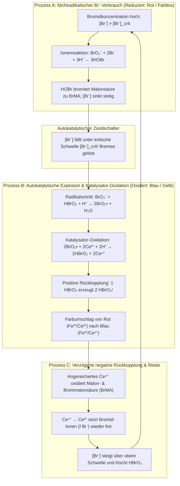
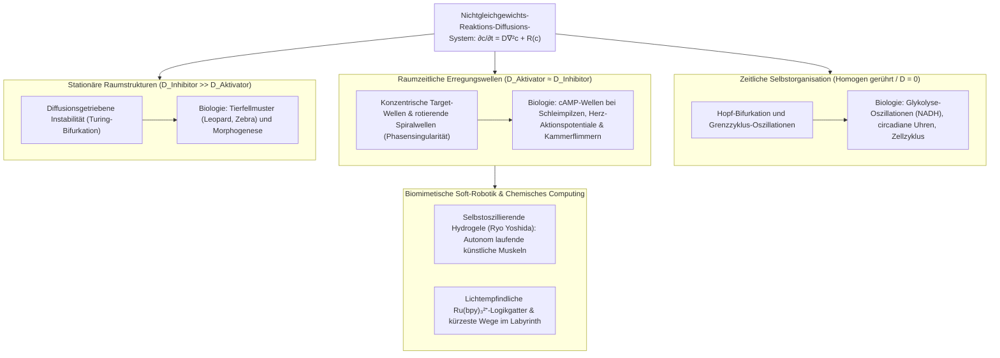

## 1. Einleitung: Was wäre, wenn die Milch im Kaffee von selbst zu pulsieren begänne?

Stellen Sie sich vor, Sie gießen kalte Milch in eine Tasse heißen schwarzen Kaffee und rühren mit einem Löffel um. Dunkle und helle Schlieren verschmelzen miteinander, bis eine gleichmäßige, hellbraune Flüssigkeit entsteht. Unsere Alltagserfahrung – und das Fundament der klassischen Physik, der <strong>Zweite Hauptsatz der Thermodynamik</strong> – sagt uns, dass dieser Prozess strikt in eine Richtung verläuft. Einmal gemischt, wird der Kaffee niemals von selbst wieder tiefschwarz werden, eine Minute später schneeweiß aufleuchten und wie ein Uhrwerk zwischen Schwarz und Weiß hin- und herpendeln.

Doch in der physikalischen Chemie existiert eine Reaktion, die genau dieser Alltagsintuition auf spektakuläre Weise widerspricht: Die <strong>Belousov-Zhabotinsky-Reaktion (BZ-Reaktion)</strong>. Mischt man einige klare Reagenzien in einem Becherglas, so <strong>pulsiert die Lösung mit der Präzision eines Metronoms dutzende Male zwischen kontrastierenden Farben hin und her</strong>; gießt man sie als dünne, ungerührte Schicht in eine Petrischale, so erzeugt sie spontan <strong>expandierende konzentrische Ringe (Target-Muster) und rotierende archimedische Spiralwellen</strong>.

### 1951: Eine „ketzerische“ Entdeckung, die von der sowjetischen Fachwelt abgelehnt wurde

Die Geschichte beginnt 1951 in Moskau. Der sowjetische Chemiker und Biophysiker <strong>Boris Pawlowitsch Belousov (1893–1970)</strong> suchte nach einem anorganischen Modell für den biologischen <strong>Citratzyklus (Krebs-Zyklus)</strong>. Er löste <strong>Kaliumbromat ($\text{KBrO}_3$)</strong> als Oxidationsmittel, <strong>Citronensäure</strong> als organisches Substrat und <strong>Cersulfat ($\text{Ce}^{4+}/\text{Ce}^{3+}$)</strong> als Redoxkatalysator in verdünnter Schwefelsäure. Vierwertige Cer-Ionen ($\text{Ce}^{4+}$) sind in Wasser gelb, dreiwertige ($\text{Ce}^{3+}$) hingegen farblos. Statt wie erwartet monoton von Gelb nach Farblos zu verblassen, wechselte Belousovs Lösung über eine Stunde lang dutzende Male periodisch zwischen <strong>Gelb ($\text{Ce}^{4+}$) und Farblos ($\text{Ce}^{3+}$)</strong>!

Als Belousov 1951 und 1957 seine Manuskripte bei führenden sowjetischen Fachzeitschriften einreichte, wurden sie <strong>kategorisch abgelehnt</strong>. Das Urteil der Gutachter lautete:

> „Die behauptete periodische Oszillation einer homogenen chemischen Reaktion über ihren Gleichgewichtspunkt hinaus <strong>verstößt direkt gegen den Zweiten Hauptsatz der Thermodynamik</strong>. Was der Autor beobachtet hat, muss ein experimentelles Artefakt durch schlechtes Rühren, Staubpartikel oder Gasblasen sein.“

Tief verletzt zog sich der 64-jährige Belousov zurück und veröffentlichte 1958 lediglich eine zweiseitige Notiz in einem kaum gelesenen Tagungsband der Strahlenmedizin.

### 1961: Anatol Zhabotinskys Rehabilitierung und der rot-blaue Herzschlag

1961 übergab Professor Simon Schnoll an der Staatlichen Universität Moskau das rätselhafte Rezept an den jungen Doktoranden <strong>Anatol Markowitsch Zhabotinsky (1938–2008)</strong>. Zhabotinsky bestätigte Belousovs Entdeckung und führte zwei entscheidende Verbesserungen ein: Er ersetzte Citronensäure durch <strong>Malonsäure ($\text{CH}_2(\text{COOH})_2$)</strong> (was störende Nebenreaktionen minimierte) und nutzte den Redoxindikator <strong>Ferroin ($[\text{Fe}(\text{phen})_3]^{2+}/[\text{Fe}(\text{phen})_3]^{3+}$)</strong>. Damit pulsierte die Lösung dramatisch zwischen <strong>Ziegelrot (reduziertes $[\text{Fe}(\text{phen})_3]^{2+}$) und Himmelblau (oxidiertes $[\text{Fe}(\text{phen})_3]^{3+}$)</strong>. 1980 wurden Belousov (posthum) und Zhabotinsky mit dem <strong>Leninpreis</strong> geehrt.

---

## 2. Lösung des thermodynamischen Paradoxons: Warum die BZ-Reaktion den Zweiten Hauptsatz nicht verletzt

### Monotone Abnahme der Gibbs-Energie und Onsagersche Reziprozitätsbeziehungen nahe dem Gleichgewicht

In einem geschlossenen System bei konstanter Temperatur $T$ und konstantem Druck $P$ verlangt der Zweite Hauptsatz eine nichtnegative innere Entropieproduktionsrate $\sigma_S \equiv \frac{d_i S}{dt} \ge 0$. Für die zeitliche Änderung der freien Enthalpie (Gibbs-Energie) $G = H - TS$ gilt:

$$\frac{dG}{dt} = -T \sigma_S = -\sum_{\rho} A_{\rho} v_{\rho} \le 0$$

wobei $v_{\rho}$ die Reaktionsgeschwindigkeit und $A_{\rho} \equiv -\sum_i \nu_{i\rho} \mu_i = -\left(\frac{\partial G}{\partial \xi_{\rho}}\right)_{T,P}$ die chemische Affinität der Reaktion $\rho$ ist.

Im <strong>linearen Nichtgleichgewichtsbereich</strong> unmittelbar um das thermodynamische Gleichgewicht ($|A_{\rho}| \ll RT$) erzwingt die mikroskopische Zeitumkehrsymmetrie das <strong>Prinzip des detaillierten Gleichgewichts</strong>. Nach den <strong>Onsagerschen Reziprozitätsbeziehungen</strong> (Lars Onsager, Nobelpreis 1968) ist die Matrix der Transportkoeffizienten strikt symmetrisch ($L_{\alpha\beta} = L_{\beta\alpha}$). Dadurch ist die Jacobi-Matrix $\mathbf{J}_{\text{eq}}$ der linearisierten Reaktionskinetik bezüglich der thermodynamischen Metrik selbstadjungiert und besitzt ausschließlich <strong>reelle, nichtpositive Eigenwerte ($\lambda_k \in \mathbb{R}, \lambda_k \le 0, \text{Im}(\lambda_k) = 0$)</strong>. Nahe dem Gleichgewicht sind selbst gedämpfte Oszillationen thermodynamisch unmöglich!

### Fern vom Gleichgewicht: Symmetriebrechung und Prigogines dissipative Strukturen

Die Lösung des Rätsels lautet: <strong>Die BZ-Reaktion schwingt nicht um das thermodynamische Gleichgewicht, sondern operiert weit entfernt vom Gleichgewicht ($A_{\rho} \gg RT$) im stark nichtlinearen Bereich!</strong>

Fern vom Gleichgewicht bricht die Onsager-Symmetrie durch autokatalytische Rückkopplung zusammen. Die Jacobi-Matrix $\mathbf{J}(\mathbf{c}^*)$ um einen stationären Nichtgleichgewichtszustand wird asymmetrisch und kann <strong>komplex konjugierte Eigenwerte $\lambda_{\pm} = \mu \pm i\omega$ ($\omega \neq 0$)</strong> annehmen. Der Physikochemiker <strong>Ilya Prigogine (Nobelpreis 1977)</strong> zeigte, dass starke Entropieproduktion ($\sigma_S > 0$) fern vom Gleichgewicht zur Quelle spontaner zeitlicher und räumlicher Selbstorganisation wird – den sogenannten <strong>dissipativen Strukturen</strong>:
1. <strong>Im offenen Durchflussreaktor (CSTR)</strong>: Kontinuierliche Zufuhr frischer Reaktanten und Abfuhr von Produkten halten die Entropiebilanz $dS = d_e S + d_i S = 0$ aufrecht; die chemische Uhr schlägt unbegrenzt.
2. <strong>Im geschlossenen Becherglas (Treppenförmiger Abstieg von $G(t)$)</strong>: Die hochkonzentrierten <strong>Hauptreaktanten ($\text{BrO}_3^-$ und Malonsäure, $\sim 10^{-1}\text{ M}$)</strong> werden streng monoton zu Produkten abgebaut ($\frac{dG}{dt} \le 0$). Nur die <strong>Spuren-Zwischenprodukte ($\text{HBrO}_2, \text{Br}^-, \text{Ce}^{4+}$, $\sim 10^{-7}\text{ bis }10^{-4}\text{ M}$)</strong> durchlaufen geschlossene Schleifen – genau wie ein <strong>Wasserrad in einem Wasserfall</strong>, das sich hunderte Male im Kreis dreht, während das Wasser selbst ausschließlich bergab fließt.

| Thermodynamisches Regime | Thermodynamisches Gleichgewicht | Lineares Nichtgleichgewicht (Gleichgewichtsnah) | Nichtlineares Nichtgleichgewicht (Fern vom Gleichgewicht / BZ) |
| :--- | :--- | :--- | :--- |
| <strong>Chemische Affinität $A_{\rho}$</strong> | $A_{\rho} = 0$ (Detailliertes Gleichgewicht) | $\|A_{\rho}\| \ll RT$ (Lineare Antwort) | $A_{\rho} \gg RT$ (Irreversibel, stark nichtlinear) |
| <strong>Entropieproduktion $\sigma_S$</strong> | $\sigma_S = 0$ (Keine Dissipation) | $\sigma_S > 0$ (Minimale Entropieproduktion) | $\sigma_S \gg 0$ (Dissipation erhält dynamische Ordnung) |
| <strong>Onsager-Symmetrie</strong> | Flüsse $J_{\alpha} = 0$ | $L_{\alpha\beta} = L_{\beta\alpha}$ (Symmetrische Matrix) | Symmetriebrechung ($\mathbf{J}$ nicht-symmetrisch) |
| <strong>Eigenwerte der Jacobi-Matrix $\mathbf{J}$</strong> | — | Rein reell und negativ ($\text{Im}(\lambda_k)=0$) | Komplex konjugiert $\lambda = \mu \pm i\omega$ ($\mu > 0$ möglich) |
| <strong>Raumzeitliches Verhalten</strong> | Homogener, statischer Zustand | Monotone exponentielle Relaxation | <strong>Grenzzyklus-Oszillationen, Spiralwellen, Turing-Muster</strong> |

---

## 3. Der FKN-Mechanismus (1972): Drei gekoppelte Prozesse und der autokatalytische Schalter

1972 entschlüsselten <strong>Richard J. Field</strong>, <strong>Endre Körös</strong> und <strong>Richard M. Noyes</strong> den aus 18 Elementarschritten bestehenden <strong>FKN-Mechanismus</strong>. Die Bruttoreaktion ist die bromatgetriebene Oxidation und Bromierung von Malonsäure:

$$2\text{BrO}_3^- + 3\text{CH}_2(\text{COOH})_2 + 2\text{H}^+ \longrightarrow 2\text{BrCH}(\text{COOH})_2 + 3\text{CO}_2 + 4\text{H}_2\text{O}$$

Der Zyklus wird durch den Wettstreit zwischen dem <strong>Aktivator Bromige Säure ($\text{HBrO}_2$)</strong> und dem <strong>Inhibitor Bromid-Ion ($\text{Br}^-$)</strong> über drei Prozesse (A, B, C) gesteuert:

1. <strong>Prozess A (Bromid-Bremse)</strong>: Solange $[\text{Br}^-] > [\text{Br}^-]_{\text{crit}}$, fängt $\text{Br}^-$ jedes gebildete $\text{HBrO}_2$ sofort über $\text{HBrO}_2 + \text{Br}^- + \text{H}^+ \xrightarrow{k_2} 2\text{HOBr}$ ab und bildet Brommalonsäure ($\text{BrMA}$). Der Katalysator bleibt reduziert (rot).
2. <strong>Prozess B (Autokatalytische Explosion)</strong>: Unterschreitet $[\text{Br}^-]$ die kritische Schwelle $[\text{Br}^-]_{\text{crit}} = \frac{k_5}{k_2}[\text{BrO}_3^-] \approx 5 \times 10^{-7}\text{ M}$, zündet über $\text{BrO}_2^\bullet$-Radikale die verzweigte Autokatalyse:
   $$\text{BrO}_3^- + \mathbf{HBrO_2} + 3\text{H}^+ + 2\text{Ce}^{3+} \longrightarrow \mathbf{2\,\text{HBrO}_2} + 2\text{Ce}^{4+} + \text{H}_2\text{O}$$
   <strong>Ein Molekül $\text{HBrO}_2$ produziert zwei Moleküle $\text{HBrO}_2$!</strong> $[\text{HBrO}_2]$ schießt um vier Größenordnungen nach oben, oxidiert den Katalysator ($\text{Ce}^{3+} \to \text{Ce}^{4+}$, Ferroin schlägt nach <strong>Blau</strong> um) und wird erst durch die Disproportionierung $2\text{HBrO}_2 \xrightarrow{k_4} \text{BrO}_3^- + \text{HOBr} + \text{H}^+$ begrenzt.
3. <strong>Prozess C (Verzögerte negative Rückkopplung)</strong>: Das angehäufte $\text{Ce}^{4+}$ oxidiert Brommalonsäure, wird wieder zu $\text{Ce}^{3+}$ reduziert und setzt pro zwei $\text{Ce}^{4+}$-Ionen $f$ Bromid-Ionen ($\text{Br}^-$) frei, was die Autokatalyse löscht und Prozess A neu startet.

---

## 4. Mathematische Theorie des Oregonators: Relaxationsoszillationen, Hopf-Bifurkation und Grenzzyklen

1974 reduzierten Field und Noyes den FKN-Mechanismus auf das dreidimensionale Differentialgleichungssystem des <strong>Oregonators</strong> für die dimensionslosen Konzentrationen $x \propto [\text{HBrO}_2]$, $y \propto [\text{Br}^-]$ und $z \propto [\text{Ce}^{4+}]$:

$$\varepsilon \frac{dx}{d\tau} = q y - x y + x(1 - x), \qquad \varepsilon' \frac{dy}{d\tau} = -q y - x y + f z, \qquad \frac{dz}{d\tau} = x - z$$

- <strong>Schnell-Langsam-Zeitskalentrennung und Relaxationsoszillationen</strong>: Da $\varepsilon' \sim 10^{-4} \ll \varepsilon \sim 10^{-2} \ll 1$, folgt $y \approx \frac{f z}{x + q}$ quasi-stationär, und in der $(x, z)$-Phasenebene besitzt die $x$-Nullkline $z = \frac{x(1-x)(x+q)}{f(x-q)}$ eine <strong>kubische S-förmige (bzw. N-förmige) Faltung</strong>. Die Trajektorie kriecht langsam auf dem stabilen linken Ast hinab, springt am unteren Faltpunkt explosionsartig auf den rechten Ast (Zündung) und nach langsamem Aufstieg wieder zurück – eine klassische <strong>Relaxationsoszillation</strong> mit sägezahnförmigen Pulsen.
- <strong>Hopf-Bifurkation und Satz von Poincaré-Bendixson</strong>: Die Jacobi-Matrix $\mathbf{J}$ am eindeutigen Fixpunkt $(x^*, z^*)$ erfüllt stets $\det(\mathbf{J}) > 0$. Liegt der stöchiometrische Faktor $f$ im Schwingungsfenster ($0{,}5 \lesssim f \lesssim 1 + \sqrt{2} \approx 2{,}414$), so liegt der Fixpunkt auf dem instabilen mittleren Nullklinenast mit $\text{Tr}(\mathbf{J}) > 0$. Beim Überschreiten der kritischen Schwellen überqueren die Eigenwerte $\lambda_{\pm} = \mu(f) \pm i\omega(f)$ die imaginäre Achse in einer <strong>Andronow-Hopf-Bifurkation</strong>, und der <strong>Satz von Poincaré-Bendixson</strong> garantiert die Existenz eines global anziehenden <strong>Grenzzyklus (Limit Cycle)</strong>.

---

## 5. Chemische Wellen im ungerührten Raum: Reaktions-Diffusions-PDGL, Target-Muster und Spiralwellen

In einer flachen, ungerührten Petrischale koppelt die lokale Reaktionskinetik $\mathbf{R}(\mathbf{c})$ mit dem zweiten Fickschen Diffusionsgesetz zum <strong>Reaktions-Diffusions-System</strong>:

$$\frac{\partial \mathbf{c}(\mathbf{r}, t)}{\partial t} = \mathbf{D} \nabla^2 \mathbf{c}(\mathbf{r}, t) + \mathbf{R}\bigl(\mathbf{c}(\mathbf{r}, t)\bigr)$$

1. <strong>Erregbares Medium und Luthers Geschwindigkeitsformel</strong>: Die Kombination aus lokaler Autokatalyse ($k_{\text{auto}} = k_5 [\text{BrO}_3^-][\text{H}^+]$) und Diffusion ($D_X$) treibt ungedämpfte Triggerwellen an, deren konstante Ausbreitungsgeschwindigkeit durch die <strong>Luther-Formel (1906)</strong> bestimmt wird:
   $$v_0 = 2 \sqrt{D_X \, k_{\text{auto}}} = 2 \sqrt{D_X \, k_5 [\text{BrO}_3^-][\text{H}^+]} \approx 5\text{–}10\text{ mm/min}$$
2. <strong>Paarvernichtung bei Kollision und Phasensingularität der Spiralwellen</strong>: Hinter jeder blauen Wellenfront liegt eine <strong>Refraktärzone</strong> (Prozess C mit hohem $[\text{Br}^-]$), die nicht erregbar ist. <strong>Stoßen zwei chemische Wellen frontal zusammen, löschen sie sich gegenseitig vollständig aus!</strong> Wird eine kreisförmige Wellenfront (Target-Muster) unterbrochen, rollt sich das freie Wellenende um seine eigene Refraktärzone ein und bildet eine autonom rotierende <strong>archimedische Spiralwelle</strong>. Ihr Zentrum ist eine topologische <strong>Phasensingularität</strong> ($\oint_C \nabla \phi \cdot d\mathbf{l} = \pm 2\pi n$), und die Frontgeschwindigkeit gehorcht der <strong>Eikonal-Krümmungsrelation</strong> $v_n = v_0 - D\kappa$.

---

## 6. Vom lebenden Organismus zu intelligenten Materialien: Turing-Muster, Kammerflimmern und selbstlaufende Gele

- <strong>Alan Turings Morphogenese (1952)</strong>: Wenn der Inhibitor viel schneller diffundiert als der Aktivator ($D_v \gg D_u$), entstehen stehende Punkte- und Streifenmuster (<strong>Turing-Muster</strong>), die in BZ-AOT-Mikroemulsionen direkt neben Spiralwellen nachgewiesen wurden.
- <strong>Herzkammerflimmern als Spiralwellen-Chaos</strong>: Der menschliche Herzmuskel ist ein elektrisch erregbares Medium. Reißt eine Erregungswelle an geschädigtem Gewebe auf, entstehen rotierende <strong>Spiralwellen (3D-Scroll-Wellen)</strong>, deren Zerfall in raumzeitliches Chaos das tödliche <strong>Kammerflimmern</strong> auslöst. Ein <strong>Defibrillator (AED)</strong> versetzt das gesamte Myokard gleichzeitig in die Refraktärphase, um alle Phasensingularitäten zu löschen.
- <strong>Selbstlaufende Hydrogele (Ryo Yoshida)</strong>: Durch kovalente Bindung des lichtempfindlichen BZ-Katalysators $\text{Ru(bpy)}_3^{2+}$ an ein thermoresponsives Polymernetzwerk (PNIPAAm) entstehen <strong>selbstoszillierende Gele</strong>, die chemische Energie direkt in mechanische Peristaltik umwandeln und ganz ohne Batterie oder Elektronik wie eine Raupe vorwärtskriechen.
