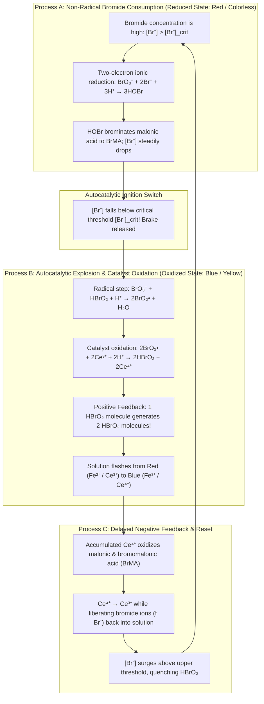
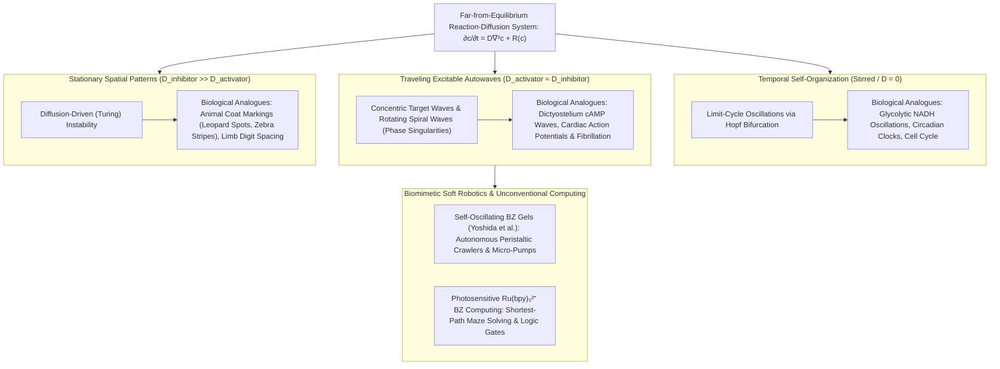

## 1. Introduction: What If Milk Poured into Coffee Started Pulsing on Its Own?

Imagine pouring cold milk into a cup of hot black coffee and stirring it with a spoon. Dark and light swirls fold into one another until the liquid settles into a uniform, placid shade of tan. Everyday intuition—and the bedrock of classical physics known as the <strong>Second Law of Thermodynamics</strong>—tells us that this process is strictly one-way. Once mixed, the coffee will never spontaneously turn pitch-black again, then flash pure white a minute later, and continue oscillating between black and white like a ticking clock. If you saw a cup of coffee behave that way on a table, you would suspect a hidden trick or an illusion.

Yet in the realm of physical chemistry, there exists a reaction that defies this everyday intuition in the most spectacular fashion. When you mix a few clear and lightly tinted aqueous reagents in a beaker, the resulting solution <strong>spontaneously oscillates between contrasting colors dozens of times with metronomic precision</strong>; when poured into a thin, unstirred layer in a Petri dish, it autonomously generates <strong>expanding concentric rings (target patterns) and rotating Archimedes spirals (chemical waves)</strong>. This phenomenon is the celebrated <strong>Belousov-Zhabotinsky (BZ) reaction</strong>—the Rosetta Stone of nonlinear chemical dynamics and far-from-equilibrium self-organization.

### 1951: A "Heretical" Discovery Rejected by Soviet Science

The story begins in 1951 in Moscow. <strong>Boris Pavlovich Belousov (1893–1970)</strong>, a respected chemist and biophysicist working at the Laboratory of Biophysics of the USSR Ministry of Health, was searching for an inorganic analogue of the biological <strong>citric acid cycle (Krebs cycle / TCA cycle)</strong>. In living cells, citric acid and related tricarboxylic intermediates are sequentially oxidized to carbon dioxide ($\text{CO}_2$) while reducing coenzymes. Belousov wondered whether a simple aqueous mixture could mimic this catalytic oxidation without biological enzymes.

He dissolved <strong>potassium bromate ($\text{KBrO}_3$)</strong> as an oxidizer, <strong>citric acid</strong> as an organic substrate, and <strong>cerium sulfate ($\text{Ce}^{4+} / \text{Ce}^{3+}$)</strong> as a redox catalyst in dilute sulfuric acid. In aqueous solution, tetravalent cerium ions ($\text{Ce}^{4+}$) are yellow, whereas trivalent cerium ions ($\text{Ce}^{3+}$) are colorless. By every textbook rule of chemistry at the time, the solution should have changed monotonically from yellow to colorless as the reaction proceeded toward equilibrium.

Instead, Belousov witnessed something extraordinary. The yellow solution turned completely colorless—and then, after several tens of seconds, suddenly flashed back to bright yellow, only to fade to colorless again. This periodic oscillation between <strong>yellow ($\text{Ce}^{4+}$) and colorless ($\text{Ce}^{3+}$)</strong> persisted for over an hour across dozens of regular cycles. When he stopped stirring the mixture in a graduated cylinder, he even observed traveling yellow bands migrating steadily up and down the tube.

Thrilled by his discovery, Belousov submitted a carefully documented manuscript to a leading Soviet chemistry journal in 1951. The paper was <strong>summarily rejected</strong>. The editor and anonymous referees delivered a scathing verdict:

> "The claimed periodic oscillation of a homogeneous chemical reaction back and forth past its equilibrium point <strong>directly violates the Second Law of Thermodynamics</strong>. Whatever the author observed must be an experimental artifact caused by poor mixing, dust impurities, or gas bubble nucleation."

Undeterred, Belousov spent six more years recording kinetic curves, measuring temperature dependencies, and photographing the traveling waves. In 1957 he submitted an expanded manuscript to another journal. Again, reviewers refused to believe that homogeneous chemical oscillations could exist, offering at most to print a heavily truncated note if he admitted the system was heterogeneous. Deeply offended at age 64, Belousov withdrew his manuscript. In 1958, he tucked away a brief two-page abstract and recipe in an obscure, unreviewed institutional bulletin—*Sbornik Referatov po Radiatsionnoi Meditsine* (*Collection of Abstracts on Radiation Medicine*)—and abandoned the topic forever.

### 1961: Anatol Zhabotinsky's Revival and the Red-Blue Heartbeat

For several years, Belousov's recipe circulated around Moscow laboratories as scientific folklore: a mysterious flask that beat like a clock, even though no one knew its mechanism or original author. In 1961, <strong>Simon Shnoll</strong>, a charismatic professor of biophysics at Moscow State University, handed the recipe to a brilliant young graduate student, <strong>Anatol Markovich Zhabotinsky (1938–2008)</strong>.

Zhabotinsky tracked down Belousov's 1958 abstract, reproduced the oscillations, and introduced two decisive chemical refinements that transformed the curiosity into a quantitative model system:
1. He replaced citric acid with <strong>malonic acid ($\text{CH}_2(\text{COOH})_2$)</strong>, a simpler dicarboxylic acid that greatly reduced side reactions and gas evolution.
2. He introduced the redox indicator <strong>ferroin ($[\text{Fe}(\text{phen})_3]^{2+} / [\text{Fe}(\text{phen})_3]^{3+}$)</strong>, a complex of iron with $1,10$-phenanthroline, either alongside cerium or as a standalone catalyst.

With ferroin, the visual contrast became breathtaking: the solution pulsed dramatically between <strong>brick-red (reduced $[\text{Fe}(\text{phen})_3]^{2+}$) and vivid sky-blue (oxidized $[\text{Fe}(\text{phen})_3]^{3+}$)</strong>. Zhabotinsky published his findings in 1964, scrupulously crediting Belousov's pioneering work. Although Belousov and Zhabotinsky never met face to face, their names were forever linked in the <strong>Belousov-Zhabotinsky (BZ) reaction</strong>. In 1980, a decade after Belousov's death, the Soviet Union awarded Belousov (posthumously), Zhabotinsky, Zaikin, Krinsky, and Ivanitsky the prestigious <strong>Lenin Prize</strong>—the highest scientific honor in the USSR—for discovering a new class of autowave processes.

---

## 2. Resolving the Thermodynamic Paradox: Why the BZ Reaction Does Not Violate the Second Law

Why were the referees of the 1950s so convinced that homogeneous chemical oscillations were impossible? And where exactly did their thermodynamic intuition fail? Answering this question rigorously takes us to the heart of modern <strong>Non-Equilibrium Thermodynamics</strong>.

### Monotonic Decrease of Gibbs Free Energy in a Closed System

Consider a closed, well-stirred reactor maintained at constant temperature $T$ and constant pressure $P$. According to the Second Law of Thermodynamics, any differential change $dS$ in the entropy of the system can be decomposed into two parts:

$$dS = d_e S + d_i S \qquad \left( d_i S \ge 0 \right)$$

where $d_e S = \frac{\delta Q}{T}$ is the entropy exchanged with the surroundings via heat transfer, and $d_i S$ is the <strong>internal entropy production</strong> due to irreversible processes inside the system, which must be non-negative ($d_i S \ge 0$, vanishing only at reversible equilibrium).

At constant $T$ and $P$, the Gibbs free energy $G = H - TS$ evolves in time according to the internal entropy production rate $\sigma_S \equiv \frac{d_i S}{dt} \ge 0$:

$$\frac{dG}{dt} = -T \sigma_S = -T \sum_{\rho} \frac{A_{\rho}}{T} v_{\rho} = -\sum_{\rho} A_{\rho} v_{\rho} \le 0$$

Here, the index $\rho$ runs over all elementary or independent chemical reactions in the mixture, $v_{\rho} = \frac{1}{V}\frac{d\xi_{\rho}}{dt}$ is the reaction rate (velocity) of reaction $\rho$, and $A_{\rho}$ is the <strong>chemical affinity</strong> introduced by Théophile De Donder:

$$A_{\rho} \equiv -\sum_{i} \nu_{i\rho} \mu_i = -\left(\frac{\partial G}{\partial \xi_{\rho}}\right)_{T, P}$$

where $\mu_i$ is the chemical potential of species $i$ and $\nu_{i\rho}$ is its signed stoichiometric coefficient in reaction $\rho$. Thermodynamic equilibrium corresponds to the global minimum of $G$, where $A_{\rho} = 0$ and $v_{\rho} = 0$ for every reaction $\rho$, yielding $\frac{dG}{dt} = 0$.

Classical chemists pictured a single reaction $A \rightleftharpoons B$ moving along a one-dimensional reaction coordinate $\xi$ on a bowl-shaped curve $G(\xi)$. For the concentration of $B$ to increase, pass through equilibrium, and then decrease again, the state of the system would have to roll down to the bottom of the Gibbs free energy bowl, overshoot it, and climb up the opposite wall—requiring $\frac{dG}{dt} > 0$ ($\sigma_S < 0$), an unambiguous violation of the Second Law.

### Near Equilibrium: Detailed Balance and Onsager Reciprocal Relations Forbid Spiraling

What if we have a network of $n$ chemical species $\mathbf{c} = (c_1, c_2, \dots, c_n)^T$ moving on a high-dimensional bowl $G(\mathbf{c})$? Could the trajectory spiral around the equilibrium point $\mathbf{c}^{\text{eq}}$ like a marble circling a funnel on its way down, maintaining $\frac{dG}{dt} < 0$ while its coordinates oscillate in damped waves?

Remarkably, the answer near thermodynamic equilibrium is still <strong>no</strong>! Even damped oscillations around the true equilibrium state $\mathbf{c}^{\text{eq}}$ are strictly forbidden by statistical mechanics.

In the <strong>linear non-equilibrium regime</strong> very close to thermodynamic equilibrium ($|A_{\rho}| \ll RT$), microscopic time-reversal invariance requires the <strong>Principle of Detailed Balance</strong>: every forward elementary reaction is balanced individually by its exact reverse reaction at equilibrium, disallowing net cyclic fluxes ($A \to B \to C \to A$). In this linear neighborhood, thermodynamic fluxes $J_{\alpha} = v_{\alpha}$ are linear functions of the thermodynamic forces $X_{\beta} = A_{\beta}/T$:

$$J_{\alpha} = \sum_{\beta} L_{\alpha\beta} X_{\beta}$$

By the celebrated <strong>Onsager Reciprocal Relations</strong> proved by Lars Onsager in 1931 (1968 Nobel Prize in Chemistry), the phenomenological conductivity matrix $\mathbf{L}$ is strictly symmetric and positive semidefinite:

$$L_{\alpha\beta} = L_{\beta\alpha}$$

Simultaneously, the Hessian matrix of the Gibbs free energy with respect to small concentration perturbations $\delta \mathbf{c} = \mathbf{c} - \mathbf{c}^{\text{eq}}$, namely $M_{ij} = \left(\frac{\partial \mu_i}{\partial c_j}\right)_{\text{eq}} = \left(\frac{\partial^2 g}{\partial c_i \partial c_j}\right)_{\text{eq}}$, is symmetric and positive definite by thermodynamic stability. Consequently, the linearized kinetic evolution near equilibrium:

$$\frac{d(\delta \mathbf{c})}{dt} = \mathbf{J}_{\text{eq}} \, \delta \mathbf{c}$$

is governed by a Jacobian matrix $\mathbf{J}_{\text{eq}} = -\mathbf{S}\,\mathbf{L}\,\mathbf{S}^T \mathbf{M}$ (where $\mathbf{S}$ is the stoichiometric matrix) that is <strong>similar to a real symmetric negative semidefinite matrix</strong> under the inner product defined by $\mathbf{M}$! By a fundamental theorem of linear algebra, a matrix that is self-adjoint with respect to a positive-definite metric possesses <strong>purely real, non-positive eigenvalues</strong>:

$$\lambda_k \in \mathbb{R}, \quad \lambda_k \le 0, \quad \text{Im}(\lambda_k) = 0 \quad (\forall k)$$

Because every eigenvalue has zero imaginary part ($\text{Im}(\lambda_k) = 0$), oscillatory factors of the form $e^{i\omega t} = \cos(\omega t) + i\sin(\omega t)$ can never arise near thermodynamic equilibrium. All perturbations $\delta \mathbf{c}(t) = \sum_k \mathbf{v}_k e^{-|\lambda_k| t}$ decay strictly monotonically!

### Far from Equilibrium: Breaking Onsager Symmetry and Prigogine's Dissipative Structures

How, then, does the Belousov-Zhabotinsky reaction oscillate? The resolution lies in recognizing that <strong>the BZ reaction does not oscillate around thermodynamic equilibrium; it operates far from equilibrium ($A_{\rho} \gg RT$) in the strongly nonlinear regime!</strong>

When a chemical system is held far from equilibrium, reverse rates of strongly exergonic steps become negligible, autocatalytic feedback loops emerge, and the linear proportionality between fluxes and affinities breaks down. In this nonlinear regime, the Jacobian matrix $\mathbf{J}(\mathbf{c}^*)$ evaluated around a far-from-equilibrium steady state $\mathbf{c}^*$ is <strong>no longer constrained by Onsager symmetry</strong> ($\mathbf{J}$ is non-symmetric). Its eigenvalues can therefore become a pair of <strong>complex conjugates</strong>:

$$\lambda_{\pm} = \mu \pm i\omega \qquad (\omega \neq 0)$$

Enabling sustained periodic orbits! The Belgian physical chemist <strong>Ilya Prigogine (1917–2003, 1977 Nobel Prize in Chemistry)</strong> showed that far from equilibrium, irreversible entropy production ($\sigma_S > 0$) ceases to be merely an engine of disorder and instead becomes the very driving force for spontaneous temporal and spatial self-organization—creating what he termed <strong>Dissipative Structures</strong>:

1. <strong>In an Open Reactor (CSTR — Continuous Stirred-Tank Reactor)</strong>: Fresh high-free-energy reactants ($\text{BrO}_3^-$ and malonic acid) are continuously pumped in while spent products are flushed out. The negative entropy flux exported to the environment ($d_e S < 0$) exactly balances internal entropy production ($d_i S > 0$), maintaining $dS = d_e S + d_i S = 0$ indefinitely. The chemical clock runs forever without decaying.
2. <strong>In a Closed Beaker (Batch Reactor) — The Staircase Descent of Gibbs Free Energy</strong>: Why does a closed beaker of BZ solution still oscillate dozens of times over an hour? Because the chemical species in the beaker are divided into two vastly different populations:
   - <strong>Major Reactants and Products</strong> ($\text{BrO}_3^-$, malonic acid, $\text{CO}_2$, bromomalonic acid) present at high concentrations ($\sim 10^{-1}\text{ M}$). These major species move monotonically downhill from reactants to products, driving a massive, irreversible drop in total Gibbs free energy ($\Delta G \ll 0$).
   - <strong>Trace Reaction Intermediates</strong> ($\text{HBrO}_2, \text{Br}^-, \text{Ce}^{4+}$) present at concentrations a thousand to a hundred thousand times smaller ($\sim 10^{-7}$ to $10^{-4}\text{ M}$). Only these trace intermediates execute closed loops in concentration space!

Think of a <strong>waterwheel placed in a mountain waterfall</strong>. The water itself (the Gibbs free energy $G(t)$ of the major reactants) flows strictly downhill from the mountain reservoir to the valley floor; not a single drop flows uphill against gravity ($\frac{dG}{dt} \le 0$ at every instant). Yet the blades of the waterwheel (the trace catalytic intermediates $\text{HBrO}_2, \text{Br}^-, \text{Ce}^{4+}$) spin round and round through the exact same periodic cycle hundreds of times until the reservoir runs dry. If you plot the total Gibbs free energy $G(t)$ of a closed BZ beaker against time, it traces a <strong>monotonically decreasing staircase curve</strong>—dropping steeply during the rapid autocatalytic flash and sloping gently downward during the quiescent recovery phase, satisfying $\frac{dG}{dt} = -T\sigma_S < 0$ at every moment in time.

| Thermodynamic Regime | Thermodynamic Equilibrium | Linear Non-Equilibrium (Near Equilibrium) | Nonlinear Non-Equilibrium (Far from Equilibrium / BZ Reaction) |
| :--- | :--- | :--- | :--- |
| <strong>Chemical Affinity $A_{\rho}$</strong> | $A_{\rho} = 0$ (Detailed balance holds) | $\|A_{\rho}\| \ll RT$ (Linear response regime) | $A_{\rho} \gg RT$ (Irreversible, strongly nonlinear regime) |
| <strong>Entropy Production $\sigma_S$</strong> | $\sigma_S = 0$ (Zero dissipation) | $\sigma_S > 0$ (Minimum entropy production theorem) | $\sigma_S \gg 0$ (High dissipation sustains dynamic order) |
| <strong>Onsager Symmetry</strong> | Fluxes $J_{\alpha} = 0$ | $L_{\alpha\beta} = L_{\beta\alpha}$ (Symmetric matrix) | Broken symmetry ($\mathbf{J}$ is non-symmetric) |
| <strong>Eigenvalues of Jacobian $\mathbf{J}$</strong> | — | Purely real and negative ($\lambda_k < 0, \text{Im}(\lambda_k)=0$) | Complex conjugates $\lambda = \mu \pm i\omega$ with $\mu > 0$ possible |
| <strong>Spatiotemporal Behavior</strong> | Homogeneous, static dead state | Monotonic exponential relaxation only | <strong>Limit-cycle oscillations, spiral waves, Turing patterns</strong> |

---

## 3. The FKN Mechanism (1972): Three Interlocking Processes and the Autocatalytic Switch

Even after chemists accepted that far-from-equilibrium oscillations were thermodynamically permissible, the detailed molecular mechanism of the BZ reaction remained a formidable puzzle for over a decade. In 1972, in a landmark series of papers, <strong>Richard J. Field</strong>, <strong>Endre Körös</strong>, and <strong>Richard M. Noyes</strong> at the University of Oregon unraveled the intricate kinetic network of bromine oxyacids, organic radicals, and metal ions. Their comprehensive 18-step kinetic scheme—distilled from over 80 elementary reactions—is universally known as the <strong>FKN Mechanism</strong>.

### Overall Stoichiometry and the Two Protagonists: Activator $\text{HBrO}_2$ vs. Inhibitor $\text{Br}^-$

In an acidic aqueous solution containing a redox catalyst ($\text{Ce}^{3+}/\text{Ce}^{4+}$ or ferroin $[\text{Fe}(\text{phen})_3]^{2+}/[\text{Fe}(\text{phen})_3]^{3+}$), the net overall chemical transformation of the BZ reaction is the bromate-driven oxidation and bromination of malonic acid ($\text{CH}_2(\text{COOH})_2$):

$$2\text{BrO}_3^- + 3\text{CH}_2(\text{COOH})_2 + 2\text{H}^+ \longrightarrow 2\text{BrCH}(\text{COOH})_2 + 3\text{CO}_2 + 4\text{H}_2\text{O}$$

Field, Körös, and Noyes discovered that this overall reaction does not proceed smoothly. Instead, it alternates cyclically among three distinct kinetic regimes—<strong>Process A</strong>, <strong>Process B</strong>, and <strong>Process C</strong>—controlled by a tug-of-war between two trace intermediates:

- <strong>The Activator (Autocatalytic Species)</strong>: <strong>Bromous acid ($\text{HBrO}_2$)</strong>, where bromine is in the $+3$ oxidation state. It acts as the chemical "accelerator," capable of catalyzing its own explosive multiplication.
- <strong>The Inhibitor (Control Species)</strong>: <strong>Bromide ion ($\text{Br}^-$)</strong>, where bromine is in the $-1$ oxidation state. It acts as the chemical "brake," rapidly scavenging $\text{HBrO}_2$ before autocatalysis can ignite.

Let us trace how Processes A, B, and C interlock to create a self-sustaining chemical clock.

### Process A: The Bromide Brake and Non-Radical Reduction (Reduced State)

Suppose the solution initially contains an abundant concentration of bromide ions, $[\text{Br}^-] > [\text{Br}^-]_{\text{crit}}$, with the metal catalyst in its reduced form ($\text{Ce}^{3+}$ colorless, or ferroin $[\text{Fe}(\text{phen})_3]^{2+}$ <strong>brick-red</strong>). Under these conditions, bromate ($\text{BrO}_3^-$) is reduced exclusively via two-electron oxygen-atom transfer reactions with $\text{Br}^-$ that do not involve free radicals or metal ions:

$$\text{(R1)} \quad \text{BrO}_3^- + \text{Br}^- + 2\text{H}^+ \xrightarrow{k_1} \text{HBrO}_2 + \text{HOBr}$$

$$\text{(R2)} \quad \text{HBrO}_2 + \text{Br}^- + \text{H}^+ \xrightarrow{k_2} 2\text{HOBr}$$

$$\text{(R3)} \quad \text{HOBr} + \text{Br}^- + \text{H}^+ \xrightarrow{\text{fast}} \text{Br}_2 + \text{H}_2\text{O}$$

Reaction (R2) is exceedingly fast ($k_2 \approx 2 \times 10^6\text{ M}^{-2}\text{s}^{-1}$). As long as $[\text{Br}^-]$ is appreciable, any molecule of bromous acid ($\text{HBrO}_2$) formed in (R1) is <strong>immediately scavenged by $\text{Br}^-$ via (R2)</strong> and converted into hypobromous acid ($\text{HOBr}$). The resulting $\text{HOBr}$ and $\text{Br}_2$ rapidly brominate the enol form of malonic acid to yield <strong>bromomalonic acid ($\text{BrCH}(\text{COOH})_2$, abbreviated $\text{BrMA}$)</strong>, locking bromine into a covalent carbon-bromine bond:

$$\text{Net Process A:} \quad \text{BrO}_3^- + 2\text{Br}^- + 3\text{CH}_2(\text{COOH})_2 + 3\text{H}^+ \longrightarrow 3\text{BrCH}(\text{COOH})_2 + 3\text{H}_2\text{O}$$

Throughout Process A, the solution remains quietly red (or colorless), while behind the scenes the inhibitor $[\text{Br}^-]$ is inexorably consumed.

### Process B: Autocatalytic Explosion of $\text{HBrO}_2$ and Catalyst Oxidation (Positive Feedback)

As $[\text{Br}^-]$ continues to fall, it eventually drops below a sharp <strong>critical threshold $[\text{Br}^-]_{\text{crit}}$</strong>. At that exact instant, the scavenging reaction (R2) can no longer keep pace with a competing pathway in which $\text{HBrO}_2$ reacts directly with bromate ($\text{BrO}_3^-$) via a one-electron radical chain:

$$\text{(R5a)} \quad \text{BrO}_3^- + \text{HBrO}_2 + \text{H}^+ \xrightarrow{k_5} 2\text{BrO}_2^\bullet + \text{H}_2\text{O}$$

$$\text{(R5b)} \quad \text{BrO}_2^\bullet + \text{Ce}^{3+} + \text{H}^+ \xrightarrow{\text{fast}} \text{HBrO}_2 + \text{Ce}^{4+}$$

In step (R5a), $\text{Br(V)}$ in $\text{BrO}_3^-$ and $\text{Br(III)}$ in $\text{HBrO}_2$ undergo comproportionation to produce two molecules of the <strong>bromine dioxide free radical ($\text{BrO}_2^\bullet$)</strong>, where bromine is in the $+4$ oxidation state. Each $\text{BrO}_2^\bullet$ radical rapidly extracts one electron from the reduced metal catalyst $\text{Ce}^{3+}$ (or red ferroin $[\text{Fe}(\text{phen})_3]^{2+}$) in step (R5b), oxidizing the catalyst to $\text{Ce}^{4+}$ (or blue ferriin $[\text{Fe}(\text{phen})_3]^{3+}$) while regenerating $\text{HBrO}_2$.

Adding $\text{(R5a)} + 2\times\text{(R5b)}$ reveals the celebrated <strong>autocatalytic heart</strong> of the BZ reaction:

$$\text{BrO}_3^- + \mathbf{HBrO_2} + 3\text{H}^+ + 2\text{Ce}^{3+} \longrightarrow \mathbf{2\,HBrO_2} + 2\text{Ce}^{4+} + \text{H}_2\text{O}$$

<strong>Every single molecule of $\text{HBrO}_2$ that enters the reaction produces two molecules of $\text{HBrO}_2$!</strong> Those 2 molecules produce 4, 4 produce 8, and so on in a branched chain explosion.

By comparing the rate of autocatalytic production of $\text{HBrO}_2$ in (R5a), $v_{\text{auto}} = k_5 [\text{BrO}_3^-][\text{H}^+][\text{HBrO}_2]$, with the rate of $\text{HBrO}_2$ destruction by $\text{Br}^-$ in (R2), $v_{\text{inhib}} = k_2 [\text{Br}^-][\text{H}^+][\text{HBrO}_2]$, we obtain the exact mathematical condition for ignition:

$$v_{\text{auto}} > v_{\text{inhib}} \iff k_5 [\text{BrO}_3^-][\text{H}^+][\text{HBrO}_2] > k_2 [\text{Br}^-][\text{H}^+][\text{HBrO}_2] \iff [\text{Br}^-] < [\text{Br}^-]_{\text{crit}} \equiv \frac{k_5}{k_2} [\text{BrO}_3^-]$$

At $25^\circ\text{C}$, the rate constant ratio is $\frac{k_5}{k_2} \approx 5 \times 10^{-6}$. For a typical bromate concentration $[\text{BrO}_3^-] = 0.10\text{ M}$, the critical bromide concentration is a minuscule $[\text{Br}^-]_{\text{crit}} \approx 5 \times 10^{-7}\text{ M}$! The moment $[\text{Br}^-]$ dips below this sub-micromolar threshold, positive feedback takes over: $[\text{HBrO}_2]$ skyrockets by four to five orders of magnitude within milliseconds, wiping out any remaining $\text{Br}^-$ via (R2) and rapidly oxidizing $\text{Ce}^{3+} \to \text{Ce}^{4+}$ (or red ferroin $\to$ <strong>bright blue ferriin</strong>).

The exponential runaway of $[\text{HBrO}_2]$ is ultimately capped at a high plateau by the bimolecular disproportionation of bromous acid (quadratic self-termination):

$$\text{(R4)} \quad 2\text{HBrO}_2 \xrightarrow{k_4} \text{BrO}_3^- + \text{HOBr} + \text{H}^+$$

### Process C: Delayed Negative Feedback and Catalyst Reduction (Regenerating the Brake)

If the reaction stopped at Process B, the solution would remain permanently blue in the high-$[\text{HBrO}_2]$, high-$[\text{Ce}^{4+}]$ oxidized state. To sustain oscillations, a system requires a <strong>delayed negative feedback loop</strong> that restores the inhibitor $\text{Br}^-$. This is the role of <strong>Process C</strong>.

During Process B, the concentration of oxidized metal catalyst $\text{Ce}^{4+}$ (or $[\text{Fe}(\text{phen})_3]^{3+}$) builds up to a high level. This strong oxidant now attacks the organic substrates—malonic acid and especially the <strong>bromomalonic acid ($\text{BrCH}(\text{COOH})_2$)</strong> that accumulated during Process A—cleaving the carbon-bromine bond and liberating free bromide ions ($\text{Br}^-$) back into the solution while reducing the catalyst back to $\text{Ce}^{3+}$:

$$2\text{Ce}^{4+} + \text{CH}_2(\text{COOH})_2 + \text{BrCH}(\text{COOH})_2 \xrightarrow{k_C} f\,\text{Br}^- + 2\text{Ce}^{3+} + \text{CO}_2\uparrow + \text{formic acid / other products}$$

Here, the dimensionless parameter $f$ is the crucial <strong>stoichiometric factor</strong>, defined such that the reduction of two moles of $\text{Ce}^{4+}$ yields $f$ moles of $\text{Br}^-$ ion (or $f/2$ moles of $\text{Br}^-$ per mole of $\text{Ce}^{4+}$ reduced). As Process C pours $\text{Br}^-$ back into the mixture, $[\text{Br}^-]$ eventually exceeds an upper threshold where reaction (R2) overwhelms autocatalysis (R5a), catastrophically quenching $[\text{HBrO}_2]$ and returning the solution to Process A (the red reduced state), ready for the next beat of the chemical heart.

---

## 4. Mathematical Theory of the Oregonator: Relaxation Oscillations, Hopf Bifurcation, and Limit Cycles

While the 18-step FKN mechanism triumphantly explained the chemistry, a system of 18 coupled stiff differential equations is too unwieldy for analytical phase-space geometry. In 1974, <strong>Richard J. Field and Richard M. Noyes</strong> distilled the FKN mechanism into a minimal, five-step kinetic model with just three dynamic variables. Named the <strong>Oregonator</strong> (a portmanteau of *Oregon* and *Oscillator*), it stands alongside the Lorenz equations and the Hodgkin-Huxley model as a cornerstone of nonlinear science.

### The Five Skeleton Steps and Dimensionless ODEs

Holding the major pool species constant—$A = [\text{BrO}_3^-]$, $B = [\text{Malonic Acid} + \text{Bromomalonic Acid}]$, and $[\text{H}^+]$—the Oregonator tracks three dynamic intermediate concentrations:
- $X = [\text{HBrO}_2]$ : the autocatalytic activator (bromous acid)
- $Y = [\text{Br}^-]$ : the inhibitor (bromide ion)
- $Z = [\text{Ce}^{4+}]$ : the oxidized metal catalyst mediating delayed negative feedback

(with $P = [\text{HOBr}]$ representing non-oscillating products). The five irreversible skeleton reactions of the Oregonator are:

$$\begin{aligned}
\text{(M1)} &\quad A + Y \xrightarrow{k_1} X + P && \text{(Process A: Slow initiation of }\text{HBrO}_2\text{ from }\text{BrO}_3^-\text{ and }\text{Br}^-\text{)} \\
\text{(M2)} &\quad X + Y \xrightarrow{k_2} 2P && \text{(Inhibition switch: Scavenging of }\text{HBrO}_2\text{ by }\text{Br}^-\text{)} \\
\text{(M3)} &\quad A + X \xrightarrow{k_3} 2X + 2Z && \text{(Process B: Autocatalytic doubling of }\text{HBrO}_2\text{ and }\text{Ce}^{4+}\text{ production)} \\
\text{(M4)} &\quad 2X \xrightarrow{k_4} A + P && \text{(Quadratic saturation: Disproportionation of }\text{HBrO}_2\text{)} \\
\text{(M5)} &\quad B + Z \xrightarrow{k_5} \frac{1}{2} f Y && \text{(Process C: Delayed regeneration of }\text{Br}^-\text{ via }\text{Ce}^{4+}\text{ reduction)}
\end{aligned}$$

By the Law of Mass Action, the kinetic rate equations for $(X, Y, Z)$ read:

$$\begin{aligned}
\frac{dX}{dt} &= k_1 A Y - k_2 X Y + k_3 A X - 2 k_4 X^2 \\
\frac{dY}{dt} &= -k_1 A Y - k_2 X Y + \frac{1}{2} f k_5 B Z \\
\frac{dZ}{dt} &= 2 k_3 A X - k_5 B Z
\end{aligned}$$

Following the standard dimensionless scaling introduced by John J. Tyson, we define dimensionless concentrations $(x, y, z)$ and dimensionless time $\tau$:

$$x = \frac{2 k_4}{k_3 A} X, \qquad y = \frac{k_2}{k_3 A} Y, \qquad z = \frac{k_4 k_5 B}{(k_3 A)^2} Z, \qquad \tau = k_5 B t$$

Substituting these variables transforms the Oregonator into a remarkably compact system of three coupled nonlinear ordinary differential equations (ODEs):

$$\begin{aligned}
\varepsilon \frac{dx}{d\tau} &= q y - x y + x(1 - x) \\
\varepsilon' \frac{dy}{d\tau} &= -q y - x y + f z \\
\frac{dz}{d\tau} &= x - z
\end{aligned}$$

where the four dimensionless parameters $(\varepsilon, \varepsilon', q, f)$ are given by:

$$\varepsilon = \frac{k_5 B}{k_3 A} \sim 10^{-2}, \qquad \varepsilon' = \frac{2 k_4 k_5 B}{k_2 k_3 A} \sim 10^{-5}\text{ to }10^{-4}, \qquad q = \frac{2 k_1 k_4}{k_2 k_3} \sim 10^{-4}$$

and $f \sim 0.5\text{ to }2.0$ is the stoichiometric factor.

### Fast-Slow Timescale Separation, Folded Nullclines, and Relaxation Oscillations

Notice the small parameters multiplying the time derivatives on the left-hand side: $\varepsilon' \ll \varepsilon \ll 1$. In dynamical systems theory, such a system is called a <strong>singularly perturbed fast-slow system (stiff ODE system)</strong>. Because $\varepsilon' \sim 10^{-4}$ is tiny compared to both $\varepsilon$ and $1$, the bromide variable $y$ relaxes almost instantaneously to its <strong>quasi-steady-state approximation (QSSA)</strong> manifold defined by $\varepsilon' \frac{dy}{d\tau} \approx 0$:

$$-q y - x y + f z \approx 0 \implies y(x, z) = \frac{f z}{x + q}$$

Eliminating $y$ reduces the Oregonator to a <strong>two-variable planar dynamical system</strong> in the fast activator $x$ ($[\text{HBrO}_2]$) and slow recovery variable $z$ ($[\text{Ce}^{4+}]$):

$$\varepsilon \frac{dx}{d\tau} = x(1 - x) - f z \frac{x - q}{x + q} \equiv F(x, z)$$

$$\frac{dz}{d\tau} = x - z \equiv G(x, z)$$

Let us examine the geometry of the <strong>nullclines</strong> in the $(x, z)$ phase plane:
- <strong>The $z$-nullcline ($\frac{dz}{d\tau} = 0$)</strong>: The straight diagonal line $z = x$.
- <strong>The $x$-nullcline ($\frac{dx}{d\tau} = 0$)</strong>: The curve
  $$z = \frac{x(1 - x)(x + q)}{f(x - q)} \qquad (x > q)$$
  When plotted in the $(x, z)$ plane (or with $y$ retained for $x \approx q$), this curve exhibits a classic <strong>cubic-like S-shaped (or N-shaped) folded geometry</strong> consisting of three branches:
  1. A stable <strong>left branch</strong> at very low activator concentration ($x \approx q$, corresponding to Process A / reduced state),
  2. An unstable <strong>middle branch</strong> with positive slope where autocatalysis is runaway,
  3. A stable <strong>right branch</strong> at high activator concentration ($x \approx 1$, corresponding to Process B / oxidized state).

Because $\varepsilon \ll 1$, horizontal motion ($\frac{dx}{d\tau} \sim \mathcal{O}(\varepsilon^{-1})$) is a hundred times faster than vertical motion ($\frac{dz}{d\tau} \sim \mathcal{O}(1)$). Consequently, the trajectory executes a <strong>Relaxation Oscillation</strong> (a term coined by Balthasar van der Pol in 1926):
1. Starting on the left stable branch (reduced state, red), $x < z$ so $\frac{dz}{d\tau} < 0$: the state creeps slowly downward along the left branch as $\text{Ce}^{4+}$ and $\text{Br}^-$ decay.
2. Upon reaching the lower fold point (the "knee" or local minimum of the nullcline), the left branch disappears! The state is flung horizontally to the right in an explosive $\mathcal{O}(\varepsilon)$ jump (<strong>autocatalytic ignition</strong>) until it lands on the right stable branch ($x \approx 1$, blue oxidized state).
3. On the right branch, $x > z$ so $\frac{dz}{d\tau} > 0$: the state climbs slowly upward as $\text{Ce}^{4+}$ accumulates via Process C.
4. Reaching the upper fold point (local maximum), the state jumps catastrophically back to the left branch (<strong>extinction</strong>), completing the closed loop.

This fast-slow jump mechanism explains why the experimental potentiometric traces of the BZ reaction never look like smooth sinusoidal waves ($\sin \omega t$), but instead exhibit <strong>sharp, sawtooth spikes separated by long quiescent plateaus</strong>—exactly like the electrical action potentials of cardiac pacemaker cells or a Japanese bamboo water-clapper (*shishi-odoshi*).

### Linear Stability Analysis, Hopf Bifurcation, and the Poincaré-Bendixson Theorem

For which values of the stoichiometric factor $f$ does the steady state lose stability and give birth to spontaneous oscillations? Setting $F(x^*, z^*) = 0$ and $z^* = x^*$ yields the unique positive steady state $(x^*, z^*)$ in the region $x^* > q$:

$$(x^*)^2 + (f + q - 1)x^* - q(1 + f) = 0 \implies x^* = z^* = \frac{1 - f - q + \sqrt{(1 - f - q)^2 + 4q(1 + f)}}{2}$$

Linearizing the two-variable Oregonator around $(x^*, z^*)$ gives the $2 \times 2$ Jacobian matrix $\mathbf{J}$:

$$\mathbf{J} = \begin{pmatrix} \dfrac{\partial (F/\varepsilon)}{\partial x} & \dfrac{\partial (F/\varepsilon)}{\partial z} \\[10pt] \dfrac{\partial G}{\partial x} & \dfrac{\partial G}{\partial z} \end{pmatrix}_{(x^*, z^*)} = \begin{pmatrix} \dfrac{1}{\varepsilon}\left(1 - 2x^* - \dfrac{2 q f x^*}{(x^* + q)^2}\right) & -\dfrac{f}{\varepsilon}\dfrac{x^* - q}{x^* + q} \\[10pt] 1 & -1 \end{pmatrix}$$

The eigenvalues $\lambda_{\pm}$ of $\mathbf{J}$ are determined by its trace $\text{Tr}(\mathbf{J})$ and determinant $\det(\mathbf{J})$:

$$\lambda_{\pm} = \frac{\text{Tr}(\mathbf{J}) \pm \sqrt{\text{Tr}(\mathbf{J})^2 - 4\det(\mathbf{J})}}{2}$$

Since $\det(\mathbf{J}) > 0$ for all $x^* > q$ and $f > 0$, the steady state is never a saddle point. Its stability is governed entirely by the sign of the trace:

$$\text{Tr}(\mathbf{J}) = \frac{1}{\varepsilon}\left(1 - 2x^* - \frac{2 q f x^*}{(x^* + q)^2}\right) - 1$$

- <strong>When $f$ is either too small ($f < f_{\min} \approx 0.5$) or too large ($f > f_{\max} \approx 1 + \sqrt{2} \approx 2.414$)</strong>:
  The intersection $(x^*, z^*)$ lies on the stable left or right branch of the $x$-nullcline. Here $\text{Tr}(\mathbf{J}) < 0$, so $\text{Re}(\lambda_{\pm}) < 0$: the steady state is a <strong>stable node or stable focus</strong>, and all oscillations die out.
- <strong>When $f$ lies inside the oscillatory window ($0.5 \lesssim f \lesssim 2.414$)</strong>:
  The steady state $(x^*, z^*)$ sits on the unstable middle branch of the folded nullcline, making <strong>$\text{Tr}(\mathbf{J}) > 0$</strong> (for small $\varepsilon$). As the control parameter $f$ crosses the critical thresholds where $\text{Tr}(\mathbf{J}) = 0$ and $\det(\mathbf{J}) > 0$, the complex conjugate eigenvalues $\lambda_{\pm}(f) = \mu(f) \pm i\omega(f)$ cross the imaginary axis from left ($\mu < 0$) to right ($\mu > 0$) with non-zero speed $\frac{d\mu}{df} \neq 0$. This is the celebrated <strong>Andronov-Hopf Bifurcation</strong>!

Furthermore, because trajectories far from the origin are pushed inward by quadratic saturation ($-x^2$) and linear decay ($-z$), we can construct a bounded positively invariant trapping region $\mathcal{D}$ in the positive quadrant $(x > 0, z > 0)$. When the sole fixed point $(x^*, z^*)$ inside $\mathcal{D}$ becomes an unstable source ($\text{Tr}(\mathbf{J}) > 0$), the <strong>Poincaré-Bendixson Theorem</strong> guarantees with mathematical certainty that every trajectory must spiral into a closed periodic orbit—a globally attracting <strong>Limit Cycle</strong>! Unlike a conservative mechanical pendulum whose amplitude depends on how hard you push it, a chemical limit cycle has an intrinsic amplitude and period determined purely by the rate constants; after any external perturbation, the system automatically returns to the exact same heartbeat.

*(Note: In a 3D or higher-dimensional open CSTR where the third variable or reactant flow rate $k_f$ participates actively, the restriction of the planar Poincaré-Bendixson theorem is lifted. In the late 1970s and 1980s, researchers demonstrated that varying the CSTR residence time drives the BZ reaction through a <strong>period-doubling cascade</strong> and <strong>mixed-mode oscillations ($L^S$)</strong> into genuine <strong>deterministic chemical chaos</strong> characterized by a strange attractor and a positive Lyapunov exponent!)*

---

## 5. Chemical Waves in Unstirred Space: Reaction-Diffusion PDEs, Target Patterns, and Spiral Waves

Up to this point, we have assumed the reaction vessel is vigorously stirred so that concentrations are spatially uniform ($\nabla \mathbf{c} = \mathbf{0}$). What happens if we turn off the magnetic stirrer and pour a thin $1.5\text{ mm}$ layer of ferroin-catalyzed BZ solution into a flat Petri dish?

In 1970, Anatol Zhabotinsky and Albert Zaikin in Moscow, followed shortly by theoretical biologist <strong>Arthur T. Winfree (1942–2002)</strong> in the United States, discovered that an unstirred BZ layer spontaneously organizes into breathtaking spatial structures: expanding bullseye rings called <strong>Target Patterns</strong> and rotating pinwheels called <strong>Spiral Waves</strong>.

### The Reaction-Diffusion Partial Differential Equations

In an unstirred fluid without convection, local chemical kinetics $\mathbf{R}(\mathbf{c})$ couples to molecular diffusion governed by <strong>Fick's Second Law</strong>. The spatiotemporal evolution of the concentration field $\mathbf{c}(\mathbf{r}, t)$ at position $\mathbf{r} = (x_{\text{space}}, y_{\text{space}})$ obeys the <strong>Reaction-Diffusion System</strong> of partial differential equations (PDEs):

$$\frac{\partial \mathbf{c}(\mathbf{r}, t)}{\partial t} = \mathbf{D} \nabla^2 \mathbf{c}(\mathbf{r}, t) + \mathbf{R}\bigl(\mathbf{c}(\mathbf{r}, t)\bigr)$$

where $\nabla^2 = \frac{\partial^2}{\partial x_{\text{space}}^2} + \frac{\partial^2}{\partial y_{\text{space}}^2}$ is the Laplacian operator and $\mathbf{D} = \text{diag}(D_1, D_2, \dots, D_n)$ is the diagonal matrix of molecular diffusion coefficients (for small aqueous ions like $\text{HBrO}_2$ and $\text{Br}^-$, $D \approx 1.5\text{ to }2.0 \times 10^{-5}\text{ cm}^2/\text{s}$).

### Excitable Media and Luther's Formula for Chemical Wave Velocity

Pure diffusion is notoriously slow over macroscopic distances: the characteristic time to diffuse a distance $L$ scales as $t_{\text{diff}} \sim \frac{L^2}{D}$, meaning that a molecule with $D = 2 \times 10^{-5}\text{ cm}^2/\text{s}$ takes roughly $5,000\text{ seconds}$ ($\approx 1.4\text{ hours}$) to cross $1\text{ cm}$, and slows down as $1/L$ with distance.

Yet in a Petri dish, blue oxidized BZ waves propagate across several centimeters at a <strong>strictly constant speed of several millimeters per minute ($v \approx 5\text{ to }10\text{ mm/min}$)</strong> without damping or slowing down! How does a reaction-diffusion wave overcome the $L^2$ tyranny of pure diffusion?

The secret is that the BZ solution acts as an <strong>Excitable Medium</strong>—the exact chemical analogue of a prairie wildfire, a line of falling dominoes, or a nerve axon. When a local pacemaker (a tiny dust particle, gas bubble, or spontaneous fluctuation) triggers the autocatalytic explosion of Process B at one spot, the local concentration of activator $X = [\text{HBrO}_2]$ surges by four orders of magnitude. Steep concentration gradients at the edge of this blue spot cause $\text{HBrO}_2$ to diffuse just a few micrometers into the adjacent red zone. There, the diffusing $\text{HBrO}_2$ scavenges local $\text{Br}^-$ below $[\text{Br}^-]_{\text{crit}}$ and triggers a fresh autocatalytic explosion in the neighboring fluid!

At the leading edge of this traveling trigger wave, the activator $X(r, t)$ obeys the reaction-diffusion front equation first analyzed by <strong>Robert Luther (1906)</strong> and later by <strong>Fisher and Kolmogorov, Petrovsky, and Piskunov (FKPP, 1937)</strong>:

$$\frac{\partial X}{\partial t} = D_X \frac{\partial^2 X}{\partial r^2} + k_{\text{auto}} X \qquad \left(k_{\text{auto}} = k_5 [\text{BrO}_3^-][\text{H}^+]\right)$$

Seeking a traveling wave solution $X(r, t) = \tilde{X}(r - vt)$ that decays exponentially ahead of the front as $e^{-\lambda(r - vt)}$ yields the dispersion relation $v(\lambda) = D_X \lambda + \frac{k_{\text{auto}}}{\lambda}$, whose minimum over $\lambda > 0$ selects the unique asymptotic propagation speed—<strong>Luther's Formula</strong>:

$$v_0 = 2 \sqrt{D_X \, k_{\text{auto}}} = 2 \sqrt{D_X \, k_5 [\text{BrO}_3^-][\text{H}^+]}$$

Plugging in $D_X \approx 2 \times 10^{-5}\text{ cm}^2/\text{s}$ and $k_{\text{auto}} \approx 1\text{ s}^{-1}$ gives $v_0 \approx 9 \times 10^{-3}\text{ cm/s} \approx 5.4\text{ mm/min}$, in quantitative agreement with laboratory measurements!

### Mutual Annihilation on Collision and Phase Singularities of Spiral Waves

Unlike linear water ripples or sound waves governed by the wave equation $\frac{\partial^2 u}{\partial t^2} = c^2 \nabla^2 u$—which obey the principle of superposition and pass right through one another upon collision—nonlinear chemical waves in an excitable medium exhibit two remarkable topological properties:

1. <strong>Mutual Annihilation upon Head-On Collision</strong>:
   Immediately behind the blue excited wave front lies a broad <strong>refractory tail</strong> (Process C) where $[\text{Ce}^{4+}]$ and regenerated $[\text{Br}^-]$ are high. While in this refractory state, the fluid is completely unexcitable regardless of how much $\text{HBrO}_2$ diffuses into it. When two expanding chemical waves collide head-on, neither wave can penetrate the refractory tail of the other; just like two wildfires meeting along a burned-out strip of forest, <strong>both waves annihilate each other completely upon collision!</strong>
2. <strong>Wave Break, Topological Phase Singularities, and Spiral Waves</strong>:
   If you gently pass a glass rod through an expanding circular target wave—or briefly blow a puff of air across the Petri dish—you shear and break the wave front, creating two <strong>free ends (wave tips)</strong>. Unlike the closed ring, a free wave tip borders recovering tissue on its side. As the tip advances, it curls inward into the newly recovered zone right behind its own refractory tail, locking into a self-sustaining rotating <strong>Spiral Wave</strong>!

At the exact center (core) of a spiral wave lies a <strong>Phase Singularity (Topological Defect)</strong> where the local oscillation phase $\phi(\mathbf{r}, t)$ is undefined and the line integral of the phase gradient around any closed loop $C$ encircling the core is quantized in multiples of $2\pi$:

$$\oint_{C} \nabla \phi(\mathbf{r}, t) \cdot d\mathbf{l} = \pm 2\pi n \qquad (n = 1, 2, \dots : \text{topological winding number / chirality})$$

Whereas concentric target patterns require a central pacemaker heterogeneity and vanish if the pacemaker is removed, a spiral wave is topologically protected: it requires no pacemaker and rotates autonomously at a fixed frequency higher than any surrounding target pacemaker, eventually dominating the entire Petri dish. Moreover, the normal velocity $v_n$ of a curved wave front with local curvature $\kappa$ obeys the <strong>Eikonal Curvature Relation</strong>:

$$v_n = v_0 - D \kappa$$

Because high positive curvature ($\kappa > 0$) near the spiral tip dilutes the diffusing $\text{HBrO}_2$ activator over a wider arc, the inner tip moves slower than the outer arm, shaping the wave into an exact <strong>Archimedean Spiral</strong> ($r \propto \theta$ at large radii).

---

## 6. From Living Systems to Smart Materials: Turing Patterns, Cardiac Fibrillation, and Self-Walking Gels

Why did biophysicists, mathematicians, and materials scientists devote decades to a colorful bromate reaction? Because the Belousov-Zhabotinsky reaction is an exact mathematical and physical-chemical prototype for how living matter generates <strong>biological clocks in time</strong> and <strong>anatomical patterns in space</strong>.

### 1. Alan Turing's Morphogenesis (1952) and StationaryBZ-AOT Patterns

Just one year after Belousov's 1951 discovery, the British mathematician and computer pioneer <strong>Alan Turing (1912–1954)</strong> published his seminal 1952 paper, *"The Chemical Basis of Morphogenesis."* Turing proved mathematically that in a reaction-diffusion system of two morphogens—a <strong>short-range autocatalytic activator $u$</strong> with slow diffusion ($D_u$ small) and a <strong>long-range inhibitor $v$</strong> with rapid diffusion ($D_v \gg D_u$)—molecular diffusion can paradoxically destabilize a uniform steady state (<strong>Diffusion-Driven Instability / Turing Bifurcation</strong>) and freeze the system into stationary periodic spots, stripes, or labyrinths.

In a standard aqueous BZ solution, $\text{HBrO}_2$ and $\text{Br}^-$ are small ions of comparable size ($D_u \approx D_v \approx 1.8 \times 10^{-5}\text{ cm}^2/\text{s}$), so traveling waves appear instead of stationary Turing patterns. However, in the 1990s, chemists achieved $D_v \gg D_u$ in the <strong>BZ-AOT microemulsion system</strong>, where BZ reagents are encapsulated inside nanometer-sized water droplets suspended in octane oil by surfactant (AOT). Hydrophilic activator ions ($\text{HBrO}_2$) remain trapped inside slow-moving water nanodroplets ($D_u \sim 10^{-7}\text{ cm}^2/\text{s}$), whereas nonpolar inhibitory bromine species ($\text{Br}_2$) diffuse rapidly through the continuous oil phase ($D_v \sim 10^{-5}\text{ cm}^2/\text{s}$). In a single BZ-AOT dish, researchers observed stationary hexagonal <strong>Turing spots</strong>, <strong>Turing stripes</strong>, <strong>oscillating waves</strong>, and <strong>spiral turbulence</strong>—providing the definitive experimental confirmation of Turing's morphogenesis theory that explains zebra stripes, leopard spots, and embryonic skeletal patterning.

### 2. Biological Clocks, Slime Mold Aggregation, and Lethal Cardiac Fibrillation

Across biology, living cells harness the exact nonlinear mathematics of the BZ reaction:
- <strong>Glycolytic Oscillations</strong>: In yeast and muscle extracts, the enzyme phosphofructokinase (PFK) is allosterically activated by its own reaction product (ADP/AMP). This positive feedback loop drives sustained limit-cycle oscillations in NADH concentration and ATP/ADP ratios with a period of several minutes.
- <strong>Slime Mold (*Dictyostelium discoideum*) Spiral Waves</strong>: When starved, tens of thousands of solitary amoebae communicate by secreting pulses of <strong>cyclic AMP (cAMP)</strong>. Extracellular cAMP binds to cell-surface receptors, triggering autocatalytic intracellular synthesis and release of more cAMP, followed by receptor desensitization (a refractory period). Dark-field time-lapse microscopy reveals macroscopic <strong>rotating spiral waves and target patterns of cAMP</strong> across the soil that are visually and mathematically indistinguishable from a BZ Petri dish, guiding the cells to stream together into a multicellular fruiting body!
- <strong>Cardiac Action Potentials and Ventricular Fibrillation</strong>:
  Heart muscle (myocardium) is an electrical excitable medium. During a healthy heartbeat, the sinoatrial (SA) node fires rhythmic waves of membrane depolarization ($\text{Na}^+/\text{Ca}^{2+}$ influx = fast activator; $\text{K}^+$ efflux and channel inactivation = slow recovery/inhibitor) that sweep uniformly across the ventricles like a BZ target wave and extinguish at the boundaries.
  However, if a patch of ischemic scar tissue from a heart attack or an ill-timed premature beat breaks an advancing electrical wave front, the broken wave tip curls into a <strong>rotating spiral wave (a 3D "scroll wave" inside the thick ventricular wall)</strong>! Because the spiral wave rotates at its own intrinsic frequency of 300 to 600 beats per minute, it overrides the natural pacemaker, causing <strong>ventricular tachycardia</strong>. When this spiral wave destabilizes and shatters into multiple writhing daughter spirals (spiral wave breakup / spatiotemporal chaos), coordinated pumping ceases instantly—a lethal condition known as <strong>Ventricular Fibrillation (sudden cardiac arrest)</strong>.
  Why does an <strong>Automated External Defibrillator (AED)</strong> save lives by delivering a massive high-voltage shock across the chest? It does not "jump-start" a stalled engine; rather, <strong>it simultaneously depolarizes every single cardiomyocyte in the heart, forcing the entire myocardium into its refractory period at once so that all rotating spiral wave phase singularities are starved of excitable tissue and annihilate!</strong> Today, optical mapping of BZ spiral waves and reaction-diffusion PDEs directly guides cardiologists in designing low-energy defibrillation protocols.

### 3. Self-Walking Biomimetic Gels and Unconventional Chemical Computing

In 1996, <strong>Ryo Yoshida</strong> and colleagues at the University of Tokyo achieved a breakthrough in smart materials by covalently attaching the BZ catalyst <strong>ruthenium(II) tris(2,2'-bipyridine) ($\text{Ru(bpy)}_3^{2+}$)</strong> onto the polymer network of a thermoresponsive hydrogel, poly($N$-isopropylacrylamide) (<strong>PNIPAAm</strong>).

When a strip of this <strong>Self-Oscillating Gel</strong> is immersed in a catalyst-free aqueous solution of bromate, malonic acid, and nitric acid—with <strong>no wires, batteries, motors, or external electronics whatsoever</strong>—the BZ reaction ignites spontaneously inside the polymer network. As the attached ruthenium catalyst oscillates between reduced $\text{Ru(bpy)}_3^{2+}$ (more hydrophobic $\to$ gel shrinks) and oxidized $\text{Ru(bpy)}_3^{3+}$ (more hydrophilic $\to$ gel swells by absorbing water), chemical free energy is transduced directly into <strong>autonomous, rhythmic mechanical pulsation</strong>!
- By fabricating ratcheted gel strips along which chemical peristaltic waves propagate from tail to head, Yoshida's group created <strong>autonomous inchworm-like gel actuators that walk across surfaces</strong> powered purely by chemical bath nutrients.
- Micro-arrays of self-oscillating gel cilia act as autonomous microfluidic pumps and artificial intestines that transport cargo without external control.

Even more remarkably, the $\text{Ru(bpy)}_3^{2+}$-catalyzed BZ reaction is <strong>photosensitive</strong>: illumination with blue light ($\lambda \approx 450\text{ nm}$) excites $\text{Ru(bpy)}_3^{2+*}$ to generate bromide ions ($\text{Br}^-$), allowing researchers to inhibit oscillations or erase waves locally using a digital light projector. By projecting a labyrinth pattern onto a BZ film or gel network, propagating chemical waves explore all corridors in parallel, annihilate upon colliding at dead ends or longer branches, and <strong>autonomously compute the shortest path through a maze</strong>, execute Voronoi tessellations, and operate as collision-based <strong>AND, OR, and NOT logic gates</strong> in non-von Neumann wetware chemical computers!

---

## 7. Conclusion: The Bridge Between Inanimate Matter and Living Order

When Boris Belousov watched his flask of citric acid, bromate, and cerium pulse between yellow and clear in 1951, his contemporaries dismissed the sight as an impossible violation of thermodynamic law. Yet Belousov had glimpsed a profound truth about nature.

If the universe operated only at or near thermodynamic equilibrium, matter would be condemned to static uniformity: there would be no clocks, no heartbeats, no embryonic body plans, and no neural rhythms capable of thought. It is precisely <strong>far from equilibrium</strong>—along the steep waterfall of Gibbs free energy dissipation—that nonlinear feedback and molecular diffusion conspire through Hopf and Turing bifurcations to forge <strong>limit cycles in time</strong> and <strong>spiral and morphogenetic waves in space</strong>.

When we watch the red and blue waves of the Belousov-Zhabotinsky reaction unfurl across a Petri dish, we are witnessing far more than a laboratory curiosity. We are looking at the universal physical-chemical grammar by which inanimate molecules first learned to keep time, organize space, and cross the threshold into life.
