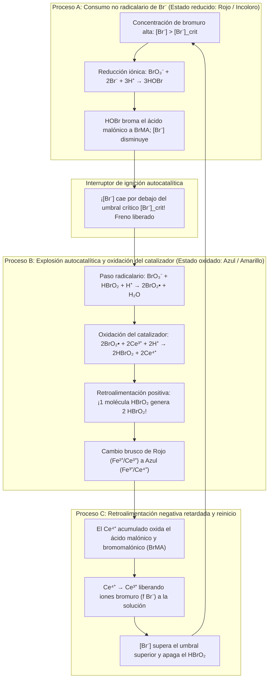
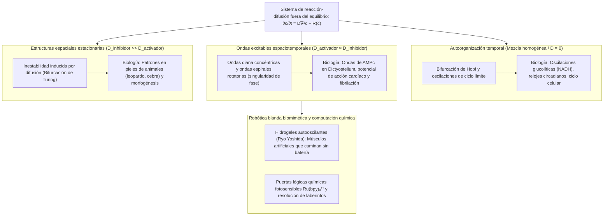

## 1. Introducción: ¿Y si la leche vertida en el café comenzara a latir por sí sola?

Imagine verter leche fría en una taza de café negro caliente y remover con una cuchara. Los remolinos oscuros y claros se funden hasta alcanzar un tono marrón uniforme. Nuestra intuición cotidiana —y el pilar de la física clásica conocido como la <strong>Segunda Ley de la Termodinámica</strong>— nos dice que este proceso es estrictamente unidireccional. Una vez mezclado, el café jamás volverá espontáneamente a ser negro azabache, para luego volverse blanco puro un minuto después y seguir oscilando como un reloj.

Sin embargo, en la fisicoquímica existe una reacción que desafía esta intuición de forma espectacular: la <strong>reacción de Belousov-Zhabotinsky (reacción BZ)</strong>. Al mezclar unos pocos reactivos acuosos en un vaso de precipitados, la solución <strong>oscila espontáneamente decenas de veces entre colores contrastantes con precisión metronómica</strong>; y extendida en una capa fina sin agitar dentro de una placa de Petri, genera por sí sola <strong>anillos concéntricos en expansión (patrones diana) y ondas espirales de Arquímedes en rotación</strong>.

### 1951: Un descubrimiento «herético» rechazado por la ciencia soviética

La historia comienza en Moscú en 1951. El químico y biofísico soviético <strong>Boris Pavlovich Belousov (1893–1970)</strong> buscaba un análogo inorgánico del <strong>ciclo del ácido cítrico (ciclo de Krebs)</strong>. Disolvió <strong>bromato de potasio ($\text{KBrO}_3$)</strong> como oxidante, <strong>ácido cítrico</strong> como sustrato orgánico y <strong>sulfato de cerio ($\text{Ce}^{4+}/\text{Ce}^{3+}$)</strong> como catalizador rédox en ácido sulfúrico diluido. En lugar de cambiar monótonamente de amarillo ($\text{Ce}^{4+}$) a incoloro ($\text{Ce}^{3+}$), la solución osciló periódicamente entre <strong>amarillo e incoloro</strong> decenas de veces durante más de una hora.

Cuando Belousov envió sus manuscritos en 1951 y 1957 a las revistas químicas soviéticas, fueron <strong>rechazados de plano</strong>:

> «La supuesta oscilación periódica de una reacción química homogénea de un lado a otro de su punto de equilibrio <strong>viola directamente la Segunda Ley de la Termodinámica</strong>. Lo observado debe ser un artefacto experimental causado por mala agitación, impurezas o burbujas de gas.»

Indignado a sus 64 años, Belousov solo publicó una breve nota de dos páginas en 1958 en un oscuro boletín de medicina radiológica y abandonó el tema para siempre.

### 1961: La rehabilitación por Anatol Zhabotinsky y el latido rojo-azul

En 1961, el profesor Simon Shnoll entregó la receta al joven estudiante de posgrado <strong>Anatol Markovich Zhabotinsky (1938–2008)</strong> en la Universidad Estatal de Moscú. Zhabotinsky sustituyó el ácido cítrico por <strong>ácido malónico ($\text{CH}_2(\text{COOH})_2$)</strong> e introdujo el indicador rédox <strong>ferroína ($[\text{Fe}(\text{phen})_3]^{2+}/[\text{Fe}(\text{phen})_3]^{3+}$)</strong>, logrando que la solución pulsara dramáticamente entre el <strong>rojo ladrillo ($[\text{Fe}(\text{phen})_3]^{2+}$ reducido) y el azul cielo brillante ($[\text{Fe}(\text{phen})_3]^{3+}$ oxidado)</strong>. En 1980, Belousov (a título póstumo) y Zhabotinsky recibieron el prestigioso <strong>Premio Lenin</strong>.

---

## 2. Resolución de la paradoja termodinámica: Por qué la reacción BZ no viola la Segunda Ley

### Disminución monótona de la energía libre de Gibbs y relaciones de Onsager cerca del equilibrio

En un sistema cerrado a temperatura $T$ y presión $P$ constantes, la Segunda Ley exige una producción de entropía interna no negativa, $\sigma_S \equiv \frac{d_i S}{dt} \ge 0$, por lo que la energía libre de Gibbs $G = H - TS$ evoluciona según:

$$\frac{dG}{dt} = -T \sigma_S = -\sum_{\rho} A_{\rho} v_{\rho} \le 0$$

donde $v_{\rho}$ es la velocidad de reacción y $A_{\rho} \equiv -\sum_i \nu_{i\rho} \mu_i = -\left(\frac{\partial G}{\partial \xi_{\rho}}\right)_{T,P}$ es la afinidad química.

En el <strong>régimen lineal cercano al equilibrio</strong> ($|A_{\rho}| \ll RT$), la reversibilidad microscópica impone el <strong>principio de balance detallado</strong> y las <strong>relaciones de reciprocidad de Onsager</strong> (Lars Onsager, Premio Nobel 1968), haciendo que la matriz de conductividad sea simétrica ($L_{\alpha\beta} = L_{\beta\alpha}$). Como consecuencia, la matriz jacobiana $\mathbf{J}_{\text{eq}}$ posee exclusivamente <strong>autovalores reales y no positivos ($\lambda_k \in \mathbb{R}, \lambda_k \le 0, \text{Im}(\lambda_k) = 0$)</strong>. ¡Cerca del equilibrio termodinámico, incluso las oscilaciones amortiguadas están estrictamente prohibidas!

### Lejos del equilibrio: Ruptura de la simetría y estructuras disipativas de Prigogine

La clave reside en que <strong>la reacción BZ no oscila alrededor del equilibrio termodinámico, sino que opera lejos del equilibrio ($A_{\rho} \gg RT$) en el régimen fuertemente no lineal</strong>.

Lejos del equilibrio, la retroalimentación autocatalítica rompe la simetría de Onsager y la matriz jacobiana $\mathbf{J}(\mathbf{c}^*)$ puede tener <strong>autovalores complejos conjugados $\lambda_{\pm} = \mu \pm i\omega$ ($\omega \neq 0$)</strong>. El fisicoquímico belga <strong>Ilya Prigogine (Premio Nobel 1977)</strong> demostró que lejos del equilibrio la disipación irreversible ($\sigma_S > 0$) impulsa la autoorganización espaciotemporal espontánea, originando <strong>estructuras disipativas</strong>:
1. <strong>En un reactor abierto (CSTR)</strong>: El flujo continuo de reactivos frescos equilibra la producción interna de entropía ($dS = d_e S + d_i S = 0$), manteniendo oscilaciones perpetuas.
2. <strong>En un vaso cerrado (descenso escalonado de $G(t)$)</strong>: Los <strong>reactivos principales ($\text{BrO}_3^-$ y ácido malónico, $\sim 10^{-1}\text{ M}$)</strong> descienden monótonamente hacia los productos ($\frac{dG}{dt} \le 0$). Solo los <strong>intermediarios traza ($\text{HBrO}_2, \text{Br}^-, \text{Ce}^{4+}$, $\sim 10^{-7}\text{ a }10^{-4}\text{ M}$)</strong> trazan bucles cerrados, igual que una <strong>rueda hidráulica en una cascada</strong> que gira cientos de veces mientras el agua cae siempre hacia abajo.

| Régimen termodinámico | Equilibrio termodinámico | No equilibrio lineal (Cerca del equilibrio) | No equilibrio no lineal (Lejos del equilibrio / BZ) |
| :--- | :--- | :--- | :--- |
| <strong>Afinidad química $A_{\rho}$</strong> | $A_{\rho} = 0$ (Balance detallado) | $\|A_{\rho}\| \ll RT$ (Respuesta lineal) | $A_{\rho} \gg RT$ (Irreversible, fuertemente no lineal) |
| <strong>Producción de entropía $\sigma_S$</strong> | $\sigma_S = 0$ (Sin disipación) | $\sigma_S > 0$ (Mínima producción de entropía) | $\sigma_S \gg 0$ (La disipación sostiene el orden dinámico) |
| <strong>Simetría de Onsager</strong> | Flujos $J_{\alpha} = 0$ | $L_{\alpha\beta} = L_{\beta\alpha}$ (Matriz simétrica) | Simetría rota ($\mathbf{J}$ no simétrica) |
| <strong>Autovalores del Jacobiano $\mathbf{J}$</strong> | — | Reales y negativos ($\text{Im}(\lambda_k)=0$) | Complejos conjugados $\lambda = \mu \pm i\omega$ ($\mu > 0$ posible) |
| <strong>Comportamiento espaciotemporal</strong> | Estado homogéneo y estático | Relajación exponencial monótona | <strong>Ciclos límite, ondas espirales, patrones de Turing</strong> |

---

## 3. El mecanismo FKN (1972): Tres procesos acoplados y el interruptor autocatalítico

En 1972, <strong>Richard J. Field</strong>, <strong>Endre Körös</strong> y <strong>Richard M. Noyes</strong> formularon el <strong>mecanismo FKN</strong> de 18 pasos elementales para la oxidación y bromación del ácido malónico por bromato:

$$2\text{BrO}_3^- + 3\text{CH}_2(\text{COOH})_2 + 2\text{H}^+ \longrightarrow 2\text{BrCH}(\text{COOH})_2 + 3\text{CO}_2 + 4\text{H}_2\text{O}$$

El ciclo alterna entre los Procesos A, B y C mediante la pugna entre el <strong>activador ácido bromoso ($\text{HBrO}_2$)</strong> y el <strong>inhibidor ion bromuro ($\text{Br}^-$)</strong>:

1. <strong>Proceso A (El freno de bromuro)</strong>: Cuando $[\text{Br}^-] > [\text{Br}^-]_{\text{crit}}$, el $\text{Br}^-$ elimina el $\text{HBrO}_2$ mediante $\text{HBrO}_2 + \text{Br}^- + \text{H}^+ \xrightarrow{k_2} 2\text{HOBr}$ y broma el ácido malónico a ácido bromomalónico ($\text{BrMA}$), manteniendo el catalizador reducido (rojo).
2. <strong>Proceso B (Explosión autocatalítica)</strong>: Cuando $[\text{Br}^-] < [\text{Br}^-]_{\text{crit}} = \frac{k_5}{k_2}[\text{BrO}_3^-] \approx 5 \times 10^{-7}\text{ M}$, se enciende la cadena radicalaria mediada por $\text{BrO}_2^\bullet$:
   $$\text{BrO}_3^- + \mathbf{HBrO_2} + 3\text{H}^+ + 2\text{Ce}^{3+} \longrightarrow \mathbf{2\,\text{HBrO}_2} + 2\text{Ce}^{4+} + \text{H}_2\text{O}$$
   <strong>¡Cada molécula de $\text{HBrO}_2$ produce dos moléculas de $\text{HBrO}_2$!</strong> $[\text{HBrO}_2]$ se multiplica por diez mil en milisegundos, oxida el catalizador ($\text{Ce}^{3+} \to \text{Ce}^{4+}$, viraje al <strong>azul</strong>) y se satura por desproporción ($2\text{HBrO}_2 \xrightarrow{k_4} \text{BrO}_3^- + \text{HOBr} + \text{H}^+$).
3. <strong>Proceso C (Retroalimentación negativa retardada)</strong>: El $\text{Ce}^{4+}$ acumulado oxida el ácido bromomalónico reduciéndose a $\text{Ce}^{3+}$ y liberando $f$ iones $\text{Br}^-$, lo que apaga la autocatálisis y reinicia el Proceso A.

---

## 4. Teoría matemática del Oregonator: Oscilaciones de relajación, bifurcación de Hopf y ciclo límite

En 1974, Field y Noyes destilaron el mecanismo FKN en las tres ecuaciones diferenciales adimensionales del <strong>Oregonator</strong> ($x \propto [\text{HBrO}_2]$, $y \propto [\text{Br}^-]$, $z \propto [\text{Ce}^{4+}]$):

$$\varepsilon \frac{dx}{d\tau} = q y - x y + x(1 - x), \qquad \varepsilon' \frac{dy}{d\tau} = -q y - x y + f z, \qquad \frac{dz}{d\tau} = x - z$$

- <strong>Separación de escalas temporales y oscilaciones de relajación</strong>: Dado que $\varepsilon' \sim 10^{-4} \ll \varepsilon \sim 10^{-2} \ll 1$, la aproximación de estado cuasiestacionario $y \approx \frac{f z}{x + q}$ reduce el sistema al plano $(x, z)$, donde la nulclina de $x$, $z = \frac{x(1-x)(x+q)}{f(x-q)}$, posee una <strong>geometría plegada cúbica en forma de S (o N)</strong>. El estado se desliza lentamente por las ramas estables y salta horizontalmente en los pliegues, generando <strong>oscilaciones de relajación</strong> en diente de sierra.
- <strong>Bifurcación de Hopf y teorema de Poincaré-Bendixson</strong>: En el punto fijo $(x^*, z^*)$, siempre se cumple $\det(\mathbf{J}) > 0$. Cuando el factor estequiométrico $f$ se sitúa dentro de la ventana oscilatoria ($0{,}5 \lesssim f \lesssim 1 + \sqrt{2} \approx 2{,}414$), el punto fijo cae en la rama media inestable con $\text{Tr}(\mathbf{J}) > 0$. Al cruzar el umbral crítico ocurre una <strong>bifurcación de Andronov-Hopf</strong> y el <strong>teorema de Poincaré-Bendixson</strong> garantiza la existencia de un <strong>ciclo límite</strong> globalmente atractivo.

---

## 5. Ondas químicas en el espacio sin agitar: EDP de reacción-difusión, patrones diana y ondas espirales

En una placa de Petri sin agitar, la cinética local $\mathbf{R}(\mathbf{c})$ se acopla a la difusión de Fick formando el sistema de <strong>ecuaciones en derivadas parciales (EDP) de reacción-difusión</strong>:

$$\frac{\partial \mathbf{c}(\mathbf{r}, t)}{\partial t} = \mathbf{D} \nabla^2 \mathbf{c}(\mathbf{r}, t) + \mathbf{R}\bigl(\mathbf{c}(\mathbf{r}, t)\bigr)$$

1. <strong>Medio excitable y fórmula de Luther</strong>: Los frentes químicos viajan sin atenuación a una velocidad constante dada por la <strong>fórmula de Luther (1906)</strong>:
   $$v_0 = 2 \sqrt{D_X \, k_{\text{auto}}} = 2 \sqrt{D_X \, k_5 [\text{BrO}_3^-][\text{H}^+]} \approx 5\text{–}10\text{ mm/min}$$
2. <strong>Aniquilación mutua y singularidad de fase de las ondas espirales</strong>: Detrás de cada frente azul viaja una <strong>cola refractaria</strong> rica en $\text{Br}^-$. Por ello, <strong>¡dos ondas químicas que chocan de frente se aniquilan mutuamente por completo!</strong> Si se rompe un anillo concéntrico (patrón diana), el extremo libre se curva sobre su propia cola refractaria formando una <strong>onda espiral de Arquímedes</strong> que gira alrededor de una <strong>singularidad de fase topológica</strong> ($\oint_C \nabla \phi \cdot d\mathbf{l} = \pm 2\pi n$) regida por la relación eikonal de curvatura $v_n = v_0 - D\kappa$.

---

## 6. De los sistemas vivos a los materiales inteligentes: Patrones de Turing, fibrilación cardíaca e hidrogeles autónomos

- <strong>Morfogénesis de Alan Turing (1952)</strong>: Cuando el inhibidor se difunde mucho más rápido que el activador ($D_v \gg D_u$), emergen patrones estacionarios de manchas y rayas (<strong>patrones de Turing</strong>), verificados experimentalmente en microemulsiones BZ-AOT.
- <strong>Fibrilación ventricular cardíaca</strong>: El miocardio es un medio excitable eléctrico. Cuando un frente eléctrico se rompe en tejido isquémico, genera <strong>ondas espirales (ondas en rollo 3D)</strong> cuya fragmentación caótica provoca la letal <strong>fibrilación ventricular</strong>. La descarga de un <strong>desfibrilador (DEA)</strong> fuerza a todo el músculo cardíaco al estado refractario para borrar las singularidades de fase.
- <strong>Hidrogeles autooscilantes (Ryo Yoshida)</strong>: Al unir covalentemente el catalizador $\text{Ru(bpy)}_3^{2+}$ a un polímero termosensible (PNIPAAm), se crean <strong>geles biomiméticos autónomos</strong> que transforman la oscilación química en contracción peristáltica y caminan como una oruga sin necesidad de baterías ni cables.
