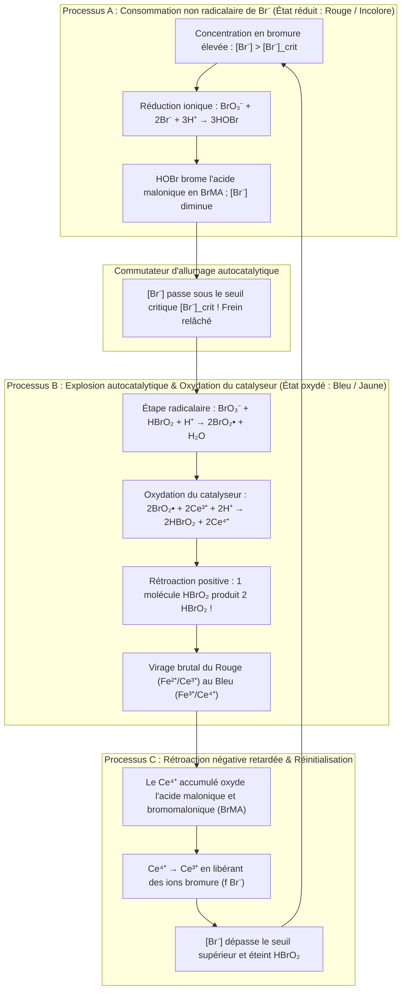
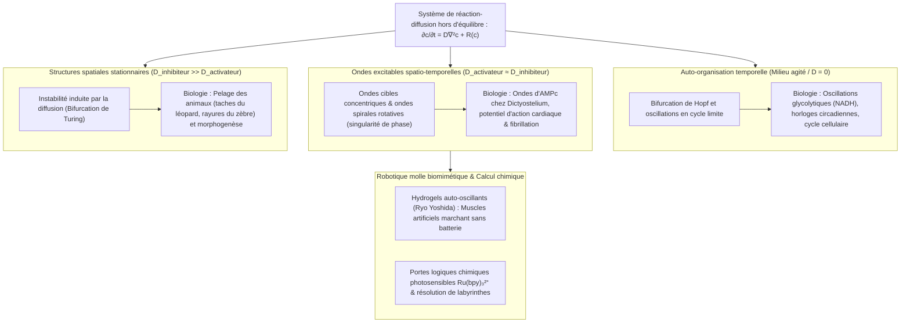

## 1. Introduction : Et si le lait versé dans votre café se mettait à pulser tout seul ?

Imaginez que vous versiez du lait froid dans une tasse de café noir brûlant et que vous remuiez avec une cuillère. Les tourbillons sombres et clairs se fondent jusqu'à former un liquide beige parfaitement uniforme. Notre intuition quotidienne — tout comme le pilier de la physique classique qu'est le <strong>Second Principe de la Thermodynamique</strong> — nous affirme que cette évolution est strictement irréversible. Une fois mélangé, le café ne redeviendra jamais spontanément noir d'encre, puis blanc pur une minute plus tard, en oscillant comme un pendule.

Pourtant, il existe en chimie physique une réaction qui défie cette intuition de manière spectaculaire : la <strong>réaction de Belousov-Zhabotinsky (réaction BZ)</strong>. Lorsque l'on mélange quelques réactifs aqueux dans un bécher, la solution <strong>oscille spontanément des dizaines de fois entre deux couleurs contrastées avec la régularité d'un métronome</strong> ; étalée en couche mince non agitée dans une boîte de Petri, elle engendre d'elle-même <strong>des anneaux concentriques en expansion (motifs cibles) et des ondes spirales d'Archimède en rotation</strong>.

### 1951 : Une découverte « hérétique » rejetée par la science soviétique

L'histoire débute à Moscou en 1951. Le chimiste et biophysicien soviétique <strong>Boris Pavlovitch Belousov (1893–1970)</strong> cherchait un analogue inorganique du <strong>cycle de l'acide citrique (cycle de Krebs)</strong>. Il dissolvait du <strong>bromate de potassium ($\text{KBrO}_3$)</strong> comme oxydant, de l'<strong>acide citrique</strong> comme substrat organique et du <strong>sulfate de cérium ($\text{Ce}^{4+}/\text{Ce}^{3+}$)</strong> comme catalyseur rédox dans de l'acide sulfurique dilué. À sa grande stupéfaction, au lieu de passer de manière monotone du jaune ($\text{Ce}^{4+}$) à l'incolore ($\text{Ce}^{3+}$), la solution se mit à osciller périodiquement entre le <strong>jaune et l'incolore</strong> pendant plus d'une heure !

Lorsque Belousov soumit ses manuscrits en 1951 puis en 1957 aux revues de chimie soviétiques, il essuya un <strong>refus catégorique</strong> :

> « L'affirmation selon laquelle une réaction chimique homogène oscillerait de part et d'autre de son point d'équilibre <strong>viole directement le Second Principe de la Thermodynamique</strong>. Ce que l'auteur a observé ne peut être qu'un artefact dû à un mauvais mélange, des poussières ou des bulles de gaz. »

Profondément blessé, Belousov abandonna ses recherches après n'avoir publié qu'un court résumé de deux pages en 1958 dans un obscur bulletin de médecine radiologique.

### 1961 : La réhabilitation par Anatol Zhabotinsky et le battement rouge-bleu

En 1961, le professeur Simon Shnoll confia la recette à un jeune doctorant de l'Université d'État de Moscou, <strong>Anatol Markovitch Zhabotinsky (1938–2008)</strong>. Zhabotinsky remplaça l'acide citrique par l'<strong>acide malonique ($\text{CH}_2(\text{COOH})_2$)</strong> et introduisit l'indicateur rédox <strong>ferroïne ($[\text{Fe}(\text{phen})_3]^{2+}/[\text{Fe}(\text{phen})_3]^{3+}$)</strong>. La solution se mit alors à pulser spectaculairement entre le <strong>rouge brique ($[\text{Fe}(\text{phen})_3]^{2+}$ réduit) et le bleu azur ($[\text{Fe}(\text{phen})_3]^{3+}$ oxydé)</strong>. En 1980, Belousov (à titre posthume) et Zhabotinsky reçurent le prestigieux <strong>Prix Lénine</strong>.

---

## 2. Résolution du paradoxe thermodynamique : Pourquoi la réaction BZ ne viole pas le Second Principe

### Décroissance monotone de l'enthalpie libre de Gibbs et relations d'Onsager près de l'équilibre

Dans un système fermé à température $T$ et pression $P$ constantes, le Second Principe impose un taux de production d'entropie interne positif ou nul, $\sigma_S \equiv \frac{d_i S}{dt} \ge 0$, ce qui entraîne pour l'enthalpie libre de Gibbs $G = H - TS$ :

$$\frac{dG}{dt} = -T \sigma_S = -\sum_{\rho} A_{\rho} v_{\rho} \le 0$$

où $v_{\rho}$ est la vitesse de la réaction $\rho$ et $A_{\rho} \equiv -\sum_i \nu_{i\rho} \mu_i = -\left(\frac{\partial G}{\partial \xi_{\rho}}\right)_{T,P}$ est l'affinité chimique de De Donder.

Dans le <strong>régime linéaire proche de l'équilibre</strong> ($|A_{\rho}| \ll RT$), la réversibilité microscopique impose le <strong>principe du bilan détaillé</strong> et les <strong>relations de réciprocité d'Onsager</strong> (Lars Onsager, Prix Nobel 1968), rendant la matrice des coefficients phénoménologiques strictement symétrique ($L_{\alpha\beta} = L_{\beta\alpha}$). La matrice jacobienne cinétique $\mathbf{J}_{\text{eq}}$ au voisinage de l'équilibre est alors semblable à une matrice symétrique définie négative : ses valeurs propres sont <strong>purement réelles et négatives ($\lambda_k \in \mathbb{R}, \lambda_k \le 0, \text{Im}(\lambda_k) = 0$)</strong>. Près de l'équilibre, même une oscillation amortie est strictement interdite !

### Loin de l'équilibre : Brisure de symétrie et structures dissipatives de Prigogine

La clé du paradoxe est que <strong>la réaction BZ n'oscille pas autour de l'équilibre thermodynamique : elle opère loin de l'équilibre ($A_{\rho} \gg RT$), en régime fortement non linéaire !</strong>

Loin de l'équilibre, les boucles d'autocatalyse brisent la symétrie d'Onsager. La matrice jacobienne $\mathbf{J}(\mathbf{c}^*)$ autour d'un état stationnaire hors d'équilibre devient non symétrique et admet des <strong>valeurs propres complexes conjuguées $\lambda_{\pm} = \mu \pm i\omega$ ($\omega \neq 0$)</strong>. Le physico-chimiste belge <strong>Ilya Prigogine (Prix Nobel 1977)</strong> a démontré que loin de l'équilibre, la dissipation irréversible ($\sigma_S > 0$) devient le moteur même de l'auto-organisation spatio-temporelle, créant des <strong>structures dissipatives</strong> :
1. <strong>En réacteur ouvert (CSTR)</strong> : L'apport continu de réactifs frais compense exactement la production d'entropie interne ($dS = d_e S + d_i S = 0$), entretenant des oscillations perpétuelles.
2. <strong>En bécher fermé (descente en escalier de $G(t)$)</strong> : Les <strong>réactifs majoritaires ($\text{BrO}_3^-$ et acide malonique, $\sim 10^{-1}\text{ M}$)</strong> sont consommés de façon strictement monotone ($\frac{dG}{dt} \le 0$). Seuls les <strong>intermédiaires en traces ($\text{HBrO}_2, \text{Br}^-, \text{Ce}^{4+}$, $\sim 10^{-7}\text{ à }10^{-4}\text{ M}$)</strong> décrivent des boucles fermées, telle une <strong>roue à aubes dans une cascade</strong> qui tourne des centaines de fois sur elle-même pendant que l'eau s'écoule uniquement vers le bas.

| Régime thermodynamique | Équilibre thermodynamique | Hors d'équilibre linéaire (Proche de l'équilibre) | Hors d'équilibre non linéaire (Loin de l'équilibre / BZ) |
| :--- | :--- | :--- | :--- |
| <strong>Affinité chimique $A_{\rho}$</strong> | $A_{\rho} = 0$ (Bilan détaillé) | $\|A_{\rho}\| \ll RT$ (Réponse linéaire) | $A_{\rho} \gg RT$ (Régime irréversible non linéaire) |
| <strong>Production d'entropie $\sigma_S$</strong> | $\sigma_S = 0$ (Dissipation nulle) | $\sigma_S > 0$ (Production d'entropie minimale) | $\sigma_S \gg 0$ (La dissipation soutient l'ordre dynamique) |
| <strong>Symétrie d'Onsager</strong> | Flux $J_{\alpha} = 0$ | $L_{\alpha\beta} = L_{\beta\alpha}$ (Matrice symétrique) | Symétrie brisée ($\mathbf{J}$ non symétrique) |
| <strong>Valeurs propres du Jacobien $\mathbf{J}$</strong> | — | Purement réelles et négatives ($\text{Im}(\lambda_k)=0$) | Complexes conjuguées $\lambda = \mu \pm i\omega$ ($\mu > 0$ possible) |
| <strong>Comportement spatio-temporel</strong> | État homogène et statique | Relaxation exponentielle monotone | <strong>Cycles limites, ondes spirales, motifs de Turing</strong> |

---

## 3. Le mécanisme FKN (1972) : Trois processus couplés et le commutateur autocatalytique

En 1972, <strong>Richard J. Field</strong>, <strong>Endre Körös</strong> et <strong>Richard M. Noyes</strong> ont élucidé le <strong>mécanisme FKN</strong> en 18 étapes élémentaires. Le bilan global est l'oxydation et la bromation de l'acide malonique par le bromate :

$$2\text{BrO}_3^- + 3\text{CH}_2(\text{COOH})_2 + 2\text{H}^+ \longrightarrow 2\text{BrCH}(\text{COOH})_2 + 3\text{CO}_2 + 4\text{H}_2\text{O}$$

L'oscillation résulte de la compétition entre l'<strong>activateur acide bromeux ($\text{HBrO}_2$)</strong> et l'<strong>inhibiteur ion bromure ($\text{Br}^-$)</strong> à travers trois processus (A, B, C) :

1. <strong>Processus A (Le frein bromure)</strong> : Tant que $[\text{Br}^-] > [\text{Br}^-]_{\text{crit}}$, l'ion $\text{Br}^-$ piège immédiatement $\text{HBrO}_2$ via $\text{HBrO}_2 + \text{Br}^- + \text{H}^+ \xrightarrow{k_2} 2\text{HOBr}$ et forme de l'acide bromomalonique ($\text{BrMA}$). Le catalyseur reste réduit (rouge).
2. <strong>Processus B (Explosion autocatalytique)</strong> : Dès que $[\text{Br}^-] < [\text{Br}^-]_{\text{crit}} = \frac{k_5}{k_2}[\text{BrO}_3^-] \approx 5 \times 10^{-7}\text{ M}$, la chaîne radicalaire via $\text{BrO}_2^\bullet$ déclenche l'autocatalyse :
   $$\text{BrO}_3^- + \mathbf{HBrO_2} + 3\text{H}^+ + 2\text{Ce}^{3+} \longrightarrow \mathbf{2\,\text{HBrO}_2} + 2\text{Ce}^{4+} + \text{H}_2\text{O}$$
   <strong>Chaque molécule de $\text{HBrO}_2$ engendre deux molécules de $\text{HBrO}_2$ !</strong> $[\text{HBrO}_2]$ bondit de quatre ordres de grandeur, oxyde le catalyseur ($\text{Ce}^{3+} \to \text{Ce}^{4+}$, virage au <strong>bleu</strong>) et sature par dismutation ($2\text{HBrO}_2 \xrightarrow{k_4} \text{BrO}_3^- + \text{HOBr} + \text{H}^+$).
3. <strong>Processus C (Rétroaction négative retardée)</strong> : Le $\text{Ce}^{4+}$ accumulé oxyde l'acide bromomalonique en régénérant $\text{Ce}^{3+}$ et $f$ ions $\text{Br}^-$, ce qui éteint l'autocatalyse et ramène le système au Processus A.

---

## 4. Théorie mathématique de l'Oregonator : Oscillations de relaxation, bifurcation de Hopf et cycle limite

En 1974, Field et Noyes ont condensé le mécanisme FKN dans le modèle à trois variables adimensionnées de l'<strong>Oregonator</strong> ($x \propto [\text{HBrO}_2]$, $y \propto [\text{Br}^-]$, $z \propto [\text{Ce}^{4+}]$) :

$$\varepsilon \frac{dx}{d\tau} = q y - x y + x(1 - x), \qquad \varepsilon' \frac{dy}{d\tau} = -q y - x y + f z, \qquad \frac{dz}{d\tau} = x - z$$

- <strong>Séparation des échelles de temps et oscillations de relaxation</strong> : Comme $\varepsilon' \sim 10^{-4} \ll \varepsilon \sim 10^{-2} \ll 1$, l'approximation d'état quasi-stationnaire $y \approx \frac{f z}{x + q}$ réduit le système au plan $(x, z)$, où la nullcline de $x$, $z = \frac{x(1-x)(x+q)}{f(x-q)}$, présente une <strong>géométrie repliée en S (ou en N)</strong>. La trajectoire glisse lentement sur les branches stables et saute horizontalement aux plis en un temps $\mathcal{O}(\varepsilon)$, produisant des <strong>oscillations de relaxation</strong> en dents de scie.
- <strong>Bifurcation de Hopf et théorème de Poincaré-Bendixson</strong> : Au point fixe $(x^*, z^*)$, $\det(\mathbf{J}) > 0$. Lorsque le facteur stœchiométrique $f$ appartient à la fenêtre d'oscillation ($0{,}5 \lesssim f \lesssim 1 + \sqrt{2} \approx 2{,}414$), $(x^*, z^*)$ se trouve sur la branche médiane instable où $\text{Tr}(\mathbf{J}) > 0$. Le franchissement de l'axe imaginaire par les valeurs propres $\lambda_{\pm} = \mu(f) \pm i\omega(f)$ constitue une <strong>bifurcation d'Andronov-Hopf</strong>, et le <strong>théorème de Poincaré-Bendixson</strong> garantit la convergence vers un <strong>cycle limite</strong> attractif unique.

---

## 5. Ondes chimiques dans l'espace non agité : EDP de réaction-diffusion, cibles et ondes spirales

Dans une boîte de Petri non agitée, la cinétique locale $\mathbf{R}(\mathbf{c})$ se couple à la diffusion moléculaire de Fick pour former le système d'<strong>équations aux dérivées partielles (EDP) de réaction-diffusion</strong> :

$$\frac{\partial \mathbf{c}(\mathbf{r}, t)}{\partial t} = \mathbf{D} \nabla^2 \mathbf{c}(\mathbf{r}, t) + \mathbf{R}\bigl(\mathbf{c}(\mathbf{r}, t)\bigr)$$

1. <strong>Milieu excitable et formule de Luther</strong> : Les fronts d'excitation se propagent sans atténuation à une vitesse constante donnée par la <strong>formule de Luther (1906)</strong> :
   $$v_0 = 2 \sqrt{D_X \, k_{\text{auto}}} = 2 \sqrt{D_X \, k_5 [\text{BrO}_3^-][\text{H}^+]} \approx 5\text{–}10\text{ mm/min}$$
2. <strong>Annihilation mutuelle et singularité de phase des ondes spirales</strong> : Chaque front bleu est suivi d'une <strong>queue réfractaire</strong> riche en $\text{Br}^-$. Par conséquent, <strong>deux ondes chimiques qui entrent en collision frontale s'annihilent mutuellement !</strong> Si l'on brise un anneau concentrique (motif cible), l'extrémité libre s'enroule autour de sa propre zone réfractaire pour former une <strong>onde spirale d'Archimède</strong> tournant autour d'une <strong>singularité de phase topologique</strong> ($\oint_C \nabla \phi \cdot d\mathbf{l} = \pm 2\pi n$) selon la relation eikonale de courbure $v_n = v_0 - D\kappa$.

---

## 6. Du vivant aux matériaux intelligents : Motifs de Turing, fibrillation cardiaque et gels autonomes

- <strong>Morphogenèse d'Alan Turing (1952)</strong> : Lorsque l'inhibiteur diffuse beaucoup plus vite que l'activateur ($D_v \gg D_u$), une instabilité de diffusion engendre des motifs stationnaires de taches et de rayures (<strong>motifs de Turing</strong>), observés expérimentalement dans les microémulsions BZ-AOT.
- <strong>Fibrillation ventriculaire cardiaque</strong> : Le myocarde est un milieu excitable électrique. La rupture d'un front d'onde électrique sur une zone ischémique engendre des <strong>ondes spirales (ondes en rouleau 3D)</strong> dont l'éclatement chaotique provoque la <strong>fibrillation ventriculaire</strong> mortelle. Le choc électrique d'un <strong>défibrillateur (DAE)</strong> dépolarise tout le cœur simultanément pour effacer les singularités de phase.
- <strong>Hydrogels auto-oscillants (Ryo Yoshida)</strong> : En greffant le catalyseur $\text{Ru(bpy)}_3^{2+}$ sur un réseau polymère thermosensible (PNIPAAm), on obtient des <strong>gels biomimétiques autonomes</strong> qui convertissent l'oscillation rédox en contraction mécanique péristaltique et avancent comme une chenille sans aucune source d'énergie électrique externe.
