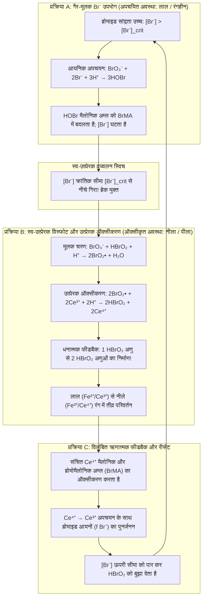
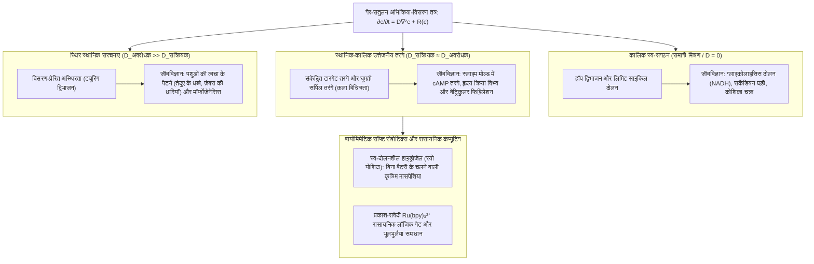

## 1. परिचय: यदि कॉफी में डाला गया दूध अपने आप धड़कने लगे तो क्या होगा?

कल्पना कीजिए कि आप गर्म ब्लैक कॉफी के कप में ठंडा दूध डालते हैं और चम्मच से हिलाते हैं। गहरे और हल्के भंवर एक-दूसरे में मिल जाते हैं और अंततः एकसमान भूरा तरल बन जाता है। हमारा दैनिक अनुभव—और चिरसम्मत भौतिकी का आधार स्तंभ जिसे <strong>ऊष्मागतिकी का द्वितीय नियम (Second Law of Thermodynamics)</strong> कहा जाता है—हमें बताता है कि यह प्रक्रिया पूरी तरह एकतरफा है। एक बार मिल जाने के बाद कॉफी कभी भी अपने आप वापस काली नहीं होगी, फिर एक मिनट बाद सफेद नहीं होगी, और घड़ी के पेंडुलम की तरह काले और सफेद के बीच दोलन नहीं करेगी।

किंतु भौतिक रसायन विज्ञान में एक ऐसी अद्भुत अभिक्रिया मौजूद है जो इस सहज ज्ञान को चुनौती देती है: <strong>बेलौसोव-ज़ाबोटिंस्की अभिक्रिया (Belousov-Zhabotinsky reaction - BZ अभिक्रिया)</strong>। जब बीकर में कुछ जलीय अभिकर्मकों को मिलाया जाता है, तो घोल <strong>मेट्रोनोम की सटीकता के साथ दर्जनों बार दो विपरीत रंगों के बीच स्वतः दोलन करता है</strong>; और जब इसे बिना हिलाए पेट्री डिश में एक पतली परत के रूप में फैलाया जाता है, तो यह स्वतः ही <strong>फैलते हुए संकेंद्रित छल्ले (टारगेट पैटर्न) और घूमती हुई आर्किमिडीयन सर्पिल तरंगें (Spiral Waves)</strong> उत्पन्न करता है।

### 1951: सोवियत विज्ञान द्वारा ठुकराई गई एक 'विधर्मी' खोज

यह कहानी 1951 में मॉस्को में शुरू हुई। सोवियत रसायनज्ञ और जीवभौतिकीविद् <strong>बोरिस पावलोविच बेलौसोव (Boris Pavlovich Belousov, 1893–1970)</strong> जैविक <strong>सिट्रिक अम्ल चक्र (क्रेब्स चक्र)</strong> के अकार्बनिक प्रतिरूप की खोज कर रहे थे। उन्होंने तनु सल्फ्यूरिक अम्ल में ऑक्सीकारक के रूप में <strong>पोटैशियम ब्रोमेट ($\text{KBrO}_3$)</strong>, कार्बनिक सब्सट्रेट के रूप में <strong>सिट्रिक अम्ल</strong>, और रेडॉक्स उत्प्रेरक के रूप में <strong>सीरियम सल्फेट ($\text{Ce}^{4+}/\text{Ce}^{3+}$)</strong> को घोला। पीले ($\text{Ce}^{4+}$) से रंगहीन ($\text{Ce}^{3+}$) में एकतरफा बदलने के बजाय, घोल एक घंटे से अधिक समय तक दर्जनों बार <strong>पीले और रंगहीन के बीच आवधिक रूप से दोलन</strong> करने लगा!

जब बेलौसोव ने 1951 और 1957 में सोवियत रसायन पत्रिकाओं में अपने शोधपत्र भेजे, तो उन्हें <strong>सिरे से खारिज (Reject)</strong> कर दिया गया:

> "एक समांगी रासायनिक अभिक्रिया का अपने संतुलन बिंदु के आगे-पीछे आवधिक दोलन करना <strong>ऊष्मागतिकी के द्वितीय नियम का सीधा उल्लंघन है</strong>। लेखक ने जो देखा वह खराब मिश्रण, धूल या गैस के बुलबुलों से उत्पन्न प्रायोगिक त्रुटि मात्र है।"

आहत होकर 64 वर्षीय बेलौसोव ने 1958 में एक अपरिचित विकिरण चिकित्सा बुलेटिन में केवल दो पृष्ठों का संक्षिप्त नोट प्रकाशित किया और इस विषय को हमेशा के लिए छोड़ दिया।

### 1961: अनातोली ज़ाबोटिंस्की द्वारा पुनरुद्धार और लाल-नीली धड़कन

1961 में मॉस्को स्टेट यूनिवर्सिटी के प्रोफेसर सिमोन श्नोल ने युवा शोध छात्र <strong>अनातोली मार्कोविच ज़ाबोटिंस्की (Anatol Markovich Zhabotinsky, 1938–2008)</strong> को इस नुस्खे की जांच करने को कहा। ज़ाबोटिंस्की ने सिट्रिक अम्ल के स्थान पर <strong>मैलोनिक अम्ल ($\text{CH}_2(\text{COOH})_2$)</strong> का उपयोग किया और रेडॉक्स संकेतक <strong>फेरोइन (Ferroin, $[\text{Fe}(\text{phen})_3]^{2+}/[\text{Fe}(\text{phen})_3]^{3+}$)</strong> जोड़ा, जिससे घोल नाटकीय रूप से <strong>ईंट-लाल ($[\text{Fe}(\text{phen})_3]^{2+}$ अपचयित) और चमकीले नीले ($[\text{Fe}(\text{phen})_3]^{3+}$ ऑक्सीकृत)</strong> रंगों के बीच धड़कने लगा। 1980 में बेलौसोव (मरणोपरांत) और ज़ाबोटिंस्की को सर्वोच्च वैज्ञानिक सम्मान <strong>लेनिन पुरस्कार</strong> से नवाज़ा गया।

---

## 2. ऊष्मागतिकीय विरोधाभास का समाधान: BZ अभिक्रिया द्वितीय नियम का उल्लंघन क्यों नहीं करती?

### बंद निकाय में गिब्स मुक्त ऊर्जा का एकदिष्ट ह्रास और ओन्सागर के पारस्परिक संबंध

स्थिर तापमान $T$ और दाब $P$ पर रखे गए बंद निकाय में द्वितीय नियम के अनुसार आंतरिक एन्ट्रॉपी उत्पादन दर $\sigma_S \equiv \frac{d_i S}{dt} \ge 0$ होती है, जिससे गिब्स मुक्त ऊर्जा $G = H - TS$ समय के साथ एकदिष्ट रूप से घटती है:

$$\frac{dG}{dt} = -T \sigma_S = -\sum_{\rho} A_{\rho} v_{\rho} \le 0$$

जहाँ $v_{\rho}$ अभिक्रिया वेग है और $A_{\rho} \equiv -\sum_i \nu_{i\rho} \mu_i = -\left(\frac{\partial G}{\partial \xi_{\rho}}\right)_{T,P}$ रासायनिक बंधुता (Chemical Affinity) है।

संतुलन बिंदु के अत्यंत निकट <strong>रैखिक गैर-संतुलन क्षेत्र</strong> ($|A_{\rho}| \ll RT$) में सूक्ष्म समय-उत्क्रमण सममिति के कारण <strong>विस्तृत संतुलन का सिद्धांत (Detailed Balance)</strong> और <strong>ओन्सागर के पारस्परिक संबंध</strong> (लार्स ओन्सागर, नोबेल पुरस्कार 1968) लागू होते हैं, जिससे चालकता आव्यूह सममित ($L_{\alpha\beta} = L_{\beta\alpha}$) होता है। फलस्वरूप जैकोबियन आव्यूह $\mathbf{J}_{\text{eq}}$ के सभी आइगेनमान <strong>विशुद्ध रूप से वास्तविक और ऋणात्मक ($\lambda_k \in \mathbb{R}, \lambda_k \le 0, \text{Im}(\lambda_k) = 0$)</strong> होते हैं। अतः संतुलन के निकट अवमंदित दोलन भी असंभव हैं!

### संतुलन से बहुत दूर: सममिति भंग और प्रिगोगिन की 'विघटनकारी संरचनाएं'

इस पहेली का उत्तर यह है कि <strong>BZ अभिक्रिया ऊष्मागतिकीय संतुलन के इर्द-गिर्द दोलन नहीं करती, बल्कि संतुलन से बहुत दूर ($A_{\rho} \gg RT$) तीव्र अरैखिक क्षेत्र में कार्य करती है!</strong>

संतुलन से दूर स्व-उत्प्रेरक फीडबैक ओन्सागर सममिति को तोड़ देता है और जैकोबियन आव्यूह $\mathbf{J}(\mathbf{c}^*)$ के <strong>सम्मिश्र संयुग्मी आइगेनमान $\lambda_{\pm} = \mu \pm i\omega$ ($\omega \neq 0$)</strong> हो सकते हैं। बेल्जियम के भौतिक रसायनज्ञ <strong>इल्या प्रिगोगिन (Ilya Prigogine, नोबेल पुरस्कार 1977)</strong> ने सिद्ध किया कि संतुलन से दूर अपरिवर्तनीय ऊर्जा क्षय ($\sigma_S > 0$) स्वतःस्फूर्त कालिक और स्थानिक स्व-संगठन को जन्म देता है, जिसे उन्होंने <strong>विघटनकारी संरचनाएं (Dissipative Structures)</strong> नाम दिया:
1. <strong>खुले रिएक्टर (CSTR) में</strong>: ताजे अभिकर्मकों का निरंतर प्रवाह आंतरिक एन्ट्रॉपी उत्पादन को संतुलित करता है ($dS = d_e S + d_i S = 0$), जिससे रासायनिक घड़ी अनंत काल तक चलती रहती है।
2. <strong>बंद बीकर में ($G(t)$ का सीढ़ीदार ह्रास)</strong>: उच्च सांद्रता वाले <strong>मुख्य अभिकर्मक ($\text{BrO}_3^-$ और मैलोनिक अम्ल, $\sim 10^{-1}\text{ M}$)</strong> एकदिष्ट रूप से उत्पादों में बदलते हैं ($\frac{dG}{dt} \le 0$)। केवल <strong>सूक्ष्म मध्यवर्ती ($\text{HBrO}_2, \text{Br}^-, \text{Ce}^{4+}$, $\sim 10^{-7}\text{ से }10^{-4}\text{ M}$)</strong> सांद्रता आकाश में बंद लूप बनाते हैं—बिल्कुल <strong>झरने के नीचे लगे पनचक्की के पहिये</strong> की तरह, जो पानी के नीचे गिरने के दौरान सैकड़ों बार घूमता है।

| ऊष्मागतिकीय क्षेत्र | ऊष्मागतिकीय संतुलन | रैखिक गैर-संतुलन (संतुलन के निकट) | अरैखिक गैर-संतुलन (संतुलन से दूर / BZ अभिक्रिया) |
| :--- | :--- | :--- | :--- |
| <strong>रासायनिक बंधुता $A_{\rho}$</strong> | $A_{\rho} = 0$ (विस्तृत संतुलन) | $\|A_{\rho}\| \ll RT$ (रैखिक अनुक्रिया) | $A_{\rho} \gg RT$ (अपरिवर्तनीय अरैखिक क्षेत्र) |
| <strong>एन्ट्रॉपी उत्पादन $\sigma_S$</strong> | $\sigma_S = 0$ (कोई क्षय नहीं) | $\sigma_S > 0$ (न्यूनतम एन्ट्रॉपी उत्पादन) | $\sigma_S \gg 0$ (उच्च क्षय गतिशील व्यवस्था बनाए रखता है) |
| <strong>ओन्सागर सममिति</strong> | प्रवाह $J_{\alpha} = 0$ | $L_{\alpha\beta} = L_{\beta\alpha}$ (सममित आव्यूह) | सममिति भंग ($\mathbf{J}$ असममित) |
| <strong>जैकोबियन $\mathbf{J}$ के आइगेनमान</strong> | — | वास्तविक तथा ऋणात्मक ($\text{Im}(\lambda_k)=0$) | सम्मिश्र संयुग्मी $\lambda = \mu \pm i\omega$ ($\mu > 0$ संभव) |
| <strong>स्थानिक-कालिक व्यवहार</strong> | समांगी और स्थिर अवस्था | केवल एकदिष्ट चरघातांकी शिथिलन | <strong>लिमिट साइकिल दोलन, सर्पिल तरंगें, ट्यूरिंग पैटर्न</strong> |

---

## 3. FKN तंत्र (1972): तीन युग्मित प्रक्रियाएं और स्व-उत्प्रेरक स्विच

1972 में <strong>रिचर्ड जे. फील्ड</strong>, <strong>एंड्रे कोरोस</strong> और <strong>रिचर्ड एम. नोयेस</strong> ने ब्रोमेट द्वारा मैलोनिक अम्ल के ऑक्सीकरण और ब्रोमीनीकरण के 18-चरणीय <strong>FKN तंत्र</strong> की व्याख्या की:

$$2\text{BrO}_3^- + 3\text{CH}_2(\text{COOH})_2 + 2\text{H}^+ \longrightarrow 2\text{BrCH}(\text{COOH})_2 + 3\text{CO}_2 + 4\text{H}_2\text{O}$$

यह चक्र <strong>सक्रियक ब्रोमस अम्ल ($\text{HBrO}_2$)</strong> और <strong>अवरोधक ब्रोमाइड आयन ($\text{Br}^-$)</strong> के बीच प्रतिस्पर्धा द्वारा तीन प्रक्रियाओं (A, B, C) में चलता है:

1. <strong>प्रक्रिया A (ब्रोमाइड ब्रेक)</strong>: जब तक $[\text{Br}^-] > [\text{Br}^-]_{\text{crit}}$, $\text{Br}^-$ तुरंत $\text{HBrO}_2 + \text{Br}^- + \text{H}^+ \xrightarrow{k_2} 2\text{HOBr}$ के माध्यम से $\text{HBrO}_2$ को हटाकर ब्रोमोमैलोनिक अम्ल ($\text{BrMA}$) बनाता है और उत्प्रेरक अपचयित (लाल) रहता है।
2. <strong>प्रक्रिया B (स्व-उत्प्रेरक विस्फोट)</strong>: जैसे ही $[\text{Br}^-] < [\text{Br}^-]_{\text{crit}} = \frac{k_5}{k_2}[\text{BrO}_3^-] \approx 5 \times 10^{-7}\text{ M}$ होता है, $\text{BrO}_2^\bullet$ मूलकों के माध्यम से स्व-उत्प्रेरण (Autocatalysis) विस्फोटित होता है:
   $$\text{BrO}_3^- + \mathbf{HBrO_2} + 3\text{H}^+ + 2\text{Ce}^{3+} \longrightarrow \mathbf{2\,\text{HBrO}_2} + 2\text{Ce}^{4+} + \text{H}_2\text{O}$$
   <strong>$\text{HBrO}_2$ का प्रत्येक अणु दो $\text{HBrO}_2$ अणु उत्पन्न करता है!</strong> मिलीसेकंड में $[\text{HBrO}_2]$ दस हजार गुना बढ़ जाता है, उत्प्रेरक को ऑक्सीकृत ($\text{Ce}^{3+} \to \text{Ce}^{4+}$, <strong>नीला</strong> रंग) करता है, और $2\text{HBrO}_2 \xrightarrow{k_4} \text{BrO}_3^- + \text{HOBr} + \text{H}^+$ द्वारा संतृप्त होता है।
3. <strong>प्रक्रिया C (विलंबित ऋणात्मक फीडबैक)</strong>: संचित $\text{Ce}^{4+}$ ब्रोमोमैलोनिक अम्ल को ऑक्सीकृत कर स्वयं $\text{Ce}^{3+}$ में लौटता है और $f$ ब्रोमाइड आयन ($\text{Br}^-$) मुक्त करता है, जिससे स्व-उत्प्रेरण रुक जाता है और चक्र प्रक्रिया A पर रीसेट हो जाता है।

---

## 4. ओरेगोनेटर (Oregonator) का गणितीय सिद्धांत: विश्रांति दोलन, हॉप द्विभाजन और लिमिट साइकिल

1974 में फील्ड और नोयेस ने FKN तंत्र को तीन विमाहीन चरों ($x \propto [\text{HBrO}_2]$, $y \propto [\text{Br}^-]$, $z \propto [\text{Ce}^{4+}]$) वाले <strong>ओरेगोनेटर (Oregonator)</strong> अवकल समीकरणों में संक्षेपित किया:

$$\varepsilon \frac{dx}{d\tau} = q y - x y + x(1 - x), \qquad \varepsilon' \frac{dy}{d\tau} = -q y - x y + f z, \qquad \frac{dz}{d\tau} = x - z$$

- <strong>तीव्र-मंद समय पृथक्करण और विश्रांति दोलन (Relaxation Oscillations)</strong>: चूंकि $\varepsilon' \sim 10^{-4} \ll \varepsilon \sim 10^{-2} \ll 1$, अर्ध-स्थिर सन्निकटन $y \approx \frac{f z}{x + q}$ निकाय को $(x, z)$ तल में ले आता है, जहाँ $x$-नलक्लाइन $z = \frac{x(1-x)(x+q)}{f(x-q)}$ की <strong>घनीय S-आकार (या N-आकार) की मुड़ी हुई ज्यामिति</strong> होती है। प्रक्षेपवक्र स्थिर शाखाओं पर धीरे-धीरे सरकता है और मोड़ बिंदुओं पर तीव्रता से छलांग लगाता है, जिससे आरी-दांत (sawtooth) जैसे <strong>विश्रांति दोलन</strong> उत्पन्न होते हैं।
- <strong>हॉप द्विभाजन और पोंकारे-बेंडिक्सन प्रमेय</strong>: स्थिर बिंदु $(x^*, z^*)$ पर सदैव $\det(\mathbf{J}) > 0$ होता है। जब रससमीकरणमितीय गुणांक $f$ दोलन अंतराल ($0.5 \lesssim f \lesssim 1 + \sqrt{2} \approx 2.414$) में होता है, तो स्थिर बिंदु अस्थिर मध्य शाखा पर पड़ता है जहाँ $\text{Tr}(\mathbf{J}) > 0$ है। क्रांतिक सीमा पार करने पर <strong>एंड्रोनोव-हॉप द्विभाजन (Hopf Bifurcation)</strong> होता है और <strong>पोंकारे-बेंडिक्सन प्रमेय (Poincaré-Bendixson Theorem)</strong> एक स्थिर <strong>लिमिट साइकिल (Limit Cycle)</strong> के अस्तित्व की गारंटी देता है।

---

## 5. बिना हिलाए स्थान में रासायनिक तरंगें: अभिक्रिया-विसरण समीकरण, टारगेट पैटर्न और सर्पिल तरंगें

बिना हिलाए पेट्री डिश में स्थानीय रासायनिक बलगतिकी $\mathbf{R}(\mathbf{c})$ और फिक का विसरण नियम मिलकर <strong>अभिक्रिया-विसरण आंशिक अवकल समीकरण (Reaction-Diffusion PDE)</strong> बनाते हैं:

$$\frac{\partial \mathbf{c}(\mathbf{r}, t)}{\partial t} = \mathbf{D} \nabla^2 \mathbf{c}(\mathbf{r}, t) + \mathbf{R}\bigl(\mathbf{c}(\mathbf{r}, t)\bigr)$$

1. <strong>उत्तेजनीय माध्यम और लूथर का तरंग वेग सूत्र</strong>: रासायनिक ट्रिगर तरंगें बिना मंदन के <strong>लूथर के सूत्र (Luther, 1906)</strong> द्वारा दिए गए नियत वेग से आगे बढ़ती हैं:
   $$v_0 = 2 \sqrt{D_X \, k_{\text{auto}}} = 2 \sqrt{D_X \, k_5 [\text{BrO}_3^-][\text{H}^+]} \approx 5\text{–}10\text{ mm/min}$$
2. <strong>टकराव पर पारस्परिक विनाश और सर्पिल तरंगों की कला विचित्रता</strong>: प्रत्येक नीली तरंग के ठीक पीछे उच्च $[\text{Br}^-]$ वाली एक अनुत्तेजनीय <strong>रिफ्रैक्टरी पूंछ (Refractory Tail)</strong> होती है। इसलिए <strong>जब दो रासायनिक तरंगें आमने-सामने टकराती हैं, तो वे एक-दूसरे को पूरी तरह नष्ट (Annihilate) कर देती हैं!</strong> यदि किसी वृत्ताकार तरंग को कांच की छड़ से तोड़ा जाए, तो उसका मुक्त सिरा अपनी ही रिफ्रैक्टरी पूंछ के चारों ओर मुड़कर एक घूमती हुई <strong>आर्किमिडीयन सर्पिल तरंग (Spiral Wave)</strong> बना लेता है, जिसके केंद्र में <strong>टोपोलॉजिकल कला विचित्रता (Phase Singularity)</strong> ($\oint_C \nabla \phi \cdot d\mathbf{l} = \pm 2\pi n$) होती है और वेग आइकोनल संबंध $v_n = v_0 - D\kappa$ का पालन करता है।

---

## 6. जैविक प्रणालियों से स्मार्ट पदार्थों तक: ट्यूरिंग पैटर्न, हृदय फिब्रिलेशन और स्वयं चलने वाले जेल

- <strong>एलन ट्यूरिंग का मॉर्फोजेनेसिस सिद्धांत (1952)</strong>: जब अवरोधक सक्रियक की तुलना में बहुत तेज़ी से विसरित होता है ($D_v \gg D_u$), तो स्थिर धब्बे और धारियाँ (<strong>ट्यूरिंग पैटर्न</strong>) स्वतः निर्मित होते हैं, जिन्हें BZ-AOT माइक्रोइमल्शन में प्रायोगिक रूप से सत्यापित किया गया है।
- <strong>हृदय की वेंट्रिकुलर फिब्रिलेशन</strong>: हृदय की मांसपेशी एक विद्युत उत्तेजनीय माध्यम है। क्षतिग्रस्त ऊतक पर विद्युत तरंग के टूटने से घूमती हुई <strong>सर्पिल तरंगें (3D स्क्रॉल तरंगें)</strong> बनती हैं, जिनका अराजक विखंडन घातक <strong>वेंट्रिकुलर फिब्रिलेशन</strong> पैदा करता है। <strong>डिफिब्रिलेटर (AED)</strong> का विद्युत झटका पूरे हृदय को एक साथ रिफ्रैक्टरी अवस्था में भेजकर इन सर्पिल दोषों को मिटा देता है।
- <strong>स्व-दोलनशील हाइड्रोजेल (रयो योशिदा)</strong>: ताप-संवेदी बहुलक जाल (PNIPAAm) में $\text{Ru(bpy)}_3^{2+}$ उत्प्रेरक को सहसंयोजक रूप से जोड़कर ऐसे <strong>स्मार्ट हाइड्रोजेल</strong> बनाए गए हैं जो रासायनिक दोलनों को यांत्रिक संकुचन-प्रसार में बदलकर बिना किसी बैटरी या तार के इल्ली (कैटरपिलर) की तरह स्वयं चलते हैं।
