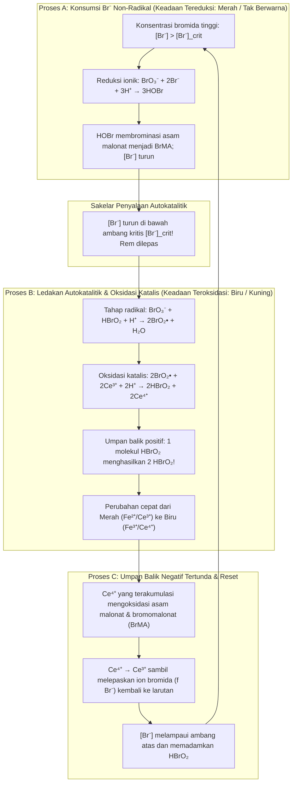
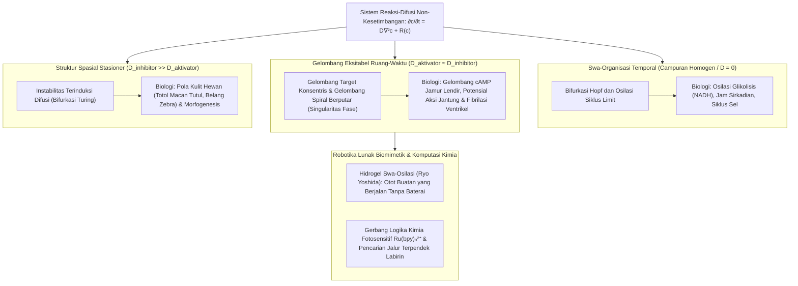

## 1. Pendahuluan: Bagaimana Jika Susu yang Dituang ke Dalam Kopi Mulai Berdenyut Sendiri?

Bayangkan Anda menuangkan susu dingin ke dalam secangkir kopi hitam panas lalu mengaduknya dengan sendok. Pusaran gelap dan terang menyatu hingga menjadi cairan cokelat muda yang seragam. Intuisi sehari-hari—serta pilar fisika klasik yaitu <strong>Hukum Kedua Termodinamika</strong>—mengatakan bahwa proses ini berjalan satu arah. Setelah tercampur, kopi tidak akan pernah secara spontan kembali menjadi hitam pekat, lalu berubah putih bersih semenit kemudian, dan terus berosilasi seperti jam.

Namun dalam kimia fisik, ada reaksi nyata yang menantang intuisi tersebut secara spektakuler: <strong>reaksi Belousov-Zhabotinsky (reaksi BZ)</strong>. Ketika beberapa reagen berair dicampurkan dalam gelas kimia, larutan tersebut <strong>berosilasi secara spontan puluhan kali di antara dua warna kontras dengan presisi metronom</strong>; dan bila dituangkan sebagai lapisan tipis tanpa pengadukan di cawan Petri, ia secara mandiri membentuk <strong>cincin konsentris yang meluas (pola target) dan gelombang spiral Archimedes yang berputar</strong>.

### 1951: Penemuan "Bidah" yang Ditolak oleh Komunitas Ilmiah Soviet

Kisah ini bermula di Moskow pada tahun 1951. Ahli kimia dan biofisika Soviet <strong>Boris Pavlovich Belousov (1893–1970)</strong> sedang mencari analog anorganik dari <strong>siklus asam sitrat (siklus Krebs)</strong>. Ia melarutkan <strong>kalium bromat ($\text{KBrO}_3$)</strong> sebagai oksidator, <strong>asam sitrat</strong> sebagai substrat organik, dan <strong>serium sulfat ($\text{Ce}^{4+}/\text{Ce}^{3+}$)</strong> sebagai katalis redoks dalam asam sulfat encer. Alih-alih berubah secara monoton dari kuning ($\text{Ce}^{4+}$) menjadi tak berwarna ($\text{Ce}^{3+}$), larutan tersebut berosilasi secara periodik antara <strong>kuning dan tak berwarna</strong> puluhan kali selama lebih dari satu jam!

Ketika Belousov mengirimkan naskahnya pada tahun 1951 dan 1957 ke jurnal kimia terkemuka Soviet, makalahnya <strong>ditolak mentah-mentah</strong>:

> "Klaim bahwa reaksi kimia homogen berosilasi bolak-balik melewati titik kesetimbangannya <strong>melanggar Hukum Kedua Termodinamika secara langsung</strong>. Apa yang diamati penulis pastilah artefak eksperimental akibat pengadukan yang buruk, kotoran debu, atau gelembung gas."

Kecewa mendalam pada usia 64 tahun, Belousov hanya menerbitkan catatan singkat dua halaman pada tahun 1958 dalam buletin medis radiasi yang nyaris tak dikenal dan meninggalkan topik itu selamanya.

### 1961: Rehabilitasi oleh Anatol Zhabotinsky dan Detak Merah-Biru

Pada tahun 1961, Profesor Simon Shnoll menyerahkan resep tersebut kepada mahasiswa pascasarjana muda di Universitas Negeri Moskow, <strong>Anatol Markovich Zhabotinsky (1938–2008)</strong>. Zhabotinsky mengganti asam sitrat dengan <strong>asam malonat ($\text{CH}_2(\text{COOH})_2$)</strong> dan memperkenalkan indikator redoks <strong>feroin ($[\text{Fe}(\text{phen})_3]^{2+}/[\text{Fe}(\text{phen})_3]^{3+}$)</strong>, sehingga larutan berdenyut dramatis antara <strong>merah bata ($[\text{Fe}(\text{phen})_3]^{2+}$ tereduksi) dan biru langit cerah ($[\text{Fe}(\text{phen})_3]^{3+}$ teroksidasi)</strong>. Pada tahun 1980, Belousov (secara anumerta) dan Zhabotinsky dianugerahi <strong>Hadiah Lenin</strong>.

---

## 2. Memecahkan Paradoks Termodinamika: Mengapa Reaksi BZ Tidak Melanggar Hukum Kedua

### Penurunan Monoton Energi Bebas Gibbs dan Relasi Resiprokal Onsager di Dekat Kesetimbangan

Dalam sistem tertutup pada suhu $T$ dan tekanan $P$ konstan, Hukum Kedua menuntut laju produksi entropi internal non-negatif $\sigma_S \equiv \frac{d_i S}{dt} \ge 0$, sehingga energi bebas Gibbs $G = H - TS$ selalu menurun secara monoton:

$$\frac{dG}{dt} = -T \sigma_S = -\sum_{\rho} A_{\rho} v_{\rho} \le 0$$

di mana $v_{\rho}$ adalah laju reaksi $\rho$ dan $A_{\rho} \equiv -\sum_i \nu_{i\rho} \mu_i = -\left(\frac{\partial G}{\partial \xi_{\rho}}\right)_{T,P}$ adalah afinitas kimia.

Dalam <strong>rezim non-kesetimbangan linier</strong> sangat dekat dengan kesetimbangan ($|A_{\rho}| \ll RT$), reversibilitas mikroskopis menuntut <strong>prinsip keseimbangan terperinci (detailed balance)</strong> dan <strong>relasi resiprokal Onsager</strong> (Lars Onsager, Nobel Kimia 1968), yang membuat matriks konduktivitas simetris ($L_{\alpha\beta} = L_{\beta\alpha}$). Akibatnya, matriks Jacobian $\mathbf{J}_{\text{eq}}$ hanya memiliki <strong>nilai eigen riil dan non-positif ($\lambda_k \in \mathbb{R}, \lambda_k \le 0, \text{Im}(\lambda_k) = 0$)</strong>. Di dekat kesetimbangan, bahkan osilasi teredam pun mustahil secara termodinamika!

### Jauh dari Kesetimbangan: Rusaknya Simetri dan Struktur Disipatif Prigogine

Kuncinya adalah <strong>reaksi BZ tidak berosilasi di sekitar kesetimbangan termodinamika, melainkan beroperasi jauh dari kesetimbangan ($A_{\rho} \gg RT$) dalam rezim sangat nonlinier!</strong>

Jauh dari kesetimbangan, umpan balik autokatalitik mematahkan simetri Onsager sehingga matriks Jacobian $\mathbf{J}(\mathbf{c}^*)$ menjadi tak simetris dan dapat memiliki <strong>nilai eigen kompleks konjugat $\lambda_{\pm} = \mu \pm i\omega$ ($\omega \neq 0$)</strong>. Ahli kimia fisik Belgia <strong>Ilya Prigogine (Nobel Kimia 1977)</strong> menunjukkan bahwa jauh dari kesetimbangan, disipasi energi ($\sigma_S > 0$) justru menjadi penggerak swa-organisasi ruang-waktu yang disebut <strong>struktur disipatif</strong>:
1. <strong>Dalam reaktor terbuka (CSTR)</strong>: Pasokan reaktan segar secara kontinu menyeimbangkan produksi entropi internal ($dS = d_e S + d_i S = 0$), menjaga osilasi abadi.
2. <strong>Dalam gelas kimia tertutup (penurunan bertingkat $G(t)$)</strong>: <strong>Reaktan utama ($\text{BrO}_3^-$ dan asam malonat, $\sim 10^{-1}\text{ M}$)</strong> menurun secara monoton menuju produk ($\frac{dG}{dt} \le 0$). Hanya <strong>zat antara renik ($\text{HBrO}_2, \text{Br}^-, \text{Ce}^{4+}$, $\sim 10^{-7}\text{ hingga }10^{-4}\text{ M}$)</strong> yang berputar dalam siklus tertutup, persis seperti <strong>kincir air di bawah air terjun</strong> yang berputar ratusan kali sementara airnya terus mengalir ke bawah.

| Rezim Termodinamika | Kesetimbangan Termodinamika | Non-Kesetimbangan Linier (Dekat Kesetimbangan) | Non-Kesetimbangan Nonlinier (Jauh dari Kesetimbangan / BZ) |
| :--- | :--- | :--- | :--- |
| <strong>Afinitas Kimia $A_{\rho}$</strong> | $A_{\rho} = 0$ (Keseimbangan terperinci) | $\|A_{\rho}\| \ll RT$ (Respons linier) | $A_{\rho} \gg RT$ (Ireversibel, sangat nonlinier) |
| <strong>Produksi Entropi $\sigma_S$</strong> | $\sigma_S = 0$ (Tanpa disipasi) | $\sigma_S > 0$ (Produksi entropi minimum) | $\sigma_S \gg 0$ (Disipasi menopang keteraturan dinamis) |
| <strong>Simetri Onsager</strong> | Fluks $J_{\alpha} = 0$ | $L_{\alpha\beta} = L_{\beta\alpha}$ (Matriks simetris) | Simetri patah ($\mathbf{J}$ tak simetris) |
| <strong>Nilai Eigen Jacobian $\mathbf{J}$</strong> | — | Riil murni dan negatif ($\text{Im}(\lambda_k)=0$) | Kompleks konjugat $\lambda = \mu \pm i\omega$ ($\mu > 0$ mungkin) |
| <strong>Perilaku Ruang-Waktu</strong> | Homogen dan statis | Relaksasi eksponensial monoton | <strong>Siklus limit, gelombang spiral, pola Turing</strong> |

---

## 3. Mekanisme FKN (1972): Tiga Proses Terkopel dan Sakelar Autokatalitik

Pada tahun 1972, <strong>Richard J. Field</strong>, <strong>Endre Körös</strong>, dan <strong>Richard M. Noyes</strong> merumuskan <strong>mekanisme FKN</strong> 18 langkah untuk oksidasi dan brominasi asam malonat oleh bromat:

$$2\text{BrO}_3^- + 3\text{CH}_2(\text{COOH})_2 + 2\text{H}^+ \longrightarrow 2\text{BrCH}(\text{COOH})_2 + 3\text{CO}_2 + 4\text{H}_2\text{O}$$

Siklus ini bergantian antara Proses A, B, dan C melalui tarik-menarik antara <strong>aktivator asam bromit ($\text{HBrO}_2$)</strong> dan <strong>inhibitor ion bromida ($\text{Br}^-$)</strong>:

1. <strong>Proses A (Rem Bromida)</strong>: Selama $[\text{Br}^-] > [\text{Br}^-]_{\text{crit}}$, $\text{Br}^-$ langsung menyapu $\text{HBrO}_2$ melalui $\text{HBrO}_2 + \text{Br}^- + \text{H}^+ \xrightarrow{k_2} 2\text{HOBr}$ dan membentuk asam bromomalonat ($\text{BrMA}$), menjaga katalis tetap tereduksi (merah).
2. <strong>Proses B (Ledakan Autokatalitik)</strong>: Begitu $[\text{Br}^-] < [\text{Br}^-]_{\text{crit}} = \frac{k_5}{k_2}[\text{BrO}_3^-] \approx 5 \times 10^{-7}\text{ M}$, rantai radikal melalui $\text{BrO}_2^\bullet$ memicu autokatalisis:
   $$\text{BrO}_3^- + \mathbf{HBrO_2} + 3\text{H}^+ + 2\text{Ce}^{3+} \longrightarrow \mathbf{2\,\text{HBrO}_2} + 2\text{Ce}^{4+} + \text{H}_2\text{O}$$
   <strong>Setiap molekul $\text{HBrO}_2$ menghasilkan dua molekul $\text{HBrO}_2$!</strong> $[\text{HBrO}_2]$ melonjak empat orde besaran dalam milidetik, mengoksidasi katalis ($\text{Ce}^{3+} \to \text{Ce}^{4+}$, berubah menjadi <strong>biru</strong>), lalu jenuh melalui disproporsionasi $2\text{HBrO}_2 \xrightarrow{k_4} \text{BrO}_3^- + \text{HOBr} + \text{H}^+$.
3. <strong>Proses C (Umpan Balik Negatif Tertunda)</strong>: $\text{Ce}^{4+}$ yang terakumulasi mengoksidasi asam bromomalonat, kembali menjadi $\text{Ce}^{3+}$ sambil melepaskan $f$ ion $\text{Br}^-$ yang memadamkan autokatalisis dan mengembalikan sistem ke Proses A.

---

## 4. Teori Matematika Oregonator: Osilasi Relaksasi, Bifurkasi Hopf, dan Siklus Limit

Pada tahun 1974, Field dan Noyes menyederhanakan mekanisme FKN menjadi tiga PDB tak berdimensi <strong>Oregonator</strong> ($x \propto [\text{HBrO}_2]$, $y \propto [\text{Br}^-]$, $z \propto [\text{Ce}^{4+}]$):

$$\varepsilon \frac{dx}{d\tau} = q y - x y + x(1 - x), \qquad \varepsilon' \frac{dy}{d\tau} = -q y - x y + f z, \qquad \frac{dz}{d\tau} = x - z$$

- <strong>Pemisahan Skala Waktu Cepat-Lambat dan Osilasi Relaksasi</strong>: Karena $\varepsilon' \sim 10^{-4} \ll \varepsilon \sim 10^{-2} \ll 1$, pendekatan keadaan kuasi-tunak $y \approx \frac{f z}{x + q}$ mereduksi sistem ke bidang $(x, z)$, di mana nullcline-$x$ $z = \frac{x(1-x)(x+q)}{f(x-q)}$ memiliki <strong>geometri terlipat kubik berbentuk S (atau N)</strong>. Lintasan merayap lambat di sepanjang cabang stabil dan melompat secara eksplosif di titik lipatan, menghasilkan <strong>osilasi relaksasi</strong> bergigi gergaji.
- <strong>Bifurkasi Hopf dan Teorema Poincaré-Bendixson</strong>: Pada titik tetap $(x^*, z^*)$, selalu berlaku $\det(\mathbf{J}) > 0$. Ketika faktor stoikiometri $f$ berada di dalam jendela osilasi ($0{,}5 \lesssim f \lesssim 1 + \sqrt{2} \approx 2{,}414$), titik tetap berada pada cabang tengah yang tak stabil dengan $\text{Tr}(\mathbf{J}) > 0$. Saat melewati ambang kritis terjadi <strong>bifurkasi Andronov-Hopf</strong>, dan <strong>teorema Poincaré-Bendixson</strong> menjamin konvergensi menuju <strong>siklus limit (Limit Cycle)</strong> yang stabil.

---

## 5. Gelombang Kimia dalam Ruang Tanpa Pengadukan: PDP Reaksi-Difusi, Pola Target, dan Gelombang Spiral

Di dalam cawan Petri tanpa pengadukan, kinetika lokal $\mathbf{R}(\mathbf{c})$ berpadu dengan difusi Fick membentuk <strong>persamaan diferensial parsial (PDP) reaksi-difusi</strong>:

$$\frac{\partial \mathbf{c}(\mathbf{r}, t)}{\partial t} = \mathbf{D} \nabla^2 \mathbf{c}(\mathbf{r}, t) + \mathbf{R}\bigl(\mathbf{c}(\mathbf{r}, t)\bigr)$$

1. <strong>Medium Eksitabel dan Rumus Luther</strong>: Gelombang pemicu kimia merambat tanpa redaman dengan laju konstan menurut <strong>rumus Luther (1906)</strong>:
   $$v_0 = 2 \sqrt{D_X \, k_{\text{auto}}} = 2 \sqrt{D_X \, k_5 [\text{BrO}_3^-][\text{H}^+]} \approx 5\text{–}10\text{ mm/menit}$$
2. <strong>Anihilasi Timbal Balik dan Singularitas Fase Gelombang Spiral</strong>: Tepat di belakang muka gelombang biru terdapat <strong>ekor refrakter</strong> kaya $\text{Br}^-$. Akibatnya, <strong>dua gelombang kimia yang bertabrakan frontal akan saling memusnahkan (anihilasi) sepenuhnya!</strong> Jika cincin konsentris (pola target) dipotong, ujung bebasnya menggulung mengelilingi ekor refrakternya sendiri membentuk <strong>gelombang spiral Archimedes</strong> yang berputar mengelilingi <strong>singularitas fase topologis</strong> ($\oint_C \nabla \phi \cdot d\mathbf{l} = \pm 2\pi n$) sesuai relasi kelengkungan eikonal $v_n = v_0 - D\kappa$.

---

## 6. Dari Sistem Kehidupan ke Material Pintar: Pola Turing, Fibrilasi Jantung, dan Hidrogel Berjalan

- <strong>Morfogenesis Alan Turing (1952)</strong>: Ketika inhibitor berdifusi jauh lebih cepat daripada aktivator ($D_v \gg D_u$), muncul pola bintik dan garis stasioner (<strong>pola Turing</strong>), yang telah dibuktikan secara eksperimental dalam mikroemulsi BZ-AOT.
- <strong>Fibrilasi Ventrikel Jantung</strong>: Otot jantung (miokardium) adalah medium eksitabel listrik. Patahnya muka gelombang listrik pada jaringan iskemik melahirkan <strong>gelombang spiral (gelombang gulung 3D)</strong> yang pecah secara kacau menjadi <strong>fibrilasi ventrikel</strong> yang mematikan. Kejutan listrik <strong>defibrilator (AED)</strong> mendepolarisasi seluruh miokardium secara serentak ke fase refrakter untuk menghapus singularitas fase.
- <strong>Hidrogel Swa-Osilasi (Ryo Yoshida)</strong>: Dengan mengikat katalis $\text{Ru(bpy)}_3^{2+}$ secara kovalen pada jaringan polimer termorresponsif (PNIPAAm), tercipta <strong>gel biomimetik otonom</strong> yang mengubah osilasi redoks menjadi kontraksi peristaltik dan berjalan sendiri seperti ulat tanpa baterai.
