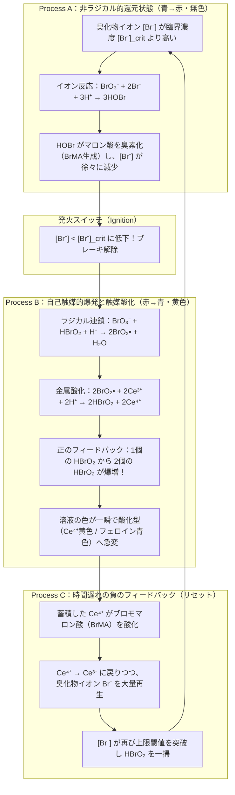
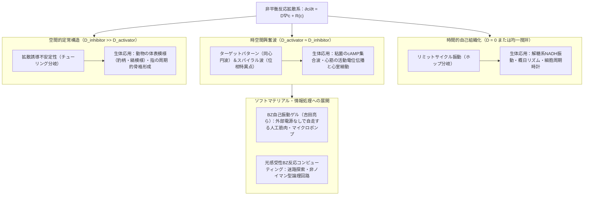

## 1. はじめに：コーヒーに注いだミルクが「ひとりでに脈打ち始める」としたら？

熱いブラックコーヒーに冷たいミルクを注ぎ、スプーンでよくかき混ぜる場面を思い浮かべてみてください。黒と白の液体は渦を巻きながら混ざり合い、やがて均一なカフェオレ色になって静まり返ります。これは私たちが毎日目にする当たり前の光景であり、物理学が<strong>熱力学第二法則（エントロピー増大則）</strong>と呼ぶ絶対的な自然の摂理です。一度均一なカフェオレになった液体が、外から何も操作していないのに突然真っ黒に戻り、1分後に真っ白になり、再び黒へと周期的に色を変え始める——そんなことが起きれば、誰もが目を疑い、何かの手品か超常現象だと思うことでしょう。

ところが、化学の世界には<strong>「均一にかき混ぜたはずの液体が、メトロノームのように正確な周期で何十回も色を変え続け、静置すればシャーレの中に無数の同心円や回転する渦巻き（スパイラル波）を自ら描き出す」</strong>という、にわかには信じがたい反応が実在します。それが、非線形化学および非平衡熱力学の象徴として知られる<strong>ベロウソフ・ジャボチンスキー反応（Belousov-Zhabotinsky reaction：以下、BZ反応）</strong>です。

### 1951年、ソビエト連邦で葬り去られた「異端の発見」

物語は1951年のソビエト連邦・モスクワに遡ります。ソ連保健省の生物物理学研究所で働いていた化学者<strong>ボリス・パヴロヴィチ・ベロウソフ（Boris Pavlovich Belousov, 1893–1970）</strong>は、生体内のエネルギー代謝の要である<strong>クエン酸回路（TCA回路／クレブス回路）</strong>の無機化学的なモデルを探究していました。生体内で有機酸が酵素の助けを借りて酸化分解され、二酸化炭素（$\text{CO}_2$）を放出していくプロセスを、試験管内の単純な無機試薬で模倣しようとしたのです。

ベロウソフは、酸化剤として<strong>臭素酸カリウム（$\text{KBrO}_3$）</strong>、還元される有機基質として<strong>クエン酸</strong>、そして酸化還元触媒として<strong>硫酸セリウム（$\text{Ce}^{4+} / \text{Ce}^{3+}$）</strong>を希硫酸中に溶解させました。4価のセリウムイオン（$\text{Ce}^{4+}$）は水溶液中で黄色を呈し、還元されて3価のセリウムイオン（$\text{Ce}^{3+}$）になると無色透明になります。当時のあらゆる化学の常識に従えば、溶液は反応の進行とともに黄色から無色へと一方向に変化し、そのまま反応が終了するはずでした。

しかし、ベロウソフが実験台の上のフラスコに目をやったとき、信じられない現象が起きていました。黄色かった溶液がすっと無色透明に変わったかと思うと、数十秒後、突如として再び鮮やかな黄色へと戻り、しばらくするとまた無色になったのです。この<strong>「黄色 $\leftrightarrow$ 無色」の周期的な化学振動</strong>は、1時間以上にわたって何十サイクルも規則正しく繰り返されました。さらに撹拌を止めた試験管内では、黄色の帯が液体の中を生き物のように移動していく進行波まで観察されました。

驚喜したベロウソフは1951年、この現象を詳細に記録した論文をソ連の主要な化学学術誌に投稿しました。ところが、返ってきたのは冷酷な<strong>掲載拒否（リジェクト）</strong>の通知でした。当時の編集長と査読者たちはこう断じたのです。

> 「均一な溶液中で化学反応が熱平衡点を通り過ぎて行ったり来たりするなどということは、<strong>熱力学第二法則に真っ向から違反している</strong>。したがって、報告されている『振動』なるものは、不純物の混入や気泡の発生、あるいは不完全な撹拌による初歩的な実験ミスにすぎない。」

ベロウソフはあきらめず、温度による周期の変化や反応速度論的なデータをさらに6年間かけて積み上げ、写真や詳細なレシピを添えて1957年に別の学術誌へ再投稿しました。しかし、そこでも編集部は「これほど長大な論文ではなく、単なる短いレター（速報）に削るなら載せてもよい」という屈辱的な条件を突きつけました。誇り高い64歳の老化学者はこれに深く傷つき、論文を取り下げてしまいます。彼は1958年、ほとんど誰の目にも触れない『放射線医学要約集（Sbornik Referatov po Radiatsionnoi Meditsine）』という研究所の内部紀要に、わずか1ページ半の短い報告と実験レシピだけをひっそりと残し、二度とこの研究に戻ることはありませんでした。

### 1961年、若きジャボチンスキーによる復権と「赤と青の脈動」

あやうく科学史の闇に葬られかけていたベロウソフの発見は、モスクワの化学者たちの間で「出所不明の奇妙なレシピ」として口頭で細々と語り継がれていました。1961年、モスクワ国立大学の生物物理学教授シモン・シュノール（Simon Shnoll）は、大学院生だった<strong>アナトール・ジャボチンスキー（Anatol Zhabotinsky, 1938–2008）</strong>に、この謎めいた反応の正体を突き止めるよう勧めました。

ジャボチンスキーは図書館の片隅からベロウソフの1958年の紀要を探し出し、追試に成功しただけでなく、反応機構の解明に向けた決定的な改良を加えました。第一に、クエン酸の代わりに構造がより単純で副反応の少ない<strong>マロン酸（$\text{CH}_2(\text{COOH})_2$）</strong>を用いたこと。第二に、セリウムの淡い「黄色 $\leftrightarrow$ 無色」の変化を誰の目にも鮮烈に可視化するため、鉄のフェナントロリン錯体である酸化還元指示薬<strong>フェロイン（Ferroin: $[\text{Fe}(\text{phen})_3]^{2+} / [\text{Fe}(\text{phen})_3]^{3+}$）</strong>を導入したことです。

これにより、溶液は<strong>鮮やかな赤褐色（還元型 $[\text{Fe}(\text{phen})_3]^{2+}$）と透き通るような青色（酸化型 $[\text{Fe}(\text{phen})_3]^{3+}$）の間を劇的に行き来する</strong>ようになりました。ジャボチンスキーは1964年にこの成果を発表し、自らの論文の中でベロウソフの先駆的業績に最大の敬意を表しました。こうして二人の名を冠した<strong>「ベロウソフ・ジャボチンスキー反応（BZ反応）」</strong>は世界中の物理学者・化学者・数理生物学者の注目を集め、1980年にはベロウソフ（没後10年での追贈）とジャボチンスキーらに対してソビエト連邦最高峰の科学賞である<strong>レーニン賞</strong>が授与されたのです。

---

## 2. 熱力学的パラドックスの厳密な解明：なぜBZ反応は熱力学第二法則に違反しないのか？

1950年代の査読者たちは、なぜあれほど頑なに「化学振動などあり得ない」と信じ込んだのでしょうか？そして、彼らは熱力学の何を誤解していたのでしょうか？この問いに厳密に答えることこそが、現代の<strong>非平衡熱力学（Non-Equilibrium Thermodynamics）</strong>への扉を開く鍵となります。

### 閉鎖系におけるギブズ自由エネルギーの単調減少

まず、定温（温度 $T$ 一定）・定圧（圧力 $P$ 一定）に保たれた閉鎖系（物質の出入りがないビーカー内の反応）を考えましょう。熱力学第二法則によれば、系の全エントロピー変化 $dS$ は、外界との熱交換に伴うエントロピー流 $d_e S$ と、系内部の不可逆過程によって生み出される<strong>内部エントロピー生成（Internal Entropy Production）</strong> $d_i S$ の和で表されます。

$$dS = d_e S + d_i S \qquad \left( d_i S \ge 0 \right)$$

定温・定圧の閉鎖系では、ギブズ自由エネルギー $G = H - TS$ の時間微分は、単位時間あたりの内部エントロピー生成率 $\sigma_S \equiv \frac{d_i S}{dt} \ge 0$ と次の直接的な関係にあります。

$$\frac{dG}{dt} = -T \sigma_S = -T \sum_{\rho} \frac{A_{\rho}}{T} v_{\rho} = -\sum_{\rho} A_{\rho} v_{\rho} \le 0$$

ここで、添字 $\rho$ は系内で進行する各化学反応を表し、$v_{\rho}$ は反応 $\rho$ の反応速度、$A_{\rho}$ はテオフィル・ド・ドンデ（Théophile De Donder）が導入した<strong>化学親和力（Chemical Affinity）</strong>です。化学種 $i$ の化学ポテンシャルを $\mu_i$、反応 $\rho$ における化学量論係数（生成物を正、反応物を負とする）を $\nu_{i\rho}$ とすると、化学親和力は次のように定義されます。

$$A_{\rho} \equiv -\sum_{i} \nu_{i\rho} \mu_i = -\left(\frac{\partial G}{\partial \xi_{\rho}}\right)_{T, P}$$

（$\xi_{\rho}$ は反応進行度）。熱平衡状態とは、すべての反応において $A_{\rho} = 0$ かつ $v_{\rho} = 0$ となり、$G$ が大域的な最小値に到達して $\frac{dG}{dt} = 0$ となった状態です。

当時の化学者たちは、単一の反応 $A \rightleftharpoons B$ のイメージに囚われていました。もし $A$ から $B$ へ進み、平衡点を通過して再び $B$ から $A$ へ戻るとすれば、ギブズ自由エネルギー $G$ の谷底を通り過ぎて坂を上り直すことになり、$\frac{dG}{dt} > 0$（すなわち $d_i S < 0$）となる瞬間がなければなりません。これは確かに熱力学第二法則に違反します。

### 熱平衡近傍（線形非平衡領域）：詳細釣り合いとオンサーガーの相反定理

では、複数の化学種 $(c_1, c_2, \dots, c_n)$ が関与する多段階反応なら、谷底（熱平衡点 $\mathbf{c}^{\text{eq}}$）の周りを渦巻き状に回りながら底へ落ちていく「減衰振動」は可能でしょうか？実は、<strong>熱平衡点の十分近くでは、渦巻き状の減衰振動すら熱力学的に禁止されている</strong>のです！

熱平衡点 $\mathbf{c}^{\text{eq}}$ のごく近傍（化学親和力が熱エネルギーに比べて十分小さい線形領域：$|A_{\rho}| \ll RT$）では、ミクロな力学法則の時間反転対称性から<strong>詳細釣り合いの原理（Principle of Detailed Balance）</strong>が成立します。このとき、熱力学的流束（反応速度 $J_{\rho} = v_{\rho}$）は熱力学的力（$X_{\rho} = A_{\rho}/T$）の線形結合で表されます。

$$J_{\alpha} = \sum_{\beta} L_{\alpha\beta} X_{\beta}$$

ラルス・オンサーガー（Lars Onsager、1968年ノーベル化学賞）が1931年に証明した<strong>オンサーガーの相反定理（Onsager Reciprocal Relations）</strong>により、輸送係数行列 $\mathbf{L}$ は厳密に対称行列となります。

$$L_{\alpha\beta} = L_{\beta\alpha}$$

さらに、平衡点からの微小な濃度ずれ $\delta \mathbf{c} = \mathbf{c} - \mathbf{c}^{\text{eq}}$ に対する化学ポテンシャルの展開係数行列 $\mathbf{M}_{ij} = \left(\frac{\partial \mu_i}{\partial c_j}\right)_{\text{eq}}$ も、自由エネルギーの2階微分 $\frac{\partial^2 G}{\partial c_i \partial c_j}$ であるから対称かつ正定値です。したがって、平衡点近傍の濃度緩和方程式：

$$\frac{d(\delta \mathbf{c})}{dt} = \mathbf{J}_{\text{eq}} \, \delta \mathbf{c}$$

を支配するヤコビ行列 $\mathbf{J}_{\text{eq}}$ は、正定値対称計量のもとで自己随伴（対称化可能）な負定値演算子となります。線形代数の基本定理により、実対称化可能な行列の固有値 $\lambda_k$ は<strong>すべて純粋な実数かつ負（$\lambda_k \in \mathbb{R},\ \lambda_k < 0$）</strong>に限られます。

$$\text{Im}(\lambda_k) = 0 \quad (\forall k) \implies \text{平衡点近傍では振動モード（}e^{i\omega t}\text{）は存在し得ない！}$$

つまり、熱平衡点のすぐ近くでは、どのような複雑な化学反応ネットワークを組もうとも、濃度は単調な指数減衰の重ね合わせ（$\sum a_k e^{-|\lambda_k| t}$）としてしか平衡へ近づくことができず、決して振動できないのです。

### 平衡から遠く離れた領域（Far from Equilibrium）とプリゴジンの「散逸構造」

では、なぜBZ反応は振動できるのでしょうか？答えは明快です。<strong>BZ反応は熱平衡点の周り（近傍）を振動しているのではなく、熱平衡から遠く離れた非線形領域（Far from Equilibrium, $A_{\rho} \gg RT$）で起きているから</strong>です。

熱平衡から遠く離れると、逆反応が無視できる不可逆な段階や自己触媒段階が現れ、流束と力の線形関係やオンサーガーの相反対称性（$L_{\alpha\beta} = L_{\beta\alpha}$）は完全に破れます。その結果、定常状態の周りでのヤコビ行列 $\mathbf{J}$ は非対称行列となり、<strong>共役複素固有値 $\lambda = \mu \pm i\omega$（$\omega \neq 0$）</strong>を持つことが許されるようになります。

ベルギーの物理化学者<strong>イリヤ・プリゴジン（Ilya Prigogine, 1917–2003、1977年ノーベル化学賞受賞）</strong>は、このように熱平衡から遠く離れた非線形領域において、エネルギーや物質の絶え間ない散逸（エントロピー生成 $\sigma_S > 0$）を駆動力として自発的に立ち現れる時間的・空間的な秩序を<strong>「散逸構造（Dissipative Structures）」</strong>と名付けました。BZ反応における熱力学的整合性は、次の2つの状況に分けて完璧に説明されます。

1. <strong>開放系（CSTR：連続槽型反応器）における持続振動</strong>：
   反応容器に新鮮な原料（高自由エネルギーの臭素酸塩とマロン酸）を一定速度で注入し、反応液をオーバーフローさせて排出し続ける開放系では、外界への負のエントロピー流 $d_e S < 0$ が内部エントロピー生成 $d_i S > 0$ をちょうど打ち消すことができます（$dS = d_e S + d_i S = 0$）。これにより、系は熱平衡に落ち込むことなく、永久に一定振幅・一定周期の化学振動を維持し続けます。
2. <strong>閉鎖系（ビーカー内のバッチ反応）における「階段状の自由エネルギー降下」</strong>：
   ビーカーに試薬を入れて蓋をした閉鎖系でも、BZ反応は1時間以上にわたって何十回も色を変えます。このとき、系全体のギブズ自由エネルギー $G(t)$ は決して増えていません。
   なぜなら、溶液中に大量に存在する<strong>主反応物（$\text{BrO}_3^-$ とマロン酸、濃度 $\sim 10^{-1}\text{ M}$）は一方向に消費され続け、最終生成物（$\text{CO}_2$, $\text{H}_2\text{O}$, 臭素化有機酸）へと一貫して増え続けている</strong>からです。周期的に増減して元の濃度に戻っているのは、主反応物に比べて数千分の一〜数万分の一しか存在しない<strong>微量な反応中間体（$\text{HBrO}_2, \text{Br}^-, \text{Ce}^{4+}$、濃度 $\sim 10^{-7} \sim 10^{-4}\text{ M}$）だけ</strong>なのです！

これを直感的に理解するには、<strong>「山の上の巨大な貯水池から麓へと流れ落ちる急流に設置された水車」</strong>を想像するとよいでしょう。貯水池の水（主反応物のギブズ自由エネルギー $G(t)$）は、重力に従って高いところから低いところへと一度も逆流することなく単調に流れ落ちていきます（$\frac{dG}{dt} \le 0$）。しかし、その水流の途中に置かれた水車の羽根（中間体濃度 $x(t), y(t), z(t)$）は、水が尽きるまでの間、同じ円軌道を何百回でも周期的に回り続けることができます。実際、閉鎖系BZ反応の全ギブズ自由エネルギー $G(t)$ を時間に対してプロットすると、色が切り替わる（自己触媒反応が爆発する）瞬間に急激に下がり、休止期に緩やかに下がるという<strong>「単調減少する階段関数（Staircase Monotonic Decrease）」</strong>を描きながら、最終的に原料が尽きた時点で熱平衡（静止状態）へと到達するのです。

| 比較項目 | 熱平衡状態 (Thermodynamic Equilibrium) | 線形非平衡領域 (Near-Equilibrium) | 非線形非平衡領域・散逸構造 (Far-from-Equilibrium / BZ反応) |
| :--- | :--- | :--- | :--- |
| <strong>化学親和力 $A_{\rho}$</strong> | $A_{\rho} = 0$ （全反応が釣り合う） | $\|A_{\rho}\| \ll RT$ （平衡のごく近傍） | $A_{\rho} \gg RT$ （平衡から遠く離れている） |
| <strong>エントロピー生成率 $\sigma_S$</strong> | $\sigma_S = 0$ （散逸なし） | $\sigma_S > 0$ （最小エントロピー生成原理に従う） | $\sigma_S \gg 0$ （大きな自由エネルギー散逸が秩序を維持） |
| <strong>オンサーガーの相反関係</strong> | 成立（流束 $J = 0$） | $L_{ij} = L_{ji}$ が成立（対称行列） | 破綻（非線形効果・自己触媒により非対称化） |
| <strong>ヤコビ行列 $\mathbf{J}$ の固有値</strong> | — | すべて実数かつ負（$\lambda_i < 0, \text{Im}(\lambda_i)=0$） | 複素固有値 $\lambda = \mu \pm i\omega$ や正の実部を持ちうる |
| <strong>時間的・空間的挙動</strong> | 一様・静止（死んだ状態） | 単調な指数関数的緩和のみ（振動不可能） | <strong>リミットサイクル振動・スパイラル波・チューリング模様</strong> |

---

## 3. FKNメカニズム（1972年）：化学振動を駆動する3つのプロセスとスイッチング機構

BZ反応が熱力学的に許されることがわかったとしても、「具体的にどのような分子のやり取りが、あのような鮮烈な色の反転を生み出しているのか？」という化学反応速度論の謎は長らく未解明のままでした。この難問を完全に解き明かしたのが、1972年にオレゴン大学の<strong>リチャード・フィールド（Richard J. Field）</strong>、ハンガリーから訪れていた<strong>エンドレ・ケレシュ（Endre Körös）</strong>、そして物理化学の泰斗<strong>リチャード・ノイエス（Richard M. Noyes）</strong>の3人が発表した記念碑的論文であり、彼らの頭文字をとって<strong>FKNメカニズム（Field-Körös-Noyes Mechanism）</strong>と呼ばれています。

### 全体反応と2つの主役：アクチベーター $\text{HBrO}_2$ とインヒビター $\text{Br}^-$

BZ反応の全体としての正味（ネット）の化学反応は、酸性の水溶液中でセリウムイオン（$\text{Ce}^{3+}/\text{Ce}^{4+}$）やフェロイン（$[\text{Fe}(\text{phen})_3]^{2+}/[\text{Fe}(\text{phen})_3]^{3+}$）を触媒として、臭素酸イオン（$\text{BrO}_3^-$）がマロン酸（$\text{CH}_2(\text{COOH})_2$）を酸化・臭素化する反応です。

$$2\text{BrO}_3^- + 3\text{CH}_2(\text{COOH})_2 + 2\text{H}^+ \longrightarrow 2\text{BrCH}(\text{COOH})_2 + 3\text{CO}_2 + 4\text{H}_2\text{O}$$

FKNメカニズムは、80個以上の素反応の中から本質的な18の素反応を特定し、この全体反応が次の<strong>2種類の微量中間体の主導権争い</strong>によって3つのプロセス（<strong>Process A, Process B, Process C</strong>）を周期的に切り替えていることを突き止めました。

- <strong>アクチベーター（自己触媒的活性種）</strong>：<strong>亜臭素酸（$\text{HBrO}_2$）</strong> —— 自分自身の生成を爆発的に加速させる「アクセル」の役割を果たす。
- <strong>インヒビター（阻害剤・制御種）</strong>：<strong>臭化物イオン（$\text{Br}^-$）</strong> —— $\text{HBrO}_2$ を素早く捕捉・消去して爆発を抑え込む「ブレーキ」の役割を果たす。

この3つのプロセスがどのように連鎖して振動を生むのか、順を追って見ていきましょう。

### Process A：臭化物イオン $\text{Br}^-$ によるブレーキと非ラジカル的消費（還元状態）

最初、溶液中に十分な濃度の臭化物イオン $\text{Br}^-$ が存在している状態からスタートします。このとき金属触媒は還元型（$\text{Ce}^{3+}$ で無色、フェロインなら<strong>赤色</strong>）にあります。$\text{Br}^-$ 濃度が高い間は、臭素酸イオン $\text{BrO}_3^-$ は酸素原子のやり取り（2電子移動の非ラジカル的イオン反応）によって段階的に還元されます。

$$\text{(R1)} \quad \text{BrO}_3^- + \text{Br}^- + 2\text{H}^+ \xrightarrow{k_1} \text{HBrO}_2 + \text{HOBr}$$

$$\text{(R2)} \quad \text{HBrO}_2 + \text{Br}^- + \text{H}^+ \xrightarrow{k_2} 2\text{HOBr}$$

$$\text{(R3)} \quad \text{HOBr} + \text{Br}^- + \text{H}^+ \xrightarrow{\text{fast}} \text{Br}_2 + \text{H}_2\text{O}$$

ここで極めて重要なのは、反応 (R2) の速度定数 $k_2 \approx 2 \times 10^6\text{ M}^{-2}\text{s}^{-1}$ が非常に大きいため、<strong>$\text{Br}^-$ が存在する限り、亜臭素酸 $\text{HBrO}_2$ は生まれた瞬間に反応 (R2) によって次亜臭素酸 $\text{HOBr}$ へと消し去られてしまう</strong>という点です。生じた $\text{HOBr}$ や $\text{Br}_2$ は、溶液中のマロン酸 $\text{CH}_2(\text{COOH})_2$ のエノール型と速やかに反応し、<strong>ブロモマロン酸（$\text{BrCH}(\text{COOH})_2$：以下 $\text{BrMA}$）</strong>へと変わります。

$$\text{(R1)} + \text{(R2)} + 3\times\text{臭素化} \implies \text{BrO}_3^- + 2\text{Br}^- + 3\text{CH}_2(\text{COOH})_2 + 3\text{H}^+ \longrightarrow 3\text{BrCH}(\text{COOH})_2 + 3\text{H}_2\text{O}$$

この Process A が進行している間、溶液の色は赤色（または無色）のまま静かに保たれますが、水面下では<strong>ブレーキ役である $\text{Br}^-$ が一歩一歩確実に消費され、濃度 $[\text{Br}^-]$ が低下し続けています</strong>。

### Process B：亜臭素酸 $\text{HBrO}_2$ の自己触媒的爆発（正のフィードバックと色の急変）

やがて $[\text{Br}^-]$ が減少し、ある<strong>臨界濃度 $[\text{Br}^-]_{\text{crit}}$</strong> を下回った瞬間、劇的なスイッチング（発火：Ignition）が起きます。実は、亜臭素酸 $\text{HBrO}_2$ を消費しようとする反応には、$\text{Br}^-$ による除去反応 (R2) と競合するもう一つのルート——臭素酸イオン $\text{BrO}_3^-$ との反応 (R5) が存在しているのです。

$$\text{(R5a)} \quad \text{BrO}_3^- + \text{HBrO}_2 + \text{H}^+ \xrightarrow{k_5} 2\text{BrO}_2^\bullet + \text{H}_2\text{O}$$

$$\text{(R5b)} \quad \text{BrO}_2^\bullet + \text{Ce}^{3+} + \text{H}^+ \xrightarrow{\text{fast}} \text{HBrO}_2 + \text{Ce}^{4+}$$

反応 (R5a) では、5価の臭素（$\text{BrO}_3^-$）と3価の臭素（$\text{HBrO}_2$）が均化反応（Comproportionation）を起こし、4価の<strong>二酸化臭素ラジカル（$\text{BrO}_2^\bullet$）</strong>を2分子生成します。このフリーラジカル $\text{BrO}_2^\bullet$ がすぐさま還元型触媒 $\text{Ce}^{3+}$（または $[\text{Fe}(\text{phen})_3]^{2+}$）から1電子を奪い取り（R5b）、自らを $\text{HBrO}_2$ に変えながら触媒を酸化型 $\text{Ce}^{4+}$（または青色の $[\text{Fe}(\text{phen})_3]^{3+}$）へと変換します。(R5a) と $2\times$(R5b) を足し合わせた正味の反応式を見てください。

$$\text{BrO}_3^- + \mathbf{HBrO_2} + 3\text{H}^+ + 2\text{Ce}^{3+} \longrightarrow \mathbf{2\,HBrO_2} + 2\text{Ce}^{4+} + \text{H}_2\text{O}$$

左辺で<strong>1分子の $\text{HBrO}_2$</strong> が反応に入ると、右辺から<strong>2分子の $\text{HBrO}_2$</strong> が出てきます！その2分子が次は4分子を生み、4分子が8分子を生む——これこそが化学における<strong>自己触媒反応（Autocatalysis：正のフィードバック）</strong>です。

この自己触媒による $\text{HBrO}_2$ の生成速度 $k_5 [\text{BrO}_3^-][\text{H}^+][\text{HBrO}_2]$ が、反応 (R2) による消去速度 $k_2 [\text{Br}^-][\text{H}^+][\text{HBrO}_2]$ を上回る条件から、スイッチが切り替わる臨界臭化物イオン濃度 $[\text{Br}^-]_{\text{crit}}$ が厳密に求まります。

$$k_5 [\text{BrO}_3^-][\text{H}^+][\text{HBrO}_2] > k_2 [\text{Br}^-][\text{H}^+][\text{HBrO}_2] \iff [\text{Br}^-] < [\text{Br}^-]_{\text{crit}} \equiv \frac{k_5}{k_2} [\text{BrO}_3^-]$$

室温付近での速度定数比は $\frac{k_5}{k_2} \approx 5 \times 10^{-6}$ です。したがって、たとえば $[\text{BrO}_3^-] = 0.1\text{ M}$ のとき、$[\text{Br}^-]$ がわずか $5 \times 10^{-7}\text{ M}$ という極微量な閾値を割り込んだ瞬間にブレーキが完全に外れ、$[\text{HBrO}_2]$ は一瞬にして1,000倍〜10,000倍へと指数関数的に急騰します。この爆発的な $\text{HBrO}_2$ が残っていた $\text{Br}^-$ を反応 (R2) で根こそぎ焼き尽くしながら、$\text{Ce}^{3+}$ を一斉に $\text{Ce}^{4+}$ へと酸化するため、<strong>溶液の色は赤色から鮮やかな青色（セリウム単独なら無色から黄色）へと一瞬で切り替わります</strong>。

なお、$\text{HBrO}_2$ の指数関数的増殖は無限には続きません。高濃度になった $\text{HBrO}_2$ 同士が衝突して不均化反応（Disproportionation）を起こす二次反応 (R4)：

$$\text{(R4)} \quad 2\text{HBrO}_2 \xrightarrow{k_4} \text{BrO}_3^- + \text{HOBr} + \text{H}^+$$

によって頭打ちとなり、高い準定常濃度（酸化状態）に達します。

### Process C：時間遅れを伴う負のフィードバック（$\text{Ce}^{4+}$ の還元と $\text{Br}^-$ の再生）

もし Process B だけで終わってしまえば、溶液は青色（酸化状態）になったまま二度と元には戻りません。振動が繰り返されるためには、<strong>「少し遅れて作動し、系を最初の状態へと引き戻す負のフィードバック（Negative Feedback）」</strong>が不可欠です。それを担うのが Process C です。

Process B で大量に生み出された酸化型金属触媒 $\text{Ce}^{4+}$（またはフェロイン青色）は、Process A およびに Process B で蓄積していたマロン酸と<strong>ブロモマロン酸（$\text{BrMA}$）</strong>をゆっくりと酸化分解し始めます。

$$2\text{Ce}^{4+} + \text{CH}_2(\text{COOH})_2 + \text{BrCH}(\text{COOH})_2 \xrightarrow{k_C} f\,\text{Br}^- + 2\text{Ce}^{3+} + \text{CO}_2\uparrow + \text{その他の酸化生成物}$$

この反応によって、次の2つのことが同時に進行します。
1. 酸化型だった触媒 $\text{Ce}^{4+}$ が再び還元型の $\text{Ce}^{3+}$（フェロインなら赤色）へと戻される。
2. ブロモマロン酸の炭素-臭素結合が切断され、<strong>ブレーキ役である臭化物イオン $\text{Br}^-$ が再び溶液中へと大量に放出（再生）される</strong>。

ここで係数 $f$ は<strong>化学量論因子（Stoichiometric Factor）</strong>と呼ばれ、「$\text{Ce}^{4+}$ イオン1個が還元される際に平均して何個の $\text{Br}^-$ イオンが再生されるか（通常は $2\text{Ce}^{4+}$ あたり $f$ 個、すなわち $\text{Ce}^{4+}$ 1個あたり $f/2$ 個と定義される）」を表す無次元パラメータです。再生された $\text{Br}^-$ の濃度が高まり、高濃度の $\text{HBrO}_2$ を打ち負かす上限閾値を突破すると、$\text{HBrO}_2$ は一気に消滅して Process B が強制終了し、系は再び最初の <strong>Process A（赤色の還元状態）</strong>へとリセットされます。そしてまた $\text{Br}^-$ が消費され、臨界値を割れば Process B が爆発する——この「<strong>速い正のフィードバック（Process B）</strong>」と「<strong>遅い負のフィードバック（Process C）</strong>」の絶妙な追いかけっここそが、BZ反応という化学時計の心臓部なのです。

---

## 4. オレゴネーター（Oregonator）モデルの数理と非線形力学系：緩和振動・ホップ分岐・リミットサイクル

18個もの素反応を含むFKNメカニズムは化学的に極めて正確ですが、そのままでは微分方程式の数が多すぎて、振動が起きる数学的条件（分岐構造）を見通しよく解析することが困難です。そこで1974年、フィールドとノイエス（Field & Noyes）は、FKNメカニズムの本質をわずか<strong>5つの骨格反応と3つの動的変数</strong>へと鮮やかに凝縮した数理モデルを発表しました。オレゴン大学の名にちなんで<strong>「オレゴネーター（Oregonator：Oregon + Oscillator）」</strong>と名付けられたこのモデルは、非線形動力学における最も美しい標準模型の一つとなっています。

### 5つの骨格反応と無次元化微分方程式

主反応物である臭素酸イオン濃度 $A = [\text{BrO}_3^-]$ と有機物（マロン酸＋ブロモマロン酸）濃度 $B = [\text{MA} + \text{BrMA}]$、および水素イオン濃度 $[\text{H}^+]$ は、中間体に比べて大過剰に存在するため一定とみなします。時間とともに激しく変化する3つの動的変数を次のように置きます。

- $X = [\text{HBrO}_2]$ ：アクチベーター（亜臭素酸）
- $Y = [\text{Br}^-]$ ：インヒビター（臭化物イオン）
- $Z = [\text{Ce}^{4+}]$ ：酸化型金属触媒（遅いフィードバック変数）

（$P = [\text{HOBr}]$ は反応生成物）。オレゴネーターの5つの不可逆反応ステップは次のように書かれます。

$$\begin{aligned}
\text{(M1)} &\quad A + Y \xrightarrow{k_1} X + P && \text{（Process A：}\text{Br}^-\text{ による }\text{BrO}_3^-\text{ の還元）} \\
\text{(M2)} &\quad X + Y \xrightarrow{k_2} 2P && \text{（Process A/Bの境界：}\text{Br}^-\text{ による }\text{HBrO}_2\text{ の消去）} \\
\text{(M3)} &\quad A + X \xrightarrow{k_3} 2X + 2Z && \text{（Process B：}\text{HBrO}_2\text{ の自己触媒増殖と }\text{Ce}^{4+}\text{ 生成）} \\
\text{(M4)} &\quad 2X \xrightarrow{k_4} A + P && \text{（Process Bの飽和：}\text{HBrO}_2\text{ の不均化停止反応）} \\
\text{(M5)} &\quad B + Z \xrightarrow{k_5} \frac{1}{2} f Y && \text{（Process C：}\text{Ce}^{4+}\text{ の還元と }\text{Br}^-\text{ の再生）}
\end{aligned}$$

質量作用の法則（Law of Mass Action）を適用すると、$(X, Y, Z)$ の時間発展を表す連立常微分方程式（ODE）はただちに次のように書き下せます。

$$\begin{aligned}
\frac{dX}{dt} &= k_1 A Y - k_2 X Y + k_3 A X - 2 k_4 X^2 \\
\frac{dY}{dt} &= -k_1 A Y - k_2 X Y + \frac{1}{2} f k_5 B Z \\
\frac{dZ}{dt} &= 2 k_3 A X - k_5 B Z
\end{aligned}$$

この方程式系の構造をクリアにするため、タイソン（John J. Tyson）らによる標準的な<strong>無次元化変換（Dimensionless Scaling）</strong>を導入します。

$$x = \frac{2 k_4}{k_3 A} X, \qquad y = \frac{k_2}{k_3 A} Y, \qquad z = \frac{k_4 k_5 B}{(k_3 A)^2} Z, \qquad \tau = k_5 B t$$

すると、オレゴネーターはわずか4つの無次元パラメータ $(\varepsilon, \varepsilon', q, f)$ のみを含む、驚くほど簡潔な<strong>無次元化オレゴネーター方程式</strong>へと姿を変えます。

$$\begin{aligned}
\varepsilon \frac{dx}{d\tau} &= q y - x y + x(1 - x) \\
\varepsilon' \frac{dy}{d\tau} &= -q y - x y + f z \\
\frac{dz}{d\tau} &= x - z
\end{aligned}$$

ここで各無次元パラメータの定義と、典型的な実験条件におけるオーダー（桁数）は次の通りです。

$$\varepsilon = \frac{k_5 B}{k_3 A} \sim 10^{-2}, \qquad \varepsilon' = \frac{2 k_4 k_5 B}{k_2 k_3 A} \sim 10^{-5} \sim 10^{-4}, \qquad q = \frac{2 k_1 k_4}{k_2 k_3} \sim 10^{-4}$$

### 速い変数と遅い変数の分離（Fast-Slow System）と「緩和振動（Relaxation Oscillation）」

上の無次元方程式の左辺に注目してください。$z$ の微分には係数が $1$ かかっているのに対し、$x$ の微分には $\varepsilon \approx 10^{-2}$、$y$ の微分には $\varepsilon' \approx 10^{-4}$ という極めて小さな数がかかっています。これは、<strong>3つの変数の動くスピード（固有時間スケール）が何桁も異なっている</strong>ことを意味します。

特に $\varepsilon' \ll \varepsilon \ll 1$ であるため、インヒビター $y$（$[\text{Br}^-]$）は他の変数に比べて瞬時に反応し、常に $\varepsilon' \frac{dy}{d\tau} \approx 0$ の<strong>準定常状態近似（Quasi-Steady-State Approximation: QSSA）</strong>を満たしながら追随します。

$$-q y - x y + f z \approx 0 \implies y(x, z) = \frac{f z}{q + x}$$

これを第1式に代入すると、オレゴネーターは「<strong>速い変数 $x$（アクチベーター $\text{HBrO}_2$）</strong>」と「<strong>遅い変数 $z$（触媒 $\text{Ce}^{4+}$）</strong>」からなる<strong>2変数オレゴネーター（平面力学系）</strong>へと完全に縮約されます！

$$\varepsilon \frac{dx}{d\tau} = x(1 - x) - f z \frac{x - q}{x + q} \equiv F(x, z)$$

$$\frac{dz}{d\tau} = x - z \equiv G(x, z)$$

相平面 $(x, z)$ 上でこの2つの微分がゼロになる曲線——すなわち<strong>ヌルクライン（Nullclines）</strong>の形を調べてみましょう。
- $z$-ヌルクライン（$\frac{dz}{d\tau} = 0$）：単純な直線 $z = x$ です。
- $x$-ヌルクライン（$\frac{dx}{d\tau} = 0$）：
  $$z = \frac{x(1 - x)(x + q)}{f(x - q)} \quad (x > q)$$
  この曲線は、$x$ が $q$ にごく近い領域（$q \approx 10^{-4} \ll 1$）で急峻な極大値を持ち、中間の領域で右下がりとなり、$x \approx 1$ 付近で極小値に達したあと（高次の項や $y$ の別分岐を含めると再び上昇する）、全体として<strong>N字型（またはS字型）に折れ曲がった3次曲線状の形状（Folded Nullcline）</strong>を描きます。

$\varepsilon \ll 1$ であるため、相平面上の任意の点 $(x, z)$ にある状態は、まず $\frac{dx}{d\tau} \sim \mathcal{O}(\varepsilon^{-1})$ という猛烈なスピードで水平方向に飛び、$x$-ヌルクラインの安定な枝（左側の低 $x$ 枝＝Process A、または右側の高 $x$ 枝＝Process B）の上に張り付きます。
1. 左側の安定枝（$x \approx q$：還元状態）に乗った状態は、$\frac{dz}{d\tau} = x - z < 0$ に従ってゆっくりと下へ滑っていきます（$\text{Ce}^{4+}$ と $\text{Br}^-$ の減少）。
2. やがて左枝の下端（極小点：膝 / Knee）に到達した瞬間、支えを失った軌道は $\mathcal{O}(\varepsilon)$ の超短時間で水平右方向へと<strong>カタストロフィックに大ジャンプ（発火：Ignition）</strong>し、右側の安定枝（$x \approx 1$：酸化状態）に着地します。
3. 右側の枝の上では $x > z$ なので $\frac{dz}{d\tau} = x - z > 0$ となり、状態はゆっくりと上へ登っていきます（Process C による $\text{Ce}^{4+}$ の蓄積と $\text{Br}^-$ の再生）。
4. 右枝の上端（極大点）に達すると、再び支えを失って左側の安定枝へと<strong>水平左方向に大ジャンプ（消火：Extinction）</strong>し、1サイクルが完了します。

このように、エネルギーや物質をじわじわと溜め込んでは限界点で一気に放出・ジャンプする非線形振動を、オランダの物理学者バルタザール・ファン・デル・ポール（Balthasar van der Pol）が1926年に命名した用語で<strong>「緩和振動（Relaxation Oscillation）」</strong>と呼びます（日本の添田・ししおどし「鹿威し」が、竹筒に水をゆっくり溜めては一瞬で傾いて音を鳴らすのと全く同じ力学構造です）。BZ反応の電位や吸光度の時間波形が、振り子のような滑らかな正弦波（$\sin \omega t$）ではなく、<strong>鋭いスパイクと緩やかな減衰を繰り返す鋸歯（ノコギリ刃）状の波形</strong>になる理由は、まさにこの $\varepsilon \ll 1$ の緩和振動にあるのです。

### 線形安定性解析、ホップ分岐（Hopf Bifurcation）、ポアンカレ・ベンディクソンの定理

では、どのような化学量論因子 $f$ の値のときに、静止状態（定常状態）が壊れて自発的な振動が始まるのでしょうか？
2つのヌルクラインの交点である正の定常状態 $(x^*, z^*)$ は、$z^* = x^*$ を $F(x^*, z^*) = 0$ に代入することで求まります。

$$1 - x^* - f \frac{x^* - q}{x^* + q} = 0 \implies (x^*)^2 + (f + q - 1)x^* - q(1 + f) = 0$$

$x^* > q$ の唯一の正根は次式で与えられます。

$$x^* = z^* = \frac{1 - f - q + \sqrt{(1 - f - q)^2 + 4q(1 + f)}}{2}$$

この定常点 $(x^*, z^*)$ の周りでの線形安定性を調べるため、ヤコビ行列 $\mathbf{J}$ を計算します。

$$\mathbf{J} = \begin{pmatrix} \dfrac{\partial (F/\varepsilon)}{\partial x} & \dfrac{\partial (F/\varepsilon)}{\partial z} \\[10pt] \dfrac{\partial G}{\partial x} & \dfrac{\partial G}{\partial z} \end{pmatrix}_{(x^*, z^*)} = \begin{pmatrix} \dfrac{1}{\varepsilon}\left(1 - 2x^* - \dfrac{2 q f x^*}{(x^* + q)^2}\right) & -\dfrac{f}{\varepsilon}\dfrac{x^* - q}{x^* + q} \\[10pt] 1 & -1 \end{pmatrix}$$

2次元ヤコビ行列の固有値 $\lambda_{\pm}$ は、トレース $\text{Tr}(\mathbf{J})$ と行列式 $\det(\mathbf{J})$ によって完全に決定されます。

$$\lambda_{\pm} = \frac{\text{Tr}(\mathbf{J}) \pm \sqrt{\text{Tr}(\mathbf{J})^2 - 4\det(\mathbf{J})}}{2}$$

ここで、$x^* > q$ において行列式 $\det(\mathbf{J})$ は常に正（$\det(\mathbf{J}) > 0$：鞍点にはならない）であることが容易に確かめられます。したがって、定常点 $(x^*, z^*)$ の安定性は<strong>トレース $\text{Tr}(\mathbf{J})$ の符号だけ</strong>で決まります！

$$\text{Tr}(\mathbf{J}) = \frac{1}{\varepsilon}\left(1 - 2x^* - \frac{2 q f x^*}{(x^* + q)^2}\right) - 1$$

- <strong>$f$ が非常に小さいとき（$f \lesssim 0.5$）または大きいとき（$f \gtrsim 1 + \sqrt{2} \approx 2.414$）</strong>：
  定常点 $x^*$ は $x$-ヌルクラインの右枝または左枝（負の傾きを持つ領域）に位置し、$\text{Tr}(\mathbf{J}) < 0$ となります。固有値の実部は負（$\text{Re}(\lambda_{\pm}) < 0$）であり、定常点は<strong>安定な不動点（Stable Node / Focus）</strong>となるため、溶液は振動せず一定の酸化状態または還元状態に落ち着きます。
- <strong>$f$ が中間領域（およそ $0.5 < f < 1 + \sqrt{2} \approx 2.414$）に入ったとき</strong>：
  定常点 $x^*$ は $x$-ヌルクラインの中央の「正の傾きを持つ不安定枝」の上に移動し、$\varepsilon \ll 1$ のもとで <strong>$\text{Tr}(\mathbf{J}) > 0$</strong> となります！
  パラメータ $f$ を変化させて $\text{Tr}(\mathbf{J}) = 0$ を通過する瞬間、共役複素固有値 $\lambda_{\pm} = \mu(f) \pm i\omega(f)$ の実部 $\mu(f)$ が負から正へと複素平面の虚軸を横切ります。この分岐現象を力学系理論で<strong>「ホップ分岐（Hopf Bifurcation：アンドロノフ・ホップ分岐）」</strong>と呼びます。

さらに、相平面 $(x, z)$ の外側境界ではすべてのベクトル場が内側を向いており（有界なトラッピング領域 $D$ が存在する）、その内部に存在する唯一の不動点 $(x^*, z^*)$ が $\text{Tr}(\mathbf{J}) > 0$ によって不安定な湧き出し（Repeller）となるとき、微分方程式論の金字塔である<strong>ポアンカレ・ベンディクソンの定理（Poincaré-Bendixson Theorem）</strong>が発動します。

> <strong>ポアンカレ・ベンディクソンの定理</strong>：2次元平面上の有界な閉領域 $D$ から外へ出る軌道が存在せず、$D$ の内部に安定な不動点が存在しないならば、$D$ 内のすべての軌道は必ず閉軌道——すなわち<strong>安定なリミットサイクル（Limit Cycle）</strong>へと漸近する。

単なる振り子の振動（保存系のセンター軌道）は、外から少しでも指で触れて擾乱を与えれば振幅が変わったまま元に戻りません。しかし、BZ反応が生み出す<strong>リミットサイクル（極限周期軌道）</strong>は、相空間内のあらゆる初期状態を引き寄せる<strong>アトラクター（Attractor）</strong>であるため、途中で溶液を少し揺らしたり温度が一時的に変動したりしても、軌道は再び同じ振幅・同じ周期の閉曲線へと力強く復帰します。生命の心拍や概日リズム（サーカディアン・リズム）が外部ノイズに対して驚くほど頑健（ロバスト）である数学的根拠も、まさにこのリミットサイクルにあるのです。

---

## 5. 空間へ広がる化学波：反応拡散方程式・ターゲットパターン・スパイラル波

ここまでは「スターラーで均一にかき混ぜたビーカーの中（空間的に一様な0次元系）」の話をしてきました。では、撹拌を止め、フェロインを加えた赤色のBZ反応液を浅いペトリ皿（シャーレ）に厚さ $1 \sim 2\text{ mm}$ で薄く広げて静置すると、一体何が起きるでしょうか？

1970年、ジャボチンスキーとザイキン（A. N. Zaikin）、そしてアメリカの理論生物学者<strong>アーサー・ウィンフリー（Arthur T. Winfree, 1942–2002）</strong>は、静置されたBZ反応液の薄膜の中に、目を奪われるほど美しい空間パターンが自発的に出現することを相次いで報告しました。赤い溶液のあちこちに青い小さな点が生まれ、それが<strong>同心円状の青いリングとなって外へと広がっていく「ターゲットパターン（Target Patterns / 同心円波）」</strong>、そしてリングの一部が切れた場所から<strong>アルキメデス螺旋を描いて永続的に回転し続ける「スパイラル波（Spiral Waves / 螺旋波）」</strong>です。

### 反応拡散方程式（Reaction-Diffusion Equations）

かき混ぜられていない溶液中では、各空間位置 $\mathbf{r} = (x, y)$ における化学種の濃度ベクトル $\mathbf{c}(\mathbf{r}, t) = ([\text{HBrO}_2], [\text{Br}^-], [\text{Ce}^{4+}])^T$ は、その場所での局所的な化学反応 $\mathbf{R}(\mathbf{c})$ と、濃度勾配に従って周囲へ広がる<strong>フィックの拡散法則（Fick's Law of Diffusion）</strong>の両方によって変化します。これを記述するのが<strong>反応拡散偏微分方程式（Reaction-Diffusion PDE）</strong>です。

$$\frac{\partial \mathbf{c}(\mathbf{r}, t)}{\partial t} = \mathbf{D} \nabla^2 \mathbf{c}(\mathbf{r}, t) + \mathbf{R}\bigl(\mathbf{c}(\mathbf{r}, t)\bigr)$$

ここで $\nabla^2 = \frac{\partial^2}{\partial x^2} + \frac{\partial^2}{\partial y^2}$ は空間ラプラシアン演算子、$\mathbf{D} = \text{diag}(D_x, D_y, D_z)$ は各化学種の拡散係数行列です（水溶液中における $\text{HBrO}_2$ や $\text{Br}^-$ などの低分子イオンの拡散係数はおよそ $D \approx 1.5 \sim 2.0 \times 10^{-5}\text{ cm}^2/\text{s}$ です）。

### 興奮性媒質（Excitable Medium）と化学波の伝播速度（ルターの式）

一見すると、拡散（$\mathbf{D}\nabla^2 \mathbf{c}$）とは「濃度のムラを均して一様にする働き」しか持たないように思えます。しかも、単純な分子拡散だけで物質が距離 $L$ を移動するのにかかる時間は $t \sim \frac{L^2}{D}$ に比例するため、距離が遠くなるほど伝わる速度は急激に遅くなります（たとえば $D = 2 \times 10^{-5}\text{ cm}^2/\text{s}$ で $1\text{ cm}$ 拡散するには約 $5,000\text{ 秒} \approx 1.4\text{ 時間}$ もかかります）。

ところが、シャーレ内の青いBZ化学波は、速度が一切減衰することなく<strong>毎分数ミリメートル（$v \approx 5 \sim 10\text{ mm/min}$）という一定の速度</strong>でシャーレの端から端まで駆け抜けます。なぜそんなことが可能なのでしょうか？

それは、静止状態（またはゆっくり振動する状態）にあるBZ溶液が<strong>「興奮性媒質（Excitable Medium）」</strong>として振る舞うからです。ある1点で微細な気泡やチリ、あるいは局所的な濃度ゆらぎ（ペースメーカー核）によって $[\text{Br}^-]$ が臨界値を割り、Process B の自己触媒爆発が起きて $\text{HBrO}_2$ が急増したとします。すると、その高濃度の $\text{HBrO}_2$ がごくわずかな距離だけ隣の領域へと拡散し、隣の領域の $\text{Br}^-$ を反応 (R2) で食いつぶして臨界値以下へと引きずり下ろします。すると隣の領域が自ら自己触媒爆発を起こして大量の $\text{HBrO}_2$ を生み出し、それがさらにその隣を着火させる——つまり、<strong>「野火（山火事）が隣の草木に次々と燃え移っていく」あるいは「ドミノ倒しが一定の速度で伝わっていく」のと全く同じメカニズム</strong>で波が伝播しているのです！

この自己触媒反応と拡散が結合した進行波（トリガー波：Trigger Wave / Fisher-Kolmogorov-Petrovsky-Piskunov [FKPP] 波）の伝播速度 $v$ は、1906年にドイツの物理化学者ロベルト・ルター（Robert Luther）が発見した<strong>ルターの式（Luther's Equation）</strong>によって見事に与えられます。アクチベーター $X = [\text{HBrO}_2]$ の波面先端における反応拡散方程式：

$$\frac{\partial X}{\partial t} = D_X \frac{\partial^2 X}{\partial r^2} + k_{\text{auto}} X \qquad \left(k_{\text{auto}} = k_5 [\text{BrO}_3^-][\text{H}^+]\right)$$

に進行波解 $X(r, t) = \tilde{X}(r - vt)$ を代入すると、最小安定波速 $v_0$ として次の普遍的な関係式が導かれます。

$$v_0 = 2 \sqrt{D_X \, k_{\text{auto}}} = 2 \sqrt{D_X \, k_5 [\text{BrO}_3^-][\text{H}^+]}$$

拡散係数 $D_X \sim 2 \times 10^{-5}\text{ cm}^2/\text{s}$ と自己触媒速度定数 $k_{\text{auto}} \sim 1\text{ s}^{-1}$ を代入すると、$v_0 \approx 2\sqrt{2\times 10^{-5}} \approx 9 \times 10^{-3}\text{ cm/s} \approx 5.4\text{ mm/min}$ となり、実験値と驚くほど正確に一致します。

### 水面波・音波との決定的な違い：「衝突による対消滅」と「スパイラル波の位相特異点」

ここで、池に石を投げ込んだときに広がる「水面の波」や「音波・光波」などの<strong>線形波（Linear Waves）</strong>と、BZ反応の<strong>化学波（非線形反応拡散波）</strong>の決定的な違いを比較してみましょう。

水面に2つの石を投げて2つの同心円波を作ると、2つの波はぶつかった瞬間に重なり合い（重ね合わせの原理）、何事もなかったかのように互いをすり抜けて反対側へ進んでいきます。また、壁に当たれば反射します。

しかし、<strong>BZ反応の2つの化学波（青いリング）が正面から衝突すると、すり抜けることも反射することもなく、衝突したその場所で両方とも跡形もなく消え去る（対消滅：Mutual Annihilation）</strong>のです！

なぜ対消滅が起きるのでしょうか？それは、発火して青くなった波の先端（Excited Front）のすぐ後ろには、Process C が進行中で $\text{Ce}^{4+}$ と再生された $\text{Br}^-$ が高濃度に満ちている<strong>「不応期（Refractory Period / Refractory Tail）」</strong>の領域が帯状に続いているからです。この不応期の領域はブレーキ役 $\text{Br}^-$ が過剰にあるため、外からどれほど $\text{HBrO}_2$ が拡散してきても絶対に再発火できません。したがって、向かい合って進んできた2つの波が衝突すると、それぞれの波の前方は「相手が通り過ぎた直後の不応期の壁」に阻まれて行く手を失い、山火事が焼け野原にぶつかって鎮火するように、その場で完全に消滅してしまうのです。

さらに、広がっていくリング状の波の一部をガラス棒でサッと撫でるなどして<strong>波面を途中で切断（Wave Break）</strong>すると、さらに劇的な現象が起きます。切断された波の「端っこ（自由端：Free End / Wave Tip）」では、進行方向のすぐ横に不応期が終わったばかりの回復領域が存在するため、波の先端がクルリと内側へと回り込みます。そして、<strong>自分の尻尾（不応期）を追いかけながら果てしなく回転し続ける「スパイラル波（Spiral Wave）」</strong>が誕生するのです。

スパイラル波の中心核（Core）は、周囲を1周したときに振動の位相 $\phi(\mathbf{r}, t)$ が $2\pi$ だけずれる<strong>位相特異点（Phase Singularity / トポロジカル欠陥 Topological Defect）</strong>となっています。

$$\oint_{C} \nabla \phi(\mathbf{r}, t) \cdot d\mathbf{l} = \pm 2\pi n \qquad (n = 1, 2, \dots : \text{トポロジカルチャージ／巻き数})$$

ターゲットパターン（同心円波）は中心にあるチリや気泡などのペースメーカーを取り除けば消えてしまいますが、スパイラル波はトポロジカルな構造そのものによって安定化されているため、不純物が一切なくても自ら永続的に波を送り出し続けます。しかも、波面の局所曲率 $\kappa$（外向き凸を正とする）と法線方向の伝播速度 $v_n$ の間には、拡散による希釈効果を表す<strong>アイコナル方程式（Eikonal Equation）</strong>：

$$v_n = v_0 - D \kappa$$

が成り立ちます。中心に近いほど曲率 $\kappa$ が大きいため波速 $v_n$ が遅くなり、外側ほど $v_0$ に近づく結果、波面は必然的に美しい<strong>アルキメデス螺旋（Archimedean Spiral）</strong>へと自己組織化されるのです。

---

## 6. 生命現象と最先端マテリアルへの架け橋：チューリング・パターンから心臓細動、自走するスマートゲルまで

なぜ生物物理学者であったベロウソフやジャボチンスキー、そして数理生物学者たちは、これほどまでにBZ反応に情熱を注いだのでしょうか？それは、BZ反応が単なる「珍しい色変わりマジック」ではなく、<strong>生命がいかにして無秩序な分子のスープから時間のリズム（生物時計）と空間の形（形態形成）を創り出しているのかを解き明かす、最も純粋な物理化学モデル</strong>だからです。

### 1. アラン・チューリングの「形態形成理論（1952年）」との統合

ベロウソフが論文を却下された翌年の1952年、コンピュータ科学の父であるイギリスの数学者<strong>アラン・チューリング（Alan Turing, 1912–1954）</strong>は、晩年の最高傑作である論文『形態形成の化学的基礎（The Chemical Basis of Morphogenesis）』を発表しました。彼は、「本来なら濃度を均一にならすはずの<strong>拡散（Diffusion）</strong>が、自己触媒反応と組み合わさることで逆に均一状態を不安定化させ、空間的に固定された斑点（スポット）や縞模様（ストライプ）を自発的に生み出す」という<strong>拡散誘導不安定性（Diffusion-Driven Instability / チューリング不安定性）</strong>を数学的に予言しました。

チューリング・パターンが出現するための絶対条件は、<strong>「局所で増えるアクチベーターの拡散係数 $D_u$ よりも、周囲を抑え込むインヒビターの拡散係数 $D_v$ の方がはるかに大きいこと（$D_v \gg D_u$：局所的活性化と長距離阻害）」</strong>です。通常の水溶液中のBZ反応では、$\text{HBrO}_2$ も $\text{Br}^-$ も同じくらいの大きさの低分子イオンであるため $D_u \approx D_v$ となり、静止した模様ではなく進行波（ターゲット波やスパイラル波）が生まれます。

しかし1990年、フランスのボルドー大学のグループ（Castets et al.）が、デンプンなどの高分子をゲル内に固定してアクチベーターの見かけの拡散係数 $D_u$ を劇的に低下させる手法（CIMA反応）により、ついに化学実験室で本物の<strong>チューリング・パターン</strong>を創り出すことに成功しました。続いて、水・油・界面活性剤（AOT）からなるナノスケールの水滴ネットワーク（逆ミセル系）の中でBZ反応を行わせる<strong>「BZ-AOT系」</strong>では、親水性のイオンは水滴内に閉じ込められてゆっくり拡散（$D_u$ 小）し、親油性の中間体（$\text{Br}_2$ や $\text{BrO}_2^\bullet$）は油相を通って高速拡散（$D_v$ 大）するため、単一のBZ反応系の中で<strong>リミットサイクル振動・スパイラル波・静止した六角形チューリング斑点・縞模様</strong>のすべてを自在に遷移させることができるようになりました。熱帯魚のタテジマキンチャクダイの縞模様やヒョウの斑点、さらには私たちの手の指が等間隔に5本形成される発生生物学のメカニズムも、この反応拡散原理によって説明されています。

### 2. 解糖系振動・粘菌の集合・そして心臓の「心室細動（スパイラル波の暴走）」

生体内に目を向けると、BZ反応と数学的に同型な反応拡散ダイナミクスがいたるところで命を支えています。

- <strong>解糖系振動（Glycolytic Oscillations）</strong>：酵母や筋肉細胞がグルコースを分解する解糖系では、律速酵素であるホスホフルクトキナーゼ（PFK）が、自らの反応生成物であるADPやAMPによってアロステリックに活性化されます。この「生成物による正のフィードバック」によって、細胞内のNADH蛍光強度が数分周期で鮮やかに振動し、さらに細胞集団がアセトアルデヒドの拡散を介して一斉に同期（Synchronization）します。
- <strong>細胞性粘菌（Dictyostelium discoideum）のスパイラル波</strong>：普段は土壌中で単細胞のアメーバとして暮らす細胞性粘菌は、餌が尽きて飢餓状態に陥ると、シグナル分子である<strong>サイクリックAMP（cAMP）</strong>を分泌し始めます。細胞膜上の受容体がcAMPを受け取ると、細胞内でcAMP合成酵素が自己触媒的に活性化されて周囲へcAMPを放出し、直後に受容体が脱感作して不応期に入ります。その結果、シャーレ上の粘菌シートには<strong>BZ反応と寸分違わぬcAMPのスパイラル波とターゲットパターン</strong>が出現し、数十万個の細胞がその波に向かって行進することで1つの多細胞体（ナメクジ状の移動体から子実体）へと集合するのです。
- <strong>心臓の拍動と致死性不整脈（心室細動：Ventricular Fibrillation）</strong>：
  私たちの心臓が1日に約10万回規則正しく拍動できるのは、右心房の洞房結節（ペースメーカー）から発せられた電気的興奮（活動電位）が、心筋という「興奮性媒質」を<strong>ターゲットパターン（進行波）</strong>として一方向に伝播し、心室全体を同期収縮させたあと、不応期を経て消えていくからです。
  ところが、心筋梗塞などによる虚血部位やタイミングの悪い期外収縮によって進行波の波面が途中で切断（Wave Break）されると、心筋の上に<strong>電気的なスパイラル波（3次元の心筋壁内では「スクロール波：Scroll Wave」）</strong>が発生してしまいます！
  ひとたびスパイラル波が生まれると、その中心の位相特異点（核）が本来の洞房結節を無視して毎分300〜600回という猛烈なスピードで回転し続け、心筋を無秩序に興奮させます（心室頻拍）。さらにこのスパイラル波が不安定化して複数の小さなスパイラルへと次々に分裂（スパイラル・ブレイクアップ：時空間カオス）した状態こそが、心臓が血液を送り出せなくなって数分で死に至る<strong>「心室細動（Ventricular Fibrillation）」</strong>の正体なのです。
  街中に設置されている<strong>AED（自動体外式除細動器）</strong>がなぜ強力な電気ショックを心臓に与えるのか？それは、止まった心臓を動かしているのではありません。<strong>心臓全体のすべての心筋細胞を強力な電流で一斉に強制発火（脱分極）させて「すべて同時に不応期」へと叩き込むことで、心筋上を暴走しているスパイラル波の位相特異点を行き場のない焼け野原に閉じ込めて対消滅（リセット）させている</strong>のです！BZ反応のスパイラル波の力学研究は、今日、心臓不整脈の解明と低エネルギー除細動法の開発に直結しています。

### 3. 自走する人工筋肉「自己振動ゲル」と化学コンピューティング

さらに20世紀末から現在にかけて、BZ反応は「観察する対象」から「機能するスマートマテリアル」へと劇的な進化を遂げました。

1996年、日本の高分子科学者である<strong>吉田亮（Ryo Yoshida、東京大学教授）</strong>らの研究グループは、温度や酸化還元状態によって膨潤・収縮する高分子ゲル（ポリN-イソプロピルアクリルアミド：PNIPAAm）の高分子鎖に、BZ反応の金属触媒であるルテニウムビピリジン錯体（$\text{Ru(bpy)}_3^{2+}$）を共有結合で組み込んだ<strong>「自発的周期振動ゲル（Self-Oscillating Gel）」</strong>を世界で初めて創製しました。

このゲルを、触媒を含まない一定のBZ基質水溶液（臭素酸ナトリウム、マロン酸、硝酸）の中に浸すだけで、驚異的な現象が起きます。外部から電線もバッテリーもスイッチも一切つないでいないのに、ゲル内部でBZ反応が自発的に回り始め、$\text{Ru}^{2+}$（疎水的・収縮）$\leftrightarrow \text{Ru}^{3+}$（親水的・膨潤）の周期的な酸化還元変化が、そのまま<strong>高分子ゲルの周期的な体積膨張と収縮（機械的拍動）</strong>へと直接変換されるのです！

ゲルが小さいときは全体が心臓のようにドクンドクンと拍動し、細長い帯状のゲルにすると、端から端へと膨潤の化学波（ぜん動波）が伝播することで、<strong>まるで生きている尺取り虫やミミズのように自力で海底を歩き進む「自走するソフトロボット（Self-Walking Gel Actuator）」</strong>となります。また、表面に繊毛状の微細構造を作れば自律的に液体を送液する人工繊毛シートとなり、マイクロ流路の自律型化学ポンプや、体内の環境に応じて薬物をパルス放出するドラッグデリバリーシステム（DDS）への応用が進められています。

さらに、ルテニウム触媒 $\text{Ru(bpy)}_3^{2+}$ は青い光（波長 $450\text{ nm}$ 付近）を吸収すると臭化物イオン $\text{Br}^-$ の生成を促進して<strong>振動や波の伝播を抑制する「光感受性（Photosensitivity）」</strong>を持っています。この性質を利用し、ゲルや溶液の薄膜にプロジェクターで迷路のパターンの光を投影すると、化学波は光が当たっていない通路だけを伝播し、行き止まりで消滅し、交差点で衝突・選別されることで、<strong>迷路の最短経路を一瞬で解き明かしたり、AND / OR / NOT の論理ゲートとして動作したりする「非ノイマン型・反応拡散化学コンピュータ（Chemical Computing）」</strong>まで実証されています。

---

## 7. おわりに：死んだ物質と生きた生命を繋ぐ「非平衡の架け橋」

かつて1951年にボリス・ベロウソフがフラスコの中で目撃し、当時の学会から「熱力学第二法則に反するあり得ない幻想」として拒絶された黄色と無色の脈動は、今や物理学・化学・数学・生物学・工学を横断する巨大な知の体系へと発展しました。

もし宇宙が熱平衡状態（またはそのごく近傍）だけで完結しているならば、この世界にはただ均一で退屈な静止状態しか存在せず、時計の針も、心臓の鼓動も、美しい貝殻の模様も、そして思考する私たちの脳の神経発火も決して生まれることはなかったでしょう。

しかし自然界は、<strong>「熱平衡から遠く離れた非線形領域（Far from Equilibrium）」</strong>において、自由エネルギーが散逸してエントロピーが生み出されるその激しい流れの只中に、ホップ分岐による<strong>リミットサイクル（時間の秩序）</strong>と、反応拡散による<strong>スパイラル波・チューリングパターン（空間の秩序）</strong>を自発的に立ち上げるという驚くべき仕組みを用意していました。

ビーカーの中で赤と青に脈打つベロウソフ・ジャボチンスキー反応を見つめるとき、私たちが目にしているのは単なる試薬の変色ではありません。それは、無生物の分子の集まりがいかにしてリズムを獲得し、自らを組織化し、「生命」と呼ばれるダイナミックな秩序へと飛躍したのかを物語る、宇宙で最も美しい物理化学の詩なのです。
