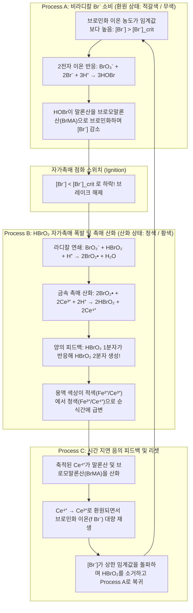
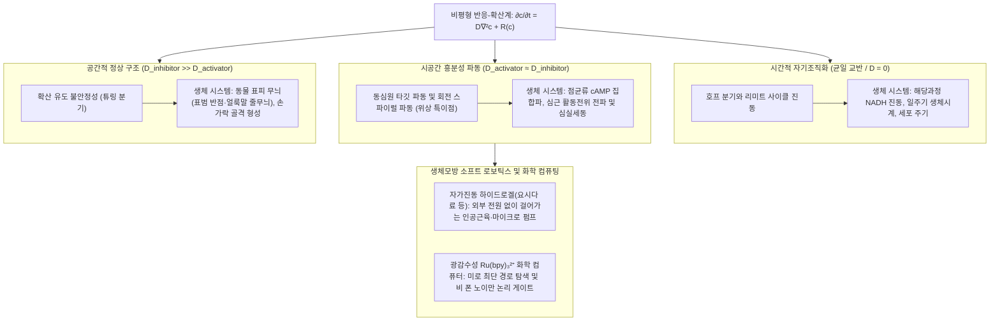

## 1. 들어가며: 커피에 부은 우유가 '스스로 맥동하기 시작한다'면?

뜨거운 블랙커피에 차가운 우유를 붓고 스푼으로 잘 저어 주는 장면을 떠올려 보십시오. 검은색과 흰색 액체는 소용돌이치며 섞이더니 이내 균일한 카페오레 빛깔이 되어 고요해집니다. 이는 우리가 매일 목격하는 당연한 일상이며, 물리학이 <strong>열역학 제2법칙(엔트로피 증가의 법칙)</strong>이라 부르는 자연의 절대적인 섭리입니다. 만약 한 번 균일하게 섞인 커피가 아무런 외부 조작도 없는데 갑자기 새까만 색으로 돌아갔다가, 1분 뒤 새하얀 색이 되고, 다시 검은색으로 주기적으로 색을 바꾸기 시작한다면 누구나 마술이나 초자연적 현상이라고 생각할 것입니다.

그런데 화학의 세계에는 <strong>"균일하게 섞은 액체가 메트로놈처럼 정확한 주기로 수십 번이나 색을 바꾸며 맥동하고, 얇게 펼쳐 정지시켜 두면 스스로 무수한 동심원(타깃 패턴)과 회전하는 소용돌이(스파이럴 파동)를 그려내는"</strong> 놀라운 반응이 실재합니다. 비선형 화학 동역학과 비평형 열역학의 상징인 <strong>벨로우소프-자보틴스키 반응(Belousov-Zhabotinsky reaction, 이하 BZ 반응)</strong>이 바로 그것입니다.

### 1951년, 소비에트 연방 학계에서 매장당한 '이단의 발견'

이야기는 1951년 소련 모스크바로 거슬러 올라갑니다. 소련 보건부 생물물리학 연구소의 화학자 <strong>보리스 파블로비치 벨로우소프(Boris Pavlovich Belousov, 1893–1970)</strong>는 생체 내 에너지 대사의 핵심인 <strong>시트르산 회로(TCA 회로 / 크렙스 회로)</strong>를 무기화학적으로 모방할 수 있는 모델을 찾고 있었습니다. 그는 산화제로 <strong>브로민산 칼륨($\text{KBrO}_3$)</strong>, 유기 기질로 <strong>시트르산(구연산)</strong>, 그리고 산화·환원 촉매로 <strong>황산 세륨($\text{Ce}^{4+}/\text{Ce}^{3+}$)</strong>을 묽은 황산에 녹였습니다. 수용액에서 4가 세륨 이온($\text{Ce}^{4+}$)은 노란색을 띠고, 환원된 3가 세륨 이온($\text{Ce}^{3+}$)은 무색투명합니다.

당시 화학계의 모든 상식에 따르면 용액은 노란색에서 무색으로 단조롭게 변하며 반응이 끝나야 했습니다. 그러나 벨로우소프의 플라스크에서는 믿기 힘든 일이 벌어졌습니다. 노란색 용액이 무색투명해지더니, 수십 초 뒤 갑자기 다시 선명한 노란색으로 되돌아왔고, 잠시 후 다시 무색으로 변했습니다! 이 <strong>'노란색 $\leftrightarrow$ 무색'의 주기적인 화학 진동</strong>은 한 시간 넘게 수십 회나 규칙적으로 반복되었습니다.

벨로우소프는 1951년 이 발견을 소련의 주요 화학 학술지에 투고했으나, 편집자와 심사위원들로부터 냉혹한 <strong>게재 거부(Reject)</strong> 통보를 받았습니다.

> "균일한 용액 속에서 화학 반응이 열평형점을 지나쳐 앞뒤로 왔다 갔다 한다는 주장은 <strong>열역학 제2법칙에 정면으로 위배된다</strong>. 저자가 관찰했다는 진동은 불완전한 교반이나 불순물, 혹은 기포 발생에 의한 초보적인 실험 오류에 불과하다."

벨로우소프는 6년 동안 반응 속도론 데이터와 사진을 보강해 1957년 다시 투고했지만 또다시 모욕적인 거절을 당했습니다. 깊은 상처를 입은 64세의 노과학자는 논문을 철회하고, 1958년 거의 아무도 읽지 않는 연구소 내부 간행물 《방사선의학 초록집》에 단 두 페이지짜리 짧은 보고서와 레시피만 남긴 채 영원히 이 연구를 떠났습니다.

### 1961년, 젊은 자보틴스키에 의한 복권과 '적색과 청색의 고동'

1961년 모스크바 국립대학교의 생물물리학 교수 시몬 슈놀(Simon Shnoll)은 대학원생이던 <strong>아나톨 자보틴스키(Anatol Zhabotinsky, 1938–2008)</strong>에게 이 수수께끼의 레시피를 검증해 보라고 권유했습니다. 자보틴스키는 벨로우소프의 1958년 초록을 찾아내어 재현에 성공했을 뿐 아니라 두 가지 결정적인 개량을 가했습니다.
1. 시트르산 대신 부반응이 적은 <strong>말론산($\text{CH}_2(\text{COOH})_2$)</strong>을 기질로 사용했고,
2. 철-페난트롤린 착물 산화·환원 지시약인 <strong>페로인(Ferroin, $[\text{Fe}(\text{phen})_3]^{2+}/[\text{Fe}(\text{phen})_3]^{3+}$)</strong>을 도입했습니다.

이로써 용액은 <strong>선명한 적갈색(환원형 $[\text{Fe}(\text{phen})_3]^{2+}$)과 맑은 푸른색(산화형 $[\text{Fe}(\text{phen})_3]^{3+}$) 사이를 극적으로 오가는 화학 시계</strong>로 거듭났습니다. 1980년 소련 정부는 벨로우소프(사후 추서)와 자보틴스키 등에게 소련 최고 과학상인 <strong>레닌상</strong>을 수여하며 그 명예를 회복시켰습니다.

---

## 2. 열역학적 역설의 엄밀한 해명: 왜 BZ 반응은 열역학 제2법칙을 위반하지 않는가?

### 닫힌계에서의 깁스 자유 에너지 단조 감소와 온사게르 상반 정리

일정한 온도 $T$와 압력 $P$로 유지되는 닫힌계에서 열역학 제2법칙은 내부 엔트로피 생성률 $\sigma_S \equiv \frac{d_i S}{dt} \ge 0$을 요구하며, 깁스 자유 에너지 $G = H - TS$의 시간 변화율은 다음과 같습니다.

$$\frac{dG}{dt} = -T \sigma_S = -\sum_{\rho} A_{\rho} v_{\rho} \le 0$$

여기서 $v_{\rho}$는 반응 $\rho$의 반응 속도이고, $A_{\rho} \equiv -\sum_i \nu_{i\rho} \mu_i = -\left(\frac{\partial G}{\partial \xi_{\rho}}\right)_{T,P}$는 화학 친화력(Chemical Affinity)입니다.

더욱이 열평형점 $\mathbf{c}^{\text{eq}}$의 아주 가까운 근방인 <strong>선형 비평형 영역($|A_{\rho}| \ll RT$)</strong>에서는 미시적 시간 반전 대칭성에 의해 <strong>상세 평형의 원리(Principle of Detailed Balance)</strong>가 성립하며, 반응 흐름 $J_{\alpha} = \sum_{\beta} L_{\alpha\beta} X_{\beta}$의 수송 계수 행렬은 라르스 온사게르(Lars Onsager, 1968년 노벨 화학상)가 증명한 <strong>온사게르 상반 정리(Onsager Reciprocal Relations)</strong>에 의해 엄밀히 대칭 행렬($L_{\alpha\beta} = L_{\beta\alpha}$)이 됩니다. 그 결과 평형점 근방의 농도 완화를 지배하는 야코비 행렬 $\mathbf{J}_{\text{eq}}$는 양정치 대칭 계량에 대해 자기수반(대칭화 가능) 연산자가 되며, <strong>모든 고윳값 $\lambda_k$가 순수한 음의 실수($\lambda_k \in \mathbb{R}, \lambda_k < 0, \text{Im}(\lambda_k) = 0$)</strong>로 제한됩니다. 따라서 열평형점 근처에서는 감쇠 진동조차 열역학적으로 절대 불가능합니다!

### 평형에서 멀리 떨어진 영역(Far from Equilibrium)과 프리고진의 '소산 구조'

그렇다면 BZ 반응은 어떻게 진동할까요? 핵심은 <strong>BZ 반응이 열평형점 주위를 진동하는 것이 아니라, 열평형에서 멀리 떨어진 비선형 영역($A_{\rho} \gg RT$)에서 작동한다</strong>는 데 있습니다!

평형에서 멀어지면 자가촉매 피드백에 의해 온사게르 대칭성($L_{\alpha\beta} = L_{\beta\alpha}$)이 깨지고, 비평형 정상 상태 주위의 야코비 행렬 $\mathbf{J}$는 비대칭 행렬이 되어 <strong>켤레 복소수 고윳값 $\lambda = \mu \pm i\omega$ ($\omega \neq 0$)</strong>를 가질 수 있습니다. 벨기에의 물리화학자 <strong>일리아 프리고진(Ilya Prigogine, 1977년 노벨 화학상)</strong>은 이처럼 평형에서 멀리 떨어진 비선형 영역에서 지속적인 에너지 소산($\sigma_S > 0$)을 원동력으로 삼아 자발적으로 창발하는 시공간적 질서를 <strong>'소산 구조(Dissipative Structures)'</strong>라 명명했습니다.
1. <strong>열린계(CSTR 연속 교반 탱크 반응기)</strong>: 신선한 반응물을 계속 주입하고 생성물을 배출하면 외부로의 음의 엔트로피 흐름($d_e S < 0$)이 내부 엔트로피 생성($d_i S > 0$)을 상쇄하여($dS = 0$) 영구적인 리미트 사이클 진동을 유지합니다.
2. <strong>닫힌계(비커 내 배치 반응)의 '계단식 자유 에너지 하강'</strong>: 닫힌 비커 안에서도 고농도의 <strong>주반응물($\text{BrO}_3^-$와 말론산, $\sim 10^{-1}\text{ M}$)</strong>은 최종 생성물($\text{CO}_2$, 브로모말론산)을 향해 일방향으로 소비되며 전체 깁스 자유 에너지 $G(t)$는 <strong>단조 감소하는 계단형 곡선(Staircase Monotonic Decrease, $\frac{dG}{dt} \le 0$)</strong>을 그리며 내려갑니다. 농도 공간에서 폐곡선(리미트 사이클)을 도는 것은 주반응물의 수천분의 일에 불과한 <strong>극미량 중간체($\text{HBrO}_2, \text{Br}^-, \text{Ce}^{4+}$, $\sim 10^{-7}\sim 10^{-4}\text{ M}$)뿐</strong>입니다. 이는 폭포수 줄기(전체 자유 에너지 하강) 중간에 놓인 물레방아 날개(중간체 사이클)가 물이 다 떨어질 때까지 같은 자리를 수백 번 회전하는 것과 완벽히 같습니다.

| 비교 항목 | 열역학적 평형 상태 (Equilibrium) | 선형 비평형 영역 (Near-Equilibrium) | 비선형 비평형 영역 / 소산 구조 (Far-from-Equilibrium / BZ 반응) |
| :--- | :--- | :--- | :--- |
| <strong>화학 친화력 $A_{\rho}$</strong> | $A_{\rho} = 0$ (상세 평형 성립) | $\|A_{\rho}\| \ll RT$ (평형 근방 선형 응답) | $A_{\rho} \gg RT$ (평형에서 멀리 떨어진 비가역 영역) |
| <strong>엔트로피 생성률 $\sigma_S$</strong> | $\sigma_S = 0$ (소산 없음) | $\sigma_S > 0$ (최소 엔트로피 생성 원리) | $\sigma_S \gg 0$ (거대한 자유 에너지 소산이 질서를 유지) |
| <strong>온사게르 상반 관계</strong> | 알짜 흐름 $J_{\alpha} = 0$ | $L_{\alpha\beta} = L_{\beta\alpha}$ (대칭 행렬) | 대칭성 붕괴 (야코비 행렬 $\mathbf{J}$ 비대칭화) |
| <strong>야코비 행렬 $\mathbf{J}$의 고윳값</strong> | — | 모두 음의 실수 ($\lambda_k < 0, \text{Im}(\lambda_k)=0$) | 복소 고윳값 $\lambda = \mu \pm i\omega$ 및 양의 실수부 가능 |
| <strong>시공간적 거동</strong> | 균일·정지된 죽은 상태 | 단조 지수 감쇠만 가능 (진동 불가능) | <strong>리미트 사이클 진동, 타깃 파동, 나선파, 튜링 패턴</strong> |

---

## 3. FKN 메커니즘(1972년): 화학 진동을 구동하는 3가지 프로세스와 자가촉매 스위치

1972년 오리건 대학교의 <strong>리처드 필드(Richard J. Field)</strong>, <strong>엔드레 쾨뢰시(Endre Körös)</strong>, <strong>리처드 노예스(Richard M. Noyes)</strong>는 18단계의 핵심 기초 반응으로 이루어진 <strong>FKN 메커니즘</strong>을 규명했습니다. 전체 반응은 금속 촉매 존재하에 브로민산 이온이 말론산을 산화·브로민화하는 반응입니다.

$$2\text{BrO}_3^- + 3\text{CH}_2(\text{COOH})_2 + 2\text{H}^+ \longrightarrow 2\text{BrCH}(\text{COOH})_2 + 3\text{CO}_2 + 4\text{H}_2\text{O}$$

이 반응은 가속 페달 역할을 하는 <strong>활성제(Activator) 아브로민산($\text{HBrO}_2$)</strong>과 브레이크 역할을 하는 <strong>억제제(Inhibitor) 브로민화 이온($\text{Br}^-$)</strong>의 주도권 다툼에 의해 3가지 프로세스(Process A, B, C)를 주기적으로 전환합니다.

1. <strong>Process A (비라디칼적 $\text{Br}^-$ 소비 및 환원 상태 유지)</strong>:
   $[\text{Br}^-] > [\text{Br}^-]_{\text{crit}}$일 때, $\text{Br}^-$는 빠른 이온 반응 $\text{(R2)}\ \text{HBrO}_2 + \text{Br}^- + \text{H}^+ \xrightarrow{k_2} 2\text{HOBr}$을 통해 $\text{HBrO}_2$를 즉시 제거하고 브로모말론산($\text{BrMA}$)을 만듭니다. 촉매는 환원형(적색)에 머물며 $[\text{Br}^-]$가 서서히 소모됩니다.
2. <strong>Process B ($\text{HBrO}_2$의 자가촉매 폭발과 양의 피드백)</strong>:
   $[\text{Br}^-]$가 임계 농도 $[\text{Br}^-]_{\text{crit}} = \frac{k_5}{k_2}[\text{BrO}_3^-]$ 아래로 떨어지는 순간 브레이크가 풀리며, 이산화 브로민 라디칼($\text{BrO}_2^\bullet$)을 매개로 한 1전자 전달 <strong>자가촉매 반응(Autocatalysis)</strong>이 폭발합니다.
   $$\text{BrO}_3^- + \mathbf{HBrO_2} + 3\text{H}^+ + 2\text{Ce}^{3+} \longrightarrow \mathbf{2\,\text{HBrO}_2} + 2\text{Ce}^{4+} + \text{H}_2\text{O}$$
   <strong>1분자의 $\text{HBrO}_2$가 들어갈 때마다 2분자의 $\text{HBrO}_2$가 생성</strong>되는 기하급수적 증폭에 의해 $[\text{HBrO}_2]$가 수만 배 폭증하고, 동시에 촉매가 $\text{Ce}^{3+} \to \text{Ce}^{4+}$(페로인 적색 $\to$ 청색)로 산화됩니다. 폭주는 불균등화 반응 $2\text{HBrO}_2 \xrightarrow{k_4} \text{BrO}_3^- + \text{HOBr} + \text{H}^+$에 의해 포화됩니다.
3. <strong>Process C (시간 지연 음의 피드백과 $\text{Br}^-$ 재생)</strong>:
   Process B에서 축적된 고농도 $\text{Ce}^{4+}$가 브로모말론산($\text{BrCH}(\text{COOH})_2$)을 산화시키며 스스로 $\text{Ce}^{3+}$로 돌아가는 동시에 화학양론 인자 $f$만큼의 억제제 $\text{Br}^-$를 방출합니다. 재생된 $[\text{Br}^-]$가 상한 임계값을 넘으면 $\text{HBrO}_2$가 소거되고 계는 다시 Process A로 리셋됩니다.

---

## 4. 오레고네이터(Oregonator) 수리 모델: 이완 진동, 호프 분기, 리미트 사이클

1974년 필드와 노예스(Field & Noyes)는 FKN 메커니즘을 3개의 무차원 변수 $x \propto [\text{HBrO}_2]$, $y \propto [\text{Br}^-]$, $z \propto [\text{Ce}^{4+}]$로 이루어진 <strong>오레고네이터(Oregonator)</strong> 상미분방정식(ODE)으로 축약했습니다.

$$\varepsilon \frac{dx}{d\tau} = q y - x y + x(1 - x), \qquad \varepsilon' \frac{dy}{d\tau} = -q y - x y + f z, \qquad \frac{dz}{d\tau} = x - z$$

- <strong>빠르고 느린 변수의 분리(Fast-Slow System)와 이완 진동(Relaxation Oscillation)</strong>:
  $\varepsilon' \approx 10^{-4} \ll \varepsilon \approx 10^{-2} \ll 1$이므로 $y \approx \frac{f z}{x + q}$의 준정상 상태 근사가 성립하며, 2차원 평면 $(x, z)$ 위에서 $x$-널클라인(Nullcline)은 <strong>3차 곡선 형태의 S자(또는 N자) 접힘 구조</strong>를 가집니다. 궤적은 좌측 안정 가지(환원 상태)를 따라 천천히 내려오다가 무릎점(극소점)에서 우측 안정 가지(산화 상태)로 수평 점프(점화)하고, 다시 우측 가지를 타고 올라가 좌측으로 점프하는 <strong>이완 진동(Relaxation Oscillation)</strong>을 수행합니다.
- <strong>선형 안정성 해석, 호프 분기(Hopf Bifurcation), 푸앵카레-벤딕손 정리</strong>:
  정상 상태 $(x^*, z^*)$에서의 야코비 행렬 $\mathbf{J}$는 항상 $\det(\mathbf{J}) > 0$을 만족하며, 화학양론 인자 $f$가 진동 영역($0.5 \lesssim f \lesssim 1 + \sqrt{2} \approx 2.414$)에 들어설 때 대각합 $\text{Tr}(\mathbf{J}) > 0$이 되어 정상점이 불안정해집니다. $f$가 임계값을 지날 때 복소 고윳값 $\lambda_{\pm} = \mu(f) \pm i\omega(f)$가 허수축을 가로지르는 <strong>안드로노프-호프 분기(Hopf Bifurcation)</strong>가 일어나며, <strong>푸앵카레-벤딕손 정리(Poincaré-Bendixson Theorem)</strong>에 의해 모든 궤적이 안정한 주기 궤도인 <strong>리미트 사이클(Limit Cycle)</strong>로 수렴함이 수학적으로 보장됩니다.

---

## 5. 공간으로 퍼져나가는 화학파: 반응-확산 방정식, 타깃 패턴, 스파이럴 파동

교반을 멈추고 페트리 접시에 얇게 펼친 BZ 용액에서는 국소 반응 $\mathbf{R}(\mathbf{c})$와 픽의 확산 법칙이 결합된 <strong>반응-확산 편미분방정식(Reaction-Diffusion PDE)</strong>이 지배합니다.

$$\frac{\partial \mathbf{c}(\mathbf{r}, t)}{\partial t} = \mathbf{D} \nabla^2 \mathbf{c}(\mathbf{r}, t) + \mathbf{R}\bigl(\mathbf{c}(\mathbf{r}, t)\bigr)$$

1. <strong>흥분성 매질(Excitable Medium)과 루터의 파동 속도 공식</strong>:
   국소적으로 폭발한 $\text{HBrO}_2$가 인접 영역으로 확산해 도미노처럼 자가촉매 점화를 일으키는 트리거 파동은 거리에 따라 감쇠하지 않고 일정한 속도로 진행하며, 그 속도는 <strong>루터(Luther, 1906) 및 FKPP 공식</strong>으로 주어집니다.
   $$v_0 = 2 \sqrt{D_X \, k_{\text{auto}}} = 2 \sqrt{D_X \, k_5 [\text{BrO}_3^-][\text{H}^+]}$$
2. <strong>정면충돌에 의한 쌍소멸(Mutual Annihilation)과 나선파의 위상 특이점</strong>:
   중첩의 원리에 의해 서로를 통과하는 물결파나 음파(선형 파동)와 달리, BZ 화학파의 바로 뒤에는 $\text{Ce}^{4+}$와 $\text{Br}^-$가 고농도로 차 있어 재점화가 불가능한 <strong>불응기 꼬리(Refractory Tail)</strong>가 따라붙습니다. 따라서 <strong>두 화학파가 정면충돌하면 서로 상대방의 불응기 벽에 가로막혀 그 자리에서 완전히 소멸(쌍소멸)합니다!</strong>
   또한 팽창하는 동심원 <strong>타깃 패턴(Target Pattern)</strong>의 파면을 유리봉으로 끊어 놓으면, 잘린 자유단(Wave Tip)이 안쪽으로 말려 들어가 자신의 불응기 꼬리를 쫓으며 영구히 회전하는 <strong>스파이럴 파동(Spiral Wave, 아르키메데스 나선파)</strong>이 됩니다. 나선의 중심핵은 위상이 정의되지 않는 <strong>위상 특이점(Phase Singularity / 위상적 결함)</strong> $\oint_C \nabla\phi \cdot d\mathbf{l} = \pm 2\pi n$이며, 파면 곡률 $\kappa$에 따른 법선 속도는 <strong>아이코날 방정식(Eikonal Relation)</strong> $v_n = v_0 - D\kappa$를 따릅니다.

---

## 6. 생명 현상과 스마트 물질로의 가교: 튜링 패턴, 심실세동, 자가보행 하이드로겔

1. <strong>앨런 튜링의 형태형성 이론(Turing Morphogenesis, 1952)</strong>:
   확산이 느린 활성제($D_u$)와 확산이 빠른 억제제($D_v \gg D_u$)가 결합하면 확산 유도 불안정성에 의해 멈춰 있는 점이나 줄무늬(<strong>튜링 패턴</strong>)가 자발적으로 형성됩니다. 나노 물방울 마이크로에멀션인 <strong>BZ-AOT 시스템</strong>을 통해 단일 BZ 반응계 안에서 정지된 육각형 튜링 반점과 스파이럴 파동의 공존 및 전이가 실험적으로 완벽히 입증되었습니다.
2. <strong>해당과정 진동, 점균류의 집합, 그리고 심장의 '심실세동(스파이럴 파동의 폭주)'</strong>:
   효모의 해당과정 진동과 굶주린 세포성 점균류(*Dictyostelium*)가 방출하는 cAMP 나선파는 BZ 반응과 수학적으로 완전히 동일합니다. 나아가 인간의 <strong>심장 근육(심근) 역시 전기적 흥분성 매질</strong>입니다. 정상 박동은 동방결절에서 퍼져나가는 타깃 파동이지만, 허혈 부위나 조기수축에 의해 전기 파면이 끊어지면 심근 위에 분당 수백 회 회전하는 <strong>스파이럴 파동(3차원 스크롤 파동)</strong>이 발생합니다. 이 나선파가 여러 개로 쪼개지며 시공간 카오스에 빠진 상태가 바로 급사를 일으키는 <strong>심실세동(Ventricular Fibrillation)</strong>입니다! <strong>자동심장충격기(AED)</strong>가 강력한 전기 쇼크를 가하는 이유는 심근 세포 전체를 동시에 탈분극시켜 '불응기'로 몰아넣음으로써 폭주하는 스파이럴 파동의 위상 특이점을 소멸(리셋)시키기 위함입니다.
3. <strong>스스로 걸어가는 '자가진동 겔(Self-Oscillating Gel)'과 화학 컴퓨팅</strong>:
   도쿄대학의 <strong>요시다 료(Ryo Yoshida)</strong> 교수 연구팀은 BZ 촉매인 루테늄 착물($\text{Ru(bpy)}_3^{2+}$)을 온도응답성 고분자 겔(PNIPAAm) 사슬에 공유결합시켜 <strong>자가진동 겔</strong>을 개발했습니다. 배터리나 전선 없이 기질 수용액에 담가 두기만 해도 $\text{Ru}^{2+} \leftrightarrow \text{Ru}^{3+}$ 산화·환원 진동이 고분자의 주기적인 팽윤·수축으로 변환되어 자벌레처럼 스스로 걸어가는 소프트 로봇이 됩니다. 또한 청색광에 반응하는 $\text{Ru(bpy)}_3^{2+}$의 광감수성을 이용해 미로의 최단 경로를 탐색하고 논리 게이트를 구현하는 비 폰 노이만형 <strong>화학 컴퓨터(Chemical Computing)</strong>까지 실현되고 있습니다.

열평형에서 멀리 떨어진 자유 에너지 소산의 급류 속에서 무생물 분자들이 어떻게 시간의 리듬과 공간의 형태를 스스로 창조해 내는가—BZ 반응은 무생물과 생명을 잇는 가장 아름다운 물리화학의 다리입니다.
