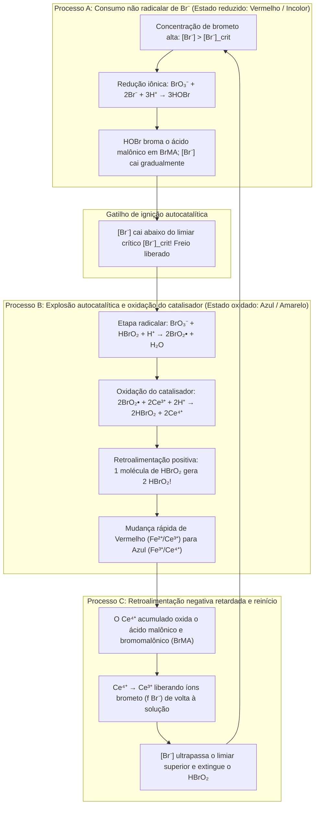
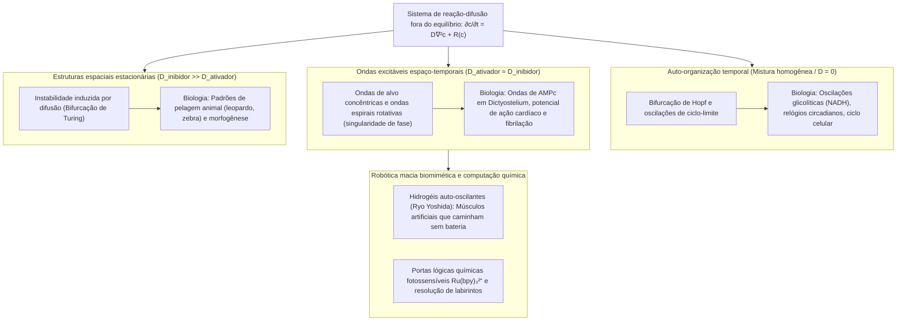

## 1. Introdução: E se o leite derramado no café começasse a pulsar sozinho?

Imagine despejar leite frio em uma xícara de café preto quente e mexer com uma colher. Os redemoinhos escuros e claros se misturam até formar um líquido castanho uniforme. Nossa intuição cotidiana — e o pilar da física clássica conhecido como a <strong>Segunda Lei da Termodinâmica</strong> — nos diz que esse processo tem sentido único. Uma vez misturado, o café jamais voltará espontaneamente a ficar preto puro, depois branco um minuto depois, oscilando como um relógio.

No entanto, na físico-química existe uma reação que desafia essa intuição de maneira espetacular: a <strong>reação de Belousov-Zhabotinsky (reação BZ)</strong>. Ao misturar alguns reagentes aquosos em um béquer, a solução <strong>oscila espontaneamente dezenas de vezes entre cores contrastantes com precisão metronômica</strong>; quando espalhada em uma camada fina sem agitação em uma placa de Petri, ela gera sozinha <strong>anéis concêntricos em expansão (padrões de alvo) e ondas espirais de Arquimedes em rotação</strong>.

### 1951: Uma descoberta «herética» rejeitada pela ciência soviética

A história começa em Moscou, em 1951. O químico e biofísico soviético <strong>Boris Pavlovich Belousov (1893–1970)</strong> procurava um análogo inorgânico do <strong>ciclo do ácido cítrico (ciclo de Krebs)</strong>. Ele dissolveu <strong>bromato de potássio ($\text{KBrO}_3$)</strong> como oxidante, <strong>ácido cítrico</strong> como substrato orgânico e <strong>sulfato de cério ($\text{Ce}^{4+}/\text{Ce}^{3+}$)</strong> como catalisador redox em ácido sulfúrico diluído. Em vez de mudar monotonamente do amarelo ($\text{Ce}^{4+}$) para o incolor ($\text{Ce}^{3+}$), a solução oscilou periodicamente entre <strong>amarelo e incolor</strong> dezenas de vezes durante mais de uma hora!

Quando Belousov submeteu seus manuscritos em 1951 e 1957 às principais revistas soviéticas de química, eles foram <strong>sumariamente rejeitados</strong>:

> «A alegada oscilação periódica de uma reação química homogênea para frente e para trás além do seu ponto de equilíbrio <strong>viola diretamente a Segunda Lei da Termodinâmica</strong>. O que o autor observou deve ser um artefato experimental causado por agitação deficiente, poeira ou bolhas de gás.»

Profundamente magoado aos 64 anos, Belousov publicou apenas uma nota de duas páginas em 1958 em um obscuro boletim de medicina de radiação e abandonou o tema.

### 1961: A reabilitação por Anatol Zhabotinsky e a pulsação vermelho-azul

Em 1961, o professor Simon Shnoll entregou a receita ao jovem pós-graduando <strong>Anatol Markovich Zhabotinsky (1938–2008)</strong> na Universidade Estadual de Moscou. Zhabotinsky substituiu o ácido cítrico pelo <strong>ácido malônico ($\text{CH}_2(\text{COOH})_2$)</strong> e introduziu o indicador redox <strong>ferroína ($[\text{Fe}(\text{phen})_3]^{2+}/[\text{Fe}(\text{phen})_3]^{3+}$)</strong>, fazendo a solução pulsar dramaticamente entre o <strong>vermelho-tijolo ($[\text{Fe}(\text{phen})_3]^{2+}$ reduzido) e o azul-celeste ($[\text{Fe}(\text{phen})_3]^{3+}$ oxidado)</strong>. Em 1980, Belousov (postumamente) e Zhabotinsky receberam o prestigioso <strong>Prêmio Lênin</strong>.

---

## 2. Resolvendo o paradoxo termodinâmico: Por que a reação BZ não viola a Segunda Lei

### Queda monótona da energia livre de Gibbs e relações de Onsager perto do equilíbrio

Em um sistema fechado a temperatura $T$ e pressão $P$ constantes, a Segunda Lei exige uma taxa de produção de entropia interna não negativa, $\sigma_S \equiv \frac{d_i S}{dt} \ge 0$, de modo que a energia livre de Gibbs $G = H - TS$ obedece a:

$$\frac{dG}{dt} = -T \sigma_S = -\sum_{\rho} A_{\rho} v_{\rho} \le 0$$

onde $v_{\rho}$ é a velocidade da reação $\rho$ e $A_{\rho} \equiv -\sum_i \nu_{i\rho} \mu_i = -\left(\frac{\partial G}{\partial \xi_{\rho}}\right)_{T,P}$ é a afinidade química.

No <strong>regime linear próximo do equilíbrio</strong> ($|A_{\rho}| \ll RT$), a reversibilidade microscópica impõe o <strong>princípio do balanço detalhado</strong> e as <strong>relações de reciprocidade de Onsager</strong> (Lars Onsager, Prêmio Nobel 1968), tornando a matriz de transporte simétrica ($L_{\alpha\beta} = L_{\beta\alpha}$). Assim, a matriz jacobiana $\mathbf{J}_{\text{eq}}$ possui apenas <strong>autovalores reais e não positivos ($\lambda_k \in \mathbb{R}, \lambda_k \le 0, \text{Im}(\lambda_k) = 0$)</strong>. Perto do equilíbrio, até mesmo oscilações amortecidas são termodinamicamente proibidas!

### Longe do equilíbrio: Quebra de simetria e estruturas dissipativas de Prigogine

A solução do enigma é que <strong>a reação BZ não oscila em torno do equilíbrio termodinâmico; ela opera longe do equilíbrio ($A_{\rho} \gg RT$) no regime fortemente não linear!</strong>

Longe do equilíbrio, a retroalimentação autocatalítica quebra a simetria de Onsager e a matriz jacobiana $\mathbf{J}(\mathbf{c}^*)$ pode admitir <strong>autovalores complexos conjugados $\lambda_{\pm} = \mu \pm i\omega$ ($\omega \neq 0$)</strong>. O físico-químico belga <strong>Ilya Prigogine (Prêmio Nobel 1977)</strong> mostrou que longe do equilíbrio a dissipação irreversível ($\sigma_S > 0$) torna-se o motor da auto-organização espaço-temporal, gerando <strong>estruturas dissipativas</strong>:
1. <strong>Em reator aberto (CSTR)</strong>: O fluxo contínuo de reagentes frescos compensa a produção interna de entropia ($dS = d_e S + d_i S = 0$), mantendo oscilações perpétuas.
2. <strong>Em béquer fechado (descida em degraus de $G(t)$)</strong>: Os <strong>reagentes principais ($\text{BrO}_3^-$ e ácido malônico, $\sim 10^{-1}\text{ M}$)</strong> caem monotonamente rumo aos produtos ($\frac{dG}{dt} \le 0$). Apenas os <strong>intermediários em traços ($\text{HBrO}_2, \text{Br}^-, \text{Ce}^{4+}$, $\sim 10^{-7}\text{ a }10^{-4}\text{ M}$)</strong> descrevem ciclos fechados, exatamente como uma <strong>roda d'água em uma cachoeira</strong> que gira centenas de vezes enquanto a água corre apenas para baixo.

| Regime termodinâmico | Equilíbrio termodinâmico | Não equilíbrio linear (Perto do equilíbrio) | Não equilíbrio não linear (Longe do equilíbrio / BZ) |
| :--- | :--- | :--- | :--- |
| <strong>Afinidade química $A_{\rho}$</strong> | $A_{\rho} = 0$ (Balanço detalhado) | $\|A_{\rho}\| \ll RT$ (Resposta linear) | $A_{\rho} \gg RT$ (Irreversível, fortemente não linear) |
| <strong>Produção de entropia $\sigma_S$</strong> | $\sigma_S = 0$ (Sem dissipação) | $\sigma_S > 0$ (Produção mínima de entropia) | $\sigma_S \gg 0$ (A dissipação sustenta a ordem dinâmica) |
| <strong>Simetria de Onsager</strong> | Fluxos $J_{\alpha} = 0$ | $L_{\alpha\beta} = L_{\beta\alpha}$ (Matriz simétrica) | Simetria quebrada ($\mathbf{J}$ não simétrica) |
| <strong>Autovalores do Jacobiano $\mathbf{J}$</strong> | — | Reais e negativos ($\text{Im}(\lambda_k)=0$) | Complexos conjugados $\lambda = \mu \pm i\omega$ ($\mu > 0$ possível) |
| <strong>Comportamento espaço-temporal</strong> | Estado homogêneo e estático | Relaxação exponencial monótona | <strong>Ciclos-limite, ondas espirais, padrões de Turing</strong> |

---

## 3. O mecanismo FKN (1972): Três processos acoplados e o gatilho autocatalítico

Em 1972, <strong>Richard J. Field</strong>, <strong>Endre Körös</strong> e <strong>Richard M. Noyes</strong> desvendaram o <strong>mecanismo FKN</strong> de 18 etapas para a oxidação e bromação do ácido malônico pelo bromato:

$$2\text{BrO}_3^- + 3\text{CH}_2(\text{COOH})_2 + 2\text{H}^+ \longrightarrow 2\text{BrCH}(\text{COOH})_2 + 3\text{CO}_2 + 4\text{H}_2\text{O}$$

O ciclo alterna entre os Processos A, B e C através da disputa entre o <strong>ativador ácido bromoso ($\text{HBrO}_2$)</strong> e o <strong>inibidor íon brometo ($\text{Br}^-$)</strong>:

1. <strong>Processo A (O freio de brometo)</strong>: Enquanto $[\text{Br}^-] > [\text{Br}^-]_{\text{crit}}$, o $\text{Br}^-$ consome imediatamente o $\text{HBrO}_2$ via $\text{HBrO}_2 + \text{Br}^- + \text{H}^+ \xrightarrow{k_2} 2\text{HOBr}$ e forma ácido bromomalônico ($\text{BrMA}$), mantendo o catalisador reduzido (vermelho).
2. <strong>Processo B (Explosão autocatalítica)</strong>: Quando $[\text{Br}^-] < [\text{Br}^-]_{\text{crit}} = \frac{k_5}{k_2}[\text{BrO}_3^-] \approx 5 \times 10^{-7}\text{ M}$, dispara a cadeia radicalar via $\text{BrO}_2^\bullet$:
   $$\text{BrO}_3^- + \mathbf{HBrO_2} + 3\text{H}^+ + 2\text{Ce}^{3+} \longrightarrow \mathbf{2\,\text{HBrO}_2} + 2\text{Ce}^{4+} + \text{H}_2\text{O}$$
   <strong>Cada molécula de $\text{HBrO}_2$ produz duas moléculas de $\text{HBrO}_2$!</strong> $[\text{HBrO}_2]$ cresce quatro ordens de grandeza em milissegundos, oxida o catalisador ($\text{Ce}^{3+} \to \text{Ce}^{4+}$, viragem para <strong>azul</strong>) e satura por desproporcionamento ($2\text{HBrO}_2 \xrightarrow{k_4} \text{BrO}_3^- + \text{HOBr} + \text{H}^+$).
3. <strong>Processo C (Retroalimentação negativa retardada)</strong>: O $\text{Ce}^{4+}$ acumulado oxida o ácido bromomalônico, voltando a $\text{Ce}^{3+}$ e liberando $f$ íons $\text{Br}^-$, o que apaga a autocatálise e reinicia o Processo A.

---

## 4. Teoria matemática do Oregonator: Oscilações de relaxação, bifurcação de Hopf e ciclo-limite

Em 1974, Field e Noyes reduziram o mecanismo FKN às três equações diferenciais adimensionais do <strong>Oregonator</strong> ($x \propto [\text{HBrO}_2]$, $y \propto [\text{Br}^-]$, $z \propto [\text{Ce}^{4+}]$):

$$\varepsilon \frac{dx}{d\tau} = q y - x y + x(1 - x), \qquad \varepsilon' \frac{dy}{d\tau} = -q y - x y + f z, \qquad \frac{dz}{d\tau} = x - z$$

- <strong>Separação de escalas de tempo e oscilações de relaxação</strong>: Como $\varepsilon' \sim 10^{-4} \ll \varepsilon \sim 10^{-2} \ll 1$, a aproximação quase-estacionária $y \approx \frac{f z}{x + q}$ reduz o sistema ao plano $(x, z)$, onde a nulclina de $x$, $z = \frac{x(1-x)(x+q)}{f(x-q)}$, apresenta uma <strong>geometria dobrada cúbica em S (ou N)</strong>. A trajetória desliza lentamente pelos ramos estáveis e salta horizontalmente nas dobras, gerando <strong>oscilações de relaxação</strong> em dente de serra.
- <strong>Bifurcação de Hopf e teorema de Poincaré-Bendixson</strong>: No ponto fixo $(x^*, z^*)$, tem-se $\det(\mathbf{J}) > 0$. Quando o fator estequiométrico $f$ está na janela oscilatória ($0{,}5 \lesssim f \lesssim 1 + \sqrt{2} \approx 2{,}414$), o ponto fixo situa-se no ramo médio instável com $\text{Tr}(\mathbf{J}) > 0$. Ao cruzar o limiar crítico ocorre uma <strong>bifurcação de Andronov-Hopf</strong>, e o <strong>teorema de Poincaré-Bendixson</strong> garante a convergência para um <strong>ciclo-limite</strong> globalmente atrativo.

---

## 5. Ondas químicas no espaço sem agitação: EDP de reação-difusão, padrões de alvo e ondas espirais

Em uma placa de Petri sem agitação, a cinética local $\mathbf{R}(\mathbf{c})$ acopla-se à difusão de Fick formando o sistema de <strong>equações diferenciais parciais (EDP) de reação-difusão</strong>:

$$\frac{\partial \mathbf{c}(\mathbf{r}, t)}{\partial t} = \mathbf{D} \nabla^2 \mathbf{c}(\mathbf{r}, t) + \mathbf{R}\bigl(\mathbf{c}(\mathbf{r}, t)\bigr)$$

1. <strong>Meio excitável e fórmula de Luther</strong>: As frentes de onda propagam-se sem atenuação com velocidade constante dada pela <strong>fórmula de Luther (1906)</strong>:
   $$v_0 = 2 \sqrt{D_X \, k_{\text{auto}}} = 2 \sqrt{D_X \, k_5 [\text{BrO}_3^-][\text{H}^+]} \approx 5\text{–}10\text{ mm/min}$$
2. <strong>Aniquilação mútua e singularidade de fase das ondas espirais</strong>: Logo atrás da frente azul existe uma <strong>cauda refratária</strong> rica em $\text{Br}^-$. Por isso, <strong>duas ondas químicas que colidem frontalmente aniquilam-se mutuamente por completo!</strong> Se um anel concêntrico (padrão de alvo) for rompido, a ponta livre enrola-se em torno de sua própria cauda refratária formando uma <strong>onda espiral de Arquimedes</strong> que gira em torno de uma <strong>singularidade de fase topológica</strong> ($\oint_C \nabla \phi \cdot d\mathbf{l} = \pm 2\pi n$), obedecendo à relação eikonal de curvatura $v_n = v_0 - D\kappa$.

---

## 6. Dos sistemas vivos aos materiais inteligentes: Padrões de Turing, fibrilação cardíaca e hidrogéis autônomos

- <strong>Morfogênese de Alan Turing (1952)</strong>: Quando o inibidor se difunde muito mais rápido que o ativador ($D_v \gg D_u$), surgem padrões estacionários de manchas e listras (<strong>padrões de Turing</strong>), comprovados em microemulsões BZ-AOT.
- <strong>Fibrilação ventricular cardíaca</strong>: O miocárdio é um meio excitável elétrico. A ruptura de uma frente elétrica em tecido isquêmico gera <strong>ondas espirais (ondas em rolo 3D)</strong> cuja fragmentação caótica causa a <strong>fibrilação ventricular</strong> letal. O choque de um <strong>desfibrilador (DEA)</strong> coloca todo o coração no estado refratário simultaneamente para extinguir as singularidades de fase.
- <strong>Hidrogéis auto-oscilantes (Ryo Yoshida)</strong>: Ligando covalentemente o catalisador $\text{Ru(bpy)}_3^{2+}$ a uma rede polimérica termorresponsiva (PNIPAAm), obtêm-se <strong>géis biomiméticos autônomos</strong> que convertem a oscilação química em contração peristáltica e caminham como uma lagarta sem baterias.
