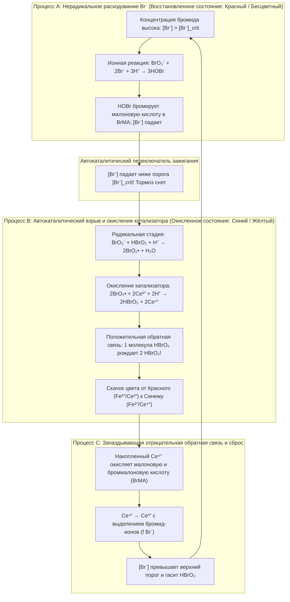
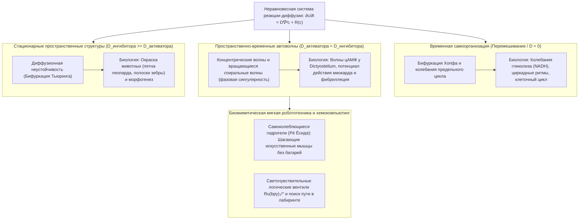

## 1. Введение: Что, если молоко, налитое в кофе, начнёт пульсировать само по себе?

Представьте, что вы наливаете холодное молоко в чашку горячего чёрного кофе и размешиваете ложкой. Тёмные и светлые вихри сливаются в однородную бежевую жидкость. Повседневная интуиция и фундамент классической физики — <strong>Второе начало термодинамики</strong> — говорят нам, что этот процесс строго необратим. Однажды перемешанный кофе никогда сам по себе не станет снова угольно-чёрным, а через минуту — белоснежным, продолжая тикать, как маятник часов.

Однако в физической химии существует реакция, которая эффектно опровергает эту бытовую интуицию: <strong>реакция Белоусова — Жаботинского (реакция БЖ)</strong>. При смешивании нескольких прозрачных водных реагентов в стакане раствор <strong>спонтанно и с точностью метронома десятки раз меняет цвет туда и обратно</strong>; а если налить его тонким неперемешиваемым слоем в чашку Петри, он сам по себе порождает <strong>расходящиеся концентрические кольца (пейсмейкеры) и вращающиеся архимедовы спиральные волны</strong>.

### 1951 год: «Еретическое» открытие, отвергнутое советской наукой

История началась в 1951 году в Москве. Советский химик и биофизик <strong>Борис Павлович Белоусов (1893–1970)</strong>, работавший в лаборатории биофизики Минздрава СССР, искал неорганический аналог биологического <strong>цикла трикарбоновых кислот (цикла Кребса)</strong>. Он растворил в разбавленной серной кислоте <strong>бромат калия ($\text{KBrO}_3$)</strong> как окислитель, <strong>лимонную кислоту</strong> как органический субстрат и <strong>сульфат церия ($\text{Ce}^{4+}/\text{Ce}^{3+}$)</strong> как окислительно-восстановительный катализатор. Вместо монотонного перехода от жёлтого ($\text{Ce}^{4+}$) к бесцветному ($\text{Ce}^{3+}$) раствор Белоусова более часа периодически пульсировал между <strong>жёлтым и бесцветным состояниями</strong>!

Когда Белоусов в 1951 и 1957 годах направил рукописи в ведущие советские химические журналы, они были <strong>категорически отвергнуты</strong>. Вердикт рецензентов гласил:

> «Утверждение о периодических колебаниях гомогенной химической реакции туда и обратно через точку равновесия <strong>прямо противоречит Второму началу термодинамики</strong>. Наблюдения автора — это артефакт плохого перемешивания, пыли или пузырьков газа».

Глубоко оскорблённый 64-летний учёный опубликовал в 1958 году лишь двухстраничный реферат в малоизвестном «Сборнике рефератов по радиационной медицине» и навсегда оставил эту тему.

### 1961 год: Реабилитация Анатолием Жаботинским и красно-синее биение

В 1961 году профессор МГУ Симон Эльевич Шноль передал рецепт молодому аспиранту <strong>Анатолию Марковичу Жаботинскому (1938–2008)</strong>. Жаботинский заменил лимонную кислоту на <strong>малоновую кислоту ($\text{CH}_2(\text{COOH})_2$)</strong> и ввёл редокс-индикатор <strong>ферроин ($[\text{Fe}(\text{phen})_3]^{2+}/[\text{Fe}(\text{phen})_3]^{3+}$)</strong>, благодаря чему раствор стал ярко пульсировать между <strong>кирпично-красным ($[\text{Fe}(\text{phen})_3]^{2+}$) и небесно-голубым ($[\text{Fe}(\text{phen})_3]^{3+}$)</strong> цветами. В 1980 году Белоусову (посмертно), Жаботинскому, Заикину, Кринскому и Иваницкому была присуждена <strong>Ленинская премия</strong>.

---

## 2. Разрешение термодинамического парадокса: почему реакция БЖ не нарушает Второе начало

### Монотонное убывание энергии Гиббса и соотношения Онсагера вблизи равновесия

В закрытой системе при постоянных температуре $T$ и давлении $P$ Второе начало требует неотрицательного производства внутренней энтропии $\sigma_S \equiv \frac{d_i S}{dt} \ge 0$, поэтому энергия Гиббса $G = H - TS$ убывает монотонно:

$$\frac{dG}{dt} = -T \sigma_S = -\sum_{\rho} A_{\rho} v_{\rho} \le 0$$

где $v_{\rho}$ — скорость реакции $\rho$, а $A_{\rho} \equiv -\sum_i \nu_{i\rho} \mu_i = -\left(\frac{\partial G}{\partial \xi_{\rho}}\right)_{T,P}$ — химическое сродство Де Дондера.

В <strong>линейной области вблизи равновесия</strong> ($|A_{\rho}| \ll RT$) микроскопическая обратимость во времени требует <strong>принципа детального равновесия</strong> и <strong>соотношений взаимности Онсагера</strong> (Ларс Онсагер, Нобелевская премия 1968 г.), в силу которых матрица кинетических коэффициентов строго симметрична ($L_{\alpha\beta} = L_{\beta\alpha}$). Поэтому матрица Якоби $\mathbf{J}_{\text{eq}}$ подобна вещественной симметричной отрицательно полуопределённой матрице, и все её собственные значения <strong>чисто вещественны и неположительны ($\lambda_k \in \mathbb{R}, \lambda_k \le 0, \text{Im}(\lambda_k) = 0$)</strong>. Вблизи термодинамического равновесия невозможны даже затухающие колебания!

### Вдали от равновесия: нарушение симметрии и диссипативные структуры Пригожина

Разгадка парадокса состоит в том, что <strong>реакция БЖ колеблется не вокруг точки термодинамического равновесия, а протекает вдали от равновесия ($A_{\rho} \gg RT$) в сильно нелинейном режиме!</strong>

Вдали от равновесия автокаталитическая обратная связь нарушает симметрию Онсагера, матрица Якоби $\mathbf{J}(\mathbf{c}^*)$ становится несимметричной и может иметь <strong>комплексно-сопряжённые собственные значения $\lambda_{\pm} = \mu \pm i\omega$ ($\omega \neq 0$)</strong>. Бельгийский физикохимик <strong>Илья Пригожин (Нобелевская премия 1977 г.)</strong> показал, что вдали от равновесия диссипация энергии ($\sigma_S > 0$) становится источником пространственно-временной самоорганизации — <strong>диссипативных структур</strong>:
1. <strong>В открытом проточном реакторе (CSTR)</strong>: Приток свежих реагентов компенсирует производство энтропии ($dS = d_e S + d_i S = 0$), поддерживая незатухающие колебания бесконечно долго.
2. <strong>В закрытом стакане (ступенчатый спуск $G(t)$)</strong>: Высококонцентрированные <strong>основные реагенты ($\text{BrO}_3^-$ и малоновая кислота, $\sim 10^{-1}\text{ M}$)</strong> расходуются строго монотонно ($\frac{dG}{dt} \le 0$). Замкнутые петли в пространстве концентраций описывают только <strong>следовые интермедиаты ($\text{HBrO}_2, \text{Br}^-, \text{Ce}^{4+}$, $\sim 10^{-7}\text{–}10^{-4}\text{ M}$)</strong> — в точности как <strong>водяное колесо в водопаде</strong>, которое вращается сотни раз, пока вода течёт строго сверху вниз.

| Термодинамический режим | Термодинамическое равновесие | Линейный неравновесный (вблизи равновесия) | Нелинейный неравновесный (вдали от равновесия / БЖ) |
| :--- | :--- | :--- | :--- |
| <strong>Химическое сродство $A_{\rho}$</strong> | $A_{\rho} = 0$ (Детальное равновесие) | $\|A_{\rho}\| \ll RT$ (Линейный отклик) | $A_{\rho} \gg RT$ (Необратимый нелинейный режим) |
| <strong>Производство энтропии $\sigma_S$</strong> | $\sigma_S = 0$ (Диссипация отсутствует) | $\sigma_S > 0$ (Теорема минимума $\sigma_S$) | $\sigma_S \gg 0$ (Диссипация рождает динамический порядок) |
| <strong>Симметрия Онсагера</strong> | Потоки $J_{\alpha} = 0$ | $L_{\alpha\beta} = L_{\beta\alpha}$ (Симметричная матрица) | Нарушение симметрии ($\mathbf{J}$ несимметрична) |
| <strong>Собственные значения $\mathbf{J}$</strong> | — | Вещественные и отрицательные ($\text{Im}(\lambda_k)=0$) | Комплексно-сопряжённые $\lambda = \mu \pm i\omega$ ($\mu > 0$ возможно) |
| <strong>Поведение системы</strong> | Однородное статическое состояние | Монотонная экспоненциальная релаксация | <strong>Предельные циклы, спиральные волны, структуры Тьюринга</strong> |

---

## 3. Механизм FKN (1972): три сопряжённых процесса и автокаталитический переключатель

В 1972 году <strong>Ричард Филд</strong>, <strong>Эндре Кёрёш</strong> и <strong>Ричард Нойес</strong> расшифровали 18-стадийный <strong>механизм FKN</strong> окисления и бромирования малоновой кислоты броматом:

$$2\text{BrO}_3^- + 3\text{CH}_2(\text{COOH})_2 + 2\text{H}^+ \longrightarrow 2\text{BrCH}(\text{COOH})_2 + 3\text{CO}_2 + 4\text{H}_2\text{O}$$

Цикл переключается между процессами A, B и C благодаря конкуренции между <strong>активатором — бромистой кислотой ($\text{HBrO}_2$)</strong> и <strong>ингибитором — бромид-ионом ($\text{Br}^-$)</strong>:

1. <strong>Процесс A (Бромидный тормоз)</strong>: Пока $[\text{Br}^-] > [\text{Br}^-]_{\text{crit}}$, ионы $\text{Br}^-$ мгновенно перехватывают $\text{HBrO}_2$ по реакции $\text{HBrO}_2 + \text{Br}^- + \text{H}^+ \xrightarrow{k_2} 2\text{HOBr}$ с образованием броммалоновой кислоты ($\text{BrMA}$). Катализатор остаётся восстановленным (красным).
2. <strong>Процесс B (Автокаталитический взрыв)</strong>: Как только $[\text{Br}^-] < [\text{Br}^-]_{\text{crit}} = \frac{k_5}{k_2}[\text{BrO}_3^-] \approx 5 \times 10^{-7}\text{ M}$, запускается радикальная цепь через $\text{BrO}_2^\bullet$:
   $$\text{BrO}_3^- + \mathbf{HBrO_2} + 3\text{H}^+ + 2\text{Ce}^{3+} \longrightarrow \mathbf{2\,\text{HBrO}_2} + 2\text{Ce}^{4+} + \text{H}_2\text{O}$$
   <strong>Каждая молекула $\text{HBrO}_2$ порождает две молекулы $\text{HBrO}_2$!</strong> Концентрация $[\text{HBrO}_2]$ взлетает на четыре порядка, окисляя катализатор ($\text{Ce}^{3+} \to \text{Ce}^{4+}$, переход в <strong>синий</strong> цвет), и ограничивается диспропорционированием $2\text{HBrO}_2 \xrightarrow{k_4} \text{BrO}_3^- + \text{HOBr} + \text{H}^+$.
3. <strong>Процесс C (Запаздывающая отрицательная обратная связь)</strong>: Накопленный $\text{Ce}^{4+}$ окисляет броммалоновую кислоту, восстанавливаясь до $\text{Ce}^{3+}$ и высвобождая $f$ ионов $\text{Br}^-$, что гасит автокатализ и возвращает систему к Процессу A.

---

## 4. Математическая теория орегонатора: релаксационные колебания, бифуркация Хопфа и предельный цикл

В 1974 году Филд и Нойес свели механизм FKN к системе из трёх безразмерных ОДУ <strong>орегонатора (Oregonator)</strong> для $x \propto [\text{HBrO}_2]$, $y \propto [\text{Br}^-]$, $z \propto [\text{Ce}^{4+}]$:

$$\varepsilon \frac{dx}{d\tau} = q y - x y + x(1 - x), \qquad \varepsilon' \frac{dy}{d\tau} = -q y - x y + f z, \qquad \frac{dz}{d\tau} = x - z$$

- <strong>Разделение времён и релаксационные колебания</strong>: Поскольку $\varepsilon' \sim 10^{-4} \ll \varepsilon \sim 10^{-2} \ll 1$, квазистационарное приближение $y \approx \frac{f z}{x + q}$ сводит систему к плоскости $(x, z)$, где нуль-изоклина $z = \frac{x(1-x)(x+q)}{f(x-q)}$ имеет <strong>кубическую S-образную (или N-образную) складчатую форму</strong>. Траектория медленно ползёт вдоль устойчивых ветвей и скачком перепрыгивает между ними в точках срыва, порождая пилообразные <strong>релаксационные колебания</strong>.
- <strong>Бифуркация Хопфа и теорема Пуанкаре — Бендиксона</strong>: В стационарной точке $(x^*, z^*)$ всегда $\det(\mathbf{J}) > 0$. Когда стехиометрический фактор $f$ лежит в окне колебаний ($0{,}5 \lesssim f \lesssim 1 + \sqrt{2} \approx 2{,}414$), точка $(x^*, z^*)$ попадает на неустойчивую среднюю ветвь с $\text{Tr}(\mathbf{J}) > 0$. Переход собственных значений $\lambda_{\pm} = \mu(f) \pm i\omega(f)$ через мнимую ось порождает <strong>бифуркацию Андронова — Хопфа</strong>, а <strong>теорема Пуанкаре — Бендиксона</strong> гарантирует существование глобально притягивающего <strong>предельного цикла</strong>.

---

## 5. Химические волны в неперемешиваемой среде: УРЧП реакции-диффузии и спиральные волны

В тонком слое раствора БЖ в чашке Петри локальная кинетика $\mathbf{R}(\mathbf{c})$ объединяется со вторым законом диффузии Фика в систему <strong>уравнений в частных производных (УРЧП) реакции-диффузии</strong>:

$$\frac{\partial \mathbf{c}(\mathbf{r}, t)}{\partial t} = \mathbf{D} \nabla^2 \mathbf{c}(\mathbf{r}, t) + \mathbf{R}\bigl(\mathbf{c}(\mathbf{r}, t)\bigr)$$

1. <strong>Возбудимая среда и формула Лютера</strong>: Автоволны распространяются без затухания с постоянной скоростью, определяемой <strong>формулой Лютера (1906)</strong>:
   $$v_0 = 2 \sqrt{D_X \, k_{\text{auto}}} = 2 \sqrt{D_X \, k_5 [\text{BrO}_3^-][\text{H}^+]} \approx 5\text{–}10\text{ мм/мин}$$
2. <strong>Взаимная аннигиляция и фазовая сингулярность спиральных волн</strong>: Сразу за синим фронтом волны тянется невозбудимый <strong>рефрактерный хвост</strong> с высокой концентрацией $\text{Br}^-$. Поэтому <strong>при лобовом столкновении две химические автоволны полностью гасят (аннигилируют) друг друга!</strong> Если разорвать кольцевой фронт волны стеклянной палочкой, свободный конец закручивается вокруг собственного рефрактерного хвоста в самоподдерживающуюся <strong>архимедову спиральную волну</strong> вокруг топологической <strong>фазовой сингулярности</strong> ($\oint_C \nabla \phi \cdot d\mathbf{l} = \pm 2\pi n$), подчиняясь уравнению эйконала $v_n = v_0 - D\kappa$.

---

## 6. От живых систем к умным материалам: структуры Тьюринга, фибрилляция сердца и самоходные гели

- <strong>Морфогенез Алана Тьюринга (1952)</strong>: Когда ингибитор диффундирует намного быстрее активатора ($D_v \gg D_u$), возникают стационарные пятна и полосы (<strong>структуры Тьюринга</strong>), экспериментально полученные в микроэмульсиях БЖ-АОТ.
- <strong>Фибрилляция желудочков сердца</strong>: Сердечная мышца (миокард) — это электрически возбудимая среда. Разрыв фронта электрической волны на ишемическом участке порождает вращающиеся <strong>спиральные волны (3D-скролл-волны)</strong>, распад которых ведёт к смертельной <strong>фибрилляции желудочков</strong>. Разряд <strong>дефибриллятора (АНД)</strong> одновременно переводит весь миокард в рефрактерное состояние, уничтожая фазовые сингулярности.
- <strong>Самоколеблющиеся гидрогели (Рё Ёсида)</strong>: Ковалентное встраивание катализатора $\text{Ru(bpy)}_3^{2+}$ в термочувствительную полимерную сетку (PNIPAAm) создаёт <strong>самоходные гидрогели</strong>, которые преобразуют редокс-колебания БЖ в перистальтические сокращения и ползут подобно гусенице без внешних источников тока.
