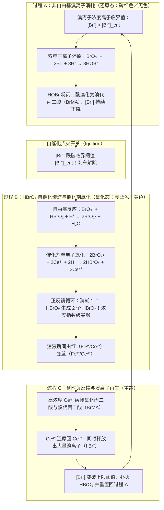
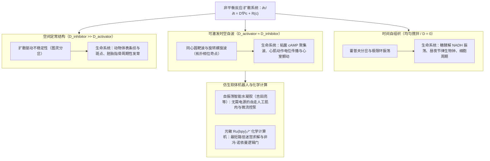

## 1. 引言：如果倒入咖啡的牛奶开始“自己脉动”？——1951年被苏联学界扼杀的异端发现

设想你将冷牛奶倒入热黑咖啡并用勺子搅拌均匀。黑与白的液体交融成均匀的浅褐色，从此静止不动。这是日常生活与经典物理学<strong>热力学第二定律（熵增原理）</strong>告诉我们的常识：自发混合与化学反应总是单向地奔向热力学平衡态。如果一杯已经混合均匀的拿铁咖啡突然自己变回纯黑，一分钟后又变成纯白，如此周而复始地像时钟一样脉动，任何人都会以为这是魔术。

然而在物理化学中，确实存在这样一种颠覆直觉的反应——<strong>别洛乌索夫-扎鲍廷斯基反应（Belousov-Zhabotinsky reaction，简称 BZ 反应）</strong>。

### 1951年：鲍里斯·别洛乌索夫的发现在审稿人面前碰壁

1951年，苏联卫生部生物物理研究所的化学家<strong>鲍里斯·帕夫洛维奇·别洛乌索夫（Boris Pavlovich Belousov, 1893–1970）</strong>正在寻找生物体内<strong>三羧酸循环（TCA循环／克雷布斯循环）</strong>的无机模拟体系。他将作为氧化剂的<strong>溴酸钾（$\text{KBrO}_3$）</strong>、作为有机底物的<strong>柠檬酸</strong>，以及作为氧化还原催化剂的<strong>硫酸铈（$\text{Ce}^{4+}/\text{Ce}^{3+}$）</strong>溶解在稀硫酸中。四价铈离子（$\text{Ce}^{4+}$）呈黄色，还原为三价铈离子（$\text{Ce}^{3+}$）后则无色透明。

按照当时的化学常识，溶液应当单调地从黄色变为无色并结束反应。然而别洛乌索夫震惊地看到：溶液从黄色变为无色后，过了几十秒竟然突然重新变回鲜艳的黄色，随后再次褪为无色！这种<strong>“黄色 $\leftrightarrow$ 无色”的周期性化学振荡</strong>能够以惊人的规律性持续数十个周期；如果不加搅拌，试管中还会出现向上或向下匀速传播的黄色化学波带。

别洛乌索夫于1951年满怀喜悦地将论文投给苏联权威化学期刊，却遭到了冷酷的<strong>拒稿</strong>。审稿人和主编断言：

> “在均匀溶液中，化学反应不可能越过热力学平衡点来回摆动，这<strong>直接违反了热力学第二定律</strong>。作者观察到的所谓振荡，必定是搅拌不均、杂质污染或气泡成核导致的低级实验失误。”

别洛乌索夫又花了六年时间补充动力学数据和照片，于1957年再次投稿，依然遭到百般刁难。深感屈辱的别洛乌索夫撤回了稿件，仅在1958年的一份内部出版物《辐射医学文摘汇编》上发表了一页半的简短摘要与实验配方，从此彻底离开了这一领域。

### 1961年：阿纳托尔·扎鲍廷斯基的复兴与“红蓝脉动”

1961年，莫斯科大学生物物理学教授西蒙·什诺尔（Simon Shnoll）鼓励年轻的研究生<strong>阿纳托尔·扎鲍廷斯基（Anatol Zhabotinsky, 1938–1908）</strong>去探究这份在莫斯科实验室口耳相传的“神秘配方”。扎鲍廷斯基找到了别洛乌索夫1958年的短文，不仅完美复现了实验，还做出了两项关键改进：
1. 用结构更简单、副反应更少的<strong>丙二酸（$\text{CH}_2(\text{COOH})_2$）</strong>替代柠檬酸；
2. 引入铁邻菲啰啉络合物氧化还原指示剂——<strong>铁灵（Ferroin, $[\text{Fe}(\text{phen})_3]^{2+}/[\text{Fe}(\text{phen})_3]^{3+}$）</strong>。

由此，溶液在<strong>砖红色（还原态 $[\text{Fe}(\text{phen})_3]^{2+}$）与亮蓝色（氧化态 $[\text{Fe}(\text{phen})_3]^{3+}$）</strong>之间展现出极其震撼的周期性交替。扎鲍廷斯基于1964年发表成果并高度致敬了别洛乌索夫。1980年，苏联政府向别洛乌索夫（追授）与扎鲍廷斯基等人颁发了最高科学荣誉——<strong>列宁奖</strong>。

---

## 2. 严格解开热力学悖论：为什么 BZ 反应不违反热力学第二定律？

为什么20世纪50年代的化学家坚信化学振荡不可能存在？解答这一问题的关键在于区分<strong>“热平衡态附近（线性非平衡区）”</strong>与<strong>“远离平衡态（非线性非平衡区）”</strong>。

### 封闭系统中的吉布斯自由能单调递减

在恒温 $T$、恒压 $P$ 的封闭反应器中，根据热力学第二定律，系统的总熵变 $dS = d_e S + d_i S$，其中内部不可逆过程产生的<strong>内熵产生</strong>必须非负（$\sigma_S \equiv \frac{d_i S}{dt} \ge 0$）。吉布斯自由能 $G = H - TS$ 的时间导数满足：

$$\frac{dG}{dt} = -T \sigma_S = -\sum_{\rho} A_{\rho} v_{\rho} \le 0$$

其中 $v_{\rho}$ 是第 $\rho$ 个反应的反应速率，$A_{\rho} \equiv -\sum_i \nu_{i\rho} \mu_i = -\left(\frac{\partial G}{\partial \xi_{\rho}}\right)_{T,P}$ 是德·唐德（De Donder）定义的<strong>化学亲和势（Chemical Affinity）</strong>。对于单一反应 $A \rightleftharpoons B$，如果浓度越过平衡点往复振荡，就意味着系统在自由能谷底冲上对面的山坡，必然出现 $\frac{dG}{dt} > 0$，这确实为热力学第二定律所禁止。

### 热平衡态附近：细致平衡原理与昂萨格倒易关系禁止螺旋衰减振荡

那么，在多组分反应网络 $\mathbf{c} = (c_1, \dots, c_n)^T$ 中，系统能否像漏斗中的小球一样，一边螺旋式旋转（阻尼振荡）一边滑向平衡点 $\mathbf{c}^{\text{eq}}$ 呢？答案依然是<strong>绝对不能</strong>！

在非常接近热平衡态的<strong>线性非平衡区（$|A_{\rho}| \ll RT$）</strong>，微观可逆性保证了<strong>细致平衡原理（Principle of Detailed Balance）</strong>成立。此时反应流 $J_{\alpha} = v_{\alpha}$ 与热力学力 $X_{\beta} = A_{\beta}/T$ 呈线性关系 $J_{\alpha} = \sum_{\beta} L_{\alpha\beta} X_{\beta}$。根据拉斯·昂萨格（Lars Onsager，1968年诺贝尔化学奖得主）证明的<strong>昂萨格倒易关系（Onsager Reciprocal Relations）</strong>，唯象系数矩阵严格对称：

$$L_{\alpha\beta} = L_{\beta\alpha}$$

同时，自由能二阶导数矩阵 $M_{ij} = \left(\frac{\partial \mu_i}{\partial c_j}\right)_{\text{eq}}$ 也是对称正定矩阵。因此，平衡点附近的线性化动力学方程 $\frac{d(\delta \mathbf{c})}{dt} = \mathbf{J}_{\text{eq}} \delta \mathbf{c}$ 的雅可比矩阵 $\mathbf{J}_{\text{eq}}$ 在正定度量下相似于实对称负定矩阵。根据线性代数基本定理，<strong>实对称矩阵的所有特征值 $\lambda_k$ 均为纯实数且小于零（$\lambda_k \in \mathbb{R}, \lambda_k < 0, \text{Im}(\lambda_k) = 0$）</strong>。由于不存在虚部 $\text{Im}(\lambda_k) \neq 0$，在热平衡点附近连阻尼振荡（$e^{i\omega t}$）都绝无可能发生！

### 远离平衡态（Far from Equilibrium）与普里高津的“耗散结构”

BZ 反应之所以能够振荡，是因为它根本不是在热平衡点附近摆动，而是运行在<strong>远离热平衡的强非线性区域（$A_{\rho} \gg RT$）</strong>！在远离平衡态时，自催化反馈打破了昂萨格对称性（$L_{\alpha\beta} \neq L_{\beta\alpha}$），定常态附近的雅可比矩阵 $\mathbf{J}$ 变为非对称矩阵，从而允许拥有<strong>共轭复特征值 $\lambda = \mu \pm i\omega$（$\omega \neq 0$）</strong>。

比利时物理化学家<strong>伊利亚·普里高津（Ilya Prigogine，1977年诺贝尔化学奖得主）</strong>将这种在远离平衡的非线性区、依靠持续耗散自由能（$\sigma_S > 0$）来维持的时空有序结构命名为<strong>“耗散结构（Dissipative Structures）”</strong>：
1. <strong>开放系统（CSTR 连续搅拌釜反应器）</strong>：不断泵入高自由能的新鲜反应物并排出产物，负熵流 $d_e S < 0$ 抵消内熵产生 $d_i S > 0$，化学振荡可以永远持续。
2. <strong>封闭烧杯中的“阶梯式自由能下降”</strong>：在封闭烧杯中，高浓度的<strong>主反应物（$\text{BrO}_3^-$ 与丙二酸，$\sim 10^{-1}\text{ M}$）</strong>始终单向地转化为最终产物（$\text{CO}_2$、溴代丙二酸），驱动总吉布斯自由能 $G(t)$ 沿着一条<strong>单调递减的阶梯曲线（Staircase Monotonic Decrease）</strong>不断下降（始终满足 $\frac{dG}{dt} \le 0$）。真正在相空间中画闭合圆圈（极限环）的，仅仅是浓度只有百万分之一到万分之一量级的<strong>微量反应中间体（$\text{HBrO}_2, \text{Br}^-, \text{Ce}^{4+}$，$\sim 10^{-7} \sim 10^{-4}\text{ M}$）</strong>——就像瀑布急流中旋转的水车，水（总自由能 $G$）永远从高处流向低处，但水车的叶片（微量中间体）却能周而复始地旋转数百圈，直到上游水库枯竭！

| 比较维度 | 热力学平衡态 (Equilibrium) | 线性非平衡区 (Near-Equilibrium) | 强非线性非平衡区／耗散结构 (Far-from-Equilibrium / BZ反应) |
| :--- | :--- | :--- | :--- |
| <strong>化学亲和势 $A_{\rho}$</strong> | $A_{\rho} = 0$（细致平衡严格成立） | $\|A_{\rho}\| \ll RT$（接近平衡线性响应） | $A_{\rho} \gg RT$（远离平衡，不可逆与自催化主导） |
| <strong>熵产生率 $\sigma_S$</strong> | $\sigma_S = 0$（无耗散） | $\sigma_S > 0$（服从最小熵产生原理） | $\sigma_S \gg 0$（高自由能散逸维持动态时空秩序） |
| <strong>昂萨格倒易关系</strong> | 净流 $J_{\alpha} = 0$ | $L_{\alpha\beta} = L_{\beta\alpha}$（严格对称） | 对称性破缺（雅可比矩阵 $\mathbf{J}$ 非对称） |
| <strong>雅可比矩阵特征值 $\lambda$</strong> | — | 纯实数且为负（$\lambda_k < 0, \text{Im}(\lambda_k)=0$） | 允许复特征值 $\lambda = \mu \pm i\omega$ 且实部 $\mu > 0$ |
| <strong>时空动力学行为</strong> | 均匀、静止的死寂状态 | 仅限单调指数衰减（绝对禁止振荡） | <strong>极限环化学振荡、靶波、螺旋波、图灵斑图</strong> |

---

## 3. FKN 机理（1972年）：三大反应过程与自催化开关

1972年，美国俄勒冈大学的<strong>理查德·菲尔德（Richard J. Field）</strong>、<strong>恩德雷·克勒什（Endre Körös）</strong>与<strong>理查德·诺伊斯（Richard M. Noyes）</strong>发表了里程碑式的研究，从80多个基元反应中提炼出18步核心反应，确立了著名的<strong>FKN 机理（Field-Körös-Noyes Mechanism）</strong>。

BZ 反应的总反应是在金属催化剂（$\text{Ce}^{3+}/\text{Ce}^{4+}$ 或铁灵）存在下，溴酸根氧化并溴化丙二酸：

$$2\text{BrO}_3^- + 3\text{CH}_2(\text{COOH})_2 + 2\text{H}^+ \longrightarrow 2\text{BrCH}(\text{COOH})_2 + 3\text{CO}_2 + 4\text{H}_2\text{O}$$

整个周期由两个核心微量物种的博弈所支配：<strong>激活剂（Activator，油门）亚溴酸 $\text{HBrO}_2$</strong> 与 <strong>抑制剂（Inhibitor，刹车）溴离子 $\text{Br}^-$</strong>，并按以下三个过程循环切换：

1. <strong>过程 A（非自由基 $\text{Br}^-$ 消耗，维持还原态）</strong>：
   当溶液中 $[\text{Br}^-] > [\text{Br}^-]_{\text{crit}}$ 时，$\text{Br}^-$ 通过快速反应 $\text{(R2)}\ \text{HBrO}_2 + \text{Br}^- + \text{H}^+ \xrightarrow{k_2} 2\text{HOBr}$ 将任何新生成的 $\text{HBrO}_2$ 瞬间清除。生成的 $\text{HOBr}$ 与丙二酸反应生成溴代丙二酸（$\text{BrMA}$）。此时催化剂保持还原态（砖红色），而刹车离子 $[\text{Br}^-]$ 不断被消耗。
2. <strong>过程 B（$\text{HBrO}_2$ 自催化爆炸与正反馈，瞬间变色）</strong>：
   当 $[\text{Br}^-]$ 降至临界浓度 $[\text{Br}^-]_{\text{crit}} = \frac{k_5}{k_2}[\text{BrO}_3^-]$（约 $5 \times 10^{-6}[\text{BrO}_3^-]$）以下时，反应 (R2) 再也压制不住 $\text{HBrO}_2$ 与 $\text{BrO}_3^-$ 的单电子自由基链式反应（通过二氧化溴自由基 $\text{BrO}_2^\bullet$ 氧化 $\text{Ce}^{3+}$）：
   $$\text{BrO}_3^- + \mathbf{HBrO_2} + 3\text{H}^+ + 2\text{Ce}^{3+} \longrightarrow \mathbf{2\,\text{HBrO}_2} + 2\text{Ce}^{4+} + \text{H}_2\text{O}$$
   <strong>每消耗 1 个 $\text{HBrO}_2$ 分子就会生成 2 个 $\text{HBrO}_2$ 分子！</strong>这种强烈的自催化正反馈使 $[\text{HBrO}_2]$ 在瞬间飙升数万倍，同时将 $\text{Ce}^{3+}$（或红色铁灵）迅速氧化为 $\text{Ce}^{4+}$（或蓝色铁灵），直到被双分子歧化反应 $2\text{HBrO}_2 \xrightarrow{k_4} \text{BrO}_3^- + \text{HOBr} + \text{H}^+$ 限制在高位平台。
3. <strong>过程 C（延时负反馈，再生 $\text{Br}^-$ 刹车）</strong>：
   过程 B 积累的高浓度氧化态催化剂 $\text{Ce}^{4+}$ 随后缓慢氧化溴代丙二酸（$\text{BrCH}(\text{COOH})_2$）：
   $$2\text{Ce}^{4+} + \text{CH}_2(\text{COOH})_2 + \text{BrCH}(\text{COOH})_2 \longrightarrow f\,\text{Br}^- + 2\text{Ce}^{3+} + \text{CO}_2\uparrow + \text{其他产物}$$
   其中 $f$ 为<strong>化学计量因子（Stoichiometric Factor）</strong>。随着 $\text{Ce}^{4+}$ 被还原为 $\text{Ce}^{3+}$，大量再生出的 $\text{Br}^-$ 重新夺回控制权，扑灭 $\text{HBrO}_2$，将系统重置回过程 A。

---

## 4. 俄勒冈振子（Oregonator）模型：弛豫振荡、霍普夫分岔与极限环

1974年，菲尔德与诺伊斯（Field & Noyes）将 FKN 机理简化为包含 5 个骨架反应、3 个动态变量的数学模型——<strong>俄勒冈振子（Oregonator）</strong>。设无量纲浓度 $x \propto [\text{HBrO}_2]$（激活剂）、$y \propto [\text{Br}^-]$（抑制剂）、$z \propto [\text{Ce}^{4+}]$（慢反馈催化剂），其无量纲常微分方程组（ODE）为：

$$\begin{aligned}
\varepsilon \frac{dx}{d\tau} &= q y - x y + x(1 - x) \\
\varepsilon' \frac{dy}{d\tau} &= -q y - x y + f z \\
\frac{dz}{d\tau} &= x - z
\end{aligned}$$

其中时间尺度参数满足 $\varepsilon' \approx 10^{-4} \ll \varepsilon \approx 10^{-2} \ll 1$，$q \approx 10^{-4}$。

- <strong>快慢动力学与弛豫振荡（Relaxation Oscillations）</strong>：
  由于 $\varepsilon' \ll \varepsilon \ll 1$，$y$ 瞬间达到准稳态 $y = \frac{f z}{x + q}$，系统约化为 $(x, z)$ 相平面上的二维快慢方程：
  $$\varepsilon \frac{dx}{d\tau} = x(1 - x) - f z \frac{x - q}{x + q}, \qquad \frac{dz}{d\tau} = x - z$$
  其 $x$-零倾线（Nullcline）呈典型的<strong>三次曲线 S 型（或 N 型）折叠形态</strong>。相点沿着稳定的左支（低 $x$ 还原态）缓慢下滑，到达下折点（膝点）时以 $\mathcal{O}(\varepsilon^{-1})$ 的极高速度水平跳跃至右支（高 $x$ 氧化态），再沿右支缓慢爬升并跳回左支。这种“缓慢积累—瞬间释放”的非线性周期运动正是范德波尔（van der Pol）提出的<strong>弛豫振荡</strong>，解释了为何 BZ 反应的波形是陡峭的锯齿状脉冲而非正弦波。
- <strong>线性稳定性分析、霍普夫分岔（Hopf Bifurcation）与庞加莱-本迪克松定理</strong>：
  对正定常态 $(x^*, z^*)$ 求雅可比矩阵 $\mathbf{J}$，其行列式 $\det(\mathbf{J}) > 0$ 恒成立。当化学计量因子 $f$ 处于振荡窗口（约 $0.5 < f < 1 + \sqrt{2} \approx 2.414$）内时，定常态落入零倾线的不稳定中支，迹 $\text{Tr}(\mathbf{J}) > 0$。当 $f$ 跨越临界值使共轭复特征值 $\lambda_{\pm} = \mu(f) \pm i\omega(f)$ 的实部 $\mu(f)$ 由负变正穿过虚轴时，系统发生<strong>安德罗诺夫-霍普夫分岔（Hopf Bifurcation）</strong>。根据二维平面上的<strong>庞加莱-本迪克松定理（Poincaré-Bendixson Theorem）</strong>，有界捕获域内唯一的不稳定不动点必然迫使所有轨道渐近收敛于一条稳定的闭合周期轨道——<strong>极限环（Limit Cycle）</strong>。在开放式 CSTR 反应器中，调节流速还会进一步引发倍周期分岔并进入确定性<strong>化学混沌（Chemical Chaos）</strong>。

---

## 5. 空间中的化学波：反应-扩散方程、靶波与螺旋波相位奇点

若停止搅拌，将含有铁灵的 BZ 溶液铺成 $1\sim 2\text{ mm}$ 厚的薄层静置在培养皿中，局部化学动力学 $\mathbf{R}(\mathbf{c})$ 与菲克分子扩散耦合，遵循<strong>反应-扩散偏微分方程（Reaction-Diffusion PDE）</strong>：

$$\frac{\partial \mathbf{c}(\mathbf{r}, t)}{\partial t} = \mathbf{D} \nabla^2 \mathbf{c}(\mathbf{r}, t) + \mathbf{R}\bigl(\mathbf{c}(\mathbf{r}, t)\bigr)$$

1. <strong>可激发介质（Excitable Medium）与路德公式（Luther's Equation）</strong>：
   局部自催化爆炸产生的 $\text{HBrO}_2$ 向邻近区域微弱扩散，即可耗尽邻近的 $\text{Br}^-$ 并触发多米诺骨牌式的链式点火。这种行波（触发波）以恒定速度传播，其波速遵循1906年罗伯特·路德导出的<strong>路德公式（FKPP 波速）</strong>：
   $$v_0 = 2 \sqrt{D_X \, k_{\text{auto}}} = 2 \sqrt{D_X \, k_5 [\text{BrO}_3^-][\text{H}^+]}$$
   （通常为数毫米每分钟）。
2. <strong>迎头碰撞湮灭（Mutual Annihilation）与螺旋波相位奇点（Phase Singularity）</strong>：
   与遵循叠加原理、碰撞后相互穿透的线性水波或声波截然不同，BZ 化学波锋面后方拖着一条高 $[\text{Ce}^{4+}]$、高 $[\text{Br}^-]$ 的<strong>不应期尾迹（Refractory Tail）</strong>。因此，<strong>两列相向传播的 BZ 化学波迎头碰撞时，无法穿透对方的不应期，会在碰撞处同归于尽（相互湮灭）！</strong>
   若用玻璃棒划断一圈正在扩张的同心圆<strong>靶波（Target Pattern）</strong>，断裂处的自由波端（Wave Tip）会向内卷曲，追逐自身的不应期尾巴而永恒旋转，形成<strong>阿基米德螺旋波（Spiral Wave）</strong>。螺旋中心是相位无定义的<strong>拓扑缺陷（相位奇点 Phase Singularity）</strong>：
   $$\oint_C \nabla \phi \cdot d\mathbf{l} = \pm 2\pi n$$
   且弯曲波锋的法向速度满足<strong>程函关系（Eikonal Relation）</strong> $v_n = v_0 - D\kappa$（$\kappa$ 为局部曲率）。

---

## 6. 从生命节律到智能材料：图灵斑图、心脏室颤与自走水凝胶

BZ 反应之所以成为非线性科学的圣杯，是因为它揭示了无机分子通往生命节律与生物形态的普适规律：

1. <strong>阿兰·图灵的形态发生理论（Turing Morphogenesis, 1952）</strong>：
   图灵预言，当慢扩散激活剂（$D_u$ 小）与快扩散抑制剂（$D_v \gg D_u$）耦合时，扩散反而会破坏均匀态，形成空间静止的周期性斑点与条纹（<strong>图灵斑图</strong>）。在微乳液体系 <strong>BZ-AOT</strong> 中，亲水离子被限制在纳米水滴内慢速扩散，而亲油的 $\text{Br}_2$ 在油相中快速扩散，科学家成功在同一 BZ 体系中实验观测到了静止六角图灵斑点、条纹与螺旋波的共存与转换。
2. <strong>糖酵解振荡、粘菌聚集与致死性心室颤动（Ventricular Fibrillation）</strong>：
   酵母细胞的糖酵解 NADH 振荡、饥饿盘基网柄菌（*Dictyostelium*）分泌环磷酸腺苷（cAMP）形成的螺旋聚集波，都与 BZ 动力学完全同构。更重要的是，人类的<strong>心肌组织就是一种电可激发介质</strong>：正常心跳对应从窦房结发出的靶波；而当心肌缺血或早搏切断电波锋面时，心肌上就会产生每秒旋转数次的<strong>三维螺旋波（Scroll Wave，导致室性心动过速）</strong>；当螺旋波失稳碎裂为无数小螺旋（时空混沌）时，心脏立即丧失泵血功能，即致死性的<strong>心室颤动（室颤）</strong>！<strong>自动体外除颤器（AED）</strong>之所以施加强电流电击，正是为了将所有心肌细胞同时强制去极化推入“不应期”，从而彻底抹除螺旋波的相位奇点，让心脏节律重启。
3. <strong>自走仿生水凝胶与非冯·诺依曼化学计算</strong>：
   东京大学的<strong>吉田亮（Ryo Yoshida）</strong>教授团队将 BZ 催化剂联吡啶钌（$\text{Ru(bpy)}_3^{2+}$）共价键合到温敏高分子水凝胶（PNIPAAm）网络中，发明了<strong>自振荡水凝胶（Self-Oscillating Gel）</strong>。无需任何电池或电路，只需浸入溴酸盐与丙二酸营养液中，钌催化剂的周期性氧化还原就会直接驱动凝胶周期性溶胀与收缩，像尺蠖或心肌一样自主爬行！结合蓝光对 $\text{Ru(bpy)}_3^{2+}$ 的光敏抑制效应，科学家还能利用 BZ 化学波在迷宫中的并行传播与碰撞湮灭，实现<strong>最短路径迷宫求解与化学逻辑门计算</strong>。

在远离热平衡的耗散洪流中，无生命的分子通过正负反馈与反应扩散学会了计时与造型——BZ 反应正是连接无机物质与生命秩序的最美桥梁。
