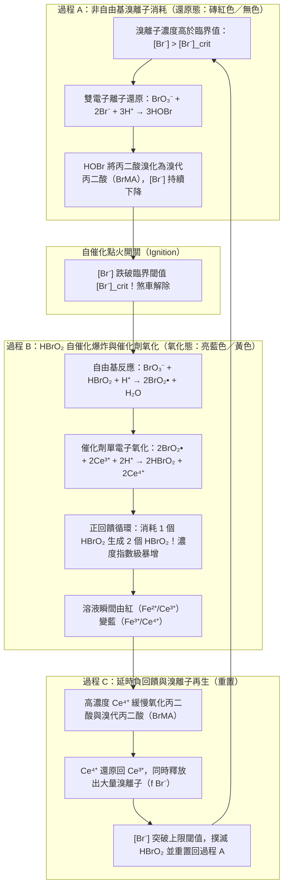
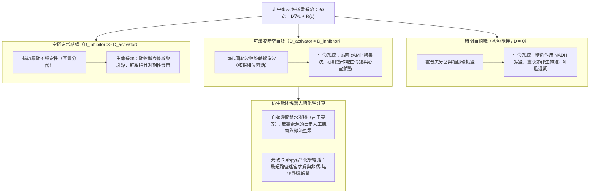

## 1. 引言：如果倒入咖啡的牛奶開始「自己脈動」？——1951年被蘇聯學界扼殺的異端發現

設想你將冷牛奶倒入熱黑咖啡並用勺子攪拌均勻。黑與白的液體交融成均勻的淺褐色，從此靜止不動。這是日常生活與古典物理學<strong>熱力學第二定律（熵增原理）</strong>告訴我們的常識：自發混合與化學反應總是單向地奔向熱力學平衡態。如果一杯已經混合均勻的拿鐵咖啡突然自己變回純黑，一分鐘後又變成純白，如此週而復始地像時鐘一樣脈動，任何人都會以為這是魔術。

然而在物理化學中，確實存在這樣一種顛覆直覺的反應——<strong>別洛烏索夫-扎鮑廷斯基反應（Belousov-Zhabotinsky reaction，簡稱 BZ 反應）</strong>。

### 1951年：鮑里斯·別洛烏索夫的發現在審稿人面前碰壁

1951年，蘇聯衛生部生物物理研究所的化學家<strong>鮑里斯·帕夫洛維奇·別洛烏索夫（Boris Pavlovich Belousov, 1893–1970）</strong>正在尋找生物體內<strong>三羧酸循環（TCA循環／克雷布斯循環）</strong>的無機模擬體系。他將作為氧化劑的<strong>溴酸鉀（$\text{KBrO}_3$）</strong>、作為有機受質的<strong>檸檬酸</strong>，以及作為氧化還原催化劑的<strong>硫酸鈰（$\text{Ce}^{4+}/\text{Ce}^{3+}$）</strong>溶解在稀硫酸中。四價鈰離子（$\text{Ce}^{4+}$）呈黃色，還原為三價鈰離子（$\text{Ce}^{3+}$）後則無色透明。

按照當時的化學常識，溶液應當單調地從黃色變為無色並結束反應。然而別洛烏索夫震驚地看到：溶液從黃色變為無色後，過了幾十秒竟然突然重新變回鮮豔的黃色，隨後再次褪為無色！這種<strong>「黃色 $\leftrightarrow$ 無色」的週期性化學振盪</strong>能夠以驚人的規律性持續數十個週期；如果不加攪拌，試管中還會出現向上或向下等速傳播的黃色化學波帶。

別洛烏索夫於1951年滿懷喜悅地將論文投給蘇聯權威化學期刊，卻遭到了冷酷的<strong>拒稿</strong>。審稿人和主編斷言：

> 「在均勻溶液中，化學反應不可能越過熱力學平衡點來回擺動，這<strong>直接違反了熱力學第二定律</strong>。作者觀察到的所謂振盪，必定是攪拌不均、雜質污染或氣泡成核導致的低級實驗失誤。」

別洛烏索夫又花了六年時間補充動力學數據和照片，於1957年再次投稿，依然遭到百般刁難。深感屈辱的別洛烏索夫撤回了稿件，僅在1958年的一份內部出版物《輻射醫學文摘彙編》上發表了一頁半的簡短摘要與實驗配方，從此徹底離開了這一領域。

### 1961年：阿納托爾·扎鮑廷斯基的復興與「紅藍脈動」

1961年，莫斯科大學生物物理學教授西蒙·什諾爾（Simon Shnoll）鼓勵年輕的研究生<strong>阿納托爾·扎鮑廷斯基（Anatol Zhabotinsky, 1938–2008）</strong>去探究這份在莫斯科實驗室口耳相傳的「神秘配方」。扎鮑廷斯基找到了別洛烏索夫1958年的短文，不僅完美重現了實驗，還做出了兩項關鍵改進：
1. 用結構更簡單、副反應更少的<strong>丙二酸（$\text{CH}_2(\text{COOH})_2$）</strong>替代檸檬酸；
2. 引入鐵鄰菲囉啉錯合物氧化還原指示劑——<strong>鐵靈（Ferroin, $[\text{Fe}(\text{phen})_3]^{2+}/[\text{Fe}(\text{phen})_3]^{3+}$）</strong>。

由此，溶液在<strong>磚紅色（還原態 $[\text{Fe}(\text{phen})_3]^{2+}$）與亮藍色（氧化態 $[\text{Fe}(\text{phen})_3]^{3+}$）</strong>之間展現出極其震撼的週期性交替。扎鮑廷斯基於1964年發表成果並高度致敬了別洛烏索夫。1980年，蘇聯政府向別洛烏索夫（追授）與扎鮑廷斯基等人頒發了最高科學榮譽——<strong>列寧獎</strong>。

---

## 2. 嚴格解開熱力學悖論：為什麼 BZ 反應不違反熱力學第二定律？

為什麼20世紀50年代的化學家堅信化學振盪不可能存在？解答這一問題的關鍵在於區分<strong>「熱平衡態附近（線性非平衡區）」</strong>與<strong>「遠離平衡態（非線性非平衡區）」</strong>。

### 封閉系統中的吉布斯自由能單調遞減

在恆溫 $T$、恆壓 $P$ 的封閉反應器中，根據熱力學第二定律，系統的總熵變 $dS = d_e S + d_i S$，其中內部不可逆過程產生的<strong>內熵產生</strong>必須非負（$\sigma_S \equiv \frac{d_i S}{dt} \ge 0$）。吉布斯自由能 $G = H - TS$ 的時間導數滿足：

$$\frac{dG}{dt} = -T \sigma_S = -\sum_{\rho} A_{\rho} v_{\rho} \le 0$$

其中 $v_{\rho}$ 是第 $\rho$ 個反應的反應速率，$A_{\rho} \equiv -\sum_i \nu_{i\rho} \mu_i = -\left(\frac{\partial G}{\partial \xi_{\rho}}\right)_{T,P}$ 是德·唐德（De Donder）定義的<strong>化學親和勢（Chemical Affinity）</strong>。對於單一反應 $A \rightleftharpoons B$，如果濃度越過平衡點往復振盪，就意味著系統在自由能谷底衝上對面的山坡，必然出現 $\frac{dG}{dt} > 0$，這確實為熱力學第二定律所禁止。

### 熱平衡態附近：細緻平衡原理與昂薩格倒易關係禁止螺旋衰減振盪

那麼，在多組分反應網路 $\mathbf{c} = (c_1, \dots, c_n)^T$ 中，系統能否像漏斗中的小球一樣，一邊螺旋式旋轉（阻尼振盪）一邊滑向平衡點 $\mathbf{c}^{\text{eq}}$ 呢？答案依然是<strong>絕對不能</strong>！

在非常接近熱平衡態的<strong>線性非平衡區（$|A_{\rho}| \ll RT$）</strong>，微觀可逆性保證了<strong>細緻平衡原理（Principle of Detailed Balance）</strong>成立。此時反應流 $J_{\alpha} = v_{\alpha}$ 與熱力學力 $X_{\beta} = A_{\beta}/T$ 呈線性關係 $J_{\alpha} = \sum_{\beta} L_{\alpha\beta} X_{\beta}$。根據拉斯·昂薩格（Lars Onsager，1968年諾貝爾化學獎得主）證明的<strong>昂薩格倒易關係（Onsager Reciprocal Relations）</strong>，唯象係數矩陣嚴格對稱：

$$L_{\alpha\beta} = L_{\beta\alpha}$$

同時，自由能二階導數矩陣 $M_{ij} = \left(\frac{\partial \mu_i}{\partial c_j}\right)_{\text{eq}}$ 也是對稱正定矩陣。因此，平衡點附近的線性化動力學方程 $\frac{d(\delta \mathbf{c})}{dt} = \mathbf{J}_{\text{eq}} \delta \mathbf{c}$ 的雅可比矩陣 $\mathbf{J}_{\text{eq}}$ 在正定度量下相似於實對稱負定矩陣。根據線性代數基本定理，<strong>實對稱矩陣的所有特徵值 $\lambda_k$ 均為純實數且小於零（$\lambda_k \in \mathbb{R}, \lambda_k < 0, \text{Im}(\lambda_k) = 0$）</strong>。由於不存在虛部 $\text{Im}(\lambda_k) \neq 0$，在熱平衡點附近連阻尼振盪（$e^{i\omega t}$）都絕無可能發生！

### 遠離平衡態（Far from Equilibrium）與普里高津的「耗散結構」

BZ 反應之所以能夠振盪，是因為它根本不是在熱平衡點附近擺動，而是運行在<strong>遠離熱平衡的強非線性區域（$A_{\rho} \gg RT$）</strong>！在遠離平衡態時，自催化回饋打破了昂薩格對稱性（$L_{\alpha\beta} \neq L_{\beta\alpha}$），定常態附近的雅可比矩陣 $\mathbf{J}$ 變為非對稱矩陣，從而允許擁有<strong>共軛複特徵值 $\lambda = \mu \pm i\omega$（$\omega \neq 0$）</strong>。

比利時物理化學家<strong>伊利亞·普里高津（Ilya Prigogine，1977年諾貝爾化學獎得主）</strong>將這種在遠離平衡的非線性區、依靠持續耗散自由能（$\sigma_S > 0$）來維持的時空有序結構命名為<strong>「耗散結構（Dissipative Structures）」</strong>：
1. <strong>開放系統（CSTR 連續攪拌槽反應器）</strong>：不斷泵入高自由能的新鮮反應物並排出產物，負熵流 $d_e S < 0$ 抵消內熵產生 $d_i S > 0$，化學振盪可以永遠持續。
2. <strong>封閉燒杯中的「階梯式自由能下降」</strong>：在封閉燒杯中，高濃度的<strong>主反應物（$\text{BrO}_3^-$ 與丙二酸，$\sim 10^{-1}\text{ M}$）</strong>始終單向地轉化為最終產物（$\text{CO}_2$、溴代丙二酸），驅動總吉布斯自由能 $G(t)$ 沿著一條<strong>單調遞減的階梯曲線（Staircase Monotonic Decrease）</strong>不斷下降（始終滿足 $\frac{dG}{dt} \le 0$）。真正在相空間中畫閉合圓圈（極限環）的，僅僅是濃度只有百萬分之一到萬分之一量級的<strong>微量反應中間體（$\text{HBrO}_2, \text{Br}^-, \text{Ce}^{4+}$，$\sim 10^{-7} \sim 10^{-4}\text{ M}$）</strong>——就像瀑布急流中旋轉的水車，水（總自由能 $G$）永遠從高處流向低處，但水車的葉片（微量中間體）卻能週而復始地旋轉數百圈，直到上游水庫枯竭！

| 比較維度 | 熱力學平衡態 (Equilibrium) | 線性非平衡區 (Near-Equilibrium) | 強非線性非平衡區／耗散結構 (Far-from-Equilibrium / BZ反應) |
| :--- | :--- | :--- | :--- |
| <strong>化學親和勢 $A_{\rho}$</strong> | $A_{\rho} = 0$（細緻平衡嚴格成立） | $\|A_{\rho}\| \ll RT$（接近平衡線性響應） | $A_{\rho} \gg RT$（遠離平衡，不可逆與自催化主導） |
| <strong>熵產生率 $\sigma_S$</strong> | $\sigma_S = 0$（無耗散） | $\sigma_S > 0$（服從最小熵產生原理） | $\sigma_S \gg 0$（高自由能散逸維持動態時空秩序） |
| <strong>昂薩格倒易關係</strong> | 淨流 $J_{\alpha} = 0$ | $L_{\alpha\beta} = L_{\beta\alpha}$（嚴格對稱） | 對稱性破缺（雅可比矩陣 $\mathbf{J}$ 非對稱） |
| <strong>雅可比矩陣特徵值 $\lambda$</strong> | — | 純實數且為負（$\lambda_k < 0, \text{Im}(\lambda_k)=0$） | 允許複特徵值 $\lambda = \mu \pm i\omega$ 且實部 $\mu > 0$ |
| <strong>時空動力學行為</strong> | 均勻、靜止的死寂狀態 | 僅限單調指數衰減（絕對禁止振盪） | <strong>極限環化學振盪、靶波、螺旋波、圖靈斑圖</strong> |

---

## 3. FKN 機理（1972年）：三大反應過程與自催化開關

1972年，美國奧勒岡大學的<strong>理查德·菲爾德（Richard J. Field）</strong>、<strong>恩德雷·克勒什（Endre Körös）</strong>與<strong>理查德·諾伊斯（Richard M. Noyes）</strong>發表了里程碑式的研究，從80多個基元反應中提煉出18步核心反應，確立了著名的<strong>FKN 機理（Field-Körös-Noyes Mechanism）</strong>。

BZ 反應的總反應是在金屬催化劑（$\text{Ce}^{3+}/\text{Ce}^{4+}$ 或鐵靈）存在下，溴酸根氧化並溴化丙二酸：

$$2\text{BrO}_3^- + 3\text{CH}_2(\text{COOH})_2 + 2\text{H}^+ \longrightarrow 2\text{BrCH}(\text{COOH})_2 + 3\text{CO}_2 + 4\text{H}_2\text{O}$$

整個週期由兩個核心微量物種的博弈所支配：<strong>活化劑（Activator，油門）亞溴酸 $\text{HBrO}_2$</strong> 與 <strong>抑制劑（Inhibitor，煞車）溴離子 $\text{Br}^-$</strong>，並按以下三個過程循環切換：

1. <strong>過程 A（非自由基 $\text{Br}^-$ 消耗，維持還原態）</strong>：
   當溶液中 $[\text{Br}^-] > [\text{Br}^-]_{\text{crit}}$ 時，$\text{Br}^-$ 透過快速反應 $\text{(R2)}\ \text{HBrO}_2 + \text{Br}^- + \text{H}^+ \xrightarrow{k_2} 2\text{HOBr}$ 將任何新生成的 $\text{HBrO}_2$ 瞬間清除。生成的 $\text{HOBr}$ 與丙二酸反應生成溴代丙二酸（$\text{BrMA}$）。此時催化劑保持還原態（磚紅色），而煞車離子 $[\text{Br}^-]$ 不斷被消耗。
2. <strong>過程 B（$\text{HBrO}_2$ 自催化爆炸與正回饋，瞬間變色）</strong>：
   當 $[\text{Br}^-]$ 降至臨界濃度 $[\text{Br}^-]_{\text{crit}} = \frac{k_5}{k_2}[\text{BrO}_3^-]$（約 $5 \times 10^{-6}[\text{BrO}_3^-]$）以下時，反應 (R2) 再也壓制不住 $\text{HBrO}_2$ 與 $\text{BrO}_3^-$ 的單電子自由基鏈式反應（透過二氧化溴自由基 $\text{BrO}_2^\bullet$ 氧化 $\text{Ce}^{3+}$）：
   $$\text{BrO}_3^- + \mathbf{HBrO_2} + 3\text{H}^+ + 2\text{Ce}^{3+} \longrightarrow \mathbf{2\,\text{HBrO}_2} + 2\text{Ce}^{4+} + \text{H}_2\text{O}$$
   <strong>每消耗 1 個 $\text{HBrO}_2$ 分子就會生成 2 個 $\text{HBrO}_2$ 分子！</strong>這種強烈的自催化正回饋使 $[\text{HBrO}_2]$ 在瞬間飆升數萬倍，同時將 $\text{Ce}^{3+}$（或紅色鐵靈）迅速氧化為 $\text{Ce}^{4+}$（或藍色鐵靈），直到被雙分子歧化反應 $2\text{HBrO}_2 \xrightarrow{k_4} \text{BrO}_3^- + \text{HOBr} + \text{H}^+$ 限制在高位平台。
3. <strong>過程 C（延時負回饋，再生 $\text{Br}^-$ 煞車）</strong>：
   過程 B 積累的高濃度氧化態催化劑 $\text{Ce}^{4+}$ 隨後緩慢氧化溴代丙二酸（$\text{BrCH}(\text{COOH})_2$）：
   $$2\text{Ce}^{4+} + \text{CH}_2(\text{COOH})_2 + \text{BrCH}(\text{COOH})_2 \longrightarrow f\,\text{Br}^- + 2\text{Ce}^{3+} + \text{CO}_2\uparrow + \text{其他產物}$$
   其中 $f$ 為<strong>化學計量因子（Stoichiometric Factor）</strong>。隨著 $\text{Ce}^{4+}$ 被還原為 $\text{Ce}^{3+}$，大量再生出的 $\text{Br}^-$ 重新奪回控制權，撲滅 $\text{HBrO}_2$，將系統重置回過程 A。

---

## 4. 俄勒岡振子（Oregonator）模型：弛豫振盪、霍普夫分岔與極限環

1974年，菲爾德與諾伊斯（Field & Noyes）將 FKN 機理簡化為包含 5 個骨架反應、3 個動態變數的數學模型——<strong>俄勒岡振子（Oregonator）</strong>。設無因次濃度 $x \propto [\text{HBrO}_2]$（活化劑）、$y \propto [\text{Br}^-]$（抑制劑）、$z \propto [\text{Ce}^{4+}]$（慢回饋催化劑），其無因次常微分方程組（ODE）為：

$$\begin{aligned}
\varepsilon \frac{dx}{d\tau} &= q y - x y + x(1 - x) \\
\varepsilon' \frac{dy}{d\tau} &= -q y - x y + f z \\
\frac{dz}{d\tau} &= x - z
\end{aligned}$$

其中時間尺度參數滿足 $\varepsilon' \approx 10^{-4} \ll \varepsilon \approx 10^{-2} \ll 1$，$q \approx 10^{-4}$。

- <strong>快慢動力學與弛豫振盪（Relaxation Oscillations）</strong>：
  由於 $\varepsilon' \ll \varepsilon \ll 1$，$y$ 瞬間達到準穩態 $y = \frac{f z}{x + q}$，系統約化為 $(x, z)$ 相平面上的二維快慢方程：
  $$\varepsilon \frac{dx}{d\tau} = x(1 - x) - f z \frac{x - q}{x + q}, \qquad \frac{dz}{d\tau} = x - z$$
  其 $x$-零傾線（Nullcline）呈典型的<strong>三次曲線 S 型（或 N 型）折疊形態</strong>。相點沿著穩定的左支（低 $x$ 還原態）緩慢下滑，到達下折點（膝點）時以 $\mathcal{O}(\varepsilon^{-1})$ 的極高速度水平跳躍至右支（高 $x$ 氧化態），再沿右支緩慢爬升並跳回左支。這種「緩慢積累—瞬間釋放」的非線性週期運動正是范德波爾（van der Pol）提出的<strong>弛豫振盪</strong>，解釋了為何 BZ 反應的波形是陡峭的鋸齒狀脈衝而非正弦波。
- <strong>線性穩定性分析、霍普夫分岔（Hopf Bifurcation）與龐加萊-本迪克松定理</strong>：
  對正定常態 $(x^*, z^*)$ 求雅可比矩陣 $\mathbf{J}$，其行列式 $\det(\mathbf{J}) > 0$ 恆成立。當化學計量因子 $f$ 處於振盪窗口（約 $0.5 < f < 1 + \sqrt{2} \approx 2.414$）內時，定常態落入零傾線的不穩定中支，跡 $\text{Tr}(\mathbf{J}) > 0$。當 $f$ 跨越臨界值使共軛複特徵值 $\lambda_{\pm} = \mu(f) \pm i\omega(f)$ 的實部 $\mu(f)$ 由負變正穿過虛軸時，系統發生<strong>安德羅諾夫-霍普夫分岔（Hopf Bifurcation）</strong>。根據二維平面上的<strong>龐加萊-本迪克松定理（Poincaré-Bendixson Theorem）</strong>，有界捕獲域內唯一的不穩定不動點必然迫使所有軌道漸近收斂於一條穩定的閉合週期軌道——<strong>極限環（Limit Cycle）</strong>。在開放式 CSTR 反應器中，調節流速還會進一步引發倍週期分岔並進入確定性<strong>化學混沌（Chemical Chaos）</strong>。

---

## 5. 空間中的化學波：反應-擴散方程、靶波與螺旋波相位奇點

若停止攪拌，將含有鐵靈的 BZ 溶液鋪成 $1\sim 2\text{ mm}$ 厚的薄層靜置在培養皿中，局部化學動力學 $\mathbf{R}(\mathbf{c})$ 與菲克分子擴散耦合，遵循<strong>反應-擴散偏微分方程（Reaction-Diffusion PDE）</strong>：

$$\frac{\partial \mathbf{c}(\mathbf{r}, t)}{\partial t} = \mathbf{D} \nabla^2 \mathbf{c}(\mathbf{r}, t) + \mathbf{R}\bigl(\mathbf{c}(\mathbf{r}, t)\bigr)$$

1. <strong>可激發介質（Excitable Medium）與路德公式（Luther's Equation）</strong>：
   局部自催化爆炸產生的 $\text{HBrO}_2$ 向鄰近區域微弱擴散，即可耗盡鄰近的 $\text{Br}^-$ 並觸發骨牌式的鏈式點火。這種行波（觸發波）以恆定速度傳播，其波速遵循1906年羅伯特·路德導出的<strong>路德公式（FKPP 波速）</strong>：
   $$v_0 = 2 \sqrt{D_X \, k_{\text{auto}}} = 2 \sqrt{D_X \, k_5 [\text{BrO}_3^-][\text{H}^+]}$$
   （通常為數毫米每分鐘）。
2. <strong>迎頭碰撞湮滅（Mutual Annihilation）與螺旋波相位奇點（Phase Singularity）</strong>：
   與遵循疊加原理、碰撞後相互穿透的線性水波或聲波截然不同，BZ 化學波鋒面後方拖著一條高 $[\text{Ce}^{4+}]$、高 $[\text{Br}^-]$ 的<strong>不應期尾跡（Refractory Tail）</strong>。因此，<strong>兩列相向傳播的 BZ 化學波迎頭碰撞時，無法穿透對方的不應期，會在碰撞處同歸於盡（相互湮滅）！</strong>
   若用玻璃棒劃斷一圈正在擴張的同心圓<strong>靶波（Target Pattern）</strong>，斷裂處的自由波端（Wave Tip）會向內捲曲，追逐自身的不應期尾巴而永恆旋轉，形成<strong>阿基米德螺旋波（Spiral Wave）</strong>。螺旋中心是相位無定義的<strong>拓撲缺陷（相位奇點 Phase Singularity）</strong>：
   $$\oint_C \nabla \phi \cdot d\mathbf{l} = \pm 2\pi n$$
   且彎曲波鋒的法向速度滿足<strong>程函關係（Eikonal Relation）</strong> $v_n = v_0 - D\kappa$（$\kappa$ 為局部曲率）。

---

## 6. 從生命節律到智慧材料：圖靈斑圖、心臟室顫與自走水凝膠

BZ 反應之所以成為非線性科學的聖杯，是因為它揭示了無機分子通往生命節律與生物形態的普適規律：

1. <strong>艾倫·圖靈的形態發生理論（Turing Morphogenesis, 1952）</strong>：
   圖靈預言，當慢擴散活化劑（$D_u$ 小）與快擴散抑制劑（$D_v \gg D_u$）耦合時，擴散反而會破壞均勻態，形成空間靜止的週期性斑點與條紋（<strong>圖靈斑圖</strong>）。在微乳液體系 <strong>BZ-AOT</strong> 中，親水離子被限制在奈米水滴內慢速擴散，而親油的 $\text{Br}_2$ 在油相中快速擴散，科學家成功在同一 BZ 體系中實驗觀測到了靜止六角圖靈斑點、條紋與螺旋波的共存與轉換。
2. <strong>糖解振盪、黏菌聚集與致死性心室顫動（Ventricular Fibrillation）</strong>：
   酵母細胞的糖解 NADH 振盪、飢餓盤基網柄菌（*Dictyostelium*）分泌環磷酸腺苷（cAMP）形成的螺旋聚集波，都與 BZ 動力學完全同構。更重要的是，人類的<strong>心肌組織就是一種電可激發介質</strong>：正常心跳對應從竇房結發出的靶波；而當心肌缺血或早搏切斷電波鋒面時，心肌上就會產生每秒旋轉數次的<strong>三維螺旋波（Scroll Wave，導致室性心搏過速）</strong>；當螺旋波失穩碎裂為無數小螺旋（時空混沌）時，心臟立即喪失泵血功能，即致死性的<strong>心室顫動（室顫）</strong>！<strong>自動體外心臟除顫器（AED）</strong>之所以施加強電流電擊，正是為了將所有心肌細胞同時強制去極化推入「不應期」，從而徹底抹除螺旋波的相位奇點，讓心臟節律重啟。
3. <strong>自走仿生水凝膠與非馮·諾伊曼化學計算</strong>：
   東京大學的<strong>吉田亮（Ryo Yoshida）</strong>教授團隊將 BZ 催化劑聯吡啶釕（$\text{Ru(bpy)}_3^{2+}$）共價鍵合到溫敏高分子水凝膠（PNIPAAm）網路中，發明了<strong>自振盪水凝膠（Self-Oscillating Gel）</strong>。無需任何電池或電路，只需浸入溴酸鹽與丙二酸營養液中，釕催化劑的週期性氧化還原就會直接驅動凝膠週期性膨潤與收縮，像尺蠖或心肌一樣自主爬行！結合藍光對 $\text{Ru(bpy)}_3^{2+}$ 的光敏抑制效應，科學家還能利用 BZ 化學波在迷宮中的平行傳播與碰撞湮滅，實現<strong>最短路徑迷宮求解與化學邏輯閘計算</strong>。

在遠離熱平衡的耗散洪流中，無生命的分子透過正負回饋與反應擴散學會了計時與造型——BZ 反應正是連接無機物質與生命秩序的最美橋樑。
