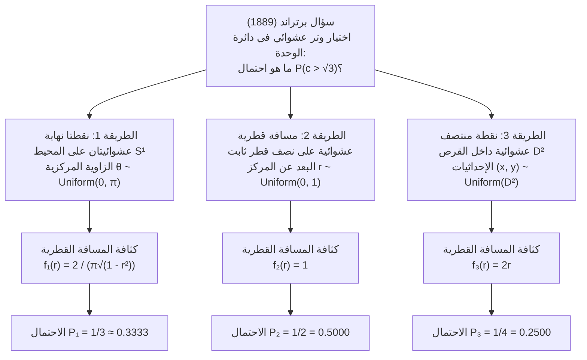
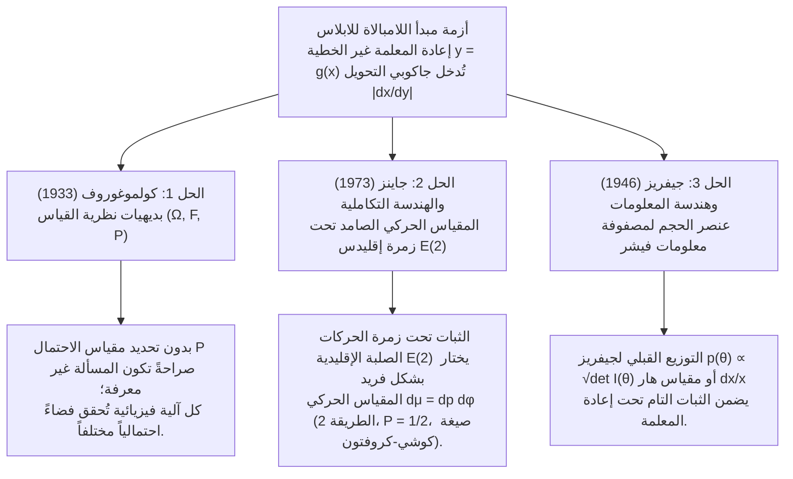

## 1. مقدمة: انهيار حدس «العشوائية المنتظمة» عام 1889

في الفضاءات المتقطعة المنتهية، تبدو عبارة «الاختيار عشوائياً» واضحة تماماً؛ فعند رمي حجر نرد متماثل يكون احتمال ظهور كل وجه مساوياً لـ $1/6$. ولكن بمجرد الانتقال إلى <strong>الفضاءات الهندسية المتصلة</strong>، ينهار هذا الحدس البسيط. في عام 1889، طرح عالم الرياضيات الفرنسي <strong>جوزيف برتراند (Joseph Bertrand, 1822–1900)</strong> في كتابه *Calcul des probabilités* مسألة هندسية أولية هزت أركان نظرية الاحتمالات، وتُعرف اليوم باسم <strong>مفارقة برتراند (Bertrand's Paradox)</strong>.

لنفترض دائرة وحدة $S^1 = \{(x,y) \in \mathbb{R}^2 : x^2 + y^2 = 1\}$ نصف قطرها $R = 1$، وبداخلها مثلث متساوي الأضلاع محاط بها $\triangle ABC$. طول ضلع هذا المثلث هو $L = 2R\sin(\pi/3) = \sqrt{3} \approx 1.732$، ونصف قطر دائرته الداخلية (المسافة العمودية من المركز $O$ إلى كل ضلع) هو $r_{\text{in}} = R\cos(\pi/3) = 1/2$.

> <strong>[مسألة برتراند (1889)]</strong>
> نختار وتراً $c$ في دائرة الوحدة «عشوائياً». ما هو الاحتمال $P(c > \sqrt{3})$ بأن يكون طول هذا الوتر أكبر من طول ضلع المثلث المتساوي الأضلاع المحاط بالدائرة $L = \sqrt{3}$؟

قدّم برتراند ثلاث طرق هندسية طبيعية ومتماثلة تماماً، لكنها أدت إلى ثلاث إجابات دقيقة متناقضة: <strong>$P_1 = 1/3$ و $P_2 = 1/2$ و $P_3 = 1/4$</strong>.



---

## 2. الاشتقاق الرياضي الدقيق للحلول الكلاسيكية الثلاثة ودوال كثافتها

لتكن $\theta \in [0, \pi]$ الزاوية المركزية التي يقابلها الوتر، و $r \in [0, 1]$ المسافة العمودية من المركز $O$ إلى منتصف الوتر $M(x,y) = (r\cos\phi, r\sin\phi)$، و $c$ طول الوتر. من مبرهنة فيثاغورس نحصل على العلاقة الأساسية:

$$c = 2\sqrt{1 - r^2} = 2\sin\left(\frac{\theta}{2}\right), \qquad r = \cos\left(\frac{\theta}{2}\right) = \sqrt{1 - \frac{c^2}{4}}$$

وبالتالي فإن الحدث $E = \{c > \sqrt{3}\}$ يكافئ في جميع أنظمة الإحداثيات الشرط:

$$c > \sqrt{3} \iff 2\sqrt{1 - r^2} > \sqrt{3} \iff 0 \le r < \frac{1}{2} \iff \theta \in \left(\frac{2\pi}{3}, \frac{4\pi}{3}\right)$$

### 2.1 الطريقة الأولى: اختيار نقطتي النهاية بانتظام على المحيط ($P_1 = 1/3$)

بفضل التماثل الدوراني $SO(2)$، نثبت الطرف الأول $A$ عند أحد رؤوس المثلث ($\theta = 0$) ونختار الطرف الثاني $B$ بانتظام على المحيط بحيث $\theta \sim \text{Uniform}(0, 2\pi)$. يتحقق $c(\theta) > \sqrt{3}$ إذا وفقط إذا وقعت النقطة $B$ على القوس المقابل $\theta \in (2\pi/3, 4\pi/3)$ الذي طوله $2\pi/3$ من إجمالي المحيط $2\pi$:

$$P_1(c > \sqrt{3}) = \frac{4\pi/3 - 2\pi/3}{2\pi} = \frac{1}{3}$$

باستخدام التحويل $r = \cos(\theta/2)$ ($\theta \in [0, \pi]$، $f_\Theta(\theta) = 1/\pi$) ومحدد جاكوبي $\left|\frac{d\theta}{dr}\right| = \frac{2}{\sqrt{1 - r^2}}$، نجد دوال الكثافة:

$$f_{R,1}(r) = \frac{2}{\pi\sqrt{1 - r^2}}, \qquad f_{C,1}(c) = \frac{2}{\pi\sqrt{4 - c^2}}, \qquad \mathbb{E}_1[c] = \frac{4}{\pi} \approx 1.2732$$

### 2.2 الطريقة الثانية: اختيار المسافة القطرية بانتظام على نصف قطر ثابت ($P_2 = 1/2$)

نختار اتجاه نصف القطر $\phi \sim \text{Uniform}(0, 2\pi)$ ثم نختار المسافة من المركز إلى منتصف الوتر $r \sim \text{Uniform}(0, 1)$ بانتظام. وبما أن ضلع المثلث المتساوي الأضلاع يبعد عن المركز مسافة $r_{\text{in}} = 1/2$، فإن $c > \sqrt{3} \iff 0 \le r < 1/2$:

$$P_2(c > \sqrt{3}) = \int_0^{1/2} 1\,dr = \frac{1}{2}, \qquad f_{R,2}(r) = 1, \qquad f_{C,2}(c) = \frac{c}{2\sqrt{4 - c^2}}, \qquad \mathbb{E}_2[c] = \frac{\pi}{2} \approx 1.5708$$

### 2.3 الطريقة الثالثة: اختيار نقطة المنتصف بانتظام داخل مساحة القرص ($P_3 = 1/4$)

يتحدد كل وتر غير قطري بشكل فريد بنقطة منتصفه $M(x, y) \in D^2$. إذا اخترنا $M$ بانتظام بالنسبة لمقياس المساحة $dx\,dy$ على قرص الوحدة $D^2$ ($f_{X,Y}(x,y) = 1/\pi$)، فإن $c > \sqrt{3}$ يتحقق إذا وفقط إذا وقعت $M$ داخل القرص الداخلي المتحد المركز $D_{1/2}$ ذي نصف القطر $1/2$:

$$P_3(c > \sqrt{3}) = \frac{\text{Area}(D_{1/2})}{\text{Area}(D_1)} = \frac{\pi (1/2)^2}{\pi (1)^2} = \frac{1}{4}$$

لماذا تختلف الطريقة الثانية عن الثالثة؟ لأن عنصر المساحة في الإحداثيات القطبية يتضمن جاكوبي التحويل $J = r$، أي $dx\,dy = r\,dr\,d\phi$. وعند التكامل على $\phi \in [0, 2\pi)$ تصبح الكثافة الهامشية لـ $r$ دالة خطية:

$$f_{R,3}(r) = \int_0^{2\pi} \frac{1}{\pi} r\,d\phi = 2r, \qquad f_{C,3}(c) = \frac{c}{2}, \qquad \mathbb{E}_3[c] = \frac{4}{3} \approx 1.3333$$

| وجه المقارنة | الطريقة 1: أطراف عشوائية | الطريقة 2: نصف قطر عشوائي | الطريقة 3: منتصف عشوائي |
| :--- | :--- | :--- | :--- |
| <strong>المتغير المنتظم</strong> | الزاوية $\theta \sim U(0, \pi)$ | المسافة $r \sim U(0, 1)$ | المساحة $(x,y) \sim U(D^2)$ ($r^2 \sim U(0,1)$) |
| <strong>عنصر الاحتمال $d\mathbb{P}(r,\phi)$</strong> | $\dfrac{1}{\pi^2\sqrt{1 - r^2}}\,dr\,d\phi$ | $\dfrac{1}{2\pi}\,dr\,d\phi$ | $\dfrac{r}{\pi}\,dr\,d\phi = \dfrac{1}{\pi}\,dx\,dy$ |
| <strong>الكثافة القطرية $f_R(r)$</strong> | $\dfrac{2}{\pi\sqrt{1 - r^2}}$ | $1$ | $2r$ |
| <strong>كثافة طول الوتر $f_C(c)$</strong> | $\dfrac{2}{\pi\sqrt{4 - c^2}}$ | $\dfrac{c}{2\sqrt{4 - c^2}}$ | $\dfrac{c}{2}$ |
| <strong>الاحتمال $P(c > \sqrt{3})$</strong> | <strong>$1/3 \approx 0.3333$</strong> | <strong>$1/2 = 0.5000$</strong> | <strong>$1/4 = 0.2500$</strong> |
| <strong>القيمة المتوقعة $\mathbb{E}[c]$</strong> | $4/\pi \approx 1.2732$ | $\pi/2 \approx 1.5708$ | $4/3 \approx 1.3333$ |

---

## 3. أزمة مبدأ اللامبالاة للابلاس ومفارقة النبيذ والماء لكينز (1921)

استندت نظرية الاحتمالات الكلاسيكية عند <strong>بيير سيمون لابلاس (Pierre-Simon Laplace)</strong> إلى <strong>مبدأ السبب غير الكافي</strong>، الذي أطلق عليه <strong>جون ماينارد كينز (John Maynard Keynes, 1921)</strong> في كتابه *A Treatise on Probability* اسم <strong>مبدأ اللامبالاة (Principle of Indifference)</strong>. في الفضاءات المتصلة، يؤدي فرض كثافة منتظمة $f_X(x) = \frac{1}{b-a}$ على متغير $x \in [a, b]$ تحت أي تحويل غير خطي $y = g(x)$ إلى ضرب الكثافة في <strong>محدد جاكوبي $\left|\frac{dx}{dy}\right|$</strong>:

$$f_Y(y) = f_X\bigl(g^{-1}(y)\bigr)\left|\frac{dx}{dy}\right|$$

في <strong>مفارقة النبيذ والماء لكينز (1921)</strong>:
- يحتوي كأس على خليط من النبيذ والماء بحيث تقع نسبة النبيذ إلى الماء $x = W_{\text{wine}}/W_{\text{water}}$ بين $1/3$ و $3$. إذا افترضنا $x \sim \text{Uniform}(1/3, 3)$ فإن الوسيط هو $x_{\text{med}} = 5/3$ والاحتمال $P_X(x \le 2) = \frac{2 - 1/3}{3 - 1/3} = \frac{5}{8} = 0.625$.
- لكن المعطى نفسه يعني أن النسبة العكسية (الماء إلى النبيذ) $y = 1/x = W_{\text{water}}/W_{\text{wine}}$ تقع أيضاً بين $1/3$ و $3$. إذا افترضنا $y \sim \text{Uniform}(1/3, 3)$ فإن الوسيط هو $y_{\text{med}} = 5/3$ (وهو ما يناقض $x \cdot y = 1$!) ويصبح احتمال نفس الحدث $x \le 2 \iff y \ge 1/2$ مساوياً لـ $P_Y(y \ge 1/2) = \frac{3 - 1/2}{3 - 1/3} = \frac{15}{16} = 0.9375 \neq \frac{5}{8}$.

---

## 4. الحلول الرياضية والفيزيائية الحديثة الثلاثة



### 4.1 بديهيات كولموغوروف لنظرية القياس $(\Omega, \mathcal{F}, \mathbb{P})$ (1933)

في عام 1933، أثبت عالم الرياضيات الروسي <strong>أندريه كولموغوروف (Andrei Kolmogorov)</strong> أن أي مسألة احتمالية تتطلب تحديد الثلاثية $(\Omega, \mathcal{F}, \mathbb{P})$ بشكل صريح. وبدون تحديد مقياس الاحتمال $\mathbb{P}$، فإن عبارة «اختيار وتر عشوائياً» غير مكتملة رياضياً.

### 4.2 ثبات زمر التحويل عند إدوين جاينز (1973) والهندسة التكاملية

في ورقته الشهيرة *"The Well-Posed Problem"* (1973)، برهن الفيزيائي <strong>إدوين جاينز (Edwin T. Jaynes)</strong> أنه عند إلقاء قشات طويلة مستقيمة من بعيد على دائرة مرسومة على الأرض، يجب أن يكون مقياس المستقيمات $x\cos\phi + y\sin\phi = p$ المعطى بـ $h(p, \phi)\,dp\,d\phi$ صامداً (Invariant) تحت:
1. <strong>الدوران $SO(2)$</strong>: $h(p, \phi) = g(p)/(2\pi)$؛
2. <strong>تغيير المقياس (Scale Invariance)</strong> (التقييد بدائرة داخلية متحدة المركز نصف قطرها $a < 1$)؛
3. <strong>الانسحاب في المستوي $\mathbb{R}^2$ (زمرة إقليدس للحركات الصلبة $E(2) = \mathbb{R}^2 \rtimes O(2)$)</strong>: عند إزاحة المركز بمقدار $(x_0, y_0)$ يتحول $(p, \phi)$ إلى $p' = p - x_0\cos\phi - y_0\sin\phi$ و $\phi' = \phi$، ومحدد جاكوبي لهذا التحويل يساوي $1$ دائماً:
   $$J = \det\frac{\partial(p', \phi')}{\partial(p, \phi)} = \det\begin{pmatrix} 1 & x_0\sin\phi - y_0\cos\phi \\ 0 & 1 \end{pmatrix} = 1$$
   إن شرط الثبات الانسحابي $g(p') = g(p)$ يفرض بشكل فريد أن تكون $g(p) = \text{const.}$!

وهذا هو <strong>المقياس الحركي لبوانكاريه–سانتالو (Poincaré–Santaló Kinematic Measure)</strong> في الهندسة التكاملية:

$$d\mu(L) = dp\,d\phi$$

وبموجب <strong>صيغة كوشي–كروفتون (Cauchy–Crofton Formula)</strong> (التي تحكم أيضاً <strong>مسألة إبرة بوفون Buffon's Needle</strong>)، فإن مقياس المستقيمات التي تقطع جسماً محدباً $K \subset \mathbb{R}^2$ يساوي محيطه $\text{Perimeter}(\partial K)$. ومن نسبة محيط الدائرة الداخلية ($\pi$) إلى محيط دائرة الوحدة ($2\pi$) نحصل فوراً على <strong>الطريقة الثانية ($P = 1/2$)</strong>.

### 4.3 التوزيع القبلي غير المعلوماتي لجيفريز (1946)

في الإحصاء البايزي، قدّم <strong>هارولد جيفريز (Harold Jeffreys, 1946)</strong> التوزيع القبلي الصامد باستخدام الجذر التربيعي لمحدد <strong>مصفوفة معلومات فيشر</strong> $I_{ij}(\theta) = -\mathbb{E}\left[\frac{\partial^2 \ln p(X\mid\theta)}{\partial\theta_i\partial\theta_j}\right]$:

$$p_J(\theta) \propto \sqrt{\det I(\theta)}$$

وفي مفارقة النبيذ والماء، يعطي مقياس هار للزمرة الضربية $(\mathbb{R}_{>0}, \times)$ وهو $d\mu(x) = \frac{dx}{x}$ بكثافة $f(x) = \frac{1}{2\ln 3 \cdot x}$ على $[1/3, 3]$ ثباتاً تاماً تحت التحويل العكسي $y = 1/x$، ويصبح الوسيط $x_{\text{med}} = y_{\text{med}} = 1$ دون أي تناقض.

---

## 5. محاكاة مونت كارلو بلغة Python

```python
import numpy as np

def simulate_bertrand(n: int = 1_000_000, seed: int = 42) -> None:
    rng = np.random.default_rng(seed)
    limit = np.sqrt(3.0)

    # الطريقة 1: أطراف عشوائية على المحيط (P = 1/3)
    t1 = rng.uniform(0, 2 * np.pi, n)
    t2 = rng.uniform(0, 2 * np.pi, n)
    c1 = 2.0 * np.sin(np.abs(t1 - t2) / 2.0)

    # الطريقة 2: مسافة قطرية عشوائية r ~ U(0, 1) (P = 1/2)
    r2 = rng.uniform(0.0, 1.0, n)
    c2 = 2.0 * np.sqrt(1.0 - r2**2)

    # الطريقة 3: نقطة منتصف عشوائية u = r^2 ~ U(0, 1) (P = 1/4)
    r3 = np.sqrt(rng.uniform(0.0, 1.0, n))
    c3 = 2.0 * np.sqrt(1.0 - r3**2)

    # الطريقة 4: تجربة جاينز الفيزيائية (دائرة مزاحة إلى (3.5, -2.0))
    phi = rng.uniform(0, 2 * np.pi, n * 5)
    p = rng.uniform(-10.0, 10.0, n * 5)
    r_shifted = np.abs(p - (3.5 * np.cos(phi) - 2.0 * np.sin(phi)))
    hits = r_shifted[r_shifted <= 1.0]
    c_jaynes = 2.0 * np.sqrt(1.0 - hits**2)

    for name, arr, exact in [
        ("Method 1 (Endpoints)", c1, 1/3),
        ("Method 2 (Radius)", c2, 1/2),
        ("Method 3 (Midpoint)", c3, 1/4),
        ("Jaynes Off-Center Toss", c_jaynes, 1/2),
    ]:
        print(f"{name:<24}: P(c > √3) = {np.mean(arr > limit):.5f} (Exact: {exact:.5f})")

if __name__ == "__main__":
    simulate_bertrand()
```
