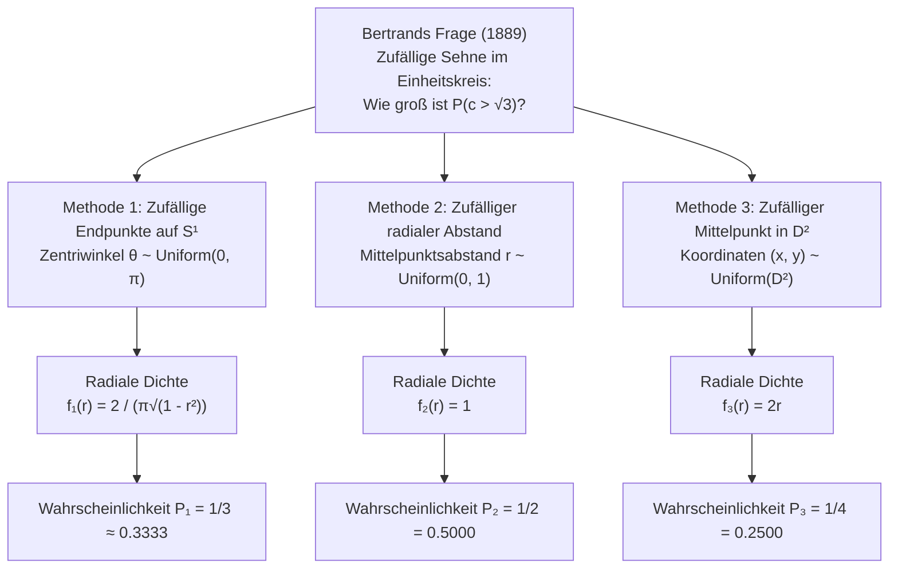
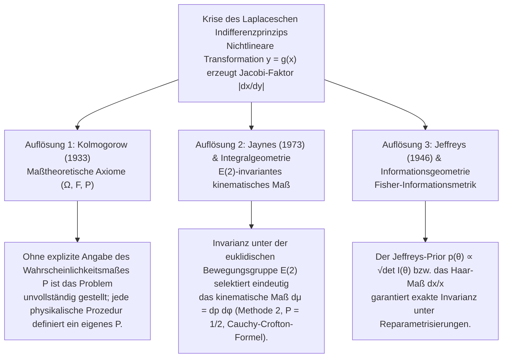

## 1. Einleitung: Der Zusammenbruch des „gleichmäßig Zufälligen“ im Jahr 1889

In der diskreten Wahrscheinlichkeitsrechnung erscheint der Begriff „zufällig ausgewählt“ vollkommen eindeutig: Bei einem fairen Würfel hat jede der sechs Seiten die Wahrscheinlichkeit $1/6$. Sobald wir jedoch von endlichen Mengen in den <strong>kontinuierlichen geometrischen Raum</strong> übergehen, bricht diese naive Intuition zusammen. Im Jahr 1889 veröffentlichte der französische Mathematiker <strong>Joseph Bertrand (1822–1900)</strong> in seinem Werk *Calcul des probabilités* ein scheinbar elementares geometrisches Problem, das als <strong>Bertrand-Paradoxon</strong> berühmt wurde.

Gegeben sei ein Einheitskreis $S^1 = \{(x,y) \in \mathbb{R}^2 : x^2 + y^2 = 1\}$ mit Radius $R = 1$ und ein einbeschriebenes gleichseitiges Dreieck $\triangle ABC$. Die Seitenlänge des Dreiecks beträgt $L = 2R\sin(\pi/3) = \sqrt{3} \approx 1.732$, und der Inkreisradius (der senkrechte Abstand vom Kreismittelpunkt $O$ zu jeder Dreiecksseite) ist $r_{\text{in}} = R\cos(\pi/3) = 1/2$.

> <strong>[Bertrands Problem (1889)]</strong>
> Man wähle „zufällig“ eine Sehne $c$ des Einheitskreises. Wie groß ist die Wahrscheinlichkeit $P(c > \sqrt{3})$, dass die Sehne länger ist als die Seite $L = \sqrt{3}$ des einbeschriebenen gleichseitigen Dreiecks?

Bertrand präsentierte drei gleichermaßen plausible, symmetrische Konstruktionsmethoden und erhielt drei widersprüchliche exakte Ergebnisse: <strong>$P_1 = 1/3$, $P_2 = 1/2$ und $P_3 = 1/4$</strong>.



---

## 2. Strenge Herleitung der drei klassischen Lösungen und ihrer Dichtefunktionen

Bezeichnet $\theta \in [0, \pi]$ den Zentriwinkel der Sehne, $r \in [0, 1]$ den senkrechten Abstand des Sehnenmittelpunkts $M(x,y) = (r\cos\phi, r\sin\phi)$ vom Ursprung $O$ und $c$ die Sehnenlänge, so liefert der Satz des Pythagoras:

$$c = 2\sqrt{1 - r^2} = 2\sin\left(\frac{\theta}{2}\right), \qquad r = \cos\left(\frac{\theta}{2}\right) = \sqrt{1 - \frac{c^2}{4}}$$

Das Ereignis $E = \{c > \sqrt{3}\}$ ist in allen drei Parametrisierungen exakt äquivalent zu:

$$c > \sqrt{3} \iff 2\sqrt{1 - r^2} > \sqrt{3} \iff 0 \le r < \frac{1}{2} \iff \theta \in \left(\frac{2\pi}{3}, \frac{4\pi}{3}\right)$$

### 2.1 Methode 1: Zufällige Endpunkte auf dem Kreisumfang ($P_1 = 1/3$)

Man wählt zwei Punkte $A, B$ unabhängig und gleichverteilt auf der Kreislinie $S^1$. Dank Rotationssymmetrie $SO(2)$ fixieren wir $A$ bei $\theta = 0$ (einer Ecke des Dreiecks). Der zweite Endpunkt $B$ hat den Winkel $\theta \sim \text{Uniform}(0, 2\pi)$. Es gilt $c(\theta) > \sqrt{3}$ genau dann, wenn $\theta \in (2\pi/3, 4\pi/3)$:

$$P_1(c > \sqrt{3}) = \frac{4\pi/3 - 2\pi/3}{2\pi} = \frac{1}{3}$$

Mit $r = \cos(\theta/2)$ auf $\theta \in [0, \pi]$ ($f_\Theta(\theta) = 1/\pi$) und der Funktionaldeterminante (Jacobi-Determinante) $\left|\frac{d\theta}{dr}\right| = \frac{2}{\sqrt{1 - r^2}}$ folgt für die Dichten von $r$ und $c$:

$$f_{R,1}(r) = \frac{2}{\pi\sqrt{1 - r^2}}, \qquad f_{C,1}(c) = \frac{2}{\pi\sqrt{4 - c^2}}, \qquad \mathbb{E}_1[c] = \frac{4}{\pi} \approx 1.2732$$

### 2.2 Methode 2: Zufälliger radialer Abstand auf einem festen Radius ($P_2 = 1/2$)

Man wählt einen Radius unter dem Winkel $\phi \sim \text{Uniform}(0, 2\pi)$ und darauf den Abstand $r \sim \text{Uniform}(0, 1)$ gleichverteilt. Da die Dreiecksseite den Abstand $r_{\text{in}} = 1/2$ vom Zentrum hat, gilt $c > \sqrt{3} \iff 0 \le r < 1/2$:

$$P_2(c > \sqrt{3}) = \int_0^{1/2} 1\,dr = \frac{1}{2}, \qquad f_{R,2}(r) = 1, \qquad f_{C,2}(c) = \frac{c}{2\sqrt{4 - c^2}}, \qquad \mathbb{E}_2[c] = \frac{\pi}{2} \approx 1.5708$$

### 2.3 Methode 3: Zufälliger Mittelpunkt gleichverteilt in der Kreisscheibe ($P_3 = 1/4$)

Jede Sehne ($r > 0$) ist eindeutig durch ihren Mittelpunkt $M(x, y) \in D^2$ bestimmt. Wählt man $(x, y)$ flächengleichverteilt auf der Einheitskreisscheibe $D^2$ ($f_{X,Y}(x,y) = 1/\pi$), so gilt $c > \sqrt{3}$ genau dann, wenn $M$ in der konzentrischen Inkreisscheibe $D_{1/2}$ mit Radius $1/2$ liegt:

$$P_3(c > \sqrt{3}) = \frac{\text{Fläche}(D_{1/2})}{\text{Fläche}(D_1)} = \frac{\pi (1/2)^2}{\pi (1)^2} = \frac{1}{4}$$

Der Unterschied zwischen Methode 2 und Methode 3 resultiert aus der Polarkoordinaten-Jacobi-Determinante $dx\,dy = r\,dr\,d\phi$. Die Integration über $\phi \in [0, 2\pi)$ liefert die lineare Randdichte:

$$f_{R,3}(r) = \int_0^{2\pi} \frac{1}{\pi} r\,d\phi = 2r, \qquad f_{C,3}(c) = \frac{c}{2}, \qquad \mathbb{E}_3[c] = \frac{4}{3} \approx 1.3333$$

| Merkmal | Methode 1: Zufällige Endpunkte | Methode 2: Zufälliger Radiusabstand | Methode 3: Zufälliger Mittelpunkt |
| :--- | :--- | :--- | :--- |
| <strong>Gleichverteilter Parameter</strong> | Winkel $\theta \sim U(0, \pi)$ | Abstand $r \sim U(0, 1)$ | Fläche $(x,y) \sim U(D^2)$ ($r^2 \sim U(0,1)$) |
| <strong>Maßelement $d\mathbb{P}(r,\phi)$</strong> | $\dfrac{1}{\pi^2\sqrt{1 - r^2}}\,dr\,d\phi$ | $\dfrac{1}{2\pi}\,dr\,d\phi$ | $\dfrac{r}{\pi}\,dr\,d\phi = \dfrac{1}{\pi}\,dx\,dy$ |
| <strong>Radiale Dichte $f_R(r)$</strong> | $\dfrac{2}{\pi\sqrt{1 - r^2}}$ | $1$ | $2r$ |
| <strong>Sehnenlängendichte $f_C(c)$</strong> | $\dfrac{2}{\pi\sqrt{4 - c^2}}$ | $\dfrac{c}{2\sqrt{4 - c^2}}$ | $\dfrac{c}{2}$ |
| <strong>Wahrscheinlichkeit $P(c > \sqrt{3})$</strong> | <strong>$1/3 \approx 0.3333$</strong> | <strong>$1/2 = 0.5000$</strong> | <strong>$1/4 = 0.2500$</strong> |
| <strong>Erwartungswert $\mathbb{E}[c]$</strong> | $4/\pi \approx 1.2732$ | $\pi/2 \approx 1.5708$ | $4/3 \approx 1.3333$ |

---

## 3. Die Krise des Laplaceschen Indifferenzprinzips und Keynes' Wein-Wasser-Paradoxon (1921)

<strong>Pierre-Simon Laplace</strong> gründete die klassische Wahrscheinlichkeitstheorie auf das <strong>Prinzip vom unzureichenden Grund</strong>, das <strong>John Maynard Keynes (1921)</strong> in *A Treatise on Probability* als <strong>Indifferenzprinzip (Principle of Indifference)</strong> bezeichnete. Im Kontinuum führt die Gleichsetzung von Unwissenheit mit einer konstanten Dichte $f_X(x) = \text{const.}$ unter einer nichtlinearen Transformation $y = g(x)$ jedoch wegen der <strong>Jacobi-Determinante $\left|\frac{dx}{dy}\right|$</strong> sofort in Widersprüche:

$$f_Y(y) = f_X\bigl(g^{-1}(y)\bigr)\left|\frac{dx}{dy}\right|$$

Keynes' <strong>Wein-Wasser-Paradoxon (1921)</strong> demonstriert dies eindrucksvoll:
- In einem Glas befindet sich ein Gemisch aus Wein und Wasser, wobei das Verhältnis $x = W_{\text{Wein}}/W_{\text{Wasser}}$ zwischen $1/3$ und $3$ liegt. Nimmt man $x \sim \text{Uniform}(1/3, 3)$ an, so ist der Median $x_{\text{med}} = 5/3$ und $P_X(x \le 2) = \frac{2 - 1/3}{3 - 1/3} = \frac{5}{8} = 0.625$.
- Dieselbe Information besagt jedoch für das reziproke Verhältnis $y = 1/x = W_{\text{Wasser}}/W_{\text{Wein}}$, dass $y \in [1/3, 3]$. Nimmt man $y \sim \text{Uniform}(1/3, 3)$ an, ist der Median ebenfalls $y_{\text{med}} = 5/3$ (im Widerspruch zu $x \cdot y = 1$!) und $P_Y(y \ge 1/2) = \frac{3 - 1/2}{3 - 1/3} = \frac{15}{16} = 0.9375 \neq \frac{5}{8}$.

---

## 4. Die drei modernen mathematischen Auflösungen



### 4.1 Kolmogorows maßtheoretische Axiomatik $(\Omega, \mathcal{F}, \mathbb{P})$ (1933)

<strong>Andrei Kolmogorow</strong> zeigte 1933 in seinen *Grundbegriffen der Wahrscheinlichkeitsrechnung*, dass Wahrscheinlichkeit nur auf einem vollständig spezifizierten Wahrscheinlichkeitsraum $(\Omega, \mathcal{F}, \mathbb{P})$ definiert ist. Ohne Angabe des Maßes $\mathbb{P}$ ist die Phrase „zufällig gewählt“ mathematisch sinnlos (schlecht gestellt).

### 4.2 E. T. Jaynes' Transformationsgruppen-Invarianz (1973) und Integralgeometrie

In seiner Arbeit *"The Well-Posed Problem"* (1973) bewies der Physiker <strong>Edwin T. Jaynes</strong>: Wenn man lange gerade Halme aus der Entfernung auf einen Kreis am Boden wirft, muss die Wahrscheinlichkeitsverteilung der Geraden $x\cos\phi + y\sin\phi = p$ invariant sein unter:
1. <strong>Rotationen $SO(2)$</strong>: $h(p, \phi) = g(p)/(2\pi)$;
2. <strong>Skalierungen</strong> (Einschränkung auf einen kleineren Kreis mit Radius $a < 1$);
3. <strong>Translationen $\mathbb{R}^2$ (Euklidische Gruppe $E(2) = \mathbb{R}^2 \rtimes O(2)$)</strong>: Bei einer Verschiebung des Ursprungs um $(x_0, y_0)$ gilt $p' = p - x_0\cos\phi - y_0\sin\phi$ und $\phi' = \phi$ mit der Jacobi-Determinante:
   $$J = \det\frac{\partial(p', \phi')}{\partial(p, \phi)} = \det\begin{pmatrix} 1 & x_0\sin\phi - y_0\cos\phi \\ 0 & 1 \end{pmatrix} = 1$$
   Translationsinvarianz $g(p') = g(p)$ erzwingt eindeutig $g(p) = \text{const.}$!

Dies ist das berühmte <strong>kinematische Maß von Poincaré und Santaló</strong> der Integralgeometrie:

$$d\mu(L) = dp\,d\phi$$

Nach der <strong>Cauchy-Crofton-Formel</strong> (die auch das <strong>Buffonsche Nadelproblem</strong> regiert) ist das kinematische Maß aller Geraden, die einen konvexen Körper $K \subset \mathbb{R}^2$ schneiden, gleich dessen Umfang $\text{Perimeter}(\partial K)$. Damit folgt sofort <strong>Methode 2 ($P = \frac{2\pi(1/2)}{2\pi(1)} = 1/2$)</strong> als einzige bewegungsinvariante Lösung.

### 4.3 Jeffreys-Prior und Reparametrisierungsinvarianz (1946)

In der Bayesschen Statistik löste <strong>Sir Harold Jeffreys (1946)</strong> das Problem durch das Volumenelement der Riemannschen <strong>Fisher-Informationsmatrix</strong> $I_{ij}(\theta) = -\mathbb{E}\left[\frac{\partial^2 \ln p(X\mid\theta)}{\partial\theta_i\partial\theta_j}\right]$:

$$p_J(\theta) \propto \sqrt{\det I(\theta)}$$

Für das Wein-Wasser-Paradoxon liefert das skaleninvariante Haar-Maß der multiplikativen Gruppe $(\mathbb{R}_{>0}, \times)$, $d\mu(x) = \frac{dx}{x}$ mit Dichte $f(x) = \frac{1}{2\ln 3 \cdot x}$ auf $[1/3, 3]$, identische Dichten für $x$ und $y = 1/x$ sowie den konsistenten Median $x_{\text{med}} = y_{\text{med}} = 1$.

---

## 5. Python-Monte-Carlo-Simulation

```python
import numpy as np

def simulate_bertrand(n: int = 1_000_000, seed: int = 42) -> None:
    rng = np.random.default_rng(seed)
    limit = np.sqrt(3.0)

    # Methode 1: Zufällige Endpunkte auf S^1 (P = 1/3)
    t1 = rng.uniform(0, 2 * np.pi, n)
    t2 = rng.uniform(0, 2 * np.pi, n)
    c1 = 2.0 * np.sin(np.abs(t1 - t2) / 2.0)

    # Methode 2: Zufälliger Radiusabstand r ~ U(0, 1) (P = 1/2)
    r2 = rng.uniform(0.0, 1.0, n)
    c2 = 2.0 * np.sqrt(1.0 - r2**2)

    # Methode 3: Zufälliger Mittelpunkt u = r^2 ~ U(0, 1) (P = 1/4)
    r3 = np.sqrt(rng.uniform(0.0, 1.0, n))
    c3 = 2.0 * np.sqrt(1.0 - r3**2)

    # Methode 4: Jaynes-Experiment (Verschobener Zielkreis bei (3.5, -2.0))
    phi = rng.uniform(0, 2 * np.pi, n * 5)
    p = rng.uniform(-10.0, 10.0, n * 5)
    r_shifted = np.abs(p - (3.5 * np.cos(phi) - 2.0 * np.sin(phi)))
    hits = r_shifted[r_shifted <= 1.0]
    c_jaynes = 2.0 * np.sqrt(1.0 - hits**2)

    for name, arr, exact in [
        ("Method 1 (Endpoints)", c1, 1/3),
        ("Method 2 (Radius)", c2, 1/2),
        ("Method 3 (Midpoint)", c3, 1/4),
        ("Jaynes Off-Center Toss", c_jaynes, 1/2),
    ]:
        print(f"{name:<24}: P(c > √3) = {np.mean(arr > limit):.5f} (Exact: {exact:.5f})")

if __name__ == "__main__":
    simulate_bertrand()
```
