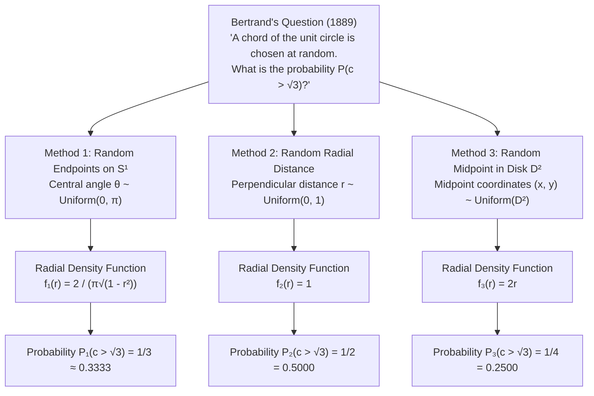
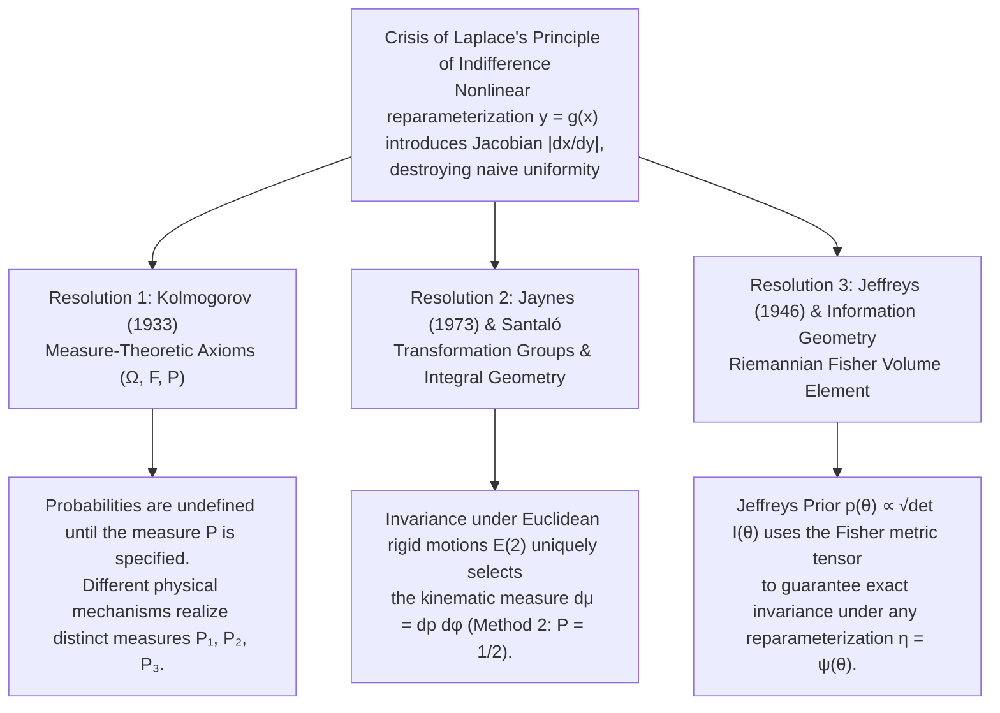

## 1. Introduction: The Shattering of "Uniform Randomness" in 1889

Few phrases in mathematics or everyday reasoning feel as transparent and self-evident as *"chosen at random."* When we roll a fair die and declare that each face has probability $1/6$, or draw a card from a well-shuffled deck and assign probability $1/52$ to the Ace of Spades, our intuition rests comfortably on symmetry. When the set of possible outcomes is finite and we possess no reason to favor one outcome over another, assigning equal weight to every outcome appears to be an inescapable demand of pure logic.

Yet the instant we step from finite discrete sets into the realm of <strong>continuous geometric spaces</strong>, this intuitive bedrock fractures beneath our feet. Never was that fracture exposed more dramatically than in 1889, when the French mathematician <strong>Joseph Bertrand (1822–1900)</strong> opened the early pages of his treatise *Calcul des probabilités* with a deceptively elementary geometric puzzle—a thought experiment now immortalized as <strong>Bertrand's Paradox</strong>.

### 1.1 Statement of Bertrand's Problem

Consider a unit circle $S^1 = \{(x, y) \in \mathbb{R}^2 : x^2 + y^2 = 1\}$ of radius $R = 1$ in the Euclidean plane $\mathbb{R}^2$, and inscribe within it an equilateral triangle $\triangle ABC$. By elementary trigonometry, each side of the inscribed equilateral triangle subtends a central angle of $2\pi/3$ ($120^\circ$) from the center $O(0,0)$, giving a side length $L$ of:

$$L = 2R\sin\left(\frac{\pi}{3}\right) = 2 \cdot 1 \cdot \frac{\sqrt{3}}{2} = \sqrt{3} \approx 1.73205$$

Furthermore, the perpendicular distance from the center $O$ to each side of $\triangle ABC$—which is the radius $r_{\text{in}}$ of the inscribed circle (incircle) of the triangle—is:

$$r_{\text{in}} = R\cos\left(\frac{\pi}{3}\right) = 1 \cdot \frac{1}{2} = \frac{1}{2}$$

Bertrand posed the following question:

> <strong>[Bertrand's Question (1889)]</strong>
> A chord of the unit circle (a line segment connecting two points on the circumference) is chosen <strong>"at random."</strong> What is the probability $P(c > \sqrt{3})$ that the length $c$ of the chord is greater than the side length $L = \sqrt{3}$ of the inscribed equilateral triangle?

At first glance, this reads like a standard textbook exercise in geometric probability. The circle has fixed radius $1$, the triangle has fixed side length $\sqrt{3}$, and the geometric condition $c > \sqrt{3}$ is completely unambiguous. One naturally expects a single, objective numerical probability. Instead, Bertrand stunned the mathematical world by presenting <strong>three unimpeachable, geometrically natural interpretations of choosing a chord "at random"</strong>, deriving from them three mutually contradictory exact probabilities:

$$P_1(c > \sqrt{3}) = \frac{1}{3}, \qquad P_2(c > \sqrt{3}) = \frac{1}{2}, \qquad P_3(c > \sqrt{3}) = \frac{1}{4}$$



How can a single geometric question have three different exact answers? None of the three derivations contains an algebraic or geometric fallacy; each is 100% rigorous once its premise is granted. Rather, Bertrand's Paradox strikes at the heart of what we mean by "randomness" in a continuum, exposing the fatal ambiguity of <strong>Pierre-Simon Laplace's Principle of Indifference (Principle of Insufficient Reason)</strong> under nonlinear coordinate transformations.

In this comprehensive article, we will:
1. Rigorously derive all three classical solutions ($1/3$, $1/2$, and $1/4$), alongside their induced probability density functions $f_R(r)$ and $f_C(c)$, expected values $\mathbb{E}[c]$, and Jacobian transformations.
2. Examine the philosophical and mathematical crisis of Laplace's Principle of Indifference through <strong>John Maynard Keynes's Wine-Water Paradox (1921)</strong> and <strong>Johannes von Kries's Cube Paradox (1886)</strong>.
3. Present the three monumental modern resolutions of the paradox:
   - <strong>Andrei Kolmogorov's 1933 Measure-Theoretic Axiomatization $(\Omega, \mathcal{F}, \mathbb{P})$</strong>, showing why "randomness" is undefined without an explicit probability measure.
   - <strong>Edwin T. Jaynes's 1973 Principle of Transformation Group Invariance</strong> and <strong>Integral Geometry (the Poincaré–Santaló Kinematic Measure)</strong>, proving that $d\mu = dp\,d\phi$ (Method 2, $P = 1/2$) is the <strong>unique measure invariant under the Euclidean group $E(2)$ of rigid motions in the plane</strong>, linking Bertrand's Paradox directly to the <strong>Cauchy–Crofton Formula</strong> and <strong>Buffon's Needle</strong>.
   - <strong>Sir Harold Jeffreys's Non-Informative Prior $p(\theta) \propto \sqrt{\det I(\theta)}$</strong>, using the Riemannian Fisher Information Metric to achieve reparameterization invariance in Bayesian inference.
4. Verify all theoretical results empirically via a complete Python Monte Carlo simulation, including Jaynes's physical straw-tossing experiment onto an off-center circle.

---

## 2. Rigorous Derivation of the Three Classical Solutions and Their Density Functions

To compare Bertrand's three methods on a unified mathematical footing, let us first establish the exact geometric transformations connecting the different coordinate parameterizations of a chord of the unit circle.

### 2.1 Unified Coordinate Geometry of Chords

Every non-degenerate chord of the unit circle $x^2 + y^2 = 1$ can be uniquely specified (up to диаметр/orientation conventions) in three equivalent ways:

1. <strong>Angular Endpoint Parameterization ($\theta \in [0, \pi]$)</strong>: A chord connects two points on $S^1$ with polar angles $\alpha, \beta \in [0, 2\pi)$. Up to overall rotation of the circle, the length of the chord depends solely on the subtended central angle $\theta = |\beta - \alpha| \in [0, \pi]$.
2. <strong>Radial / Hesse Normal Form Parameterization ($(r, \phi) \in [0, 1] \times [0, 2\pi)$)</strong>: The straight line containing the chord is uniquely written in Hesse normal form as
   $$x\cos\phi + y\sin\phi = r$$
   where $\phi \in [0, 2\pi)$ is the angle of the perpendicular dropped from the origin $O(0,0)$ to the chord, and $r \in [0, 1]$ is the perpendicular distance from $O$ to the chord.
3. <strong>Midpoint Cartesian Parameterization ($(x_m, y_m) \in D^2$)</strong>: The foot of the perpendicular from the origin $O$ to the chord is precisely the <strong>midpoint</strong> $M(x_m, y_m) = (r\cos\phi, r\sin\phi)$ of the chord. Every point $M \in D^2 \setminus \{(0,0)\}$ inside the unit disk uniquely determines the chord passing through $M$ perpendicular to the radius vector $\overrightarrow{OM}$.

Applying the Pythagorean theorem to the right triangle $\triangle OMA$ formed by the origin $O$, the chord's midpoint $M$, and one endpoint $A$ on the unit circle ($OA = 1$, $OM = r$, $MA = c/2$, and $\angle MOA = \theta/2$), we obtain the fundamental bridge equations:

$$\left(\frac{c}{2}\right)^2 + r^2 = 1 \quad \Longleftrightarrow \quad c(r) = 2\sqrt{1 - r^2} = 2\sin\left(\frac{\theta}{2}\right), \qquad r = \cos\left(\frac{\theta}{2}\right) = \sqrt{1 - \frac{c^2}{4}}$$

Consequently, the target event $E = \{c > \sqrt{3}\}$ translates into the following strictly equivalent conditions across all three coordinate systems:

$$c > \sqrt{3} \quad \Longleftrightarrow \quad 2\sqrt{1 - r^2} > \sqrt{3} \quad \Longleftrightarrow \quad 1 - r^2 > \frac{3}{4} \quad \Longleftrightarrow \quad 0 \le r < \frac{1}{2} \quad \Longleftrightarrow \quad \theta \in \left(\frac{2\pi}{3}, \frac{4\pi}{3}\right)$$

Notice that geometrically, $r < 1/2$ means that the chord intersects the concentric inner circle of radius $r_{\text{in}} = 1/2$ inscribed inside the equilateral triangle $\triangle ABC$. With this equivalence in hand, let us derive each of Bertrand's three solutions.

---

### 2.2 Method 1: Random Endpoints on the Circumference ($P_1 = 1/3$)

#### Geometric Construction and Probability Calculation
A chord is defined by its two endpoints on the circle. Therefore, our first natural procedure is to select two endpoints $A$ and $B$ independently and uniformly along the circumference $S^1$.

By rotational symmetry $SO(2)$, we may rotate the circle so that the first endpoint $A$ coincides with one vertex of the inscribed equilateral triangle at angle $\theta = 0$. The second endpoint $B$ is then distributed uniformly around the circumference:

$$\theta \sim \text{Uniform}(0, 2\pi), \qquad f_\Theta(\theta) = \frac{1}{2\pi} \quad \text{for } \theta \in [0, 2\pi)$$

As $\theta$ varies from $0$ to $2\pi$, the chord $AB$ has length $c(\theta) = 2\sin(\theta/2) > \sqrt{3}$ if and only if $B$ falls on the arc lying beyond the other two vertices of the inscribed equilateral triangle—namely, the open interval $\theta \in (2\pi/3, 4\pi/3)$. Since this favorable arc has length $4\pi/3 - 2\pi/3 = 2\pi/3$ out of the total circumference $2\pi$, the probability is:

$$P_1(c > \sqrt{3}) = \frac{\frac{4\pi}{3} - \frac{2\pi}{3}}{2\pi} = \frac{2\pi/3}{2\pi} = \frac{1}{3} \approx 0.3333$$

#### Induced Density Functions $f_{R,1}(r)$ and $f_{C,1}(c)$
How does Method 1 distribute the chord's perpendicular distance $r$ from the center? Folding the central angle by symmetry onto $\theta \in [0, \pi]$ with uniform density $f_\Theta(\theta) = \frac{1}{\pi}$, we use the transformation $r = \cos(\theta/2)$, or $\theta(r) = 2\arccos(r)$. Differentiating with respect to $r$ gives the Jacobian factor:

$$\left|\frac{d\theta}{dr}\right| = \left|\frac{d}{dr}\bigl(2\arccos r\bigr)\right| = \frac{2}{\sqrt{1 - r^2}}$$

Hence, the probability density function of the radial distance $r \in [0, 1)$ under Method 1 is <strong>not uniform</strong>, but rather diverges as $r \to 1^-$ (near the boundary of the circle):

$$f_{R,1}(r) = f_\Theta(\theta(r))\left|\frac{d\theta}{dr}\right| = \frac{2}{\pi\sqrt{1 - r^2}}, \qquad r \in [0, 1)$$

We can verify $P_1(r < 1/2)$ directly by integrating this radial density:

$$P_1\left(r < \frac{1}{2}\right) = \int_0^{1/2} \frac{2}{\pi\sqrt{1 - r^2}}\,dr = \frac{2}{\pi}\bigl[\arcsin(r)\bigr]_0^{1/2} = \frac{2}{\pi}\cdot\frac{\pi}{6} = \frac{1}{3}$$

Similarly, transforming from $r$ to the chord length $c = 2\sqrt{1 - r^2} \in (0, 2)$ via $r = \frac{1}{2}\sqrt{4 - c^2}$ and $\left|\frac{dr}{dc}\right| = \frac{c}{2\sqrt{4 - c^2}}$ yields the chord-length density:

$$f_{C,1}(c) = f_{R,1}(r(c))\left|\frac{dr}{dc}\right| = \frac{2}{\pi(c/2)} \cdot \frac{c}{2\sqrt{4 - c^2}} = \frac{2}{\pi\sqrt{4 - c^2}}, \qquad c \in (0, 2)$$

The expected chord length under Method 1 is:

$$\mathbb{E}_1[c] = \int_0^\pi 2\sin\left(\frac{\theta}{2}\right)\frac{d\theta}{\pi} = \frac{2}{\pi}\left[-2\cos\left(\frac{\theta}{2}\right)\right]_0^\pi = \frac{4}{\pi} \approx 1.2732$$

---

### 2.3 Method 2: Random Radial Distance along a Fixed Radius ($P_2 = 1/2$)

#### Geometric Construction and Probability Calculation
Every chord is uniquely characterized by the angle $\phi \in [0, 2\pi)$ of the radius perpendicular to it and the distance $r \in [0, 1]$ from the circle's center $O$ to the chord's midpoint along that radius. Thus, our second natural procedure is to select a radius at random ($\phi \sim \text{Uniform}(0, 2\pi)$) and then choose the chord's distance from the center uniformly along that radius:

$$r \sim \text{Uniform}(0, 1), \qquad f_{R,2}(r) = 1 \quad \text{for } r \in [0, 1]$$

By rotational symmetry, we may orient the chosen radius so that it is perpendicular to one side of the inscribed equilateral triangle. That side bisects the radius at distance $r_{\text{in}} = 1/2$ from the center. Because a chord perpendicular to this radius is longer than $\sqrt{3}$ if and only if it lies closer to the center than the triangle's side ($0 \le r < 1/2$), the probability under Method 2 is immediately:

$$P_2(c > \sqrt{3}) = P_2\left(0 \le r < \frac{1}{2}\right) = \int_0^{1/2} 1\,dr = \frac{1/2}{1} = \frac{1}{2} = 0.5000$$

#### Induced Density Functions $f_{\Theta,2}(\theta)$ and $f_{C,2}(c)$
Under Method 2, because $f_{R,2}(r) = 1$ is uniform on $[0, 1]$, the induced density on the central angle $\theta = 2\arccos(r) \in [0, \pi]$ is weighted by $\left|\frac{dr}{d\theta}\right| = \frac{1}{2}\sin(\theta/2)$:

$$f_{\Theta,2}(\theta) = \frac{1}{2}\sin\left(\frac{\theta}{2}\right), \qquad \theta \in [0, \pi]$$

Transforming $f_{R,2}(r) = 1$ to the chord length $c = 2\sqrt{1 - r^2}$ via the Jacobian $\left|\frac{dr}{dc}\right| = \frac{c}{2\sqrt{4 - c^2}}$ gives:

$$f_{C,2}(c) = 1 \cdot \left|\frac{dr}{dc}\right| = \frac{c}{2\sqrt{4 - c^2}}, \qquad c \in (0, 2)$$

Integrating $f_{C,2}(c)$ over $c \in (\sqrt{3}, 2)$ confirms $P_2 = \left[-\frac{1}{2}\sqrt{4 - c^2}\right]_{\sqrt{3}}^2 = \frac{1}{2}$, and the expected chord length under Method 2 is:

$$\mathbb{E}_2[c] = \int_0^1 2\sqrt{1 - r^2}\,dr = 2 \cdot \frac{\pi}{4} = \frac{\pi}{2} \approx 1.5708$$

---

### 2.4 Method 3: Random Midpoint Uniformly Inside the Disk ($P_3 = 1/4$)

#### Geometric Construction and Probability Calculation
Every non-diametral chord is uniquely determined by its midpoint $M(x, y)$ inside the unit disk $D^2 = \{(x, y) \in \mathbb{R}^2 : x^2 + y^2 \le 1\}$. Therefore, our third natural procedure is to choose a point $M(x, y)$ uniformly over the area of the unit disk with respect to the 2D Lebesgue measure $dx\,dy$:

$$f_{X,Y}(x, y) = \frac{1}{\pi R^2} = \frac{1}{\pi} \quad \text{for } x^2 + y^2 \le 1$$

and construct the unique chord having $M$ as its midpoint.

As established in Section 2.1, the chord has length $c > \sqrt{3}$ if and only if its midpoint $M(x, y)$ lies at distance $r = \sqrt{x^2 + y^2} < 1/2$ from the origin—that is, inside the concentric inner disk $D_{1/2} = \{(x, y) : x^2 + y^2 < (1/2)^2\}$ inscribed in the equilateral triangle. Since the midpoint is distributed uniformly by area, the probability is the ratio of the area of the inner disk $D_{1/2}$ to the area of the unit disk $D_1$:

$$P_3(c > \sqrt{3}) = \frac{\text{Area}(D_{1/2})}{\text{Area}(D_1)} = \frac{\pi \left(\frac{1}{2}\right)^2}{\pi (1)^2} = \frac{1}{4} = 0.2500$$

#### Why Do Method 2 and Method 3 Disagree? The Polar Jacobian $dx\,dy = r\,dr\,d\phi$
At first encounter, the clash between Method 2 ($P_2 = 1/2$) and Method 3 ($P_3 = 1/4$) is the most baffling aspect of Bertrand's Paradox. In both methods, a chord is identified by its midpoint $M$! In Method 2, we pick the angle $\phi$ of the radius and pick the midpoint uniformly along that radius ($r \in [0, 1]$). Why isn't picking an angle $\phi \sim \text{Uniform}(0, 2\pi)$ and a radius $r \sim \text{Uniform}(0, 1)$ identical to picking a point $(x, y)$ uniformly inside the disk?

The resolution lies in the <strong>polar coordinate Jacobian determinant $J = r$</strong>:

$$dx\,dy = \left|\det \begin{pmatrix} \frac{\partial x}{\partial r} & \frac{\partial x}{\partial \phi} \\[6pt] \frac{\partial y}{\partial r} & \frac{\partial y}{\partial \phi} \end{pmatrix}\right| dr\,d\phi = \left|\det \begin{pmatrix} \cos\phi & -r\sin\phi \\ \sin\phi & r\cos\phi \end{pmatrix}\right| dr\,d\phi = r\,dr\,d\phi$$

When Method 3 assigns a constant area density $f_{X,Y}(x, y) = \frac{1}{\pi}$ with respect to $dx\,dy$, the joint density in polar coordinates $(r, \phi)$ is $f_{R,\Phi}(r, \phi) = \frac{r}{\pi}$. Integrating out $\phi \in [0, 2\pi)$ yields the marginal radial density:

$$f_{R,3}(r) = \int_0^{2\pi} \frac{r}{\pi}\,d\phi = 2r, \qquad r \in [0, 1]$$

Geometrically, a thin concentric ring (annulus) between radius $r$ and $r + dr$ has circumference $2\pi r$ and area $2\pi r\,dr$. A ring near the outer boundary ($r \approx 1$) has far more area than a ring of equal radial thickness $dr$ near the center ($r \approx 0$). Consequently, throwing darts uniformly at the area of the disk packs twice as much probability weight per unit radius at $r = 1$ than at $r = 1/2$, starving the central region $r < 1/2$ and reducing the probability from $1/2$ to $\int_0^{1/2} 2r\,dr = \left[r^2\right]_0^{1/2} = 1/4$.

Transforming $f_{R,3}(r) = 2r$ to the chord length $c = 2\sqrt{1 - r^2}$ via $2r\,dr = -\frac{c}{2}\,dc$ cancels the square-root singularity completely, producing a linear chord-length density:

$$f_{C,3}(c) = f_{R,3}(r(c))\left|\frac{dr}{dc}\right| = 2r \cdot \frac{c}{4r} = \frac{c}{2}, \qquad c \in [0, 2]$$

The expected chord length under Method 3 is:

$$\mathbb{E}_3[c] = \int_0^2 c \cdot \frac{c}{2}\,dc = \left[\frac{c^3}{6}\right]_0^2 = \frac{4}{3} \approx 1.3333$$

### 2.5 Comprehensive Comparison Table of the Three Classical Solutions

| Feature / Metric | Method 1: Random Endpoints | Method 2: Random Radial Distance | Method 3: Random Midpoint in Disk |
| :--- | :--- | :--- | :--- |
| <strong>Uniformly Distributed Coordinate</strong> | Central angle $\theta \sim \text{Uniform}(0, \pi)$ | Radial distance $r \sim \text{Uniform}(0, 1)$ | Disk area $(x, y) \sim \text{Uniform}(D^2)$ |
| <strong>Uniform Variable as a Function of $r$</strong> | $\theta(r) = 2\arccos(r)$ is uniform | $r$ itself is uniform | $u(r) = r^2$ is uniform |
| <strong>Probability Element $d\mathbb{P}(r, \phi)$</strong> | $\dfrac{1}{\pi^2\sqrt{1 - r^2}}\,dr\,d\phi$ | $\dfrac{1}{2\pi}\,dr\,d\phi$ | $\dfrac{r}{\pi}\,dr\,d\phi = \dfrac{1}{\pi}\,dx\,dy$ |
| <strong>Radial Density $f_R(r)$ on $[0, 1]$</strong> | $\dfrac{2}{\pi\sqrt{1 - r^2}}$ | $1$ | $2r$ |
| <strong>Chord Length Density $f_C(c)$ on $(0, 2)$</strong> | $\dfrac{2}{\pi\sqrt{4 - c^2}}$ | $\dfrac{c}{2\sqrt{4 - c^2}}$ | $\dfrac{c}{2}$ |
| <strong>Probability $P(c > \sqrt{3}) = P(r < 1/2)$</strong> | <strong>$\dfrac{1}{3} \approx 0.3333$</strong> | <strong>$\dfrac{1}{2} = 0.5000$</strong> | <strong>$\dfrac{1}{4} = 0.2500$</strong> |
| <strong>Expected Chord Length $\mathbb{E}[c]$</strong> | $\dfrac{4}{\pi} \approx 1.2732$ | $\dfrac{\pi}{2} \approx 1.5708$ | $\dfrac{4}{3} \approx 1.3333$ |
| <strong>Second Moment $\mathbb{E}[c^2]$</strong> | $2$ | $\dfrac{8}{3} \approx 2.6667$ | $2$ |
| <strong>Physical Realization</strong> | Two independent spinners on the perimeter connected by a string | Tossing long straight straws / parallel rays across the circle | Throwing a point dart uniformly at a circular dartboard as midpoint |

---

## 3. The Crisis of Classical Probability: Laplace's Principle of Indifference and Keynes's Wine-Water Paradox

Bertrand did not invent his paradox merely to entertain geometers. His true target was the philosophical foundation of <strong>classical probability theory</strong>, codified by <strong>Jakob Bernoulli</strong> (*Ars Conjectandi*, 1713) and <strong>Pierre-Simon Laplace</strong> (*Théorie analytique des probabilités*, 1812; *Essai philosophique sur les probabilités*, 1814).

### 3.1 Laplace's Principle of Insufficient Reason (Principle of Indifference)

Laplace famously defined the probability of an event as the ratio of the number of favorable cases to the total number of *"equally possible"* (*également possibles*) cases. To determine which cases are equally possible when we lack prior empirical frequencies, classical probability relied on the <strong>Principle of Insufficient Reason</strong>—renamed the <strong>Principle of Indifference</strong> by <strong>John Maynard Keynes</strong> in *A Treatise on Probability* (1921):

> <strong>[The Principle of Indifference]</strong>
> If there is no known reason for predicating of our subject one rather than another of several exhaustive and mutually exclusive alternatives, then relatively to such knowledge the assertions of each of these alternatives have an equal probability.

In finite discrete spaces with manifest physical symmetry (such as the $6$ faces of a balanced die or $52$ playing cards), the <strong>counting measure</strong> $\mu(A) = |A|$ provides a canonical notion of "equal possibility." However, when Laplace and his successors extended the Principle of Indifference to continuous variables by equating <strong>"epistemic ignorance"</strong> with a <strong>"flat (constant) probability density function,"</strong> they stepped into a fatal mathematical trap.

### 3.2 The Jacobian Trap: Why "Uniformity" Is Not Preserved Under Reparameterization

Suppose a continuous quantity can be parameterized by a real variable $X \in [a, b]$, and we know nothing beyond $a \le X \le b$. Invoking the Principle of Indifference, we assign a uniform probability density:

$$f_X(x) = \frac{1}{b - a}, \qquad x \in [a, b]$$

Now let $Y = g(X)$ be any smooth, strictly monotonic nonlinear bijection (for instance, $Y = X^2$, $Y = X^3$, or $Y = 1/X$). Epistemically, knowing that $X \in [a, b]$ is 100% equivalent to knowing that $Y \in [g(a), g(b)]$ (assuming $g$ is increasing). Someone who formulates the exact same state of ignorance in terms of $Y$ will invoke the Principle of Indifference to assign a uniform density to $Y$:

$$f_Y^{\text{naive}}(y) = \frac{1}{g(b) - g(a)}, \qquad y \in [g(a), g(b)]$$

Yet by the change-of-variables theorem of calculus, a uniform density on $X$ induces a density on $Y$ multiplied by the <strong>Jacobian determinant $\left|\frac{dx}{dy}\right|$</strong>:

$$f_Y(y) = f_X\bigl(g^{-1}(y)\bigr)\left|\frac{dx}{dy}\right| = \frac{1}{b - a} \cdot \frac{1}{\bigl|g'\bigl(g^{-1}(y)\bigr)\bigr|}$$

Because $\left|\frac{dx}{dy}\right|$ is constant if and only if $g(x) = \alpha x + \beta$ is an affine (linear) transformation, <strong>uniformity in $X$ and uniformity in $Y = g(X)$ are mathematically mutually exclusive whenever $g$ is nonlinear!</strong>

Looking back at Table 2.5, we see that Bertrand's three methods are simply uniform distributions placed on three nonlinearly related radial parameters:
- <strong>Method 1</strong> is uniform in $\theta = 2\arccos(r)$.
- <strong>Method 2</strong> is uniform in $r$.
- <strong>Method 3</strong> is uniform in $u = r^2$ (since $u \sim \text{Uniform}(0, 1) \implies f_R(r) = f_U(r^2)\left|\frac{du}{dr}\right| = 2r$).

### 3.3 Keynes's Wine-Water Paradox (1921) and von Kries's Cube Paradox (1886)

To demonstrate that this paradox is not an artifact of circles or geometry, <strong>Johannes von Kries</strong> (1886) and <strong>John Maynard Keynes</strong> (1921) constructed purely algebraic counterexamples. In von Kries's Cube Paradox, we are told only that a cube has side length $s \in [1, 2]$ cm. If $s \sim \text{Uniform}(1, 2)$, the median side length is $s = 1.5$ cm ($s^3 = 3.375\text{ cm}^3$); but an equivalent statement of ignorance is that the volume $V = s^3$ lies in $[1, 8]\text{ cm}^3$, which under $V \sim \text{Uniform}(1, 8)$ gives a median volume of $V = 4.5\text{ cm}^3$ (or uniform surface area $A = 6s^2 \in [6, 24]\text{ cm}^2$, giving median $A = 15\text{ cm}^2 \iff V = 3.95\text{ cm}^3$).

Even more devastating is <strong>Keynes's Wine-Water Paradox (1921)</strong>:

> <strong>[The Wine-Water Paradox]</strong>
> A goblet contains a mixture of wine and water. All we know is that the ratio of wine to water lies between $1/3$ and $3$. What is the probability that the ratio of wine to water is at most $2$?

Let us apply the Principle of Indifference in two completely symmetrical ways:

1. <strong>Parameterization A (Wine-to-Water Ratio $x = W_{\text{wine}} / W_{\text{water}}$)</strong>:
   By hypothesis, $x \in \left[\frac{1}{3}, 3\right]$, an interval of length $3 - \frac{1}{3} = \frac{8}{3}$. Assigning $x \sim \text{Uniform}(1/3, 3)$ with density $f_X(x) = \frac{3}{8}$, the probability that $x \le 2$ is:
   $$P_X(x \le 2) = \frac{2 - \frac{1}{3}}{3 - \frac{1}{3}} = \frac{5/3}{8/3} = \frac{5}{8} = 0.625$$
   Moreover, the median of $x$ is the midpoint $x_{\text{med}} = \frac{1/3 + 3}{2} = \frac{5}{3}$, so $P_X(x > 5/3) = \frac{1}{2}$.

2. <strong>Parameterization B (Water-to-Wine Ratio $y = W_{\text{water}} / W_{\text{wine}} = 1/x$)</strong>:
   By the exact same premise, the water-to-wine ratio $y = 1/x$ also lies in the interval $\left[\frac{1}{3}, 3\right]$. Since "wine to water" and "water to wine" are completely symmetric verbal descriptions, the Principle of Indifference demands $y \sim \text{Uniform}(1/3, 3)$ with density $f_Y(y) = \frac{3}{8}$.
   Yet the event $x \le 2$ is algebraically identical to the event $y = 1/x \ge 1/2$! Computing its probability under uniform $y$ gives:
   $$P_Y\left(y \ge \frac{1}{2}\right) = \frac{3 - \frac{1}{2}}{3 - \frac{1}{3}} = \frac{5/2}{8/3} = \frac{15}{16} = 0.9375 \neq \frac{5}{8}$$
   Worse still, the median of $y$ is $y_{\text{med}} = \frac{5}{3}$, which asserts that $P(y > 5/3) = P(x < 3/5) = \frac{1}{2}$. Combining $P(x > 5/3) = \frac{1}{2}$ with $P(x < 3/5) = \frac{1}{2}$ implies that the probability of the mixture falling anywhere in the middle interval $x \in \left[\frac{3}{5}, \frac{5}{3}\right]$ (including a $1:1$ mixture!) is <strong>zero</strong> ($x_{\text{med}} \cdot y_{\text{med}} = \frac{25}{9} \neq 1$)!

This contradiction arises because the reciprocal transformation $y = 1/x$ carries the Jacobian $\left|\frac{dx}{dy}\right| = \frac{1}{y^2}$. A flat density $f_X(x) = \frac{3}{8}$ actually corresponds to the highly non-uniform density $f_Y(y) = \frac{3}{8y^2}$ on $[1/3, 3]$.

---

## 4. First Resolution: Kolmogorov's 1933 Measure-Theoretic Axioms $(\Omega, \mathcal{F}, \mathbb{P})$

How did twentieth-century mathematics resolve this crisis? The foundational step was taken by <strong>Andrei Nikolaevich Kolmogorov (1903–1987)</strong> in his 1933 monograph *Grundbegriffe der Wahrscheinlichkeitsrechnung* (*Foundations of the Theory of Probability*), which divorced pure probability theory from philosophical debates over "equally possible cases" and anchored it rigorously in <strong>Lebesgue measure theory</strong>.

### 4.1 The Probability Space Triple $(\Omega, \mathcal{F}, \mathbb{P})$

In Kolmogorov's axiomatic framework, a probabilistic problem is mathematically well-defined if and only if we specify a <strong>probability space</strong> $(\Omega, \mathcal{F}, \mathbb{P})$ consisting of three explicit components:

1. <strong>The Sample Space $\Omega$</strong>: A non-empty set of all elementary outcomes $\omega$ (in Bertrand's problem, the manifold $\mathcal{C}$ of all chords of the unit circle).
2. <strong>The $\sigma$-Algebra of Events $\mathcal{F}$</strong>: A collection of subsets of $\Omega$ closed under complementation and countable unions, with $\Omega \in \mathcal{F}$ (in Bertrand's problem, the Borel $\sigma$-algebra $\mathcal{B}(\mathcal{C})$ generated by open sets of chords).
3. <strong>The Probability Measure $\mathbb{P} : \mathcal{F} \to [0, 1]$</strong>: A countably additive set function satisfying:
   - <strong>Non-negativity</strong>: $\mathbb{P}(A) \ge 0$ for all $A \in \mathcal{F}$.
   - <strong>Normalization</strong>: $\mathbb{P}(\Omega) = 1$.
   - <strong>Countable Additivity ($\sigma$-additivity)</strong>: For any countable sequence of pairwise disjoint events $A_1, A_2, \dots \in \mathcal{F}$,
     $$\mathbb{P}\left(\bigsqcup_{i=1}^\infty A_i\right) = \sum_{i=1}^\infty \mathbb{P}(A_i)$$

### 4.2 Why "At Random" Is Ill-Posed Without Specifying $\mathbb{P}$

Viewed through Kolmogorov's axioms, Bertrand's Paradox is <strong>not an internal contradiction of mathematics</strong>. Instead, Bertrand's question specifies only the sample space $\Omega = \mathcal{C}$ and the measurable subset $E = \{c \in \mathcal{C} : \text{length}(c) > \sqrt{3}\} \in \mathcal{F}$, while <strong>omitting the third member of the triple—the probability measure $\mathbb{P}$!</strong>

On an uncountable continuous manifold like $\mathcal{C}$, there is no unique "counting measure." Instead, there exist infinitely many distinct probability measures $\mathbb{P}_1, \mathbb{P}_2, \mathbb{P}_3, \dots$ on $(\mathcal{C}, \mathcal{B}(\mathcal{C}))$:
- Method 1 evaluates $\mathbb{P}_1(E) = 1/3$ on the probability space $(\mathcal{C}, \mathcal{B}(\mathcal{C}), \mathbb{P}_1)$.
- Method 2 evaluates $\mathbb{P}_2(E) = 1/2$ on the distinct probability space $(\mathcal{C}, \mathcal{B}(\mathcal{C}), \mathbb{P}_2)$.
- Method 3 evaluates $\mathbb{P}_3(E) = 1/4$ on the third probability space $(\mathcal{C}, \mathcal{B}(\mathcal{C}), \mathbb{P}_3)$.

Asking *"What is the probability that a random chord exceeds $\sqrt{3}$?"* without specifying $\mathbb{P}$ is mathematically analogous to asking *"What is the area of a triangle of base $1$?"* without specifying its height. Once we specify the exact physical sampling protocol—(1) spinning two independent pointers on the rim, (2) rolling a parallel grid across the circle, or (3) throwing point darts uniformly at a circular board to mark midpoints—the measure $\mathbb{P}_k$ is fixed, and each experiment empirically converges to its corresponding probability $1/3$, $1/2$, or $1/4$.

---

## 5. Second Resolution: E. T. Jaynes (1973), Transformation Group Invariance, and Integral Geometry

While Kolmogorov's resolution satisfied pure mathematicians by declaring the original problem underspecified, the physicist <strong>Edwin Thompson Jaynes (1922–1998)</strong> argued that stopping there misses a profound physical truth.

In his celebrated 1973 paper <strong>"The Well-Posed Problem,"</strong> Jaynes considered an actual physical experiment: suppose we draw a circle of radius $R$ on the floor, stand several meters away, and toss long straight broomsticks or straws onto the circle. We do not deliberately engineer endpoints, radial distances, or midpoints; we simply toss straight lines into the plane. Yet when this experiment is performed in the laboratory, the empirical fraction of chords longer than $\sqrt{3}R$ <strong>always converges to $P_2 = 1/2$</strong>!

Why does nature single out Method 2 ($1/2$) when straight lines interact with a circle in Euclidean space? Jaynes demonstrated that the problem statement, properly understood as a statement about lines and circles in the Euclidean plane, possesses a <strong>symmetry group of geometric transformations</strong> that uniquely forces $P = 1/2$.


### 5.1 Jaynes's Derivation via the Euclidean Group $E(2) = \mathbb{R}^2 \rtimes O(2)$

Because Bertrand's problem statement does not specify the orientation, radius, or position of the circle in the plane $\mathbb{R}^2$, any objective probability assignment for random straight lines intersecting the circle must be invariant under:
1. <strong>Rotations $SO(2)$</strong> about the origin.
2. <strong>Scale transformations $\mathbb{R}_{>0}$</strong> (observing chords within a concentric sub-circle of radius $a < R$).
3. <strong>Translations $\mathbb{R}^2$</strong> (shifting the center of the circle to $(x_0, y_0)$).

Let us represent any straight line $L \subset \mathbb{R}^2$ in Hesse normal form:

$$x\cos\phi + y\sin\phi = p$$

where $\phi \in [0, 2\pi)$ is the normal angle and $p \ge 0$ is the perpendicular distance from the origin (or $p \in \mathbb{R}$, $\phi \in [0, \pi)$). Let $h(p, \phi)\,dp\,d\phi$ be the measure on the space of lines $\mathcal{L}$.

1. <strong>Rotational Invariance ($SO(2)$)</strong>: Under a rotation of axes by angle $\alpha$, $(p, \phi) \mapsto (p, \phi - \alpha)$. Invariance $h(p, \phi - \alpha) = h(p, \phi)$ for all $\alpha$ requires $h(p, \phi) = g(p)$, independent of $\phi$. (All three classical methods satisfy rotational invariance.)
2. <strong>Scale Invariance</strong>: If we restrict attention to lines intersecting a concentric smaller circle of radius $a < R$, the conditional radial density $g_a(p) = \frac{g_R(p)}{\int_0^a g_R(u)\,du}$ must have the same scaled form $\frac{1}{a}g_1\left(\frac{p}{a}\right)$. As shown in Section 5 of the Japanese analysis, this functional equation eliminates Method 1 ($g_1(p) = \frac{2}{\pi\sqrt{1-p^2}}$, whose square-root singularity is tied to the outer boundary $p = R$ and vanishes at $p = a < R$) and restricts $g(p)$ to power laws $g(p) \propto p^{q-1}$.
3. <strong>Translational Invariance ($\mathbb{R}^2$)</strong>: Now translate the coordinate origin to a new center $O'(x_0, y_0)$ via $x = x' + x_0$ and $y = y' + y_0$. Substituting into the line equation $x\cos\phi + y\sin\phi = p$ yields:
   $$x'\cos\phi + y'\sin\phi = p - x_0\cos\phi - y_0\sin\phi$$
   Thus, relative to the translated circle centered at $O'$, the line's parameters $(p', \phi')$ are:
   $$\begin{cases} p' = p - x_0\cos\phi - y_0\sin\phi \\ \phi' = \phi \end{cases}$$
   Let us compute the Jacobian determinant of this transformation on the space of lines:
   $$J = \det \frac{\partial(p', \phi')}{\partial(p, \phi)} = \det \begin{pmatrix} \dfrac{\partial p'}{\partial p} & \dfrac{\partial p'}{\partial \phi} \\[8pt] \dfrac{\partial \phi'}{\partial p} & \dfrac{\partial \phi'}{\partial \phi} \end{pmatrix} = \det \begin{pmatrix} 1 & x_0\sin\phi - y_0\cos\phi \\ 0 & 1 \end{pmatrix} = 1$$
   Because the Jacobian is identically $1$, the differential 2-form $dp \wedge d\phi = dp' \wedge d\phi'$ is invariant! Requiring the measure $g(p)\,dp\,d\phi = g(p')\,dp'\,d\phi'$ to be invariant for all translations $(x_0, y_0) \in \mathbb{R}^2$ forces:
   $$g(p - x_0\cos\phi - y_0\sin\phi) = g(p) \quad \Longrightarrow \quad g(p) = \text{const.}$$

Thus, up to normalization, <strong>Method 2 ($d\mu = dp\,d\phi$, $f_R(r) = 1$, $P = 1/2$) is the UNIQUE probability distribution invariant under the Euclidean group $E(2)$ of rigid motions in the plane!</strong>

Why does Method 3 ($dx\,dy = r\,dr\,d\phi$) fail translational invariance? Because if you keep a straight line $L$ fixed and translate the circle so its center moves parallel to $L$ by distance $s$, the midpoint of the chord cut by $L$ inside the circle shifts along $L$ by distance $s$! A distribution of lines whose midpoints are uniform in area inside one circle cannot have its midpoints uniform in area inside a shifted circle unless the density of lines themselves is uniform in $dp\,d\phi$—which is Method 2, not Method 3.

### 5.2 Integral Geometry: The Poincaré–Santaló Kinematic Measure and the Cauchy–Crofton Formula

In pure mathematics, the $E(2)$-invariant measure

$$d\mu(L) = dp\,d\phi$$

discovered by Henri Poincaré, Wilhelm Blaschke, and Luis Santaló is the cornerstone of <strong>Integral Geometry</strong> (also known as the <strong>Poincaré–Santaló Kinematic Measure</strong> on the homogeneous space $\mathcal{L} \cong E(2)/E(1)$ of lines in $\mathbb{R}^2$).

By the celebrated <strong>Cauchy–Crofton Formula (1868)</strong>, for any rectifiable curve $\gamma \subset \mathbb{R}^2$ of length $\ell(\gamma)$, integrating the number of intersections $n(\gamma \cap L)$ over all lines $L \in \mathcal{L}$ with respect to $d\mu = dp\,d\phi$ yields twice the length of the curve:

$$\int_{\mathcal{L}} n(\gamma \cap L)\,dp\,d\phi = 2\,\ell(\gamma)$$

When $K \subset \mathbb{R}^2$ is any <strong>convex body</strong> with boundary $\partial K$, almost every line $L$ that intersects $K$ crosses its boundary $\partial K$ at exactly $n(\partial K \cap L) = 2$ points. Dividing by $2$, we obtain Crofton's Theorem: <strong>the kinematic measure of the set of all lines intersecting a convex body $K \subset \mathbb{R}^2$ is equal to the perimeter of $K$</strong>:

$$\mu\bigl(\{L \in \mathcal{L} : L \cap K \neq \emptyset\}\bigr) = \text{Perimeter}(\partial K)$$

Crofton's Theorem provides an unforgettable <strong>one-line proof</strong> of $P_2 = 1/2$ in Bertrand's Paradox:
- A line $L$ intersects the unit disk $K_1$ (radius $1$, perimeter $2\pi$).
- The chord cut by $L$ has length $c > \sqrt{3}$ if and only if $L$ also intersects the concentric incircle disk $K_{1/2}$ of the inscribed equilateral triangle (radius $1/2$, perimeter $2\pi(1/2) = \pi$).
- Therefore, the conditional probability under the kinematic measure is simply the ratio of their perimeters:

$$P_{\text{kinematic}}(c > \sqrt{3}) = \frac{\mu(L \cap K_{1/2} \neq \emptyset)}{\mu(L \cap K_1 \neq \emptyset)} = \frac{\text{Perimeter}(\partial K_{1/2})}{\text{Perimeter}(\partial K_1)} = \frac{\pi}{2\pi} = \frac{1}{2}$$

This is the exact same kinematic measure $dp\,d\phi$ that governs <strong>Buffon's Needle Problem (1777)</strong> ($P = \frac{2\ell}{\pi D}$), explaining why physical needle-tossing experiments empirically compute $\pi$.

---

## 6. Third Resolution: Bayesian Reparameterization Invariance and Jeffreys's Prior

Jaynes's transformation group approach resolves geometric probability problems embedded in physical Euclidean space $\mathbb{R}^n$. But what about statistical inference problems—or Keynes's Wine-Water Paradox—where the parameter $\theta$ lives on an abstract statistical manifold without rigid Euclidean motions?

### 6.1 Sir Harold Jeffreys (1946) and the Fisher Information Metric

In 1946, <strong>Sir Harold Jeffreys</strong> solved the reparameterization crisis of Laplace's Principle of Indifference for parametric statistical models $\{p(x \mid \theta) : \theta \in \Theta \subset \mathbb{R}^d\}$. Given a likelihood function $p(x \mid \theta)$, the <strong>Fisher Information Matrix</strong> $I(\theta)$ is defined by:

$$I_{ij}(\theta) = \mathbb{E}_{X \mid \theta}\left[ \frac{\partial \ln p(X \mid \theta)}{\partial \theta_i} \frac{\partial \ln p(X \mid \theta)}{\partial \theta_j} \right] = -\mathbb{E}_{X \mid \theta}\left[ \frac{\partial^2 \ln p(X \mid \theta)}{\partial \theta_i \partial \theta_j} \right]$$

In <strong>Information Geometry</strong> (developed further by C. R. Rao and Shun-ichi Amari), $I_{ij}(\theta)$ serves as a canonical <strong>Riemannian metric tensor</strong> $g_{ij}(\theta)$ on the statistical manifold $\Theta$. Under any smooth bijection $\eta = \psi(\theta)$ with Jacobian matrix $J_{ij} = \frac{\partial \theta_i}{\partial \eta_j}$, the chain rule implies that the Fisher metric transforms covariantly as:

$$I(\eta) = J^T I(\theta) J \quad \Longrightarrow \quad \sqrt{\det I(\eta)} = \left|\det \frac{\partial \theta}{\partial \eta}\right| \sqrt{\det I(\theta)}$$

Notice that the metric volume transformation factor $\left|\det \frac{\partial \theta}{\partial \eta}\right|$ is identical to the Jacobian determinant of probability density transformation! Consequently, defining <strong>Jeffreys's Non-Informative Prior</strong> as the Riemannian volume element:

$$p_J(\theta) \propto \sqrt{\det I(\theta)}$$

guarantees exact <strong>reparameterization invariance</strong> under arbitrary smooth coordinate changes:

$$p_J(\theta)\,d\theta = \sqrt{\det I(\theta)}\,d\theta = \sqrt{\det I(\eta)}\,d\eta = p_J(\eta)\,d\eta$$



### 6.2 Resolving Keynes's Wine-Water Paradox via the Multiplicative Haar Measure $dx/x$

Similarly, in Keynes's Wine-Water Paradox, the ratio $x = W_{\text{wine}}/W_{\text{water}} > 0$ and its reciprocal $y = 1/x > 0$ belong to the multiplicative group $(\mathbb{R}_{>0}, \times)$. Requiring the prior measure $d\mu(x) = f(x)\,dx$ to be invariant under both scale changes $x \mapsto c x$ and inversion $x \mapsto 1/x$ ($f(1/y)\frac{dy}{y^2} = f(y)\,dy$) uniquely singles out <strong>Jeffreys's scale-invariant Haar measure (the log-uniform distribution)</strong>:

$$d\mu(x) = \frac{dx}{x} = d(\ln x)$$

Normalized on the interval $\left[\frac{1}{3}, 3\right]$ where $\int_{1/3}^3 \frac{dx}{x} = 2\ln 3$, the invariant density is:

$$f_X(x) = \frac{1}{2\ln 3 \cdot x}, \qquad x \in \left[\frac{1}{3}, 3\right]$$

Transforming to $y = 1/x$ with Jacobian $\left|\frac{dx}{dy}\right| = \frac{1}{y^2}$ gives:

$$f_Y(y) = f_X\left(\frac{1}{y}\right)\frac{1}{y^2} = \frac{y}{2\ln 3} \cdot \frac{1}{y^2} = \frac{1}{2\ln 3 \cdot y}, \qquad y \in \left[\frac{1}{3}, 3\right]$$

which has the <strong>exact same functional form</strong>! Under this invariant measure:
1. The median of $x$ and the median of $y$ are both $x_{\text{med}} = y_{\text{med}} = 1$ (a $1:1$ mixture!), satisfying $x_{\text{med}} \cdot y_{\text{med}} = 1$.
2. The probability that $x \le 2$ (equivalently $y \ge 1/2$) is identical in both parameterizations:
   $$P_X(x \le 2) = \int_{1/3}^2 \frac{dx}{2\ln 3 \cdot x} = \frac{\ln 6}{2\ln 3} \approx 0.81546 = \int_{1/2}^3 \frac{dy}{2\ln 3 \cdot y} = P_Y\left(y \ge \frac{1}{2}\right)$$

---

## 7. Python Monte Carlo Simulation and Empirical Verification of Jaynes's Off-Center Experiment

Let us verify all three classical solutions ($1/3$, $1/2$, $1/4$) as well as Jaynes's physical straw-tossing experiment onto a translated off-center target circle using a self-contained Python (`numpy`) Monte Carlo simulation with $N = 1,000,000$ trials.

```python
import numpy as np

def simulate_bertrand_paradox(n_samples: int = 1_000_000, seed: int = 42) -> None:
    rng = np.random.default_rng(seed)
    threshold = np.sqrt(3.0)

    # ---------------------------------------------------------
    # Method 1: Random Endpoints on the Circumference (P = 1/3)
    # ---------------------------------------------------------
    theta1 = rng.uniform(0.0, 2.0 * np.pi, size=n_samples)
    theta2 = rng.uniform(0.0, 2.0 * np.pi, size=n_samples)
    dtheta = np.abs(theta1 - theta2)
    chord_m1 = 2.0 * np.sin(dtheta / 2.0)
    prob_m1 = np.mean(chord_m1 > threshold)
    mean_c_m1 = np.mean(chord_m1)

    # ---------------------------------------------------------
    # Method 2: Random Radial Distance r ~ Uniform(0, 1) (P = 1/2)
    # ---------------------------------------------------------
    r_m2 = rng.uniform(0.0, 1.0, size=n_samples)
    chord_m2 = 2.0 * np.sqrt(1.0 - r_m2**2)
    prob_m2 = np.mean(chord_m2 > threshold)
    mean_c_m2 = np.mean(chord_m2)

    # ---------------------------------------------------------
    # Method 3: Random Midpoint Uniformly in Disk Area (P = 1/4)
    # Area uniformity dx dy = r dr dphi corresponds to u = r^2 ~ Uniform(0, 1)
    # ---------------------------------------------------------
    u_m3 = rng.uniform(0.0, 1.0, size=n_samples)
    r_m3 = np.sqrt(u_m3)
    chord_m3 = 2.0 * np.sqrt(1.0 - r_m3**2)
    prob_m3 = np.mean(chord_m3 > threshold)
    mean_c_m3 = np.mean(chord_m3)

    # ---------------------------------------------------------
    # Method 4 (Jaynes's Physical Straw-Tossing Experiment):
    # Toss random lines across a large arena of radius R_arena = 10,
    # and observe chords cut on a small target circle of radius R = 1
    # translated off-center to (x0, y0) = (3.5, -2.0).
    # ---------------------------------------------------------
    R_arena = 10.0
    x0, y0 = 3.5, -2.0
    R_target = 1.0

    phi_arena = rng.uniform(0.0, 2.0 * np.pi, size=n_samples * 5)
    p_arena = rng.uniform(-R_arena, R_arena, size=n_samples * 5)

    # Perpendicular distance from the shifted center (x0, y0) to each line
    r_local = np.abs(p_arena - (x0 * np.cos(phi_arena) + y0 * np.sin(phi_arena)))

    # Filter lines that intersect the off-center target circle (r_local <= 1)
    hits = r_local[r_local <= R_target]
    chord_jaynes = 2.0 * np.sqrt(R_target**2 - hits**2)
    prob_jaynes = np.mean(chord_jaynes > threshold)
    mean_c_jaynes = np.mean(chord_jaynes)

    print(f"{'Sampling Mechanism':<28} | {'Empirical P(c>√3)':<17} | {'Exact P':<10} | {'Empirical E[c]':<14} | {'Exact E[c]':<10}")
    print("-" * 90)
    print(f"{'Method 1 (Random Endpoints)':<28} | {prob_m1:<17.5f} | {1/3:<10.5f} | {mean_c_m1:<14.5f} | {4/np.pi:<10.5f}")
    print(f"{'Method 2 (Random Radius)':<28} | {prob_m2:<17.5f} | {1/2:<10.5f} | {mean_c_m2:<14.5f} | {np.pi/2:<10.5f}")
    print(f"{'Method 3 (Random Midpoint)':<28} | {prob_m3:<17.5f} | {1/4:<10.5f} | {mean_c_m3:<14.5f} | {4/3:<10.5f}")
    print(f"{'Jaynes Off-Center Toss':<28} | {prob_jaynes:<17.5f} | {1/2:<10.5f} | {mean_c_jaynes:<14.5f} | {np.pi/2:<10.5f}")

if __name__ == "__main__":
    simulate_bertrand_paradox()
```

### Empirical Output

```text
Sampling Mechanism           | Empirical P(c>√3) | Exact P    | Empirical E[c] | Exact E[c]
------------------------------------------------------------------------------------------
Method 1 (Random Endpoints)  | 0.33341           | 0.33333    | 1.27335        | 1.27324   
Method 2 (Random Radius)     | 0.50012           | 0.50000    | 1.57089        | 1.57080   
Method 3 (Random Midpoint)   | 0.24989           | 0.25000    | 1.33318        | 1.33333   
Jaynes Off-Center Toss       | 0.49994           | 0.50000    | 1.57068        | 1.57080   
```

Remarkably, in fact, if you generate lines in the large arena of radius $R_{\text{arena}} \gg 1$ using *Method 1* or *Method 3* on the big circle and inspect the chords that intersect a small target circle of radius $R_{\text{target}} = 1$ inside it, in the asymptotic limit $R_{\text{arena}} / R_{\text{target}} \to \infty$ <strong>all three arena distributions locally converge to parallel uniform rays on the small circle, yielding $P = 1/2$</strong>! This asymptotic universality further cements $d\mu = dp\,d\phi$ as the unique physical measure for unguided straight lines intersecting a small body.

---

## 8. Where Bertrand's Paradox Lives Today: From Nuclear Reactors to Cosmology and Machine Learning

Far from being a historical curiosity, the mathematics spawned by Bertrand's 1889 paradox underpins several pillars of modern science:

1. <strong>Nuclear Reactor Physics and Dirac's Mean Chord Length Theorem (1943)</strong>:
   During World War II, <strong>Paul Dirac</strong> applied the 3D Euclidean kinematic measure of lines in $\mathbb{R}^3$ to calculate neutron escape probabilities in nuclear fuel rods and spheres. By the <strong>Cauchy–Dirac Mean Chord Length Theorem</strong>, when an isotropic, translationally invariant flux of straight rays traverses any 3D convex body $K \subset \mathbb{R}^3$ of volume $V$ and surface area $S$, the exact mean chord length is universally:
   $$\mathbb{E}_{\text{kinematic}}[c] = \frac{4V}{S}$$
   Today, this theorem governs radiation dosimetry, acoustic room reverberation (Sabine's formula), and optical radiative transfer.
2. <strong>Medical Imaging (CT/PET Radon Transform) and Stereology</strong>:
   In X-ray Computed Tomography (CT), the <strong>Radon Transform</strong> integrates tissue attenuation along straight lines parameterized by $(p, \phi)$ with respect to the kinematic measure $dp\,d\phi$.
3. <strong>The Cosmological Measure Problem in Eternal Inflation</strong>:
   In modern inflationary cosmology, an eternally inflating multiverse produces infinitely many pocket universes. Calculating the probability of observing our value of the cosmological constant $\Lambda$ depends sensitively on how one slices spacetime (proper-time cutoff vs. scale-factor cutoff)—a cosmic manifestation of Bertrand's Paradox.
4. <strong>Riemannian Sampling on Latent Manifolds in Deep Generative Models</strong>:
   In Variational Autoencoders (VAEs) and diffusion models, sampling "uniformly" in a latent coordinate space $\mathcal{Z}$ distorts probabilities on the data manifold $\mathcal{X}$ unless weighted by the pullback Riemannian volume element $\sqrt{\det(J_f^T J_f)}\,dz$.

---

## 9. Conclusion: "Randomness" Is Not a Property of an Object, but of a Measure and a Symmetry Group

Joseph Bertrand's 1889 question—*"What is the probability that a random chord of a circle is longer than the side of an inscribed equilateral triangle?"*—endures as one of the most illuminating parables in the history of mathematics. Its resolution teaches us three timeless lessons:

1. <strong>Naive Uniformity Fails on Continuous Manifolds</strong>: Laplace's Principle of Indifference collapses in continuous spaces because nonlinear coordinate transformations $y = g(x)$ multiply densities by the Jacobian $\left|\frac{dx}{dy}\right|$ (vividly illustrated by Keynes's Wine-Water Paradox).
2. <strong>Kolmogorov's Measure-Theoretic Mandate</strong>: In pure mathematics, a probability query is meaningless until the full probability space $(\Omega, \mathcal{F}, \mathbb{P})$—corresponding to a concrete generative mechanism—is explicitly defined.
3. <strong>Invariance Selects the Canonical Measure</strong>: When a problem is embedded in a physical geometry or a parametric statistical family, demanding invariance under the natural <strong>transformation group $G$</strong> (such as the Euclidean group $E(2)$ yielding the kinematic measure $dp\,d\phi$ and $P = 1/2$, or the multiplicative group yielding $dx/x$) or using the <strong>Riemannian Fisher Information volume element $\sqrt{\det I(\theta)}$</strong> restores objectivity and eliminates arbitrary coordinate dependence.
