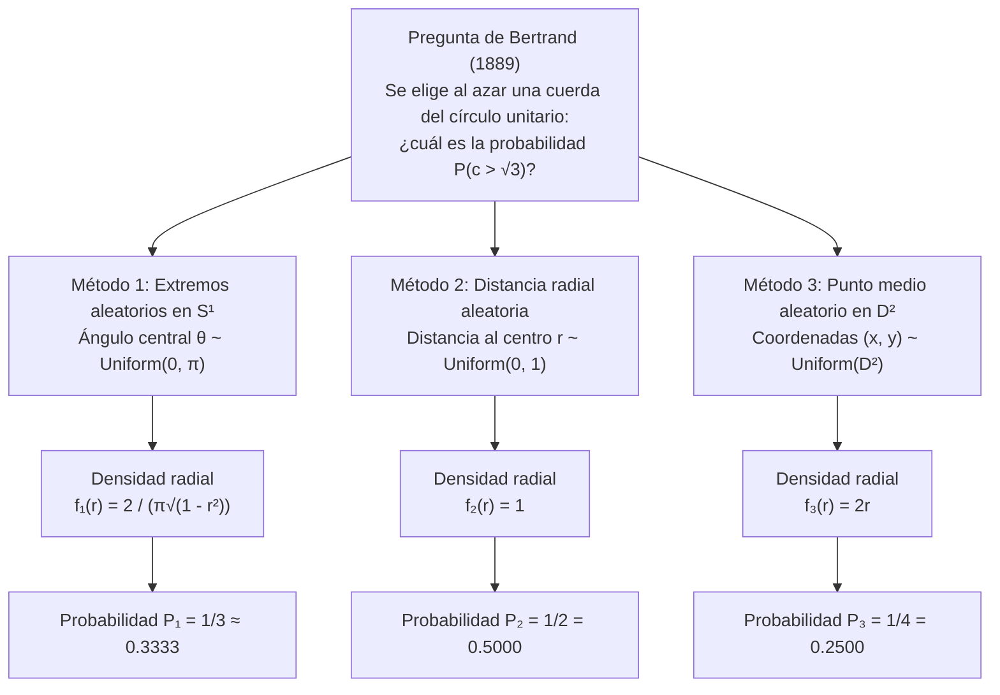
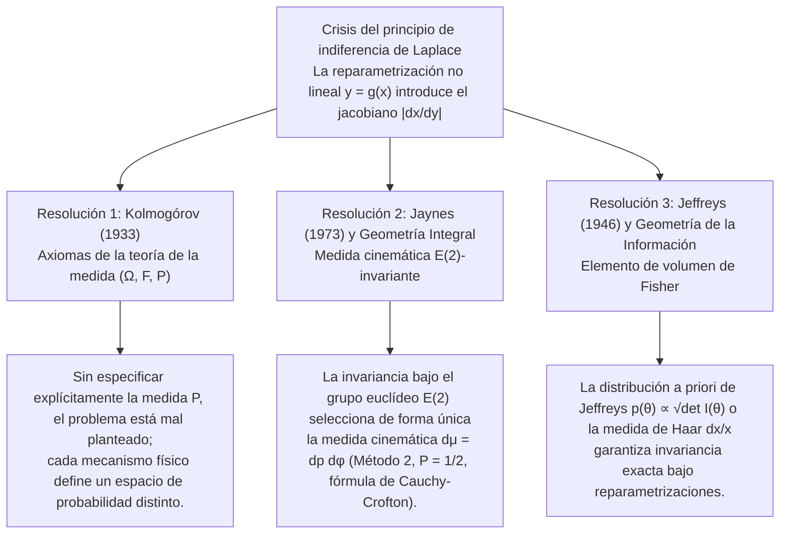

## 1. Introducción: El derrumbe de la «aleatoriedad uniforme» en 1889

En los espacios finitos discretos, la expresión «elegir al azar» parece inequívoca: al lanzar un dado simétrico, cada una de sus seis caras tiene probabilidad $1/6$. Sin embargo, al pasar al <strong>continuo geométrico</strong>, esta intuición se quiebra por completo. En 1889, el matemático francés <strong>Joseph Bertrand (1822–1900)</strong> planteó en las primeras páginas de su obra *Calcul des probabilités* un problema elemental que sacudió los cimientos de la teoría de la probabilidad: la <strong>paradoja de Bertrand</strong>.

Consideremos un círculo unitario $S^1 = \{(x,y) \in \mathbb{R}^2 : x^2 + y^2 = 1\}$ de radio $R = 1$ y un triángulo equilátero inscrito $\triangle ABC$. La longitud del lado del triángulo es $L = 2R\sin(\pi/3) = \sqrt{3} \approx 1.732$, y el radio de su círculo inscrito (la distancia perpendicular desde el centro $O$ hasta cada lado) es $r_{\text{in}} = R\cos(\pi/3) = 1/2$.

> <strong>[Problema de Bertrand (1889)]</strong>
> Se traza «al azar» una cuerda $c$ del círculo unitario. ¿Cuál es la probabilidad $P(c > \sqrt{3})$ de que la longitud de la cuerda sea mayor que el lado $L = \sqrt{3}$ del triángulo equilátero inscrito?

Bertrand presentó tres construcciones geométricas completamente naturales y simétricas que conducen a tres probabilidades exactas mutuamente contradictorias: <strong>$P_1 = 1/3$, $P_2 = 1/2$ y $P_3 = 1/4$</strong>.



---

## 2. Derivación rigurosa de las tres soluciones clásicas y sus funciones de densidad

Sea $\theta \in [0, \pi]$ el ángulo central subtendido por la cuerda, $r \in [0, 1]$ la distancia perpendicular desde el centro $O$ hasta el punto medio $M(x,y) = (r\cos\phi, r\sin\phi)$ de la cuerda, y $c$ su longitud. Por el teorema de Pitágoras:

$$c = 2\sqrt{1 - r^2} = 2\sin\left(\frac{\theta}{2}\right), \qquad r = \cos\left(\frac{\theta}{2}\right) = \sqrt{1 - \frac{c^2}{4}}$$

El suceso $E = \{c > \sqrt{3}\}$ equivale exactamente en los tres sistemas de coordenadas a:

$$c > \sqrt{3} \iff 2\sqrt{1 - r^2} > \sqrt{3} \iff 0 \le r < \frac{1}{2} \iff \theta \in \left(\frac{2\pi}{3}, \frac{4\pi}{3}\right)$$

### 2.1 Método 1: Extremos aleatorios sobre la circunferencia ($P_1 = 1/3$)

Por simetría rotacional $SO(2)$, fijamos el primer extremo $A$ en un vértice del triángulo ($\theta = 0$) y elegimos el segundo extremo $B$ con ángulo $\theta \sim \text{Uniform}(0, 2\pi)$. Se cumple $c(\theta) > \sqrt{3}$ si y solo si $B$ cae en el arco opuesto $\theta \in (2\pi/3, 4\pi/3)$, cuya longitud es $2\pi/3$ de un total de $2\pi$:

$$P_1(c > \sqrt{3}) = \frac{4\pi/3 - 2\pi/3}{2\pi} = \frac{1}{3}$$

Mediante $r = \cos(\theta/2)$ ($\theta \in [0, \pi]$, $f_\Theta(\theta) = 1/\pi$) y el jacobiano $\left|\frac{d\theta}{dr}\right| = \frac{2}{\sqrt{1 - r^2}}$, obtenemos las densidades:

$$f_{R,1}(r) = \frac{2}{\pi\sqrt{1 - r^2}}, \qquad f_{C,1}(c) = \frac{2}{\pi\sqrt{4 - c^2}}, \qquad \mathbb{E}_1[c] = \frac{4}{\pi} \approx 1.2732$$

### 2.2 Método 2: Distancia radial aleatoria a lo largo de un radio fijo ($P_2 = 1/2$)

Elegimos un radio con ángulo $\phi \sim \text{Uniform}(0, 2\pi)$ y sobre él seleccionamos la distancia al centro $r \sim \text{Uniform}(0, 1)$. Como el lado del triángulo equilátero dista $r_{\text{in}} = 1/2$ del centro, $c > \sqrt{3} \iff 0 \le r < 1/2$:

$$P_2(c > \sqrt{3}) = \int_0^{1/2} 1\,dr = \frac{1}{2}, \qquad f_{R,2}(r) = 1, \qquad f_{C,2}(c) = \frac{c}{2\sqrt{4 - c^2}}, \qquad \mathbb{E}_2[c] = \frac{\pi}{2} \approx 1.5708$$

### 2.3 Método 3: Punto medio aleatorio uniformemente en el disco ($P_3 = 1/4$)

Toda cuerda no diametral queda determinada de forma única por su punto medio $M(x, y) \in D^2$. Si elegimos $M$ uniformemente respecto al área $dx\,dy$ del disco unitario $D^2$ ($f_{X,Y}(x,y) = 1/\pi$), entonces $c > \sqrt{3}$ si y solo si $M$ cae dentro del disco inscrito concéntrico $D_{1/2}$ de radio $1/2$:

$$P_3(c > \sqrt{3}) = \frac{\text{Área}(D_{1/2})}{\text{Área}(D_1)} = \frac{\pi (1/2)^2}{\pi (1)^2} = \frac{1}{4}$$

¿Por qué difieren los métodos 2 y 3? Porque el elemento de área en coordenadas polares incluye el determinante jacobiano $J = r$, es decir, $dx\,dy = r\,dr\,d\phi$. Al integrar respecto a $\phi \in [0, 2\pi)$, la densidad marginal radial resulta lineal:

$$f_{R,3}(r) = \int_0^{2\pi} \frac{1}{\pi} r\,d\phi = 2r, \qquad f_{C,3}(c) = \frac{c}{2}, \qquad \mathbb{E}_3[c] = \frac{4}{3} \approx 1.3333$$

| Característica | Método 1: Extremos aleatorios | Método 2: Radio aleatorio | Método 3: Punto medio aleatorio |
| :--- | :--- | :--- | :--- |
| <strong>Coordenada uniforme</strong> | Ángulo $\theta \sim U(0, \pi)$ | Distancia $r \sim U(0, 1)$ | Área $(x,y) \sim U(D^2)$ ($r^2 \sim U(0,1)$) |
| <strong>Elemento de medida $d\mathbb{P}(r,\phi)$</strong> | $\dfrac{1}{\pi^2\sqrt{1 - r^2}}\,dr\,d\phi$ | $\dfrac{1}{2\pi}\,dr\,d\phi$ | $\dfrac{r}{\pi}\,dr\,d\phi = \dfrac{1}{\pi}\,dx\,dy$ |
| <strong>Densidad radial $f_R(r)$</strong> | $\dfrac{2}{\pi\sqrt{1 - r^2}}$ | $1$ | $2r$ |
| <strong>Densidad de longitud $f_C(c)$</strong> | $\dfrac{2}{\pi\sqrt{4 - c^2}}$ | $\dfrac{c}{2\sqrt{4 - c^2}}$ | $\dfrac{c}{2}$ |
| <strong>Probabilidad $P(c > \sqrt{3})$</strong> | <strong>$1/3 \approx 0.3333$</strong> | <strong>$1/2 = 0.5000$</strong> | <strong>$1/4 = 0.2500$</strong> |
| <strong>Valor esperado $\mathbb{E}[c]$</strong> | $4/\pi \approx 1.2732$ | $\pi/2 \approx 1.5708$ | $4/3 \approx 1.3333$ |

---

## 3. La crisis del principio de indiferencia de Laplace y la paradoja del vino y el agua de Keynes (1921)

La probabilidad clásica de <strong>Pierre-Simon Laplace</strong> descansaba en el <strong>principio de razón insuficiente</strong>, rebautizado como <strong>principio de indiferencia (Principle of Indifference)</strong> por <strong>John Maynard Keynes (1921)</strong> en *A Treatise on Probability*. En un espacio continuo, asignar una densidad constante $f_X(x) = \frac{1}{b-a}$ a un parámetro $x \in [a, b]$ bajo una transformación no lineal $y = g(x)$ multiplica la densidad por el <strong>jacobiano $\left|\frac{dx}{dy}\right|$</strong>:

$$f_Y(y) = f_X\bigl(g^{-1}(y)\bigr)\left|\frac{dx}{dy}\right|$$

En la <strong>paradoja del vino y el agua de Keynes (1921)</strong>:
- Sabemos únicamente que la proporción de vino respecto a agua $x = W_{\text{vino}}/W_{\text{agua}}$ en una copa está entre $1/3$ y $3$. Si $x \sim \text{Uniform}(1/3, 3)$, la mediana es $x_{\text{med}} = 5/3$ y $P_X(x \le 2) = \frac{2 - 1/3}{3 - 1/3} = \frac{5}{8} = 0.625$.
- Pero la misma premisa implica que la proporción inversa $y = 1/x = W_{\text{agua}}/W_{\text{vino}}$ también pertenece a $[1/3, 3]$. Si $y \sim \text{Uniform}(1/3, 3)$, la mediana es $y_{\text{med}} = 5/3$ (¡contradiciendo $x \cdot y = 1$!) y el mismo suceso $x \le 2 \iff y \ge 1/2$ tiene probabilidad $P_Y(y \ge 1/2) = \frac{3 - 1/2}{3 - 1/3} = \frac{15}{16} = 0.9375 \neq \frac{5}{8}$.

---

## 4. Las tres resoluciones matemáticas y físicas modernas



### 4.1 Axiomatización en teoría de la medida de Kolmogórov $(\Omega, \mathcal{F}, \mathbb{P})$ (1933)

En 1933, <strong>Andréi Kolmogórov</strong> demostró que todo problema probabilístico exige definir explícitamente la terna $(\Omega, \mathcal{F}, \mathbb{P})$. Sin especificar la medida de probabilidad $\mathbb{P}$, pedir la probabilidad de una cuerda «al azar» carece de sentido matemático.

### 4.2 Invariancia bajo grupos de transformación de E. T. Jaynes (1973) y geometría integral

En *"The Well-Posed Problem"* (1973), el físico <strong>Edwin T. Jaynes</strong> demostró que al lanzar pajitas largas sobre un círculo en el suelo, la densidad $h(p, \phi)\,dp\,d\phi$ de las rectas $x\cos\phi + y\sin\phi = p$ debe ser invariante bajo:
1. <strong>Rotaciones $SO(2)$</strong>: $h(p, \phi) = g(p)/(2\pi)$;
2. <strong>Cambios de escala</strong> (restricción a un subcírculo concéntrico de radio $a < 1$);
3. <strong>Traslaciones $\mathbb{R}^2$ (grupo euclídeo de movimientos rígidos $E(2) = \mathbb{R}^2 \rtimes O(2)$)</strong>: al trasladar el origen en $(x_0, y_0)$, se tiene $p' = p - x_0\cos\phi - y_0\sin\phi$ y $\phi' = \phi$, cuyo determinante jacobiano es idénticamente $1$:
   $$J = \det\frac{\partial(p', \phi')}{\partial(p, \phi)} = \det\begin{pmatrix} 1 & x_0\sin\phi - y_0\cos\phi \\ 0 & 1 \end{pmatrix} = 1$$
   La invariancia traslacional $g(p') = g(p)$ obliga de manera única a que $g(p) = \text{const.}$

Esta es la <strong>medida cinemática de Poincaré–Santaló</strong> de la geometría integral:

$$d\mu(L) = dp\,d\phi$$

Por la <strong>fórmula de Cauchy–Crofton</strong> (que también rige la <strong>aguja de Buffon</strong>), la medida de las rectas que cortan un cuerpo convexo $K \subset \mathbb{R}^2$ es igual a su perímetro $\text{Perimeter}(\partial K)$. El cociente entre el perímetro del círculo inscrito ($\pi$) y del círculo unitario ($2\pi$) arroja de inmediato el <strong>Método 2 ($P = 1/2$)</strong>.

### 4.3 Distribución a priori de Jeffreys (1946)

En inferencia bayesiana, <strong>Harold Jeffreys (1946)</strong> utilizó la raíz cuadrada del determinante de la <strong>matriz de información de Fisher</strong> $I_{ij}(\theta) = -\mathbb{E}\left[\frac{\partial^2 \ln p(X\mid\theta)}{\partial\theta_i\partial\theta_j}\right]$:

$$p_J(\theta) \propto \sqrt{\det I(\theta)}$$

Para la paradoja del vino y el agua, la medida de Haar del grupo multiplicativo $(\mathbb{R}_{>0}, \times)$, $d\mu(x) = \frac{dx}{x}$ con densidad $f(x) = \frac{1}{2\ln 3 \cdot x}$ en $[1/3, 3]$, es invariante bajo $y = 1/x$, dando una mediana consistente $x_{\text{med}} = y_{\text{med}} = 1$.

---

## 5. Simulación de Montecarlo en Python

```python
import numpy as np

def simulate_bertrand(n: int = 1_000_000, seed: int = 42) -> None:
    rng = np.random.default_rng(seed)
    limit = np.sqrt(3.0)

    # Método 1: Extremos aleatorios en S^1 (P = 1/3)
    t1 = rng.uniform(0, 2 * np.pi, n)
    t2 = rng.uniform(0, 2 * np.pi, n)
    c1 = 2.0 * np.sin(np.abs(t1 - t2) / 2.0)

    # Método 2: Distancia radial aleatoria r ~ U(0, 1) (P = 1/2)
    r2 = rng.uniform(0.0, 1.0, n)
    c2 = 2.0 * np.sqrt(1.0 - r2**2)

    # Método 3: Punto medio aleatorio u = r^2 ~ U(0, 1) (P = 1/4)
    r3 = np.sqrt(rng.uniform(0.0, 1.0, n))
    c3 = 2.0 * np.sqrt(1.0 - r3**2)

    # Método 4: Experimento físico de Jaynes (Círculo descentrado en (3.5, -2.0))
    phi = rng.uniform(0, 2 * np.pi, n * 5)
    p = rng.uniform(-10.0, 10.0, n * 5)
    r_shifted = np.abs(p - (3.5 * np.cos(phi) - 2.0 * np.sin(phi)))
    hits = r_shifted[r_shifted <= 1.0]
    c_jaynes = 2.0 * np.sqrt(1.0 - hits**2)

    for name, arr, exact in [
        ("Method 1 (Endpoints)", c1, 1/3),
        ("Method 2 (Radius)", c2, 1/2),
        ("Method 3 (Midpoint)", c3, 1/4),
        ("Jaynes Off-Center Toss", c_jaynes, 1/2),
    ]:
        print(f"{name:<24}: P(c > √3) = {np.mean(arr > limit):.5f} (Exact: {exact:.5f})")

if __name__ == "__main__":
    simulate_bertrand()
```
