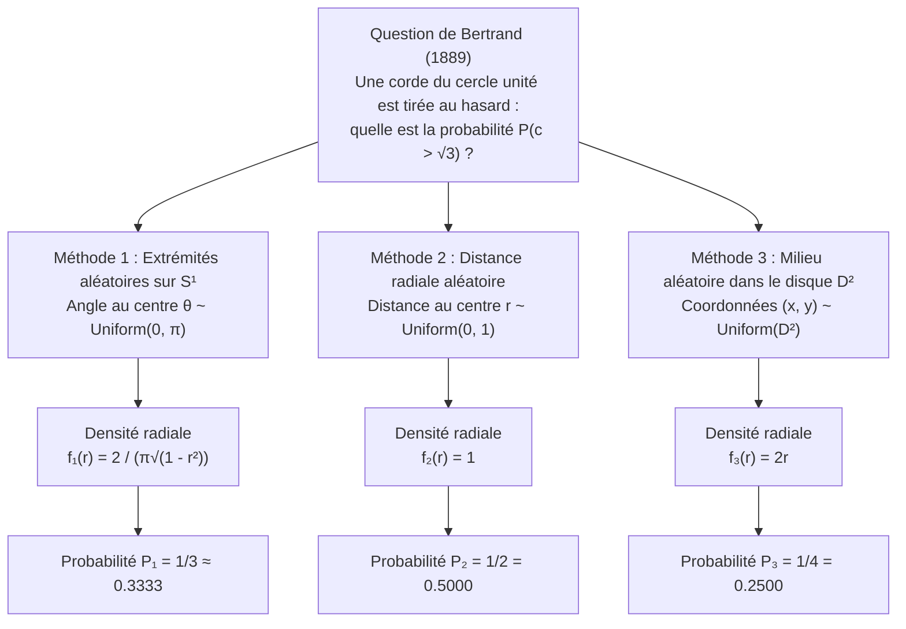
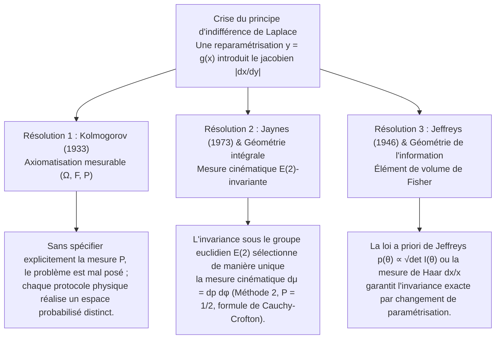

## 1. Introduction : L'effondrement de l'intuition du « hasard uniforme » en 1889

Dans les espaces finis discrets, l'expression « choisir au hasard » semble dépourvue de toute ambiguïté : lancer un dé équilibré attribue la probabilité $1/6$ à chacune des six faces. Mais dès que l'on franchit le seuil du <strong>continu géométrique</strong>, cette intuition s'effondre. En 1889, dans son célèbre traité *Calcul des probabilités*, le mathématicien français <strong>Joseph Bertrand (1822–1900)</strong> formula un problème élémentaire devenu légendaire sous le nom de <strong>paradoxe de Bertrand</strong>.

Considérons un cercle unité $S^1 = \{(x,y) \in \mathbb{R}^2 : x^2 + y^2 = 1\}$ de rayon $R = 1$ et un triangle équilatéral inscrit $\triangle ABC$. Le côté du triangle vaut $L = 2R\sin(\pi/3) = \sqrt{3} \approx 1.732$, et le rayon de son cercle inscrit (la distance du centre $O$ à chaque côté) vaut $r_{\text{in}} = R\cos(\pi/3) = 1/2$.

> <strong>[Problème de Bertrand (1889)]</strong>
> On choisit « au hasard » une corde $c$ du cercle unité. Quelle est la probabilité $P(c > \sqrt{3})$ que la longueur de cette corde dépasse le côté $L = \sqrt{3}$ du triangle équilatéral inscrit ?

Bertrand proposa trois méthodes géométriques parfaitement naturelles et symétriques, aboutissant pourtant à trois probabilités exactes mutuellement incompatibles : <strong>$P_1 = 1/3$, $P_2 = 1/2$ et $P_3 = 1/4$</strong>.



---

## 2. Dérivation rigoureuse des trois solutions classiques et de leurs densités

Soit $\theta \in [0, \pi]$ l'angle au centre sous-tendu par la corde, $r \in [0, 1]$ la distance perpendiculaire du centre $O$ au milieu $M(x,y) = (r\cos\phi, r\sin\phi)$ de la corde, et $c$ sa longueur. Le théorème de Pythagore donne la relation fondamentale :

$$c = 2\sqrt{1 - r^2} = 2\sin\left(\frac{\theta}{2}\right), \qquad r = \cos\left(\frac{\theta}{2}\right) = \sqrt{1 - \frac{c^2}{4}}$$

L'événement $E = \{c > \sqrt{3}\}$ s'écrit de manière équivalente dans les trois systèmes de coordonnées :

$$c > \sqrt{3} \iff 2\sqrt{1 - r^2} > \sqrt{3} \iff 0 \le r < \frac{1}{2} \iff \theta \in \left(\frac{2\pi}{3}, \frac{4\pi}{3}\right)$$

### 2.1 Méthode 1 : Extrémités choisies uniformément sur la circonférence ($P_1 = 1/3$)

Par symétrie de rotation $SO(2)$, fixons la première extrémité $A$ en $\theta = 0$ (un sommet du triangle) et choisissons la seconde extrémité $B$ selon $\theta \sim \text{Uniform}(0, 2\pi)$. La corde vérifie $c(\theta) > \sqrt{3}$ si et seulement si $B$ appartient à l'arc opposé $\theta \in (2\pi/3, 4\pi/3)$, de longueur $2\pi/3$ sur $2\pi$ :

$$P_1(c > \sqrt{3}) = \frac{4\pi/3 - 2\pi/3}{2\pi} = \frac{1}{3}$$

Avec le changement de variable $r = \cos(\theta/2)$ ($\theta \in [0, \pi]$, $f_\Theta(\theta) = 1/\pi$) et le jacobien $\left|\frac{d\theta}{dr}\right| = \frac{2}{\sqrt{1 - r^2}}$, on obtient :

$$f_{R,1}(r) = \frac{2}{\pi\sqrt{1 - r^2}}, \qquad f_{C,1}(c) = \frac{2}{\pi\sqrt{4 - c^2}}, \qquad \mathbb{E}_1[c] = \frac{4}{\pi} \approx 1.2732$$

### 2.2 Méthode 2 : Distance radiale choisie uniformément sur un rayon fixe ($P_2 = 1/2$)

On choisit une direction radiale $\phi \sim \text{Uniform}(0, 2\pi)$ puis la distance $r \sim \text{Uniform}(0, 1)$ du milieu de la corde au centre $O$. Comme le côté du triangle équilatéral est à la distance $r_{\text{in}} = 1/2$ du centre, on a $c > \sqrt{3} \iff 0 \le r < 1/2$ :

$$P_2(c > \sqrt{3}) = \int_0^{1/2} 1\,dr = \frac{1}{2}, \qquad f_{R,2}(r) = 1, \qquad f_{C,2}(c) = \frac{c}{2\sqrt{4 - c^2}}, \qquad \mathbb{E}_2[c] = \frac{\pi}{2} \approx 1.5708$$

### 2.3 Méthode 3 : Milieu choisi uniformément en aire dans le disque ($P_3 = 1/4$)

Toute corde ($r > 0$) est déterminée de façon unique par son milieu $M(x, y) \in D^2$. Si $M$ est choisi uniformément par rapport à la mesure d'aire de Lebesgue $dx\,dy$ sur le disque unité $D^2$ ($f_{X,Y}(x,y) = 1/\pi$), alors $c > \sqrt{3}$ si et seulement si $M$ tombe dans le disque inscrit concentrique $D_{1/2}$ de rayon $1/2$ :

$$P_3(c > \sqrt{3}) = \frac{\text{Aire}(D_{1/2})}{\text{Aire}(D_1)} = \frac{\pi (1/2)^2}{\pi (1)^2} = \frac{1}{4}$$

Pourquoi les méthodes 2 et 3 diffèrent-elles ? Parce que le passage en coordonnées polaires fait apparaître le jacobien $J = r$, soit $dx\,dy = r\,dr\,d\phi$. En intégrant sur $\phi \in [0, 2\pi)$, la densité marginale de $r$ devient linéaire :

$$f_{R,3}(r) = \int_0^{2\pi} \frac{1}{\pi} r\,d\phi = 2r, \qquad f_{C,3}(c) = \frac{c}{2}, \qquad \mathbb{E}_3[c] = \frac{4}{3} \approx 1.3333$$

| Critère | Méthode 1 : Extrémités aléatoires | Méthode 2 : Rayon aléatoire | Méthode 3 : Milieu aléatoire |
| :--- | :--- | :--- | :--- |
| <strong>Paramètre uniforme</strong> | Angle $\theta \sim U(0, \pi)$ | Distance $r \sim U(0, 1)$ | Aire $(x,y) \sim U(D^2)$ ($r^2 \sim U(0,1)$) |
| <strong>Élément de probabilité $d\mathbb{P}(r,\phi)$</strong> | $\dfrac{1}{\pi^2\sqrt{1 - r^2}}\,dr\,d\phi$ | $\dfrac{1}{2\pi}\,dr\,d\phi$ | $\dfrac{r}{\pi}\,dr\,d\phi = \dfrac{1}{\pi}\,dx\,dy$ |
| <strong>Densité radiale $f_R(r)$</strong> | $\dfrac{2}{\pi\sqrt{1 - r^2}}$ | $1$ | $2r$ |
| <strong>Densité de longueur $f_C(c)$</strong> | $\dfrac{2}{\pi\sqrt{4 - c^2}}$ | $\dfrac{c}{2\sqrt{4 - c^2}}$ | $\dfrac{c}{2}$ |
| <strong>Probabilité $P(c > \sqrt{3})$</strong> | <strong>$1/3 \approx 0.3333$</strong> | <strong>$1/2 = 0.5000$</strong> | <strong>$1/4 = 0.2500$</strong> |
| <strong>Espérance $\mathbb{E}[c]$</strong> | $4/\pi \approx 1.2732$ | $\pi/2 \approx 1.5708$ | $4/3 \approx 1.3333$ |

---

## 3. La crise du principe d'indifférence de Laplace et le paradoxe du vin et de l'eau de Keynes (1921)

La théorie classique de <strong>Pierre-Simon Laplace</strong> reposait sur le <strong>principe de raison insuffisante</strong>, rebaptisé <strong>principe d'indifférence (Principle of Indifference)</strong> par <strong>John Maynard Keynes (1921)</strong> dans *A Treatise on Probability*. Or, sur un espace continu, attribuer une densité uniforme $f_X(x) = \frac{1}{b-a}$ à un paramètre $x \in [a, b]$ détruit l'uniformité sous toute reparamétrisation non linéaire $y = g(x)$ à cause du <strong>jacobien $\left|\frac{dx}{dy}\right|$</strong> :

$$f_Y(y) = f_X\bigl(g^{-1}(y)\bigr)\left|\frac{dx}{dy}\right|$$

Le <strong>paradoxe du vin et de l'eau de Keynes (1921)</strong> l'illustre de façon éclatante :
- Un verre contient un mélange d'eau et de vin tel que le rapport $x = W_{\text{vin}}/W_{\text{eau}}$ est compris entre $1/3$ et $3$. Si $x \sim \text{Uniform}(1/3, 3)$, la médiane est $x_{\text{med}} = 5/3$ et $P_X(x \le 2) = \frac{2 - 1/3}{3 - 1/3} = \frac{5}{8} = 0.625$.
- Mais la même hypothèse signifie que le rapport inverse $y = 1/x = W_{\text{eau}}/W_{\text{vin}}$ appartient lui aussi à $[1/3, 3]$. Si $y \sim \text{Uniform}(1/3, 3)$, la médiane est $y_{\text{med}} = 5/3$ (ce qui contredit $x \cdot y = 1$ !) et le même événement $x \le 2 \iff y \ge 1/2$ a pour probabilité $P_Y(y \ge 1/2) = \frac{3 - 1/2}{3 - 1/3} = \frac{15}{16} = 0.9375 \neq \frac{5}{8}$ !

---

## 4. Les trois résolutions mathématiques et physiques modernes



### 4.1 L'axiomatique en théorie de la mesure de Kolmogorov $(\Omega, \mathcal{F}, \mathbb{P})$ (1933)

En 1933, <strong>Andreï Kolmogorov</strong> établit qu'un problème probabiliste n'est bien défini que si l'on fixe explicitement le triplet $(\Omega, \mathcal{F}, \mathbb{P})$. Sans la donnée de la mesure de probabilité $\mathbb{P}$, l'expression « choisir une corde au hasard » est mathématiquement incomplète.

### 4.2 L'invariance par groupe de transformations d'E. T. Jaynes (1973) et la mesure cinématique

Dans son article fondateur *"The Well-Posed Problem"* (1973), le physicien <strong>Edwin T. Jaynes</strong> montra que lorsqu'on lance de longues pailles vers un cercle tracé au sol, la mesure $h(p, \phi)\,dp\,d\phi$ sur l'espace des droites $x\cos\phi + y\sin\phi = p$ doit être invariante par :
1. <strong>Rotations $SO(2)$</strong> : $h(p, \phi) = g(p)/(2\pi)$ ;
2. <strong>Changements d'échelle</strong> (restriction à un sous-cercle concentrique de rayon $a < 1$) ;
3. <strong>Translations $\mathbb{R}^2$ (groupe euclidien des déplacements rigides $E(2) = \mathbb{R}^2 \rtimes O(2)$)</strong> : une translation d'origine $(x_0, y_0)$ transforme $(p, \phi)$ en $p' = p - x_0\cos\phi - y_0\sin\phi$ et $\phi' = \phi$, dont le déterminant jacobien vaut identiquement $1$ :
   $$J = \det\frac{\partial(p', \phi')}{\partial(p, \phi)} = \det\begin{pmatrix} 1 & x_0\sin\phi - y_0\cos\phi \\ 0 & 1 \end{pmatrix} = 1$$
   L'invariance $g(p') = g(p)$ pour toute translation impose de manière unique $g(p) = \text{const.}$ !

On retrouve ainsi l'unique <strong>mesure cinématique de Poincaré–Santaló</strong> en géométrie intégrale :

$$d\mu(L) = dp\,d\phi$$

D'après la <strong>formule de Cauchy–Crofton</strong> (qui gouverne aussi l'<strong>aiguille de Buffon</strong>), la mesure des droites coupant un convexe $K \subset \mathbb{R}^2$ est égale à son périmètre $\text{Perimeter}(\partial K)$. Le rapport des périmètres du cercle inscrit ($\pi$) et du cercle unité ($2\pi$) donne immédiatement la <strong>Méthode 2 ($P = 1/2$)</strong>.

### 4.3 La loi a priori de Jeffreys (1946)

En statistique bayésienne, <strong>Harold Jeffreys (1946)</strong> résolut le problème de reparamétrisation en définissant la densité a priori via la racine carrée du déterminant de la <strong>matrice d'information de Fisher</strong> $I_{ij}(\theta) = -\mathbb{E}\left[\frac{\partial^2 \ln p(X\mid\theta)}{\partial\theta_i\partial\theta_j}\right]$ :

$$p_J(\theta) \propto \sqrt{\det I(\theta)}$$

Pour le paradoxe du vin et de l'eau, la mesure de Haar du groupe multiplicatif $(\mathbb{R}_{>0}, \times)$, $d\mu(x) = \frac{dx}{x}$ de densité $f(x) = \frac{1}{2\ln 3 \cdot x}$ sur $[1/3, 3]$, est strictement invariante sous $y = 1/x$, donnant une médiane cohérente $x_{\text{med}} = y_{\text{med}} = 1$.

---

## 5. Simulation Monte-Carlo en Python

```python
import numpy as np

def simulate_bertrand(n: int = 1_000_000, seed: int = 42) -> None:
    rng = np.random.default_rng(seed)
    limit = np.sqrt(3.0)

    # Méthode 1 : Extrémités aléatoires sur S^1 (P = 1/3)
    t1 = rng.uniform(0, 2 * np.pi, n)
    t2 = rng.uniform(0, 2 * np.pi, n)
    c1 = 2.0 * np.sin(np.abs(t1 - t2) / 2.0)

    # Méthode 2 : Distance radiale aléatoire r ~ U(0, 1) (P = 1/2)
    r2 = rng.uniform(0.0, 1.0, n)
    c2 = 2.0 * np.sqrt(1.0 - r2**2)

    # Méthode 3 : Milieu aléatoire u = r^2 ~ U(0, 1) (P = 1/4)
    r3 = np.sqrt(rng.uniform(0.0, 1.0, n))
    c3 = 2.0 * np.sqrt(1.0 - r3**2)

    # Méthode 4 : Expérience de Jaynes (Cercle cible décentré en (3.5, -2.0))
    phi = rng.uniform(0, 2 * np.pi, n * 5)
    p = rng.uniform(-10.0, 10.0, n * 5)
    r_shifted = np.abs(p - (3.5 * np.cos(phi) - 2.0 * np.sin(phi)))
    hits = r_shifted[r_shifted <= 1.0]
    c_jaynes = 2.0 * np.sqrt(1.0 - hits**2)

    for name, arr, exact in [
        ("Method 1 (Endpoints)", c1, 1/3),
        ("Method 2 (Radius)", c2, 1/2),
        ("Method 3 (Midpoint)", c3, 1/4),
        ("Jaynes Off-Center Toss", c_jaynes, 1/2),
    ]:
        print(f"{name:<24}: P(c > √3) = {np.mean(arr > limit):.5f} (Exact: {exact:.5f})")

if __name__ == "__main__":
    simulate_bertrand()
```
