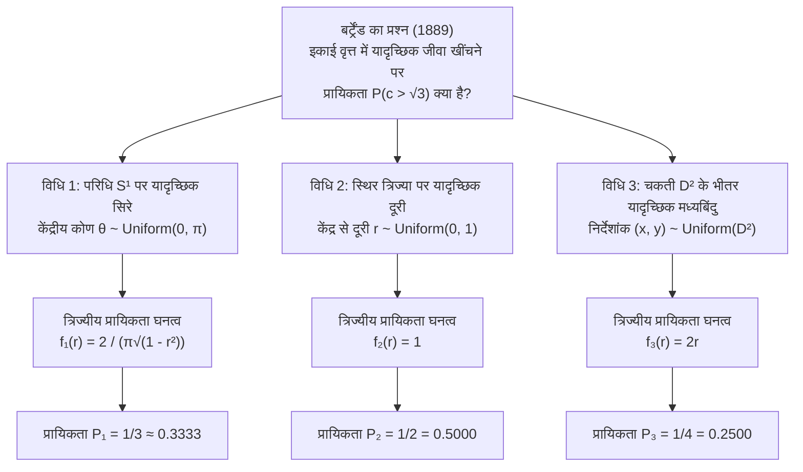
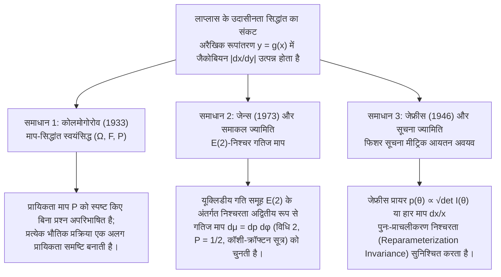

## 1. प्रस्तावना: 1889 में "एकसमान यादृच्छिकता" (Uniform Randomness) के अंतर्ज्ञान का पतन

परिमित असतत (finite discrete) समुच्चयों में "यादृच्छिक रूप से चुनना" (choosing at random) अत्यंत स्पष्ट प्रतीत होता है: एक निष्पक्ष पासे को फेंकने पर प्रत्येक फलक के आने की प्रायिकता $1/6$ होती है। किंतु जैसे ही हम परिमित समुच्चयों से <strong>सतत ज्यामितीय समष्टि (Continuous Geometric Space)</strong> में प्रवेश करते हैं, यह सहज अंतर्ज्ञान ढह जाता है। 1889 में फ्रांसीसी गणितज्ञ <strong>जोसेफ बर्ट्रेंड (Joseph Bertrand, 1822–1900)</strong> ने अपनी प्रसिद्ध पुस्तक *Calcul des probabilités* में एक सरल ज्यामितीय प्रश्न प्रस्तुत किया, जिसे आज <strong>बर्ट्रेंड का विरोधाभास (Bertrand's Paradox)</strong> कहा जाता है।

यूक्लिडीय समतल $\mathbb{R}^2$ में त्रिज्या $R = 1$ वाला एक इकाई वृत्त $S^1 = \{(x,y) : x^2 + y^2 = 1\}$ और उसके भीतर बना एक समबाहु त्रिभुज $\triangle ABC$ लें। समबाहु त्रिभुज की प्रत्येक भुजा की लंबाई $L = 2R\sin(\pi/3) = \sqrt{3} \approx 1.732$ है, तथा वृत्त के केंद्र $O(0,0)$ से त्रिभुज की प्रत्येक भुजा की लंबवत दूरी (अंतःवृत्त की त्रिज्या) $r_{\text{in}} = R\cos(\pi/3) = 1/2$ है।

> <strong>[बर्ट्रेंड का प्रश्न (1889)]</strong>
> इकाई वृत्त की एक जीवा (chord) $c$ को "यादृच्छिक रूप से" खींचा जाता है। इस बात की क्या प्रायिकता $P(c > \sqrt{3})$ है कि जीवा की लंबाई अंतर्निहित समबाहु त्रिभुज की भुजा $L = \sqrt{3}$ से अधिक हो?

बर्ट्रेंड ने जीवा चुनने की तीन पूर्णतः स्वाभाविक और सममित विधियाँ प्रस्तुत कीं और उनसे तीन परस्पर विरोधी सटीक उत्तर प्राप्त किए: <strong>$P_1 = 1/3$, $P_2 = 1/2$ और $P_3 = 1/4$</strong>।



---

## 2. तीनों शास्त्रीय समाधानों और उनके प्रायिकता घनत्व फलनों की कठोर व्युत्पत्ति

माना जीवा द्वारा केंद्र पर अंतरित कोण $\theta \in [0, \pi]$ है, केंद्र $O$ से जीवा के मध्यबिंदु $M(x,y) = (r\cos\phi, r\sin\phi)$ की लंबवत दूरी $r \in [0, 1]$ है, और जीवा की लंबाई $c$ है। पाइथागोरस प्रमेय से:

$$c = 2\sqrt{1 - r^2} = 2\sin\left(\frac{\theta}{2}\right), \qquad r = \cos\left(\frac{\theta}{2}\right) = \sqrt{1 - \frac{c^2}{4}}$$

अतः घटना $E = \{c > \sqrt{3}\}$ तीनों निर्देशांक प्रणालियों में निम्न शर्तों के समतुल्य है:

$$c > \sqrt{3} \iff 2\sqrt{1 - r^2} > \sqrt{3} \iff 0 \le r < \frac{1}{2} \iff \theta \in \left(\frac{2\pi}{3}, \frac{4\pi}{3}\right)$$

### 2.1 विधि 1: परिधि पर यादृच्छिक अंतिम बिंदु ($P_1 = 1/3$)

घूर्णन सममिति $SO(2)$ के कारण पहले सिरे $A$ को त्रिभुज के एक शीर्ष ($\theta = 0$) पर स्थिर करें और दूसरे सिरे $B$ को परिधि पर एकसमान रूप से चुनें: $\theta \sim \text{Uniform}(0, 2\pi)$। जीवा की लंबाई $c(\theta) > \sqrt{3}$ तभी होगी जब $B$ सम्मुख चाप $\theta \in (2\pi/3, 4\pi/3)$ पर पड़े, जिसकी लंबाई कुल परिधि $2\pi$ में से $2\pi/3$ है:

$$P_1(c > \sqrt{3}) = \frac{4\pi/3 - 2\pi/3}{2\pi} = \frac{1}{3}$$

$r = \cos(\theta/2)$ ($\theta \in [0, \pi]$, $f_\Theta(\theta) = 1/\pi$) और जैकोबियन $\left|\frac{d\theta}{dr}\right| = \frac{2}{\sqrt{1 - r^2}}$ से घनत्व फलन प्राप्त होते हैं:

$$f_{R,1}(r) = \frac{2}{\pi\sqrt{1 - r^2}}, \qquad f_{C,1}(c) = \frac{2}{\pi\sqrt{4 - c^2}}, \qquad \mathbb{E}_1[c] = \frac{4}{\pi} \approx 1.2732$$

### 2.2 विधि 2: एक निश्चित त्रिज्या के अनुदिश यादृच्छिक दूरी ($P_2 = 1/2$)

एक त्रिज्या की दिशा $\phi \sim \text{Uniform}(0, 2\pi)$ चुनें और उस पर केंद्र से दूरी $r \sim \text{Uniform}(0, 1)$ एकसमान रूप से चुनें। चूँकि समबाहु त्रिभुज की भुजा केंद्र से $r_{\text{in}} = 1/2$ दूरी पर होती है, इसलिए $c > \sqrt{3} \iff 0 \le r < 1/2$:

$$P_2(c > \sqrt{3}) = \int_0^{1/2} 1\,dr = \frac{1}{2}, \qquad f_{R,2}(r) = 1, \qquad f_{C,2}(c) = \frac{c}{2\sqrt{4 - c^2}}, \qquad \mathbb{E}_2[c] = \frac{\pi}{2} \approx 1.5708$$

### 2.3 विधि 3: वृत्तीय चकती के भीतर यादृच्छिक मध्यबिंदु ($P_3 = 1/4$)

प्रत्येक जीवा ($r > 0$) अपने मध्यबिंदु $M(x, y) \in D^2$ द्वारा अद्वितीय रूप से निर्धारित होती है। यदि $M$ को इकाई चकती $D^2$ के क्षेत्रफल $dx\,dy$ के सापेक्ष एकसमान रूप से चुना जाए ($f_{X,Y}(x,y) = 1/\pi$), तो $c > \sqrt{3}$ तभी होगा जब $M$ त्रिज्या $1/2$ वाली संकेंद्रित अंतःवृत्त चकती $D_{1/2}$ के भीतर गिरे:

$$P_3(c > \sqrt{3}) = \frac{\text{Area}(D_{1/2})}{\text{Area}(D_1)} = \frac{\pi (1/2)^2}{\pi (1)^2} = \frac{1}{4}$$

विधि 2 और विधि 3 में अंतर ध्रुवीय निर्देशांक के जैकोबियन $dx\,dy = r\,dr\,d\phi$ के कारण आता है। $\phi \in [0, 2\pi)$ पर समाकलन करने से $r$ का सीमांत घनत्व रैखिक हो जाता है:

$$f_{R,3}(r) = \int_0^{2\pi} \frac{1}{\pi} r\,d\phi = 2r, \qquad f_{C,3}(c) = \frac{c}{2}, \qquad \mathbb{E}_3[c] = \frac{4}{3} \approx 1.3333$$

| तुलना मानदंड | विधि 1: यादृच्छिक सिरे | विधि 2: यादृच्छिक त्रिज्या दूरी | विधि 3: यादृच्छिक मध्यबिंदु |
| :--- | :--- | :--- | :--- |
| <strong>एकसमान प्राचल</strong> | कोण $\theta \sim U(0, \pi)$ | दूरी $r \sim U(0, 1)$ | क्षेत्रफल $(x,y) \sim U(D^2)$ ($r^2 \sim U(0,1)$) |
| <strong>प्रायिकता अवयव $d\mathbb{P}(r,\phi)$</strong> | $\dfrac{1}{\pi^2\sqrt{1 - r^2}}\,dr\,d\phi$ | $\dfrac{1}{2\pi}\,dr\,d\phi$ | $\dfrac{r}{\pi}\,dr\,d\phi = \dfrac{1}{\pi}\,dx\,dy$ |
| <strong>त्रिज्यीय घनत्व $f_R(r)$</strong> | $\dfrac{2}{\pi\sqrt{1 - r^2}}$ | $1$ | $2r$ |
| <strong>जीवा लंबाई घनत्व $f_C(c)$</strong> | $\dfrac{2}{\pi\sqrt{4 - c^2}}$ | $\dfrac{c}{2\sqrt{4 - c^2}}$ | $\dfrac{c}{2}$ |
| <strong>प्रायिकता $P(c > \sqrt{3})$</strong> | <strong>$1/3 \approx 0.3333$</strong> | <strong>$1/2 = 0.5000$</strong> | <strong>$1/4 = 0.2500$</strong> |
| <strong>प्रत्याशित मान $\mathbb{E}[c]$</strong> | $4/\pi \approx 1.2732$ | $\pi/2 \approx 1.5708$ | $4/3 \approx 1.3333$ |

---

## 3. लाप्लास के 'अपर्याप्त कारण के सिद्धांत' का संकट और कीन्स का 'शराब-पानी विरोधाभास' (1921)

<strong>पियरे-साइमन लाप्लास (Pierre-Simon Laplace)</strong> का शास्त्रीय प्रायिकता सिद्धांत <strong>अपर्याप्त कारण के सिद्धांत</strong> पर आधारित था, जिसे <strong>जॉन मेनार्ड कीन्स (John Maynard Keynes, 1921)</strong> ने *A Treatise on Probability* में <strong>उदासीनता का सिद्धांत (Principle of Indifference)</strong> नाम दिया। सतत समष्टि में यदि $x \in [a, b]$ पर अचर घनत्व $f_X(x) = \frac{1}{b-a}$ माना जाए, तो किसी अरैखिक रूपांतरण $y = g(x)$ के अंतर्गत <strong>जैकोबियन $\left|\frac{dx}{dy}\right|$</strong> से गुणा हो जाता है:

$$f_Y(y) = f_X\bigl(g^{-1}(y)\bigr)\left|\frac{dx}{dy}\right|$$

कीन्स के <strong>शराब-पानी विरोधाभास (Wine-Water Paradox, 1921)</strong> में:
- एक गिलास में शराब और पानी का मिश्रण है जहाँ अनुपात $x = W_{\text{wine}}/W_{\text{water}}$ अंतराल $[1/3, 3]$ में है। यदि $x \sim \text{Uniform}(1/3, 3)$ मानें, तो माध्यिका $x_{\text{med}} = 5/3$ है और $P_X(x \le 2) = \frac{2 - 1/3}{3 - 1/3} = \frac{5}{8} = 0.625$।
- किंतु यही शर्त कहती है कि व्युत्क्रम अनुपात $y = 1/x = W_{\text{water}}/W_{\text{wine}}$ भी $[1/3, 3]$ में है! यदि $y \sim \text{Uniform}(1/3, 3)$ मानें, तो माध्यिका $y_{\text{med}} = 5/3$ आती है (जो $x \cdot y = 1$ का खंडन करती है!) और उसी घटना $x \le 2 \iff y \ge 1/2$ की प्रायिकता $P_Y(y \ge 1/2) = \frac{3 - 1/2}{3 - 1/3} = \frac{15}{16} = 0.9375 \neq \frac{5}{8}$ हो जाती है।

---

## 4. आधुनिक गणित और भौतिकी के तीन महान समाधान



### 4.1 कोलमोगोरोव का माप-सिद्धांत स्वयंसिद्धीकरण $(\Omega, \mathcal{F}, \mathbb{P})$ (1933)

1933 में <strong>आंद्रेई कोलमोगोरोव (Andrei Kolmogorov)</strong> ने स्थापित किया कि कोई भी प्रायिकता समस्या तभी सुपरिभाषित होती है जब प्रायिकता समष्टि $(\Omega, \mathcal{F}, \mathbb{P})$ स्पष्ट रूप से दी गई हो। प्रायिकता माप $\mathbb{P}$ का उल्लेख किए बिना "यादृच्छिक जीवा चुनना" गणितीय रूप से अधूरा प्रश्न है।

### 4.2 ई. टी. जेन्स की रूपांतरण समूह निश्चरता (1973) और समाकल ज्यामिति

अपने प्रसिद्ध शोधपत्र *"The Well-Posed Problem"* (1973) में भौतिक विज्ञानी <strong>एडविन टी. जेन्स (Edwin T. Jaynes)</strong> ने सिद्ध किया कि जब हम फर्श पर बने वृत्त पर दूर से लंबे तिनके फेंकते हैं, तो सरल रेखाओं $x\cos\phi + y\sin\phi = p$ का माप $h(p, \phi)\,dp\,d\phi$ निम्न तीन सममितियों के अंतर्गत निश्चर (invariant) होना चाहिए:
1. <strong>घूर्णन निश्चरता $SO(2)$</strong>: $h(p, \phi) = g(p)/(2\pi)$;
2. <strong>मापक्रम (Scale) निश्चरता</strong> (त्रिज्या $a < 1$ के संकेंद्रित उप-वृत्त पर प्रतिबंध);
3. <strong>स्थानांतरण निश्चरता $\mathbb{R}^2$ (यूक्लिडीय दृढ़ गति समूह $E(2) = \mathbb{R}^2 \rtimes O(2)$)</strong>: मूलबिंदु को $(x_0, y_0)$ से विस्थापित करने पर $p' = p - x_0\cos\phi - y_0\sin\phi$ तथा $\phi' = \phi$ प्राप्त होता है, जिसका जैकोबियन सारणिक सर्वसम रूप से $1$ है:
   $$J = \det\frac{\partial(p', \phi')}{\partial(p, \phi)} = \det\begin{pmatrix} 1 & x_0\sin\phi - y_0\cos\phi \\ 0 & 1 \end{pmatrix} = 1$$
   स्थानांतरण निश्चरता $g(p') = g(p)$ अद्वितीय रूप से $g(p) = \text{const.}$ निर्धारित करती है!

यही समाकल ज्यामिति (Integral Geometry) का प्रसिद्ध <strong>पॉइनकेयर–सैंटालो गतिज माप (Poincaré–Santaló Kinematic Measure)</strong> है:

$$d\mu(L) = dp\,d\phi$$

<strong>कॉशी–क्रॉफ्टन सूत्र (Cauchy–Crofton Formula)</strong> (जो <strong>बफन की सुई समस्या Buffon's Needle</strong> को भी नियंत्रित करता है) के अनुसार किसी उत्तल आकृति $K \subset \mathbb{R}^2$ को काटने वाली रेखाओं का माप उसके परिमाप $\text{Perimeter}(\partial K)$ के बराबर होता है। अतः अंतःवृत्त के परिमाप ($\pi$) और इकाई वृत्त के परिमाप ($2\pi$) के अनुपात से तुरंत <strong>विधि 2 ($P = 1/2$)</strong> प्राप्त होती है।

### 4.3 हैरोल्ड जेफ्रीस का प्रायर (Jeffreys Prior, 1946)

बेयसियन सांख्यिकी में <strong>सर हैरोल्ड जेफ्रीस (1946)</strong> ने <strong>फिशर सूचना आव्यूह (Fisher Information Matrix)</strong> $I_{ij}(\theta) = -\mathbb{E}\left[\frac{\partial^2 \ln p(X\mid\theta)}{\partial\theta_i\partial\theta_j}\right]$ के सारणिक के वर्गमूल का उपयोग किया:

$$p_J(\theta) \propto \sqrt{\det I(\theta)}$$

शराब-पानी विरोधाभास के लिए गुणन समूह $(\mathbb{R}_{>0}, \times)$ का हार माप $d\mu(x) = \frac{dx}{x}$ (अर्थात् $[1/3, 3]$ पर घनत्व $f(x) = \frac{1}{2\ln 3 \cdot x}$) व्युत्क्रम रूपांतरण $y = 1/x$ के अंतर्गत पूर्णतः निश्चर रहता है और संगत माध्यिका $x_{\text{med}} = y_{\text{med}} = 1$ प्रदान करता है।

---

## 5. Python मोंटे कार्लो सिमुलेशन

```python
import numpy as np

def simulate_bertrand(n: int = 1_000_000, seed: int = 42) -> None:
    rng = np.random.default_rng(seed)
    limit = np.sqrt(3.0)

    # विधि 1: परिधि S^1 पर यादृच्छिक सिरे (P = 1/3)
    t1 = rng.uniform(0, 2 * np.pi, n)
    t2 = rng.uniform(0, 2 * np.pi, n)
    c1 = 2.0 * np.sin(np.abs(t1 - t2) / 2.0)

    # विधि 2: यादृच्छिक त्रिज्यीय दूरी r ~ U(0, 1) (P = 1/2)
    r2 = rng.uniform(0.0, 1.0, n)
    c2 = 2.0 * np.sqrt(1.0 - r2**2)

    # विधि 3: यादृच्छिक मध्यबिंदु u = r^2 ~ U(0, 1) (P = 1/4)
    r3 = np.sqrt(rng.uniform(0.0, 1.0, n))
    c3 = 2.0 * np.sqrt(1.0 - r3**2)

    # विधि 4: जेन्स का भौतिक प्रयोग ((3.5, -2.0) पर विस्थापित वृत्त)
    phi = rng.uniform(0, 2 * np.pi, n * 5)
    p = rng.uniform(-10.0, 10.0, n * 5)
    r_shifted = np.abs(p - (3.5 * np.cos(phi) - 2.0 * np.sin(phi)))
    hits = r_shifted[r_shifted <= 1.0]
    c_jaynes = 2.0 * np.sqrt(1.0 - hits**2)

    for name, arr, exact in [
        ("Method 1 (Endpoints)", c1, 1/3),
        ("Method 2 (Radius)", c2, 1/2),
        ("Method 3 (Midpoint)", c3, 1/4),
        ("Jaynes Off-Center Toss", c_jaynes, 1/2),
    ]:
        print(f"{name:<24}: P(c > √3) = {np.mean(arr > limit):.5f} (Exact: {exact:.5f})")

if __name__ == "__main__":
    simulate_bertrand()
```
