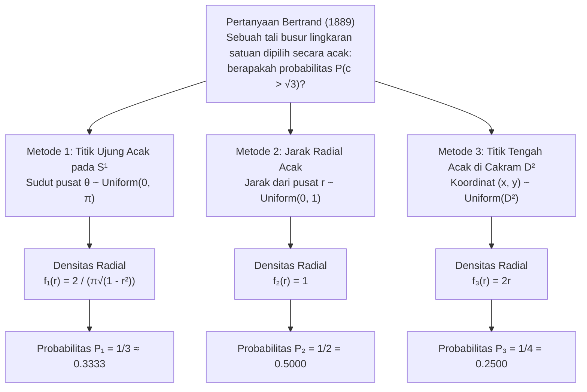
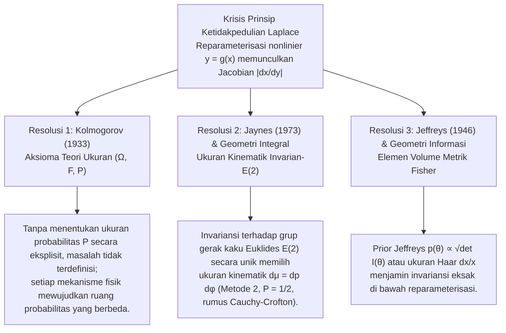

## 1. Pendahuluan: Runtuhnya Intuisi "Acak Seragam" pada Tahun 1889

Dalam ruang diskrit berhingga, frasa "dipilih secara acak" tampak sangat jelas: saat melempar dadu seimbang, masing-masing dari enam sisi memiliki probabilitas $1/6$. Namun, begitu kita melangkah ke <strong>ruang geometris kontinu</strong>, intuisi ini runtuh. Pada tahun 1889, matematikawan Prancis <strong>Joseph Bertrand (1822–1900)</strong> dalam bukunya *Calcul des probabilités* mengajukan teka-teki geometri sederhana yang kini dikenal sebagai <strong>Paradoks Bertrand</strong>.

Tinjau sebuah lingkaran satuan $S^1 = \{(x,y) \in \mathbb{R}^2 : x^2 + y^2 = 1\}$ berjari-jari $R = 1$ dan sebuah segitiga sama sisi $\triangle ABC$ yang dilukis di dalamnya. Panjang sisi segitiga tersebut adalah $L = 2R\sin(\pi/3) = \sqrt{3} \approx 1.732$, dan jari-jari lingkaran dalamnya (jarak tegak lurus dari pusat $O$ ke setiap sisi) adalah $r_{\text{in}} = R\cos(\pi/3) = 1/2$.

> <strong>[Masalah Bertrand (1889)]</strong>
> Sebuah tali busur $c$ pada lingkaran satuan dipilih "secara acak". Berapakah probabilitas $P(c > \sqrt{3})$ bahwa panjang tali busur tersebut melebihi panjang sisi $L = \sqrt{3}$ dari segitiga sama sisi dalam?

Bertrand menyajikan tiga metode konstruksi geometris yang sama-sama alami dan simetris, namun menghasilkan tiga jawaban eksak yang saling bertentangan: <strong>$P_1 = 1/3$, $P_2 = 1/2$, dan $P_3 = 1/4$</strong>.



---

## 2. Penurunan Ketat Tiga Solusi Klasik dan Fungsi Densitas Probabilitasnya

Misalkan $\theta \in [0, \pi]$ adalah sudut pusat tali busur, $r \in [0, 1]$ adalah jarak tegak lurus dari pusat $O$ ke titik tengah tali busur $M(x,y) = (r\cos\phi, r\sin\phi)$, dan $c$ adalah panjang tali busur. Berdasarkan teorema Pythagoras:

$$c = 2\sqrt{1 - r^2} = 2\sin\left(\frac{\theta}{2}\right), \qquad r = \cos\left(\frac{\theta}{2}\right) = \sqrt{1 - \frac{c^2}{4}}$$

Kejadian $E = \{c > \sqrt{3}\}$ ekuivalen di ketiga sistem koordinat dengan:

$$c > \sqrt{3} \iff 2\sqrt{1 - r^2} > \sqrt{3} \iff 0 \le r < \frac{1}{2} \iff \theta \in \left(\frac{2\pi}{3}, \frac{4\pi}{3}\right)$$

### 2.1 Metode 1: Titik Ujung Acak pada Keliling Lingkaran ($P_1 = 1/3$)

Berdasarkan simetri rotasi $SO(2)$, tetapkan titik ujung pertama $A$ pada salah satu titik sudut segitiga ($\theta = 0$) dan pilih titik ujung kedua $B$ secara seragam pada keliling lingkaran: $\theta \sim \text{Uniform}(0, 2\pi)$. Tali busur memenuhi $c(\theta) > \sqrt{3}$ jika dan hanya jika $B$ jatuh pada busur di hadapannya $\theta \in (2\pi/3, 4\pi/3)$ yang panjangnya $2\pi/3$ dari total keliling $2\pi$:

$$P_1(c > \sqrt{3}) = \frac{4\pi/3 - 2\pi/3}{2\pi} = \frac{1}{3}$$

Dengan transformasi $r = \cos(\theta/2)$ ($\theta \in [0, \pi]$, $f_\Theta(\theta) = 1/\pi$) dan determinan Jacobian $\left|\frac{d\theta}{dr}\right| = \frac{2}{\sqrt{1 - r^2}}$, diperoleh:

$$f_{R,1}(r) = \frac{2}{\pi\sqrt{1 - r^2}}, \qquad f_{C,1}(c) = \frac{2}{\pi\sqrt{4 - c^2}}, \qquad \mathbb{E}_1[c] = \frac{4}{\pi} \approx 1.2732$$

### 2.2 Metode 2: Jarak Radial Acak Sepanjang Jari-Jari Tetap ($P_2 = 1/2$)

Pilih arah jari-jari $\phi \sim \text{Uniform}(0, 2\pi)$ lalu pilih jarak titik tengah tali busur dari pusat $r \sim \text{Uniform}(0, 1)$ secara seragam. Karena sisi segitiga sama sisi berjarak $r_{\text{in}} = 1/2$ dari pusat, maka $c > \sqrt{3} \iff 0 \le r < 1/2$:

$$P_2(c > \sqrt{3}) = \int_0^{1/2} 1\,dr = \frac{1}{2}, \qquad f_{R,2}(r) = 1, \qquad f_{C,2}(c) = \frac{c}{2\sqrt{4 - c^2}}, \qquad \mathbb{E}_2[c] = \frac{\pi}{2} \approx 1.5708$$

### 2.3 Metode 3: Titik Tengah Acak Secara Seragam di Dalam Cakram ($P_3 = 1/4$)

Setiap tali busur ($r > 0$) ditentukan secara unik oleh titik tengahnya $M(x, y) \in D^2$. Jika $M$ dipilih secara seragam terhadap luas $dx\,dy$ pada cakram satuan $D^2$ ($f_{X,Y}(x,y) = 1/\pi$), maka $c > \sqrt{3}$ jika dan hanya jika $M$ jatuh di dalam cakram lingkaran dalam konsentris $D_{1/2}$ berjari-jari $1/2$:

$$P_3(c > \sqrt{3}) = \frac{\text{Luas}(D_{1/2})}{\text{Luas}(D_1)} = \frac{\pi (1/2)^2}{\pi (1)^2} = \frac{1}{4}$$

Mengapa Metode 2 dan Metode 3 berbeda? Karena elemen luas dalam koordinat polar memuat faktor Jacobian $J = r$, yaitu $dx\,dy = r\,dr\,d\phi$. Mengintegralkan terhadap $\phi \in [0, 2\pi)$ menghasilkan densitas marginal radial yang linier:

$$f_{R,3}(r) = \int_0^{2\pi} \frac{1}{\pi} r\,d\phi = 2r, \qquad f_{C,3}(c) = \frac{c}{2}, \qquad \mathbb{E}_3[c] = \frac{4}{3} \approx 1.3333$$

| Karakteristik | Metode 1: Titik Ujung Acak | Metode 2: Jarak Radial Acak | Metode 3: Titik Tengah Acak |
| :--- | :--- | :--- | :--- |
| <strong>Koordinat Seragam</strong> | Sudut $\theta \sim U(0, \pi)$ | Jarak $r \sim U(0, 1)$ | Luas $(x,y) \sim U(D^2)$ ($r^2 \sim U(0,1)$) |
| <strong>Elemen Ukuran $d\mathbb{P}(r,\phi)$</strong> | $\dfrac{1}{\pi^2\sqrt{1 - r^2}}\,dr\,d\phi$ | $\dfrac{1}{2\pi}\,dr\,d\phi$ | $\dfrac{r}{\pi}\,dr\,d\phi = \dfrac{1}{\pi}\,dx\,dy$ |
| <strong>Densitas Radial $f_R(r)$</strong> | $\dfrac{2}{\pi\sqrt{1 - r^2}}$ | $1$ | $2r$ |
| <strong>Densitas Panjang $f_C(c)$</strong> | $\dfrac{2}{\pi\sqrt{4 - c^2}}$ | $\dfrac{c}{2\sqrt{4 - c^2}}$ | $\dfrac{c}{2}$ |
| <strong>Probabilitas $P(c > \sqrt{3})$</strong> | <strong>$1/3 \approx 0.3333$</strong> | <strong>$1/2 = 0.5000$</strong> | <strong>$1/4 = 0.2500$</strong> |
| <strong>Nilai Ekspektasi $\mathbb{E}[c]$</strong> | $4/\pi \approx 1.2732$ | $\pi/2 \approx 1.5708$ | $4/3 \approx 1.3333$ |

---

## 3. Krisis Prinsip Ketidakpedulian Laplace dan Paradoks Anggur-Air Keynes (1921)

Probabilitas klasik <strong>Pierre-Simon Laplace</strong> bertumpu pada <strong>Prinsip Alasan yang Tidak Memadai</strong>, yang dinamai ulang menjadi <strong>Prinsip Ketidakpedulian (Principle of Indifference)</strong> oleh <strong>John Maynard Keynes (1921)</strong> dalam *A Treatise on Probability*. Dalam ruang kontinu, menetapkan densitas konstan $f_X(x) = \frac{1}{b-a}$ pada parameter $x \in [a, b]$ di bawah transformasi nonlinier $y = g(x)$ akan mengalikan densitas dengan <strong>determinan Jacobian $\left|\frac{dx}{dy}\right|$</strong>:

$$f_Y(y) = f_X\bigl(g^{-1}(y)\bigr)\left|\frac{dx}{dy}\right|$$

Dalam <strong>Paradoks Anggur-Air Keynes (1921)</strong>:
- Sebuah gelas berisi campuran anggur dan air dengan rasio $x = W_{\text{anggur}}/W_{\text{air}}$ di antara $1/3$ dan $3$. Jika $x \sim \text{Uniform}(1/3, 3)$, mediannya adalah $x_{\text{med}} = 5/3$ dan $P_X(x \le 2) = \frac{2 - 1/3}{3 - 1/3} = \frac{5}{8} = 0.625$.
- Namun premis yang sama berarti rasio kebalikannya $y = 1/x = W_{\text{air}}/W_{\text{anggur}}$ juga berada di $[1/3, 3]$. Jika $y \sim \text{Uniform}(1/3, 3)$, mediannya adalah $y_{\text{med}} = 5/3$ (bertentangan dengan $x \cdot y = 1$!) dan kejadian yang sama $x \le 2 \iff y \ge 1/2$ memiliki probabilitas $P_Y(y \ge 1/2) = \frac{3 - 1/2}{3 - 1/3} = \frac{15}{16} = 0.9375 \neq \frac{5}{8}$.

---

## 4. Tiga Resolusi Matematika dan Fisika Modern



### 4.1 Aksiomatisasi Teori Ukuran Kolmogorov $(\Omega, \mathcal{F}, \mathbb{P})$ (1933)

Pada tahun 1933, <strong>Andrei Kolmogorov</strong> menegaskan bahwa setiap masalah probabilitas menuntut spesifikasi eksplisit ruang probabilitas $(\Omega, \mathcal{F}, \mathbb{P})$. Tanpa menentukan ukuran probabilitas $\mathbb{P}$, frasa "memilih tali busur secara acak" tidak terdefinisi secara matematis (*ill-posed*).

### 4.2 Invariansi Grup Transformasi E. T. Jaynes (1973) dan Geometri Integral

Dalam makalah *"The Well-Posed Problem"* (1973), fisikawan <strong>Edwin T. Jaynes</strong> membuktikan bahwa ketika kita melempar sedotan lurus panjang ke arah lingkaran di lantai, distribusi garis lurus $x\cos\phi + y\sin\phi = p$ dengan ukuran $h(p, \phi)\,dp\,d\phi$ harus invarian terhadap:
1. <strong>Rotasi $SO(2)$</strong>: $h(p, \phi) = g(p)/(2\pi)$;
2. <strong>Perubahan skala</strong> (pembatasan pada sub-lingkaran konsentris berjari-jari $a < 1$);
3. <strong>Translasi $\mathbb{R}^2$ (grup gerak kaku Euklides $E(2) = \mathbb{R}^2 \rtimes O(2)$)</strong>: menggeser titik asal sebesar $(x_0, y_0)$ mengubah parameter menjadi $p' = p - x_0\cos\phi - y_0\sin\phi$ dan $\phi' = \phi$, dengan determinan Jacobian bernilai identik $1$:
   $$J = \det\frac{\partial(p', \phi')}{\partial(p, \phi)} = \det\begin{pmatrix} 1 & x_0\sin\phi - y_0\cos\phi \\ 0 & 1 \end{pmatrix} = 1$$
   Invariansi translasi $g(p') = g(p)$ secara unik memaksa $g(p) = \text{const.}$

Inilah <strong>ukuran kinematik Poincaré–Santaló</strong> dalam geometri integral:

$$d\mu(L) = dp\,d\phi$$

Berdasarkan <strong>rumus Cauchy–Crofton</strong> (yang juga mengatur <strong>masalah Jarum Buffon</strong>), ukuran himpunan garis yang memotong benda cembung $K \subset \mathbb{R}^2$ sama dengan kelilingnya $\text{Perimeter}(\partial K)$. Rasio keliling lingkaran dalam ($\pi$) terhadap lingkaran satuan ($2\pi$) langsung memberikan <strong>Metode 2 ($P = 1/2$)</strong>.

### 4.3 Prior Non-Informatif Jeffreys (1946)

Dalam statistika Bayes, <strong>Harold Jeffreys (1946)</strong> menggunakan akar kuadrat determinan <strong>matriks informasi Fisher</strong> $I_{ij}(\theta) = -\mathbb{E}\left[\frac{\partial^2 \ln p(X\mid\theta)}{\partial\theta_i\partial\theta_j}\right]$:

$$p_J(\theta) \propto \sqrt{\det I(\theta)}$$

Untuk paradoks anggur-air, ukuran Haar grup multiplikatif $(\mathbb{R}_{>0}, \times)$, $d\mu(x) = \frac{dx}{x}$ dengan densitas $f(x) = \frac{1}{2\ln 3 \cdot x}$ pada $[1/3, 3]$, bersifat invarian di bawah $y = 1/x$ dan menghasilkan median yang konsisten $x_{\text{med}} = y_{\text{med}} = 1$.

---

## 5. Simulasi Monte Carlo dengan Python

```python
import numpy as np

def simulate_bertrand(n: int = 1_000_000, seed: int = 42) -> None:
    rng = np.random.default_rng(seed)
    limit = np.sqrt(3.0)

    # Metode 1: Titik ujung acak pada S^1 (P = 1/3)
    t1 = rng.uniform(0, 2 * np.pi, n)
    t2 = rng.uniform(0, 2 * np.pi, n)
    c1 = 2.0 * np.sin(np.abs(t1 - t2) / 2.0)

    # Metode 2: Jarak radial acak r ~ U(0, 1) (P = 1/2)
    r2 = rng.uniform(0.0, 1.0, n)
    c2 = 2.0 * np.sqrt(1.0 - r2**2)

    # Metode 3: Titik tengah acak u = r^2 ~ U(0, 1) (P = 1/4)
    r3 = np.sqrt(rng.uniform(0.0, 1.0, n))
    c3 = 2.0 * np.sqrt(1.0 - r3**2)

    # Metode 4: Eksperimen fisik Jaynes (Lingkaran bergeser di (3.5, -2.0))
    phi = rng.uniform(0, 2 * np.pi, n * 5)
    p = rng.uniform(-10.0, 10.0, n * 5)
    r_shifted = np.abs(p - (3.5 * np.cos(phi) - 2.0 * np.sin(phi)))
    hits = r_shifted[r_shifted <= 1.0]
    c_jaynes = 2.0 * np.sqrt(1.0 - hits**2)

    for name, arr, exact in [
        ("Method 1 (Endpoints)", c1, 1/3),
        ("Method 2 (Radius)", c2, 1/2),
        ("Method 3 (Midpoint)", c3, 1/4),
        ("Jaynes Off-Center Toss", c_jaynes, 1/2),
    ]:
        print(f"{name:<24}: P(c > √3) = {np.mean(arr > limit):.5f} (Exact: {exact:.5f})")

if __name__ == "__main__":
    simulate_bertrand()
```
