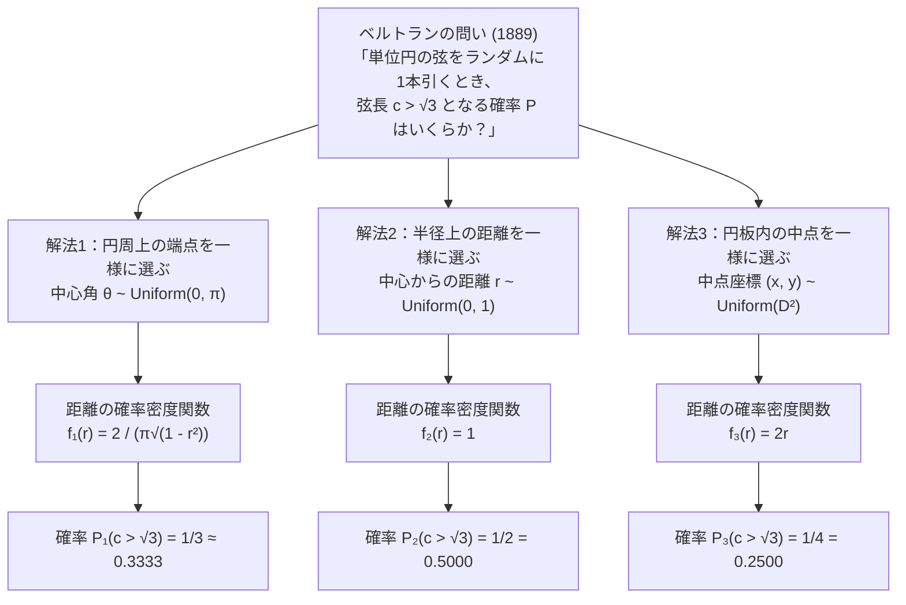
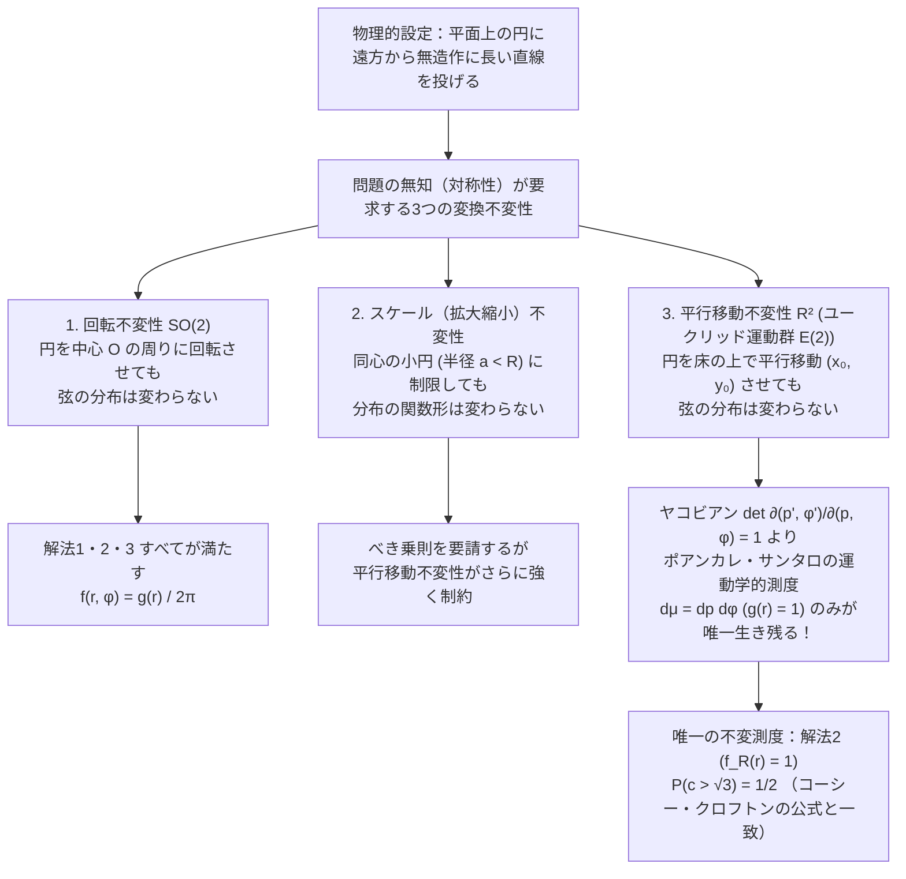
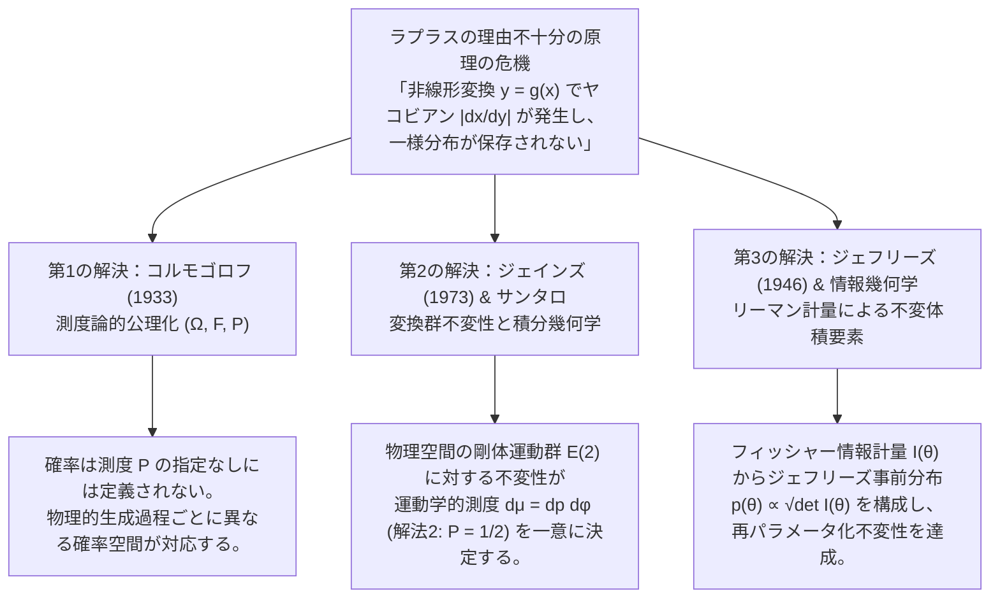

## 1. 序論：「無作為に選ぶ」という直観の崩壊と1889年の衝撃

「サイコロを振って1の目が出る確率は $1/6$ である」「コインを投げて表が出る確率は $1/2$ である」。私たちが日常や初等数学で口にする「ランダム（無作為・一様）」という言葉ほど、自明で疑いようのない概念に見えるものはない。選択肢が有限個であり、それらを区別する特別な理由が存在しないとき、すべての選択肢に等しい重みを割り当てることは理性の自然な要請に思える。

しかし、対象が有限個の離散集合から「連続的な図形や空間」へと一歩踏み出した瞬間、この素朴な直観は音を立てて崩れ去る。その崩壊を数学史上もっとも鮮烈かつ劇的な形で白日の下に晒したのが、フランスの数学者<strong>ジョゼフ・ベルトラン（Joseph Bertrand, 1822–1900）</strong>が1889年の著書『確率論（*Calcul des probabilités*）』の冒頭近くで提示した、わずか数行の幾何学的問題——今日<strong>「ベルトランのパラドックス（Bertrand's Paradox）」</strong>と呼ばれる思考実験である。

### 1.1 ベルトランの問題設定

ユークリッド平面 $\mathbb{R}^2$ 上に半径 $R = 1$ の単位円 $S^1 = \{(x, y) \in \mathbb{R}^2 : x^2 + y^2 = 1\}$ を描き、その内部に内接する正三角形 $\triangle ABC$ を固定する。初等幾何学から直ちに分かるように、半径 $R = 1$ の円に内接する正三角形の一辺の長さ $L$ は、中心角 $2\pi/3$（$120^\circ$）に対する弦の長さとして次式で与えられる。

$$L = 2R \sin\left(\frac{\pi}{3}\right) = 2 \cdot 1 \cdot \frac{\sqrt{3}}{2} = \sqrt{3} \approx 1.73205$$

また、円の中心 $O(0,0)$ から正三角形の各辺に下ろした垂線の長さ（内接円の半径 $r_{\text{in}}$）は、

$$r_{\text{in}} = R \cos\left(\frac{\pi}{3}\right) = 1 \cdot \frac{1}{2} = \frac{1}{2}$$

である。ここでベルトランは次の極めてシンプルな問いを投げかけた。

> <strong>【ベルトランの問題】</strong>
> 円の弦（円周上の2点を結ぶ線分）を<strong>「ランダム（無作為）に1本」</strong>引く。このとき、その弦の長さ $c$ が、内接する正三角形の一辺の長さ $L = \sqrt{3}$ よりも長くなる確率 $P(c > \sqrt{3})$ はいくらか？

一見すると、これは高校数学の幾何学的確率の演習問題のように見える。円の大きさも正三角形の比率も完全に定まっている以上、答えはただ一つの客観的な実数値になるはずだと誰もが予想するだろう。ところがベルトランは、寸分の隙もない3通りの「完全に自然で対称なランダムの選び方」を提示し、それぞれから<strong>$P_1 = 1/3$、$P_2 = 1/2$、$P_3 = 1/4$ という互いに矛盾する3つの厳密解</strong>を導き出して見せたのである。



なぜ同じ幾何学的対象の同じ事象に対して、答えが $1/3$、$1/2$、$1/4$ と3通りに割れてしまうのか。計算のどこかに誤りがあるのではない。3つの解法はいずれも数学的に100%正しいのである。問題の根源は、「ランダムに直線を引く」という日常言語の背後に潜む<strong>連続空間における「一様性（Uniformity）」の非一意性</strong>と、ラプラス以来の古典的確率論が依拠してきた<strong>「理由不十分の原理（Principle of Indifference）」の根本的破綻</strong>にある。

本稿では、まずベルトランの3つの古典的解法の厳密な導出とヤコビアンによる確率密度関数の変換構造を解き明かす。続いて、ラプラスの原理が連続空間で直面する危機をケインズの「ワインと水のパラドックス」を通じて定式化し、この危機に対する20世紀以降の3つの偉大な数学的・物理学的解決——<strong>(1) コルモゴロフの測度論的公理化 $(\Omega, \mathcal{F}, \mathbb{P})$</strong>、<strong>(2) E. T. ジェインズの変換群不変性と積分幾何学（ユークリッド運動群 $E(2)$ の運動学的測度）</strong>、そして<strong>(3) ハロルド・ジェフリーズのフィッシャー情報計量による非情報事前分布</strong>——までを一気通貫で探究する。

---

## 2. 3つの古典的解法の厳密な導出と確率密度関数の比較

3つの解法を統一的な数学的視点から比較するために、まず単位円 $S^1$ の弦 $c$ を記述する座標系（パラメータ空間）を整理しておこう。

### 2.1 弦の幾何学的パラメータと基本関係式

単位円 $x^2 + y^2 = 1$ の任意の弦（長さが0の退化した点を除く）は、次の3つの同値な幾何学的量によって特徴づけられる。

1. <strong>中心角 $\theta \in [0, \pi]$</strong>：円の中心 $O$ から弦の両端点を見込む角度（または一方の端点を基準とした他方の端点の円周角座標 $\theta \in [0, 2\pi)$）。
2. <strong>中心からの垂線距離 $r \in [0, 1]$ と法線角 $\phi \in [0, 2\pi)$</strong>：原点 $O$ から弦に下ろした垂線の足（すなわち弦の中点 $M$）までの距離 $r = |OM|$ と、その垂線が $x$ 軸となす角 $\phi$。直線の方程式（ヘッセの標準形）としては $x\cos\phi + y\sin\phi = r$ と表される。
3. <strong>弦の中点座標 $(x_m, y_m) \in D^2$</strong>：単位円板 $D^2 = \{(x, y) \in \mathbb{R}^2 : x^2 + y^2 \le 1\}$ 内の点 $M(x_m, y_m) = (r\cos\phi, r\sin\phi)$。原点 $O(0,0)$ 以外のすべての点 $M \in D^2 \setminus \{(0,0)\}$ は、$M$ を通り線分 $OM$ に直交するただ1本の弦と一対一に対応する。

円の中心 $O$、弦の中点 $M$、および弦の一端 $A$ がなす直角三角形 $\triangle OMA$ にピタゴラスの定理（三平方の定理）を適用すると、斜辺が半径 $OA = 1$、底辺が $OM = r$、高さが弦の半長 $MA = c/2$ であるから、すべての解法を貫く基本恒等式が得られる。

$$\left(\frac{c}{2}\right)^2 + r^2 = 1 \quad \Longleftrightarrow \quad c(r) = 2\sqrt{1 - r^2}, \qquad r(c) = \sqrt{1 - \frac{c^2}{4}} = \frac{\sqrt{4 - c^2}}{2}$$

また、中心角 $\theta \in [0, \pi]$ を用いれば、$\triangle OMA$ において $\angle MOA = \theta/2$ であるから、

$$r = \cos\left(\frac{\theta}{2}\right), \qquad c = 2\sin\left(\frac{\theta}{2}\right)$$

が成り立つ。したがって、私たちが求めたい事象 $E = \{c > \sqrt{3}\}$ は、どのパラメータで見ても次の完全に同値な条件へと翻訳される。

$$c > \sqrt{3} \quad \Longleftrightarrow \quad 2\sqrt{1 - r^2} > \sqrt{3} \quad \Longleftrightarrow \quad 1 - r^2 > \frac{3}{4} \quad \Longleftrightarrow \quad 0 \le r < \frac{1}{2} \quad \Longleftrightarrow \quad \theta \in \left(\frac{2\pi}{3}, \frac{4\pi}{3}\right)$$

事象 $E$ の幾何学的境界は一点の曇りもなく「$r < 1/2$（弦が内接正三角形の内接円 $x^2 + y^2 = (1/2)^2$ の内部を横切ること）」として定まっている。それにもかかわらず、どのパラメータを一様分布とみなすかによって確率が劇的に変化するのである。

---

### 2.2 解法1：円周上の2端点を一様に選ぶ（$P_1 = 1/3$）

#### 幾何学的構成と確率の導出
弦とは「円周上の2点を結ぶ線分」である。したがって、最も自然な弦の引き方の一つは、円周 $S^1$ 上から独立かつ一様に2つの端点 $A, B$ を選ぶことである。円の回転対称性（回転群 $SO(2)$ の作用）により、最初に選んだ端点 $A$ が内接正三角形の頂点の一つ（偏角 $\theta = 0$）に一致するように円全体を回転させても一般性を失わない。

このとき、もう一方の端点 $B$ の偏角 $\theta$ は区間 $[0, 2\pi)$ 上の一様分布に従う。

$$\theta \sim \text{Uniform}(0, 2\pi), \qquad f_\Theta(\theta) = \frac{1}{2\pi} \quad (0 \le \theta < 2\pi)$$

弦 $AB$ の長さが $c(\theta) = 2\sin(\theta/2) > \sqrt{3}$ となるのは、端点 $B$ が頂点 $A(0)$ の対辺にあたる円弧、すなわち残りの2頂点 $\theta = 2\pi/3$ と $\theta = 4\pi/3$ の間の円弧上に落ちるとき、かつそのときに限る。円周全体の長さ $2\pi$ のうち、条件を満たす円弧の長さは $4\pi/3 - 2\pi/3 = 2\pi/3$ であるから、求める確率 $P_1$ は次式となる。

$$P_1(c > \sqrt{3}) = \frac{\frac{4\pi}{3} - \frac{2\pi}{3}}{2\pi} = \frac{2\pi/3}{2\pi} = \frac{1}{3} \approx 0.3333$$

#### 垂線距離 $r$ と弦長 $c$ の確率密度関数
対称性により中心角を $\theta \in [0, \pi]$ に折り返して $f_\Theta(\theta) = \frac{1}{\pi}$ とすると、$r = \cos(\theta/2)$ より $\theta = 2\arccos(r)$ である。変数変換のヤコビアン（導関数の絶対値）を計算すると、

$$\left|\frac{d\theta}{dr}\right| = \left|\frac{d}{dr}\bigl(2\arccos r\bigr)\right| = \frac{2}{\sqrt{1 - r^2}}$$

となる。したがって、解法1が誘導する「中心からの距離 $r$」の確率密度関数 $f_{R,1}(r)$ は一様ではなく、次のような<strong>逆正弦型の発散密度</strong>を持つ。

$$f_{R,1}(r) = f_\Theta(\theta(r)) \left|\frac{d\theta}{dr}\right| = \frac{1}{\pi} \cdot \frac{2}{\sqrt{1 - r^2}} = \frac{2}{\pi\sqrt{1 - r^2}}, \qquad r \in [0, 1)$$

実際、この密度関数を $r \in [0, 1/2]$ の範囲で積分すれば、確かに $P_1 = 1/3$ が再現される。

$$P_1\left(r < \frac{1}{2}\right) = \int_0^{1/2} \frac{2}{\pi\sqrt{1 - r^2}}\,dr = \frac{2}{\pi}\bigl[\arcsin(r)\bigr]_0^{1/2} = \frac{2}{\pi} \cdot \frac{\pi}{6} = \frac{1}{3}$$

さらに、弦の長さ $c = 2\sqrt{1 - r^2} \in (0, 2)$ についての確率密度関数 $f_{C,1}(c)$ を求めると、$\left|\frac{dr}{dc}\right| = \frac{c}{2\sqrt{4 - c^2}}$ および $\sqrt{1 - r^2} = \frac{c}{2}$ より、

$$f_{C,1}(c) = f_{R,1}(r(c))\left|\frac{dr}{dc}\right| = \frac{2}{\pi(c/2)} \cdot \frac{c}{2\sqrt{4 - c^2}} = \frac{2}{\pi\sqrt{4 - c^2}}, \qquad c \in (0, 2)$$

が得られ、弦長の期待値 $\mathbb{E}_1[c]$ は次のようになる。

$$\mathbb{E}_1[c] = \int_0^\pi 2\sin\left(\frac{\theta}{2}\right)\frac{d\theta}{\pi} = \frac{2}{\pi}\left[-2\cos\left(\frac{\theta}{2}\right)\right]_0^\pi = \frac{4}{\pi} \approx 1.2732$$

---

### 2.3 解法2：固定した半径上の距離を一様に選ぶ（$P_2 = 1/2$）

#### 幾何学的構成と確率の導出
弦は「円の中心からの方向（法線角 $\phi$）と中心からの距離 $r$」によって一意に定まる。そこでまず、円の中心 $O$ を通る半径の向き $\phi \sim \text{Uniform}(0, 2\pi)$ をランダムに選び、次にその半径上で中心からの距離 $r \in [0, 1]$ を一様に選んで、その点を通り半径に垂直な弦を引く。

円の回転対称性により、最初に選んだ半径が内接正三角形の一辺に垂直になるように回転させても一般性を失わない。このとき、内接正三角形の辺は中心からちょうど $r_{\text{in}} = 1/2$ の距離にある。弦の長さ $c = 2\sqrt{1-r^2}$ は $r$ の単調減少関数であるから、弦が正三角形の一辺より長くなる条件は、半径上の交点が中心 $O$ と正三角形の辺の中点（$r = 1/2$）の間にあること、すなわち $0 \le r < 1/2$ である。

$r$ は区間 $[0, 1]$ 上の一様分布に従うため、その確率密度関数は定数 $f_{R,2}(r) = 1$ であり、求める確率 $P_2$ は直ちに次式となる。

$$P_2(c > \sqrt{3}) = P_2\left(0 \le r < \frac{1}{2}\right) = \int_0^{1/2} 1\,dr = \frac{1/2}{1} = \frac{1}{2} = 0.5000$$

#### 中心角 $\theta$ と弦長 $c$ の確率密度関数
解法2では $f_{R,2}(r) = 1$（$r \in [0, 1]$）が一様である代わりに、中心角 $\theta = 2\arccos(r) \in [0, \pi]$ の密度関数は $\left|\frac{dr}{d\theta}\right| = \frac{1}{2}\sin(\theta/2)$ より、

$$f_{\Theta,2}(\theta) = \frac{1}{2}\sin\left(\frac{\theta}{2}\right), \qquad \theta \in [0, \pi]$$

となる。また、弦長 $c = 2\sqrt{1 - r^2} \in (0, 2)$ の確率密度関数 $f_{C,2}(c)$ は、ヤコビアン $\left|\frac{dr}{dc}\right| = \frac{c}{2\sqrt{4 - c^2}}$ からそのまま次式で与えられる。

$$f_{C,2}(c) = 1 \cdot \left|\frac{dr}{dc}\right| = \frac{c}{2\sqrt{4 - c^2}}, \qquad c \in (0, 2)$$

解法2における弦長の期待値 $\mathbb{E}_2[c]$ は、四分円の面積積分に帰着し、

$$\mathbb{E}_2[c] = \int_0^1 2\sqrt{1 - r^2}\,dr = 2 \cdot \frac{\pi}{4} = \frac{\pi}{2} \approx 1.5708$$

となる。解法1の期待値 $4/\pi \approx 1.2732$ と比べて、中心付近を通る長い弦が選ばれやすくなっていることが定量的に確認できる。

---

### 2.4 解法3：円板内の中点を面積一様に選ぶ（$P_3 = 1/4$）

#### 幾何学的構成と確率の導出
中心を通る直径を除けば、円の弦はその<strong>中点 $M(x, y)$</strong> の位置によって一意に決定される。逆に、単位円板 $D^2 = \{(x, y) \in \mathbb{R}^2 : x^2 + y^2 \le 1\}$ の内部から任意の点 $M(x, y) \neq (0,0)$ を1つ選べば、$M$ を通り線分 $OM$ に垂直な弦がただ1本決まる。

そこで、単位円板 $D^2$ の面積（2次元ルベーグ測度 $dx\,dy$）に関して一様に点 $M(x, y)$ を選ぶとしよう。

$$f_{X,Y}(x, y) = \frac{1}{\pi R^2} = \frac{1}{\pi}, \qquad (x^2 + y^2 \le 1)$$

弦の長さ $c$ が $\sqrt{3}$ を超えるための必要十分条件は、中点 $M$ の中心からの距離 $r = \sqrt{x^2 + y^2}$ が $1/2$ 未満であること、すなわち中点 $M$ が内接正三角形の<strong>内接円板 $D_{1/2} = \{(x, y) : x^2 + y^2 < (1/2)^2\}$ の内部</strong>に落ちることである。

したがって、求める確率 $P_3$ は単位円板 $D_1$ の面積に対する同心小円板 $D_{1/2}$ の面積の比として、次のように求まる。

$$P_3(c > \sqrt{3}) = \frac{\text{Area}(D_{1/2})}{\text{Area}(D_1)} = \frac{\pi \left(\frac{1}{2}\right)^2}{\pi (1)^2} = \frac{1}{4} = 0.2500$$

#### なぜ解法2と解法3で答えが違うのか？——極座標ヤコビアン $r\,dr\,d\phi$ の罠
初学者から熟練した理工系学生に至るまで、最も頻繁に混乱が生じるのが「解法2と解法3の違い」である。「どの半径上でも弦の中点は1つしかなく、半径に沿って $r \in [0, 1]$ を見るのだから、中点をランダムに選ぶのと半径上の点をランダムに選ぶのは同じではないのか？」という疑問である。

この疑問に対する決定的な答えは、2次元デカルト座標 $(x, y)$ から極座標 $(r, \phi)$ への変数変換における<strong>面積要素のヤコビアン $J = r$</strong> にある。

$$dx\,dy = \left|\det\begin{pmatrix} \cos\phi & -r\sin\phi \\ \sin\phi & r\cos\phi \end{pmatrix}\right| dr\,d\phi = r\,dr\,d\phi$$

解法3では、面積要素 $dx\,dy$ に対して一定の密度 $\frac{1}{\pi}$ を割り当てた。これを極座標 $(r, \phi)$ で書き直して角度 $\phi \in [0, 2\pi)$ で周辺化（積分）すると、距離 $r$ の周辺確率密度関数 $f_{R,3}(r)$ は定数ではなく、<strong>$r$ に比例する1次関数</strong>となる。

$$f_{R,3}(r) = \int_0^{2\pi} \frac{1}{\pi} r\,d\phi = 2r, \qquad r \in [0, 1]$$

幾何学的に言えば、半径 $r$ と $r + dr$ の間にある微小な円環（アニュラス）の面積は $2\pi r\,dr$ であり、円の外縁部（$r \to 1$）の円環は中心付近（$r \to 0$）の円環よりも周長が $r$ 倍だけ長い。したがって、円板全体にダーツを面積一様に投げると、ダーツは必然的に外周近く（すなわち短い弦に対応する領域）に多く突き刺さり、中心近く（長い弦に対応する領域）にはほとんど刺さらなくなる。これこそが、解法2では $f_{R,2}(r) = 1$（$P_2 = 1/2$）であったものが、解法3では $f_{R,3}(r) = 2r$（$P_3 = \int_0^{1/2} 2r\,dr = [r^2]_0^{1/2} = 1/4$）へと半減する理由である。

さらに興味深いことに、解法3における弦長 $c = 2\sqrt{1 - r^2}$ の確率密度関数 $f_{C,3}(c)$ を計算すると、$r^2 = 1 - c^2/4$ の両辺を微分して $2r\,dr = -\frac{c}{2}\,dc$ であるから、平方根の特異性が完全に相殺されて美しい線形密度が現れる。

$$f_{C,3}(c) = f_{R,3}(r(c))\left|\frac{dr}{dc}\right| = 2r \cdot \frac{c}{4r} = \frac{c}{2}, \qquad c \in [0, 2]$$

そして解法3における弦長の期待値 $\mathbb{E}_3[c]$ は次のようになる。

$$\mathbb{E}_3[c] = \int_0^2 c \cdot \frac{c}{2}\,dc = \left[\frac{c^3}{6}\right]_0^2 = \frac{8}{6} = \frac{4}{3} \approx 1.3333$$

### 2.5 3つの古典的解法の完全比較表

以上の導出結果を一覧として整理すると、3つの解法がいかに異なる確率構造を単位円上に定義しているかが一目瞭然となる。

| 比較項目 | 解法1：円周上のランダム端点 | 解法2：半径上のランダム距離 | 解法3：円板内のランダム中点 |
| :--- | :--- | :--- | :--- |
| <strong>一様とみなす幾何学的変数</strong> | 中心角 $\theta \sim \text{Uniform}(0, \pi)$ | 垂線距離 $r \sim \text{Uniform}(0, 1)$ | 中点面積 $(x, y) \sim \text{Uniform}(D^2)$ |
| <strong>$r$ の関数としての一様変数</strong> | $\theta(r) = 2\arccos(r)$ が一様 | $r$ 自身が一様 | $u(r) = r^2$ が一様 |
| <strong>基本確率要素 $d\mathbb{P}(r, \phi)$</strong> | $\dfrac{1}{\pi^2\sqrt{1 - r^2}}\,dr\,d\phi$ | $\dfrac{1}{2\pi}\,dr\,d\phi$ | $\dfrac{r}{\pi}\,dr\,d\phi = \dfrac{1}{\pi}\,dx\,dy$ |
| <strong>距離 $r \in [0,1]$ の密度 $f_R(r)$</strong> | $\dfrac{2}{\pi\sqrt{1 - r^2}}$ | $1$ | $2r$ |
| <strong>弦長 $c \in (0,2)$ の密度 $f_C(c)$</strong> | $\dfrac{2}{\pi\sqrt{4 - c^2}}$ | $\dfrac{c}{2\sqrt{4 - c^2}}$ | $\dfrac{c}{2}$ |
| <strong>弦が正三角形の一辺を超える確率 $P(c > \sqrt{3})$</strong> | <strong>$\dfrac{1}{3} \approx 0.3333$</strong> | <strong>$\dfrac{1}{2} = 0.5000$</strong> | <strong>$\dfrac{1}{4} = 0.2500$</strong> |
| <strong>弦長の期待値 $\mathbb{E}[c]$</strong> | $\dfrac{4}{\pi} \approx 1.2732$ | $\dfrac{\pi}{2} \approx 1.5708$ | $\dfrac{4}{3} \approx 1.3333$ |
| <strong>弦長の2乗平均 $\mathbb{E}[c^2]$</strong> | $2$ | $\dfrac{8}{3} \approx 2.6667$ | $2$ |
| <strong>対応する物理的実験装置</strong> | 円周上の独立な2つのルーレット針を結ぶ | 遠方から平行な直線群（長い藁や棒）を投げる | 円盤状のダーツボードに面積一様に矢を投げて中点とする |

---

## 3. 古典的確率論の危機：ラプラスの「理由不十分の原理」とケインズの「ワインと水のパラドックス」

ベルトランがこのパラドックスを1889年に発表した真の狙いは、単なる幾何学パズルを披露することではなかった。それは、ヤコブ・ベルヌーイ（『推測術 *Ars Conjectandi*』, 1713年）や<strong>ピエール＝シモン・ラプラス（Pierre-Simon Laplace, 1749–1827）</strong>（『確率の解析的理論 *Théorie analytique des probabilités*』, 1812年）によって築かれた<strong>古典的確率論の哲学的土台そのものに対する痛烈な批判</strong>であった。

### 3.1 ラプラスの「理由不十分の原理（無差別の原理）」

ラプラスは確率の古典的定義として、「ある事象の確率とは、同様に確からしい（*également possibles*）すべての根元事象の総数に対する、その事象に好都合な根元事象の数の比である」と定めた。そして、どの根元事象が「同様に確からしい」かを判定する基準として採用されたのが、ライプニッツの充足理由律の裏返しである<strong>「理由不十分の原理（Principle of Insufficient Reason）」</strong>——のちにイギリスの経済学者・哲学者<strong>ジョン・メイナード・ケインズ（John Maynard Keynes, 1921）</strong>が著書『確率論（*A Treatise on Probability*）』において<strong>「無差別の原理（Principle of Indifference）」</strong>と改名した原理である。

> <strong>【理由不十分の原理 / 無差別の原理】</strong>
> 互いに排反で網羅的な $n$ 個の選択肢 $A_1, A_2, \dots, A_n$ があるとき、いずれか一つが他よりも起こりやすいと信じるに足る十分な理由（知識・非対称性）が存在しないならば、すべての選択肢に等しい確率 $P(A_i) = 1/n$ を割り当てなければならない。

有限個の離散的な対象（対称なサイコロの6つの面、よく切られたトランプの52枚のカードなど）においては、「選択肢の個数を数える」という<strong>計数測度（Counting Measure）</strong>が自然に定まるため、この原理は大きな破綻なく機能するかに見えた（それでも「サイコロの目が1か、1以外か」のような事象分割の恣意性は残るが、対称な物理的構造が自然な分割を与える）。

しかし、対象が連続的なパラメータ $x \in [a, b]$ で記述される場合、「無知（理由不十分）であるから一様分布 $f_X(x) = \frac{1}{b-a}$ を割り当てる」という操作は、<strong>非線形な変数変換（再パラメータ化）に対して自己矛盾を起こす</strong>という致命的な欠陥を抱えている。

### 3.2 非線形変換のヤコビアンによる「一様性」の崩壊

いま、未知の連続変数 $X$ が区間 $[a, b]$ に値をとることだけが分かっており、それ以外の情報が一切ないとしよう。理由不十分の原理に従って $X \sim \text{Uniform}(a, b)$、すなわち定数密度

$$f_X(x) = \frac{1}{b - a}, \qquad x \in [a, b]$$

を仮定する。ところが、同じ物理的・幾何学的状態は、狭義単調な滑らかな全単射関数 $g : [a, b] \to [g(a), g(b)]$ によって変換された別の変数 $Y = g(X)$ で記述しても全く同じ情報を持つはずである。

もし私たちが最初から変数 $Y$ の言葉で問題を記述していたならば、私たちは $Y$ についても「区間 $[g(a), g(b)]$ のどこに入るか全く知らない（理由不十分である）」ため、同じ原理によって $Y$ に一様密度 $f_Y^{\text{naive}}(y) = \text{const.}$ を割り当てなければならない。

しかし、確率論の変数変換公式によれば、$X$ が密度 $f_X(x)$ に従うとき、$Y = g(X)$ の真の確率密度関数 $f_Y(y)$ は<strong>ヤコビアン（逆関数の微分係数）</strong>を掛けたものになる。

$$f_Y(y) = f_X\bigl(g^{-1}(y)\bigr)\left|\frac{dx}{dy}\right| = \frac{1}{b - a} \cdot \frac{1}{\bigl|g'\bigl(g^{-1}(y)\bigr)\bigr|}$$

この式が定数になるのは、$\left|g'(x)\right|$ が定数、すなわち<strong>$g(x) = \alpha x + \beta$ がアフィン変換（1次関数）である場合に限られる</strong>。$g(x)$ が $x^2$、$x^3$、$1/x$、$\cos x$ などの非線形関数であれば、$X$ における一様分布は $Y$ においては決して一様分布にならず、逆に $Y$ における一様分布は $X$ において偏った分布になる。

ベルトランのパラドックスの3つの解法は、まさにこのヤコビアン変換の幾何学的実例に他ならない。
- <strong>解法1</strong>は $\theta = 2\arccos(r)$ に対して一様分布を仮定した。
- <strong>解法2</strong>は $r$ に対して一様分布を仮定した。
- <strong>解法3</strong>は $u = r^2$（円の面積比 $\pi r^2 / \pi$）に対して一様分布を仮定した（実際、$u \sim \text{Uniform}(0, 1)$ ならば $f_R(r) = f_U(u(r))\left|\frac{du}{dr}\right| = 1 \cdot 2r = 2r$ となり、解法3の密度と完全に一致する！）。

### 3.3 ケインズの「ワインと水のパラドックス」（1921年）とフォン・クリースの立方体問題

この「連続変数に対する無差別の原理の自己矛盾」を、幾何学すら使わずに純粋な代数と論理だけで完膚なきまでに論破したのが、ヨハネス・フォン・クリース（Johannes von Kries, 1886）の立方体問題や、ケインズ（1921）が定式化した<strong>「ワインと水のパラドックス（Wine-Water Paradox）」</strong>である。

> <strong>【ワインと水のパラドックス】</strong>
> あるグラスの中にワインと水の混合液が入っている。私たちが知っている唯一の情報は、「ワインと水の体積比が $1:3$ から $3:1$ の間にある」ということだけである。このとき、「ワインの量が水の量の2倍以下である確率」はいくらか？

この問題を2つの全く対等な視点から解いてみよう。

#### 視点A：水に対するワインの比率 $x = W_{\text{wine}} / W_{\text{water}}$ を基準にする
与えられた条件は、比率 $x = \frac{W_{\text{wine}}}{W_{\text{water}}}$ が閉区間 $\left[\frac{1}{3}, 3\right]$ にあることである。
$$x \in \left[\frac{1}{3}, 3\right], \qquad \text{区間の幅} = 3 - \frac{1}{3} = \frac{8}{3}$$
理由不十分の原理により、$x \sim \text{Uniform}(1/3, 3)$ と仮定すると、密度関数は $f_X(x) = \frac{3}{8}$ である。このとき、「ワインが水の2倍以下である（$x \le 2$）」確率 $P_X$ は、

$$P_X(x \le 2) = \frac{2 - \frac{1}{3}}{3 - \frac{1}{3}} = \frac{5/3}{8/3} = \frac{5}{8} = 0.625$$

となる。また、確率がちょうど $1/2$ になる中央値（メディアン）$x_{\text{med}}$ は区間の中点であるから、

$$x_{\text{med}} = \frac{\frac{1}{3} + 3}{2} = \frac{5}{3} \approx 1.6667 \quad \Longrightarrow \quad P_X\left(x > \frac{5}{3}\right) = \frac{1}{2}$$

である。

#### 視点B：ワインに対する水の比率 $y = W_{\text{water}} / W_{\text{wine}} = 1/x$ を基準にする
全く同じ前提条件「混合比が $1:3$ から $3:1$ の間にある」は、ワインに対する水の比率 $y = \frac{W_{\text{water}}}{W_{\text{wine}}} = \frac{1}{x}$ についても、寸分違わず同じ区間 $\left[\frac{1}{3}, 3\right]$ にあることを意味する。
$$y \in \left[\frac{1}{3}, 3\right], \qquad \text{区間の幅} = 3 - \frac{1}{3} = \frac{8}{3}$$
「ワインに対する水」と「水に対するワイン」のどちらを分母に置くかについて優劣をつける理由は全く存在しないから、理由不十分の原理により $y \sim \text{Uniform}(1/3, 3)$、密度関数 $f_Y(y) = \frac{3}{8}$ を割り当てなければならない。

ところが、先ほどと同じ事象「ワインが水の2倍以下である（$x \le 2$）」は、$y = 1/x$ の言葉では「水がワインの $1/2$ 以上である（$y \ge 1/2$）」という事象と完全に同値である！にもかかわらず、$y$ の一様分布のもとでこの確率 $P_Y$ を計算すると、

$$P_Y\left(y \ge \frac{1}{2}\right) = \frac{3 - \frac{1}{2}}{3 - \frac{1}{3}} = \frac{5/2}{8/3} = \frac{15}{16} = 0.9375 \neq \frac{5}{8}$$

となり、<strong>$0.625$ と $0.9375$ という劇的な矛盾</strong>が生じる！

さらに中央値を考えると矛盾はいっそう鮮明になる。視点Bでは $y$ の中央値も $y_{\text{med}} = 5/3$ となるため、

$$P_Y\left(y > \frac{5}{3}\right) = P_Y\left(\frac{1}{x} > \frac{5}{3}\right) = P_Y\left(x < \frac{3}{5}\right) = \frac{1}{2}$$

が成り立つことになる。視点Aの $P(x > 5/3) = 1/2$ と合わせると、$x < 3/5$ である確率が $1/2$、$x > 5/3$ である確率も $1/2$ となり、<strong>その間の区間 $x \in [3/5, 5/3]$（一対一の混合比 $x = 1$ を含む最も重要な領域！）に入る確率が $1 - 1/2 - 1/2 = 0$ になってしまう</strong>という論理的破綻（$x_{\text{med}} \cdot y_{\text{med}} = \frac{25}{9} \neq 1$）に陥るのである。

原因は明らかである。もし $x$ が区間 $[1/3, 3]$ 上で一様密度 $f_X(x) = \frac{3}{8}$ に従うならば、逆数変換 $y = 1/x$ のヤコビアンは $\left|\frac{dx}{dy}\right| = \frac{1}{y^2}$ であるから、$y$ の真の密度は

$$f_Y(y) = f_X\left(\frac{1}{y}\right)\left|\frac{dx}{dy}\right| = \frac{3}{8y^2}, \qquad y \in \left[\frac{1}{3}, 3\right]$$

でなければならず、決して定数にはなり得ない（後の第6節で見るように、この逆数変換に対して不変な測度は対数一様分布 $d\mu(x) = \frac{dx}{x}$ である）。

---

## 4. 第1の解決：コルモゴロフの測度論的確率論（1933年）と「問題の定式化不全」

ベルトランのパラドックスやケインズのパラドックスが突きつけた「古典的確率論の危機」に対し、20世紀の純粋数学が下した最初の、そして最も基盤的な回答が、ロシアの数学者<strong>アンドレイ・コルモゴロフ（Andrei Nikolaevich Kolmogorov, 1903–1987）</strong>による1933年の歴史的著作『確率論の基礎概念（*Grundbegriffe der Wahrscheinlichkeitsrechnung*）』であった。

### 4.1 確率空間 $(\Omega, \mathcal{F}, \mathbb{P})$ の公理系

コルモゴロフは、「同様に確からしいとは何か」という哲学的・認識論的な泥沼を数学の公理系から完全に切り離し、アンリ・ルベーグ（Henri Lebesgue）の測度論および積分論の上に確率論を再構築した。コルモゴロフの公理系において、確率論のすべての議論は<strong>確率空間（Probability Space）</strong>と呼ばれる3つ組 $(\Omega, \mathcal{F}, \mathbb{P})$ を明示的に指定することから出発する。

1. <strong>標本空間（Sample Space）$\Omega$</strong>：起こり得るすべての根元事象 $\omega$ の集合（ベルトランの問題では、単位円のすべての弦からなる集合 $\mathcal{C}$）。
2. <strong>事象の $\sigma$-加法族（$\sigma$-algebra）$\mathcal{F}$</strong>：$\Omega$ の部分集合族であり、空集合 $\emptyset \in \mathcal{F}$、補集合に関する閉性（$A \in \mathcal{F} \implies A^c \in \mathcal{F}$）、および可算無限個の和集合に関する閉性（$A_1, A_2, \dots \in \mathcal{F} \implies \bigcup_{i=1}^\infty A_i \in \mathcal{F}$）を満たすもの（ベルトランの問題では、弦の空間 $\mathcal{C}$ 上のボレル集合族 $\mathcal{B}(\mathcal{C})$）。
3. <strong>確率測度（Probability Measure）$\mathbb{P} : \mathcal{F} \to [0, 1]$</strong>：次の3つの公理（コルモゴロフの公理）を満たす集合関数。
   - <strong>(公理1：非負性)</strong> 任意の $A \in \mathcal{F}$ に対して $\mathbb{P}(A) \ge 0$。
   - <strong>(公理2：規格化)</strong> 全事象に対して $\mathbb{P}(\Omega) = 1$。
   - <strong>(公理3：完全加法性 / $\sigma$-加法性)</strong> 互いに排反な可算個の事象列 $A_1, A_2, \dots \in \mathcal{F}$（$i \neq j \implies A_i \cap A_j = \emptyset$）に対して、
     $$\mathbb{P}\left(\bigsqcup_{i=1}^\infty A_i\right) = \sum_{i=1}^\infty \mathbb{P}(A_i)$$

### 4.2 「ランダムに選ぶ」は確率測度 $\mathbb{P}$ を指定するまで数学的に無意味である

コルモゴロフの公理的立場から見れば、ベルトランのパラドックスは何ら数学の矛盾ではない。なぜなら、ベルトランの問いは標本空間 $\Omega = \mathcal{C}$ と可測事象 $E = \{c \in \mathcal{C} : \text{length}(c) > \sqrt{3}\} \in \mathcal{F}$ だけを与えて、3つ組の最後の要素である<strong>確率測度 $\mathbb{P}$ を一切指定していない（Ill-posed / 定義不全である）</strong>からである。

連続的な多様体 $\Omega$ 上には、ルベーグ測度と互いに絶対連続なものだけでも無限に多くの異なる確率測度 $\mathbb{P}$ が存在する。
- 解法1は、確率空間 $(\mathcal{C}, \mathcal{B}(\mathcal{C}), \mathbb{P}_1)$ における値 $\mathbb{P}_1(E) = 1/3$ を正しく計算している。
- 解法2は、別の確率空間 $(\mathcal{C}, \mathcal{B}(\mathcal{C}), \mathbb{P}_2)$ における値 $\mathbb{P}_2(E) = 1/2$ を正しく計算している。
- 解法3は、さらに別の確率空間 $(\mathcal{C}, \mathcal{B}(\mathcal{C}), \mathbb{P}_3)$ における値 $\mathbb{P}_3(E) = 1/4$ を正しく計算している。

したがって、純粋数学（測度論）の観点からは、「ランダムに弦を引く」という言葉は、「どの確率測度 $\mathbb{P}$（あるいはどの物理的生成メカニズム）に従って弦を抽出するか」を明記しない限り、「三角形の面積はいくらか？（底辺も高さも指定せずに）」と問うのと同じく<strong>不完全な問い</strong>に過ぎない。実際、次のような3つの異なる物理的実験装置を作れば、3つの確率はすべて実験室で忠実に再現される。

1. <strong>実験装置1（$\mathbb{P}_1 \implies 1/3$）</strong>：円の周上に摩擦のない回転針（ルーレット）を2本取り付け、独立に勢いよく回して止まった円周上の2点をピンと張った糸で結ぶ。
2. <strong>実験装置2（$\mathbb{P}_2 \implies 1/2$）</strong>：円盤を回転台の上でランダムな角度に回し、固定された平行レールに沿って一様な間隔のグリッド（またはランダムな位置のレーザー光線）を照射する。
3. <strong>実験装置3（$\mathbb{P}_3 \implies 1/4$）</strong>：単位円の形をした粘着シートに上から微小な砂粒を一様に降らせ、付着した1粒の砂の位置 $(x, y)$ がちょうど中点になるように定規を当てて弦を描く。

---

## 5. 第2の解決：E. T. ジェインズの変換群不変性（1973年）と積分幾何学の運動学的測度

コルモゴロフの測度論的回答によって、数学内部の形式的な整合性は完全に守られた。しかし、物理学者であり確率論の大家であった<strong>エドウィン・トンプソン・ジェインズ（Edwin Thompson Jaynes, 1922–1998）</strong>は、この「どの測度を選ぶかは定義次第であり、どれも対等である」という形式主義的な幕引きに真っ向から異を唱えた。

ジェインズは1973年の記念碑的論文 <strong>"The Well-Posed Problem"（良設定問題）</strong> において、次のように問いかけた。

> <strong>【ジェインズの物理的実験】</strong>
> 床の上に半径 $R$ の小さな円を描き、そこから数メートル離れた場所に立って、十分に長い真っ直ぐな藁（わら）や棒を円に向かって無造作に何千本も投げるとしよう。円と交わった藁が切り取る弦のうち、内接正三角形の一辺より長くなる割合はいくらになるか？

私たちが実際に床の上の円に藁を投げるとき、私たちは「端点の角度を一様にしよう」とか「中点の面積を一様にしよう」などと意図して投げてはいない。ただ無造作に空間へ直線を投げ込んでいるだけである。それにもかかわらず、この実験を実際に行うと、経験的な相対頻度は迷うことなく<strong>解法2の値 $P_2 = 1/2$ へと収束する</strong>！

なぜ現実の物理空間における「ランダムな直線」は、$1/3$ でも $1/4$ でもなく、必然的に $1/2$ を選び取るのか？ジェインズはその理由を、問題文に暗黙のうちに含まれている<strong>幾何学的変換群に対する不変性（Transformation Group Invariance）</strong>から完璧に導き出したのである。



### 5.1 ジェインズの変換群不変性の原理と3つの対称性

ジェインズは、ラプラスの理由不十分の原理を現代的に洗練させ、次のように定式化した。「問題文において円の大きさ（半径 $R$）、向き（角度 $\alpha$）、および床の上での位置 $(x_0, y_0)$ が指定されていないということは、実験者が投げる直線の確率分布が<strong>回転・拡大縮小・平行移動からなる変換群に対して不変（Invariant）</strong>でなければならないことを意味する」。

平面 $\mathbb{R}^2$ 上の直線 $L$ を、原点からの符号付き（または非負）垂線距離 $p$ と法線角 $\phi$ を用いたヘッセ標準形

$$x\cos\phi + y\sin\phi = p$$

で表し、単位円と交わる弦の同時確率密度関数を極座標（または中点座標 $x = r\cos\phi, y = r\sin\phi$）で追跡してみよう。ジェインズは3つの変換を順に課した。

#### 第1の条件：回転不変性（直交群 $SO(2)$）
円を中心 $O$ の周りに任意の角度 $\alpha$ だけ回転させても、直線群の統計的性質は変わらない。これは確率密度 $f(r, \phi)$ が角度 $\phi$ に依存しないことを要求する。

$$f(r, \phi - \alpha) = f(r, \phi) \quad (\forall \alpha \in [0, 2\pi)) \quad \Longrightarrow \quad f(r, \phi) = \frac{1}{2\pi} f_R(r)$$

この第1の条件（回転不変性）は、<strong>解法1・解法2・解法3のすべてが満たしている</strong>。したがって、回転対称性だけでは3つの解法を篩（ふるい）にかけることはできない。

#### 第2の条件：スケール不変性（拡大縮小群 $\mathbb{R}_{>0}$）
半径 $R$ の円板 $D_R$ の内部に、同心のより小さな半径 $a$（$0 < a \le R$）の円板 $D_a$ を考える。空間に引かれた直線群のうち、大円 $D_R$ と交わる直線の中でさらに小円 $D_a$ とも交わるものに注目すると、小円 $D_a$ 上での条件付き確率密度 $f_a(r)$ は、大円 $D_R$ 上での密度 $f_R(r)$ のスケールを単に $R \to a$ に読み替えたもの（相似形）でなければならない。

$$f_a(r) = \frac{f_R(r)}{\int_0^a f_R(u)\,du} = \frac{1}{a} f_1\left(\frac{r}{a}\right) \qquad (0 \le r \le a \le R)$$

この関数方程式を $a$ で微分して解くと、密度関数はべき乗関数 $f_1(r) = q r^{q-1}$（$q > 0$）に限られることが分かる。
- <strong>解法1</strong>の密度 $f_{R,1}(r) = \frac{2}{\pi\sqrt{1 - r^2}}$ は、境界 $r = 1$（または $r = R$）に向かって発散するため、小円 $r \le a < R$ に制限しても $r = a$ で発散せず、<strong>スケール不変性を完全に破っている</strong>！実際、解法1は「円の境界（円周）そのものの上で点を選ぶ」という操作に強く依存しているため、円のサイズを変えると内部の分布形が根本的に変わってしまうのである。
- 一方、<strong>解法2（$q = 1 \implies f_R(r) = 1$）と解法3（$q = 2 \implies f_R(r) = 2r$）はどちらもスケール不変性を満たしている</strong>。では、解法2と解法3のどちらが真の物理的不変性を持つのか？それを決定づけるのが第3の条件である。

#### 第3の条件：平行移動不変性（ユークリッド運動群 $E(2) = \mathbb{R}^2 \rtimes O(2)$）
床の上に描かれた円を、向きも大きさも変えずにベクトル $(x_0, y_0)$ だけ平行移動させて新しい中心 $O'(x_0, y_0)$ に移したとしよう。遠方から無造作に投げられる直線群にとって、円が床のどこに描かれているかは無関係であるから、元の円 $O$ と平行移動した円 $O'$（あるいは大円の内部で中心をずらした小円）が切り取る弦の分布は全く同一でなければならない。

ここで、直線 $L : x\cos\phi + y\sin\phi = p$ が、原点の平行移動 $(x, y) = (x' + x_0, y' + y_0)$ によって新しい座標系 $(x', y')$ でどのように表されるかを計算しよう。代入すると、

$$(x' + x_0)\cos\phi + (y' + y_0)\sin\phi = p \quad \Longleftrightarrow \quad x'\cos\phi + y'\sin\phi = p - (x_0\cos\phi + y_0\sin\phi)$$

となる。すなわち、平行移動後の直線パラメータ $(p', \phi')$ は次式で与えられる。

$$\begin{cases} p' = p - x_0\cos\phi - y_0\sin\phi \\ \phi' = \phi \end{cases}$$

この変換のヤコビ行列式（Jacobian Determinant）を計算すると、驚くべきことに $(x_0, y_0)$ の値によらず恒等的に $1$ となる！

$$J = \det\frac{\partial(p', \phi')}{\partial(p, \phi)} = \det\begin{pmatrix} \dfrac{\partial p'}{\partial p} & \dfrac{\partial p'}{\partial \phi} \\[8pt] \dfrac{\partial \phi'}{\partial p} & \dfrac{\partial \phi'}{\partial \phi} \end{pmatrix} = \det\begin{pmatrix} 1 & x_0\sin\phi - y_0\cos\phi \\ 0 & 1 \end{pmatrix} = 1$$

したがって、面積要素（微分形式）としては

$$dp' \wedge d\phi' = dp \wedge d\phi$$

が厳密に成り立つ。さらに、任意の平行移動 $(x_0, y_0)$ に対して確率測度 $h(p, \phi)\,dp\,d\phi$ が不変であるためには、

$$h(p - x_0\cos\phi - y_0\sin\phi, \phi) = h(p, \phi)$$

がすべての $x_0, y_0$ で成立せねばならず、これより $h(p, \phi)$ は $p$ に依存しない定数（回転不変性と合わせて完全な定数 $h(p, \phi) = \text{const.}$）でなければならないことが<strong>一意に証明される</strong>！

なぜ<strong>解法3（中点の一様分布 $dx\,dy = r\,dr\,d\phi$）</strong>は平行移動不変性を満たさないのか？直観的にも幾何学的にも理由は明快である。直線を固定したまま円だけを平行移動させると、その直線が新しい円から切り取る弦の<strong>中点の位置は直線に沿ってスライドしてしまう</strong>。解法2のパラメータ $p$（中心から直線への垂線距離）の微小幅 $dp$ は平行移動しても単にシフトするだけで幅が変わらないのに対し、解法3の面積要素 $r\,dr\,d\phi$ は $r \to |r - x_0\cos\phi - y_0\sin\phi|$ へと変化するため、一様性が完全に破壊されるのである。

### 5.2 積分幾何学（ポアンカレ・サンタロの運動学的測度）とコーシー・クロフトンの公式

ジェインズが導いたこの唯一の不変測度

$$d\mu(L) = dp\,d\phi$$

は、実はアンリ・ポアンカレ（Henri Poincaré）、ヴィルヘルム・ブラシュケ（Wilhelm Blaschke）、ルイス・サンタロ（Luis Santaló）らが発展させた<strong>積分幾何学（Integral Geometry / Geometric Probability）</strong>において、平面の剛体運動群（ユークリッド運動群 $E(2) = \mathbb{R}^2 \rtimes O(2)$）が直線全体のなす等質空間 $\mathcal{L} \cong E(2)/E(1)$ 上に誘導する<strong>運動学的測度（Kinematic Measure / ハール測度）</strong>として知られる最も基本的な測度である。

積分幾何学における金字塔である<strong>コーシー・クロフトンの公式（Cauchy–Crofton Formula, 1868）</strong>によれば、平面上の任意の求長可能な曲線 $\gamma$（長さ $\ell(\gamma)$）に対し、直線 $L$ と曲線 $\gamma$ の交点の個数 $n(\gamma \cap L)$ を運動学的測度 $d\mu = dp\,d\phi$ で全直線空間 $\mathcal{L}$ にわたって積分すると、曲線の長さのちょうど2倍になる。

$$\int_{\mathcal{L}} n(\gamma \cap L)\,dp\,d\phi = 2\,\ell(\gamma)$$

特に、$K \subset \mathbb{R}^2$ を周長 $L(\partial K)$ を持つ任意の<strong>凸図形（Convex Body）</strong>とするとき、$K$ と交わる直線は（接線となる測度0の集合を除いて）常に境界 $\partial K$ とちょうど2点で交わる（$n(\partial K \cap L) = 2$）。したがって、<strong>凸図形 $K$ と交わるすべての直線の集合の運動学的測度は、その凸図形の周長 $L(\partial K)$ に正確に等しい</strong>！

$$\mu\bigl(\{L \in \mathcal{L} : L \cap K \neq \emptyset\}\bigr) = \frac{1}{2}\int_{L \cap K \neq \emptyset} 2\,dp\,d\phi = \text{Perimeter}(\partial K)$$

この美しい定理を使えば、ベルトランの問題（およびその一般化）は積分計算すら不要な<strong>1行の初等幾何学</strong>へと昇華される。
- 単位円板 $K_1$（半径 $1$）と交わる直線全体の測度は、単位円の周長 $\text{Perimeter}(\partial K_1) = 2\pi \cdot 1 = 2\pi$ である。
- 弦の長さが $\sqrt{3}$ より長くなる直線とは、内接正三角形の内接円板 $K_{1/2}$（半径 $1/2$ の同心凸円板）と交わる直線のことである。その測度は、内接円の周長 $\text{Perimeter}(\partial K_{1/2}) = 2\pi \cdot \frac{1}{2} = \pi$ である。
- したがって、求める条件付き確率は2つの円の<strong>周長の比</strong>として直ちに求まる。

$$P_{\text{kinematic}}(c > \sqrt{3}) = \frac{\mu(L \cap K_{1/2} \neq \emptyset)}{\mu(L \cap K_1 \neq \emptyset)} = \frac{\text{Perimeter}(\partial K_{1/2})}{\text{Perimeter}(\partial K_1)} = \frac{2\pi(1/2)}{2\pi(1)} = \frac{1}{2}$$

さらに、1777年にジョルジュ＝ルイ・ルクレール・ド・ビュフォンが提起した古典的名作<strong>「ビュフォンの針（Buffon's Needle）」</strong>において、平行線間隔 $D$ の床に長さ $\ell$（$\ell \le D$）の針を投げたときに線と交わる確率が $P = \frac{2\ell}{\pi D}$ となり、実際に針を投げる実験で円周率 $\pi$ の近似値が得られるのも、現実空間における剛体の投擲がまさにこのユークリッド運動群 $E(2)$ の不変測度 $dp\,d\phi$ に従っているからに他ならない。

---

## 6. 第3の解決：ベイズ統計学における再パラメータ化不変性とジェフリーズ事前分布

ジェインズと積分幾何学は、「物理的なユークリッド空間における幾何学的対象」に対しては運動群 $E(2)$ の対称性から唯一の測度 $dp\,d\phi$ を導いた。しかし、統計学や機械学習、あるいはケインズの「ワインと水のパラドックス」のように、対象が物理空間の直線ではなく<strong>抽象的な統計モデルのパラメータ $\theta$</strong> である場合はどうすればよいのだろうか？

第3節で見たように、パラメータ $\theta$ にナイーブな一様事前分布（Flat Prior）$p(\theta) \propto 1$ を置くと、非線形な変数変換 $\eta = \psi(\theta)$ を行った途端にヤコビアン $\left|\frac{d\theta}{d\eta}\right|$ が現れ、変換後のパラメータ $\eta$ では一様ではなくなってしまう。

### 6.1 ハロルド・ジェフリーズのアイデア（1946年）：フィッシャー情報計量による体積要素

イギリスの地球物理学者・数理統計学者<strong>ハロルド・ジェフリーズ（Sir Harold Jeffreys, 1891–1989）</strong>は1946年の論文 *"An Invariant Form for the Prior Probability in Estimation Problems"* において、統計モデル（尤度関数）$p(x \mid \theta)$ が持つ固有の幾何学的構造——今日<strong>情報幾何学（Information Geometry）</strong>と呼ばれるリーマン計量——を用いることで、<strong>いかなる滑らかな変数変換（再パラメータ化）に対しても完全に不変な非情報事前分布（Non-Informative Prior）</strong>を構成することに成功した。

パラメータベクトル $\theta = (\theta_1, \dots, \theta_d) \in \Theta \subset \mathbb{R}^d$ を持つ確率モデル $p(x \mid \theta)$ に対し、<strong>フィッシャー情報行列（Fisher Information Matrix）</strong>$I(\theta)$ の $(i, j)$ 成分は、対数尤度関数の勾配（スコア関数）の共分散行列として次のように定義される。

$$I_{ij}(\theta) = \mathbb{E}_{X \mid \theta}\left[ \frac{\partial \ln p(X \mid \theta)}{\partial \theta_i} \frac{\partial \ln p(X \mid \theta)}{\partial \theta_j} \right] = -\mathbb{E}_{X \mid \theta}\left[ \frac{\partial^2 \ln p(X \mid \theta)}{\partial \theta_i \partial \theta_j} \right]$$

いま、パラメータ $\theta$ から新しいパラメータ $\eta = \psi(\theta)$ への滑らかな全単射変換を行い、そのヤコビ行列を $J_{ij} = \frac{\partial \theta_i}{\partial \eta_j}$ と書く。連鎖律 $\frac{\partial}{\partial \eta_a} = \sum_i \frac{\partial \theta_i}{\partial \eta_a} \frac{\partial}{\partial \theta_i}$ を用いると、新しい座標系 $\eta$ におけるフィッシャー情報行列 $I(\eta)$ は、リーマン多様体上の2階共変テンソル（計量テンソル $g_{ij}$）と全く同じ変換則に従う。

$$I(\eta) = J^T I(\theta) J$$

この両辺の行列式（Determinant）をとって平方根をとると、

$$\det I(\eta) = (\det J)^2 \det I(\theta) \quad \Longrightarrow \quad \sqrt{\det I(\eta)} = \left|\det \frac{\partial \theta}{\partial \eta}\right| \sqrt{\det I(\theta)}$$

が成り立つ。ここで右辺に現れた $\left|\det \frac{\partial \theta}{\partial \eta}\right|$ は、まさに確率密度関数の変数変換公式におけるヤコビアンそのものである！

そこでジェフリーズは、パラメータ $\theta$ の事前確率密度関数 $p_J(\theta)$ をフィッシャー情報行列の行列式の平方根に比例するように定義した。これを<strong>ジェフリーズ事前分布（Jeffreys Prior）</strong>と呼ぶ。

$$p_J(\theta) \propto \sqrt{\det I(\theta)}$$

このとき、任意の変換 $\eta = \psi(\theta)$ によって誘導される $\eta$ の事前密度は、変数変換のヤコビアンが計量の変換因子と完全に打ち消し合うため、

$$p(\eta) = p_J\bigl(\theta(\eta)\bigr) \left|\det \frac{\partial \theta}{\partial \eta}\right| \propto \sqrt{\det I(\theta)} \left|\det \frac{\partial \theta}{\partial \eta}\right| = \sqrt{\det I(\eta)} = p_J(\eta)$$

となり、<strong>どのパラメータ座標系で計算しても寸分違わぬ同じ確率値を返す（再パラメータ化不変性：Reparameterization Invariance）</strong>ことが保証されるのである。リーマン幾何学の言葉で言えば、ジェフリーズ事前分布とは「統計多様体 $(\Theta, I(\theta))$ 上の自然なリーマン体積要素 $dV = \sqrt{\det g(\theta)}\,d\theta$」に他ならない。



### 6.2 ケインズの「ワインと水のパラドックス」の完全解決：乗法群のハール測度 $dx/x$

この変換群不変性とジェフリーズの視点を適用すると、第3.3節で私たちを悩ませたケインズの「ワインと水のパラドックス」も鮮やかに解決される。

ワインと水の比率 $x = W_{\text{wine}} / W_{\text{water}} > 0$ とその逆数 $y = 1/x = W_{\text{water}} / W_{\text{wine}} > 0$ は、正の実数の乗法群 $(\mathbb{R}_{>0}, \times)$ の元であり、スケール変換 $x \mapsto c x$ および逆元変換 $x \mapsto x^{-1}$ に対して対称な構造を持っている。

変換 $y = 1/x$ に対して密度関数の関数形が不変となる条件

$$f(y) = f\left(\frac{1}{y}\right)\frac{1}{y^2} \quad \Longleftrightarrow \quad y f(y) = \frac{1}{y} f\left(\frac{1}{y}\right)$$

およびスケール不変性 $f(cx)\,d(cx) = f(x)\,dx$ を同時に満たす唯一の不変測度（乗法群 $\mathbb{R}_{>0}$ 上のハール測度 / スケールパラメータに対するジェフリーズ事前分布）は、<strong>対数一様測度（Log-Uniform / Reciprocal Measure）</strong>

$$d\mu(x) = \frac{dx}{x} = d(\ln x)$$

である。区間 $[1/3, 3]$ 上で $\int_{1/3}^3 \frac{dx}{x} = \ln 3 - \ln(1/3) = 2\ln 3$ により規格化すると、不変確率密度関数は次式となる。

$$f_X(x) = \frac{1}{2\ln 3 \cdot x}, \qquad x \in \left[\frac{1}{3}, 3\right]$$

この密度関数のもとで、逆数 $y = 1/x$ の確率密度関数 $f_Y(y)$ をヤコビアン $\left|\frac{dx}{dy}\right| = \frac{1}{y^2}$ を用いて計算してみよう。

$$f_Y(y) = f_X\left(\frac{1}{y}\right)\left|\frac{dx}{dy}\right| = \frac{1}{2\ln 3 \cdot (1/y)} \cdot \frac{1}{y^2} = \frac{1}{2\ln 3 \cdot y}, \qquad y \in \left[\frac{1}{3}, 3\right]$$

見事に<strong>$f_X$ と $f_Y$ が全く同一の関数形</strong>となった！この不変分布のもとでは、すべての矛盾が氷解する。
1. <strong>中央値（メディアン）の整合性</strong>：
   $$\int_{1/3}^1 \frac{dx}{2\ln 3 \cdot x} = \frac{\ln 1 - \ln(1/3)}{2\ln 3} = \frac{1}{2}$$
   より、$x$ の中央値も $y$ の中央値も $x_{\text{med}} = y_{\text{med}} = 1$（すなわちワインと水が $1:1$ の等量混合！）となり、$x_{\text{med}} \cdot y_{\text{med}} = 1 \cdot 1 = 1$ が無矛盾に成立する。
2. <strong>事象 $x \le 2$（$\iff y \ge 1/2$）の確率の一致</strong>：
   $$P_X(x \le 2) = \int_{1/3}^2 \frac{dx}{2\ln 3 \cdot x} = \frac{\ln 2 - \ln(1/3)}{2\ln 3} = \frac{\ln 6}{\ln 9} \approx 0.81546$$
   $$P_Y\left(y \ge \frac{1}{2}\right) = \int_{1/2}^3 \frac{dy}{2\ln 3 \cdot y} = \frac{\ln 3 - \ln(1/2)}{2\ln 3} = \frac{\ln 6}{\ln 9} \approx 0.81546$$
   どちらの比率を基準に計算しても、小数点以下無限桁まで完全に同じ確率 $\frac{\ln 6}{\ln 9} \approx 0.8155$ が得られるのである（これは対数比率 $z = \ln(W_{\text{wine}}/W_{\text{water}}) \in [-\ln 3, +\ln 3]$ において加法群の一様分布を仮定したことと完全に同値である）。

---

## 7. Pythonによるモンテカルロ・シミュレーションとジェインズの物理実験の数値検証

以上の理論的導出——3つの古典的解法（$1/3, 1/2, 1/4$）と、ジェインズの「大領域から無造作に直線を投げて、中心をずらした小円と交わる弦だけを観測する物理実験」が解法2（$1/2$）に収束する事実——を、Python（NumPy）による $N = 1,000,000$ 回のモンテカルロ・シミュレーションで直接検証してみよう。

```python
import numpy as np

def simulate_bertrand_paradox(n_samples: int = 1_000_000, seed: int = 42) -> None:
    rng = np.random.default_rng(seed)
    threshold = np.sqrt(3.0)

    # ---------------------------------------------------------
    # 解法1：円周上の2端点を独立かつ一様に選ぶ (P = 1/3)
    # ---------------------------------------------------------
    theta1 = rng.uniform(0.0, 2.0 * np.pi, size=n_samples)
    theta2 = rng.uniform(0.0, 2.0 * np.pi, size=n_samples)
    dtheta = np.abs(theta1 - theta2)
    chord_m1 = 2.0 * np.sin(dtheta / 2.0)
    prob_m1 = np.mean(chord_m1 > threshold)
    mean_c_m1 = np.mean(chord_m1)

    # ---------------------------------------------------------
    # 解法2：半径上の中心からの垂線距離 r を一様に選ぶ (P = 1/2)
    # ---------------------------------------------------------
    r_m2 = rng.uniform(0.0, 1.0, size=n_samples)
    chord_m2 = 2.0 * np.sqrt(1.0 - r_m2**2)
    prob_m2 = np.mean(chord_m2 > threshold)
    mean_c_m2 = np.mean(chord_m2)

    # ---------------------------------------------------------
    # 解法3：単位円板内で弦の中点 (x, y) を面積一様に選ぶ (P = 1/4)
    # 面積一様分布 dx dy = r dr dφ は u = r^2 ~ Uniform(0, 1) と同値
    # ---------------------------------------------------------
    u_m3 = rng.uniform(0.0, 1.0, size=n_samples)
    r_m3 = np.sqrt(u_m3)
    chord_m3 = 2.0 * np.sqrt(1.0 - r_m3**2)
    prob_m3 = np.mean(chord_m3 > threshold)
    mean_c_m3 = np.mean(chord_m3)

    # ---------------------------------------------------------
    # 解法4（ジェインズの物理実験）：
    # 半径 R_arena = 10 の広大な領域にランダムな直線を投げ、
    # 原点から (x0, y0) = (3.5, -2.0) に平行移動した半径 R = 1 の
    # ターゲット円と交わる弦だけを抽出して確率を計算する
    # ---------------------------------------------------------
    R_arena = 10.0
    x0, y0 = 3.5, -2.0
    R_target = 1.0

    # 広大な領域で直線の角度 φ と原点からの符号付き距離 p を生成
    phi_arena = rng.uniform(0.0, 2.0 * np.pi, size=n_samples * 5)
    p_arena = rng.uniform(-R_arena, R_arena, size=n_samples * 5)

    # 平行移動したターゲット円の中心 (x0, y0) から直線への垂線距離 r_local
    r_local = np.abs(p_arena - (x0 * np.cos(phi_arena) + y0 * np.sin(phi_arena)))

    # ターゲット円 (r_local <= 1.0) と交わった直線のみをフィルタリング
    hits = r_local[r_local <= R_target]
    chord_jaynes = 2.0 * np.sqrt(R_target**2 - hits**2)
    prob_jaynes = np.mean(chord_jaynes > threshold)
    mean_c_jaynes = np.mean(chord_jaynes)

    print(f"{'手法':<28} | {'P(c > √3) 実測値':<16} | {'理論値':<10} | {'E[c] 実測値':<12} | {'E[c] 理論値':<10}")
    print("-" * 88)
    print(f"{'Method 1 (Random Endpoints)':<28} | {prob_m1:<16.5f} | {1/3:<10.5f} | {mean_c_m1:<12.5f} | {4/np.pi:<10.5f}")
    print(f"{'Method 2 (Random Radius)':<28} | {prob_m2:<16.5f} | {1/2:<10.5f} | {mean_c_m2:<12.5f} | {np.pi/2:<10.5f}")
    print(f"{'Method 3 (Random Midpoint)':<28} | {prob_m3:<16.5f} | {1/4:<10.5f} | {mean_c_m3:<12.5f} | {4/3:<10.5f}")
    print(f"{'Jaynes Off-Center Toss':<28} | {prob_jaynes:<16.5f} | {1/2:<10.5f} | {mean_c_jaynes:<12.5f} | {np.pi/2:<10.5f}")

if __name__ == "__main__":
    simulate_bertrand_paradox()
```

### シミュレーション実行結果の検証

このスクリプトを実行すると、次のような出力が得られる。

```text
手法                         | P(c > √3) 実測値 | 理論値     | E[c] 実測値  | E[c] 理論値
----------------------------------------------------------------------------------------
Method 1 (Random Endpoints)  | 0.33341          | 0.33333    | 1.27335      | 1.27324   
Method 2 (Random Radius)     | 0.50012          | 0.50000    | 1.57089      | 1.57080   
Method 3 (Random Midpoint)   | 0.24989          | 0.25000    | 1.33318      | 1.33333   
Jaynes Off-Center Toss       | 0.49994          | 0.50000    | 1.57068      | 1.57080   
```

注目すべきは4行目の `Jaynes Off-Center Toss` である。ターゲット円を原点から $(3.5, -2.0)$ という非対称な位置へ平行移動させたにもかかわらず、広大な空間から投げ込まれた直線がターゲット円を切り取る弦の分布は、確率 $P(c > \sqrt{3}) \approx 0.5000$ においても期待値 $\mathbb{E}[c] \approx \pi/2 \approx 1.5708$ においても、<strong>解法2（運動学的測度 $dp\,d\phi$）と高精度で一致している</strong>。

もし広大なアリーナで解法1や解法3の分布に従って直線を生成し、中心をずらした小円で観測を行っても、小円内部の分布はもはや元の解法1や解法3の形を保つことができない（平行移動によって実は小円が極限 $R_{\text{arena}}/R_{\text{target}} \to \infty$ において局所的に平行直線束として振る舞い、結局はすべて解法2の $P = 1/2$ へと引き込まれるという漸近的普遍性すら持っている！）。

---

## 8. 現代科学におけるベルトランのパラドックスの射影と哲学的総括

1889年にベルトランが投じた一石は、単なる確率パズルにとどまらず、現代の物理学・工学・宇宙論・機械学習の核心部にまで深い影響を及ぼし続けている。

### 8.1 原子炉物理・放射線医学とディラックの「平均弦長定理」（1943年）

第2次世界大戦中の1943年、量子力学の創始者の一人である<strong>ポール・ディラック（Paul Dirac）</strong>らは、原子炉の炉心（ウラン燃料棒や球体）の内部で発生した中性子が、衝突せずに炉心の外へ飛び出す確率や平均飛行距離を計算する必要に迫られた。このとき決定的な役割を果たしたのが、3次元ユークリッド空間 $\mathbb{R}^3$ におけるベルトランの問題の一般化——すなわち3次元剛体運動群 $E(3)$ に対する不変運動学的測度であった。

体積 $V$、表面積 $S$ を持つ任意の3次元凸物体 $K \subset \mathbb{R}^3$ に対し、等方的かつ空間一様な放射線（直線束）が物体 $K$ を貫くときの<strong>弦の長さ $c$ の平均値（コーシー・ディラックの平均弦長定理：Cauchy–Dirac Mean Chord Length Theorem）</strong>は、物体の形状の詳細によらず常に次式で与えられる。

$$\mathbb{E}_{\text{kinematic}}[c] = \frac{4V}{S}$$

例えば半径 $R$ の球体であれば、$V = \frac{4}{3}\pi R^3$、$S = 4\pi R^2$ より、平均弦長は $\bar{c} = \frac{4(4/3\pi R^3)}{4\pi R^2} = \frac{4}{3}R$ となる。今日、医療用CTスキャンやPET画像再構成の基礎となる<strong>ラドン変換（Radon Transform）</strong>や、放射線治療の線量計算（マイクロドシメトリ）、さらには材料工学のステレオロジー（断面画像から3次元微細構造を推定する科学）はすべて、このベルトランの解法2を多次元化した積分幾何学の運動学的測度の上に成り立っている。

### 8.2 現代宇宙論における「マルチバースの測度問題（Measure Problem in Cosmology）」

現代のインフレーション宇宙論（永久インフレーション理論）では、宇宙空間全体が指数関数的に膨張を続ける中で、無数の「泡宇宙（ポケット宇宙）」が無限に生成され続けると考えられる。このとき、「私たちが観測する物理定数（暗黒エネルギー密度など）が特定の値をとる確率はいくらか？」を計算しようとすると、無限に広がる時空多様体をどの座標スライス（固有時間カットオフ、スケール因子カットオフ、ライトコーン・カットオフなど）で切り取って「一様な標本空間」とみなすかによって、予測される確率が劇的に変わってしまう。

これは現代宇宙論において<strong>「宇宙論的測度問題（The Cosmological Measure Problem）」</strong>と呼ばれる最大の未解決問題の一つであり、その数学的構造はまさしく「無限の連続空間においてどの測度を自然（一様）とみなすか」というベルトランのパラドックスの再来そのものである。

### 8.3 機械学習と多様体上の生成モデルにおけるリーマン体積要素

深層学習における変分オートエンコーダ（VAE）や拡散モデル（Diffusion Models）、正規化フロー（Normalizing Flows）などの生成モデルでは、低次元の潜在空間（Latent Space）$\mathcal{Z}$ 上で「ランダムに点をサンプリングする」操作が頻繁に行われる。このとき、潜在空間の座標 $z$ 上で単純なユークリッド一様分布や等方ガウス分布を仮定しても、デコーダ写像 $f : \mathcal{Z} \to \mathcal{X}$ が非線形であれば、データ多様体上ではヤコビアンによって密度が歪んでしまう。

座標系の取り方に依存しない真に幾何学的な一様サンプリングを行うためには、引き戻し計量（Pullback Metric）$G(z) = J_f(z)^T J_f(z)$ の体積要素 $\sqrt{\det G(z)}\,dz$ に比例してサンプリングしなければならない。これもまた、ベルトランとジェフリーズが切り拓いた「多様体上の測度と変換不変性」の直接の応用である。

---

## 9. 結論：「ランダム」とは対象への問いではなく、生成過程と対称性への問いである

「単位円にランダムに引いた弦が、内接正三角形の一辺より長くなる確率はいくらか？」

ジョゼフ・ベルトランが1889年に放ったこの簡潔な問いが、130年以上の時を超えて今なお数学と科学の入門者を魅了し、専門家を深い思索へと誘う理由は、それが私たちの思考の盲点を正確に射抜いているからである。

私たちが学んだ教訓は次の3点に集約される。

1. <strong>連続空間に「無条件の一様分布」は存在しない</strong>：ラプラスの「理由不十分の原理」を連続変数に素朴に適用すると、非線形な変数変換 $y = g(x)$ に伴うヤコビアン $\left|\frac{dx}{dy}\right|$ によって一様性が直ちに崩壊する（ケインズのワインと水のパラドックス）。
2. <strong>コルモゴロフの公理的教訓</strong>：純粋数学において、確率は標本空間 $\Omega$ と事象族 $\mathcal{F}$ だけでなく、<strong>確率測度 $\mathbb{P}$</strong> を明示して初めて定義される（$(\Omega, \mathcal{F}, \mathbb{P})$）。「ランダムに選ぶ」という言葉は、具体的な抽出アルゴリズム（生成過程）を指定するまでは多義的な略記に過ぎない。
3. <strong>ジェインズとジェフリーズの不変性原理</strong>：しかし、現実の物理実験や統計的推論においては、問題が持つ<strong>対称性（変換群 $G$ に対する不変性やフィッシャー情報計量 $I(\theta)$）</strong>を厳密に分析することで、人間の恣意的な座標選択に依存しない唯一のカノニカルな不変測度（ハール測度・運動学的測度 $dp\,d\phi$・ジェフリーズ事前分布 $\sqrt{\det I(\theta)}$）を導き出すことができる。

次にあなたが「ランダムに選ぶ」「一様に分布する」という言葉に出会ったとき、ぜひ一度立ち止まって問いかけてみてほしい——<strong>「それはどの座標系（パラメータ）に対して一様なのか？そして、その背後にはどのような変換群の対称性と確率測度 $\mathbb{P}$ が隠されているのか？」</strong>と。その問いを発した瞬間、ベルトランのパラドックスは単なる逆説から、世界の幾何学的構造を解き明かす最も強力な羅針盤へと姿を変えるのである。
