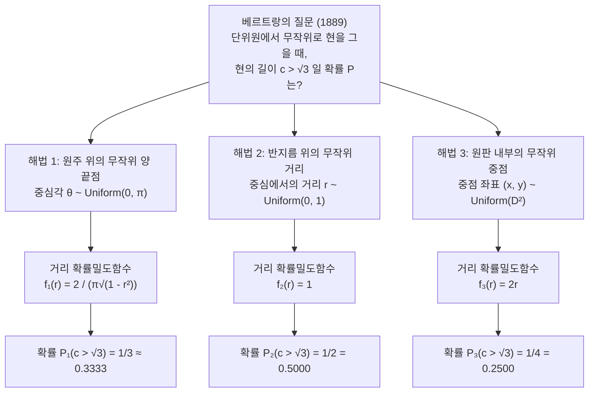
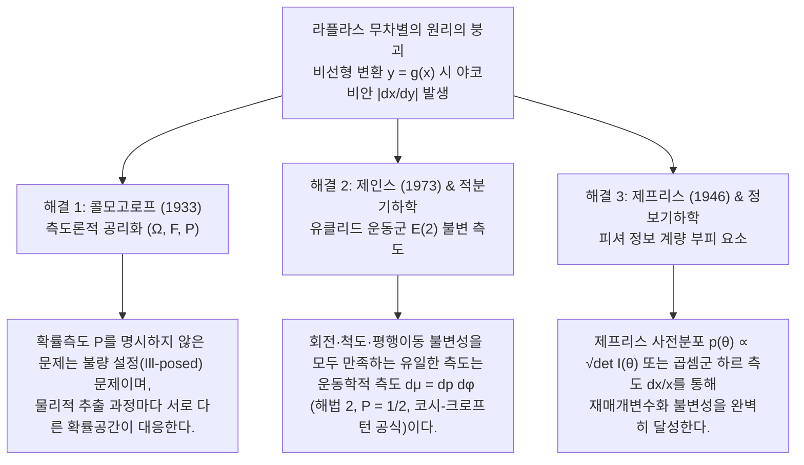

## 1. 서론: '무작위 선택'이라는 직관의 붕괴와 1889년의 충격

주사위를 던져 1이 나올 확률은 $1/6$이고, 동전을 던져 앞면이 나올 확률은 $1/2$이다. 유한개의 이산적인 선택지가 주어졌을 때, 특정한 선택지를 편애할 이유가 없다면 동일한 확률을 부여한다는 생각은 지극히 자명해 보인다.

그러나 대상이 유한 집합에서 <strong>연속적인 기하학적 공간(Continuum)</strong>으로 넘어가는 순간, 이 소박한 직관은 산산조각이 난다. 1889년 프랑스의 수학자 <strong>조제프 베르트랑(Joseph Bertrand, 1822–1900)</strong>은 저서 《확률 계산(*Calcul des probabilités*)》에서 단 몇 줄짜리 기하학 문제를 통해 고전적 확률론의 심장부를 겨누었다. 오늘날 <strong>'베르트랑의 역설(Bertrand's Paradox)'</strong>이라 불리는 문제다.

유클리드 평면 $\mathbb{R}^2$ 위의 반지름 $R = 1$인 단위원 $S^1 = \{(x,y) : x^2 + y^2 = 1\}$에 내접하는 정삼각형 $\triangle ABC$를 생각하자. 정삼각형의 한 변의 길이는 $L = 2R\sin(\pi/3) = \sqrt{3} \approx 1.732$이며, 원의 중심 $O(0,0)$에서 정삼각형의 각 변에 내린 수선의 길이(내접원의 반지름)는 $r_{\text{in}} = R\cos(\pi/3) = 1/2$이다.

> <strong>[베르트랑의 문제 (1889)]</strong>
> 단위원의 현(원주 위의 두 점을 잇는 선분)을 <strong>'무작위로(at random)'</strong> 하나 긋는다. 이 현의 길이 $c$가 내접 정삼각형의 한 변의 길이 $L = \sqrt{3}$보다 길 확률 $P(c > \sqrt{3})$은 얼마인가?

놀랍게도 베르트랑은 완전히 자연스럽고 대칭적인 세 가지 현의 생성 방식을 제시하고, 각각으로부터 <strong>$P_1 = 1/3$, $P_2 = 1/2$, $P_3 = 1/4$という 서로 모순되는 세 가지 엄밀해</strong>를 도출했다.



---

## 2. 세 가지 고전적 해법의 엄밀한 유도와 확률밀도함수

현 $c$가 원의 중심 $O$에서 이루는 중심각을 $\theta \in [0, \pi]$, 중심 $O$에서 현에 내린 수선의 발(현의 중점 $M$)까지의 거리를 $r \in [0, 1]$, 수선의 방향각을 $\phi \in [0, 2\pi)$라 하자. 피타고라스 정리에 의해 다음의 기본 항등식이 성립한다.

$$c = 2\sqrt{1 - r^2} = 2\sin\left(\frac{\theta}{2}\right), \qquad r = \cos\left(\frac{\theta}{2}\right) = \sqrt{1 - \frac{c^2}{4}}$$

따라서 사건 $E = \{c > \sqrt{3}\}$은 모든 좌표계에서 다음의 조건과 동치이다.

$$c > \sqrt{3} \iff 2\sqrt{1 - r^2} > \sqrt{3} \iff 0 \le r < \frac{1}{2} \iff \theta \in \left(\frac{2\pi}{3}, \frac{4\pi}{3}\right)$$

### 2.1 해법 1: 원주 위의 두 끝점을 균등하게 선택 ($P_1 = 1/3$)

회전 대칭성 $SO(2)$에 의해 한 끝점 $A$를 정삼각형의 꼭짓점($\theta = 0$)에 고정하고, 다른 끝점 $B$의 각도 $\theta \sim \text{Uniform}(0, 2\pi)$를 원주 위에서 균등하게 선택한다. 현의 길이가 $\sqrt{3}$보다 길어지려면 끝점 $B$가 맞은편 호 $\theta \in (2\pi/3, 4\pi/3)$ 위에 놓여야 한다. 전체 원주 $2\pi$ 중 해당 호의 길이는 $2\pi/3$이므로 확률은 다음과 같다.

$$P_1(c > \sqrt{3}) = \frac{4\pi/3 - 2\pi/3}{2\pi} = \frac{1}{3}$$

변수변환 $r = \cos(\theta/2)$($\theta \in [0, \pi]$, $f_\Theta(\theta) = 1/\pi$)와 야코비안 $\left|\frac{d\theta}{dr}\right| = \frac{2}{\sqrt{1 - r^2}}$를 적용하면 중심 거리 $r$과 현의 길이 $c$의 확률밀도함수는 다음과 같이 도출된다.

$$f_{R,1}(r) = \frac{2}{\pi\sqrt{1 - r^2}}, \qquad f_{C,1}(c) = \frac{2}{\pi\sqrt{4 - c^2}}, \qquad \mathbb{E}_1[c] = \frac{4}{\pi} \approx 1.2732$$

### 2.2 해법 2: 고정된 반지름 위에서 중심 거리를 균등하게 선택 ($P_2 = 1/2$)

반지름의 방향 $\phi \sim \text{Uniform}(0, 2\pi)$를 선택한 뒤, 그 반지름 위에서 현의 중점까지의 거리 $r \sim \text{Uniform}(0, 1)$를 균등하게 선택하여 반지름에 수직인 현을 긋는다. 정삼각형의 변은 중심으로부터 거리 $r_{\text{in}} = 1/2$에 위치하므로, $c > \sqrt{3} \iff 0 \le r < 1/2$이다.

$$P_2(c > \sqrt{3}) = \int_0^{1/2} 1\,dr = \frac{1}{2}, \qquad f_{R,2}(r) = 1, \qquad f_{C,2}(c) = \frac{c}{2\sqrt{4 - c^2}}, \qquad \mathbb{E}_2[c] = \frac{\pi}{2} \approx 1.5708$$

### 2.3 해법 3: 원판 내부에서 현의 중점을 면적 균등하게 선택 ($P_3 = 1/4$)

지름이 아닌 모든 현은 단위원판 $D^2 = \{(x,y) : x^2 + y^2 \le 1\}$ 내부의 중점 $M(x, y)$에 의해 유일하게 결정된다. 원판 전체 면적($\pi R^2 = \pi$)에 대해 균등하게 중점 $(x, y)$를 선택하면($f_{X,Y}(x,y) = 1/\pi$), $c > \sqrt{3}$일 필요충분조건은 중점 $M$이 반지름 $1/2$인 동심 내접원판 $D_{1/2}$ 내부에 들어오는 것이다.

$$P_3(c > \sqrt{3}) = \frac{\text{Area}(D_{1/2})}{\text{Area}(D_1)} = \frac{\pi (1/2)^2}{\pi (1)^2} = \frac{1}{4}$$

왜 해법 2와 해법 3이 다른가? 극좌표 변환에서 면적소 $dx\,dy = r\,dr\,d\phi$는 야코비안 $J = r$을 포함하기 때문이다. $\phi \in [0, 2\pi)$에 대해 적분하면 $r$의 주변확률밀도함수는 상수가 아니라 $2r$이 된다!

$$f_{R,3}(r) = \int_0^{2\pi} \frac{1}{\pi} r\,d\phi = 2r, \qquad f_{C,3}(c) = \frac{c}{2}, \qquad \mathbb{E}_3[c] = \frac{4}{3} \approx 1.3333$$

| 비교 항목 | 해법 1: 무작위 원주 끝점 | 해법 2: 무작위 반지름 거리 | 해법 3: 무작위 원판 중점 |
| :--- | :--- | :--- | :--- |
| <strong>균등분포를 따르는 변수</strong> | 중심각 $\theta \sim U(0, \pi)$ | 중심 거리 $r \sim U(0, 1)$ | 원판 면적 $(x,y) \sim U(D^2)$ ($r^2 \sim U(0,1)$) |
| <strong>확률측도 요소 $d\mathbb{P}(r,\phi)$</strong> | $\dfrac{1}{\pi^2\sqrt{1 - r^2}}\,dr\,d\phi$ | $\dfrac{1}{2\pi}\,dr\,d\phi$ | $\dfrac{r}{\pi}\,dr\,d\phi = \dfrac{1}{\pi}\,dx\,dy$ |
| <strong>거리 밀도함수 $f_R(r)$</strong> | $\dfrac{2}{\pi\sqrt{1 - r^2}}$ | $1$ | $2r$ |
| <strong>현 길이 밀도함수 $f_C(c)$</strong> | $\dfrac{2}{\pi\sqrt{4 - c^2}}$ | $\dfrac{c}{2\sqrt{4 - c^2}}$ | $\dfrac{c}{2}$ |
| <strong>확률 $P(c > \sqrt{3})$</strong> | <strong>$1/3 \approx 0.3333$</strong> | <strong>$1/2 = 0.5000$</strong> | <strong>$1/4 = 0.2500$</strong> |
| <strong>기댓값 $\mathbb{E}[c]$</strong> | $4/\pi \approx 1.2732$ | $\pi/2 \approx 1.5708$ | $4/3 \approx 1.3333$ |

---

## 3. 라플라스 '불충분한 이유의 원리'의 위기와 케인스의 '와인-물 역설'(1921)

<strong>피에르시몽 라플라스(Pierre-Simon Laplace)</strong>의 고전적 확률론은 <strong>'불충분한 이유의 원리(Principle of Insufficient Reason)'</strong>—훗날 <strong>존 메이너드 케인스(John Maynard Keynes, 1921)</strong>가 저서 《확률론(*A Treatise on Probability*)》에서 <strong>'무차별의 원리(Principle of Indifference)'</strong>라 명명한 원리—에 기초했다.

그러나 연속 공간에서 미지의 변수 $x \in [a, b]$에 균등밀도 $f_X(x) = \frac{1}{b-a}$를 부여하면, 비선형 변수변환 $y = g(x)$에 의해 <strong>야코비안(Jacobian) $\left|\frac{dx}{dy}\right|$</strong>가 곱해진다.

$$f_Y(y) = f_X\bigl(g^{-1}(y)\bigr)\left|\frac{dx}{dy}\right|$$

따라서 비선형 재매개변수화(Reparameterization) 아래에서 '균등성'은 보존되지 않는다. 케인스(1921)는 이를 <strong>'와인-물 역설(Wine-Water Paradox)'</strong>로 명쾌하게 논파했다.
- 잔 속에 담긴 와인과 물의 비율 $x = W_{\text{wine}}/W_{\text{water}}$가 $1/3$과 $3$ 사이에 있다는 사실만 알고 있다고 하자. $x \sim \text{Uniform}(1/3, 3)$이라 가정하면 중앙값은 $x_{\text{med}} = \frac{5}{3}$이고, $P_X(x \le 2) = \frac{2 - 1/3}{3 - 1/3} = \frac{5}{8} = 0.625$이다.
- 반면 동일한 정보는 물과 와인의 비율 $y = 1/x = W_{\text{water}}/W_{\text{wine}}$ 역시 구간 $[1/3, 3]$에 있다는 뜻이다. 무차별의 원리에 의해 $y \sim \text{Uniform}(1/3, 3)$이라 가정하면 중앙값은 $y_{\text{med}} = \frac{5}{3}$($x_{\text{med}} \cdot y_{\text{med}} = 25/9 \neq 1$ 모순!)이 되고, 동일한 사건 $x \le 2 \iff y \ge 1/2$의 확률은 $P_Y(y \ge 1/2) = \frac{3 - 1/2}{3 - 1/3} = \frac{15}{16} = 0.9375 \neq \frac{5}{8}$가 되어 자기모순에 빠진다.

---

## 4. 현대 수학과 통계학의 3대 해결책



### 4.1 안드레이 콜모고로프의 측도론적 공리화 $(\Omega, \mathcal{F}, \mathbb{P})$ (1933)

1933년 <strong>안드레이 콜모고로프(Andrei Kolmogorov)</strong>는 《확률론의 기초 개념》에서 확률을 표본공간 $\Omega$, 사건의 $\sigma$-대수 $\mathcal{F}$, 그리고 확률측도 $\mathbb{P}$의 순서쌍 $(\Omega, \mathcal{F}, \mathbb{P})$로 공리화했다. 콜모고로프의 관점에서 '무작위로 선택한다'는 말은 확률측도 $\mathbb{P}$를 명시하기 전까지는 수학적으로 정의되지 않은 불완전한 문장이다.

### 4.2 에드윈 제인스의 변환군 불변성(1973)과 푸앵카레-산탈로 운동학적 측도

1973년 물리학자 <strong>에드윈 제인스(Edwin T. Jaynes)</strong>는 논문 *"The Well-Posed Problem"*에서 바닥에 그려진 작은 원 위로 멀리서 긴 빨대를 던지는 실제 물리 실험을 분석했다. 원의 방향, 크기, 위치에 무관하려면 직선 $x\cos\phi + y\sin\phi = p$의 분포 $h(p, \phi)\,dp\,d\phi$는 다음 세 가지 대칭성을 만족해야 한다.
1. <strong>회전 불변성 $SO(2)$</strong>: $h(p, \phi) = g(p)/(2\pi)$ (세 해법 모두 만족);
2. <strong>척도(Scale) 불변성</strong>: 동심 소원($a < 1$)으로 제한해도 밀도 함수 형태가 유지됨 (경계 특이성을 갖는 해법 1 탈락);
3. <strong>평행이동 불변성 $\mathbb{R}^2$ (유클리드 강체운동군 $E(2)$)</strong>: 원점을 $(x_0, y_0)$만큼 평행이동하면 $p' = p - x_0\cos\phi - y_0\sin\phi$, $\phi' = \phi$가 되며, 야코비 행렬식은 항등적으로 $1$이다.
   $$J = \det\frac{\partial(p', \phi')}{\partial(p, \phi)} = \det\begin{pmatrix} 1 & x_0\sin\phi - y_0\cos\phi \\ 0 & 1 \end{pmatrix} = 1$$
   모든 $(x_0, y_0)$에 대해 $g(p') = g(p)$이려면 $g(p) = \text{const.}$일 수밖에 없다!

따라서 평면의 유클리드 운동군 $E(2)$에 대해 불변인 유일한 측도는 <strong>적분기하학(Integral Geometry)</strong>의 <strong>푸앵카레-산탈로 운동학적 측도(Poincaré–Santaló Kinematic Measure)</strong>

$$d\mu(L) = dp\,d\phi$$

이며, 이는 <strong>코시-크로프턴 공식(Cauchy–Crofton Formula)</strong> 및 <strong>뷔퐁의 바늘 문제(Buffon's Needle)</strong>를 지배하는 바로 그 측도다. 볼록 도형 $K$와 만나는 직선들의 측도는 둘레의 길이 $\text{Perimeter}(\partial K)$와 같으므로, 내접원(반지름 $1/2$, 둘레 $\pi$)과 단위원(반지름 $1$, 둘레 $2\pi$)의 둘레의 비로부터 <strong>해법 2($P = \pi / (2\pi) = 1/2$)</strong>가 유일한 물리적 해로 결정된다.

### 4.3 해럴드 제프리스의 비정보 사전분포(Jeffreys Prior, 1946)

베이즈 통계학에서 <strong>해럴드 제프리스(Harold Jeffreys)</strong>는 <strong>피셔 정보 행렬(Fisher Information Matrix)</strong> $I_{ij}(\theta) = -\mathbb{E}\left[\frac{\partial^2 \ln p(X\mid\theta)}{\partial\theta_i\partial\theta_j}\right]$의 행렬식 제곱근을 사전분포로 도입했다.

$$p_J(\theta) \propto \sqrt{\det I(\theta)}$$

이는 리만 다양체의 부피 요소로서 임의의 좌표 변환 $\eta = \psi(\theta)$에 대해 $p_J(\theta)\,d\theta = p_J(\eta)\,d\eta$를 만족한다. 와인-물 역설의 양수 비율 $x \in [1/3, 3]$에 대해서는 곱셈군 $(\mathbb{R}_{>0}, \times)$의 하르 측도(로그 균등분포) $d\mu(x) = \frac{dx}{x}$, 즉 $f(x) = \frac{1}{2\ln 3 \cdot x}$를 부여하면 역수 변환 $y = 1/x$에서도 동일한 분포가 유지되어 중앙값 $x_{\text{med}} = y_{\text{med}} = 1$로 역설이 완전히 해소된다.

---

## 5. Python 몬테카를로 시뮬레이션 검증

```python
import numpy as np

def simulate_bertrand(n: int = 1_000_000, seed: int = 42) -> None:
    rng = np.random.default_rng(seed)
    limit = np.sqrt(3.0)

    # 해법 1: 원주 위의 무작위 양 끝점 (P = 1/3)
    t1 = rng.uniform(0, 2 * np.pi, n)
    t2 = rng.uniform(0, 2 * np.pi, n)
    c1 = 2.0 * np.sin(np.abs(t1 - t2) / 2.0)

    # 해법 2: 반지름 위의 무작위 거리 r ~ U(0, 1) (P = 1/2)
    r2 = rng.uniform(0.0, 1.0, n)
    c2 = 2.0 * np.sqrt(1.0 - r2**2)

    # 해법 3: 원판 내부의 무작위 중점 u = r^2 ~ U(0, 1) (P = 1/4)
    r3 = np.sqrt(rng.uniform(0.0, 1.0, n))
    c3 = 2.0 * np.sqrt(1.0 - r3**2)

    # 해법 4: 제인스의 물리 실험 ((3.5, -2.0)으로 평행이동된 단위원에 무작위 직선 투척)
    phi = rng.uniform(0, 2 * np.pi, n * 5)
    p = rng.uniform(-10.0, 10.0, n * 5)
    r_shifted = np.abs(p - (3.5 * np.cos(phi) - 2.0 * np.sin(phi)))
    hits = r_shifted[r_shifted <= 1.0]
    c_jaynes = 2.0 * np.sqrt(1.0 - hits**2)

    for name, arr, exact in [
        ("Method 1 (Endpoints)", c1, 1/3),
        ("Method 2 (Radius)", c2, 1/2),
        ("Method 3 (Midpoint)", c3, 1/4),
        ("Jaynes Off-Center Toss", c_jaynes, 1/2),
    ]:
        print(f"{name:<24}: P(c > √3) = {np.mean(arr > limit):.5f} (Exact: {exact:.5f})")

if __name__ == "__main__":
    simulate_bertrand()
```
