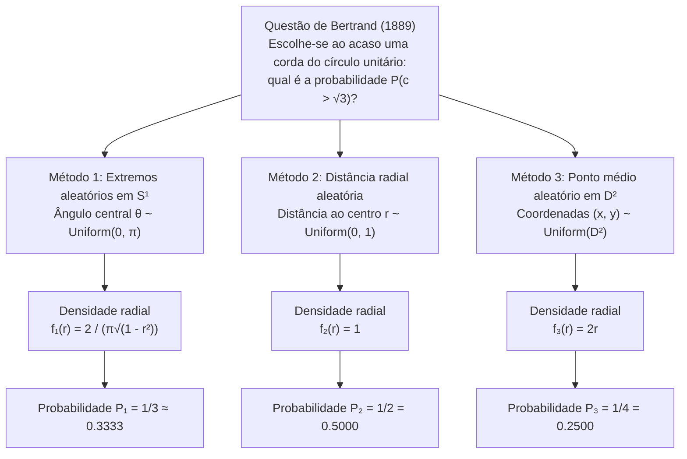
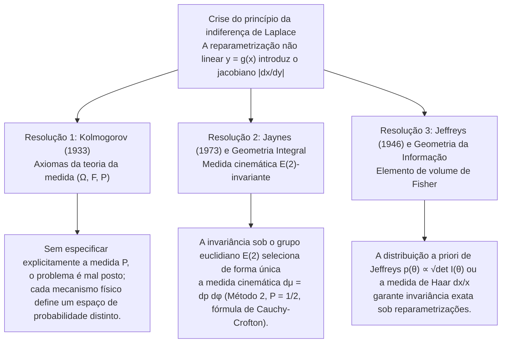

## 1. Introdução: O colapso da «aleatoriedade uniforme» em 1889

Nos espaços finitos e discretos, a expressão «escolher ao acaso» parece totalmente inequívoca: ao lançar um dado honesto, cada uma das seis faces possui probabilidade $1/6$. Contudo, assim que avançamos para o <strong>contínuo geométrico</strong>, essa intuição desmorona. Em 1889, o matemático francês <strong>Joseph Bertrand (1822–1900)</strong> apresentou em sua obra *Calcul des probabilités* um problema aparentemente elementar que abalou os alicerces da teoria das probabilidades: o <strong>Paradoxo de Bertrand</strong>.

Considere um círculo unitário $S^1 = \{(x,y) \in \mathbb{R}^2 : x^2 + y^2 = 1\}$ de raio $R = 1$ e um triângulo equilátero inscrito $\triangle ABC$. O comprimento do lado do triângulo é $L = 2R\sin(\pi/3) = \sqrt{3} \approx 1.732$, e o raio do seu círculo inscrito (a distância perpendicular do centro $O$ a cada lado) é $r_{\text{in}} = R\cos(\pi/3) = 1/2$.

> <strong>[Problema de Bertrand (1889)]</strong>
> Escolhe-se «ao acaso» uma corda $c$ do círculo unitário. Qual é a probabilidade $P(c > \sqrt{3})$ de que o comprimento dessa corda seja maior que o lado $L = \sqrt{3}$ do triângulo equilátero inscrito?

Bertrand apresentou três construções geométricas perfeitamente naturais e simétricas que levam a três probabilidades exatas mutuamente contraditórias: <strong>$P_1 = 1/3$, $P_2 = 1/2$ e $P_3 = 1/4$</strong>.



---

## 2. Derivação rigorosa das três soluções clássicas e suas funções densidade

Seja $\theta \in [0, \pi]$ o ângulo central subentendido pela corda, $r \in [0, 1]$ a distância perpendicular do centro $O$ ao ponto médio $M(x,y) = (r\cos\phi, r\sin\phi)$ da corda, e $c$ o seu comprimento. Pelo teorema de Pitágoras:

$$c = 2\sqrt{1 - r^2} = 2\sin\left(\frac{\theta}{2}\right), \qquad r = \cos\left(\frac{\theta}{2}\right) = \sqrt{1 - \frac{c^2}{4}}$$

O evento $E = \{c > \sqrt{3}\}$ é estritamente equivalente nos três sistemas de coordenadas a:

$$c > \sqrt{3} \iff 2\sqrt{1 - r^2} > \sqrt{3} \iff 0 \le r < \frac{1}{2} \iff \theta \in \left(\frac{2\pi}{3}, \frac{4\pi}{3}\right)$$

### 2.1 Método 1: Extremos aleatórios sobre a circunferência ($P_1 = 1/3$)

Por simetria rotacional $SO(2)$, fixamos o primeiro extremo $A$ em um vértice do triângulo ($\theta = 0$) e escolhemos o segundo extremo $B$ segundo $\theta \sim \text{Uniform}(0, 2\pi)$. Tem-se $c(\theta) > \sqrt{3}$ se e somente se $B$ pertence ao arco oposto $\theta \in (2\pi/3, 4\pi/3)$, de comprimento $2\pi/3$ em $2\pi$:

$$P_1(c > \sqrt{3}) = \frac{4\pi/3 - 2\pi/3}{2\pi} = \frac{1}{3}$$

Com $r = \cos(\theta/2)$ ($\theta \in [0, \pi]$, $f_\Theta(\theta) = 1/\pi$) e o jacobiano $\left|\frac{d\theta}{dr}\right| = \frac{2}{\sqrt{1 - r^2}}$, obtemos:

$$f_{R,1}(r) = \frac{2}{\pi\sqrt{1 - r^2}}, \qquad f_{C,1}(c) = \frac{2}{\pi\sqrt{4 - c^2}}, \qquad \mathbb{E}_1[c] = \frac{4}{\pi} \approx 1.2732$$

### 2.2 Método 2: Distância radial aleatória ao longo de um raio fixo ($P_2 = 1/2$)

Escolhemos uma direção radial $\phi \sim \text{Uniform}(0, 2\pi)$ e sobre ela a distância ao centro $r \sim \text{Uniform}(0, 1)$. Como o lado do triângulo equilátero dista $r_{\text{in}} = 1/2$ do centro, $c > \sqrt{3} \iff 0 \le r < 1/2$:

$$P_2(c > \sqrt{3}) = \int_0^{1/2} 1\,dr = \frac{1}{2}, \qquad f_{R,2}(r) = 1, \qquad f_{C,2}(c) = \frac{c}{2\sqrt{4 - c^2}}, \qquad \mathbb{E}_2[c] = \frac{\pi}{2} \approx 1.5708$$

### 2.3 Método 3: Ponto médio aleatório uniformemente no disco ($P_3 = 1/4$)

Toda corda não diametral é determinada de forma única pelo seu ponto médio $M(x, y) \in D^2$. Escolhendo $M$ uniformemente em relação à área $dx\,dy$ do disco unitário $D^2$ ($f_{X,Y}(x,y) = 1/\pi$), então $c > \sqrt{3}$ se e somente se $M$ cai dentro do disco inscrito concêntrico $D_{1/2}$ de raio $1/2$:

$$P_3(c > \sqrt{3}) = \frac{\text{Área}(D_{1/2})}{\text{Área}(D_1)} = \frac{\pi (1/2)^2}{\pi (1)^2} = \frac{1}{4}$$

Por que os métodos 2 e 3 divergem? Porque o elemento de área em coordenadas polares inclui o determinante jacobiano $J = r$, isto é, $dx\,dy = r\,dr\,d\phi$. Integrando em $\phi \in [0, 2\pi)$, a densidade marginal radial torna-se linear:

$$f_{R,3}(r) = \int_0^{2\pi} \frac{1}{\pi} r\,d\phi = 2r, \qquad f_{C,3}(c) = \frac{c}{2}, \qquad \mathbb{E}_3[c] = \frac{4}{3} \approx 1.3333$$

| Característica | Método 1: Extremos aleatórios | Método 2: Raio aleatório | Método 3: Ponto médio aleatório |
| :--- | :--- | :--- | :--- |
| <strong>Coordenada uniforme</strong> | Ângulo $\theta \sim U(0, \pi)$ | Distância $r \sim U(0, 1)$ | Área $(x,y) \sim U(D^2)$ ($r^2 \sim U(0,1)$) |
| <strong>Elemento de medida $d\mathbb{P}(r,\phi)$</strong> | $\dfrac{1}{\pi^2\sqrt{1 - r^2}}\,dr\,d\phi$ | $\dfrac{1}{2\pi}\,dr\,d\phi$ | $\dfrac{r}{\pi}\,dr\,d\phi = \dfrac{1}{\pi}\,dx\,dy$ |
| <strong>Densidade radial $f_R(r)$</strong> | $\dfrac{2}{\pi\sqrt{1 - r^2}}$ | $1$ | $2r$ |
| <strong>Densidade de comprimento $f_C(c)$</strong> | $\dfrac{2}{\pi\sqrt{4 - c^2}}$ | $\dfrac{c}{2\sqrt{4 - c^2}}$ | $\dfrac{c}{2}$ |
| <strong>Probabilidade $P(c > \sqrt{3})$</strong> | <strong>$1/3 \approx 0.3333$</strong> | <strong>$1/2 = 0.5000$</strong> | <strong>$1/4 = 0.2500$</strong> |
| <strong>Esperança $\mathbb{E}[c]$</strong> | $4/\pi \approx 1.2732$ | $\pi/2 \approx 1.5708$ | $4/3 \approx 1.3333$ |

---

## 3. A crise do princípio da indiferença de Laplace e o paradoxo do vinho e da água de Keynes (1921)

A probabilidade clássica de <strong>Pierre-Simon Laplace</strong> baseava-se no <strong>princípio da razão insuficiente</strong>, renomeado como <strong>princípio da indiferença (Principle of Indifference)</strong> por <strong>John Maynard Keynes (1921)</strong> em *A Treatise on Probability*. No contínuo, atribuir uma densidade uniforme $f_X(x) = \frac{1}{b-a}$ a um parâmetro $x \in [a, b]$ sob uma transformação não linear $y = g(x)$ multiplica a densidade pelo <strong>jacobiano $\left|\frac{dx}{dy}\right|$</strong>:

$$f_Y(y) = f_X\bigl(g^{-1}(y)\bigr)\left|\frac{dx}{dy}\right|$$

No <strong>paradoxo do vinho e da água de Keynes (1921)</strong>:
- Uma taça contém uma mistura de vinho e água cuja razão $x = W_{\text{vinho}}/W_{\text{água}}$ está entre $1/3$ e $3$. Se $x \sim \text{Uniform}(1/3, 3)$, a mediana é $x_{\text{med}} = 5/3$ e $P_X(x \le 2) = \frac{2 - 1/3}{3 - 1/3} = \frac{5}{8} = 0.625$.
- Porém, a mesma premissa implica que a razão inversa $y = 1/x = W_{\text{água}}/W_{\text{vinho}}$ também pertence a $[1/3, 3]$. Se $y \sim \text{Uniform}(1/3, 3)$, a mediana é $y_{\text{med}} = 5/3$ (contradizendo $x \cdot y = 1$!) e o mesmo evento $x \le 2 \iff y \ge 1/2$ tem probabilidade $P_Y(y \ge 1/2) = \frac{3 - 1/2}{3 - 1/3} = \frac{15}{16} = 0.9375 \neq \frac{5}{8}$.

---

## 4. As três resoluções matemáticas e físicas modernas



### 4.1 Axiomatização na teoria da medida de Kolmogorov $(\Omega, \mathcal{F}, \mathbb{P})$ (1933)

Em 1933, <strong>Andrei Kolmogorov</strong> estabeleceu que todo problema probabilístico exige definir explicitamente a tripla $(\Omega, \mathcal{F}, \mathbb{P})$. Sem especificar a medida de probabilidade $\mathbb{P}$, pedir a probabilidade de uma corda «ao acaso» é matematicamente mal posto.

### 4.2 Invariância por grupos de transformação de E. T. Jaynes (1973) e geometria integral

Em *"The Well-Posed Problem"* (1973), o físico <strong>Edwin T. Jaynes</strong> demonstrou que ao lançar canudos longos sobre um círculo desenhado no chão, a medida $h(p, \phi)\,dp\,d\phi$ das retas $x\cos\phi + y\sin\phi = p$ deve ser invariante sob:
1. <strong>Rotações $SO(2)$</strong>: $h(p, \phi) = g(p)/(2\pi)$;
2. <strong>Mudanças de escala</strong> (restrição a um subcírculo concêntrico de raio $a < 1$);
3. <strong>Translações $\mathbb{R}^2$ (grupo euclidiano de movimentos rígidos $E(2) = \mathbb{R}^2 \rtimes O(2)$)</strong>: ao transladar a origem por $(x_0, y_0)$, tem-se $p' = p - x_0\cos\phi - y_0\sin\phi$ e $\phi' = \phi$, cujo determinante jacobiano é identicamente $1$:
   $$J = \det\frac{\partial(p', \phi')}{\partial(p, \phi)} = \det\begin{pmatrix} 1 & x_0\sin\phi - y_0\cos\phi \\ 0 & 1 \end{pmatrix} = 1$$
   A invariância translacional $g(p') = g(p)$ impõe de forma única $g(p) = \text{const.}$

Esta é a <strong>medida cinemática de Poincaré–Santaló</strong> da geometria integral:

$$d\mu(L) = dp\,d\phi$$

Pela <strong>fórmula de Cauchy–Crofton</strong> (que também rege a <strong>agulha de Buffon</strong>), a medida das retas que interceptam um corpo convexo $K \subset \mathbb{R}^2$ é igual ao seu perímetro $\text{Perimeter}(\partial K)$. A razão entre o perímetro do círculo inscrito ($\pi$) e do círculo unitário ($2\pi$) fornece imediatamente o <strong>Método 2 ($P = 1/2$)</strong>.

### 4.3 Distribuição a priori de Jeffreys (1946)

Na inferência bayesiana, <strong>Harold Jeffreys (1946)</strong> utilizou a raiz quadrada do determinante da <strong>matriz de informação de Fisher</strong> $I_{ij}(\theta) = -\mathbb{E}\left[\frac{\partial^2 \ln p(X\mid\theta)}{\partial\theta_i\partial\theta_j}\right]$:

$$p_J(\theta) \propto \sqrt{\det I(\theta)}$$

Para o paradoxo do vinho e da água, a medida de Haar do grupo multiplicativo $(\mathbb{R}_{>0}, \times)$, $d\mu(x) = \frac{dx}{x}$ com densidade $f(x) = \frac{1}{2\ln 3 \cdot x}$ em $[1/3, 3]$, é invariante sob $y = 1/x$, fornecendo uma mediana consistente $x_{\text{med}} = y_{\text{med}} = 1$.

---

## 5. Simulação de Monte Carlo em Python

```python
import numpy as np

def simulate_bertrand(n: int = 1_000_000, seed: int = 42) -> None:
    rng = np.random.default_rng(seed)
    limit = np.sqrt(3.0)

    # Método 1: Extremos aleatórios em S^1 (P = 1/3)
    t1 = rng.uniform(0, 2 * np.pi, n)
    t2 = rng.uniform(0, 2 * np.pi, n)
    c1 = 2.0 * np.sin(np.abs(t1 - t2) / 2.0)

    # Método 2: Distância radial aleatória r ~ U(0, 1) (P = 1/2)
    r2 = rng.uniform(0.0, 1.0, n)
    c2 = 2.0 * np.sqrt(1.0 - r2**2)

    # Método 3: Ponto médio aleatório u = r^2 ~ U(0, 1) (P = 1/4)
    r3 = np.sqrt(rng.uniform(0.0, 1.0, n))
    c3 = 2.0 * np.sqrt(1.0 - r3**2)

    # Método 4: Experimento físico de Jaynes (Círculo deslocado em (3.5, -2.0))
    phi = rng.uniform(0, 2 * np.pi, n * 5)
    p = rng.uniform(-10.0, 10.0, n * 5)
    r_shifted = np.abs(p - (3.5 * np.cos(phi) - 2.0 * np.sin(phi)))
    hits = r_shifted[r_shifted <= 1.0]
    c_jaynes = 2.0 * np.sqrt(1.0 - hits**2)

    for name, arr, exact in [
        ("Method 1 (Endpoints)", c1, 1/3),
        ("Method 2 (Radius)", c2, 1/2),
        ("Method 3 (Midpoint)", c3, 1/4),
        ("Jaynes Off-Center Toss", c_jaynes, 1/2),
    ]:
        print(f"{name:<24}: P(c > √3) = {np.mean(arr > limit):.5f} (Exact: {exact:.5f})")

if __name__ == "__main__":
    simulate_bertrand()
```
