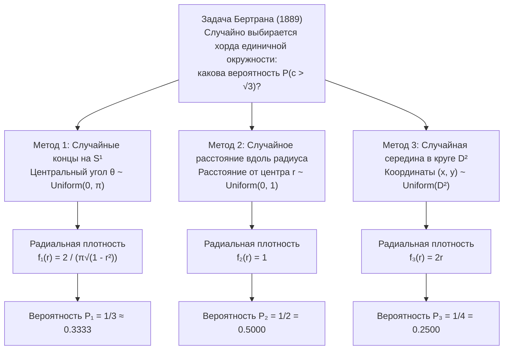
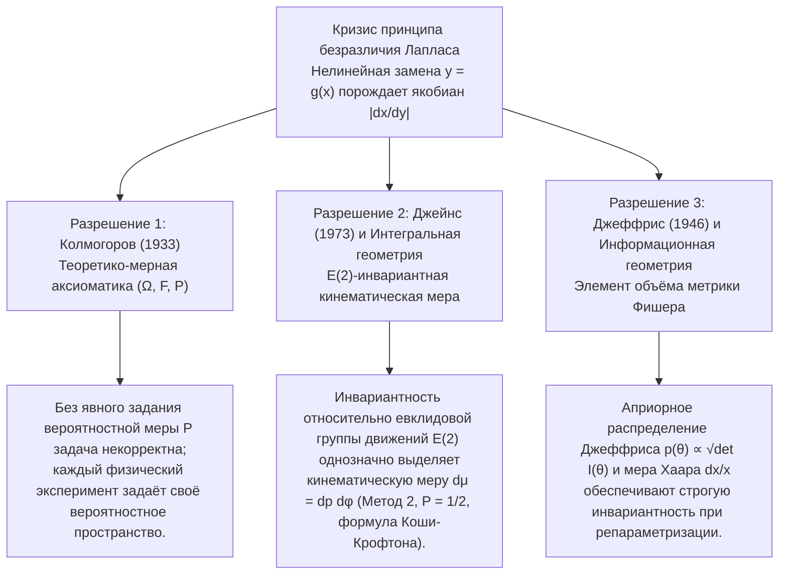

## 1. Введение: Крах интуиции «равномерной случайности» в 1889 году

В конечных дискретных пространствах понятие «выбрать наугад» кажется совершенно однозначным: при броске симметричной игральной кости каждая грань выпадает с вероятностью $1/6$. Однако при переходе к <strong>непрерывным геометрическим пространствам</strong> эта наивная интуиция рушится. В 1889 году французский математик <strong>Жозеф Бертран (Joseph Bertrand, 1822–1900)</strong> в трактате *Calcul des probabilités* сформулировал простую геометрическую задачу, вошедшую в историю как <strong>парадокс Бертрана</strong>.

Рассмотрим на плоскости $\mathbb{R}^2$ единичную окружность $S^1 = \{(x,y) : x^2 + y^2 = 1\}$ радиуса $R = 1$ и вписанный в неё равносторонний треугольник $\triangle ABC$. Длина стороны треугольника равна $L = 2R\sin(\pi/3) = \sqrt{3} \approx 1.732$, а радиус вписанной в него окружности (расстояние от центра $O$ до каждой стороны) равен $r_{\text{in}} = R\cos(\pi/3) = 1/2$.

> <strong>[Задача Бертрана (1889)]</strong>
> В единичной окружности «наугад» (случайным образом) выбирается хорда $c$. Какова вероятность $P(c > \sqrt{3})$ того, что её длина превзойдёт сторону $L = \sqrt{3}$ вписанного равностороннего треугольника?

Бертран предложил три совершенно естественных, симметричных способа выбора хорды и получил три взаимоисключающих точных ответа: <strong>$P_1 = 1/3$, $P_2 = 1/2$ и $P_3 = 1/4$</strong>.



---

## 2. Строгий вывод трёх классических решений и их плотностей вероятности

Пусть $\theta \in [0, \pi]$ — центральный угол, стягиваемый хордой, $r \in [0, 1]$ — расстояние от центра $O$ до середины хорды $M(x,y) = (r\cos\phi, r\sin\phi)$, а $c$ — длина хорды. По теореме Пифагора:

$$c = 2\sqrt{1 - r^2} = 2\sin\left(\frac{\theta}{2}\right), \qquad r = \cos\left(\frac{\theta}{2}\right) = \sqrt{1 - \frac{c^2}{4}}$$

Событие $E = \{c > \sqrt{3}\}$ во всех трёх параметризациях эквивалентно условию:

$$c > \sqrt{3} \iff 2\sqrt{1 - r^2} > \sqrt{3} \iff 0 \le r < \frac{1}{2} \iff \theta \in \left(\frac{2\pi}{3}, \frac{4\pi}{3}\right)$$

### 2.1 Метод 1: Случайные концы хорды на окружности ($P_1 = 1/3$)

В силу вращательной симметрии $SO(2)$ зафиксируем первый конец хорды $A$ в вершине треугольника ($\theta = 0$) и выберем второй конец $B$ равномерно на окружности: $\theta \sim \text{Uniform}(0, 2\pi)$. Условие $c(\theta) > \sqrt{3}$ выполняется тогда и только тогда, когда $B$ попадает на противоположную дугу $\theta \in (2\pi/3, 4\pi/3)$ длины $2\pi/3$ из общей длины $2\pi$:

$$P_1(c > \sqrt{3}) = \frac{4\pi/3 - 2\pi/3}{2\pi} = \frac{1}{3}$$

Используя замену $r = \cos(\theta/2)$ ($\theta \in [0, \pi]$, $f_\Theta(\theta) = 1/\pi$) и якобиан $\left|\frac{d\theta}{dr}\right| = \frac{2}{\sqrt{1 - r^2}}$, находим плотности:

$$f_{R,1}(r) = \frac{2}{\pi\sqrt{1 - r^2}}, \qquad f_{C,1}(c) = \frac{2}{\pi\sqrt{4 - c^2}}, \qquad \mathbb{E}_1[c] = \frac{4}{\pi} \approx 1.2732$$

### 2.2 Метод 2: Случайное радиальное расстояние вдоль фиксированного радиуса ($P_2 = 1/2$)

Выберем направление радиуса $\phi \sim \text{Uniform}(0, 2\pi)$ и на нём равномерно выберем расстояние от центра до хорды $r \sim \text{Uniform}(0, 1)$. Поскольку сторона равностороннего треугольника отстоит от центра на $r_{\text{in}} = 1/2$, условие $c > \sqrt{3}$ равносильно $0 \le r < 1/2$:

$$P_2(c > \sqrt{3}) = \int_0^{1/2} 1\,dr = \frac{1}{2}, \qquad f_{R,2}(r) = 1, \qquad f_{C,2}(c) = \frac{c}{2\sqrt{4 - c^2}}, \qquad \mathbb{E}_2[c] = \frac{\pi}{2} \approx 1.5708$$

### 2.3 Метод 3: Случайная середина хорды равномерно по площади круга ($P_3 = 1/4$)

Любая хорда ($r > 0$) однозначно определяется своей серединой $M(x, y) \in D^2$. Если точка $M$ выбирается равномерно по мере Лебега $dx\,dy$ внутри единичного круга $D^2$ ($f_{X,Y}(x,y) = 1/\pi$), то $c > \sqrt{3}$ тогда и только тогда, когда $M$ попадает внутрь концентрического вписанного круга $D_{1/2}$ радиуса $1/2$:

$$P_3(c > \sqrt{3}) = \frac{\text{Площадь}(D_{1/2})}{\text{Площадь}(D_1)} = \frac{\pi (1/2)^2}{\pi (1)^2} = \frac{1}{4}$$

Различие между методами 2 и 3 объясняется якобианом полярных координат $dx\,dy = r\,dr\,d\phi$. Интегрирование по $\phi \in [0, 2\pi)$ даёт линейную маргинальную плотность:

$$f_{R,3}(r) = \int_0^{2\pi} \frac{1}{\pi} r\,d\phi = 2r, \qquad f_{C,3}(c) = \frac{c}{2}, \qquad \mathbb{E}_3[c] = \frac{4}{3} \approx 1.3333$$

| Характеристика | Метод 1: Случайные концы | Метод 2: Случайный радиус | Метод 3: Случайная середина |
| :--- | :--- | :--- | :--- |
| <strong>Равномерный параметр</strong> | Угол $\theta \sim U(0, \pi)$ | Расстояние $r \sim U(0, 1)$ | Площадь $(x,y) \sim U(D^2)$ ($r^2 \sim U(0,1)$) |
| <strong>Элемент вероятности $d\mathbb{P}(r,\phi)$</strong> | $\dfrac{1}{\pi^2\sqrt{1 - r^2}}\,dr\,d\phi$ | $\dfrac{1}{2\pi}\,dr\,d\phi$ | $\dfrac{r}{\pi}\,dr\,d\phi = \dfrac{1}{\pi}\,dx\,dy$ |
| <strong>Радиальная плотность $f_R(r)$</strong> | $\dfrac{2}{\pi\sqrt{1 - r^2}}$ | $1$ | $2r$ |
| <strong>Плотность длины $f_C(c)$</strong> | $\dfrac{2}{\pi\sqrt{4 - c^2}}$ | $\dfrac{c}{2\sqrt{4 - c^2}}$ | $\dfrac{c}{2}$ |
| <strong>Вероятность $P(c > \sqrt{3})$</strong> | <strong>$1/3 \approx 0.3333$</strong> | <strong>$1/2 = 0.5000$</strong> | <strong>$1/4 = 0.2500$</strong> |
| <strong>Мат. ожидание $\mathbb{E}[c]$</strong> | $4/\pi \approx 1.2732$ | $\pi/2 \approx 1.5708$ | $4/3 \approx 1.3333$ |

---

## 3. Кризис принципа недостаточного основания Лапласа и парадокс вина и воды Кейнса (1921)

Классическая теория вероятностей <strong>Пьера-Симона Лапласа</strong> опиралась на <strong>принцип недостаточного основания</strong>, названный <strong>Джоном Мейнардом Кейнсом (1921)</strong> в *A Treatise on Probability* <strong>принципом безразличия (Principle of Indifference)</strong>. В непрерывном случае задание постоянной плотности $f_X(x) = \frac{1}{b-a}$ на $[a, b]$ при нелинейной замене параметра $y = g(x)$ умножает плотность на <strong>якобиан $\left|\frac{dx}{dy}\right|$</strong>:

$$f_Y(y) = f_X\bigl(g^{-1}(y)\bigr)\left|\frac{dx}{dy}\right|$$

В <strong>парадоксе вина и воды Кейнса (1921)</strong>:
- В бокале находится смесь вина и воды, причём отношение $x = W_{\text{вино}}/W_{\text{вода}}$ лежит в пределах от $1/3$ до $3$. Если $x \sim \text{Uniform}(1/3, 3)$, то медиана равна $x_{\text{med}} = 5/3$, а $P_X(x \le 2) = \frac{2 - 1/3}{3 - 1/3} = \frac{5}{8} = 0.625$.
- Но то же самое условие означает, что обратное отношение $y = 1/x = W_{\text{вода}}/W_{\text{вино}}$ также лежит в $[1/3, 3]$. Если $y \sim \text{Uniform}(1/3, 3)$, то медиана $y_{\text{med}} = 5/3$ (что противоречит $x \cdot y = 1$!), а вероятность того же события $x \le 2 \iff y \ge 1/2$ равна $P_Y(y \ge 1/2) = \frac{3 - 1/2}{3 - 1/3} = \frac{15}{16} = 0.9375 \neq \frac{5}{8}$.

---

## 4. Три современных математических и физических разрешения парадокса



### 4.1 Аксиоматика А. Н. Колмогорова $(\Omega, \mathcal{F}, \mathbb{P})$ (1933)

В 1933 году <strong>Андрей Николаевич Колмогоров</strong> в монографии *«Основные понятия теории вероятностей»* показал, что вероятность определена лишь тогда, когда задана тройка $(\Omega, \mathcal{F}, \mathbb{P})$. Без явного указания вероятностной меры $\mathbb{P}$ фраза «выбрать хорду наугад» математически некорректна.

### 4.2 Групповая инвариантность Э. Т. Джейнса (1973) и кинематическая мера Пуанкаре–Сантало

В знаменитой статье *"The Well-Posed Problem"* (1973) физик <strong>Эдвин Джейнс</strong> доказал, что при бросании длинных соломинок на нарисованный на полу круг распределение прямых $x\cos\phi + y\sin\phi = p$ с мерой $h(p, \phi)\,dp\,d\phi$ должно быть инвариантно относительно:
1. <strong>Вращений $SO(2)$</strong>: $h(p, \phi) = g(p)/(2\pi)$;
2. <strong>Масштабирования</strong> (перехода к концентрическому кругу радиуса $a < 1$);
3. <strong>Параллельных переносов $\mathbb{R}^2$ (евклидовой группы движений $E(2) = \mathbb{R}^2 \rtimes O(2)$)</strong>: при сдвиге начала координат на $(x_0, y_0)$ получаем $p' = p - x_0\cos\phi - y_0\sin\phi$, $\phi' = \phi$, причём якобиан преобразования тождественно равен $1$:
   $$J = \det\frac{\partial(p', \phi')}{\partial(p, \phi)} = \det\begin{pmatrix} 1 & x_0\sin\phi - y_0\cos\phi \\ 0 & 1 \end{pmatrix} = 1$$
   Требование $g(p') = g(p)$ однозначно влечёт $g(p) = \text{const.}$

Это единственная $E(2)$-инвариантная <strong>кинематическая мера Пуанкаре–Сантало</strong> в интегральной геометрии:

$$d\mu(L) = dp\,d\phi$$

Согласно <strong>формуле Коши–Крофтона</strong> (которая также лежит в основе <strong>задачи Бюффона о бросании иглы</strong>), мера множества прямых, пересекающих выпуклое тело $K \subset \mathbb{R}^2$, равна его периметру $\text{Perimeter}(\partial K)$. Отношение периметра вписанного круга ($\pi$) к периметру единичного круга ($2\pi$) сразу даёт <strong>Метод 2 ($P = 1/2$)</strong>.

### 4.3 Априорное распределение Джеффриса (1946)

В байесовской статистике <strong>Гарольд Джеффрис (1946)</strong> ввёл инвариантную плотность через корень из определителя <strong>информационной матрицы Фишера</strong> $I_{ij}(\theta) = -\mathbb{E}\left[\frac{\partial^2 \ln p(X\mid\theta)}{\partial\theta_i\partial\theta_j}\right]$:

$$p_J(\theta) \propto \sqrt{\det I(\theta)}$$

Для парадокса вина и воды мера Хаара мультипликативной группы $(\mathbb{R}_{>0}, \times)$, $d\mu(x) = \frac{dx}{x}$ с плотностью $f(x) = \frac{1}{2\ln 3 \cdot x}$ на $[1/3, 3]$, инвариантна относительно замены $y = 1/x$ и даёт согласованную медиану $x_{\text{med}} = y_{\text{med}} = 1$.

---

## 5. Моделирование методом Монте-Карло на Python

```python
import numpy as np

def simulate_bertrand(n: int = 1_000_000, seed: int = 42) -> None:
    rng = np.random.default_rng(seed)
    limit = np.sqrt(3.0)

    # Метод 1: Случайные концы на S^1 (P = 1/3)
    t1 = rng.uniform(0, 2 * np.pi, n)
    t2 = rng.uniform(0, 2 * np.pi, n)
    c1 = 2.0 * np.sin(np.abs(t1 - t2) / 2.0)

    # Метод 2: Случайный радиус r ~ U(0, 1) (P = 1/2)
    r2 = rng.uniform(0.0, 1.0, n)
    c2 = 2.0 * np.sqrt(1.0 - r2**2)

    # Метод 3: Случайная середина u = r^2 ~ U(0, 1) (P = 1/4)
    r3 = np.sqrt(rng.uniform(0.0, 1.0, n))
    c3 = 2.0 * np.sqrt(1.0 - r3**2)

    # Метод 4: Физический эксперимент Джейнса (смещённый круг в (3.5, -2.0))
    phi = rng.uniform(0, 2 * np.pi, n * 5)
    p = rng.uniform(-10.0, 10.0, n * 5)
    r_shifted = np.abs(p - (3.5 * np.cos(phi) - 2.0 * np.sin(phi)))
    hits = r_shifted[r_shifted <= 1.0]
    c_jaynes = 2.0 * np.sqrt(1.0 - hits**2)

    for name, arr, exact in [
        ("Method 1 (Endpoints)", c1, 1/3),
        ("Method 2 (Radius)", c2, 1/2),
        ("Method 3 (Midpoint)", c3, 1/4),
        ("Jaynes Off-Center Toss", c_jaynes, 1/2),
    ]:
        print(f"{name:<24}: P(c > √3) = {np.mean(arr > limit):.5f} (Exact: {exact:.5f})")

if __name__ == "__main__":
    simulate_bertrand()
```
