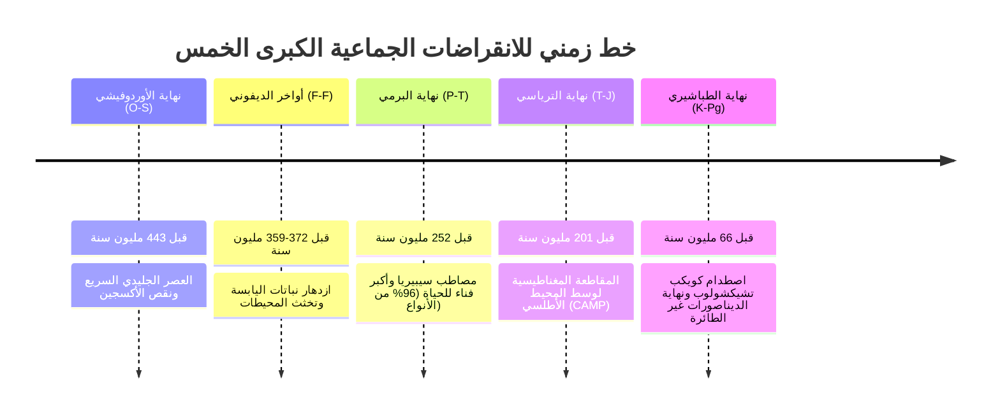
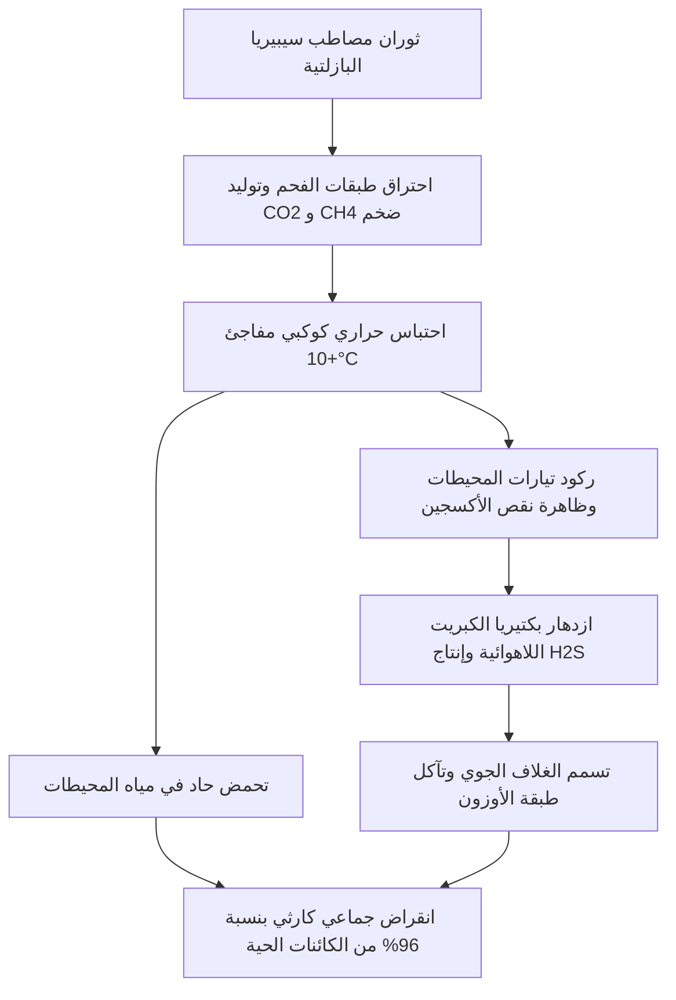

على مدار الـ 540 مليون سنة الماضية منذ العصر الكامبري، شهد كوكب الأرض خمس أزمات بيولوجية كبرى محت غالبية الأنواع الحية وأعادت تشكيل مسار التطور البيولوجي بالكامل، وتعرف باسم **الخمسة الكبار (The Big Five)**.

---

## 1. المقارنة الشاملة للأحداث الخمسة الكبرى

| الحدث | العصر الجيولوجي | التوقيت (قبل سنة) | نسبة انقراض الأنواع | السبب الجيوفيزيائي الرئيسي | المستفيدون من الإشعاع التكيفي |
| :--- | :--- | :--- | :--- | :--- | :--- |
| **O-S** | نهاية الأوردوفيشي | ~443 مليون سنة | ~85% | تجلد غندوانا، انخفاض مستوى البحر، نقص أكسجين المحيطات | ذوات القوائم الذراعية، رأسيات الأرجل الناجية |
| **Late D** | أواخر الديفوني | ~372-359 مليون سنة | ~75% | التجوية الفائقة لجذور النباتات البرية، تخثث المياه العميقة | الفقاريات رباعية الأطراف البدائية |
| **P-T** | نهاية البرمي (الأعظم) | ~252 مليون سنة | ~96% (البحرية) / ~70% (اليابسة) | ثوران مصاطب سيبيريا البازلتية، انبعاث الميثان، تحمض شديد | أسلاف الديناصورات والزواحف الحاكمة |
| **T-J** | نهاية الترياسي | ~201 مليون سنة | ~80% | تصدع بانجيا وثوران مقاطعة وسط الأطلسي (CAMP) | الديناصورات المهيمنة على اليابسة |
| **K-Pg** | نهاية الطباشيري | ~66 مليون سنة | ~76% | اصطدام كويكب تشيكشولوب ومصاطب الدكن | الثدييات والطيور الحديثة |

---

## 2. فيزياء وكيمياء الكوارث الكوكبية

### 2.1 ثوران المقاطعات النارية الكبرى (LIPs) وتسمم الغلاف الجوي
في حدث نهاية البرمي (P-T)، قذفت مصاطب سيبيريا ملايين الكيلومترات المكعبة من الحمم البركانية عبر طبقات الفحم الحجري والهيدروكربونات، مما أدى إلى تحرير كميات هائلة من ثاني أكسيد الكربون وغاز الميثان. وتخضع ديناميكية الاحترار لمعادلة التأثير الإشعاعي:

$$\Delta F = \alpha \ln\left(\frac{C}{C_0}\right)$$

حيث يتسبب الاحترار الحراري الفائق في انهيار الدورة الحرارية الملحية (Thermohaline Circulation) وتوقف الأكسجين عن الوصول إلى قاع المحيطات، مما يحفز ازدهار بكتيريا الكبريت اللاهوائية وانبعاث غاز كبريتيد الهيدروجين السام ($H_2S$) الذي يدمر طبقة الأوزون.

---

## 3. اصطدام تشيكشولوب والآليات الحركية لانقراض العصر الطباشيري (K-Pg)

قبل 66 مليون سنة، اصطدم كويكب قطره قرابة 10 إلى 15 كيلومتراً بشبه جزيرة يوكاتان بسرعة تقدر بنحو 20 كم/ثانية. وتُحسب الطاقة الحركية المنبعثة بالعلاقة:

$$E_k = \frac{1}{2} m v^2 \approx 10^{23} \text{ إلى } 10^{24} \text{ جول}$$

وهذه الطاقة تعادل مليارات القنابل النووية، ونجم عنها:
1. **الشتاء النووي/الصدمي**: حجب الغبار والكبريت لأشعة الشمس لأشهر طويلة مما أوقف التركيب الضوئي.
2. **الأمطار الحمضية الكبريتية**: تبخر صخور الأنهيدريت والجبس المشبعة بالكبريت في موقع الاصطدام.
3. **نبضة حرارية عالمية**: تساقط المقذوفات النارية المعاد دخولها في الغلاف الجوي مسببة حرائق غابات عالمية.

---

## 4. هل نعيش حالياً الانقراض الجماعي السادس؟

تشير التقديرات الجيولوجية الحديثة إلى أن معدل الانقراض الحالي للأنواع يتجاوز المعدل الطبيعي الأساسي (Background Extinction Rate) بنحو 100 إلى 1000 ضعف بفعل تدمير الموائل وتغير المناخ والاستغلال المفرط. إن دراسة سجل الصخور والانقراضات الخمسة السابقة توضح بشكل لا يقبل الشك أن التوازن الحيوي للأرض، بمجرد تجاوزه لنقاط التحول الحرجة (Tipping Points)، قد يستغرق من 5 إلى 10 ملايين سنة للتعافي الكامل عبر الإشعاع التكيفي الجديد.
