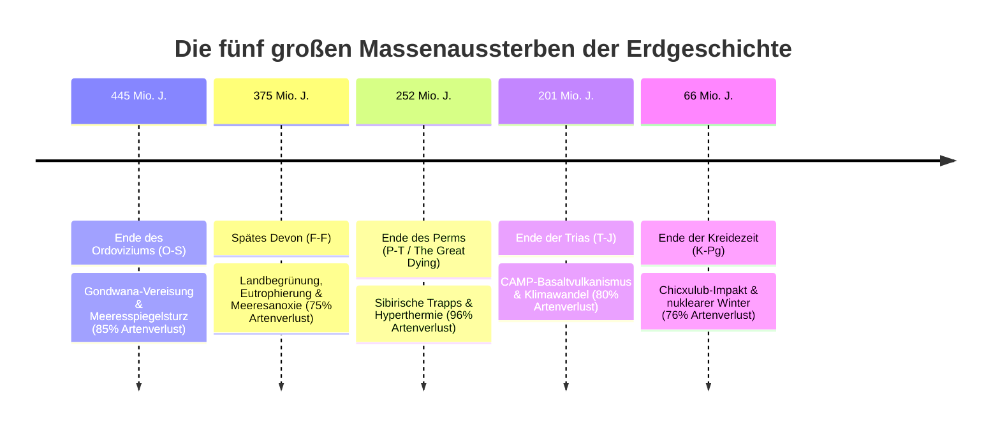
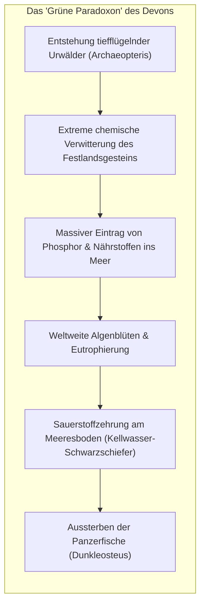
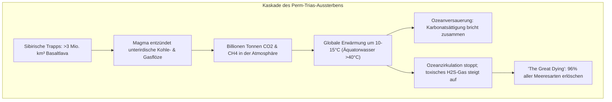
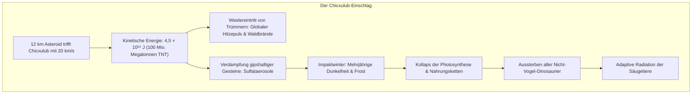

## Einleitung: Die fünf großen planetaren Resets der Biosphäre

Das Leben auf der Erde ist keine Geschichte kontinuierlicher, friedlicher Evolution. In den Gesteinsschichten des Phanerozoikums (den letzten 540 Millionen Jahren) finden sich die Spuren von fünf katastrophalen Einschnitten: **den Big Five des Massenaussterbens**.

1982 wiesen die Paläontologen **Jack Sepkoski** und **David Raup** nach, dass neben der normalen Hintergrundaussterberate fünf gewaltige Aussterbepeaks existieren. Massenaussterben vernichten dominante Gruppen und öffnen den Weg für revolutionäre **adaptive Radiationen**.

---

## 1. Die erste Katastrophe: Spätes Ordovizium (O-S: vor ~445 Mio. Jahren)

- **Gondwana-Vereisung**: Die Kontinentaldrift Gondwanas über den Südpol löste eine massive Vereisung aus. Der weltweite Meeresspiegel fiel um 50 bis 100 Meter, wodurch die lebensreichen Schelfmeere trockenfielen.
- **Entgletscherung und Meeresanoxie**: Das anschließende plötzliche Schmelzen der Eismassen stoppte die thermohaline Zirkulation. Die Ozeane wurden anoxisch und erstickten 85% der marinen Arten.

---

## 2. Die zweite Katastrophe: Spätes Devon (F-F: vor ~375 Mio. Jahren)

---

## 3. Die dritte Katastrophe: Ende des Perms (P-T: vor ~252 Mio. Jahren)

Das verheerendste Ereignis der Erdgeschichte: **96% aller Meeresarten und 70% der Landwirbeltiere starben aus**.

Kohlenstoffisotopenkurven ($\delta^{13}\text{C}$) zeigen an der P-T-Grenze einen massiven negativen Ausschlag. Die Ozeane wurden anoxisch und bildeten toxischen Schwefelwasserstoff ($\text{H}_2\text{S}$), der die Ozonschicht zerstörte. Trilobiten und alte Korallengruppen verschwanden für immer.

---

## 4. Die vierte Katastrophe: Ende der Trias (T-J: vor ~201 Mio. Jahren)

Beim Auseinanderbrechen Pangäas spaltete die **Zentralatlantische Magmatische Provinz (CAMP)** gewaltige Basaltmengen ab. Die dominanten Pseudosuchier (Krokodilverwandte) starben aus. Die frühen Dinosaurier, geschützt durch **isolierende Prototyp-Federn und Luftsacklungen**, überlebten und eroberten die freigewordenen Nischen des Jura.

---

## 5. Die fünfte Katastrophe: Ende der Kreidezeit (K-Pg: vor ~66 Mio. Jahren)

Die Iridium-Anomalie und geschockte Quarze (PDFs) lieferten den Beweis für den $180\text{ km}$ großen Chicxulub-Krater. Der Impaktwinter blockierte das Sonnenlicht, beendete die Ära der Dinosaurier und ermöglichte den Aufstieg der Säugetiere.

---

## 6. Ökologie nach der Katastrophe: Lilliput-Effekt und Katastrophen-Taxa

- **Lilliput-Effekt**: Die drastische Schrumpfung der Körpergröße überlebender Arten zur Anpassung an Ressourcenknappheit.
- **Katastrophen-Taxa (Disaster Taxa)**: Opportunistische Generalisten dominierten die Einöde. Nach dem Perm-Aussterben stellte das grabende säugetierähnliche Reptil **Lystrosaurus** über **90% aller weltweiten Landwirbeltierfossilien** der frühen Trias!

---

## Fazit

Die fünf großen Aussterbeereignisse erinnern uns an die Zerbrechlichkeit der Biosphäre – und an die unbezwingbare regenerative Schöpferkraft des Lebens.
