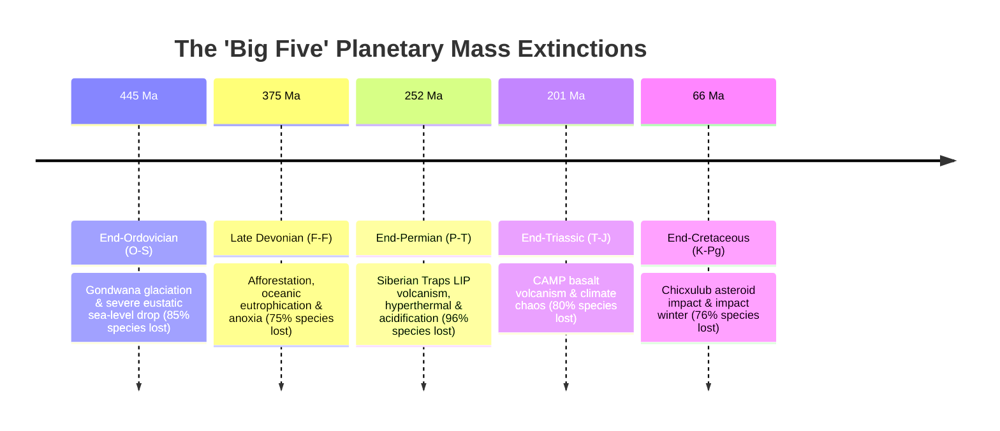
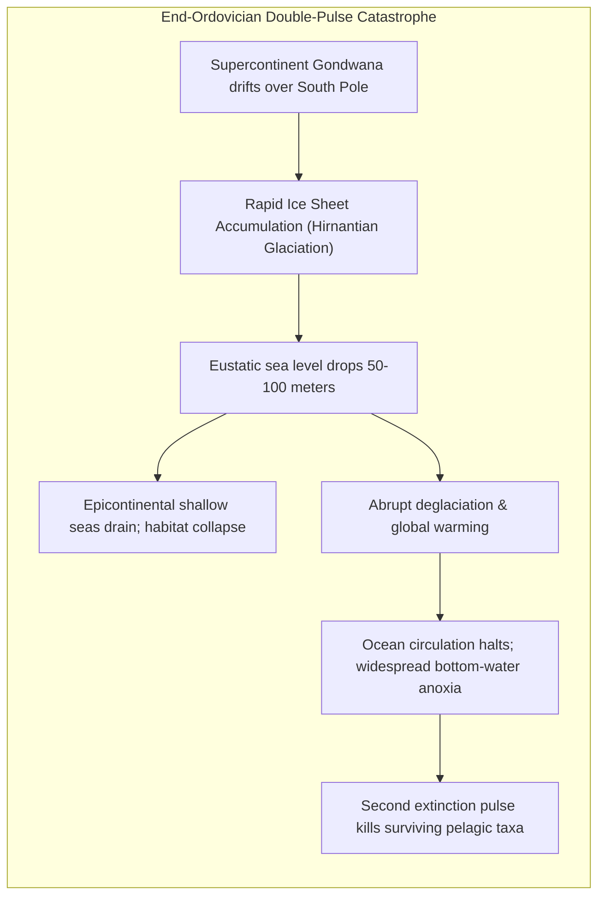
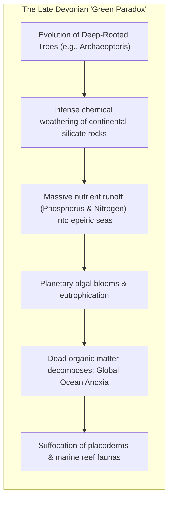
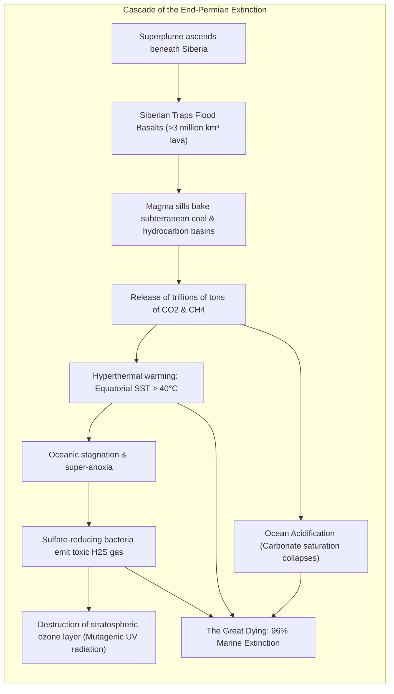
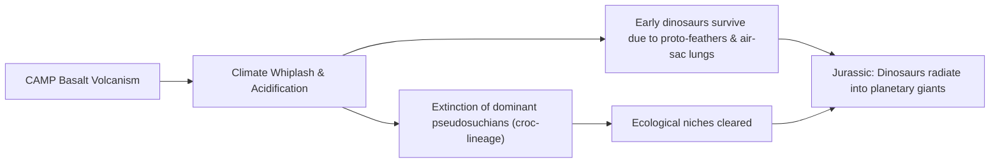
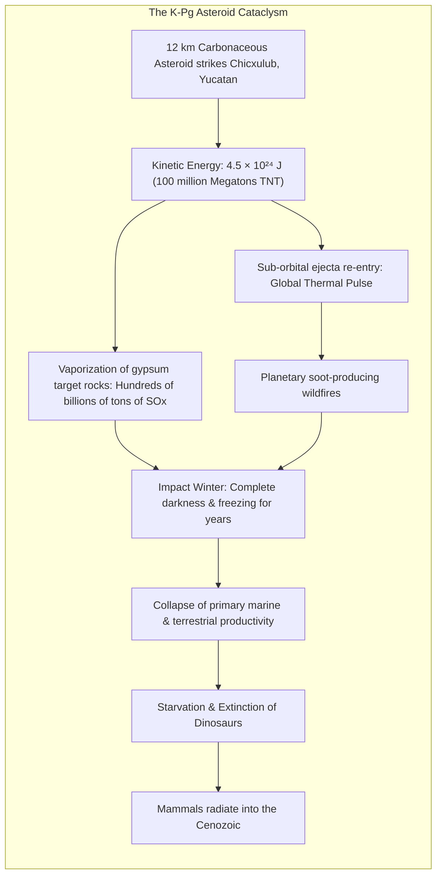
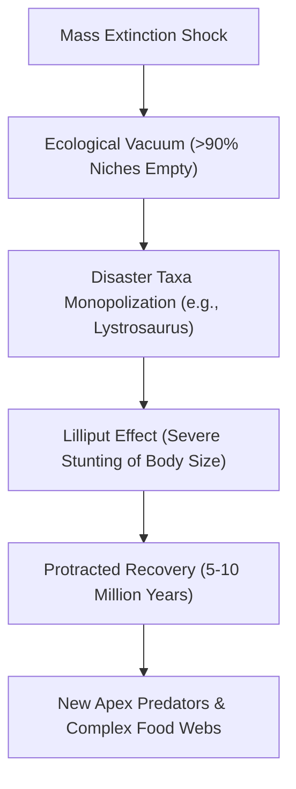

## Introduction: The Periodic Grand Resets of the Terrestrial Biosphere

The living planet we inhabit—cloaked in green forests, blue oceans, and inhabited by eight billion humans—is not the outcome of unbroken, peaceful evolutionary progress. 

Embedded within the rock strata of the Phanerozoic Eon (the past 540 million years) are the terrifying fingerprints of **global biological collapses (Mass Extinctions)** in which $75\%$ to $96\%$ of all living species were wiped from the face of the Earth.

In 1982, University of Chicago paleontologists **Jack Sepkoski** and **David Raup** statistically surveyed the fossil records of over 3,500 marine families. Their analysis proved that beyond the steady, background extinction rate of species turnover, five colossal extinction peaks punctuate Earth's history: **The Big Five**.

Far from being mere tragedies, mass extinctions are **evolutionary catalysts**. By clearing dominant taxa that monopolized ecological niches for tens of millions of years, they triggered explosive **adaptive radiations**. Without the End-Permian collapse, dinosaurs would never have evolved; without the Chicxulub bolide impact, tiny nocturnal mammals would never have diversified into primates, cetaceans, and human beings.

---

## 1. The First Crisis: End-Ordovician (O-S: ~445 Ma)

During the Ordovician, warm epicontinental shallow seas hosted a flourishing marine fauna: trilobites, brachiopods, graptolites, conodonts, and massive nautiloids. Approximately 445 million years ago (the Hirnantian stage), **85% of marine species vanished in two successive pulses**.

### 1.1 Gondwana Glaciation and Sea Level Collapse
The supercontinent Gondwana drifted directly over the South Pole. Because continental crust has lower thermal inertia than oceans, massive continental ice sheets formed. This drew trillions of tons of seawater out of the oceans, **dropping global sea levels by 50 to 100 meters**. The vast, sunlit shallow epicontinental seas drained, destroying coastal habitats.

### 1.2 Deglaciation and Ocean Anoxia
Roughly one million years later, the ice sheets collapsed abruptly. Freshwater capped the oceans, shutting down thermohaline overturning. The oceans stagnated into **lethal anoxic dead zones**, delivering a fatal second blow to surviving pelagic organisms.

---

## 2. The Second Crisis: Late Devonian (F-F Boundary: ~375 Ma)

The Devonian is famously celebrated as the **"Age of Fishes,"** dominated by massive armored placoderms like *Dunkleosteus* ($10\text{ m}$ long), lobe-finned sarcopterygians, and the first tetrapods venturing onto land.

Around 375 million years ago, the Kellwasser and Hangenberg events extinguished **75% of all species**, obliterating placoderms, most trilobites, and Paleozoic coral reefs.

### The "Green Paradox": How Forests Suffocated the Oceans
The primary culprit was the rapid expansion of Earth's first true forests (*Archaeopteris*), whose deep root systems penetrated and fractured continental bedrock:
1. Roots secreted organic acids, accelerating chemical rock weathering tenfold.
2. Trillions of tons of weathered **phosphorus and nitrogen** flushed into inland seas.
3. This catastrophic nutrient surge triggered planetary-scale **algal blooms and eutrophication**. When the algae died and sank, bacterial decay completely depleted oceanic dissolved oxygen, depositing the famous **Kellwasser Black Shales**. The armored placoderms literally suffocated in their own waters.

---

## 3. The Third Crisis: End-Permian (P-T: ~252 Ma) — "The Great Dying"

The End-Permian extinction is **the greatest biological catastrophe in planetary history**. **96% of marine species and 70% of terrestrial vertebrate families were extinguished**. It is the only known mass extinction of insects. Life was reduced to a fragile thread.

### 3.1 The Siberian Traps and Fossil Fuel Ignition
The apocalyptic driver was the eruption of the **Siberian Traps Large Igneous Province (LIP)**, which poured out over **3 million cubic kilometers of basaltic lava**.

Crucially, the rising magma intruded as horizontal sills through vast underground Tunguska coal beds and petroleum reserves. The magma flash-pyrolyzed these hydrocarbon deposits, venting **trillions of tons of $\text{CO}_2$, methane ($\text{CH}_4$), and sulfur dioxide** into the stratosphere.

Carbon isotope ratios ($\delta^{13}\text{C}$) plummeted across the P-T boundary worldwide:

$$\delta^{13}\text{C} = \left( \frac{(^{13}\text{C}/^{12}\text{C})_{\text{sample}}}{(^{13}\text{C}/^{12}\text{C})_{\text{standard}}} - 1 \right) \times 1000\ [‰]$$

### 3.2 Purple Oceans and Hydrogen Sulfide Gas
Global average temperatures surged by **$10^\circ\text{C} \sim 15^\circ\text{C}$**. Equatorial sea surface temperatures soared above **$40^\circ\text{C}$**—hot enough to induce thermal shock in cellular proteins.

Warm water holds less dissolved oxygen, and vanishing polar-equatorial temperature gradients halted ocean currents. In the stagnant, anoxic seas, anaerobic green and purple sulfur bacteria proliferated, turning the oceans purple and outgassing clouds of **hydrogen sulfide ($\text{H}_2\text{S}$)** into the atmosphere. The $\text{H}_2\text{S}$ stripped away the ozone layer, showering the charred continents in mutagenic UV radiation.

---

## 4. The Fourth Crisis: End-Triassic (T-J: ~201 Ma)

As the supercontinent Pangaea began rifting apart to birth the Atlantic Ocean, the **Central Atlantic Magmatic Province (CAMP)** erupted over 11 million square kilometers of flood basalts.

The volcanic pulse drove abrupt global warming interspersed with volcanic winters, wiping out **80% of species**, including giant temnospondyl amphibians and the crurotarsan crocodile relatives that dominated land ecosystems.

With their competitors eradicated, early dinosaurs possessing **insulating proto-feathers** and high-efficiency **air-sac respiratory systems** radiated into the vacant apex herbivore and carnivore niches, launching the 135-million-year Dinosaurian Empire.

---

## 5. The Fifth Crisis: End-Cretaceous (K-Pg: ~66 Ma)

The K-Pg boundary brought the dramatic conclusion to the Mesozoic Era. Non-avian dinosaurs, pterosaurs, plesiosaurs, mosasaurs, and ammonites were extinguished alongside **76% of all species**.

### 5.1 Alvarez Iridium Anomaly and Shocked Quartz
In 1980, Nobel laureate **Luis Alvarez** and geologist **Walter Alvarez** discovered an astonishing spike in **iridium ($\text{Ir}$)** within a $1\text{ cm}$ clay layer at Gubbio, Italy. Because iridium is depleted in Earth's crust but enriched in chondritic asteroids, they proposed a $10\text{ km}$ asteroid impact. The subsequent discovery of the **$180\text{ km}$ Chicxulub Crater** in Yucatan sealed the hypothesis.

Further geological fingerprints include:
- **Shocked Quartz**: Quartz grains exhibiting crossed Planar Deformation Features (PDFs) created by peak shock pressures $>10\text{ GPa}$.
- **Tektites (Microkrystites)**: Aerodynamically shaped glass spherules condensed from vaporized rock ejecta.

### 5.2 The Physics of the Impact Winter
Striking at $20\text{ km/s}$, the asteroid released:

$$E_k = \frac{1}{2} M v^2 \approx \mathbf{4.5 \times 10^{23}\text{ J}} \quad (\approx \mathbf{10^8\text{ Megatons TNT}})$$

The impact vaporized target rock rich in anhydrite ($\text{CaSO}_4$). Hundreds of billions of tons of sulfate aerosols and soot blocked sunlight, triggering a multi-year **Impact Winter**. Global photosynthesis halted completely. Only small, burrowing, detritus-feeding mammals and seed-eating beaked birds survived to inherit the post-apocalyptic Earth.

---

### 5.3 Deccan Traps Volcanism vs. Chicxulub Controversy
For decades, a bitter scientific debate pitted the Chicxulub bolide impact hypothesis against the eruption of the **Deccan Traps flood basalts** in present-day India. 

Recent ultra-high-precision uranium-lead ($\text{U-Pb}$) and $^{40}\text{Ar}/^{39}\text{Ar}$ radiometric dating has resolved this debate into a **Coupled Multi-Hazard Model**:
1. Eruptions began $\approx 250,000$ years prior to the K-Pg boundary, injecting substantial $\text{CO}_2$ and mercury ($\text{Hg}$) into the biosphere and inducing ecological stress.
2. The Chicxulub bolide struck with staggering force ($10^{24}\text{ J}$). The resulting magnitude $\ge 11$ seismic shockwaves propagated through the planet, focusing seismic energy on the antipodal side where the Deccan plume resided.
3. This massive seismic concussive pulse accelerated Deccan eruptive volume, triggering catastrophic volcanic pulses that compounded the impact winter and acidified surface oceans.

---

## 7. The Chemical Fingerprints: Carbon Isotopes and Ocean Acidification

Geochemists track mass extinctions through sedimentary proxy records:

$$\delta^{13}\text{C} = \left( \frac{(^{13}\text{C}/^{12}\text{C})_{\text{sample}}}{(^{13}\text{C}/^{12}\text{C})_{\text{standard}}} - 1 \right) \times 1000\ [‰]$$

During hyperthermal events (P-T, T-J), vast reservoirs of $^{13}\text{C}$-depleted carbon (from baked coals and methane hydrates) surged into the oceans, dropping $\delta^{13}\text{C}$ by $5‰ \sim 8‰$.

Simultaneously, massive $\text{CO}_2$ dissolution drove severe **ocean acidification**:

$$\text{CO}_2 + \text{H}_2\text{O} \rightleftharpoons \text{H}_2\text{CO}_3 \rightleftharpoons \text{H}^+ + \text{HCO}_3^- \rightleftharpoons 2\text{H}^+ + \text{CO}_3^{2-}$$

The calcium carbonate saturation state $\Omega$ collapsed below unity:

$$\Omega = \frac{[\text{Ca}^{2+}][\text{CO}_3^{2-}]}{K'_{\text{sp}}} < 1$$

Under undersaturated conditions ($\Omega < 1$), the calcite and aragonite shells of foraminifera, ammonites, and corals dissolved spontaneously, devastating marine calcifying organisms from the base of the food chain up.

## 6. Post-Extinction Dynamics: Lilliput Effect and Disaster Taxa

- **The Lilliput Effect**: Surviving species display dwarfism for hundreds of thousands of years due to depleted primary productivity and thermal stress.
- **Disaster Taxa**: A handful of opportunistic generalists temporarily conquer the planet. In the early Triassic following the P-T extinction, the hardy burrowing dicynodont **Lystrosaurus** accounted for **over 90% of all terrestrial vertebrate fossils** on Earth!

---

## Conclusion: The Resilience of Life

Earth's rock record delivers a sobering truth: planetary stability is fragile, and the biosphere can collapse when climate tipping points are crossed. Yet, from the ashes of asteroid firestorms and flood basalt apocalypses, life has repeatedly demonstrated unconquerable resilience, reinventing itself with greater complexity.
