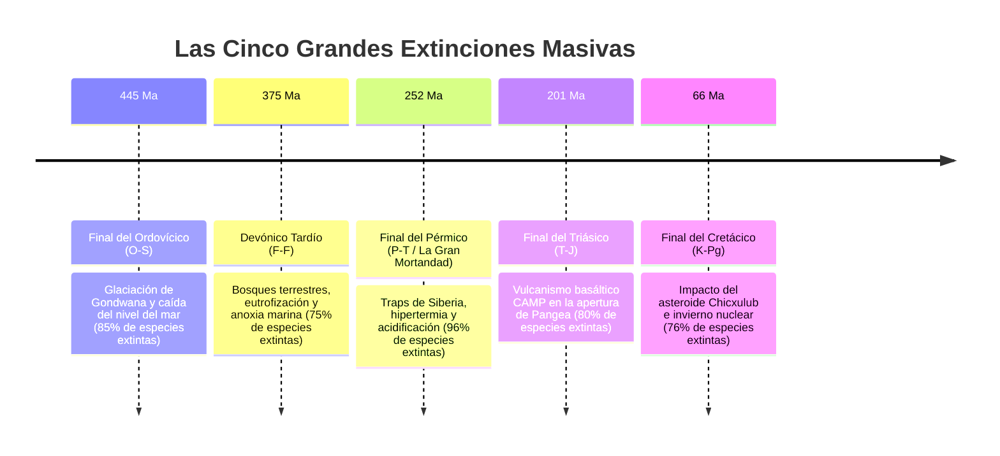
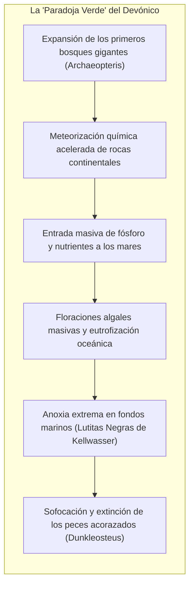
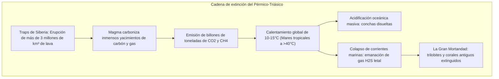
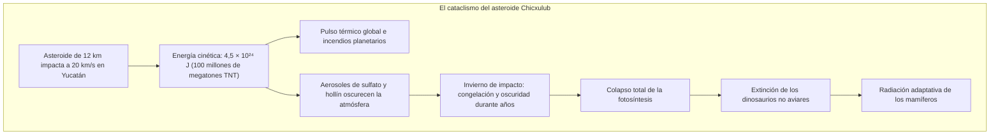

## Introducción: Los cinco reinicios planetarios de la biosfera

La historia biológica de la Tierra no es un proceso de calma ininterrumpida. En los estratos geológicos del Fanerozoico yacen las cicatrices de **cinco colapsos ecológicos globales (Las Cinco Grandes Extinciones)**, en los que entre el 75% y el 96% de las especies vivas fueron borradas del mapa.

Descritas en 1982 por **Jack Sepkoski** y **David Raup**, estas catástrofes funcionan como **interruptores de reinicio evolutivo**, despejando nichos ecológicos para desencadenar explosivas radiaciones adaptativas.

---

## 1. Primera catástrofe: Final del Ordovícico (O-S: ~445 Ma)

- **Glaciación de Gondwana**: La deriva del supercontinente hacia el Polo Sur generó enormes capas de hielo continental, reduciendo el nivel marino entre 50 y 100 metros y secando las ricas plataformas continentales.
- **Anoxia por desglaciación**: El deshielo abrupto frenó la circulación oceánica, sofocando al 85% de los invertebrados marinos en aguas sin oxígeno.

---

## 2. Segunda catástrofe: Devónico Tardío (F-F: ~375 Ma)

---

## 3. Tercera catástrofe: Final del Pérmico (P-T: ~252 Ma) — «La Gran Mortandad»

El colapso más catastrófico de la Tierra: **desapareció el 96% de las especies marinas y el 70% de los vertebrados terrestres**.

Los registros de isótopos de carbono ($\delta^{13}\text{C}$) se desplomaron. Los mares anóxicos generaron ácido sulfhídrico ($\text{H}_2\text{S}$), destruyendo la capa de ozono.

---

## 4. Cuarta catástrofe: Final del Triásico (T-J: ~201 Ma)

La fragmentación de Pangea generó la **Provincia Magmática del Atlántico Central (CAMP)**. La extinción de los crurotarsos dejó el camino libre a los primeros dinosaurios, que gracias a sus **protoplumas aislantes y pulmones con sacos aéreos** dominaron el Jurásico.

---

## 5. Quinta catástrofe: Final del Cretácico (K-Pg: ~66 Ma)

La anomalía de iridio y el cuarzo de choque descubiertos por los Álvarez demostraron el impacto en Chicxulub. La fotosíntesis se detuvo y los dinosaurios no aviares perecieron, cediendo el planeta a los mamíferos.

---

## 6. Dinámica postextinción: Efecto Liliput y taxones de desastre

- **Efecto Liliput**: Disminución notable del tamaño corporal en las especies sobrevivientes debido a la escasez de recursos y la anoxia.
- **Taxones de desastre**: Especies oportunistas que dominaron temporalmente la Tierra. Tras el Pérmico, el reptil mamiferoide excavador **Lystrosaurus** representó **más del 90% de todos los fósiles de vertebrados terrestres** del Triásico temprano.

---

## Conclusión

El registro fósil nos demuestra la fragilidad de la vida, pero también su inquebrantable resiliencia para resurgir con mayor complejidad tras cada invierno cósmico.
