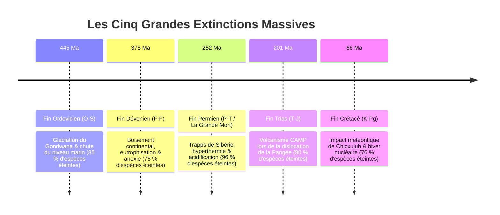
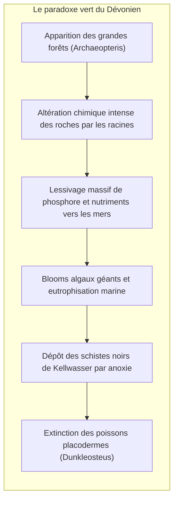
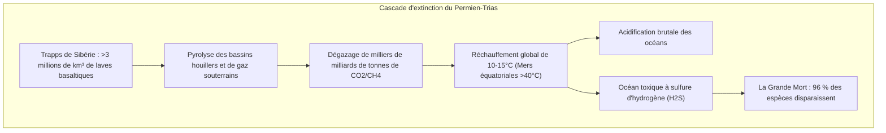
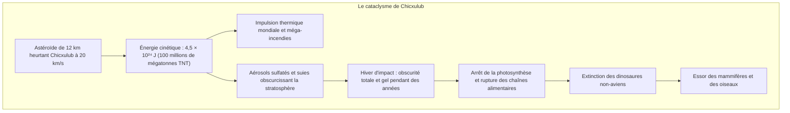

## Introduction : Les cinq réinitialisations du vivant

L'histoire biologique du Phanérozoïque n'est pas un long fleuve tranquille. Elle est scandée par des catastrophes titanesques appelées **les Cinq Grandes Extinctions Massives (Big Five)**, au cours desquelles jusqu'à 96 % des espèces vivantes ont été anéanties.

Identifiées en 1982 par les paléontologues **Jack Sepkoski** et **David Raup**, ces crises agissent comme de gigantesques **remises à zéro écologiques**, vidant les niches écologiques pour déclencher de spectaculaires radiations adaptatives.

---

## 1. Première crise : Fin de l'Ordovicien (O-S : ~445 Ma)

- **Glaciation du Gondwana** : La dérive du Gondwana sur le pôle Sud déclencha un englacement brutal, faisant baisser le niveau marin de 50 à 100 mètres et asséchant les plateformes littorales.
- **Anoxie de déglaciation** : La fonte rapide arrêta la circulation thermohaline, plongeant les océans dans une anoxie mortelle qui extermina 85 % des invertébrés marins.

---

## 2. Deuxième crise : Fin du Dévonien (F-F : ~375 Ma)

---

## 3. Troisième crise : Fin du Permien (P-T : ~252 Ma) — « La Grande Mort »

La plus violente catastrophe de l'histoire terrestre : **96 % des espèces marines et 70 % des vertébrés terrestres disparurent**.

L'effondrement des isotopes du carbone ($\delta^{13}\text{C}$) témoigne de l'injection massive de carbone organique. Les océans saturés en $\text{H}_2\text{S}$ libérèrent des gaz mortels, anéantissant trilobites et coraux anciens.

---

## 4. Quatrième crise : Fin du Trias (T-J : ~201 Ma)

La dislocation de la Pangée libéra la **Province Magmatique Centre-Atlantique (CAMP)**. La disparition des pseudorukériens rivaux laissa le champ libre aux premiers dinosaures, dotés de **proto-plumes isolantes et de poumons à sacs aériens**, inaugurant l'ère jurassique.

---

## 5. Cinquième crise : Fin du Crétacé (K-Pg : ~66 Ma)

L'anomalie en iridium et les quartz choqués découverts par Walter et Luis Alvarez prouvèrent l'impact météoritique de Chicxulub. L'arrêt de la photosynthèse entraîna la disparition des dinosaures et des ammonites.

---

## 6. Dynamique post-crise : Effet Lilliput et taxons de désastre

- **Effet Lilliput** : Réduction spectaculaire de la taille corporelle des taxons survivants en réponse à la famine et à l'anoxie.
- **Taxons de désastre** : Prolifération hégémonique de rares espèces généralistes. Au début du Trias, le reptile mammalien fouisseur **Lystrosaurus** représentait à lui seul **plus de 90 % des fossiles de vertébrés terrestres** mondiaux !

---

## Conclusion

L'enregistrement sédimentaire nous rappelle que la biosphère est vulnérable, mais douée d'une résilience évolutive inépuisable.
