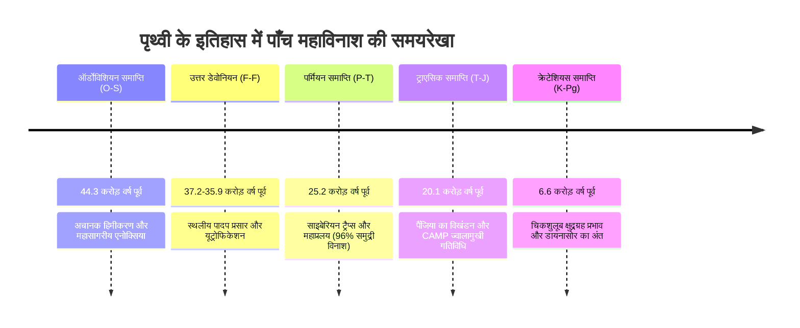
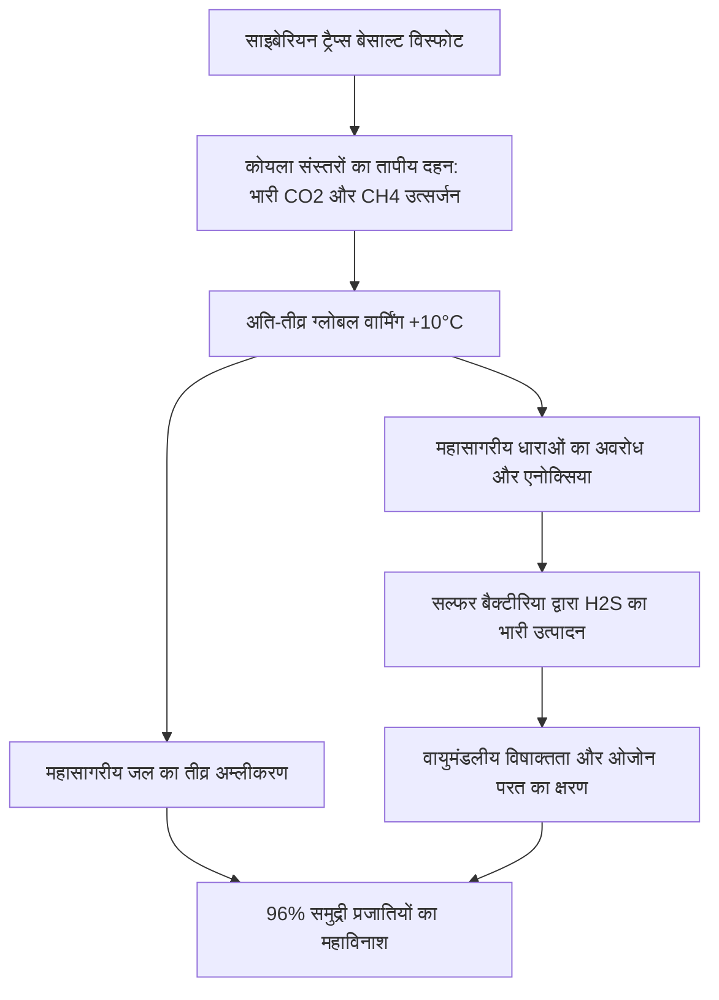

पिछले 54 करोड़ वर्षों में पृथ्वी पर जीवन ने पाँच ऐसी भयावह संकटकालीन घटनाओं का सामना किया है जिन्होंने ग्रह की अधिकांश प्रजातियों को हमेशा के लिए मिटा दिया और विकासवादी इतिहास की दिशा बदल दी। इन्हें **'द बिग फाइव' (The Big Five Mass Extinctions)** कहा जाता है।

---

## 1. पाँच महाविनाशों की विस्तृत तुलना

| घटना | भूवैज्ञानिक काल | समय (पूर्व) | प्रजातियों का विनाश | मुख्य भूभौतिकीय कारण | प्रमुख उत्तरजीवी और अनुकूली विकिरण |
| :--- | :--- | :--- | :--- | :--- | :--- |
| **O-S** | लेट ऑर्डोविशियन | ~44.3 करोड़ वर्ष | ~85% | गोंडवाना का हिमीकरण, समुद्र स्तर में गिरावट, महासागरीय एनोक्सिया | ब्रैकियोपोड्स, जीवित सेफेलोपोड्स |
| **Late D** | लेट डेवोनियन | ~37.2-35.9 करोड़ वर्ष | ~75% | स्थलीय पौधों की गहरी जड़ें, तीव्र अपक्षय, गहरे समुद्र में ऑक्सीजन की कमी | शुरुआती चार पैरों वाले टेट्रापोड्स |
| **P-T** | पर्मियन-ट्राएसिक (महानतम विनाश) | ~25.2 करोड़ वर्ष | ~96% (समुद्री) / ~70% (स्थलीय) | साइबेरियन ट्रैप्स बेसाल्ट विस्फोट, मीथेन विमुक्ति, भारी अम्लीकरण | आर्कोसॉर (डायनासोर के पूर्वज) |
| **T-J** | ट्राएसिक-जुरासिक | ~20.1 करोड़ वर्ष | ~80% | CAMP ज्वालामुखी प्रांत, CO2 और जलवायु अस्थिरता | डायनासोर का स्थलीय प्रभुत्व |
| **K-Pg** | क्रेटेशियस-पैलियोजीन | ~6.6 करोड़ वर्ष | ~76% | चिकशुलूब उल्कापिंड टक्कर और डेक्कन ट्रैप्स | स्तनधारी और आधुनिक पक्षी |

---

## 2. ग्रहीय आपदाओं के भौतिक और रासायनिक तंत्र

### 2.1 विशाल आग्नेय प्रांत (LIPs) और रासायनिक असंतुलन
पर्मियन काल के अंत (P-T) में, साइबेरियन ट्रैप्स ने लाखों घन किलोमीटर बेसाल्ट लावा उगला। जब मैग्मा ने कोयले और हाइड्रोकार्बन से भरपूर चट्टानों को जलाया, तो वायुमंडल में भारी मात्रा में कार्बन डाइऑक्साइड और मीथेन गैस छोड़ी गई। इस थर्मल विकिरण का प्रभाव निम्न समीकरण से निर्धारित होता है:

$$\Delta F = \alpha \ln\left(\frac{C}{C_0}\right)$$

इसके परिणामस्वरूप महासागरों का संवहन रुक गया और गहरा पानी ऑक्सीजन-विहीन (Anoxic) हो गया। अवायवीय सल्फर बैक्टीरिया ने जहरीली हाइड्रोजन सल्फाइड ($H_2S$) गैस उत्पन्न की, जिसने ओजोन परत को नष्ट कर दिया।

---

## 3. चिकशुलूब टक्कर की गतिज ऊर्जा और K-Pg विलुप्ति

6.6 करोड़ वर्ष पूर्व, लगभग 10-15 किमी व्यास का एक क्षुद्रग्रह मेक्सिको के युकाटन प्रायद्वीप से लगभग 20 किमी/सेकंड के वेग से टकराया। इसकी गतिज ऊर्जा की गणना इस प्रकार की जा सकती है:

$$E_k = \frac{1}{2} m v^2 \approx 10^{23} \text{ से } 10^{24} \text{ जूल}$$

यह ऊर्जा अरबों परमाणु बमों के बराबर थी, जिसके कारण:
1. **प्रभाव शीतकाल (Impact Winter)**: वायुमंडल में धूल और सल्फेट एरोसोल ने महीनों तक सूर्य के प्रकाश को रोका, जिससे प्रकाश संश्लेषण बंद हो गया।
2. **अम्लीय वर्षा**: जिप्सम और एनहाइड्राइट चट्टानों के वाष्पीकरण से तीव्र सल्फ्यूरिक एसिड वर्षा हुई।
3. **वैश्विक ऊष्मा तरंग**: पुनः प्रवेश करने वाले मलबे ने वायुमंडल को तंदूर की तरह गर्म कर दिया, जिससे वैश्विक स्तर पर दावानल फैल गया।

---

## 4. क्या हम छठे महाविनाश में प्रवेश कर चुके हैं?

वर्तमान जीवाश्म रिकॉर्ड और पारिस्थितिक अध्ययन दर्शाते हैं कि मानवीय गतिविधियों (आवास विनाश, जलवायु परिवर्तन, प्रदूषण) के कारण प्रजातियों के विलुप्त होने की वर्तमान दर ऐतिहासिक पृष्ठभूमि दर (Background Extinction Rate) से 100 से 1,000 गुना अधिक है। पृथ्वी के इतिहास से सबसे बड़ा सबक यह है कि जब भी पारिस्थितिक तंत्र क्रिटिकल टिपिंग पॉइंट पार कर लेता है, तो जीवन की बहाली और पुनर्जनन में 50 लाख से 1 करोड़ वर्ष का समय लगता है।
