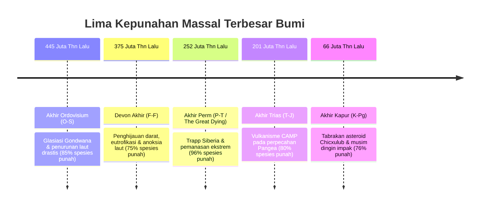
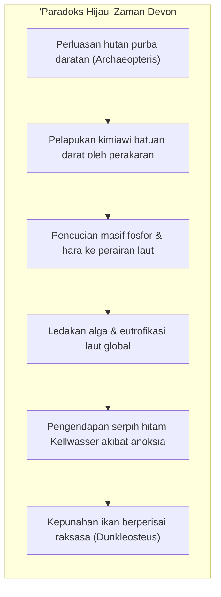
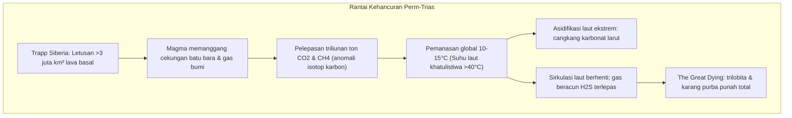
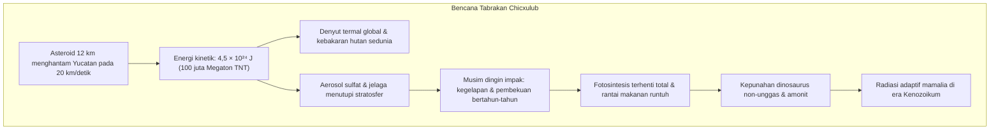

## Pendahuluan: Lima Reset Akbar Biosfer Bumi

Kehidupan di Bumi tidak berevolusi melalui ketenangan abadi. Lapisan batuan Fanerozoikum (540 juta tahun terakhir) merekam bekas luka dari lima keruntuhan biologis global: **Lima Kepunahan Massal Terbesar (The Big Five)**.

Ditemukan pada tahun 1982 oleh paleontolog **Jack Sepkoski** dan **David Raup**, peristiwa-peristiwa ini bertindak sebagai **tombol reset ekologis**, mengosongkan relung yang dimonopoli kelompok lama untuk memicu radiasi adaptif baru.

---

## 1. Bencana Pertama: Akhir Ordovisium (O-S: ~445 Juta Tahun Lalu)

- **Glasiasi Gondwana**: Pergeseran Gondwana ke Kutub Selatan menumpuk tudung es raksasa, menurunkan permukaan laut sebesar 50-100 meter dan mengeringkan laut dangkal epikontinental.
- **Anoksia Pasca-Glasiasi**: Pencairan es mendadak menghentikan sirkulasi termohalin, mencekik 85% invertebrata laut dalam air tanpa oksigen.

---

## 2. Bencana Kedua: Devon Akhir (F-F: ~375 Juta Tahun Lalu)

---

## 3. Bencana Ketiga: Akhir Perm (P-T: ~252 Juta Tahun Lalu) — «The Great Dying»

Peristiwa paling mematikan dalam sejarah planet: **96% spesies laut dan 70% vertebrata darat binasa**.

---

## 4. Bencana Keempat: Akhir Trias (T-J: ~201 Juta Tahun Lalu)

Perekahan Pangea memuntahkan **Provinsi Magmatik Atlantik Tengah (CAMP)**. Lenyapnya pesaing pseudosuchia memberi jalan bagi dinosaurus awal, yang bertahan berkat **bulu proto isolator dan kantung udara pernapasan**, untuk menguasai zaman Jura.

---

## 5. Bencana Kelima: Akhir Kapur (K-Pg: ~66 Juta Tahun Lalu)

Anomali iridium dan kuarsa kejut membuktikan tabrakan Chicxulub. Fotosintesis terhenti, memusnahkan dinosaurus dan membuka jalan bagi era keemasan mamalia.

---

## 6. Dinamika Pascakepunahan: Efek Lilliput dan Taksa Bencana

- **Efek Lilliput**: Penyusutan drastis ukuran tubuh fosil spesies penyintas untuk beradaptasi dengan kelangkaan energi.
- **Taksa Bencana (Disaster Taxa)**: Spesies oportunis yang mendominasi Bumi sendirian. Pada Trias Awal, reptil mamalia liang **Lystrosaurus** menyumbang **lebih dari 90% seluruh fosil vertebrata darat** di dunia!

---

## Kesimpulan

Lapisan batuan Bumi membuktikan kerapuhan biosfer sekaligus daya lentur kehidupan yang tak pernah padam.
