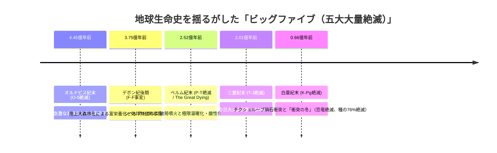
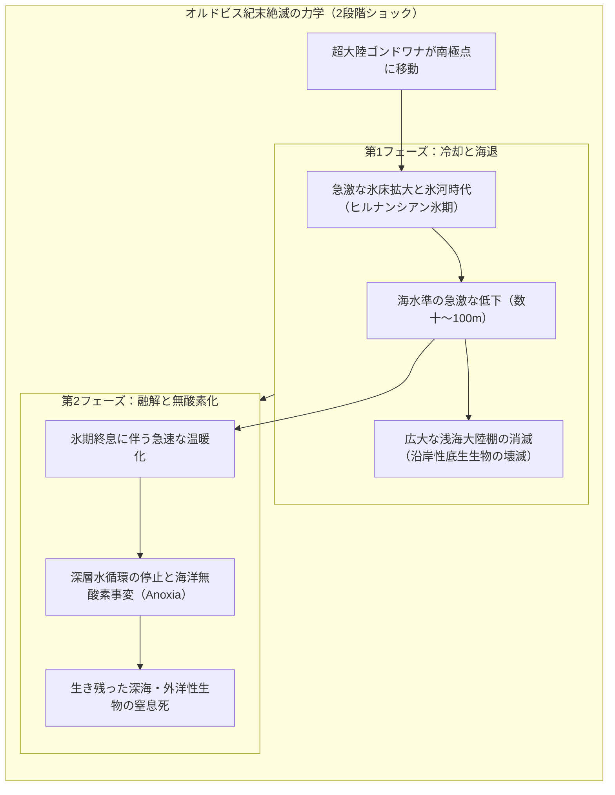
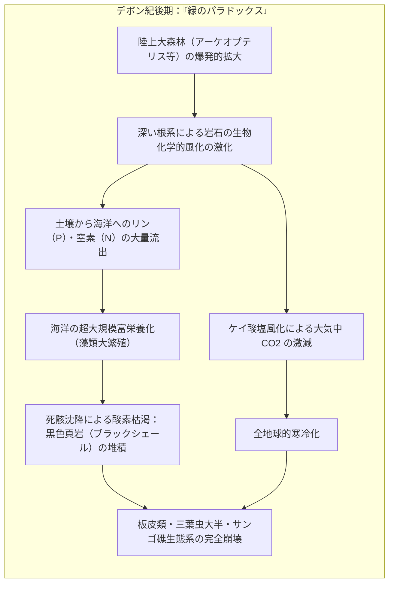
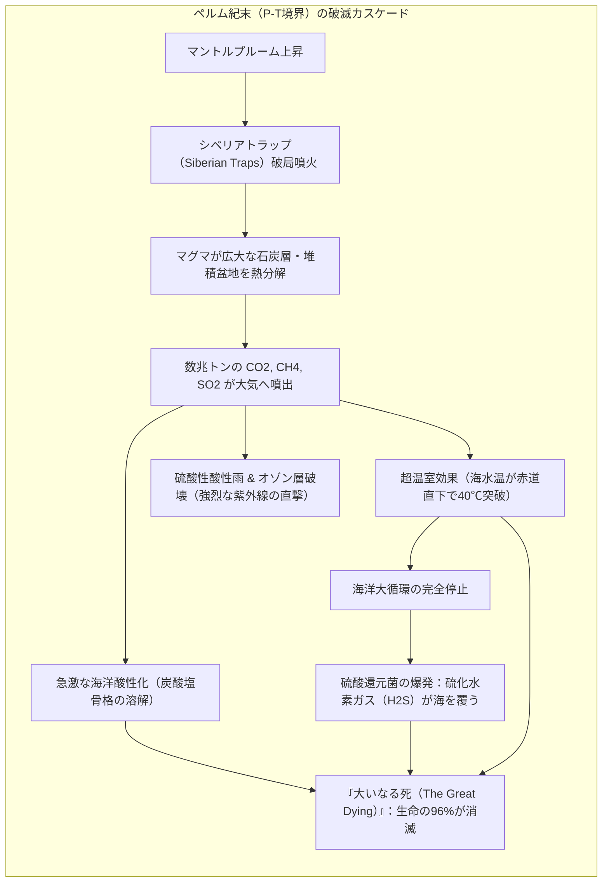
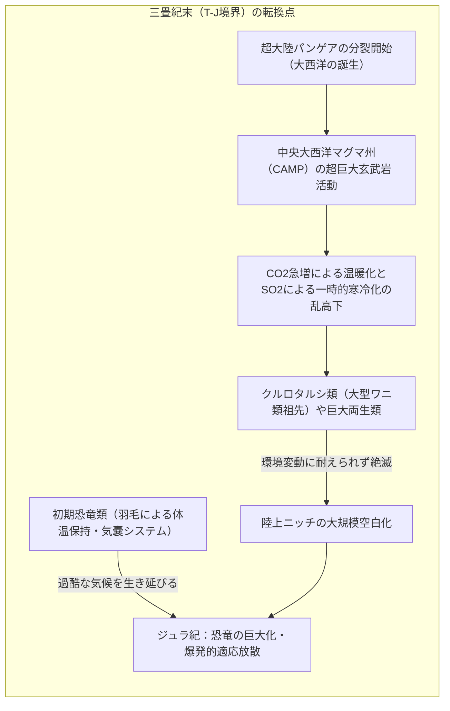
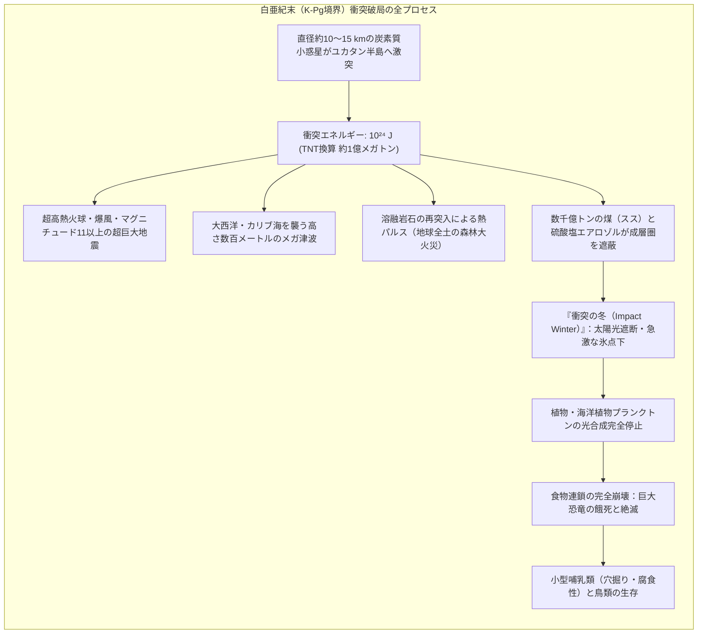
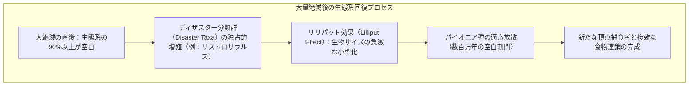
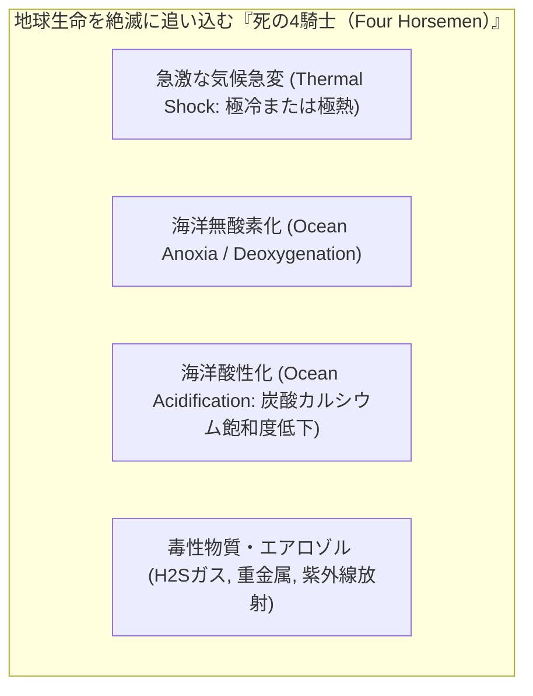
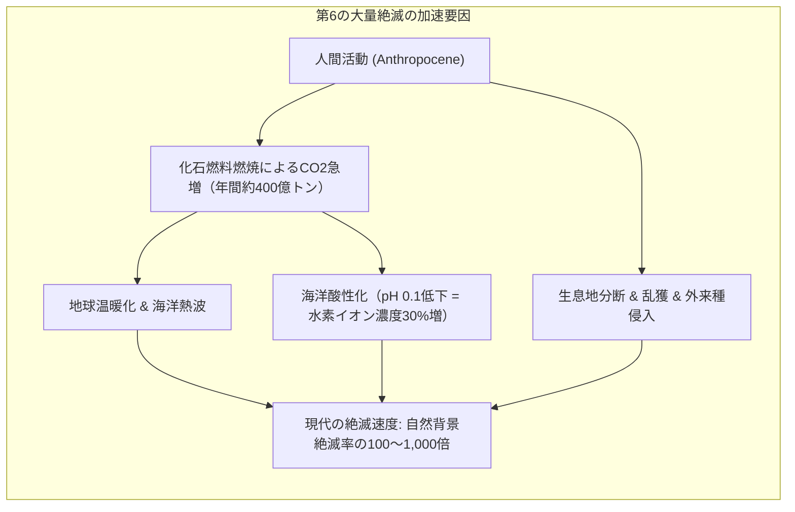

## はじめに：生命史をリセットした「5大カタストロフ」の深層

私たちが今、足を踏みしめている地球。緑豊かな山々、広大な海洋、空を舞う鳥や草原を駆ける哺乳類、そして80億の人間が織りなす文明社会は、悠久の平穏の中で育まれたものではない。

過去5億4000万年の顕生代（古生代・中生代・新生代）の地層を紐解くと、そこには**地球上の全生物種の75%から96%が地上から一挙に消滅した、想像を絶する破局（Mass Extinction：大量絶滅）の爪痕**が幾重にも刻み込まれている。

1982年、シカゴ大学の古生物学者**ジャック・セプコスキ（Jack Sepkoski）**と**デイヴィッド・ラウプ（David Raup）**は、3,500以上の海洋生物科（Family）の化石データベースを統計学的に分析し、通常の緩やかな生物の入れ替わり（背景絶滅：Background extinction）を遥かに超える、突出した**「5回の巨大な絶滅ピーク（The Big Five）」**が存在することを突き止めた。

大量絶滅とは、単なる「惨劇」にとどまらない。もしペルム紀末に単弓類（哺乳類の祖先）が壊滅していなければ恐竜の台頭はなく、白亜紀末に巨大隕石が恐竜を絶滅させていなければ、夜行性のネズミのような小型生物にすぎなかった哺乳類が地球の支配者となることも、私たち人類が誕生することも決してなかった。
大量絶滅とは、**既存の生態系が独占していたニッチ（生態的地位）を強制的に初期化し、次なる生物相の爆発的適応放散（Adaptive Radiation）を引き金を引く、地球生命圏の「リセットボタン」**だったのである。

なぜ、これほどの破局が周期的に繰り返されたのか？ 
小惑星の衝突、大陸を埋め尽くす巨大洪水玄武岩噴火、海洋無酸素事変（OAE）、メタンハイドレートの爆発、超新星爆発やガンマ線バーストの影。
本稿では、地層に残された同位体比の異常、イリジウム粘土層、炭素循環モデル、そして最新の古生物学知見をもとに、地球史の5大破局のメカニズムを完全解明していく。

---

## 1. 第1の破局：オルドビス紀末（O-S絶滅：約4億4500万年前）——氷河と海水準暴落のダブルパンチ

オルドビス紀（Ordovician）は、海の中に三葉虫、腕足動物、筆石（グラプトライト）、コノドント、巨大な直角貝（オウムガイ類）が繁栄し、サンゴ礁が初めて大規模な海洋生態系を形成した「海洋無脊椎動物の黄金期」であった。

しかし約4億4500万年前のヒルナンシアン期（Hirnantian）、海洋生物の**属（Genus）の約60%、種の約85%が2段階にわたって絶滅**した。

### 1.1 超大陸ゴンドワナの南極移動と氷床形成
当時、現在の南米、アフリカ、南極、オーストラリア、インドを包含していた超大陸**ゴンドワナ（Gondwana）**が、プレートテクトニクスによって南極点へと移動した。
陸地が極域に配置されると、海よりも熱容量が小さいため雪氷が融けずに堆積し、太陽光を高反射（アルベド効果）することで地球規模の急激な寒冷化（ヒルナンシアン氷河期）が引き起こされた。

### 1.2 海水準の劇的な低下と大陸棚の喪失
膨大な量の海水が陸上の巨大氷床へと固定された結果、**地球全体の海水準（Sea Level）が50メートルから100メートル以上も急激に低下**した。
当時の海洋生物のほとんどは、光が届く温暖な「浅海大陸棚（Epicontinental Seas）」に密集していた。海水準が暴落したことで浅海が干上がり、生息域を失った無数の底生サンゴ、腕足動物、三葉虫が最初の波で絶滅した。

### 1.3 温暖化の反動と海洋無酸素事変
さらに過酷だったのは、その数十万年後に氷期が急速に終息した第2波である。
氷床が一気に融解して冷水が海洋表層を覆うと、海洋の鉛直混合（熱塩循環）が完全に停止した。表層水と深層水の循環が止まった海洋は、有機物の沈降分解によって酸素が枯渇し、広大な**「海洋無酸素状態（Anoxic Event）」**へと突入した。第1波を生き延びた生物たちも、酸欠の毒海によって息の根を止められたのである。

---

## 2. 第2の破局：デボン紀後期（F-F境界 / ケルワッサー事変：約3億7500万年前）——大森林化が海を殺した「緑のパラドックス」

デボン紀（Devonian）は、顎を獲得した魚類が爆発的に進化し、体長10メートルに達する頂点捕食者ダンクルオステウス（板皮類）やシーラカンス、ハイギョ、さらには陸上へ進出を始めた初期四肢動物（イクチオステガなど）が登場した**「魚類の時代」**であった。

約3億7500万年前のフラニアン・ファメニアン境界（F-F境界）、そしてデボン紀末のハンゲンベルグ事変にかけて、海洋生物の**科の約20%、種の約75%が壊滅**した。

### 2.1 陸上植物の繁栄という「緑の災厄」
この絶滅の主因として近年最も有力視されているのが、地球科学における皮肉な真実、すなわち**「陸上植物の進化と大森林の形成が、海を窒息死させた」**という説である。

デボン紀中期から後期にかけて、樹高30メートルに達する世界初の本格的な森林性樹木**アーケオプテリス（Archaeopteris）**が出現した。
1. **深い根系の侵食**：植物の根が大地を砕き、有機酸を分泌して岩石の化学風化を数倍から十数倍に加速させた。
2. **富栄養化の嵐**：風化された岩石から、莫大な量のミネラル、特に**リン（$\text{P}$）やカリウム**が河川を通じて海洋へと流入した。
3. **海洋の酸欠死**：リンが海へ供給されると、植物プランクトンや藻類が爆発的に大増殖（アオコ・赤潮の惑星規模発生）した。死滅した藻類が海底に沈み、それを分解するバクテリアが水中の溶存酸素を極限まで消費した。

地質調査において、世界中のF-F境界の地層からは酸素のない海底で有機物が腐敗せずに堆積した**「黒色頁岩（Black Shale：ケルワッサー層）」**が連続して発見される。強大な顎を誇ったダンクルオステウスも、海が酸欠室と化したことで窒息死し、地上から永遠に姿を消したのである。

---

## 3. 第3の破局：ペルム紀末（P-T境界 / The Great Dying：約2億5200万年前）——地球史上最大の大量絶滅

古生代ペルム紀（Permian）の終末、地球はかつてない、そしてその後も二度とない**「生命の完全絶滅寸前」**の臨界点へと到達した。
海生生物種の**96%**、陸生脊椎動物種の**70%**が消滅した。昆虫類において歴史上唯一の大量絶滅が起きたのもこの時である。全体として**地球上の全生物種の90%以上が死滅**した。

### 3.1 シベリアトラップ（Siberian Traps）の破局噴火
この史上最大の惨劇の引き金を引いたのは、現在のロシア・シベリア一帯で起きた超巨大火山活動**「巨大火成岩岩石区（LIPs：Large Igneous Provinces）」**である。
マントル深部から湧き上がったスーパープルームにより、地殻が裂け、**数百〜数百万立方キロメートル**という天文学的な量の玄武岩質マグマが数万年にわたり噴出し続けた。この溶岩流は西ヨーロッパ全体を深さ数千メートルで埋め尽くすほどの規模であった。

### 3.2 石炭層の熱分解と炭素循環の暴走
さらに致命的だったのは、マグマがシベリア地下に眠る広大な石炭層や石油・天然ガスを豊富に含む堆積層を貫通したことである。
マグマの超高熱によって化石燃料が地下で一気に蒸し焼きにされ、**数兆トンに及ぶ二酸化炭素（$\text{CO}_2$）とメタン（$\text{CH}_4$）**、そして有毒な塩素・フッ素ガスが成層圏へと吹き上げられた。

地層中の炭素同位体比（$\delta^{13}\text{C}$）を測定すると、P-T境界で**急激なマイナスへの大暴落（負のスパイク：Negative Shift）**が記録されている。これは、有機物起源の軽い炭素（$^{12}\text{C}$）が短期間に大量に大気・海洋へ放出された動かぬ証拠である。

$$\delta^{13}\text{C} = \left( \frac{(^{13}\text{C}/^{12}\text{C})_{\text{sample}}}{(^{13}\text{C}/^{12}\text{C})_{\text{standard}}} - 1 \right) \times 1000\ [‰]$$

### 3.3 紫色の死の海（Canfield Ocean）と硫化水素ガス
大気中の二酸化炭素濃度は数千ppmに達し、地球の平均気温は**約10℃〜15℃も上昇**した。赤道直下の海水温は**40℃を超え**、もはや湯船のような熱湯地獄と化した。
高温の海水は酸素をほとんど溶かすことができない。さらに極域と赤道の温度差が消失したことで海洋の循環が停止し、深海から浅海に至るまで酸素が完全にゼロになった。

無酸素となった海では、酸素呼吸を行う生物が死滅し、代わりに硫酸塩を還元して生きる**緑色硫黄細菌や紅色硫黄細菌（嫌気性細菌）が海を支配**した。
海は酸素を失って紫色や緑色に濁り、細菌が排出した猛毒の**硫化水素ガス（$\text{H}_2\text{S}$）**が海面から大気中へと立ち込めた。硫化水素は大気中のオゾン層（$\text{O}_3$）を徹底的に破壊し、地上には太陽からの有害な紫外線（UV-B）がそのまま降り注いだ。地層からは、紫外線障害によって遺伝子が傷つき奇形化した植物の花粉や胞子が大量に発見されている。

三葉虫、古生代型サンゴ（四射サンゴ・床板サンゴ）、紡錘虫（フズリナ）はこの瞬間、1億年以上の歴史を完全に断たれ、地球から永遠に姿を消した。

---

## 4. 第4の破局：三畳紀末（T-J絶滅：約2億100万年前）——パンゲア分裂と恐竜時代の夜明け

P-T絶滅の焦土から蘇った中生代三畳紀（Triassic）の世界では、爬虫類が目覚ましい多様化を遂げていた。
当時の陸上生態系の頂点に君臨していたのは恐竜ではなく、ワニの祖先系統である巨大な肉食・草食爬虫類**「偽鰐類（クルロタルシ類：Pseudosuchia）」**や、巨大両生類（分椎類）であった。恐竜は、まだ生態系の片隅で暮らす小型の二足歩行動物にすぎなかった。

しかし約2億100万年前、超大陸パンゲアが引き裂かれる激動の地殻変動とともに、**全生物種の約80%が消滅**した。

### 4.1 中央大西洋マグマ州（CAMP）の出現
この絶滅の主因は、超大陸パンゲアが北米、南米、アフリカ、ヨーロッパへと引き裂かれ、大西洋が誕生する亀裂に沿って噴出した**中央大西洋マグマ州（CAMP：Central Atlantic Magmatic Province）**の玄武岩火山活動である。
CAMPから噴出した溶岩の面積は約1,100万平方キロメートル（アメリカ合衆国の国土面積を上回る）に及び、火山ガスによる急激な温暖化、その後のエアロゾルによる寒冷化という激しい気候の乱高下が発生した。

### 4.2 なぜ恐竜だけが生き残ったのか？
T-J絶滅は、陸上の勢力図を一夜にして塗り替えた。
繁栄を極めていたクルロタルシ類の大部分、巨大両生類、海洋のコノドントが絶滅する中で、**なぜか初期の恐竜類はほぼ無傷で生き延びた**のである。

近年の古生物学研究（コロンビア大学のポール・オルセンらの研究など）は、その理由として以下の生理的アドバンテージを指摘している。
1. **原羽毛（Proto-feathers）による防寒性**：
   CAMP噴火に伴う二酸化硫黄エアロゾルによって、火山性の厳しい冬（一時的寒冷化）が周期的に訪れた。初期の獣脚類や鳥盤類はすでに体表に羽毛（毛状構造）を獲得しており、寒冷ストレスを克服できた。
2. **高効率な呼吸器系（気嚢システム：Air Sac System）**：
   低酸素環境下でも新鮮な空気を一方向に循環できる肺システムが、呼吸器への負担を軽減した。
3. **直立歩行による優れた運動性**：
   足を体の真下に伸ばす完全直立歩行により、長距離の移動と体温維持を両立できた。

ライバルであったクルロタルシ類が絶滅したことで、地上には巨大な「生態的ニッチの空白」が生まれた。続くジュラ紀（Jurassic）、恐竜たちは巨大化を遂げ、地球の覇権を完全に握ることになったのである。

---

## 5. 第5の破局：白亜紀末（K-Pg絶滅：約6600万年前）——チクシュルーブ衝突と恐竜の終焉

ビッグファイブの中で最も有名であり、最も劇的な終末劇が、約6600万年前の中生代白亜紀（Cretaceous）と新生代古第三紀（Paleogene）を分かつ**K-Pg境界絶滅**である。

1億6000万年にわたり陸上生態系の絶対的王者として君臨したティラノサウルスやトリケラトプスなどの**非鳥類型恐竜（Non-avian Dinosaurs）**、空を飛ぶ翼竜、海を支配したモササウルスや首長竜、そして海洋で繁栄したアンモナイトが、地質学的一瞬のうちに**全生物種の76%とともに完全消滅**した。

### 5.1 アルバレス父子の「イリジウム異常」発見史
長年、恐竜絶滅の原因は「気候変動説」「哺乳類による卵の捕食説」「伝染病説」などが乱立し、古生物学界の迷宮となっていた。
この謎に決定的な終止符を打ったのが、ノーベル物理学賞受賞者**ルイス・アルバレス（Luis Alvarez）**と、その息子である地質学者**ウォルター・アルバレス（Walter Alvarez）**であった。

1980年、イタリアのグッビオにあるK-Pg境界の薄い粘土層（厚さわずか1センチメートル）を中性子放射化分析したところ、地殻には極めて微量（約 $0.02\text{ ppb}$）しか存在しないはずの白金族元素**イリジウム（Iridium：$\text{Ir}$）**が、通常の**数十倍から数百倍（約 $10\text{ ppb}$）という超高濃度**で検出された。

イリジウムは重金属であり、地球形成時にコア（中心核）へ沈み込んだため地殻にはほぼ存在しないが、宇宙の隕石（小惑星）には高濃度に含まれている。
アルバレスらは**「直径約10キロメートルの巨大隕石が地球に衝突し、その破片が成層圏を通じて地球全土に降り注いだ」**という大胆な衝突仮説を提唱した。当初は激しい反発を受けたが、1991年にメキシコのユカタン半島沖で、境界の年代と完全に一致する**直径180〜200キロメートルの超巨大クレーター「チクシュルーブ・クレーター（Chicxulub Crater）」**が発見されたことで、仮説は確固たる科学的真実となった。

### 5.2 衝突エネルギーと「衝突の冬」の物理
衝突した天体は、秒速約20キロメートル（マッハ60）という猛烈な超音速で浅海へと激突した。
衝突の運動エネルギー $E_k$ は以下のように計算される。

$$E_k = \frac{1}{2} M v^2$$

天体の直径を $D = 12\text{ km}$、密度を $\rho = 2,500\text{ kg/m}^3$ とすると、質量 $M$ は約 $2.26 \times 10^{15}\text{ kg}$。速度 $v = 20\text{ km/s}$ のとき、放出されたエネルギーは：

$$E_k \approx \frac{1}{2} \times (2.26 \times 10^{15}) \times (20,000)^2 \approx \mathbf{4.5 \times 10^{23}\text{ J}} \quad (\approx \mathbf{10^8\text{ メガトン TNT}})$$

これは、人類が保有する全核兵器（約数千メガトン）を一度に爆発させたエネルギーの**数万倍**に相当する。

1. **熱放射パルス**：大気圏外まで吹き飛ばされた数十億トンの溶融ガラス・岩石破片が、数十分後に弾道軌道を描いて地球全土の大気圏へ再突入した。夜空全体が数千度の白熱電球のように光り輝き、強力な赤外線放射パルスによって地上の森林が一斉に自然発火し、全地球的森林火災が発生した。
2. **衝突の冬（Impact Winter）**：ユカタン半島の地質は、石膏（硫酸カルシウム：$\text{CaSO}_4$）と炭酸塩に富んでいた。衝突の超高熱によって数千億トンの硫黄酸化物（$\text{SO}_x$）とススが成層圏へ注入された。これらが太陽光を完全に遮蔽し、地表は**数年間にわたり完全な暗黒と氷点下の極寒**に包まれた。
3. **食物連鎖の崩壊**：光合成が完全に停止したことで、まず陸上の植物と海洋の植物プランクトンが枯渇した。草食恐竜が数ヶ月で餓死し、それを食べるティラノサウルスなどの大型肉食恐竜も一匹残らず絶滅した。体重25キログラム以上の陸上動物で生き残ったものは一つもなかった。

### 5.3 哺乳類と鳥類の生還
この地獄を生き延びたのは、地下の穴に潜り、落ち葉や昆虫、死骸を食べて凌ぐことができた**体重数十グラムの原始的な哺乳類**と、水中で堆積有機物を摂取できた水生生物（カメやワニ）、そして種子を食べる能力を持ち空を飛べた**鳥類（鳥型獣脚類）**だけであった。恐竜の絶滅によって、新生代の哺乳類の大繁栄が幕を開けたのである。

---

### 5.4 衝突変成作用と地質学的証拠（ショッククォーツとスフェルール）
チクシュルーブ衝突の決定的証拠は、単にイリジウム異常だけではない。世界中のK-Pg境界粘土層からは、地表の通常の地質プロセスでは絶対に形成されない**「衝突変成作用（Shock Metamorphism）」**の産物が網羅的に発見されている。
- **衝撃石英（Shocked Quartz）**：超高圧（数十GPa）の衝撃波が石英結晶を通過した際、結晶格子が瞬時にせん断破壊されて生じる平行な縞模様（面状変形組織：PDFs - Planar Deformation Features）。火山の爆発では決して生じない、隕石衝突特有の「指紋」である。
- **微小テクタイト（Microtektites / Spherules）**：衝突地点の岩石が一瞬で蒸発・溶融し、成層圏まで吹き飛ばされた後、大気中で急冷されてガラスの涙滴状・球状となって降り注いだガラス小球。
- **ナノダイヤモンドとフラーレン**：衝突の超高圧下で炭素が瞬時に結晶化して生成したナノメートル単位のダイヤモンド粒子。

### 5.5 デカントラップ火山活動との複合作用論争
長年、K-Pg絶滅を巡っては「インドのデカントラップ（Deccan Traps）洪水玄武岩噴火」と「チクシュルーブ衝突」のどちらが主因かを巡る激しい論争（アルバレス派 vs ケラー派）が続いてきた。
現在では、高精度のウラン・鉛（$\text{U-Pb}$）年代測定とアルゴン・アルゴン（$\text{}^{40}\text{Ar}/^{39}\text{Ar}$）年代測定により、以下の**「複合破局モデル」**が国際的な合意を得つつある。
1. 衝突の数十万年前から、デカントラップ第1フェーズの火山活動によって大気中の $\text{CO}_2$ と水銀（$\text{Hg}$）が増加し、地球生態系はすでに環境ストレスにさらされていた。
2. そこへ、直径10kmを超えるチクシュルーブ小惑星が直撃した。衝突によって引き起こされた地球規模のマグニチュード11以上の超巨大地震動が、地球の反対側に位置していたインドのデカン・マントルプルームを強烈に刺激し、**デカントラップの火山活動を一気に最盛期へと誘発・加速させた（衝突誘発型火山活動説）**。
3. すなわち、隕石衝突という「一撃必殺の銃弾」と、巨大火山活動という「長期的な毒殺」が重なり合うことによって、恐竜たちの命運は完全に尽きたのである。

---

## 7. 絶滅後の生態系動態：リリパット効果とディザスター分類群

大量絶滅の直後、生き残った世界には、極めて特異な生態学的現象が観察される。

### 7.1 生物の小型化「リリパット効果（Lilliput Effect）」
スウィフトの小説『ガリヴァー旅行記』に登場する小人の国「リリパット」にちなんで名付けられたこの現象は、大量絶滅の直後の地層から産出する化石の体サイズが、絶滅前と比べて**劇的に小型化する現象**である。
P-T絶滅後やT-J絶滅後の海洋では、腹足類（巻貝）、二枚貝、腕足動物、そして有孔虫のサイズが通常の数分の一にまで縮小した。
食糧資源の極端な枯渇、極限の温暖化（ベルクマンの法則：高温環境ほど体表面積比を高めるため小型化する）、そして酸素濃度の激減（低酸素下では大きな体を維持できない）という三重の環境圧力が、生物に「小さく、早く繁殖する」ことを強制した結果である。

### 7.2 ディザスター分類群（Disaster Taxa）：リストロサウルスの奇跡
過酷な絶滅直後の荒野では、生物の多様性は極限まで低下するが、過酷な環境に耐えうるごく少数のタフな「ジェネラリスト（汎用種）」が、競合相手の不在に乗じて爆発的に個体数を増やす。これを**「ディザスター分類群（災害分類群）」**と呼ぶ。
その最も有名な例が、P-T絶滅直後の三畳紀初期に現れたディキノドン類単弓類の**リストロサウルス（Lystrosaurus）**である。
樽のような頑丈な胴体、土を掘る強力な前脚、そして植物の根をすり潰す嘴を持っていたリストロサウルスは、死の灰に覆われた不毛の大地で地下茎を掘り起こして生き延びた。その結果、三畳紀初期の陸上脊椎動物化石の**実に90%以上がリストロサウルスたった1属で占められる**という、地球史上前代未聞の「単一生物独占時代」が出現したのである。

## 6. 五大大量絶滅の比較と地球システム工学

これら5つの破局を俯瞰すると、地球生命を根底から揺るがすメカニズムには明確な共通パターンが存在することが見えてくる。

| 絶滅イベント | 年代 | 主な原因 | 壊滅した代表的生物 | 生き延びて放散した勝者 |
| :--- | :--- | :--- | :--- | :--- |
| **① オルドビス紀末 (O-S)** | 約4億4500万年前 | ゴンドワナ極域配置、急激な氷河化、海水準暴落、その後の海洋無酸素化 | 三葉虫の多く、腕足動物、筆石、コノドント、初期サンゴ | 顎を持つ魚類、初期維管束植物 |
| **② デボン紀後期 (F-F)** | 約3億7500万年前 | 陸上大森林化による風化加速、海洋富栄養化、大規模海洋無酸素（黒色頁岩） | 板皮類（ダンクルオステウス等）、無顎類大半、サンゴ礁 | 軟骨魚類（サメ）、硬骨魚類、初期四肢動物 |
| **③ ペルム紀末 (P-T)** | 約2億5200万年前 | シベリアトラップ噴火、石炭層熱分解、超温暖化、海洋酸性化、硫化水素充満 | 三葉虫（完全絶滅）、フズリナ、四射サンゴ、単弓類大半 | 主竜類（恐竜・ワニの祖先系統）、初期哺乳形類 |
| **④ 三畳紀末 (T-J)** | 約2億0100万年前 | パンゲア分裂に伴う巨大火山活動（CAMP）、気候の乱高下、海洋酸性化 | クルロタルシ類（大型ワニ類祖先）、巨大両生類、コノドント（完全絶滅） | 恐竜類（体温保持羽毛・気嚢システムによる圧倒） |
| **⑤ 白亜紀末 (K-Pg)** | 約6600万年前 | チクシュルーブ小惑星衝突、デカントラップ噴火、衝突の冬、光合成停止 | 非鳥類型恐竜、翼竜、首長竜、モササウルス、アンモナイト | 真獣類哺乳類、鳥類、被子植物 |

地球システム科学において、生命を真に壊滅させる要因は「単一のショック」ではない。
**「気温の急激なシフト」が「海洋大循環の停止」を招き、それが「海洋無酸素化」と「海洋酸性化」を引き起こし、毒性物質が食物連鎖の底辺（一次生産者）を破壊する**という、連鎖的なフィードバックループが臨界点を超えたときにのみ、全地球規模の大量絶滅が発生するのである。

---

## 7. 現代：「第6の大量絶滅」の危機と地球の未来

過去の5大大量絶滅を理解することは、過去のノスタルジーに浸るためではない。それは、私たちが生きる「今、ここ」の危機を正しく認識するための羅針盤である。

現在、多くの保全生物学者や地球科学者は、地球が**「第6の大量絶滅（The Sixth Extinction）」の真っ只中にある**と警告している。

現在の地球における二酸化炭素の排出速度（年間約400億トン）は、あの**地球史上最悪のP-T絶滅を引き起こしたシベリアトラップ噴火時の排出速度を凌駕している**。
海洋のpHは産業革命以降すでに0.1低下しており（酸性度が約30%上昇）、サンゴ礁の白化と石灰化阻害はペルム紀末や三畳紀末の地層に酷似したシグナルを放っている。

過去の大量絶滅が私たちに教える最も重い教訓は、**「一度崩壊した生命圏が元の多様性を取り戻すまでには、500万年から1,000万年（$5 \sim 10\text{ Ma}$）という途方もない時間を要する」**という冷徹な事実である。

---

## 結論：岩石に刻まれた生命の不屈

地球史の地層を巡る旅は、私たちに深い畏敬と希望をもたらす。

小惑星が激突し、大地が溶岩で煮えたぎり、海が酸欠と毒ガスに染まった過酷な暗黒時代においてさえ、生命は決して根絶されることはなかった。
氷床の下で身を潜めた微小な無脊椎動物、焼け野原の地下で木の実をかじり続けた小さなトガリネズミのような哺乳類、過酷な酸性海を耐え抜いた有孔虫。
彼らの生存への執念が、数百万年の時を経て再び青い地球を緑で埋め尽くし、今日の私たちへと生命のバトンを繋いできた。

五大大量絶滅の歴史とは、破滅の記録であると同時に、**どんな絶望的なカタストロフをも乗り越えて進化を加速させてきた、生命の不屈の強靭性（Resilience）の叙事詩**なのである。
