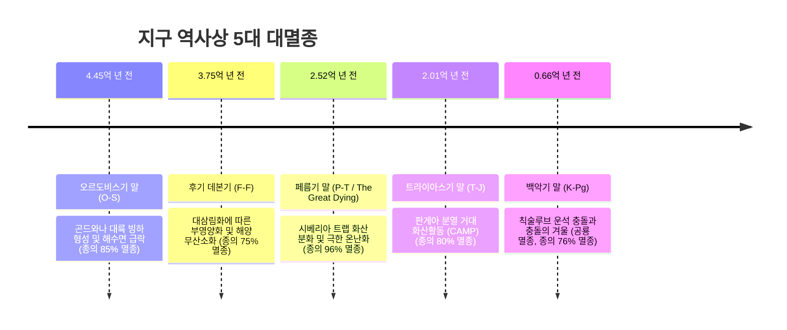
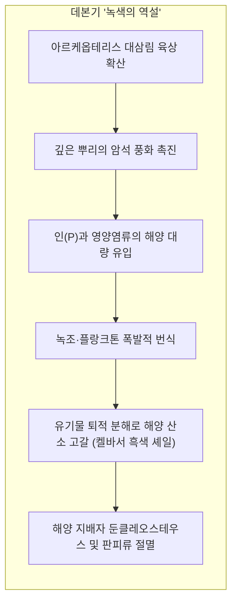
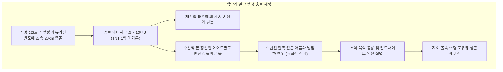

## 서론: 지구 생명사를 리셋한 '빅 파이브(Big Five)'

과거 5억 4천만 년의 현생누대 암석 기록 속에는 전 지구 생물종의 75%에서 96%가 한꺼번에 소멸한 **5대 대멸종(The Big Five)**의 상흔이 새겨져 있습니다.

1982년 잭 셉코스키(Jack Sepkoski)와 데이비드 라우프(David Raup)는 통계적 화석 데이터 분석을 통해 5번의 거대한 절멸 피크를 규명했습니다. 대멸종은 단순한 비극이 아니라, 독점된 생태적 지위(Niche)를 초기화하여 새로운 생명군의 **폭발적 적응방산(Adaptive Radiation)**을 촉발한 리셋 장치였습니다.

---

## 1. 1차 대멸종: 오르도비스기 말 (약 4.45억 년 전)

오르도비스기는 삼엽충, 완족동물, 필석류, 산호가 번성하던 해양 무척추동물의 황금기였습니다. 
1. **곤드와나 대륙의 남극 이동**: 거대 대륙이 남극으로 이동하며 막대한 빙상이 형성되었고, 해수면이 50~100m 폭락하여 얕은 대륙붕 서식지가 파괴되었습니다.
2. **빙하기 종식과 해양 무산소화**: 이어진 급격한 온난화로 바다 표층의 담수 덮개가 열염순환을 멈추게 하여 심해 산소가 고갈되면서 해양 생물종의 85%가 절멸했습니다.

---

## 2. 2차 대멸종: 후기 데본기 (약 3.75억 년 전)

육상에 등장한 거대 삼림 식물의 뿌리가 암석을 화학 풍화시켜 대량의 인(P)을 바다로 유출시켰습니다. 전 지구적 녹조와 부영양화로 바다 속 산소가 고갈되어 **켈바서 흑색 셰일(Black Shale)** 층이 형성되었고, 거대 판피류 던클레오스테우스는 질식사했습니다.

---

## 3. 3차 대멸종: 페름기 말 (약 2.52억 년 전) — '위대한 죽음'

지구 생명체가 완전히 사라질 뻔했던 사상 최악의 재앙: **해양 생물종 96%, 육상 척추동물 70% 멸종**.

시베리아 트랩의 마그마가 석탄층을 태워 방출한 수조 톤의 온실가스로 해수면 온도가 40°C를 돌파했습니다. 탄산칼슘 포화도 $\Omega < 1$로 바다가 산성화되어 껍데기를 가진 생물이 녹아내렸고, 바다는 황화수소($\text{H}_2\text{S}$)로 뒤덮였습니다.

---

## 4. 4차 대멸종: 트라이아스기 말 (약 2.01억 년 전)

초대륙 판게아가 찢어지며 분출한 **중앙 대서양 마그마주(CAMP)** 화산활동으로 당시 육상을 지배하던 대형 위악류가 멸종했습니다. **원시 깃털로 체온을 보존하고 고효율 기낭 호흡계**를 갖춘 초기 공룡들이 살아남아 쥐라기 공룡 시대를 열었습니다.

---

## 5. 5차 대멸종: 백악기 말 (약 6,600만 년 전)

알바레즈 부자가 점토층에서 발견한 **이리듐(Iridium) 이상치**와 **충격석영**이 유카탄 반도 칙술루브 충돌구와 일치했습니다. 황산염 에어로졸에 의한 충돌의 겨울로 광합성이 멈추며 비조류 공룡이 멸종했습니다.

---

## 6. 멸종 후의 생태학: 릴리풋 효과와 디재스터 분류군

- **릴리풋 효과(Lilliput Effect)**: 가혹한 자원 고갈과 저산소증으로 인해 대멸종 직후 화석들의 체구가 급격히 소형화되는 현상;
- **디재스터 분류군(Disaster Taxa)**: 황폐화된 지구에서 소수의 강인한 종이 대량 증식. 페름기 말 직후 굴을 파던 단궁류 **리스트로사우루스(Lystrosaurus)**가 초기 트라이아스기 육상 척추동물 화석의 **90% 이상을 단독 점유**했습니다.

---

## 결론

지구 지층은 생명의 연약함과 동시에 불굴의 회복력을 증언합니다. 잿더미 속에서도 생명은 진화를 멈추지 않았습니다.
