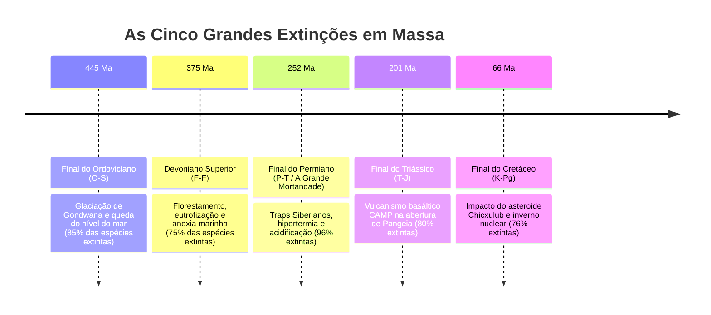
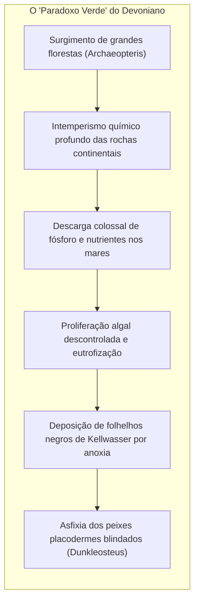
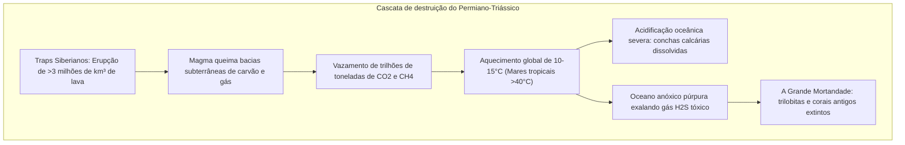
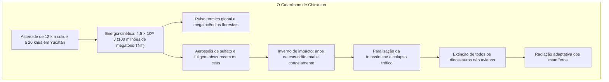

## Introdução: Os cinco grandes resets biológicos da Terra

A história biológica da Terra não é uma marcha contínua e tranquila. Nas camadas de rochas do Fanerozoico (os últimos 540 milhões de anos), encontram-se as cicatrizes de cinco colapsos globais catastróficos: **as Cinco Grandes Extinções em Massa (The Big Five)**.

Identificadas em 1982 pelos paleontólogos **Jack Sepkoski** e **David Raup**, essas extinções agem como **interruptores de reinicialização ecológica**, limpando nichos monopolizados para liberar explosivas radiações adaptativas.

---

## 1. Primeira Catástrofe: Final do Ordoviciano (O-S: ~445 Ma)

- **Glaciação de Gondwana**: O supercontinente derivou para o Polo Sul, acumulando mantos massivos de gelo continental. O nível dos oceanos despencou entre 50 e 100 metros, drenando os ricos mares rasos da plataforma continental.
- **Anoxia por Deglaciação**: O derretimento abrupto estagnou a circulação termohalina dos oceanos, asfixiando 85% dos invertebrados marinhos em águas sem oxigênio.

---

## 2. Segunda Catástrofe: Devoniano Superior (F-F: ~375 Ma)

---

## 3. Terceira Catástrofe: Final do Permiano (P-T: ~252 Ma) — «A Grande Mortandade»

O evento mais devastador da história da vida: **96% das espécies marinhas e 70% dos vertebrados terrestres pereceram**.

---

## 4. Quarta Catástrofe: Final do Triássico (T-J: ~201 Ma)

A fragmentação da Pangeia desencadeou a **Província Magmática do Atlântico Central (CAMP)**. A extinção dos pseudossúquios predadores abriu caminho para os primeiros dinossauros, que sobreviveram graças às suas **protopenas isolantes e sacos aéreos respiratórios**, dominando o período Jurássico.

---

## 5. Quinta Catástrofe: Final do Cretáceo (K-Pg: ~66 Ma)

A anomalia global de irídio e os quartzos de choque confirmaram o impacto em Chicxulub. A fotossíntese estagnou e os dinossauros pereceram, entregando o planeta aos mamíferos e aves.

---

## 6. Dinâmica Pós-Extinção: Efeito Lilliput e Táxons de Desastre

- **Efeito Lilliput**: Drástica miniaturização do tamanho corporal médio nas espécies sobreviventes devido à fome e à anoxia.
- **Táxons de Desastre**: Raras espécies oportunistas dominaram sozinhas a Terra. No início do Triássico, o réptil escavador **Lystrosaurus** representou **mais de 90% de todos os fósseis de vertebrados terrestres** do planeta!

---

## Conclusão

As grandes extinções evidenciam que o equilíbrio da biosfera é frágil, mas a força adaptativa da vida é invencível.
