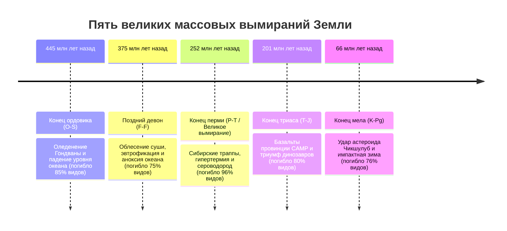
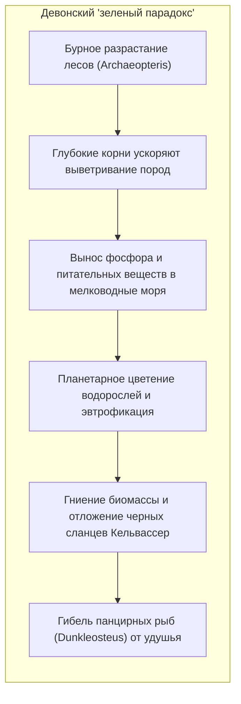
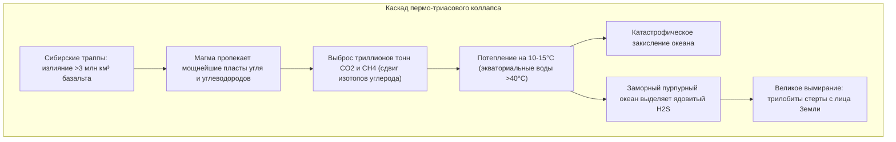
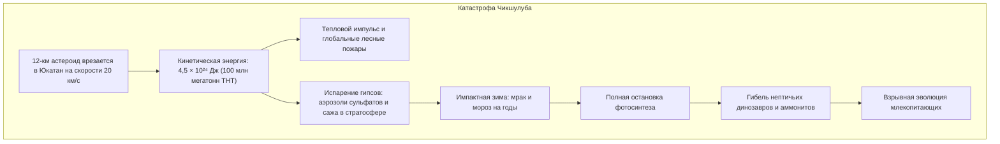

## Введение: Пять глобальных перезагрузок земной жизни

Летопись фанерозойских пород за последние 540 миллионов лет хранит свидетельства пяти масштабных биосферных катастроф — **«Большой пятерки» массовых вымираний (The Big Five)**.

В 1982 году палеонтологи **Джек Сепкоски** и **Дэвид Рауп** доказали, что на фоне плавного фонового вымирания выделяются пять колоссальных пиков гибели видов. Эти события служили **эволюционными переключателями**, освобождавшими экологические ниши для взрывной адаптивной радиации новых групп.

---

## 1. Первая катастрофа: Конец ордовика (O-S: ~445 млн лет назад)

- **Оледенение Гондваны**: Дрейф суперконтинента к Южному полюсу привел к росту гигантских ледниковых щитов. Уровень Мирового океана упал на 50–100 метров, осушив шельфы.
- **Постледниковая аноксия**: Быстрое таяние ледников заблокировало океаническую циркуляцию, вызвав тотальное удушение 85% морской фауны.

---

## 2. Вторая катастрофа: Поздний девон (F-F: ~375 млн лет назад)

---

## 3. Третья катастрофа: Конец перми (P-T: ~252 млн лет назад) — «Великое вымирание»

Самая масштабная трагедия в истории планеты: **погибло 96% морских видов и 70% наземных позвоночных**.

---

## 4. Четвертая катастрофа: Конец триаса (T-J: ~201 млн лет назад)

Раскол Пангеи породил магматическую провинцию **CAMP**. Вымирание конкурентов-круротарзов расчистило дорогу ранним динозаврам, чьи **протоперья и воздушные мешки** обеспечили им господство в юрском периоде.

---

## 5. Пятая катастрофа: Конец мела (K-Pg: ~66 млн лет назад)

Иридиевая аномалия Альваресов и ударный кварц доказали факт падения астероида в Чикшулубе, уничтожившего динозавров и открывшего эру млекопитающих.

---

## 6. Посткризисная экология: Эффект Лилипута и таксоны катастроф

- **Эффект Лилипута (Lilliput Effect)**: Резкое уменьшение средних размеров выживших организмов из-за голода и гипоксии.
- **Таксоны катастроф (Disaster Taxa)**: Монополия редких генералистов. В раннем триасе роющий звероящер **листрозавр (Lystrosaurus)** составлял **более 90% всех находок наземных позвоночных** на Земле!

---

## Заключение

Каменная летопись Земли свидетельствует: жизнь хрупка перед лицом глобальных катастроф, но ее восстановительный потенциал воистину безграничен.
