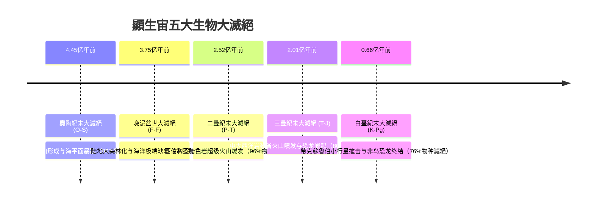
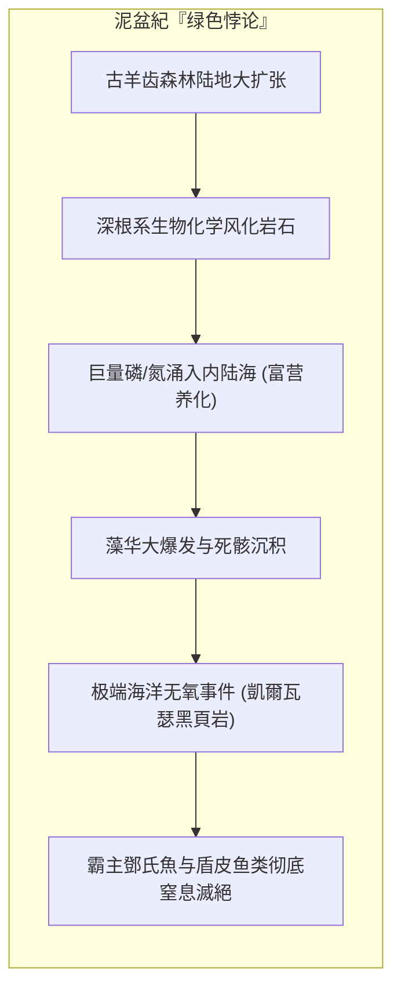
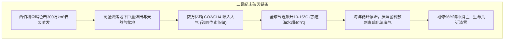
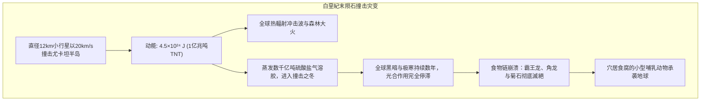

## 引言：顯生宙五大“地球重启键”

在顯生宙（过去的5.4亿年）岩层记录中，清晰烙印着五次毁灭性的**物种大滅絕事件（The Big Five）**，导致75%至96%的生命瞬间绝迹。

1982年，芝加哥大学古生物学家塞普考斯基（Jack Sepkoski）与劳普（David Raup）基于数千个海洋生物科化石统计，确立了五次大滅絕的高峰。大滅絕不仅是死亡浩劫，更是**生态位清空的重置开关**，直接引爆了恐龙与哺乳动物的适应輻射。若没有这些大滅絕，哺乳动物永远无法走出恐龙的阴影，人类文明亦无从谈起。

---

## 1. 第一次浩劫：奧陶紀末大滅絕（约4.45亿年前）

奧陶紀曾是三叶虫、腕足类、笔石和早期珊瑚繁茂的海洋黄金时代。约4.45亿年前的赫南特期，发生了两幕式的毁灭打击：
1. **岡瓦納陆块极地漂移与冰川形成**：超大陆漂移至南极引发剧烈大陆冰盖扩展，全球海平面骤降50~100米，毁灭了光照充足、生物密集的浅海大陆架生态。
2. **冰消期剧烈升温与海洋缺氧**：随后的冰川融化造成淡水覆盖表层，阻断温盐深海环流，造成大范围海底无氧死区，将残存生物彻底窒息。

---

## 2. 第二次浩劫：晚泥盆世大滅絕（约3.75亿年前）

泥盆紀是古生代著名的“鱼类时代”，鄧氏魚等盾皮鱼称霸水域。然而在F-F边界与凱爾瓦瑟事件中，75%物种消失。

大森林树木（古羊齿等）的根系分泌有机酸剧烈风化岩石，使土壤中过量的磷和营养盐冲入海洋，引发全球赤潮。大量沉底腐烂的藻类耗尽海水溶氧，形成了地层中典型的**凱爾瓦瑟黑色页岩**，最终把海洋鱼类活活憋死在水里。

---

## 3. 第三次浩劫：二疊紀末大滅絕（约2.52亿年前）——“大滅絕之王”

地球生命史上最惨烈的大毁灭：**96%的海洋物种和70%的陆生脊椎动物滅絕**，三叶虫与古生代珊瑚彻底绝迹。

西伯利亞暗色岩浆岩侵入地下煤田，烘烤出数万亿吨温室气体。全球气温暴涨，赤道海水升温超40°C。海洋酸性化使碳酸盐饱和度骤降：

$$\Omega = \frac{[\text{Ca}^{2+}][\text{CO}_3^{2-}]}{K'_{\text{sp}}} < 1$$

贝壳珊瑚自发溶解。海洋彻底厌氧变为紫色，硫酸盐还原菌向大气排放巨量有毒**硫化氢（$\text{H}_2\text{S}$）**，破坏臭氧层，紫外线暴晒导致陆地植物花粉畸形。

---

## 4. 第四次浩劫：三疊紀末大滅絕（约2.01亿年前）

泛大陆裂解伴随**中大西洋岩浆省（CAMP）**喷发，消灭了陆地偽鱷類霸主。拥有**保温原生羽毛与高效氣囊呼吸系统**的早期恐龙在严酷气候震荡中存活下来，在生态位空白中迅速輻射演化为陆地霸主。

---

## 5. 第五次浩劫：白堊紀末大滅絕（约6600万年前）

阿瓦雷兹父子在K-Pg界线黏土层中发现了惊人的**铱异常（Iridium Anomaly）**与**冲击石英（Shocked Quartz）**，随后在墨西哥发现了直径180公里的**希克蘇魯伯陨石坑**。天体撞击带来的数年极寒与无光“撞击之冬”，摧毁了食物链底层的光合作用，所有体重超25公斤的陆生动物无一幸免。

---

## 6. 灾后生态动态：小人國效應与災難物種

- **小人國效應（Lilliput Effect）**：滅絕后早期化石尺寸急剧微型化，以应对低氧低能环境；
- **災難物種（Disaster Taxa）**：强韧的泛用物种爆发式独占。如二疊紀末大滅絕后，**水龍獸（Lystrosaurus）**一度占据早三叠世陆地脊椎动物化石总量的**90%以上**！

---

---

### 滅絕的四大殺手（Four Horsemen）
地球系統科學指出，每一次大滅絕都不是單一因素造成的，而是四項致命機制連鎖疊加的結果：
1. **急劇熱震盪（Thermal Shock）**：極冷或極熱打破物種生理耐受閾值；
2. **海洋大範圍缺氧（Ocean Anoxia）**：溫鹽環流停滯導致全球海洋窒息；
3. **全球海洋酸化（Ocean Acidification）**：碳酸根離子匱乏導致鈣質外殼溶解；
4. **劇毒氣體與紫外輻射（Toxic Gases & UV）**：硫化氫瀰漫與臭氧層破壞。

## 7. 現代啟示：「第六次大滅絕」與人類的未來

地球歷史上的五次大滅絕並非遙不可及的古老傳說，而是我們正視當下生態危機的鏡鑑。許多地球科學家指出，人類活動正在引發**「第六次大滅絕（The Sixth Extinction）」**。

當前全球由於化石燃料燃燒產生的二氧化碳排放速率，已經超過了引發二疊紀末大滅絕的西伯利亞暗色岩噴發速率。工業革命以來海洋pH值已下降0.1（酸度增加約30%），伴隨棲息地破壞與物種滅絕速率達到背景滅絕率的百倍至千倍。

五大滅絕留給人類最重要的教訓是：**生態系統一旦跨越崩潰臨界點，生物圈重新恢復到原有的生物多樣性與繁榮，需要耗費500萬至1000萬年（5-10 Ma）的漫長歲月**。

## 结论

地球岩层见证了生命的脆弱与顽强。大滅絕不是终结，而是生命不断超越自我、向更高复杂性跃进的宏伟交响乐。
